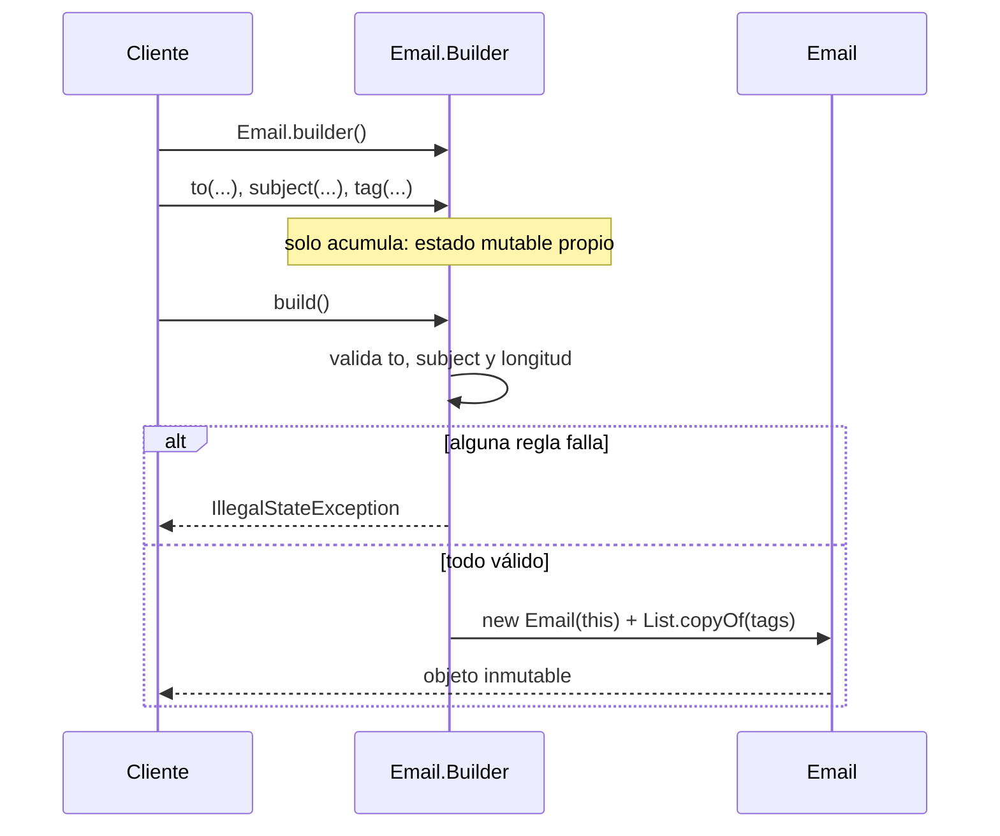
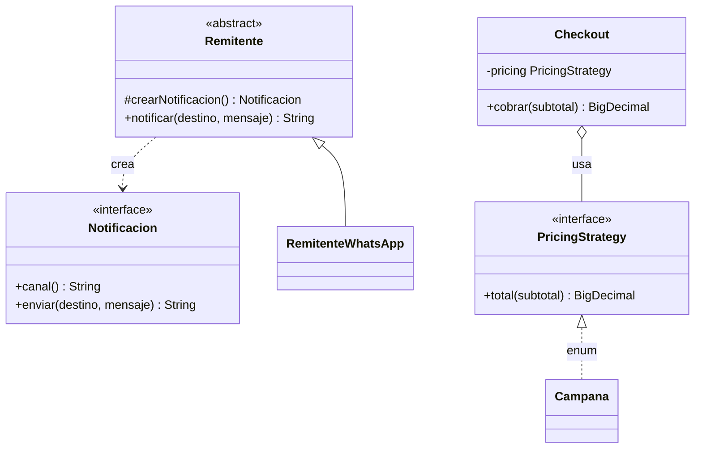
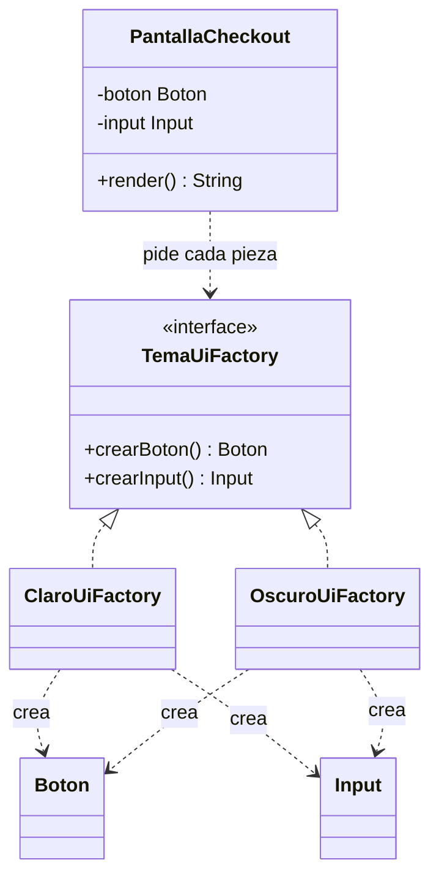
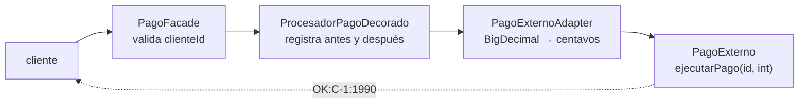
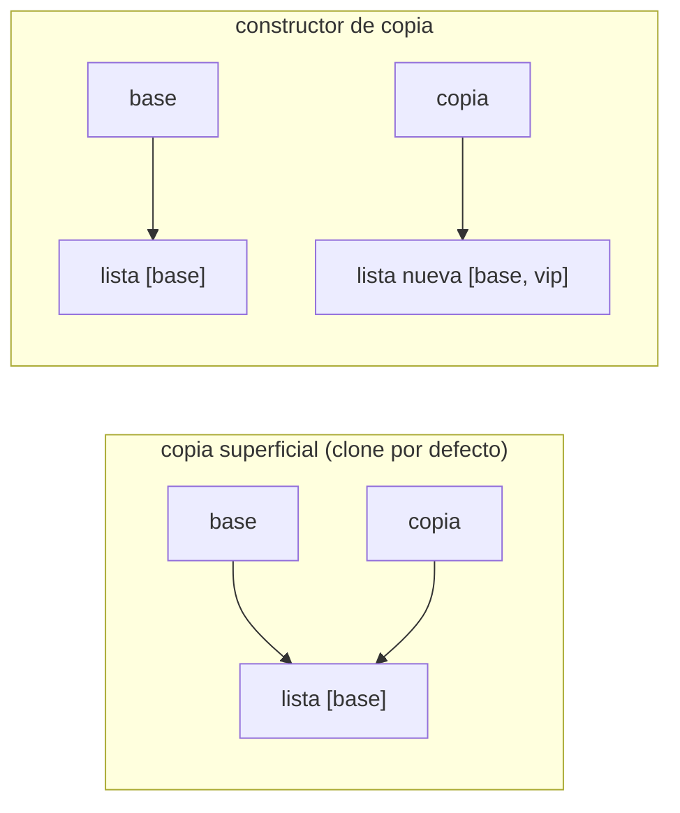

# Módulo 12: Patrones de diseño

Los patrones de diseño son soluciones probadas a problemas recurrentes. No son plantillas para copiar: son vocabulario y criterio. Un patrón bien aplicado hace explícita una intención y facilita un cambio esperado; uno mal aplicado añade indirección sin resolver presión real.

En este módulo construyes `tienda-aurora-java-m12`, un proyecto donde cada patrón aparece por una necesidad concreta de Tienda Aurora: construir objetos válidos, crear notificaciones por canal, variar precios, mantener familias de UI coherentes, copiar plantillas sin aliasing, integrar un proveedor, decorar comportamiento, simplificar un subsistema, tratar hojas y grupos con un mismo contrato, controlar acceso a un servicio caro, separar abstracción de canal y compartir estado inmutable. Cada patrón se define por cuatro ejes: **mecanismo**, **por qué existe**, **implicaciones** y **confusión común**.

## Apertura del módulo

Al terminar este módulo podrás:
- construir objetos válidos e inmutables con Builder y explicar cuándo basta un constructor;
- distinguir una factory simple, Factory Method y Abstract Factory por lo que cada una decide;
- reemplazar un `if` por campaña con Strategy usando interfaces funcionales, lambdas y `enum`;
- ejecutar Adapter, Decorator, Facade, Composite, Proxy, Bridge y Flyweight y relacionar cada salida con su problema;
- refactorizar una clase que viola SRP sin cambiar su resultado observable;
- copiar objetos sin compartir listas mutables y reconocer cuándo un patrón es sobre-ingeniería.

**Esquema del módulo:** Builder (Tema 1), Factory Method y Strategy (Tema 2), Abstract Factory (Tema 3), SOLID y
patrones estructurales (Tema 4) y Prototype (Tema 5). Cierra con el punto de entrada `App.java`, la batería
`PatronesTest` y la verificación real del proyecto.

**Qué necesitas saber antes:** clases, constructores y encapsulación (Java, Módulo 1, Tema 1); herencia (Módulo 1,
Tema 2); interfaces y clases abstractas (Módulo 1, Tema 3); `record` (Módulo 1, Tema 5); `List`, `Set`, `Map` y
`computeIfAbsent` (Módulo 2, Tema 1); excepciones (Módulo 3, Tema 1); lambdas (Módulo 4, Tema 1) y referencias a
métodos (Módulo 4, Tema 4); `AtomicInteger` y `synchronized` (Módulo 5, Tema 4); `sealed` y `switch` exhaustivo
(Módulo 7, Temas 1 y 2); JUnit (Módulo 9, Tema 1).

**Relación con Fundamentos.** El catálogo conceptual ya está en el curso de Fundamentos, con ejemplos en Python:
*patrón de diseño* y Decorator (Fundamentos, Módulo 13, Tema 1), Template Method (Fundamentos, Módulo 13, Tema 3),
Flyweight con estado intrínseco y extrínseco (Fundamentos, Módulo 13, Tema 8), y SOLID, inversión de dependencias,
Repository y Adapter (Fundamentos, Módulo 7, Tema 3). Aquí esas fichas no se repiten. Cada tema las cita y explica
solo la versión idiomática en Java: qué cambia con interfaces, `sealed`, `record`, `enum` y lambdas.

## Visual del módulo

**Visual:** [Mapa de patrones por intención: creación, comportamiento y estructura](/visuals/temas/java/modulo-12-patrones.html)

Lectura: Patrones organizados por intención. El criterio es: problema real, presión de cambio y prueba que lo justifique.

## Prerrequisitos y bootstrap

```bash
java -version
gradle --version
mkdir -p tienda-aurora-java-m12/src/main/java/com/aurora/patrones/{ui,composite,proxy,bridge,flyweight,srp}
mkdir -p tienda-aurora-java-m12/src/test/java/com/aurora/patrones
cd tienda-aurora-java-m12
gradle wrapper --gradle-version 9.9.1
```

**Entorno de referencia verificado (2026-11-23):** macOS arm64, JDK 27.0.1.0.2, Gradle 9.9.1, toolchain Java 25. Con él se capturaron las salidas del proyecto Gradle
(`./gradlew -q test` y `./gradlew -q run`).

**Entorno de los programas de un solo archivo (2026-11-24):** Linux x86_64, OpenJDK 25.0.5.1, sin Gradle. Cada
«antes» y «después» de la Capa 1 es un archivo completo. Se ejecuta con el lanzador de Java (`java Archivo.java`),
como `scripts/Inventario.java` en el Módulo 0. Esas transcripciones son literales de esa ejecución.
Créalos en una carpeta aparte, por ejemplo `~/labs/patrones-java`, para no mezclarlos con el proyecto Gradle.

## Build y configuración

El wrapper fija Gradle; el toolchain fija Java. `-Werror` convierte los warnings del compilador en fallos del build.

#### `settings.gradle.kts`

```kotlin
rootProject.name = "tienda-aurora-java-m12"
```

#### `build.gradle.kts`

```kotlin
plugins {
    java
    application
}

group = "com.aurora"
version = "1.0.0"

java {
    toolchain {
        languageVersion = JavaLanguageVersion.of(25)
    }
}

repositories {
    mavenCentral()
}

dependencies {
    testImplementation(platform("org.junit:junit-bom:5.13.4"))
    testImplementation("org.junit.jupiter:junit-jupiter")
    testRuntimeOnly("org.junit.platform:junit-platform-launcher")
}

application {
    mainClass = "com.aurora.patrones.App"
}

tasks.test {
    useJUnitPlatform()
    testLogging {
        events("passed", "skipped", "failed")
        showStandardStreams = true
    }
}

tasks.withType<JavaCompile>().configureEach {
    options.encoding = "UTF-8"
    options.compilerArgs.addAll(listOf("-Xlint:all", "-Xlint:-processing", "-Werror"))
}
```

### Tema 1: Builder — configuración paso a paso y validación · Básico · 50 min

<details open>
<summary><strong>Capa 1 — Lectura</strong></summary>

#### Objetivos
Al terminar este tema podrás:
- reconocer un constructor telescópico y los errores que deja pasar el compilador;
- implementar un Builder con interfaz fluida que valide todo en `build()`;
- proteger el objeto construido con campos `final` y copia defensiva (`List.copyOf`);
- decidir cuándo un constructor directo o un `record` bastan y el Builder sobra.

**Conceptos clave:** constructor telescópico, Builder, interfaz fluida, invariante, copia defensiva

Ya los conoces y no se repiten: *patrón de diseño* (Fundamentos, Módulo 13, Tema 1); *clase*, *constructor* y
*encapsulación* (Java, Módulo 1, Tema 1); `record` (Java, Módulo 1, Tema 5); `IllegalStateException` e
`IllegalArgumentException` (Java, Módulo 3, Tema 1).

#### El problema
Tienda Aurora envía correos de bienvenida, de pedido y de campaña. Cada correo tiene destinatario y asunto
obligatorios, cuerpo opcional y varias etiquetas. Hoy se crea con constructores de dos, tres y cuatro parámetros
`String`. Un día alguien invierte destinatario y asunto, y el programa compila igual. ¿Cómo garantizas que solo
existan correos válidos?

#### Glosario del tema

**constructor telescópico**
- **Definición técnica:** serie de constructores sobrecargados donde cada uno agrega un parámetro opcional y delega en el siguiente con `this(...)`.
- **En palabras sencillas:** un catalejo que se alarga: cada versión del constructor recibe un dato más.
- **Dónde se rompe la comparación:** el catalejo siempre se alarga en el mismo orden; en el código no puedes pasar el cuarto dato sin el tercero.
- **Ejemplo:** `Email(to, subject)`, `Email(to, subject, body)` y `Email(to, subject, body, tags)` en `EmailAntes.java`.
- **Error típico:** invertir dos parámetros del mismo tipo: `new Email("Bienvenida", "ana@aurora.test")` compila sin aviso.

**Builder**
- **Definición técnica:** patrón creacional en el que un objeto auxiliar acumula los datos de construcción y solo entrega el producto, ya validado, al llamar a `build()`.
- **En palabras sencillas:** un formulario que llenas campo por campo; nadie recibe el trámite hasta que pulsas «enviar» y pasa la revisión.
- **Dónde se rompe la comparación:** el formulario de papel se puede entregar incompleto; un Builder bien hecho lanza una excepción y no entrega nada.
- **Ejemplo:** `Email.builder().to("ana@aurora.test").subject("Bienvenida").build()`.
- **Error típico:** validar en cada método del Builder pero no en `build()`: un campo que nunca se llamó queda en `null` sin que nadie lo revise.

**interfaz fluida**
- **Definición técnica:** estilo de API en el que cada método devuelve el mismo objeto (`return this`) para encadenar llamadas en una sola expresión.
- **En palabras sencillas:** una frase larga hecha de pasos: «para Ana, con asunto Bienvenida, con etiqueta onboarding».
- **Dónde se rompe la comparación:** una frase se lee en cualquier orden; aquí cada llamada modifica el mismo Builder, así que la última asignación gana.
- **Ejemplo:** `.to("ana@aurora.test").subject("Bienvenida").tag("onboarding")`; cada método termina en `return this;`.
- **Error típico:** olvidar `return this` y devolver `void`: la cadena no compila en la llamada siguiente.

**invariante**
- **Definición técnica:** condición que debe cumplirse en todo objeto de un tipo durante toda su vida, desde que el constructor termina.
- **En palabras sencillas:** una regla que el objeto jamás rompe, como «todo correo tiene destinatario válido».
- **Dónde se rompe la comparación:** una regla escrita no se cumple sola. En Java solo vale si el constructor la comprueba y nada la cambia después.
- **Ejemplo:** `build()` rechaza `to` sin formato de correo y `subject` vacío o mayor de 120 caracteres.
- **Error típico:** exponer un setter: el objeto nace válido y deja de serlo una línea después.

**copia defensiva**
- **Definición técnica:** copia que un objeto hace de un dato mutable recibido o entregado, para que nadie de fuera pueda modificar su estado interno.
- **En palabras sencillas:** te quedas con una fotocopia del documento, no con el original que el otro puede seguir rayando.
- **Dónde se rompe la comparación:** la fotocopia se hace una vez; si guardas la lista original, cada cambio de fuera llega adentro.
- **Ejemplo:** `this.tags = List.copyOf(builder.tags);` crea una lista inmutable propia del `Email`.
- **Error típico:** escribir `this.tags = tags;`: en `EmailAntes.java` la etiqueta `intruso` aparece en un correo ya creado.

#### ► CÓMO FUNCIONA
**Mecanismo.** Un `Builder` acumula valores en su propio estado mutable, expone una API fluida (`return this`) y concentra la validación y la copia defensiva en `build()`. El producto final `Email` es inmutable: constructor privado, campos `final` y `List.copyOf`.

**Por qué existe.** Un constructor telescópico con seis parámetros opcionales es ilegible y permite combos inválidos. Los setters permiten estados intermedios inválidos. Builder separa *acumular datos* de *construir un objeto válido*.

**Implicaciones.** Añade una clase por producto y una capa de llamadas. A cambio, los invariantes viven en un solo punto (`build()`) y el objeto construido no puede mutarse. `tag()` rechaza etiquetas vacías y `build()` valida formato de correo, subject obligatorio y longitud máxima.

El flujo tiene dos fases. En la primera, el cliente llama métodos del Builder en cualquier orden y el Builder solo
guarda. En la segunda, `build()` revisa todas las reglas juntas. Si alguna falla, lanza una excepción y el `Email`
nunca existe.



**Confusión común.** Confundirlo con “una clase con muchos setters”. La diferencia es que el builder no expone el producto hasta que `build()` valida. Para `Point(x, y)` o un DTO de dos campos, un constructor directo basta.

**Lo que cambia en Java.** El constructor del producto es `private` y el Builder es una clase anidada `static`. Así
el compilador impide crear un `Email` sin pasar por `build()`. Si el objeto tiene dos o tres campos obligatorios,
un `record` con constructor compacto (Java, Módulo 1, Tema 5) valida igual y no necesita Builder.

#### Problema resuelto 1.1
Antes del patrón. Crea correos con constructores telescópicos y setters, y comprueba qué errores deja pasar Java.

**Razonamiento:**
1. Tres constructores encadenados con `this(...)` cubren los datos opcionales.
2. Un setter permite completar el objeto después de crearlo.
3. Prueba tres usos reales: parámetros invertidos, lista compartida y objeto a medias.

```java
// EmailAntes.java — constructores telescópicos y setters: compila, pero permite errores
import java.util.ArrayList;
import java.util.List;

public class EmailAntes {
    public static void main(String[] args) {
        Email invertido = new Email("Bienvenida", "ana@aurora.test"); // to y subject al revés
        System.out.println("1) " + invertido);

        List<String> tags = new ArrayList<>(List.of("onboarding"));
        Email conTags = new Email("ana@aurora.test", "Bienvenida", "Hola Ana", tags);
        tags.add("intruso");                                          // cambia el email por fuera
        System.out.println("2) " + conTags);

        Email aMedias = new Email(null, null);                        // nada lo impide
        aMedias.setTo("ana@aurora.test");                             // olvido setSubject
        System.out.println("3) " + aMedias);
    }
}

class Email {
    private String to;
    private String subject;
    private String body;
    private List<String> tags;

    Email(String to, String subject) { this(to, subject, ""); }
    Email(String to, String subject, String body) { this(to, subject, body, new ArrayList<>()); }
    Email(String to, String subject, String body, List<String> tags) {
        this.to = to;
        this.subject = subject;
        this.body = body;
        this.tags = tags;                                             // guarda la misma lista
    }

    void setTo(String to) { this.to = to; }
    void setSubject(String subject) { this.subject = subject; }

    @Override
    public String toString() {
        return "Email[to=" + to + ", subject=" + subject + ", tags=" + tags + "]";
    }
}
```

```text
$ java EmailAntes.java
1) Email[to=Bienvenida, subject=ana@aurora.test, tags=[]]
2) Email[to=ana@aurora.test, subject=Bienvenida, tags=[onboarding, intruso]]
3) Email[to=ana@aurora.test, subject=null, tags=[]]
```

**Explicación por partes.**
- Línea 7: `to` y `subject` son `String`. El compilador no distingue el orden y la salida 1 muestra el asunto como destinatario.
- Líneas 10–12: el `Email` guarda la misma lista que recibió (línea 33). Agregar `intruso` fuera cambia el correo ya creado (salida 2).
- Líneas 15–16: `new Email(null, null)` es legal y `setTo` completa solo un campo. La salida 3 tiene `subject=null`.
- Líneas 27–29: tres constructores para cuatro datos. Con seis datos opcionales harían falta muchos más.

#### Problema resuelto 1.2
Después del patrón. Construye el mismo correo con un Builder que valida en `build()` y entrega un objeto inmutable.

**Razonamiento:**
1. El constructor de `Email` es privado y recibe el Builder: nadie más puede llamarlo.
2. Los métodos del Builder normalizan (`trim`) y devuelven `this`; `build()` revisa las reglas de todo el objeto.
3. La lista se copia con `List.copyOf` al construir, así ni el Builder ni el cliente pueden cambiarla después.

```java
// EmailBuilder.java — el mismo email con Builder: solo build() entrega un objeto válido
import java.util.ArrayList;
import java.util.List;
import java.util.Objects;
import java.util.regex.Pattern;

public class EmailBuilder {
    public static void main(String[] args) {
        Email email = Email.builder()
                .to("ana@aurora.test")
                .subject("Bienvenida")
                .body("Hola Ana")
                .tag("onboarding")
                .build();
        System.out.println("1) " + email);

        try {
            Email.builder().to("Bienvenida").subject("ana@aurora.test").build();
        } catch (IllegalStateException e) {
            System.out.println("2) rechazado: " + e.getMessage());
        }

        try {
            Email.builder().to("ana@aurora.test").build();
        } catch (IllegalStateException e) {
            System.out.println("3) rechazado: " + e.getMessage());
        }

        try {
            email.tags().add("intruso");
        } catch (UnsupportedOperationException e) {
            System.out.println("4) tags inmutables: " + email.tags());
        }
    }
}

final class Email {
    private static final Pattern EMAIL_SIMPLE = Pattern.compile("^[^@\\s]+@[^@\\s]+\\.[^@\\s]+$");

    private final String to;
    private final String subject;
    private final String body;
    private final List<String> tags;

    private Email(Builder builder) {
        this.to = builder.to;
        this.subject = builder.subject;
        this.body = builder.body;
        this.tags = List.copyOf(builder.tags);
    }

    public String body() { return body; }
    public List<String> tags() { return tags; }

    @Override
    public String toString() {
        return "Email[to=" + to + ", subject=" + subject + ", tags=" + tags + "]";
    }

    public static Builder builder() { return new Builder(); }

    public static final class Builder {
        private String to;
        private String subject;
        private String body = "";
        private final List<String> tags = new ArrayList<>();

        private Builder() {}

        public Builder to(String to) { this.to = Objects.requireNonNull(to, "to").trim(); return this; }
        public Builder subject(String s) { this.subject = Objects.requireNonNull(s, "subject").trim(); return this; }
        public Builder body(String body) { this.body = Objects.requireNonNull(body, "body"); return this; }

        public Builder tag(String tag) {
            String normalizado = Objects.requireNonNull(tag, "tag").trim();
            if (normalizado.isEmpty()) {
                throw new IllegalArgumentException("tag no puede estar vacío");
            }
            tags.add(normalizado);
            return this;
        }

        public Email build() {
            if (to == null || !EMAIL_SIMPLE.matcher(to).matches()) {
                throw new IllegalStateException("to debe ser un email válido: " + to);
            }
            if (subject == null || subject.isEmpty()) {
                throw new IllegalStateException("subject es obligatorio");
            }
            if (subject.length() > 120) {
                throw new IllegalStateException("subject excede 120 caracteres");
            }
            return new Email(this);
        }
    }
}
```

```text
$ java EmailBuilder.java
1) Email[to=ana@aurora.test, subject=Bienvenida, tags=[onboarding]]
2) rechazado: to debe ser un email válido: Bienvenida
3) rechazado: subject es obligatorio
4) tags inmutables: [onboarding]
```

**Explicación por partes.**
- Líneas 9–14: la interfaz fluida. Cada método devuelve el mismo Builder; `build()` cierra la cadena.
- Línea 18: con los datos invertidos, la regla de formato de la línea 84 rechaza `Bienvenida` como destinatario (salida 2).
- Línea 24: falta `subject` y la línea 87 lo detecta (salida 3). El objeto incompleto nunca existe.
- Línea 49: `List.copyOf` crea una lista inmutable. Por eso `add("intruso")` en la línea 30 lanza `UnsupportedOperationException` (salida 4).
- Línea 45: el constructor es `private`. La única puerta de entrada es `builder()` (línea 60).

> **Error común.** Intentar saltarse el Builder con `new Email(...)` desde otra clase. Java lo detiene al compilar:
>
> ```text
> $ java SinBuilder.java
> SinBuilder.java:4: error: Email(Builder) has private access in Email
>         Email email = new Email(null);
>                       ^
> 1 error
> error: compilation failed
> ```
>
> El mensaje dice que el constructor existe, pero es privado. Usa `Email.builder()...build()`. Este es el archivo
> mínimo que lo produce:

```java
// SinBuilder.java — intenta saltarse el Builder llamando al constructor privado
public class SinBuilder {
    public static void main(String[] args) {
        Email email = new Email(null);
        System.out.println(email);
    }
}

final class Email {
    private Email(Builder builder) {}
    static final class Builder {}
}
```

> **Error común.** Esperar `IllegalArgumentException` cuando falta un dato. Este `build()` lanza
> `IllegalStateException`, porque el problema es el estado acumulado del Builder, no un argumento puntual.
> La prueba `builderValidaYConstruye` construye un `Email` válido y comprueba que `Email.builder().subject("Sin to").build()` lanza `IllegalStateException`. Esa excepción es la que realmente lanza el código de arriba, no `IllegalArgumentException`.

> **Buena práctica.** Valida en `build()` las reglas que relacionan varios campos y en cada método solo lo que
> depende de su argumento, como `tag()` con etiquetas vacías. Así el error aparece en el punto más cercano a su causa.

> **Ingeniería de software.** No crees un Builder para `Point(x, y)` ni para un DTO de dos campos. Un `record` con
> constructor compacto valida igual con una sola declaración.

#### Checkpoint 1.1
¿Qué pasa si llamas `.subject("Hola")` dos veces seguidas en el mismo Builder con textos distintos, y luego `build()`?

Respuesta: gana la última llamada. Cada método reasigna el campo del Builder y `build()` usa el valor final. No hay
error, porque ninguna regla prohíbe reasignar antes de construir.

</details>

<details>
<summary><strong>Capa 2 — Construcción</strong></summary>

#### Paso 1 · Reproduce el problema
En `~/labs/patrones-java`, crea `EmailAntes.java` y ejecútalo con `java EmailAntes.java`. Comprueba las tres líneas
de salida: destinatario invertido, `intruso` en las etiquetas y `subject=null`.

#### Paso 2 · Escribe la versión con Builder
Crea `EmailBuilder.java` y ejecútalo. Comprueba las cuatro salidas numeradas. Luego crea `SinBuilder.java` y lee el
error de compilación.

#### Paso 3 · Agrega `Email` al proyecto Gradle
En `tienda-aurora-java-m12`, crea este archivo. Es la misma clase de `EmailBuilder.java`, con paquete, Javadoc y
accesores públicos.

#### `src/main/java/com/aurora/patrones/Email.java`

```java
package com.aurora.patrones;

import java.util.ArrayList;
import java.util.List;
import java.util.Objects;
import java.util.regex.Pattern;

/**
 * Value object inmutable construido con Builder.
 * El constructor es privado: la única forma de crear Email válido es por Builder.build().
 */
public final class Email {
    private static final Pattern EMAIL_SIMPLE = Pattern.compile("^[^@\\s]+@[^@\\s]+\\.[^@\\s]+$");

    private final String to;
    private final String subject;
    private final String body;
    private final List<String> tags;

    private Email(Builder builder) {
        this.to = builder.to;
        this.subject = builder.subject;
        this.body = builder.body;
        this.tags = List.copyOf(builder.tags);
    }

    public String to() { return to; }
    public String subject() { return subject; }
    public String body() { return body; }
    public List<String> tags() { return tags; }

    @Override
    public String toString() {
        return "Email[to=" + to + ", subject=" + subject + ", tags=" + tags + "]";
    }

    public static Builder builder() {
        return new Builder();
    }

    public static final class Builder {
        private String to;
        private String subject;
        private String body = "";
        private final List<String> tags = new ArrayList<>();

        private Builder() {}

        public Builder to(String to) {
            this.to = Objects.requireNonNull(to, "to").trim();
            return this;
        }

        public Builder subject(String subject) {
            this.subject = Objects.requireNonNull(subject, "subject").trim();
            return this;
        }

        public Builder body(String body) {
            this.body = Objects.requireNonNull(body, "body");
            return this;
        }

        public Builder tag(String tag) {
            String normalized = Objects.requireNonNull(tag, "tag").trim();
            if (normalized.isEmpty()) {
                throw new IllegalArgumentException("tag no puede estar vacío");
            }
            this.tags.add(normalized);
            return this;
        }

        public Email build() {
            if (to == null || !EMAIL_SIMPLE.matcher(to).matches()) {
                throw new IllegalStateException("to debe ser un email válido: " + to);
            }
            if (subject == null || subject.isEmpty()) {
                throw new IllegalStateException("subject es obligatorio");
            }
            if (subject.length() > 120) {
                throw new IllegalStateException("subject excede 120 caracteres");
            }
            return new Email(this);
        }
    }
}
```

#### Paso 4 · Verifica con el proyecto
La prueba `builderValidaYConstruye` de `PatronesTest.java` y la primera línea de `./gradlew -q run` cubren este
tema. La salida real del proyecto (sección «Verificación real») empieza así:

```text
Email[to=ana@aurora.test, subject=Bienvenida, tags=[onboarding]]
```

#### Resumen
- Un **constructor telescópico** encadena sobrecargas y deja pasar parámetros del mismo tipo invertidos.
- **Builder** separa acumular datos de construir un objeto válido; solo `build()` entrega el producto.
- La **interfaz fluida** se logra con `return this` en cada método del Builder.
- Un **invariante** se garantiza validando en `build()` y sin setters en el producto.
- La **copia defensiva** (`List.copyOf`) impide que una lista externa cambie el objeto ya creado.
- Con dos o tres campos, un `record` con constructor compacto es más simple que un Builder.

#### Ejercicio verificable 1
Básico. ¿Qué lanza `Email.builder().to("ana@aurora.test").subject("  ").build()`?

Respuesta esperada: `java.lang.IllegalStateException: subject es obligatorio`. El método `subject` aplica `trim()`,
el texto queda vacío y la regla de la línea 87 lo rechaza.

#### Ejercicio verificable 2
Intermedio. ¿En qué llamada falla `Email.builder().to("ana@aurora.test").tag("  ")`, y con qué excepción?

Respuesta esperada: falla en `tag("  ")`, antes de llegar a `build()`, con
`java.lang.IllegalArgumentException: tag no puede estar vacío`. Esa regla depende solo del argumento.

#### Ejercicio verificable 3
Reto. Escribe un `record Pedido(String cliente, List<String> items, String direccion, String cupon)` con un Builder
anidado. `cliente` es obligatorio, se exige al menos un item, `direccion` vale `"recoger en tienda"` por defecto y
`cupon` vale `""`. Construye un pedido de Ana con `cafe`, `pan` y cupón `BIENVENIDA`, y otro sin items.

Respuesta esperada: el primero imprime
`Pedido[cliente=Ana, items=[cafe, pan], direccion=recoger en tienda, cupon=BIENVENIDA]`. El segundo lanza
`IllegalStateException` con el mensaje `el pedido necesita al menos un item`. `build()` usa `List.copyOf(items)`.

#### En el trabajo
El JDK usa Builder en `HttpClient.newBuilder()`, `HttpRequest.newBuilder()` y `Locale.Builder`. En proyectos con
Lombok verás `@Builder`, que genera la clase anidada por ti; la validación de invariantes sigue siendo tu trabajo.
En revisión de código, un constructor con cuatro `String` seguidos suele pedir un Builder o un `record` con tipos propios.

</details>

### Tema 2: Factory Method y Strategy · Intermedio · 55 min

<details open>
<summary><strong>Capa 1 — Lectura</strong></summary>

#### Objetivos
Al terminar este tema podrás:
- centralizar en una factory simple la decisión de qué canal de notificación crear;
- distinguir una factory simple de Factory Method y agregar un creador sin editar el flujo que lo usa;
- reemplazar un `if` por campaña con Strategy usando una interfaz funcional, lambdas y un `enum`;
- comparar montos `BigDecimal` con `compareTo` y explicar por qué `equals` falla con escalas distintas.

**Conceptos clave:** factory simple, Factory Method, Strategy, interfaz funcional, escala de `BigDecimal`

Ya los conoces y no se repiten: *Template Method*, el flujo fijo con pasos variables que usa Factory Method
(Fundamentos, Módulo 13, Tema 3); *inversión de dependencias* (Fundamentos, Módulo 7, Tema 3); *interfaz* y *clase
abstracta* (Java, Módulo 1, Tema 3); *lambda* (Java, Módulo 4, Tema 1); `switch` con flechas (Java, Módulo 0, Tema 6).

#### El problema
Tienda Aurora avisa por correo y SMS, y acaba de sumar WhatsApp. La decisión de qué canal usar aparece en varios
`switch` del código; alguien actualizó uno y olvidó otro. Además, `Checkout` crece con un `if` por cada campaña de
precio. ¿Cómo dejas una sola decisión de creación y cambias reglas de precio sin tocar `Checkout`?

#### Glosario del tema

**factory simple**
- **Definición técnica:** método, normalmente `static`, que recibe un parámetro y decide qué implementación concreta de una interfaz instanciar; el cliente solo recibe la interfaz.
- **En palabras sencillas:** la ventanilla donde pides «un aviso por SMS» y te entregan el objeto listo, sin saber cómo se arma.
- **Dónde se rompe la comparación:** en la ventanilla puedes pedir cualquier cosa; aquí un canal desconocido debe fallar con un mensaje claro.
- **Ejemplo:** `NotificacionFactory.crear(" sms ")` devuelve un `SmsNotificacion` visto como `Notificacion`.
- **Error típico:** copiar el `switch` de creación en otro método: el día que llega un canal nuevo, uno de los dos queda viejo.

**Factory Method**
- **Definición técnica:** patrón creacional: una clase define un flujo fijo y delega la creación del producto en un método abstracto que cada subclase redefine.
- **En palabras sencillas:** la receta del pastel es siempre la misma; cada sucursal decide qué relleno compra.
- **Dónde se rompe la comparación:** la sucursal puede cambiar la receta; aquí `notificar()` es `final` y ninguna subclase la altera.
- **Ejemplo:** `RemitenteWhatsApp` redefine `crearNotificacion()` y reutiliza `notificar()` sin tocarlo.
- **Error típico:** llamar Factory Method a cualquier método que crea objetos; el patrón exige el flujo fijo más el método redefinible.

**Strategy**
- **Definición técnica:** patrón de comportamiento que encapsula un algoritmo intercambiable detrás de una interfaz; el contexto la recibe y la usa sin conocer la implementación.
- **En palabras sencillas:** la calculadora de precios no sabe de campañas: le entregas la regla del día y la aplica.
- **Dónde se rompe la comparación:** en Java la regla puede ser una clase, una constante de `enum` o una lambda de una línea.
- **Ejemplo:** `new Checkout(Campana.VIP)` o `new Checkout(sub -> sub.subtract(new BigDecimal("15.00")))`.
- **Error típico:** confundirla con factory: la factory decide **qué objeto crear**; Strategy decide **cómo calcular**.

**interfaz funcional**
- **Definición técnica:** interfaz con exactamente un método abstracto; puede tener métodos `default` y `static`. La anotación `@FunctionalInterface` pide al compilador comprobarlo.
- **En palabras sencillas:** un enchufe con una sola clavija: cualquier lambda con esa forma encaja.
- **Dónde se rompe la comparación:** un enchufe acepta aparatos distintos; aquí la lambda debe coincidir en parámetros y tipo de retorno.
- **Ejemplo:** `PricingStrategy` solo declara `BigDecimal total(BigDecimal subtotal)`, así que `sub -> sub` es una implementación válida.
- **Error típico:** agregar un segundo método abstracto: `incompatible types: PricingStrategy is not a functional interface`.

**escala de `BigDecimal`**
- **Definición técnica:** número de dígitos a la derecha del punto decimal que guarda un `BigDecimal`; `equals` compara valor **y** escala, `compareTo` solo el valor.
- **En palabras sencillas:** `90.00` y `90.0000` son la misma cantidad de dinero escrita con distinto número de ceros.
- **Dónde se rompe la comparación:** para una persona son iguales; para `equals` no, porque los ceros forman parte del dato.
- **Ejemplo:** `new BigDecimal("100.00").multiply(new BigDecimal("0.90"))` da `90.0000`, con escala 4.
- **Error típico:** `assertEquals(new BigDecimal("90.00"), total)` falla aunque el monto sea correcto; usa `compareTo(...) == 0`.

#### ► CÓMO FUNCIONA
**Mecanismo (Factory Method).** Un método de creación centraliza qué tipo concreto se instancia a partir de un parámetro (`"EMAIL"`, `"SMS"`). El cliente recibe la interfaz `Notificacion`.

**Por qué existe (Factory Method).** Sin él, el `switch` de creación se repite por el sistema. Aquí `NotificacionFactory.crear()` es el único lugar que decide.

**Implicaciones (Factory Method).** Agregar un canal exige tocar la factory. Si la creación necesita credenciales, pools o configuración, esta factory simple se queda corta: conviene un módulo de composición o DI.

**Mecanismo (Strategy).** Una interfaz funcional `PricingStrategy` encapsula el algoritmo; `Checkout` recibe una implementación por constructor y llama a `total(subtotal)`. El lambda se pasa directamente: `new Checkout(sub -> sub.multiply(new BigDecimal("0.90")))`.

**Por qué existe (Strategy).** Las campañas de precio cambian. Sin Strategy, `Checkout` crece con un `if` por campaña y cada regla nueva obliga a modificar esa clase.

**Implicaciones (Strategy).** El contexto depende solo del contrato (DIP) y puede cambiar de algoritmo sin recompilar la clase. En este proyecto no hay `cambiarEstrategia`: se crea un `Checkout` distinto por campaña, que es suficiente para el caso.

Las dos ideas trabajan juntas pero responden preguntas distintas. La factory contesta «¿qué objeto creo?» en un solo
lugar. Strategy contesta «¿cómo calculo?» con un objeto que el contexto recibe ya creado.



**Confusión común (Factory Method).** Creer que toda factory es un “Factory Method” del GoF clásico con herencia. Aquí es una factory estática simple; el criterio útil es el mismo: concentrar la decisión de creación.

**Confusión común (Strategy).** Confundirlo con Factory. Factory decide **qué objeto crear**; Strategy decide **cómo calcular**. Tampoco hace falta una clase concreta por estrategia: un lambda es una estrategia válida si la regla es estable.

**Lo que cambia en Java.** Una estrategia de una línea es una lambda; un conjunto fijo y conocido de reglas cabe en
un `enum` que implementa la interfaz. Los productos sin estado, como cada `Notificacion`, pueden ser `record` vacíos.
Un método `default` en la interfaz evita repetir el formato de envío en cada canal.

#### Problema resuelto 2.1
Antes de la factory. Envía avisos y calcula su costo con dos `switch` separados, y agrega WhatsApp solo en uno.

**Razonamiento:**
1. `enviar` y `costoEnCentavos` deciden por separado qué hacer con cada canal.
2. Agrega el canal nuevo solo en `enviar`, como pasa cuando nadie recuerda el segundo `switch`.
3. Recorre los tres canales y observa dónde se rompe.

```java
// CanalesAntes.java — la decisión de qué canal crear repetida en dos lugares
public class CanalesAntes {
    static String enviar(String canal, String destino, String mensaje) {
        return switch (canal) {
            case "EMAIL" -> "[EMAIL] to=" + destino + " msg=" + mensaje;
            case "SMS" -> "[SMS] to=" + destino + " msg=" + mensaje;
            case "WHATSAPP" -> "[WHATSAPP] to=" + destino + " msg=" + mensaje; // canal nuevo
            default -> throw new IllegalArgumentException("Canal no soportado: " + canal);
        };
    }

    static int costoEnCentavos(String canal) {
        return switch (canal) {                     // segundo switch: nadie lo actualizó
            case "EMAIL" -> 0;
            case "SMS" -> 45;
            default -> throw new IllegalArgumentException("Canal no soportado: " + canal);
        };
    }

    public static void main(String[] args) {
        for (String canal : new String[] {"EMAIL", "SMS", "WHATSAPP"}) {
            System.out.println(enviar(canal, "ana", "Pedido listo"));
            System.out.println("  costo=" + costoEnCentavos(canal));
        }
    }
}
```

```text
$ java CanalesAntes.java
[EMAIL] to=ana msg=Pedido listo
  costo=0
[SMS] to=ana msg=Pedido listo
  costo=45
[WHATSAPP] to=ana msg=Pedido listo
Exception in thread "main" java.lang.IllegalArgumentException: Canal no soportado: WHATSAPP
	at CanalesAntes.costoEnCentavos(CanalesAntes.java:16)
	at CanalesAntes.main(CanalesAntes.java:23)
```

**Explicación por partes.**
- Líneas 4–9 y 13–17: dos decisiones sobre el mismo canal. Cada una puede quedar desactualizada por su cuenta.
- Línea 7: WhatsApp se agregó al primer `switch`, y por eso la tercera línea de aviso sí se imprime.
- Línea 16: el segundo `switch` no conoce WhatsApp. El programa termina con la excepción en la línea 23.

#### Problema resuelto 2.2
Después. Centraliza la creación en una factory simple y agrega un creador nuevo con Factory Method sin editar el flujo.

**Razonamiento:**
1. Cada canal es un tipo que implementa `Notificacion` y sabe su costo: el dato vive con el producto.
2. `NotificacionFactory.crear` es el único `switch` de creación; normaliza la entrada con `trim().toUpperCase()`.
3. `Remitente.notificar` es `final` y llama al método fábrica; WhatsApp solo agrega una subclase.

```java
// CanalesFactory.java — factory simple y Factory Method: un solo lugar decide qué crear
public class CanalesFactory {
    public static void main(String[] args) {
        Notificacion sms = NotificacionFactory.crear(" sms ");
        System.out.println(sms.enviar("ana", "Pedido listo") + " costo=" + sms.costoEnCentavos());

        Remitente[] remitentes = {new RemitenteEmail(), new RemitenteWhatsApp()};
        for (Remitente r : remitentes) {
            System.out.println(r.notificar("ana", "Pedido listo"));
        }

        try {
            NotificacionFactory.crear("FAX");
        } catch (IllegalArgumentException e) {
            System.out.println("rechazado: " + e.getMessage());
        }
    }
}

interface Notificacion {
    String canal();
    int costoEnCentavos();
    default String enviar(String destino, String mensaje) {
        return "[" + canal() + "] to=" + destino + " msg=" + mensaje;
    }
}

record EmailNotificacion() implements Notificacion {
    public String canal() { return "EMAIL"; }
    public int costoEnCentavos() { return 0; }
}

record SmsNotificacion() implements Notificacion {
    public String canal() { return "SMS"; }
    public int costoEnCentavos() { return 45; }
}

record WhatsAppNotificacion() implements Notificacion {
    public String canal() { return "WHATSAPP"; }
    public int costoEnCentavos() { return 12; }
}

/** Factory simple: el único switch de creación del programa. */
final class NotificacionFactory {
    private NotificacionFactory() {}

    static Notificacion crear(String canal) {
        return switch (canal == null ? "" : canal.trim().toUpperCase()) {
            case "EMAIL" -> new EmailNotificacion();
            case "SMS" -> new SmsNotificacion();
            case "WHATSAPP" -> new WhatsAppNotificacion();
            default -> throw new IllegalArgumentException("Canal no soportado: " + canal);
        };
    }
}

/** Factory Method: el flujo es fijo; cada subclase decide qué producto crea. */
abstract class Remitente {
    protected abstract Notificacion crearNotificacion();   // el método fábrica

    final String notificar(String destino, String mensaje) {
        Notificacion n = crearNotificacion();
        return n.enviar(destino, mensaje) + " costo=" + n.costoEnCentavos();
    }
}

final class RemitenteEmail extends Remitente {
    protected Notificacion crearNotificacion() { return new EmailNotificacion(); }
}

final class RemitenteWhatsApp extends Remitente {          // creador nuevo: notificar() no cambia
    protected Notificacion crearNotificacion() { return new WhatsAppNotificacion(); }
}
```

```text
$ java CanalesFactory.java
[SMS] to=ana msg=Pedido listo costo=45
[EMAIL] to=ana msg=Pedido listo costo=0
[WHATSAPP] to=ana msg=Pedido listo costo=12
rechazado: Canal no soportado: FAX
```

**Explicación por partes.**
- Líneas 20–26: la interfaz trae un método `default` con el formato; los canales no lo repiten.
- Líneas 28–41: cada canal es un `record` sin componentes. No tiene estado y declara su costo.
- Líneas 47–54: el único `switch` de creación. `" sms "` se normaliza y devuelve `SmsNotificacion` (salida 1).
- Líneas 58–65: Factory Method. `notificar` es fijo y `crearNotificacion` es el punto de variación.
- Líneas 71–73: el creador nuevo. Ninguna línea de `Remitente` cambió y la salida 3 muestra WhatsApp con su costo.

#### Problema resuelto 2.3
Antes de Strategy. Calcula el total con un `if` por campaña y prueba una campaña que todavía no existe.

**Razonamiento:**
1. Cada campaña es una rama dentro del mismo método.
2. Una campaña nueva obliga a editar ese método, aunque las demás no cambien.

```java
// CheckoutAntes.java — cada campaña de precio agrega un if dentro de Checkout
import java.math.BigDecimal;

public class CheckoutAntes {
    static BigDecimal cobrar(String campana, BigDecimal subtotal) {
        if (campana.equals("NORMAL")) {
            return subtotal;
        } else if (campana.equals("VIP")) {
            return subtotal.multiply(new BigDecimal("0.90"));
        } else if (campana.equals("BLACK_FRIDAY")) {
            return subtotal.multiply(new BigDecimal("0.70"));
        }
        throw new IllegalArgumentException("Campaña desconocida: " + campana);
    }

    public static void main(String[] args) {
        BigDecimal subtotal = new BigDecimal("100.00");
        for (String campana : new String[] {"NORMAL", "VIP", "BLACK_FRIDAY", "CYBER_MONDAY"}) {
            System.out.println(campana + " -> " + cobrar(campana, subtotal));
        }
    }
}
```

```text
$ java CheckoutAntes.java
NORMAL -> 100.00
VIP -> 90.0000
BLACK_FRIDAY -> 70.0000
Exception in thread "main" java.lang.IllegalArgumentException: Campaña desconocida: CYBER_MONDAY
	at CheckoutAntes.cobrar(CheckoutAntes.java:13)
	at CheckoutAntes.main(CheckoutAntes.java:19)
```

**Explicación por partes.**
- Líneas 6–12: tres reglas en un método. Con diez campañas, el método tiene diez ramas y diez razones para cambiar.
- Línea 13: `CYBER_MONDAY` no tiene rama y el programa termina. Para soportarla hay que editar y volver a probar todo.
- Salida, líneas 3–4: `VIP` y `BLACK_FRIDAY` muestran escala 4 (`90.0000`), un detalle que vuelve en el siguiente problema.

#### Problema resuelto 2.4
Después. Pasa la regla de precio a `Checkout` como Strategy: dos reglas fijas en un `enum` y una campaña nueva como lambda.

**Razonamiento:**
1. `PricingStrategy` tiene un solo método abstracto: es una interfaz funcional y acepta lambdas.
2. Las reglas estables (`NORMAL`, `VIP`) van en un `enum`; la campaña de temporada es una lambda.
3. `Checkout` valida el subtotal y delega el cálculo; no sabe qué campaña recibe.
4. Compara el total VIP con `90.00` usando `equals` y `compareTo` para ver el efecto de la escala.

```java
// CheckoutStrategy.java — Strategy con interfaz funcional, lambdas y un enum de reglas fijas
import java.math.BigDecimal;
import java.util.Objects;

public class CheckoutStrategy {
    public static void main(String[] args) {
        BigDecimal subtotal = new BigDecimal("100.00");

        Checkout normal = new Checkout(Campana.NORMAL);
        Checkout vip = new Checkout(Campana.VIP);
        Checkout cyber = new Checkout(sub -> sub.subtract(new BigDecimal("15.00")).max(BigDecimal.ZERO));

        System.out.println("NORMAL -> " + normal.cobrar(subtotal));
        System.out.println("VIP -> " + vip.cobrar(subtotal));
        System.out.println("CYBER_MONDAY -> " + cyber.cobrar(subtotal));

        BigDecimal esperado = new BigDecimal("90.00");
        BigDecimal obtenido = vip.cobrar(subtotal);
        System.out.println("equals=" + esperado.equals(obtenido) + " compareTo=" + esperado.compareTo(obtenido)
                + " escalas=" + esperado.scale() + "/" + obtenido.scale());
    }
}

@FunctionalInterface
interface PricingStrategy {
    BigDecimal total(BigDecimal subtotal);
}

enum Campana implements PricingStrategy {
    NORMAL {
        public BigDecimal total(BigDecimal subtotal) { return subtotal; }
    },
    VIP {
        public BigDecimal total(BigDecimal subtotal) { return subtotal.multiply(new BigDecimal("0.90")); }
    }
}

final class Checkout {
    private final PricingStrategy pricing;

    Checkout(PricingStrategy pricing) {
        this.pricing = Objects.requireNonNull(pricing, "pricing");
    }

    BigDecimal cobrar(BigDecimal subtotal) {
        if (subtotal.signum() < 0) {
            throw new IllegalArgumentException("subtotal no puede ser negativo");
        }
        return pricing.total(subtotal);
    }
}
```

```text
$ java CheckoutStrategy.java
NORMAL -> 100.00
VIP -> 90.0000
CYBER_MONDAY -> 85.00
equals=false compareTo=0 escalas=2/4
```

**Explicación por partes.**
- Líneas 24–27: `@FunctionalInterface` le pide al compilador que garantice un solo método abstracto.
- Líneas 29–36: cada constante del `enum` implementa `total` a su manera. Es Strategy sin clases sueltas.
- Línea 11: `CYBER_MONDAY` llega como lambda. `Checkout` (líneas 38–51) no cambió para aceptarla.
- Líneas 17–20 y última salida: `equals` da `false` porque las escalas son 2 y 4; `compareTo` da `0`.

> **Error común.** Agregar un segundo método abstracto a una interfaz que ya usas con lambdas. El compilador falla
> en la lambda y en la anotación:
>
> ```text
> DosMetodos.java:6: error: incompatible types: PricingStrategy is not a functional interface
>         PricingStrategy vip = sub -> sub.multiply(new BigDecimal("0.90"));
>                               ^
>     multiple non-overriding abstract methods found in interface PricingStrategy
> ```
>
> Si necesitas más operaciones, conviértelas en métodos `default` o crea otra interfaz. El archivo completo y la
> salida entera del compilador:

```java
// DosMetodos.java — una interfaz con dos métodos abstractos no admite lambdas
import java.math.BigDecimal;

public class DosMetodos {
    public static void main(String[] args) {
        PricingStrategy vip = sub -> sub.multiply(new BigDecimal("0.90"));
        System.out.println(vip.total(new BigDecimal("100.00")));
    }
}

@FunctionalInterface
interface PricingStrategy {
    BigDecimal total(BigDecimal subtotal);
    String nombre();
}
```

```text
$ java DosMetodos.java
DosMetodos.java:6: error: incompatible types: PricingStrategy is not a functional interface
        PricingStrategy vip = sub -> sub.multiply(new BigDecimal("0.90"));
                              ^
    multiple non-overriding abstract methods found in interface PricingStrategy
DosMetodos.java:11: error: Unexpected @FunctionalInterface annotation
@FunctionalInterface
^
  PricingStrategy is not a functional interface
    multiple non-overriding abstract methods found in interface PricingStrategy
2 errors
error: compilation failed
```

> **Error común.** Comparar `BigDecimal` con `equals` en pruebas.
> La prueba `factoryYStrategy` comprueba `canal() == "EMAIL"` y usa `compareTo` para `90.00`; no compara `BigDecimal` con `equals` ni recorta ceros. `BigDecimal.equals` compara escala, por lo que `new BigDecimal("90")` no es igual a `new BigDecimal("90.00")`.

> **Buena práctica.** Marca toda interfaz pensada para lambdas con `@FunctionalInterface`. Si alguien le agrega un
> método abstracto, el error aparece en la interfaz y no en veinte lambdas repartidas por el proyecto.

> **Ingeniería de software.** Si la creación de un canal necesita credenciales, pools o configuración, la factory
> estática se queda corta. Esa decisión pasa a la composición de la aplicación o a un contenedor de inyección.

#### Checkpoint 2.1
¿Qué imprime `new Checkout(Campana.NORMAL).cobrar(new BigDecimal("-1.00"))`?

Respuesta: nada; lanza `IllegalArgumentException: subtotal no puede ser negativo`. La validación vive en `Checkout`
(línea 46), antes de llamar a la estrategia, así que vale para todas las campañas.

</details>

<details>
<summary><strong>Capa 2 — Construcción</strong></summary>

#### Paso 1 · Reproduce los dos problemas
Ejecuta `java CanalesAntes.java` y `java CheckoutAntes.java`. Identifica en cada traza la línea que falló y por qué.

#### Paso 2 · Aplica factory y Strategy
Ejecuta `java CanalesFactory.java` y `java CheckoutStrategy.java`. Comprueba que `equals=false compareTo=0`.

#### Paso 3 · Agrega los archivos al proyecto Gradle
En `tienda-aurora-java-m12` crea el contrato, los dos canales, la factory, la estrategia y el contexto:

#### `src/main/java/com/aurora/patrones/Notificacion.java`

```java
package com.aurora.patrones;

/** Producto creado por Factory Method: el remitente solo conoce el contrato. */
public interface Notificacion {
    String canal();
    String enviar(String destinatario, String mensaje);
}
```

#### `src/main/java/com/aurora/patrones/EmailNotificacion.java`

```java
package com.aurora.patrones;

public final class EmailNotificacion implements Notificacion {
    @Override
    public String canal() { return "EMAIL"; }

    @Override
    public String enviar(String destinatario, String mensaje) {
        return "[EMAIL] to=" + destinatario + " msg=" + mensaje;
    }
}
```

#### `src/main/java/com/aurora/patrones/SmsNotificacion.java`

```java
package com.aurora.patrones;

public final class SmsNotificacion implements Notificacion {
    @Override
    public String canal() { return "SMS"; }

    @Override
    public String enviar(String destinatario, String mensaje) {
        return "[SMS] to=" + destinatario + " msg=" + mensaje;
    }
}
```

#### `src/main/java/com/aurora/patrones/NotificacionFactory.java`

```java
package com.aurora.patrones;

/**
 * Factory Method simple: centraliza creación.
 * La decisión de QUÉ crear vive aquí; la lógica de negocio de notificación vive en el producto.
 */
public final class NotificacionFactory {
    private NotificacionFactory() {}

    public static Notificacion crear(String canal) {
        return switch (canal == null ? "" : canal.trim().toUpperCase()) {
            case "EMAIL" -> new EmailNotificacion();
            case "SMS" -> new SmsNotificacion();
            default -> throw new IllegalArgumentException("Canal no soportado: " + canal);
        };
    }
}
```

#### `src/main/java/com/aurora/patrones/PricingStrategy.java`

```java
package com.aurora.patrones;

import java.math.BigDecimal;

/** Strategy: encapsula un algoritmo de precio detrás de un contrato estable. */
@FunctionalInterface
public interface PricingStrategy {
    BigDecimal total(BigDecimal subtotal);
}
```

#### `src/main/java/com/aurora/patrones/Checkout.java`

```java
package com.aurora.patrones;

import java.math.BigDecimal;
import java.util.Objects;

/**
 * Contexto que usa Strategy. No sabe si el precio es normal, VIP o promocional.
 * Solo depende del contrato PricingStrategy (DIP).
 */
public final class Checkout {
    private final PricingStrategy pricing;

    public Checkout(PricingStrategy pricing) {
        this.pricing = Objects.requireNonNull(pricing, "pricing");
    }

    public BigDecimal cobrar(BigDecimal subtotal) {
        BigDecimal base = Objects.requireNonNull(subtotal, "subtotal");
        if (base.signum() < 0) {
            throw new IllegalArgumentException("subtotal no puede ser negativo");
        }
        return pricing.total(base);
    }
}
```

#### Paso 4 · Verifica con el proyecto
La prueba `factoryYStrategy` cubre este tema. En `./gradlew -q run`, estas dos líneas salen de `NotificacionFactory`
y de `Checkout` con la estrategia VIP:

```text
[SMS] to=+51999 msg=Tu pedido va en camino
vip=90.0000
```

#### Resumen
- Una **factory simple** concentra en un solo `switch` la decisión de qué implementación crear.
- **Factory Method** fija un flujo (`notificar`) y deja a cada subclase el método que crea el producto.
- **Strategy** recibe el algoritmo desde fuera; el contexto depende solo de la interfaz.
- Una **interfaz funcional** tiene un solo método abstracto y acepta lambdas; `@FunctionalInterface` lo vigila.
- Un `enum` que implementa la interfaz agrupa estrategias fijas y conocidas.
- La **escala de `BigDecimal`** hace que `equals` falle entre `90.00` y `90.0000`; compara montos con `compareTo`.

#### Ejercicio verificable 1
Básico. Agrega la constante `BLACK_FRIDAY` al `enum Campana` con un 30 % de descuento. ¿Qué imprime
`new Checkout(Campana.BLACK_FRIDAY).cobrar(new BigDecimal("100.00"))`?

Respuesta esperada: `70.0000`. La constante multiplica por `new BigDecimal("0.70")`; la escala 4 sale de sumar las
escalas de `100.00` y `0.70`.

#### Ejercicio verificable 2
Intermedio. Agrega un creador `RemitenteSms` a `CanalesFactory.java` sin editar `Remitente`. ¿Qué imprime
`new RemitenteSms().notificar("ana", "Pedido listo")`?

Respuesta esperada: `[SMS] to=ana msg=Pedido listo costo=45`. La clase solo redefine
`protected Notificacion crearNotificacion() { return new SmsNotificacion(); }`.

#### Ejercicio verificable 3
Reto. Agrega a `PricingStrategy` un método `default PricingStrategy luego(PricingStrategy siguiente)` que aplique
primero esta regla y después la otra. Con `vip` (×0.90) y `cupon` (−15.00), calcula `vip.luego(cupon)` y
`cupon.luego(vip)` sobre `100.00`.

Respuesta esperada: `75.0000` y `76.5000`. La implementación es `return sub -> siguiente.total(this.total(sub));`.
El orden importa, y la interfaz sigue siendo funcional porque `luego` es `default`.

#### En el trabajo
Spring inyecta estrategias como beans: una `List<PricingStrategy>` o un `Map<String, PricingStrategy>` reemplaza el
`switch`. `Comparator` es la Strategy más usada del JDK: `lista.sort(Comparator.comparing(Producto::precio))`. Las
factories aparecen en `List.of`, `Path.of` y `Executors.newVirtualThreadPerTaskExecutor()`.

</details>

### Tema 3: Abstract Factory — familias de objetos compatibles · Intermedio · 45 min

<details open>
<summary><strong>Capa 1 — Lectura</strong></summary>

#### Objetivos
Al terminar este tema podrás:
- reconocer cuándo varios productos deben cambiar juntos y forman una familia;
- implementar Abstract Factory con una interfaz que crea todos los productos de la familia;
- elegir la familia en un solo lugar y demostrar que una pantalla ya no puede mezclar estilos;
- leer el error de compilación que aparece al agregar un producto nuevo a la familia.

**Conceptos clave:** familia de productos, Abstract Factory

Ya los conoces y no se repiten: *factory simple* e *interfaz funcional* (Tema 2 de este módulo);
*interfaz* (Java, Módulo 1, Tema 3); *lambda* (Java, Módulo 4, Tema 1).

#### El problema
La pantalla de checkout de Tienda Aurora tiene tema claro y oscuro. El campo de correo y el botón se crean en
funciones separadas, y cada una recibe el tema como texto. Un cambio rápido dejó un botón claro sobre un fondo
oscuro, y nada avisó. ¿Cómo haces que una pantalla solo pueda recibir piezas de la misma familia?

#### Glosario del tema

**familia de productos**
- **Definición técnica:** conjunto de tipos distintos que se diseñan para usarse juntos y deben provenir de la misma variante para ser compatibles.
- **En palabras sencillas:** los muebles de una misma colección: la mesa y las sillas combinan porque salen del mismo catálogo.
- **Dónde se rompe la comparación:** mezclar muebles es solo feo; mezclar productos de familias distintas puede romper el programa o la marca.
- **Ejemplo:** `Boton` e `Input` del tema oscuro forman una familia; los del tema claro, otra.
- **Error típico:** crear cada pieza por separado con su propio parámetro `tema`: nada impide pasar valores distintos.

**Abstract Factory**
- **Definición técnica:** patrón creacional que declara una interfaz con un método de creación por producto de la familia; cada implementación concreta crea una familia completa y compatible.
- **En palabras sencillas:** en vez de pedir la mesa en una tienda y las sillas en otra, eliges una colección y ella te da todo.
- **Dónde se rompe la comparación:** una colección nueva de muebles no cambia las anteriores; un producto nuevo en la familia obliga a modificar todas las fábricas.
- **Ejemplo:** `new PantallaCheckout(new OscuroUiFactory())` crea botón e input oscuros desde la misma fábrica.
- **Error típico:** usarla para un único producto: ahí basta una factory simple (Tema 2 de este módulo).

#### ► CÓMO FUNCIONA
**Mecanismo.** Una interfaz `TemaUiFactory` crea varios productos relacionados (`Boton`, `Input`). Cada fábrica concreta produce una familia completa. `PantallaCheckout` recibe una fábrica y crea todos sus componentes desde ella.

**Por qué existe.** El problema no es crear un botón, sino evitar mezclar claro y oscuro en la misma pantalla. La fábrica convierte la coherencia en una consecuencia del diseño.

**Implicaciones.** Agregar un producto a la familia obliga a modificar la interfaz y todas las fábricas. El costo se paga solo cuando los productos cambian juntos; con un único producto, una factory simple basta.

La pantalla ya no elige piezas: recibe una fábrica y le pide cada componente. La decisión de familia ocurre una sola
vez, al crear la fábrica.



**Confusión común.** Confundirlo con la factory de canales del tema 2. Factory simple crea *un* producto variable; Abstract Factory crea *una familia* que debe permanecer compatible.

**Lo que cambia en Java.** Cuando cada producto tiene un solo método (`render()`), es una interfaz funcional y la
fábrica devuelve lambdas en lugar de clases con nombre. El compilador garantiza que cada fábrica implemente todos
los métodos de creación: olvidar uno es un error de compilación, no un fallo en producción.

#### Problema resuelto 3.1
Antes del patrón. Crea el input y el botón con dos funciones que reciben el tema por separado.

**Razonamiento:**
1. Cada función decide su estilo a partir de un `String`.
2. Simula el error real: una línea copiada usa `"claro"` en lugar de la variable del usuario.

```java
// PantallaAntes.java — cada componente se crea por separado y nada obliga a usar el mismo tema
public class PantallaAntes {
    static String crearBoton(String tema) {
        return tema.equals("oscuro") ? "[OSCURO][BOTON]Confirmar" : "[CLARO][BOTON]Confirmar";
    }

    static String crearInput(String tema) {
        return tema.equals("oscuro") ? "[OSCURO][INPUT]email" : "[CLARO][INPUT]email";
    }

    public static void main(String[] args) {
        String temaUsuario = "oscuro";
        String input = crearInput(temaUsuario);
        String boton = crearBoton("claro");          // alguien copió una línea vieja
        System.out.println(input + " " + boton);
    }
}
```

```text
$ java PantallaAntes.java
[OSCURO][INPUT]email [CLARO][BOTON]Confirmar
```

**Explicación por partes.**
- Líneas 3–9: dos decisiones de estilo independientes. Ninguna sabe lo que eligió la otra.
- Línea 14: el botón se crea con `"claro"`. La salida mezcla `[OSCURO]` y `[CLARO]` y el programa no avisa.

#### Problema resuelto 3.2
Después. Crea la pantalla desde una fábrica que entrega la familia completa.

**Razonamiento:**
1. `TemaUiFactory` declara un método por producto: `crearBoton` y `crearInput`.
2. Cada fábrica concreta devuelve lambdas de su propio estilo.
3. `PantallaCheckout` recibe una sola fábrica; no puede pedir piezas a dos fábricas distintas.
4. `fabricaPara(tema)` es el único lugar donde un texto decide la familia.

```java
// PantallaAbstractFactory.java — una fábrica crea la familia completa; la pantalla no elige piezas
import java.util.Objects;

public class PantallaAbstractFactory {
    static TemaUiFactory fabricaPara(String tema) {           // el único lugar que elige familia
        return switch (tema) {
            case "oscuro" -> new OscuroUiFactory();
            case "claro" -> new ClaroUiFactory();
            default -> throw new IllegalArgumentException("Tema desconocido: " + tema);
        };
    }

    public static void main(String[] args) {
        for (String tema : new String[] {"oscuro", "claro"}) {
            PantallaCheckout pantalla = new PantallaCheckout(fabricaPara(tema));
            System.out.println(pantalla.render());
        }
    }
}

interface Boton { String render(); }
interface Input { String render(); }

interface TemaUiFactory {
    Boton crearBoton();
    Input crearInput();
}

final class ClaroUiFactory implements TemaUiFactory {
    public Boton crearBoton() { return () -> "[CLARO][BOTON]Confirmar"; }
    public Input crearInput() { return () -> "[CLARO][INPUT]email"; }
}

final class OscuroUiFactory implements TemaUiFactory {
    public Boton crearBoton() { return () -> "[OSCURO][BOTON]Confirmar"; }
    public Input crearInput() { return () -> "[OSCURO][INPUT]email"; }
}

final class PantallaCheckout {
    private final Boton boton;
    private final Input input;

    PantallaCheckout(TemaUiFactory factory) {
        TemaUiFactory f = Objects.requireNonNull(factory, "factory");
        this.boton = f.crearBoton();
        this.input = f.crearInput();
    }

    String render() { return input.render() + " " + boton.render(); }
}
```

```text
$ java PantallaAbstractFactory.java
[OSCURO][INPUT]email [OSCURO][BOTON]Confirmar
[CLARO][INPUT]email [CLARO][BOTON]Confirmar
```

**Explicación por partes.**
- Líneas 5–11: la elección de familia ocurre una vez. Un tema desconocido falla con un mensaje claro.
- Líneas 24–27: la interfaz de la fábrica nombra todos los productos de la familia.
- Líneas 29–37: cada fábrica devuelve lambdas que implementan `Boton` e `Input`.
- Líneas 43–47: la pantalla crea sus dos piezas con la misma fábrica `f`. Las dos salidas son coherentes.

> **Error común.** Agregar un producto a la familia y olvidar una fábrica. Java no compila:
>
> ```text
> FamiliaIncompleta.java:13: error: ClaroUiFactory is not abstract and does not override abstract method crearCheckbox() in TemaUiFactory
> final class ClaroUiFactory implements TemaUiFactory {
>       ^
> ```
>
> El mensaje nombra la fábrica incompleta y el método que falta. Implementa `crearCheckbox()` en cada fábrica.
> Programa mínimo y salida completa:

```java
// FamiliaIncompleta.java — se agrega un producto a la familia y una fábrica queda sin actualizar
public class FamiliaIncompleta {
    public static void main(String[] args) {
        System.out.println(new ClaroUiFactory().crearBoton());
    }
}

interface TemaUiFactory {
    String crearBoton();
    String crearCheckbox();                 // producto nuevo
}

final class ClaroUiFactory implements TemaUiFactory {
    public String crearBoton() { return "[CLARO][BOTON]"; }
}
```

```text
$ java FamiliaIncompleta.java
FamiliaIncompleta.java:13: error: ClaroUiFactory is not abstract and does not override abstract method crearCheckbox() in TemaUiFactory
final class ClaroUiFactory implements TemaUiFactory {
      ^
1 error
error: compilation failed
```

> **Buena práctica.** Crea la fábrica en el punto de arranque de la aplicación (configuración o preferencia del
> usuario) y pásala hacia abajo. Las pantallas nunca deberían leer el tema como texto.

> **Ingeniería de software.** Paga el costo de Abstract Factory solo si los productos cambian juntos. Si mañana solo
> varía el botón, una factory simple o una Strategy son más baratas de mantener.

#### Checkpoint 3.1
En `PantallaAbstractFactory.java`, ¿qué tendrías que cambiar para que una pantalla mezcle `[CLARO]` y `[OSCURO]`?

Respuesta: tendrías que cambiar `PantallaCheckout` para que reciba dos fábricas o piezas sueltas. Con una sola
fábrica en el constructor, ningún llamador puede mezclar familias sin editar la clase.

</details>

<details>
<summary><strong>Capa 2 — Construcción</strong></summary>

#### Paso 1 · Reproduce la mezcla
Ejecuta `java PantallaAntes.java` y confirma la salida con dos familias en la misma línea.

#### Paso 2 · Aplica la fábrica
Ejecuta `java PantallaAbstractFactory.java`. Después ejecuta `java FamiliaIncompleta.java` y lee el error.

#### Paso 3 · Agrega el paquete `ui` al proyecto Gradle
En `tienda-aurora-java-m12/src/main/java/com/aurora/patrones/ui` crea estos seis archivos:

#### `src/main/java/com/aurora/patrones/ui/TemaUiFactory.java`

```java
package com.aurora.patrones.ui;
public interface TemaUiFactory {
    Boton crearBoton();
    Input crearInput();
}
```

#### `src/main/java/com/aurora/patrones/ui/Boton.java`

```java
package com.aurora.patrones.ui;
public interface Boton { String render(); }
```

#### `src/main/java/com/aurora/patrones/ui/Input.java`

```java
package com.aurora.patrones.ui;
public interface Input { String render(); }
```

#### `src/main/java/com/aurora/patrones/ui/ClaroUiFactory.java`

```java
package com.aurora.patrones.ui;
public final class ClaroUiFactory implements TemaUiFactory {
    @Override public Boton crearBoton() { return () -> "[CLARO][BOTON]Confirmar"; }
    @Override public Input crearInput() { return () -> "[CLARO][INPUT]email"; }
}
```

#### `src/main/java/com/aurora/patrones/ui/OscuroUiFactory.java`

```java
package com.aurora.patrones.ui;
public final class OscuroUiFactory implements TemaUiFactory {
    @Override public Boton crearBoton() { return () -> "[OSCURO][BOTON]Confirmar"; }
    @Override public Input crearInput() { return () -> "[OSCURO][INPUT]email"; }
}
```

#### `src/main/java/com/aurora/patrones/ui/PantallaCheckout.java`

```java
package com.aurora.patrones.ui;
import java.util.Objects;
public final class PantallaCheckout {
    private final Boton boton;
    private final Input input;
    public PantallaCheckout(TemaUiFactory factory) {
        TemaUiFactory f = Objects.requireNonNull(factory, "factory");
        this.boton = f.crearBoton();
        this.input = f.crearInput();
    }
    public String render() { return input.render() + " " + boton.render(); }
}
```

#### Paso 4 · Verifica con el proyecto
`render()` devuelve `"[CLARO][INPUT]email [CLARO][BOTON]Confirmar"` o `"[OSCURO][INPUT]email [OSCURO][BOTON]Confirmar"`; la prueba verifica que no aparezca la familia contraria en la misma pantalla. En `./gradlew -q run` aparece:

```text
[CLARO][INPUT]email [CLARO][BOTON]Confirmar
```

#### Resumen
- Una **familia de productos** son tipos que deben venir de la misma variante para ser compatibles.
- **Abstract Factory** declara un método de creación por producto; cada fábrica concreta crea la familia completa.
- El cliente recibe una sola fábrica, así que la coherencia es una consecuencia del diseño.
- Agregar un producto obliga a tocar la interfaz y todas las fábricas; Java lo exige al compilar.
- Con un solo producto variable, una factory simple es suficiente.

#### Ejercicio verificable 1
Básico. ¿Qué imprime `new PantallaCheckout(new OscuroUiFactory()).render()`?

Respuesta esperada: `[OSCURO][INPUT]email [OSCURO][BOTON]Confirmar`. Primero va el input y después el botón, como
indica `render()`.

#### Ejercicio verificable 2
Intermedio. Agrega `crearCheckbox()` a `TemaUiFactory` en `FamiliaIncompleta.java` y corrige el error sin borrar el
método nuevo. ¿Qué imprime el programa?

Respuesta esperada: `[CLARO][BOTON]`. Basta implementar `public String crearCheckbox() { return "[CLARO][CHECK]"; }`
en `ClaroUiFactory`; `main` solo imprime el botón.

#### Ejercicio verificable 3
Reto. Tienda Aurora envía pedidos locales e internacionales. Crea `EnvioFactory` con `crearEtiqueta()` y
`crearGuia()`, y las fábricas `LocalFactory` e `InternacionalFactory`. La local imprime `[LOCAL][ETIQUETA]` y
`[LOCAL][GUIA]` con moneda `COP`; la internacional agrega `+aduana` a la etiqueta y usa `USD`. Imprime ambas
familias para el pedido `PED-7`.

Respuesta esperada:

```text
[LOCAL][ETIQUETA]PED-7 | [LOCAL][GUIA]PED-7 COP
[INTL][ETIQUETA]PED-7 +aduana | [INTL][GUIA]PED-7 USD
```

Cada producto es una interfaz funcional `String imprimir(String pedido)` y cada fábrica devuelve lambdas.

#### En el trabajo
Abstract Factory aparece en los kits de interfaz con temas y en los controladores de bases de datos: JDBC entrega
`Connection`, `Statement` y `ResultSet` de un mismo proveedor. En los frameworks de pruebas también se usa: una
fábrica de datos «válidos» y otra de datos «límite» producen objetos coherentes entre sí.

</details>

### Tema 4: SOLID, patrones estructurales y cuándo NO aplicar un patrón · Intermedio · 90 min

<details open>
<summary><strong>Capa 1 — Lectura</strong></summary>

#### Objetivos
Al terminar este tema podrás:
- refactorizar una clase con cuatro razones para cambiar en Adapter, Decorator y Facade sin cambiar su resultado;
- implementar Composite, Proxy y Bridge en Java y relacionar cada salida con el problema que resuelve;
- reducir objetos repetidos con Flyweight usando `record` como clave y `ConcurrentHashMap`;
- señalar en código real qué principio SOLID se cumple y cuándo una abstracción es sobre-ingeniería.

**Conceptos clave:** Facade, Composite, Proxy, Bridge, sobre-ingeniería, `Logger` de `java.util.logging`, `ConcurrentHashMap`

Ya los conoces y no se repiten: *principios SOLID*, *inversión de dependencias*, *Adapter*, *refactorización* y
*prueba caracterizadora* (Fundamentos, Módulo 7, Tema 3); *Decorator* (Fundamentos, Módulo 13, Tema 1); *Flyweight*,
*estado intrínseco* y *estado extrínseco* (Fundamentos, Módulo 13, Tema 8); *Strategy* e *interfaz funcional*
(Tema 2 de este módulo); `sealed` (Java, Módulo 7, Tema 1); `switch` exhaustivo (Java, Módulo 7, Tema 2); patrón `_`
(Java, Módulo 7, Tema 3); `AtomicInteger` y `synchronized` (Java, Módulo 5, Tema 4).

#### El problema
El cobro de Tienda Aurora vive en una clase que valida, registra, convierte a centavos y llama al proveedor. Además,
los pedidos traen paquetes dentro de paquetes, los reportes son caros, las alertas salen por varios canales y se
imprimen millones de etiquetas iguales. Cada caso pide una estructura distinta. ¿Cómo eliges la mínima que resuelve
cada uno, y cómo sabes cuándo no poner ninguna?

#### Glosario del tema

**Facade**
- **Definición técnica:** patrón estructural que ofrece una interfaz simple a un subsistema de varias piezas, sin impedir el acceso directo a ellas.
- **En palabras sencillas:** la recepción de un hotel: pides «quiero una habitación» y no hablas con limpieza, cocina ni contabilidad.
- **Dónde se rompe la comparación:** la recepción toma decisiones; una fachada no debería acumular reglas de negocio.
- **Ejemplo:** `PagoFacade.cobrarCliente("C-1", monto)` valida el cliente y delega en el `ProcesadorPago` ya compuesto.
- **Error típico:** convertirla en un objeto Dios que concentra validaciones, cálculos y persistencia.

**Composite**
- **Definición técnica:** patrón estructural que compone objetos en árbol, de modo que hojas y grupos implementan la misma interfaz y el cliente los trata igual.
- **En palabras sencillas:** una caja puede contener productos u otras cajas; para saber cuánto cuesta, le preguntas a la caja y ella pregunta adentro.
- **Dónde se rompe la comparación:** una caja real tiene fondo; un árbol mal construido puede contenerse a sí mismo y la recursión no termina.
- **Ejemplo:** `Paquete("combo", List.of(new Articulo(...), new Paquete(...)))` responde `total()` igual que un `Articulo`.
- **Error típico:** pensar que el patrón es «una lista»: la lista es almacenamiento; el patrón es la interfaz común.

**Proxy**
- **Definición técnica:** patrón estructural: un objeto con la misma interfaz que el real controla el acceso a él. Decide si lo llama, cuándo y con qué resultado.
- **En palabras sencillas:** la secretaria de una gerente: revisa quién puede pasar y responde ella misma lo que ya sabe.
- **Dónde se rompe la comparación:** la secretaria es una persona visible; el cliente del proxy no sabe que no habla con el objeto real.
- **Ejemplo:** `ServicioReportesProxy` rechaza a `C-2` y devuelve el reporte en caché de `C-1` sin llamar otra vez al real.
- **Error típico:** crear un proxy nuevo en cada llamada: el caché nace vacío cada vez y el real se llama siempre.

**Bridge**
- **Definición técnica:** patrón estructural que separa una abstracción de su implementación en dos jerarquías independientes, unidas por composición.
- **En palabras sencillas:** el control remoto y el televisor: cambias de marca de televisor sin cambiar el tipo de control, y al revés.
- **Dónde se rompe la comparación:** el control y el televisor son aparatos separados; aquí la alerta **guarda** el canal dentro de un campo.
- **Ejemplo:** `new AlertaUrgente(new CanalMemoria())` combina un tipo de alerta con un canal elegido al construir.
- **Error típico:** crear una clase por combinación (`UrgenteConsola`, `UrgenteMemoria`…): con 2 tipos y 4 canales son 8 clases.

**sobre-ingeniería**
- **Definición técnica:** diseño que agrega abstracciones, capas o puntos de extensión para variaciones que el problema actual no tiene.
- **En palabras sencillas:** instalar un ascensor en una casa de un piso «por si algún día crece».
- **Dónde se rompe la comparación:** el ascensor se ve; en código, el costo es invisible hasta que alguien tiene que leer cinco clases para cambiar un número.
- **Ejemplo:** `FactoryDeEstrategias` devuelve siempre la misma lambda; el resultado es idéntico al cálculo directo.
- **Error típico:** justificar una interfaz «por SOLID» cuando solo existe y existirá una implementación.

**`Logger` de `java.util.logging`**
- **Definición técnica:** API de registro incluida en el JDK (JUL). `Logger.getLogger(nombre)` obtiene un registrador; `info(...)` escribe un mensaje de nivel `INFO`, con fecha y origen, por la salida de error.
- **En palabras sencillas:** la bitácora del programa: cada mensaje dice cuándo pasó, en qué clase y qué pasó.
- **Dónde se rompe la comparación:** una bitácora se escribe en un idioma fijo; JUL traduce el nivel según el idioma del sistema (`INFO` o `INFORMACIÓN`).
- **Ejemplo:** `LOG.info(() -> "resultado=" + resultado)` en `ProcesadorPagoDecorado`; la lambda solo arma el texto si el nivel está activo.
- **Error típico:** comparar en una prueba la línea completa del log: la fecha y el idioma cambian en cada equipo.

**`ConcurrentHashMap`**
- **Definición técnica:** implementación de `Map` en `java.util.concurrent` segura para varios hilos; `computeIfAbsent` calcula y guarda el valor de forma atómica para cada clave.
- **En palabras sencillas:** un casillero compartido donde varias personas pueden guardar y sacar a la vez sin pisarse.
- **Dónde se rompe la comparación:** cada operación es segura por separado; una secuencia «leer, decidir, guardar» hecha a mano no lo es.
- **Ejemplo:** `compartidas.computeIfAbsent(clave, k -> k)` en `EtiquetaFactory` crea una sola etiqueta por combinación.
- **Error típico:** guardar `null`: `put("C-1", null)` termina con `java.lang.NullPointerException`, a diferencia de `HashMap`.

#### ► CÓMO FUNCIONA
SOLID aparece aquí de forma comprobable: **S**RP se demuestra con `CobroAcoplado` frente a la composición `PagoFacade` + `ProcesadorPagoDecorado` + `PagoExternoAdapter`; **O**pen/Closed se ve en `Checkout` (nueva campaña = nuevo lambda, no nuevo `if`); **L**iskov se cumple porque cualquier `Notificacion` o `ProcesadorPago` sustituye al contrato; **I**nterface Segregation se refleja en contratos pequeños (`Boton`, `Input`, `CanalEntrega`); **D**IP se cumple porque `Checkout` depende de `PricingStrategy` y `PagoFacade` depende de `ProcesadorPago`, nunca de implementaciones concretas.

La pregunta de diagnóstico es siempre la misma: *¿qué cambio espero y cuánto cuesta el diseño actual?* Si no hay cambio probable, la solución simple gana. Al final de este tema hay una comparación ejecutable entre una solución directa y una factory innecesaria.

**Adapter — traducir un contrato incompatible.** La ficha de Adapter está en Fundamentos, Módulo 7, Tema 3. En Java:

**Mecanismo.** `PagoExternoAdapter` implementa `ProcesadorPago` y delega en `PagoExterno.ejecutarPago(clienteId, centavos)`, convirtiendo `BigDecimal` a centavos con `RoundingMode.HALF_UP`.

**Por qué existe.** El proveedor externo no habla el lenguaje del dominio. No conviene importar su API en las reglas de negocio.

**Implicaciones.** La conversión monetaria y el redondeo viven en la frontera. Si el proveedor cambia, se cambia el adapter. `intValueExact()` falla si el monto no cabe en `int`.

**Confusión común.** Confundirlo con Facade. Adapter *traduce* una interfaz incompatible; Facade *simplifica* un subsistema compatible.

**Decorator — agregar comportamiento sin subclases.** La ficha de Decorator está en Fundamentos, Módulo 13, Tema 1.
En Java:

**Mecanismo.** `ProcesadorPagoDecorado` implementa la misma interfaz que su delegado, registra antes y después de la llamada y devuelve el resultado del delegado.

**Por qué existe.** Logging, métricas o retry son cortes transversales. Crear una subclase por combinación produce una explosión de clases.

**Implicaciones.** Se compone en runtime: `new ProcesadorPagoDecorado(new PagoExternoAdapter(new PagoExterno()))`. Cada capa añade indirección y debe ser observable; los logs JUL aparecen en la salida real de `run`.

**Confusión común.** Confundirlo con Proxy. Decorator *añade responsabilidades* manteniendo el contrato; Proxy *controla el acceso* al objeto real, normalmente sin que el cliente sepa que existe.

**Facade — simplificar un subsistema.**

**Mecanismo.** `PagoFacade.cobrarCliente()` valida `clienteId` y delega en el `ProcesadorPago` inyectado.

**Por qué existe.** El caso común no necesita exponer conversión, logging ni composición del procesador. La fachada reduce la superficie que el cliente debe conocer.

**Implicaciones.** No prohíbe el acceso avanzado: el cliente puede seguir usando `ProcesadorPago` directamente. Si la fachada acumula reglas de negocio, dejó de ser fachada.

**Confusión común.** Confundirla con un “objeto Dios” o con Adapter. Facade simplifica; Adapter traduce; un objeto Dios concentra responsabilidades que deberían estar separadas.



**Composite — hojas y grupos bajo un mismo contrato.**

**Mecanismo.** `ComponentePedido` define `total()` y `descripcion()`. `Articulo` es hoja; `Paquete` contiene `List<ComponentePedido>` y delega el cálculo a sus hijos, de modo que un paquete puede contener otros paquetes.

**Por qué existe.** El cliente no debería preguntar “¿es artículo o paquete?” para sumar. La estructura en árbol se manipula de forma uniforme.

**Implicaciones.** `total()` usa `reduce(BigDecimal.ZERO, BigDecimal::add)` en el orden de inserción; la descripción es recursiva. Añadir un nuevo tipo de componente exige implementar dos métodos del contrato.

**Confusión común.** Pensar que Composite es “una lista”. La lista es el detalle de almacenamiento; el patrón es la interfaz común que elimina el `if` por tipo.

**Proxy — controlar el acceso al objeto real.**

**Mecanismo.** `ServicioReportesProxy` implementa `ServicioReportes`, comprueba la lista de clientes permitidos y memoriza resultados con `computeIfAbsent` sobre un `HashMap` sincronizado. El objeto real `ServicioReportesReal` cuenta sus llamadas con un `AtomicInteger`.

**Por qué existe.** Generar un informe es costoso y no todos los clientes deben poder pedirlo. El control de acceso y el cacheo son responsabilidades de frontera, no del cálculo del informe.

**Implicaciones.** `real.llamadas()` sigue en 1 aunque se pidan dos veces el mismo reporte; un cliente no autorizado recibe `SecurityException`. El `synchronized` protege el caché si varios hilos comparten el proxy.

**Confusión común.** Confundirlo con Decorator. Proxy decide *si* se llama al real y puede devolver un valor cacheado; Decorator siempre delega y añade comportamiento.

**Bridge — separar abstracción e implementación.**

**Mecanismo.** `Alerta` es la abstracción (`emitir`) y `CanalEntrega` es el implementor (`enviar`). `AlertaUrgente` y `AlertaInformativa` refinan la abstracción; `CanalConsola` y `CanalMemoria` implementan el canal. Las dos jerarquías evolucionan por separado.

**Por qué existe.** Sin Bridge harían falta cuatro clases para dos tipos de alerta por dos canales (`UrgenteConsola`, `UrgenteMemoria`, `InformativaConsola` e `InformativaMemoria`). Con Bridge bastan dos abstracciones y dos canales, y cualquier combinación es posible en runtime.

**Implicaciones.** `AlertaInformativa(new CanalMemoria())` deja rastro en `memoria.enviados()`; `AlertaUrgente(new CanalConsola())` convierte el texto a mayúsculas antes de entregarlo. El cliente elige ambos ejes al construir.

**Confusión común.** Confundirlo con Strategy o Adapter. Strategy cambia un algoritmo detrás de una interfaz; Bridge separa dos jerarquías que varían por razones distintas. Adapter se usa cuando la interfaz ya existente es incompatible.

**Flyweight — compartir estado inmutable.** La ficha de Flyweight está en Fundamentos, Módulo 13, Tema 8. En Java:

**Mecanismo.** `EtiquetaFactory` mantiene un `ConcurrentHashMap<Clave, EtiquetaFlyweight>`. La clave (canal, estilo) es el estado intrínseco compartido; el producto se pasa como estado extrínseco a `renderizar(producto)`.

**Por qué existe.** Crear millones de etiquetas con el mismo canal y estilo malgasta memoria. Compartir la instancia reduce el número de objetos.

**Implicaciones.** `assertSame(primera, segunda)` y `tamanio() == 1` comprueban el compartimiento. El flyweight debe ser inmutable: si guardara el producto, todas las llamadas compartirían el mismo estado mutable.

**Confusión común.** Pensar que es un Singleton. Flyweight crea *una instancia por valor de estado intrínseco*; Singleton crea una instancia global para todo el proceso.

```mermaid
classDiagram
    class ComponentePedido {
      <<sealed interface>>
      +total() BigDecimal
      +descripcion() String
    }
    <<record>> Articulo
    <<record>> Paquete
    ComponentePedido <|.. Articulo
    ComponentePedido <|.. Paquete
    Paquete o-- ComponentePedido : hijos
    <<interface>> ServicioReportes
    ServicioReportes <|.. ServicioReportesReal
    ServicioReportes <|.. ServicioReportesProxy
    ServicioReportesProxy --> ServicioReportesReal : decide si llama
    <<abstract>> Alerta
    <<interface>> CanalEntrega
    Alerta o-- CanalEntrega : puente
    Alerta <|-- AlertaUrgente
    CanalEntrega <|.. CanalMemoria
```

**Lo que cambia en Java.** Si el contrato tiene un solo método, el Decorator puede ser una función. Recibe un
`ProcesadorPago` y devuelve una lambda que lo envuelve. Composite gana con `sealed`: la jerarquía queda cerrada y un
`switch` sobre ella es exhaustivo sin `default`. Un `record` es la clave ideal de un Flyweight porque trae `equals` y
`hashCode` por valor. Y el JDK ya aplica Flyweight: `Integer.valueOf` reutiliza los valores de −128 a 127.

#### Problema resuelto 4.1
Antes de SRP. Escribe el cobro en una sola clase y ejecútala con un cliente válido y uno en blanco.

**Razonamiento:**
1. Enumera lo que hace el método: validar, registrar, convertir y llamar al proveedor.
2. Cada tarea es una razón distinta para cambiar la clase.
3. Guarda la salida: será la prueba caracterizadora del refactor.

```java
// CobroAntes.java — una clase valida, registra, convierte y llama al proveedor
import java.math.BigDecimal;
import java.math.RoundingMode;
import java.util.Objects;

public class CobroAntes {
    public static void main(String[] args) {
        CobroAcoplado cobro = new CobroAcoplado();
        System.out.println(cobro.cobrar("C-1", new BigDecimal("19.90")));
        try {
            cobro.cobrar(" ", new BigDecimal("5.00"));
        } catch (IllegalArgumentException e) {
            System.out.println("rechazado: " + e.getMessage());
        }
    }
}

final class CobroAcoplado {
    String cobrar(String clienteId, BigDecimal monto) {
        if (clienteId == null || clienteId.isBlank()) {                 // 1. validar
            throw new IllegalArgumentException("clienteId inválido");
        }
        Objects.requireNonNull(monto, "monto");
        System.out.println("log: iniciando cobro cliente=" + clienteId); // 2. registrar
        int centavos = monto.multiply(new BigDecimal("100"))             // 3. convertir
                .setScale(0, RoundingMode.HALF_UP)
                .intValueExact();
        String resultado = "OK:" + clienteId + ":" + centavos;           // 4. "llamar" al proveedor
        System.out.println("log: resultado=" + resultado);
        return resultado;
    }
}
```

```text
$ java CobroAntes.java
log: iniciando cobro cliente=C-1
log: resultado=OK:C-1:1990
OK:C-1:1990
rechazado: clienteId inválido
```

**Explicación por partes.**
- Líneas 20–22: validación de entrada. Cambia si cambia la regla del cliente.
- Línea 24 y 29: registro. Cambia si cambia el formato de logs o la herramienta.
- Líneas 25–27: conversión a centavos. Cambia si cambia el redondeo o el proveedor.
- Línea 28: la llamada al proveedor. Cambia si cambia el proveedor.
- Salida: `OK:C-1:1990` y el rechazo del cliente en blanco son el comportamiento que el refactor debe conservar.

#### Problema resuelto 4.2
Después. Separa las cuatro responsabilidades en Adapter, Decorator y Facade, y comprueba que la salida no cambia.

**Razonamiento:**
1. `ProcesadorPago` es el contrato del dominio; tiene un solo método, así que acepta lambdas.
2. El Adapter traduce `BigDecimal` a centavos y llama a la API del proveedor.
3. El Decorator es una función: recibe un procesador y devuelve otro que registra antes y después.
4. La Facade valida el cliente y ofrece una operación simple.

```java
// CobroDespues.java — Adapter, Decorator y Facade: cada clase tiene una sola razón para cambiar
import java.math.BigDecimal;
import java.math.RoundingMode;
import java.util.Objects;

public class CobroDespues {
    public static void main(String[] args) {
        ProcesadorPago adaptado = new PagoExternoAdapter(new PagoExterno());
        ProcesadorPago conRegistro = Registro.envolver(adaptado);
        PagoFacade facade = new PagoFacade(conRegistro);

        System.out.println(facade.cobrarCliente("C-1", new BigDecimal("19.90")));
        System.out.println("sin registro: " + new PagoFacade(adaptado).cobrarCliente("C-1", new BigDecimal("19.90")));
        try {
            facade.cobrarCliente(" ", new BigDecimal("5.00"));
        } catch (IllegalArgumentException e) {
            System.out.println("rechazado: " + e.getMessage());
        }
    }
}

@FunctionalInterface
interface ProcesadorPago {                                   // contrato del dominio
    String cobrar(String clienteId, BigDecimal monto);
}

final class PagoExterno {                                    // API del proveedor: habla en centavos
    String ejecutarPago(String clienteId, int centavos) {
        return "OK:" + clienteId + ":" + centavos;
    }
}

final class PagoExternoAdapter implements ProcesadorPago {   // Adapter: traduce BigDecimal a centavos
    private final PagoExterno externo;

    PagoExternoAdapter(PagoExterno externo) { this.externo = Objects.requireNonNull(externo, "externo"); }

    public String cobrar(String clienteId, BigDecimal monto) {
        int centavos = monto.multiply(new BigDecimal("100"))
                .setScale(0, RoundingMode.HALF_UP)
                .intValueExact();
        return externo.ejecutarPago(clienteId, centavos);
    }
}

final class Registro {                                       // Decorator escrito como lambda
    private Registro() {}

    static ProcesadorPago envolver(ProcesadorPago delegado) {
        Objects.requireNonNull(delegado, "delegado");
        return (clienteId, monto) -> {
            System.out.println("log: iniciando cobro cliente=" + clienteId);
            String resultado = delegado.cobrar(clienteId, monto);
            System.out.println("log: resultado=" + resultado);
            return resultado;
        };
    }
}

final class PagoFacade {                                     // Facade: una operación simple
    private final ProcesadorPago procesador;

    PagoFacade(ProcesadorPago procesador) { this.procesador = Objects.requireNonNull(procesador, "procesador"); }

    String cobrarCliente(String clienteId, BigDecimal monto) {
        if (clienteId == null || clienteId.isBlank()) {
            throw new IllegalArgumentException("clienteId inválido");
        }
        return procesador.cobrar(clienteId, Objects.requireNonNull(monto, "monto"));
    }
}
```

```text
$ java CobroDespues.java
log: iniciando cobro cliente=C-1
log: resultado=OK:C-1:1990
OK:C-1:1990
sin registro: OK:C-1:1990
rechazado: clienteId inválido
```

**Explicación por partes.**
- Líneas 8–10: la composición se arma de adentro hacia afuera. Cada pieza recibe la anterior.
- Líneas 33–44: el Adapter. Solo aquí se conoce `PagoExterno` y la conversión a `int`.
- Líneas 49–57: el Decorator devuelve una lambda que delega en `delegado` (línea 53). Es la versión idiomática en Java.
- Línea 13: sin el Decorator, el resultado es el mismo y no hay logs. Las capas se quitan sin tocar código.
- Salida: las líneas `log:`, `OK:C-1:1990` y `rechazado` coinciden con 4.1. El refactor no cambió el comportamiento.

#### Problema resuelto 4.3
Composite. Suma un pedido con un paquete dentro de otro paquete, primero con listas y `instanceof`, luego con el patrón.

**Razonamiento:**
1. Antes: el cliente revisa el tipo de cada elemento y solo baja un nivel de anidación.
2. Después: `Articulo` y `Paquete` implementan `ComponentePedido`; el paquete suma a sus hijos, que pueden ser paquetes.
3. Con `sealed`, una operación externa (`contarHojas`) puede usar un `switch` exhaustivo.

```java
// CompositeAntesDespues.java — sumar un pedido con paquetes dentro de paquetes
import java.math.BigDecimal;
import java.util.List;

public class CompositeAntesDespues {
    // ANTES: el cliente pregunta por el tipo de cada elemento y solo baja un nivel
    static BigDecimal totalAntes(List<Object> items) {
        BigDecimal total = BigDecimal.ZERO;
        for (Object item : items) {
            if (item instanceof BigDecimal precio) {
                total = total.add(precio);
            } else if (item instanceof List<?> grupo) {
                for (Object interno : grupo) {
                    if (interno instanceof BigDecimal precio) {
                        total = total.add(precio);
                    }                                    // una lista dentro de otra se ignora
                }
            }
        }
        return total;
    }

    public static void main(String[] args) {
        List<Object> antes = List.of(
                new BigDecimal("3.50"),
                List.of(new BigDecimal("2.00"), List.of(new BigDecimal("4.00"))));
        System.out.println("antes:   total=" + totalAntes(antes) + " (esperado 9.50)");

        // DESPUÉS: hojas y grupos comparten el contrato ComponentePedido
        ComponentePedido pedido = new Paquete("pedido", List.of(
                new Articulo("cafe", new BigDecimal("3.50")),
                new Paquete("combo", List.of(
                        new Articulo("pan", new BigDecimal("2.00")),
                        new Paquete("extra", List.of(new Articulo("jugo", new BigDecimal("4.00"))))))));
        System.out.println("después: " + pedido.descripcion() + " total=" + pedido.total());
        System.out.println("hojas=" + contarHojas(pedido));
    }

    // Operación externa con switch exhaustivo: sealed permite omitir default
    static int contarHojas(ComponentePedido c) {
        return switch (c) {
            case Articulo _ -> 1;
            case Paquete p -> p.hijos().stream().mapToInt(CompositeAntesDespues::contarHojas).sum();
        };
    }
}

sealed interface ComponentePedido permits Articulo, Paquete {
    BigDecimal total();
    String descripcion();
}

record Articulo(String nombre, BigDecimal precio) implements ComponentePedido {
    public BigDecimal total() { return precio; }
    public String descripcion() { return nombre + "=" + precio; }
}

record Paquete(String nombre, List<ComponentePedido> hijos) implements ComponentePedido {
    Paquete {
        hijos = List.copyOf(hijos);
    }

    public BigDecimal total() {
        return hijos.stream().map(ComponentePedido::total).reduce(BigDecimal.ZERO, BigDecimal::add);
    }

    public String descripcion() {
        return nombre + hijos.stream().map(ComponentePedido::descripcion).toList();
    }
}
```

```text
$ java CompositeAntesDespues.java
antes:   total=5.50 (esperado 9.50)
después: pedido[cafe=3.50, combo[pan=2.00, extra[jugo=4.00]]] total=9.50
hojas=3
```

**Explicación por partes.**
- Líneas 7–21: la versión antes. La lista interna de la línea 26 contiene otra lista y la línea 16 la ignora: da `5.50`.
- Líneas 48–51: la interfaz `sealed` solo permite `Articulo` y `Paquete`.
- Líneas 63–65: `Paquete.total()` pide el total a cada hijo. La recursión baja todos los niveles y da `9.50`.
- Líneas 40–45: el `switch` cubre los dos casos sin `default`. `Articulo _` usa el patrón sin nombre porque no necesita la variable.

#### Problema resuelto 4.4
Proxy. Pide tres reportes (dos de `C-1` y uno de `C-2`) llamando al servicio real y luego a través de un proxy.

**Razonamiento:**
1. Antes: cada pedido llega al real, que cuenta sus llamadas con `AtomicInteger`.
2. Después: el proxy revisa la lista de permitidos y guarda resultados en un `HashMap` protegido con `synchronized`.
3. Compara cuántas veces trabajó el servicio real en cada caso.

```java
// ProxyAntesDespues.java — controlar acceso y evitar repetir un reporte caro
import java.util.HashMap;
import java.util.Map;
import java.util.Objects;
import java.util.Set;
import java.util.concurrent.atomic.AtomicInteger;

public class ProxyAntesDespues {
    public static void main(String[] args) {
        // ANTES: cada cliente llama directo al servicio real; nadie revisa permisos ni guarda resultados
        ServicioReportesReal realAntes = new ServicioReportesReal();
        for (String id : new String[] {"C-1", "C-1", "C-2"}) {
            System.out.println("antes:   " + realAntes.generar(id));
        }
        System.out.println("antes:   llamadas al real=" + realAntes.llamadas());

        // DESPUÉS: el proxy tiene el mismo contrato y decide si llama al real
        ServicioReportesReal real = new ServicioReportesReal();
        ServicioReportes reportes = new ServicioReportesProxy(real, Set.of("C-1"));
        for (String id : new String[] {"C-1", "C-1", "C-2"}) {
            try {
                System.out.println("después: " + reportes.generar(id));
            } catch (SecurityException e) {
                System.out.println("después: " + e);
            }
        }
        System.out.println("después: llamadas al real=" + real.llamadas());
    }
}

interface ServicioReportes {
    String generar(String clienteId);
}

final class ServicioReportesReal implements ServicioReportes {
    private final AtomicInteger llamadas = new AtomicInteger();

    public String generar(String clienteId) {
        return "reporte:" + clienteId + ":" + llamadas.incrementAndGet();
    }

    int llamadas() { return llamadas.get(); }
}

final class ServicioReportesProxy implements ServicioReportes {
    private final ServicioReportes real;
    private final Set<String> permitidos;
    private final Map<String, String> cache = new HashMap<>();

    ServicioReportesProxy(ServicioReportes real, Set<String> permitidos) {
        this.real = Objects.requireNonNull(real, "real");
        this.permitidos = Set.copyOf(permitidos);
    }

    public String generar(String clienteId) {
        if (!permitidos.contains(clienteId)) {
            throw new SecurityException("sin acceso: " + clienteId);
        }
        synchronized (cache) {
            return cache.computeIfAbsent(clienteId, real::generar);
        }
    }
}
```

```text
$ java ProxyAntesDespues.java
antes:   reporte:C-1:1
antes:   reporte:C-1:2
antes:   reporte:C-2:3
antes:   llamadas al real=3
después: reporte:C-1:1
después: reporte:C-1:1
después: java.lang.SecurityException: sin acceso: C-2
después: llamadas al real=1
```

**Explicación por partes.**
- Líneas 11–15: sin proxy, el real genera tres reportes, incluido el de `C-2`, que no debería verlo.
- Líneas 56–58: el proxy rechaza a `C-2` con `SecurityException` antes de tocar al real.
- Línea 60: `computeIfAbsent` solo llama a `real::generar` si `C-1` no está en caché. El real trabaja una vez.
- Línea 19: el cliente declara `ServicioReportes`. No sabe que habla con un proxy.

#### Problema resuelto 4.5
Bridge. Emite alertas urgentes e informativas por consola, memoria y SMS, y cuenta cuántas clases exige cada diseño.

**Razonamiento:**
1. Antes: una clase por combinación de tipo y canal. Cuenta las clases para 2, 3 y 4 canales.
2. Después: `Alerta` guarda un `CanalEntrega`; cada eje crece por separado.
3. `CanalEntrega` es una interfaz funcional, así que un canal nuevo puede ser una lambda.

```java
// BridgeAntesDespues.java — tipo de alerta y canal de entrega como dos ejes separados
import java.util.ArrayList;
import java.util.List;
import java.util.Objects;

public class BridgeAntesDespues {
    public static void main(String[] args) {
        // ANTES: una clase por combinación (tipo × canal)
        System.out.println("antes:   " + new UrgenteConsola().emitir("caida"));
        System.out.println("antes:   " + new InformativaMemoria().emitir("Pedido listo"));
        for (int canales = 2; canales <= 4; canales++) {
            System.out.println("antes:   2 tipos x " + canales + " canales = " + (2 * canales) + " clases");
        }

        // DESPUÉS: dos jerarquías; cualquier combinación se arma al construir
        CanalMemoria memoria = new CanalMemoria();
        CanalEntrega sms = texto -> "[sms] " + texto.substring(0, Math.min(texto.length(), 20));
        System.out.println("después: " + new AlertaUrgente(texto -> "[consola] " + texto).emitir("caida"));
        System.out.println("después: " + new AlertaInformativa(memoria).emitir("Pedido listo"));
        System.out.println("después: " + new AlertaUrgente(sms).emitir("pago rechazado en checkout"));
        System.out.println("después: memoria guardó " + memoria.enviados());
    }
}

// ---- ANTES ----
class UrgenteConsola {
    String emitir(String t) { return "[consola] [URGENTE] " + t.toUpperCase(); }
}
class InformativaMemoria {
    String emitir(String t) { return "[memoria] [INFO] " + t; }
}

// ---- DESPUÉS ----
@FunctionalInterface
interface CanalEntrega {                         // implementor: cómo se entrega
    String enviar(String texto);
}

final class CanalMemoria implements CanalEntrega {
    private final List<String> enviados = new ArrayList<>();
    public String enviar(String texto) { enviados.add(texto); return "[memoria] " + texto; }
    List<String> enviados() { return List.copyOf(enviados); }
}

abstract class Alerta {                          // abstracción: qué tipo de alerta
    protected final CanalEntrega canal;
    protected Alerta(CanalEntrega canal) { this.canal = Objects.requireNonNull(canal, "canal"); }
    abstract String emitir(String texto);
}

final class AlertaUrgente extends Alerta {
    AlertaUrgente(CanalEntrega canal) { super(canal); }
    String emitir(String texto) { return canal.enviar("[URGENTE] " + texto.toUpperCase()); }
}

final class AlertaInformativa extends Alerta {
    AlertaInformativa(CanalEntrega canal) { super(canal); }
    String emitir(String texto) { return canal.enviar("[INFO] " + texto); }
}
```

```text
$ java BridgeAntesDespues.java
antes:   [consola] [URGENTE] CAIDA
antes:   [memoria] [INFO] Pedido listo
antes:   2 tipos x 2 canales = 4 clases
antes:   2 tipos x 3 canales = 6 clases
antes:   2 tipos x 4 canales = 8 clases
después: [consola] [URGENTE] CAIDA
después: [memoria] [INFO] Pedido listo
después: [sms] [URGENTE] PAGO RECHA
después: memoria guardó [[INFO] Pedido listo]
```

**Explicación por partes.**
- Líneas 26–31: cada clase antes repite el formato del tipo y el del canal. El conteo crece como tipos × canales.
- Líneas 45–49: la abstracción guarda el canal en un campo: ese campo es el puente.
- Líneas 17 y 20: el canal SMS es una lambda que recorta a 20 caracteres. Se combinó con `AlertaUrgente` sin clase nueva.
- Línea 21: `CanalMemoria` conserva lo enviado. Solo guardó la alerta informativa, que fue la única que usó ese canal.

#### Problema resuelto 4.6
Flyweight. Crea 10 000 etiquetas que solo combinan dos canales y un estilo, primero sin compartir y luego con fábrica.

**Razonamiento:**
1. Cuenta objetos distintos por identidad con un `IdentityHashMap`, no por `equals`.
2. La fábrica usa el `record` como clave: dos etiquetas con el mismo canal y estilo son iguales por valor.
3. El producto no se guarda en la etiqueta: se pasa en cada llamada a `renderizar`.

```java
// FlyweightAntesDespues.java — 10 000 etiquetas con solo dos combinaciones de canal y estilo
import java.util.Collections;
import java.util.IdentityHashMap;
import java.util.Map;
import java.util.Set;
import java.util.concurrent.ConcurrentHashMap;

public class FlyweightAntesDespues {
    public static void main(String[] args) {
        // ANTES: un objeto nuevo por producto, aunque canal y estilo se repitan
        Set<Object> antes = Collections.newSetFromMap(new IdentityHashMap<>());
        for (int i = 0; i < 10_000; i++) {
            antes.add(new EtiquetaFlyweight(i % 2 == 0 ? "EMAIL" : "SMS", "promo"));
        }
        System.out.println("antes:   objetos distintos=" + antes.size());

        // DESPUÉS: la fábrica entrega la misma instancia por cada (canal, estilo)
        EtiquetaFactory factory = new EtiquetaFactory();
        Set<Object> despues = Collections.newSetFromMap(new IdentityHashMap<>());
        for (int i = 0; i < 10_000; i++) {
            despues.add(factory.obtener(i % 2 == 0 ? "EMAIL" : "SMS", "promo"));
        }
        System.out.println("después: objetos distintos=" + despues.size() + " en fábrica=" + factory.tamanio());
        System.out.println("después: " + factory.obtener("EMAIL", "promo").renderizar("Cafe"));

        // El JDK aplica la misma idea a los Integer pequeños
        Integer a = 127, b = 127, c = 128, d = 128;
        System.out.println("Integer 127 misma instancia=" + (a == b) + ", 128 misma instancia=" + (c == d));
    }
}

record EtiquetaFlyweight(String canal, String estilo) {      // estado intrínseco, inmutable
    String renderizar(String producto) {                       // producto = estado extrínseco
        return "[" + canal + "/" + estilo + "]" + producto;
    }
}

final class EtiquetaFactory {
    private final Map<EtiquetaFlyweight, EtiquetaFlyweight> compartidas = new ConcurrentHashMap<>();

    EtiquetaFlyweight obtener(String canal, String estilo) {
        EtiquetaFlyweight clave = new EtiquetaFlyweight(canal, estilo);
        return compartidas.computeIfAbsent(clave, k -> k);
    }

    int tamanio() { return compartidas.size(); }
}
```

```text
$ java FlyweightAntesDespues.java
antes:   objetos distintos=10000
después: objetos distintos=2 en fábrica=2
después: [EMAIL/promo]Cafe
Integer 127 misma instancia=true, 128 misma instancia=false
```

**Explicación por partes.**
- Líneas 11–15: sin fábrica hay 10 000 objetos, aunque solo existan dos combinaciones distintas.
- Línea 43: `computeIfAbsent(clave, k -> k)` guarda la primera instancia de cada combinación y la devuelve siempre.
- Líneas 32–35: el `record` solo tiene estado intrínseco. `producto` llega como parámetro: es el estado extrínseco.
- Líneas 27–28: `Integer` reutiliza instancias hasta 127. En 128 ya son objetos distintos, por eso `==` da `false`.

#### Problema resuelto 4.7
Cuándo no aplicar un patrón. Calcula el mismo descuento directo y a través de una factory de estrategias.

**Razonamiento:**
1. Si las dos versiones dan el mismo resultado y no hay una segunda variante, la abstracción no aporta nada.
2. Compara con `compareTo`, no con `equals` (Tema 2 de este módulo).

```java
// SobreIngenieria.java — el mismo descuento con y sin una fábrica que no varía nada
import java.math.BigDecimal;

public class SobreIngenieria {
    private static final BigDecimal DESCUENTO = new BigDecimal("0.90");

    static BigDecimal descuentoDirecto(BigDecimal subtotal) {
        return subtotal.multiply(DESCUENTO);
    }

    static BigDecimal descuentoConFabrica(BigDecimal subtotal) {
        return new FactoryDeEstrategias().crear().total(subtotal);
    }

    public static void main(String[] args) {
        BigDecimal subtotal = new BigDecimal("100.00");
        BigDecimal directo = descuentoDirecto(subtotal);
        BigDecimal conFabrica = descuentoConFabrica(subtotal);
        System.out.println("directo=" + directo + " conFabrica=" + conFabrica);
        System.out.println("mismo resultado=" + (directo.compareTo(conFabrica) == 0));
    }
}

@FunctionalInterface
interface PricingStrategy {
    BigDecimal total(BigDecimal subtotal);
}

final class FactoryDeEstrategias {
    PricingStrategy crear() {
        return sub -> sub.multiply(new BigDecimal("0.90"));
    }
}
```

```text
$ java SobreIngenieria.java
directo=90.0000 conFabrica=90.0000
mismo resultado=true
```

**Explicación por partes.**
- Líneas 7–9: la solución directa, en una línea.
- Líneas 11–13 y 24–33: la misma multiplicación pasa por una interfaz y una fábrica. Son dos tipos más.
- Salida: el resultado es idéntico. Veredicto: la factory añade una clase y un salto más sin introducir ninguna variación nueva. Se descarta. Si mañana aparecen tres campañas con reglas propias, Strategy ya está en `PricingStrategy` y no hace falta esta factory.

> **Error común.** Agregar un tipo a una jerarquía `sealed` sin incluirlo en `permits`. El compilador lo rechaza:
>
> ```text
> NoPermitido.java:18: error: class is not allowed to extend sealed class: ComponentePedido (as it is not listed in its 'permits' clause)
> record Cupon(BigDecimal valor) implements ComponentePedido {
> ^
> ```
>
> Agrega `Cupon` a `permits` y el compilador te señalará cada `switch` que ahora debe cubrirlo. Programa completo:

```java
// NoPermitido.java — un tipo nuevo intenta unirse a una jerarquía sealed sin estar en permits
import java.math.BigDecimal;

public class NoPermitido {
    public static void main(String[] args) {
        System.out.println(new Cupon(new BigDecimal("-1.00")).total());
    }
}

sealed interface ComponentePedido permits Articulo {
    BigDecimal total();
}

record Articulo(BigDecimal precio) implements ComponentePedido {
    public BigDecimal total() { return precio; }
}

record Cupon(BigDecimal valor) implements ComponentePedido {
    public BigDecimal total() { return valor; }
}
```

```text
$ java NoPermitido.java
NoPermitido.java:18: error: class is not allowed to extend sealed class: ComponentePedido (as it is not listed in its 'permits' clause)
record Cupon(BigDecimal valor) implements ComponentePedido {
^
1 error
error: compilation failed
```

> **Error común.** Un monto que no cabe en `int` dentro del Adapter. `intValueExact()` falla en vez de truncar en
> silencio:

```java
// Desborde.java — el adapter convierte a int un monto que no cabe
import java.math.BigDecimal;
import java.math.RoundingMode;

public class Desborde {
    public static void main(String[] args) {
        BigDecimal monto = new BigDecimal("30000000.00");
        int centavos = monto.multiply(new BigDecimal("100"))
                .setScale(0, RoundingMode.HALF_UP)
                .intValueExact();
        System.out.println(centavos);
    }
}
```

```text
$ java Desborde.java
Exception in thread "main" java.lang.ArithmeticException: Overflow
	at java.base/java.math.BigDecimal.intValueExact(BigDecimal.java:3680)
	at Desborde.main(Desborde.java:10)
```

> Lee la primera línea: `ArithmeticException: Overflow`. 30 000 000,00 son 3 000 000 000 centavos y el máximo de
> `int` es 2 147 483 647. Si el proveedor acepta montos mayores, el Adapter debe usar `long` (`longValueExact()`).

> **Prevenir errores.** Un proxy con caché solo sirve si se reutiliza. Créalo una vez al arrancar y compártelo; si
> lo creas en cada llamada, `real.llamadas()` sube siempre.

> **Buena práctica.** En las pruebas, verifica el resultado del Decorator, no el texto del log. Las líneas de JUL
> incluyen fecha, hora e idioma del sistema, y cambian entre equipos.

> **Ingeniería de software.** Antes de crear una interfaz, nombra la segunda implementación que esperas y el cambio
> que la traerá. Si no puedes nombrarla, empieza con la clase concreta y extrae la interfaz cuando aparezca.

#### Checkpoint 4.1
En `ProxyAntesDespues.java`, si `permitidos` fuera `Set.of("C-1", "C-2")`, ¿qué valor tendría `llamadas al real` al final?

Respuesta: `2`. `C-1` se genera una vez y la segunda llamada sale del caché; `C-2` ahora pasa el control de acceso y
se genera una vez.

#### Checkpoint 4.2
¿Qué patrón traduce una interfaz incompatible y cuál simplifica un subsistema compatible?

Respuesta: Adapter traduce (`PagoExternoAdapter` convierte `BigDecimal` en centavos `int`); Facade simplifica
(`PagoFacade` ofrece `cobrarCliente` y oculta la composición).

</details>

<details>
<summary><strong>Capa 2 — Construcción</strong></summary>

#### Paso 1 · Caracteriza el cobro acoplado
Ejecuta `java CobroAntes.java` y guarda la salida en `antes.txt` con `java CobroAntes.java > antes.txt`.

#### Paso 2 · Refactoriza y compara
Ejecuta `java CobroDespues.java > despues.txt` y compara con `diff antes.txt despues.txt`. La única diferencia debe
ser la línea `sin registro:`, que agrega el programa nuevo.

#### Paso 3 · Ejecuta los cuatro patrones estructurales
Ejecuta `CompositeAntesDespues.java`, `ProxyAntesDespues.java`, `BridgeAntesDespues.java` y
`FlyweightAntesDespues.java`. En cada salida, señala la línea «antes» que muestra el problema y la «después» que lo resuelve.

#### Paso 4 · Agrega Adapter, Decorator y Facade al proyecto Gradle
En el proyecto, el Decorator es una clase con `Logger` de JUL en lugar de una lambda. Las dos formas son válidas:

#### `src/main/java/com/aurora/patrones/ProcesadorPago.java`

```java
package com.aurora.patrones;

import java.math.BigDecimal;

public interface ProcesadorPago {
    String cobrar(String clienteId, BigDecimal monto);
}
```

#### `src/main/java/com/aurora/patrones/PagoExterno.java`

```java
package com.aurora.patrones;

/** API externa/legada con contrato incompatible al dominio. */
public final class PagoExterno {
    public String ejecutarPago(String clienteId, int centavos) {
        return "OK:" + clienteId + ":" + centavos;
    }
}
```

#### `src/main/java/com/aurora/patrones/PagoExternoAdapter.java`

```java
package com.aurora.patrones;

import java.math.BigDecimal;
import java.math.RoundingMode;
import java.util.Objects;

/** Adapter: traduce el contrato del dominio al contrato del proveedor externo. */
public final class PagoExternoAdapter implements ProcesadorPago {
    private final PagoExterno externo;

    public PagoExternoAdapter(PagoExterno externo) {
        this.externo = Objects.requireNonNull(externo, "externo");
    }

    @Override
    public String cobrar(String clienteId, BigDecimal monto) {
        Objects.requireNonNull(clienteId, "clienteId");
        Objects.requireNonNull(monto, "monto");
        int centavos = monto.multiply(new BigDecimal("100"))
                .setScale(0, RoundingMode.HALF_UP)
                .intValueExact();
        return externo.ejecutarPago(clienteId, centavos);
    }
}
```

#### `src/main/java/com/aurora/patrones/ProcesadorPagoDecorado.java`

```java
package com.aurora.patrones;

import java.math.BigDecimal;
import java.util.Objects;
import java.util.logging.Logger;

/** Decorator: agrega comportamiento sin modificar la implementación base. */
public final class ProcesadorPagoDecorado implements ProcesadorPago {
    private static final Logger LOG = Logger.getLogger(ProcesadorPagoDecorado.class.getName());
    private final ProcesadorPago delegado;

    public ProcesadorPagoDecorado(ProcesadorPago delegado) {
        this.delegado = Objects.requireNonNull(delegado, "delegado");
    }

    @Override
    public String cobrar(String clienteId, BigDecimal monto) {
        LOG.info(() -> "iniciando cobro cliente=" + clienteId + " monto=" + monto);
        String resultado = delegado.cobrar(clienteId, monto);
        LOG.info(() -> "resultado=" + resultado);
        return resultado;
    }
}
```

#### `src/main/java/com/aurora/patrones/PagoFacade.java`

```java
package com.aurora.patrones;

import java.math.BigDecimal;
import java.util.Objects;

/** Facade: expone una operación simple ocultando pasos internos. */
public final class PagoFacade {
    private final ProcesadorPago procesador;

    public PagoFacade(ProcesadorPago procesador) {
        this.procesador = Objects.requireNonNull(procesador, "procesador");
    }

    public String cobrarCliente(String clienteId, BigDecimal monto) {
        if (clienteId == null || clienteId.isBlank()) {
            throw new IllegalArgumentException("clienteId inválido");
        }
        return procesador.cobrar(clienteId, monto);
    }
}
```

#### Paso 5 · Agrega Composite y Proxy
#### `src/main/java/com/aurora/patrones/composite/ComponentePedido.java`

```java
package com.aurora.patrones.composite;

import java.math.BigDecimal;

/** Componente Composite: hojas y grupos comparten el mismo contrato. */
public interface ComponentePedido {
    BigDecimal total();
    String descripcion();
}
```

#### `src/main/java/com/aurora/patrones/composite/Articulo.java`

```java
package com.aurora.patrones.composite;

import java.math.BigDecimal;
import java.util.Objects;

/** Hoja del Composite: un artículo con precio propio. */
public record Articulo(String nombre, BigDecimal precio) implements ComponentePedido {

    public Articulo {
        Objects.requireNonNull(nombre, "nombre");
        Objects.requireNonNull(precio, "precio");
        if (precio.signum() < 0) {
            throw new IllegalArgumentException("precio negativo");
        }
    }

    @Override
    public BigDecimal total() { return precio; }

    @Override
    public String descripcion() { return nombre + "=" + precio; }
}
```

#### `src/main/java/com/aurora/patrones/composite/Paquete.java`

```java
package com.aurora.patrones.composite;

import java.math.BigDecimal;
import java.util.ArrayList;
import java.util.List;
import java.util.Objects;

/** Compuesto del Composite: contiene hojas u otros paquetes. */
public final class Paquete implements ComponentePedido {

    private final String nombre;
    private final List<ComponentePedido> hijos = new ArrayList<>();

    public Paquete(String nombre) {
        this.nombre = Objects.requireNonNull(nombre, "nombre");
    }

    public Paquete anadir(ComponentePedido hijo) {
        hijos.add(Objects.requireNonNull(hijo, "hijo"));
        return this;
    }

    @Override
    public BigDecimal total() {
        return hijos.stream()
                .map(ComponentePedido::total)
                .reduce(BigDecimal.ZERO, BigDecimal::add);
    }

    @Override
    public String descripcion() {
        String contenido = hijos.stream()
                .map(ComponentePedido::descripcion)
                .reduce((a, b) -> a + ", " + b)
                .orElse("");
        return nombre + "[" + contenido + "]";
    }
}
```

#### `src/main/java/com/aurora/patrones/proxy/ServicioReportes.java`

```java
package com.aurora.patrones.proxy;

/** Contrato compartido por el objeto real y su Proxy. */
public interface ServicioReportes {
    String generar(String clienteId);
}
```

#### `src/main/java/com/aurora/patrones/proxy/ServicioReportesReal.java`

```java
package com.aurora.patrones.proxy;

import java.util.concurrent.atomic.AtomicInteger;

/** Objeto real: costoso de crear y con efecto observable (cuenta llamadas). */
public final class ServicioReportesReal implements ServicioReportes {

    private final AtomicInteger llamadas = new AtomicInteger();

    @Override
    public String generar(String clienteId) {
        return "reporte:" + clienteId + ":" + llamadas.incrementAndGet();
    }

    public int llamadas() { return llamadas.get(); }
}
```

#### `src/main/java/com/aurora/patrones/proxy/ServicioReportesProxy.java`

```java
package com.aurora.patrones.proxy;

import java.util.HashMap;
import java.util.Map;
import java.util.Objects;
import java.util.Set;

/**
 * Proxy de control de acceso y cacheo: decide si se llama al real y cuándo.
 * El cliente ve el mismo contrato ServicioReportes.
 */
public final class ServicioReportesProxy implements ServicioReportes {

    private final ServicioReportesReal real;
    private final Set<String> permitidos;
    private final Map<String, String> cache = new HashMap<>();

    public ServicioReportesProxy(ServicioReportesReal real, Set<String> permitidos) {
        this.real = Objects.requireNonNull(real, "real");
        this.permitidos = Set.copyOf(Objects.requireNonNull(permitidos, "permitidos"));
    }

    @Override
    public String generar(String clienteId) {
        String id = Objects.requireNonNull(clienteId, "clienteId");
        if (!permitidos.contains(id)) {
            throw new SecurityException("sin acceso: " + id);
        }
        synchronized (cache) {
            return cache.computeIfAbsent(id, real::generar);
        }
    }
}
```

#### Paso 6 · Agrega Bridge y Flyweight
#### `src/main/java/com/aurora/patrones/bridge/CanalEntrega.java`

```java
package com.aurora.patrones.bridge;

/** Implementor del Bridge: cómo se entrega un mensaje. */
public interface CanalEntrega {
    String enviar(String texto);
}
```

#### `src/main/java/com/aurora/patrones/bridge/CanalConsola.java`

```java
package com.aurora.patrones.bridge;

/** Implementor concreto: entrega en consola. */
public final class CanalConsola implements CanalEntrega {
    @Override
    public String enviar(String texto) {
        return "[consola] " + texto;
    }
}
```

#### `src/main/java/com/aurora/patrones/bridge/CanalMemoria.java`

```java
package com.aurora.patrones.bridge;

import java.util.ArrayList;
import java.util.List;

/** Implementor concreto: entrega en memoria, conserva lo enviado. */
public final class CanalMemoria implements CanalEntrega {

    private final List<String> enviados = new ArrayList<>();

    @Override
    public String enviar(String texto) {
        enviados.add(texto);
        return "[memoria] " + texto;
    }

    public List<String> enviados() { return List.copyOf(enviados); }
}
```

#### `src/main/java/com/aurora/patrones/bridge/Alerta.java`

```java
package com.aurora.patrones.bridge;

import java.util.Objects;

/** Abstracción del Bridge: qué tipo de alerta se envía. */
public abstract class Alerta {

    protected final CanalEntrega canal;

    protected Alerta(CanalEntrega canal) {
        this.canal = Objects.requireNonNull(canal, "canal");
    }

    public abstract String emitir(String texto);
}
```

#### `src/main/java/com/aurora/patrones/bridge/AlertaUrgente.java`

```java
package com.aurora.patrones.bridge;

/** Abstracción refinada: urgente, independiente del canal elegido. */
public final class AlertaUrgente extends Alerta {

    public AlertaUrgente(CanalEntrega canal) {
        super(canal);
    }

    @Override
    public String emitir(String texto) {
        return canal.enviar("[URGENTE] " + texto.toUpperCase());
    }
}
```

#### `src/main/java/com/aurora/patrones/bridge/AlertaInformativa.java`

```java
package com.aurora.patrones.bridge;

/** Abstracción refinada: informativa, independiente del canal elegido. */
public final class AlertaInformativa extends Alerta {

    public AlertaInformativa(CanalEntrega canal) {
        super(canal);
    }

    @Override
    public String emitir(String texto) {
        return canal.enviar("[INFO] " + texto);
    }
}
```

#### `src/main/java/com/aurora/patrones/flyweight/EtiquetaFlyweight.java`

```java
package com.aurora.patrones.flyweight;

/**
 * Estado intrínseco compartido (canal, estilo).
 * El estado extrínseco (producto) se pasa en cada llamada.
 */
public record EtiquetaFlyweight(String canal, String estilo) {

    public String renderizar(String producto) {
        return "[" + canal + "/" + estilo + "]" + producto;
    }
}
```

#### `src/main/java/com/aurora/patrones/flyweight/EtiquetaFactory.java`

```java
package com.aurora.patrones.flyweight;

import java.util.Map;
import java.util.Objects;
import java.util.concurrent.ConcurrentHashMap;

/** Flyweight: una sola instancia por combinación canal/estilo. */
public final class EtiquetaFactory {

    private final Map<Clave, EtiquetaFlyweight> compartidas = new ConcurrentHashMap<>();

    public EtiquetaFlyweight obtener(String canal, String estilo) {
        return compartidas.computeIfAbsent(
                new Clave(canal, estilo),
                clave -> new EtiquetaFlyweight(clave.canal(), clave.estilo()));
    }

    public int tamanio() { return compartidas.size(); }

    private record Clave(String canal, String estilo) {
        private Clave {
            Objects.requireNonNull(canal, "canal");
            Objects.requireNonNull(estilo, "estilo");
        }
    }
}
```

#### Paso 7 · Agrega el «antes» de SRP y la comparación de sobre-ingeniería
`CobroAcoplado` concentra cuatro razones para cambiar: validar entrada, convertir a centavos, ejecutar el cobro y componer la respuesta. Es el “antes” deliberado:

#### `src/main/java/com/aurora/patrones/srp/CobroAcoplado.java`

```java
package com.aurora.patrones.srp;

import java.math.BigDecimal;
import java.math.RoundingMode;
import java.util.Objects;

/**
 * Antes del refactor SRP: valida, convierte a centavos, simula el cobro y
 * compone la respuesta en un único método. Cuatro razones para cambiar.
 */
public final class CobroAcoplado {

    public String cobrar(String clienteId, BigDecimal monto) {
        if (clienteId == null || clienteId.isBlank()) {
            throw new IllegalArgumentException("clienteId inválido");
        }
        Objects.requireNonNull(monto, "monto");
        int centavos = monto.multiply(new BigDecimal("100"))
                .setScale(0, RoundingMode.HALF_UP)
                .intValueExact();
        return "OK:" + clienteId + ":" + centavos;
    }
}
```

El “después” ya está implementado y mostrado archivo por archivo en este tema: `PagoFacade` valida, `ProcesadorPagoDecorado` registra, `PagoExternoAdapter` convierte y `PagoExterno` ejecuta. La prueba `refactorSrpConservaElResultado` obtiene `"OK:C-1:1990"` por ambos caminos y los compara. La refactorización no cambia el resultado observable; cambia quién puede modificar cada parte.

`SobreIngenieriaDemo` calcula el mismo descuento de dos formas: un lambda directo y una factory privada que devuelve ese mismo lambda. La prueba `sobreIngenieriaNoAportaComportamiento` usa `compareTo` y confirma que no hay diferencia de comportamiento.

#### `src/main/java/com/aurora/patrones/srp/SobreIngenieriaDemo.java`

```java
package com.aurora.patrones.srp;

import java.math.BigDecimal;

/** Comparación ejecutable: solución directa frente a abstracción innecesaria. */
public final class SobreIngenieriaDemo {

    private static final BigDecimal DESCUENTO = new BigDecimal("0.90");

    public BigDecimal descuentoDirecto(BigDecimal subtotal) {
        return subtotal.multiply(DESCUENTO);
    }

    /** Añade una factory y una interfaz sin introducir ninguna variación nueva. */
    public BigDecimal descuentoConFabricaInnecesaria(BigDecimal subtotal) {
        return new FactoryDeEstrategias().crear().total(subtotal);
    }

    private static final class FactoryDeEstrategias {
        public com.aurora.patrones.PricingStrategy crear() {
            return sub -> sub.multiply(DESCUENTO);
        }
    }
}
```

#### Paso 8 · Verifica con el proyecto
Estas líneas de `./gradlew -q run` (sección «Verificación real») corresponden a este tema. Las cuatro líneas de JUL
van por la salida de error y muestran la fecha y el idioma del equipo donde se capturaron:

```text
nov 23, 2026 3:21:47 A. M. com.aurora.patrones.ProcesadorPagoDecorado cobrar
INFORMACIÓN: iniciando cobro cliente=C-1 monto=19.90
nov 23, 2026 3:21:47 A. M. com.aurora.patrones.ProcesadorPagoDecorado cobrar
INFORMACIÓN: resultado=OK:C-1:1990
OK:C-1:1990
combo[cafe=3.50, pan=2.00] total=5.50
reporte:C-1:1 reporte:C-1:1
[consola] [URGENTE] CAIDA
[memoria] [INFO] Pedido listo
[EMAIL/promo]Cafe compartida=true
srp=OK:C-1:1990
sobreIngenieriaIgual=true
```

#### Resumen
- Los **principios SOLID** se comprueban en código: SRP con el refactor del cobro, OCP con Strategy y DIP con contratos.
- Adapter traduce, Decorator agrega comportamiento y **Facade** simplifica; juntos separaron cuatro razones de cambio.
- **Composite** trata hojas y grupos con la misma interfaz; con `sealed`, el `switch` sobre la jerarquía es exhaustivo.
- **Proxy** decide si llama al real: controla acceso y cachea con el mismo contrato.
- **Bridge** separa dos ejes de variación; las clases crecen como tipos + canales, no tipos × canales.
- Flyweight comparte estado intrínseco con un `record` como clave y un **`ConcurrentHashMap`**.
- El **`Logger` de JUL** registra con fecha e idioma del sistema; no se compara textualmente en pruebas.
- **Sobre-ingeniería** es pagar indirección sin variación real; la prueba es que el resultado no cambia.

#### Ejercicio verificable 1
Básico. En `CompositeAntesDespues.java`, agrega `new Articulo("galleta", new BigDecimal("1.25"))` al paquete `extra`.
¿Qué total y qué conteo de hojas imprime la versión después?

Respuesta esperada: `total=10.75` y `hojas=4`. Composite recorre el nivel nuevo sin cambiar `total()` ni `contarHojas`.

#### Ejercicio verificable 2
Intermedio. Con el proxy de `ProxyAntesDespues.java` y `permitidos = Set.of("C-1", "C-2")`, pides en orden `C-1`,
`C-1`, `C-1` y `C-2`. ¿Qué imprime cada llamada y cuántas veces trabaja el real?

Respuesta esperada: `reporte:C-1:1` tres veces y luego `reporte:C-2:2`; `llamadas al real=2`. El contador del real
solo avanza cuando el caché no tiene la clave.

#### Ejercicio verificable 3
Reto. En `CobroDespues.java`, escribe otro Decorator `Limite.envolver(delegado)` que rechace montos mayores a
`1000.00` con `IllegalArgumentException("monto supera el límite: " + monto)`. Cobra `1500.00` con
`Limite.envolver(Registro.envolver(base))` y con `Registro.envolver(Limite.envolver(base))`. ¿Qué cambia?

Respuesta esperada: con `Limite` afuera solo se imprime `rechazado: monto supera el límite: 1500.00`. Con `Registro`
afuera aparece antes `log: iniciando cobro cliente=C-1` y después el mismo rechazo. El orden de las capas decide qué
se registra.

#### En el trabajo
Spring construye proxies en tiempo de ejecución para `@Transactional`, `@Cacheable` y la seguridad de métodos: es
Proxy sin que escribas la clase. Los filtros de servlet y los interceptores de clientes HTTP son Decorators. SLF4J
es una Facade sobre varias bibliotecas de logging, y los SDK de pagos se integran detrás de Adapters. En revisión de
código, la pregunta «¿cuál es la segunda implementación?» detiene muchas interfaces innecesarias.

</details>

### Tema 5: Prototype: copiar un objeto sin compartir sus datos · Intermedio · 45 min

<details open>
<summary><strong>Capa 1 — Lectura</strong></summary>

#### Objetivos
Al terminar este tema podrás:
- detectar aliasing entre un objeto y su copia y demostrarlo con una ejecución;
- implementar Prototype con un constructor de copia en lugar de `Cloneable` y `clone()`;
- distinguir copia superficial de copia profunda en listas y mapas anidados;
- usar un `record` con `List.copyOf` para que «copiar con un cambio» no toque el original.

**Conceptos clave:** Prototype, aliasing, copia profunda, constructor de copia, `Cloneable` y `clone()`

Ya los conoces y no se repiten: *copia superficial* (Fundamentos, Módulo 13, Tema 6); *copia defensiva* e
*invariante* (Tema 1 de este módulo); `record` (Java, Módulo 1, Tema 5); referencias frente a primitivos (Java,
Módulo 0, Tema 4).

#### El problema
Marketing de Tienda Aurora arma cada campaña partiendo de una plantilla base con canal, asunto y etiquetas. Copia la
plantilla, agrega `vip` a la copia y, al revisar, la plantilla base también tiene `vip`. Las campañas siguientes
heredan etiquetas que nadie pidió. ¿Cómo copias un objeto sin que la copia y el original compartan datos mutables?

#### Glosario del tema

**Prototype**
- **Definición técnica:** patrón creacional que crea objetos nuevos copiando una instancia existente, el prototipo, en lugar de construirlos desde cero.
- **En palabras sencillas:** partir de una plantilla de documento ya llena y cambiar solo lo necesario.
- **Dónde se rompe la comparación:** en un procesador de texto la copia es independiente; en Java depende de cómo copies los campos mutables.
- **Ejemplo:** `PlantillaCampana copia = base.copiar();` y luego `copia.agregarEtiqueta("vip")`.
- **Error típico:** copiar la referencia de la lista: la copia y el original quedan unidos sin que se vea en el código.

**aliasing**
- **Definición técnica:** situación en la que dos referencias apuntan al mismo objeto mutable, de modo que un cambio hecho por una es visible por la otra.
- **En palabras sencillas:** dos llaves de la misma casa: si alguien mueve los muebles con una, el otro los encuentra movidos.
- **Dónde se rompe la comparación:** con las llaves sabes que la casa es una; en el código, dos nombres distintos ocultan que el objeto es el mismo.
- **Ejemplo:** en `PrototypeAntes.java`, `base.etiquetas == clon.etiquetas` imprime `true`.
- **Error típico:** comprobar la copia con `equals`: dos listas iguales por contenido pueden ser la misma instancia; usa `==` para ver identidad.

**copia profunda**
- **Definición técnica:** copia que duplica el objeto y, de forma recursiva, cada objeto mutable que contiene, hasta que nada mutable quede compartido.
- **En palabras sencillas:** fotocopiar la carpeta y también cada hoja de adentro, no solo la portada.
- **Dónde se rompe la comparación:** fotocopiar todo cuesta lo mismo por hoja; en código, los valores inmutables (`String`, `record` con datos inmutables) no necesitan copiarse.
- **Ejemplo:** `new ArrayList<>(etiquetas)` copia la lista; las cadenas de adentro se comparten porque son inmutables.
- **Error típico:** usar `Map.copyOf` en un mapa de listas y creerlo profundo: el mapa es nuevo, pero las listas internas siguen compartidas.

**constructor de copia**
- **Definición técnica:** constructor o método que recibe una instancia del mismo tipo y crea otra. Decide, campo por campo, qué duplicar.
- **En palabras sencillas:** una receta escrita para duplicar el objeto: dice qué se copia y cómo.
- **Dónde se rompe la comparación:** la receta no se actualiza sola: si agregas un campo mutable, debes agregar su copia.
- **Ejemplo:** `copiar()` llama al constructor, y el constructor hace `new ArrayList<>(etiquetas)`.
- **Error típico:** agregar un campo `List` nuevo a la clase y olvidar copiarlo: vuelve el aliasing solo para ese campo.

**`Cloneable` y `clone()`**
- **Definición técnica:** mecanismo heredado de `Object`: `super.clone()` hace una copia campo por campo y solo funciona si la clase implementa la interfaz marcadora `Cloneable`.
- **En palabras sencillas:** una fotocopiadora automática que copia la portada de la carpeta, pero no las hojas.
- **Dónde se rompe la comparación:** la fotocopiadora no exige permiso; `clone()` sin `Cloneable` lanza una excepción.
- **Ejemplo:** `(PlantillaCampana) super.clone()` devuelve un objeto nuevo con la **misma** lista de etiquetas.
- **Error típico:** olvidar `implements Cloneable`: `java.lang.CloneNotSupportedException: PlantillaCampana`.

#### ► CÓMO FUNCIONA
**Mecanismo.** `PlantillaCampana.copiar()` llama a un constructor con `new ArrayList<>(etiquetas)`. Es un constructor de copia explícito en lugar de `Cloneable`/`clone()`.

**Por qué existe.** Partir de una plantilla es más barato que reconstruirla. Pero una copia superficial compartiría la lista mutable y mutar la copia alteraría la plantilla.

**Implicaciones.** `etiquetas()` devuelve `List.copyOf(etiquetas)`, así que el estado interno no se filtra. `agregarEtiqueta()` muta la copia; la prueba comprueba que la base sigue siendo `["base"]`.

Una copia superficial crea un objeto nuevo, pero sus campos apuntan a los mismos objetos que el original. Si un
campo es mutable, ese objeto queda compartido. La copia profunda corta esa unión en cada campo mutable.



**Confusión común.** Usar `Object.clone()` por costumbre. `clone()` hace copia superficial por defecto y obliga a tratar `CloneNotSupportedException`; un constructor de copia es más explícito y no necesita `Cloneable`.

**Lo que cambia en Java.** Si un `record` guarda sus listas con `List.copyOf` en el constructor compacto, todo su
contenido es inmutable. No hay nada que copiar en profundidad: la «copia con un cambio» es un método que crea otro `record`. Así el
prototipo deja de ser un objeto mutable que se clona y pasa a ser un valor del que se derivan otros.

#### Problema resuelto 5.1
Antes. Copia una plantilla de dos formas comunes, un constructor que reutiliza la lista y `clone()`, y modifica cada copia.

**Razonamiento:**
1. El constructor guarda la referencia que recibe, sin copiarla.
2. `super.clone()` copia los campos uno a uno: copia la referencia de la lista, no la lista.
3. Imprime la base después de cada cambio y compara las listas con `==`.

```java
// PrototypeAntes.java — dos formas de "copiar" que comparten la lista de etiquetas
import java.util.ArrayList;
import java.util.List;

public class PrototypeAntes {
    public static void main(String[] args) throws CloneNotSupportedException {
        PlantillaCampana base = new PlantillaCampana("EMAIL", "Promo", new ArrayList<>(List.of("base")));

        PlantillaCampana copiaSuperficial = base.copiarSuperficial();
        copiaSuperficial.etiquetas.add("vip");
        System.out.println("constructor que reusa la lista: base=" + base.etiquetas);

        PlantillaCampana clon = base.clone();
        clon.etiquetas.add("black-friday");
        System.out.println("clone() por defecto:            base=" + base.etiquetas);
        System.out.println("¿misma lista? " + (base.etiquetas == clon.etiquetas));
    }
}

class PlantillaCampana implements Cloneable {
    final String canal;
    final String asunto;
    final List<String> etiquetas;

    PlantillaCampana(String canal, String asunto, List<String> etiquetas) {
        this.canal = canal;
        this.asunto = asunto;
        this.etiquetas = etiquetas;                       // guarda la referencia recibida
    }

    PlantillaCampana copiarSuperficial() {
        return new PlantillaCampana(canal, asunto, etiquetas);
    }

    @Override
    public PlantillaCampana clone() throws CloneNotSupportedException {
        return (PlantillaCampana) super.clone();          // copia campo por campo
    }
}
```

```text
$ java PrototypeAntes.java
constructor que reusa la lista: base=[base, vip]
clone() por defecto:            base=[base, vip, black-friday]
¿misma lista? true
```

**Explicación por partes.**
- Líneas 25–29: la línea 28 guarda la lista recibida. `copiarSuperficial` (línea 32) le pasa la misma lista.
- Líneas 9–11: agregar `vip` a la copia cambia la base (salida 1).
- Líneas 35–38: `super.clone()` hace la copia campo por campo. Funciona porque la clase implementa `Cloneable` (línea 20).
- Líneas 13–16: el clon también comparte la lista. La salida 3 confirma con `==` que es el mismo objeto.

#### Problema resuelto 5.2
Después. Copia con un constructor de copia y, como alternativa, con un `record` inmutable.

**Razonamiento:**
1. El constructor siempre crea su propia lista con `new ArrayList<>(...)`; así `copiar()` no puede compartirla.
2. `etiquetas()` devuelve `List.copyOf`, para que nadie modifique la lista interna desde fuera.
3. El `record` guarda una lista inmutable; `conEtiqueta` crea una lista nueva y un `record` nuevo.

```java
// PrototypeDespues.java — constructor de copia y record inmutable: la copia no toca la base
import java.util.ArrayList;
import java.util.List;
import java.util.Objects;

public class PrototypeDespues {
    public static void main(String[] args) {
        PlantillaCampana base = new PlantillaCampana("EMAIL", "Promo", List.of("base"));
        PlantillaCampana copia = base.copiar();
        copia.agregarEtiqueta("vip");
        System.out.println("clase:  base=" + base.etiquetas() + " copia=" + copia.etiquetas());

        Plantilla baseRecord = new Plantilla("EMAIL", "Promo", List.of("base"));
        Plantilla vip = baseRecord.conEtiqueta("vip");
        System.out.println("record: base=" + baseRecord.etiquetas() + " vip=" + vip.etiquetas());
        System.out.println("record: base.equals(copia exacta)=" + baseRecord.equals(new Plantilla("EMAIL", "Promo", List.of("base"))));
    }
}

final class PlantillaCampana {
    private final String canal;
    private final String asunto;
    private final List<String> etiquetas;

    PlantillaCampana(String canal, String asunto, List<String> etiquetas) {
        this.canal = Objects.requireNonNull(canal, "canal");
        this.asunto = Objects.requireNonNull(asunto, "asunto");
        this.etiquetas = new ArrayList<>(Objects.requireNonNull(etiquetas, "etiquetas"));
    }

    PlantillaCampana copiar() {                                   // constructor de copia
        return new PlantillaCampana(canal, asunto, etiquetas);    // el constructor crea otra lista
    }

    void agregarEtiqueta(String etiqueta) { etiquetas.add(Objects.requireNonNull(etiqueta, "etiqueta")); }
    List<String> etiquetas() { return List.copyOf(etiquetas); }
}

record Plantilla(String canal, String asunto, List<String> etiquetas) {
    Plantilla {
        etiquetas = List.copyOf(etiquetas);                       // copia defensiva e inmutable
    }

    Plantilla conEtiqueta(String etiqueta) {                      // "copia con un cambio"
        List<String> nuevas = new ArrayList<>(etiquetas);
        nuevas.add(etiqueta);
        return new Plantilla(canal, asunto, nuevas);
    }
}
```

```text
$ java PrototypeDespues.java
clase:  base=[base] copia=[base, vip]
record: base=[base] vip=[base, vip]
record: base.equals(copia exacta)=true
```

**Explicación por partes.**
- Línea 28: el constructor copia la lista recibida. Esa única línea protege a todas las copias.
- Líneas 31–33: `copiar()` pasa su lista al constructor, que la vuelve a copiar. La base sigue en `[base]` (salida 1).
- Líneas 39–42: el constructor compacto del `record` aplica `List.copyOf`. La lista queda inmutable.
- Líneas 44–48: «copiar con un cambio» crea una lista nueva y otro `record`. La base no cambia (salida 2).
- Línea 16: dos `record` con los mismos datos son iguales por valor (salida 3).

> **Error común.** Llamar a `super.clone()` en una clase que no implementa `Cloneable`. Compila, pero falla al ejecutar:

```java
// SinCloneable.java — llamar a super.clone() sin implementar Cloneable
public class SinCloneable {
    public static void main(String[] args) throws CloneNotSupportedException {
        System.out.println(new PlantillaCampana().clone());
    }
}

class PlantillaCampana {
    @Override
    public PlantillaCampana clone() throws CloneNotSupportedException {
        return (PlantillaCampana) super.clone();
    }
}
```

```text
$ java SinCloneable.java
Exception in thread "main" java.lang.CloneNotSupportedException: PlantillaCampana
	at java.base/java.lang.Object.clone(Native Method)
	at PlantillaCampana.clone(SinCloneable.java:11)
	at SinCloneable.main(SinCloneable.java:4)
```

> El nombre de la excepción dice qué pasó y el texto dice en qué clase. La primera línea de la traza (`Object.clone`)
> confirma que el fallo viene del mecanismo heredado. Usa un constructor de copia y evitas tanto `Cloneable` como la
> excepción comprobada.

> **Prevenir errores.** Escribe una prueba que modifique la copia y compruebe que el original no cambió, como
> `prototypeCopiaProfunda` en `PatronesTest`. Esa prueba detecta el aliasing aunque alguien agregue un campo mutable.

> **Buena práctica.** Haz inmutables los objetos que funcionan como plantilla. Si nadie puede modificarlos, compartirlos
> es seguro y no necesitas copiarlos en profundidad.

#### Checkpoint 5.1
En `PrototypeDespues.java`, `copiar()` pasa `etiquetas` al constructor sin `new ArrayList<>`. ¿Hay aliasing?

Respuesta: no. El constructor siempre copia la lista que recibe (línea 28), así que la copia nunca comparte la lista
de la base. La protección está en un solo lugar.

</details>

<details>
<summary><strong>Capa 2 — Construcción</strong></summary>

#### Paso 1 · Reproduce el aliasing
Ejecuta `java PrototypeAntes.java` y confirma `¿misma lista? true`.

#### Paso 2 · Corrige con constructor de copia
Ejecuta `java PrototypeDespues.java`. Después ejecuta `java SinCloneable.java` y lee la excepción.

#### Paso 3 · Agrega la plantilla al proyecto Gradle
#### `src/main/java/com/aurora/patrones/PlantillaCampana.java`

```java
package com.aurora.patrones;

import java.util.ArrayList;
import java.util.List;
import java.util.Objects;

/**
 * Prototype: crear nuevas campañas copiando una plantilla base.
 * La copia es profunda en la lista mutable de etiquetas para evitar aliasing.
 */
public final class PlantillaCampana {
    private final String canal;
    private final String asunto;
    private final List<String> etiquetas;

    public PlantillaCampana(String canal, String asunto, List<String> etiquetas) {
        this.canal = Objects.requireNonNull(canal, "canal");
        this.asunto = Objects.requireNonNull(asunto, "asunto");
        this.etiquetas = new ArrayList<>(Objects.requireNonNull(etiquetas, "etiquetas"));
    }

    /** Copia profunda: modifica la copia no afecta al original. */
    public PlantillaCampana copiar() {
        return new PlantillaCampana(canal, asunto, new ArrayList<>(etiquetas));
    }

    public void agregarEtiqueta(String etiqueta) {
        etiquetas.add(Objects.requireNonNull(etiqueta, "etiqueta"));
    }

    public String canal() { return canal; }
    public String asunto() { return asunto; }
    public List<String> etiquetas() { return List.copyOf(etiquetas); }
}
```

#### Paso 4 · Verifica con el proyecto
La prueba `prototypeCopiaProfunda` cubre este tema. En `./gradlew -q run` aparece:

```text
base=[base] copia=[base, vip]
```

#### Resumen
- **Prototype** crea objetos copiando un prototipo; la calidad de la copia depende de sus campos mutables.
- El **aliasing** aparece cuando la copia y el original apuntan a la misma lista; `==` lo revela.
- **`Cloneable` y `clone()`** hacen copia superficial y lanzan `CloneNotSupportedException` sin la interfaz.
- Un **constructor de copia** decide campo por campo qué duplicar y no necesita `Cloneable`.
- Una **copia profunda** duplica cada objeto mutable contenido; los inmutables se pueden compartir.
- Un `record` con `List.copyOf` convierte «copiar y cambiar» en crear otro valor.

#### Ejercicio verificable 1
Básico. En `PrototypeDespues.java`, después de `copia.agregarEtiqueta("vip")`, ¿qué devuelve `base.etiquetas()`, y
qué pasa si llamas `base.etiquetas().add("x")`?

Respuesta esperada: `[base]`. El `add` lanza `UnsupportedOperationException`, porque `etiquetas()` devuelve una lista
creada con `List.copyOf`.

#### Ejercicio verificable 2
Intermedio. En `PrototypeAntes.java`, cambia solo la línea 28 por `this.etiquetas = new ArrayList<>(etiquetas);`.
¿Qué imprimen ahora las tres líneas?

Respuesta esperada:

```text
constructor que reusa la lista: base=[base]
clone() por defecto:            base=[base, black-friday]
¿misma lista? true
```

El constructor ya copia, así que `copiarSuperficial` deja de compartir. `clone()` no pasa por el constructor: copia
la referencia de la lista y el aliasing sigue. Arreglar el constructor no arregla `clone()`.

#### Ejercicio verificable 3
Reto. Una plantilla guarda segmentos como `Map<String, List<String>>`. Crea el mapa con la clave `vip` y la lista
mutable `[ana]`, cópialo con `Map.copyOf` y luego agrega `bruno` a la lista original. Después repite con una copia
profunda que aplique `List.copyOf` a cada lista.

Respuesta esperada: `Map.copyOf: {vip=[ana, bruno]}` y `profunda:   {vip=[ana]}`. `Map.copyOf` copia el mapa, pero no
las listas de adentro. La copia profunda recorre el mapa con `forEach((k, v) -> profunda.put(k, List.copyOf(v)))`.

#### En el trabajo
Las bibliotecas de inmutabilidad y los `record` hicieron poco común el `clone()` en código nuevo. Prototype aparece
como «copiar con un cambio»: los métodos `withX(...)` de `java.time` (`fecha.withDayOfMonth(1)`) crean un valor
nuevo sin tocar el original. En revisión de código, un `clone()` sobre una clase con listas suele pedir un
constructor de copia y una prueba de aliasing.

</details>

## Punto de entrada y verificación ejecutable

`App.java` ejecuta los doce patrones y las dos demostraciones SRP/sobre-ingeniería en un solo proceso. `PatronesTest.java` contiene las 11 pruebas que se ejecutan en la sección de verificación.

#### `src/main/java/com/aurora/patrones/App.java`

```java
package com.aurora.patrones;

import com.aurora.patrones.bridge.AlertaInformativa;
import com.aurora.patrones.bridge.AlertaUrgente;
import com.aurora.patrones.bridge.CanalConsola;
import com.aurora.patrones.bridge.CanalMemoria;
import com.aurora.patrones.composite.Articulo;
import com.aurora.patrones.composite.ComponentePedido;
import com.aurora.patrones.composite.Paquete;
import com.aurora.patrones.flyweight.EtiquetaFactory;
import com.aurora.patrones.proxy.ServicioReportesProxy;
import com.aurora.patrones.proxy.ServicioReportesReal;
import com.aurora.patrones.srp.CobroAcoplado;
import com.aurora.patrones.srp.SobreIngenieriaDemo;
import com.aurora.patrones.ui.ClaroUiFactory;
import com.aurora.patrones.ui.PantallaCheckout;

import java.math.BigDecimal;
import java.util.ArrayList;
import java.util.List;
import java.util.Set;

public final class App {

    public static void main(String[] args) {
        Email email = Email.builder()
                .to("ana@aurora.test")
                .subject("Bienvenida")
                .body("Hola Ana")
                .tag("onboarding")
                .build();
        System.out.println(email);

        Notificacion n = NotificacionFactory.crear("sms");
        System.out.println(n.enviar("+51999", "Tu pedido va en camino"));

        Checkout checkoutVip = new Checkout(sub -> sub.multiply(new BigDecimal("0.90")));
        System.out.println("vip=" + checkoutVip.cobrar(new BigDecimal("100.00")));

        PantallaCheckout pantalla = new PantallaCheckout(new ClaroUiFactory());
        System.out.println(pantalla.render());

        PlantillaCampana base = new PlantillaCampana("EMAIL", "Promo", new ArrayList<>(List.of("base")));
        PlantillaCampana copia = base.copiar();
        copia.agregarEtiqueta("vip");
        System.out.println("base=" + base.etiquetas() + " copia=" + copia.etiquetas());

        ProcesadorPago pago = new ProcesadorPagoDecorado(new PagoExternoAdapter(new PagoExterno()));
        PagoFacade facade = new PagoFacade(pago);
        System.out.println(facade.cobrarCliente("C-1", new BigDecimal("19.90")));

        ComponentePedido paquete = new Paquete("combo")
                .anadir(new Articulo("cafe", new BigDecimal("3.50")))
                .anadir(new Articulo("pan", new BigDecimal("2.00")));
        System.out.println(paquete.descripcion() + " total=" + paquete.total());

        var reportes = new ServicioReportesProxy(new ServicioReportesReal(), Set.of("C-1"));
        System.out.println(reportes.generar("C-1") + " " + reportes.generar("C-1"));

        System.out.println(new AlertaUrgente(new CanalConsola()).emitir("caida"));
        System.out.println(new AlertaInformativa(new CanalMemoria()).emitir("Pedido listo"));

        var etiquetas = new EtiquetaFactory();
        var primera = etiquetas.obtener("EMAIL", "promo");
        var segunda = etiquetas.obtener("EMAIL", "promo");
        System.out.println(primera.renderizar("Cafe") + " compartida=" + (primera == segunda));

        System.out.println("srp=" + new CobroAcoplado().cobrar("C-1", new BigDecimal("19.90")));
        BigDecimal subtotal = new BigDecimal("100.00");
        SobreIngenieriaDemo demo = new SobreIngenieriaDemo();
        System.out.println("sobreIngenieriaIgual=" + (demo.descuentoDirecto(subtotal)
                .compareTo(demo.descuentoConFabricaInnecesaria(subtotal)) == 0));
    }

    private App() {}
}
```

#### `src/test/java/com/aurora/patrones/PatronesTest.java`

```java
package com.aurora.patrones;

import com.aurora.patrones.bridge.AlertaInformativa;
import com.aurora.patrones.bridge.AlertaUrgente;
import com.aurora.patrones.bridge.CanalConsola;
import com.aurora.patrones.bridge.CanalMemoria;
import com.aurora.patrones.composite.Articulo;
import com.aurora.patrones.composite.ComponentePedido;
import com.aurora.patrones.composite.Paquete;
import com.aurora.patrones.flyweight.EtiquetaFactory;
import com.aurora.patrones.proxy.ServicioReportesProxy;
import com.aurora.patrones.proxy.ServicioReportesReal;
import com.aurora.patrones.srp.CobroAcoplado;
import com.aurora.patrones.srp.SobreIngenieriaDemo;
import com.aurora.patrones.ui.ClaroUiFactory;
import com.aurora.patrones.ui.OscuroUiFactory;
import com.aurora.patrones.ui.PantallaCheckout;
import org.junit.jupiter.api.Test;

import java.math.BigDecimal;
import java.util.List;
import java.util.Set;

import static org.junit.jupiter.api.Assertions.*;

class PatronesTest {

    @Test
    void builderValidaYConstruye() {
        Email email = Email.builder().to("ana@aurora.test").subject("Hola").tag("ops").build();
        assertEquals("ana@aurora.test", email.to());
        assertEquals(List.of("ops"), email.tags());
        assertThrows(IllegalStateException.class, () -> Email.builder().subject("Sin to").build());
    }

    @Test
    void factoryYStrategy() {
        Notificacion n = NotificacionFactory.crear("email");
        assertEquals("EMAIL", n.canal());
        Checkout vip = new Checkout(sub -> sub.multiply(new BigDecimal("0.90")));
        assertEquals(0, new BigDecimal("90.00").compareTo(vip.cobrar(new BigDecimal("100.00"))));
    }

    @Test
    void abstractFactoryNoMezclaFamilia() {
        assertTrue(new PantallaCheckout(new ClaroUiFactory()).render().contains("[CLARO]"));
        assertTrue(new PantallaCheckout(new OscuroUiFactory()).render().contains("[OSCURO]"));
    }

    @Test
    void prototypeCopiaProfunda() {
        PlantillaCampana base = new PlantillaCampana("EMAIL", "Promo", List.of("base"));
        PlantillaCampana copia = base.copiar();
        copia.agregarEtiqueta("vip");
        assertEquals(List.of("base"), base.etiquetas());
        assertEquals(List.of("base", "vip"), copia.etiquetas());
    }

    @Test
    void adapterDecoratorFacade() {
        ProcesadorPago pago = new ProcesadorPagoDecorado(new PagoExternoAdapter(new PagoExterno()));
        String resultado = new PagoFacade(pago).cobrarCliente("C-1", new BigDecimal("19.90"));
        assertEquals("OK:C-1:1990", resultado);
    }

    @Test
    void compositeTrataHojaYGrupoIgual() {
        ComponentePedido hoja = new Articulo("cafe", new BigDecimal("3.50"));
        Paquete paquete = new Paquete("combo")
                .anadir(new Articulo("cafe", new BigDecimal("3.50")))
                .anadir(new Articulo("pan", new BigDecimal("2.00")));
        assertEquals("cafe=3.50", hoja.descripcion());
        assertEquals("combo[cafe=3.50, pan=2.00]", paquete.descripcion());
        assertEquals(0, new BigDecimal("5.50").compareTo(paquete.total()));
    }

    @Test
    void proxyControlaAccesoYCaches() {
        ServicioReportesReal real = new ServicioReportesReal();
        ServicioReportesProxy proxy = new ServicioReportesProxy(real, Set.of("C-1"));
        assertEquals("reporte:C-1:1", proxy.generar("C-1"));
        assertEquals("reporte:C-1:1", proxy.generar("C-1"));
        assertEquals(1, real.llamadas());
        assertThrows(SecurityException.class, () -> proxy.generar("C-2"));
    }

    @Test
    void bridgeSeparaAbstraccionYCanal() {
        CanalMemoria memoria = new CanalMemoria();
        assertEquals("[memoria] [INFO] Pedido listo", new AlertaInformativa(memoria).emitir("Pedido listo"));
        assertEquals(List.of("[INFO] Pedido listo"), memoria.enviados());
        assertEquals("[consola] [URGENTE] CAIDA", new AlertaUrgente(new CanalConsola()).emitir("caida"));
    }

    @Test
    void flyweightComparteEstadoIntrinseco() {
        EtiquetaFactory factory = new EtiquetaFactory();
        var primera = factory.obtener("EMAIL", "promo");
        var segunda = factory.obtener("EMAIL", "promo");
        assertSame(primera, segunda);
        assertEquals(1, factory.tamanio());
        assertEquals("[EMAIL/promo]Cafe", primera.renderizar("Cafe"));
        assertNotSame(primera, factory.obtener("SMS", "promo"));
        assertEquals(2, factory.tamanio());
    }

    @Test
    void refactorSrpConservaElResultado() {
        BigDecimal monto = new BigDecimal("19.90");
        String acoplado = new CobroAcoplado().cobrar("C-1", monto);
        ProcesadorPago pago = new ProcesadorPagoDecorado(new PagoExternoAdapter(new PagoExterno()));
        String refactorizado = new PagoFacade(pago).cobrarCliente("C-1", monto);
        assertEquals(acoplado, refactorizado);
        assertEquals("OK:C-1:1990", refactorizado);
    }

    @Test
    void sobreIngenieriaNoAportaComportamiento() {
        SobreIngenieriaDemo demo = new SobreIngenieriaDemo();
        BigDecimal subtotal = new BigDecimal("100.00");
        assertEquals(0, demo.descuentoDirecto(subtotal)
                .compareTo(demo.descuentoConFabricaInnecesaria(subtotal)));
    }
}
```

## Verificación real

Ejecutado el 2026-11-23 en `~/labs/aurora-m12` (macOS arm64, JDK 27.0.1.0.2, Gradle 9.9.1, toolchain Java 25). Comandos: `./gradlew -q test` y `./gradlew -q run`. Con `-q`, Gradle no imprime las pruebas que pasan: el conteo se lee del XML de resultados. La salida observada fue:

```text
$ ./gradlew -q test
(salida vacía: Gradle -q solo muestra errores)
$ grep -h "<testsuite " build/test-results/test/*.xml
<testsuite name="com.aurora.patrones.PatronesTest" tests="11" skipped="0" failures="0" errors="0" timestamp="2026-11-23T08:19:20.628Z" hostname="MacBook-Pro-de-Nicolas.local" time="0.031">
$ ./gradlew -q run
Email[to=ana@aurora.test, subject=Bienvenida, tags=[onboarding]]
[SMS] to=+51999 msg=Tu pedido va en camino
vip=90.0000
[CLARO][INPUT]email [CLARO][BOTON]Confirmar
base=[base] copia=[base, vip]
nov 23, 2026 3:21:47 A. M. com.aurora.patrones.ProcesadorPagoDecorado cobrar
INFORMACIÓN: iniciando cobro cliente=C-1 monto=19.90
nov 23, 2026 3:21:47 A. M. com.aurora.patrones.ProcesadorPagoDecorado cobrar
INFORMACIÓN: resultado=OK:C-1:1990
OK:C-1:1990
combo[cafe=3.50, pan=2.00] total=5.50
reporte:C-1:1 reporte:C-1:1
[consola] [URGENTE] CAIDA
[memoria] [INFO] Pedido listo
[EMAIL/promo]Cafe compartida=true
srp=OK:C-1:1990
sobreIngenieriaIgual=true
```

**Comprobación adicional (2026-11-24, Linux x86_64, OpenJDK 25.0.5.1):** las clases de `src/main` de este módulo
compilan sin advertencias con `javac -Xlint:all -Werror`, y `App` imprime las mismas líneas de negocio. Las cuatro
líneas de JUL cambian solo en fecha, hora e idioma (`INFO` en lugar de `INFORMACIÓN`). Las pruebas de JUnit no se
repitieron en ese entorno; su resultado es el del Mac de referencia.

Listado observable de pruebas (se añadió `--rerun-tasks` solo para que Gradle repita y muestre cada prueba; el resultado es el mismo):

```text
PatronesTest > adapterDecoratorFacade() PASSED
PatronesTest > proxyControlaAccesoYCaches() PASSED
PatronesTest > abstractFactoryNoMezclaFamilia() PASSED
PatronesTest > flyweightComparteEstadoIntrinseco() PASSED
PatronesTest > refactorSrpConservaElResultado() PASSED
PatronesTest > prototypeCopiaProfunda() PASSED
PatronesTest > builderValidaYConstruye() PASSED
PatronesTest > bridgeSeparaAbstraccionYCanal() PASSED
PatronesTest > sobreIngenieriaNoAportaComportamiento() PASSED
PatronesTest > compositeTrataHojaYGrupoIgual() PASSED
PatronesTest > factoryYStrategy() PASSED
BUILD SUCCESSFUL in 702ms
```

## Errores comunes y diagnóstico

| Síntoma | Causa probable | Diagnóstico | Corrección |
|---|---|---|---|
| Objeto inválido creado | Validación ausente en `build()` | Test con datos inválidos | Mover invariantes a `build()` |
| `switch` de creación repetido | Creación acoplada al cliente | Buscar `new` dispersos | Factory centralizada |
| `Checkout` crece con campañas | Regla variable incrustada | Contar `if` por campaña | Strategy con interfaz funcional |
| `assertEquals` falla con BigDecimal | Comparación de escala | Imprimir escala de ambos valores | Usar `compareTo` |
| UI mezcla estilos | Familias creadas sueltas | Revisar qué fábrica crea cada componente | Abstract Factory por familia |
| Copia muta la plantilla | Copia superficial de la lista | Modificar la copia en un test | `new ArrayList<>(etiquetas)` |
| Proveedor ensucia el dominio | Tipos externos en el core | Revisar imports y conversiones | Adapter en la frontera |
| Logs mezclados con negocio | Responsabilidad transversal dentro de la regla | Revisar razones de cambio | Decorator acotado |
| Clase con cuatro razones para cambiar | SRP violado | Comparar con la composición existente | `CobroAcoplado` → Facade + Decorator + Adapter |
| Más clases y el mismo resultado | Sobre-ingeniería | Comparar `descuentoDirecto` y `descuentoConFabricaInnecesaria` | Mantener la solución simple |
| `combo.total()` suma de más | Hijos repetidos o escalas mezcladas | Imprimir `descripcion()` | Revisar inserción y usar `compareTo` |
| Proxy no cachea | Se crea un proxy nuevo por llamada | Imprimir `real.llamadas()` | Reutilizar la misma instancia de proxy |
| Bridge produce clases combinadas | Abstracción e implementación acopladas | Contar clases por combinación | Dos jerarquías independientes |
| Flyweight crece sin límite | Clave incluye estado extrínseco | Imprimir `tamanio()` | Clave solo con estado intrínseco |

## Checklist de cierre

- [ ] Puedo explicar mecanismo, motivo, implicaciones y confusión de los doce patrones implementados.
- [ ] Distingo Factory, Abstract Factory, Builder, Composite y Flyweight por intención.
- [ ] Justifico Strategy frente a un `if/switch` creciente y verifico BigDecimal con `compareTo`.
- [ ] Demuestro copia profunda con `copiar()` y `agregarEtiqueta()`.
- [ ] Explico la equivalencia entre `CobroAcoplado` y la composición Facade/Decorator/Adapter.
- [ ] Identifico un caso de sobre-ingeniería y sé por qué se descarta.
- [ ] Ejecuté `./gradlew -q test` y `./gradlew -q run` con salida real.
