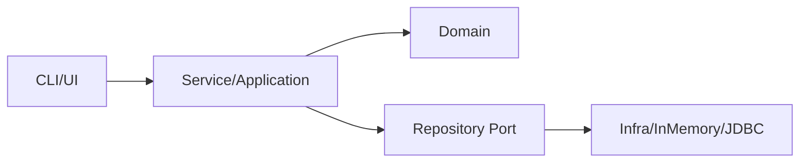

# Módulo 13: Proyecto integrador

Los módulos anteriores enseñaron piezas sueltas: POO, colecciones, errores, streams, concurrencia, I/O, logging, build, tests, módulos, JVM y patrones. El integrador obliga a combinar esas piezas en un sistema pequeño pero realista. Aquí la calidad no se mide por conocer un concepto, sino por ensamblarlo con límites claros, build reproducible y pruebas.

**Contexto Tienda Aurora.** Este módulo aporta bases para Tienda Aurora: los conceptos aquí se aplican en el monolito modular y luego en los microservicios.

**Entorno de referencia verificado (2026-05-22):** JDK 27.0.1.0.2, Maven 3.10.0.

## Aprende construyendo

### Tema 1: Arquitectura por capas del proyecto integrador · Intermedio · 40 min

**Caso guía.** un servicio de registro de guías. La UI/CLI no debe hablar directo con persistencia; el dominio no debe conocer detalles de consola.

Capas y responsabilidades

**Definición.** Arquitectura por capas separa responsabilidades: presentación/entrada, aplicación/servicio, dominio y persistencia/adaptadores. Cada capa expone contratos y depende hacia dentro o a través de interfaces.



**Ejemplo mínimo enfocado (ejecutable).**

```bash
mkdir -p java-m13/src/main/java/com/academia
cd java-m13
```

Crea el archivo `src/main/java/com/academia/GuiaService.java`:

```java
package com.academia;
import java.util.*;
interface GuiaRepo { void save(String id); List<String> all(); }
class InMemoryRepo implements GuiaRepo { private final List<String> data = new ArrayList<>(); public void save(String id){ data.add(id); } public List<String> all(){ return List.copyOf(data); } }
public class GuiaService {
  private final GuiaRepo repo;
  public GuiaService(GuiaRepo repo){ this.repo = repo; }
  public void registrar(String id){ if(id==null||id.isBlank()) throw new IllegalArgumentException("id"); repo.save(id); }
  public static void main(String[] args) {
    GuiaService s = new GuiaService(new InMemoryRepo());
    s.registrar("G1"); System.out.println("ok");
  }
}
```

```bash
javac -d out src/main/java/com/academia/GuiaService.java
java -cp out com.academia.GuiaService
```

**Error común.** Capa de dominio importando clases de infraestructura. Corrección: puertos/interfaces.

**Verificación (JDK 27, 2026-05-22).** `ok`.

### Tema 2: Build reproducible y cierre del track · Intermedio · 40 min

**Caso guía.** el integrador debe compilar y testear en otra máquina/CI.

Build reproducible

**Definición.** Build reproducible: mismas entradas, mismo resultado esperado. Requiere fijar versiones, plugins, JDK compatible y comandos claros.

**Ejemplo mínimo enfocado.**

```bash
mvn -q -DskipTests package
mvn -q test
```

**Error común.** Depender de jars locales o configuración manual. Corrección: pom/build script en repo, dependencias declaradas.

**Verificación.** Ejecutar en entorno limpio con Maven y JDK declarados.

### Tema 3: Integrando concurrencia, modelado y testing · Avanzado · 45 min

**Caso guía.** procesar guías en paralelo pero conservar consistencia y testear sin flakiness.

Integración con pruebas

**Definición.** Una prueba de integración en este nivel verifica colaboración entre componentes (servicio + repo + validación), con dobles solo en fronteras externas.

**Ejemplo mínimo enfocado (ejecutable).**

```bash
mkdir -p java-m13-test/src/main/java/com/academia java-m13-test/src/test/java/com/academia
cd java-m13-test
```

Crea el archivo `src/main/java/com/academia/Service.java`:

```java
package com.academia;
import java.util.concurrent.atomic.AtomicInteger;
public class Service {
  private final AtomicInteger count = new AtomicInteger();
  public int procesar(int n){ for(int i=0;i<n;i++) count.incrementAndGet(); return count.get(); }
}
```

Crea el archivo `src/test/java/com/academia/ServiceTest.java`:

```java
package com.academia;
import org.junit.jupiter.api.Test;
import static org.junit.jupiter.api.Assertions.*;
class ServiceTest { @Test void procesa(){ assertEquals(3, new Service().procesar(3)); } }
```

Agrega un `pom.xml` con JUnit 5 (como M9) y ejecuta:

```bash
mvn -q test
```

**Error común.** Tests de concurrencia flaky por tiempos fijos. Corrección: usar sincronización determinista, latches o asserts sobre resultado final.

**Verificación (Maven 3.10.0, JDK 27, 2026-05-22).** Test pasa.

## Cierre

El integrador es donde el criterio técnico se vuelve visible: límites, contratos, errores, tests y build reproducible.

## Checklist

- Separo capas y dependencias.
- Tengo build y tests reproducibles.
- Manejo concurrencia con invariantes claras.
