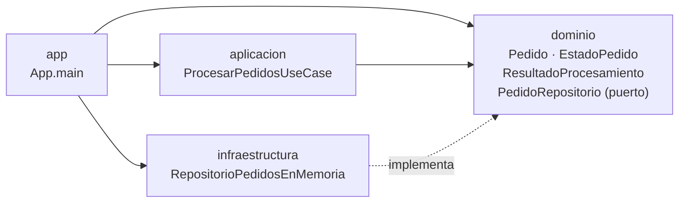
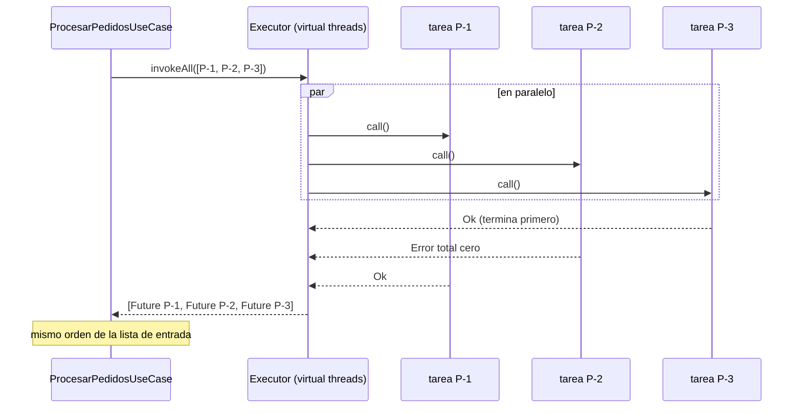

# Módulo 13: Proyecto integrador

Este módulo junta piezas trabajadas por separado: dominio, casos de uso, infraestructura, concurrencia, pruebas y build. El objetivo no es un CRUD grande, sino una pieza pequeña, completa y verificable. En Tienda Aurora, el caso es procesar pedidos pendientes con virtual threads sin perder claridad de diseño.

## Apertura del módulo

Al terminar este módulo podrás:
- organizar una aplicación en dominio, aplicación, infraestructura y composición, con dependencias hacia el dominio;
- comprobar la regla de dependencia con los `import` y cambiar un adaptador sin editar el caso de uso;
- procesar pedidos en paralelo con virtual threads e `invokeAll` sin perder el resultado de cada uno;
- modelar resultados con `record` y `sealed` para que el compilador exija cubrir cada caso;
- probar el caso de uso con un mock del puerto y dejar el build reproducible con wrapper, toolchain y versiones fijas.

**Esquema del módulo:** arquitectura por capas (Tema 1) y build reproducible con concurrencia, modelado y pruebas
(Tema 2). El código completo del proyecto está en la sección «Código completo, archivo por archivo», antes de los
temas; cada tema lo usa en su Capa 2.

**Qué necesitas saber antes:** *arquitectura*, *componente* y *dependencia* (Fundamentos, Módulo 7, Tema 2);
*inversión de dependencias*, *Repository* y *Adapter* (Arquitectura, Módulo 0, Tema 3); `record` (Java, Módulo 1,
Tema 5); `Optional` (Java, Módulo 4, Tema 2); `ExecutorService` (Java, Módulo 5, Tema 1); virtual threads (Java,
Módulo 5, Tema 3); `sealed` y `switch` exhaustivo (Java, Módulo 7, Temas 1 y 2); wrapper y toolchain de Gradle
(Java, Módulo 8, Tema 1); JUnit (Java, Módulo 9, Tema 1) y Mockito (Java, Módulo 9, Tema 2); Facade y Adapter en
Java (Java, Módulo 12, Tema 4).

## Visual del módulo

**Visual:** [Arquitectura por capas con dependencias apuntando al dominio](/visuals/temas/java/modulo-13-arquitectura.html)

Lectura: Las dependencias apuntan al dominio. La infraestructura implementa puertos; la app solo compone.

## Proyecto desde cero: `tienda-aurora-java-m13`

#### Prerrequisitos

```bash
java -version
gradle --version
```

#### Bootstrap

Ejecuta estos comandos desde el directorio donde quieras crear el proyecto. Las rutas son completas y relativas a ese directorio; no hay rutas abreviadas.

```bash
mkdir -p tienda-aurora-java-m13/src/main/java/com/aurora/integrador/dominio
mkdir -p tienda-aurora-java-m13/src/main/java/com/aurora/integrador/aplicacion
mkdir -p tienda-aurora-java-m13/src/main/java/com/aurora/integrador/infraestructura
mkdir -p tienda-aurora-java-m13/src/main/java/com/aurora/integrador/app
mkdir -p tienda-aurora-java-m13/src/test/java/com/aurora/integrador/aplicacion
cd tienda-aurora-java-m13
gradle wrapper --gradle-version 9.9.1
```

**Entorno de referencia verificado (2026-11-23):** macOS arm64, JDK 27.0.1.0.2, Gradle 9.9.1, JUnit 5.13.4, Mockito 5.18.0, toolchain Java 25. Con él se capturaron las salidas del proyecto Gradle.

**Entorno de los programas de un solo archivo (2026-11-24):** Linux x86_64, OpenJDK 25.0.5.1, sin Gradle. Los
«antes» y «después» de la Capa 1 se ejecutan con `java Archivo.java`; esas transcripciones son literales de esa
ejecución. Los tiempos en milisegundos pueden variar unos milisegundos en tu equipo; los textos no.

#### Estructura final

```text
tienda-aurora-java-m13/
├── build.gradle.kts
├── settings.gradle.kts
├── gradlew
└── src/
    ├── main/java/com/aurora/integrador/
    │   ├── app/App.java
    │   ├── aplicacion/ProcesarPedidosUseCase.java
    │   ├── dominio/EstadoPedido.java
    │   ├── dominio/Pedido.java
    │   ├── dominio/PedidoRepositorio.java
    │   ├── dominio/ResultadoProcesamiento.java
    │   └── infraestructura/RepositorioPedidosEnMemoria.java
    └── test/java/com/aurora/integrador/aplicacion/ProcesarPedidosUseCaseTest.java
```

## Código completo, archivo por archivo

#### `settings.gradle.kts`

```kotlin
rootProject.name = "tienda-aurora-java-m13"
```

#### `build.gradle.kts`

```kotlin
plugins {
    java
    application
}

group = "com.aurora"
version = "1.0.0"

java {
    toolchain {
        languageVersion = JavaLanguageVersion.of(25)
    }
}

repositories {
    mavenCentral()
}

dependencies {
    testImplementation(platform("org.junit:junit-bom:5.13.4"))
    testImplementation("org.junit.jupiter:junit-jupiter")
    testImplementation("org.mockito:mockito-core:5.18.0")
    testImplementation("org.mockito:mockito-junit-jupiter:5.18.0")
    testRuntimeOnly("org.junit.platform:junit-platform-launcher")
}

application {
    mainClass = "com.aurora.integrador.app.App"
}

tasks.test {
    useJUnitPlatform()
    testLogging { events("passed", "failed", "skipped") }
}

tasks.withType<JavaCompile>().configureEach {
    options.encoding = "UTF-8"
    options.compilerArgs.addAll(listOf("-Xlint:all", "-Xlint:-processing", "-Werror"))
}
```

#### `src/main/java/com/aurora/integrador/dominio/EstadoPedido.java`

```java
package com.aurora.integrador.dominio;
public enum EstadoPedido { PENDIENTE, PROCESADO, FALLIDO }
```

#### `src/main/java/com/aurora/integrador/dominio/Pedido.java`

```java
package com.aurora.integrador.dominio;

import java.math.BigDecimal;
import java.util.Objects;

/** Entidad de dominio: valida invariantes al construirse. */
public record Pedido(String id, String cliente, BigDecimal total, EstadoPedido estado) {
    public Pedido {
        Objects.requireNonNull(id, "id");
        Objects.requireNonNull(cliente, "cliente");
        Objects.requireNonNull(total, "total");
        Objects.requireNonNull(estado, "estado");
        if (id.isBlank()) throw new IllegalArgumentException("id vacío");
        if (cliente.isBlank()) throw new IllegalArgumentException("cliente vacío");
        if (total.signum() < 0) throw new IllegalArgumentException("total negativo");
    }

    public Pedido procesar() {
        return new Pedido(id, cliente, total, EstadoPedido.PROCESADO);
    }

    public Pedido fallar() {
        return new Pedido(id, cliente, total, EstadoPedido.FALLIDO);
    }
}
```

#### `src/main/java/com/aurora/integrador/dominio/ResultadoProcesamiento.java`

```java
package com.aurora.integrador.dominio;
/** Sealed: el compilador obliga a manejar todos los casos. */
public sealed interface ResultadoProcesamiento permits ResultadoProcesamiento.Ok, ResultadoProcesamiento.Error {
    String pedidoId();
    record Ok(String pedidoId, String detalle) implements ResultadoProcesamiento {}
    record Error(String pedidoId, String mensaje) implements ResultadoProcesamiento {}
}
```

#### `src/main/java/com/aurora/integrador/dominio/PedidoRepositorio.java`

```java
package com.aurora.integrador.dominio;

import java.util.List;
import java.util.Optional;

public interface PedidoRepositorio {
    Optional<Pedido> porId(String id);
    List<Pedido> pendientes();
    void guardar(Pedido pedido);
}
```

#### `src/main/java/com/aurora/integrador/infraestructura/RepositorioPedidosEnMemoria.java`

```java
package com.aurora.integrador.infraestructura;

import com.aurora.integrador.dominio.EstadoPedido;
import com.aurora.integrador.dominio.Pedido;
import com.aurora.integrador.dominio.PedidoRepositorio;

import java.util.List;
import java.util.Map;
import java.util.Optional;
import java.util.concurrent.ConcurrentHashMap;

public final class RepositorioPedidosEnMemoria implements PedidoRepositorio {
    private final Map<String, Pedido> datos = new ConcurrentHashMap<>();

    @Override
    public Optional<Pedido> porId(String id) {
        return Optional.ofNullable(datos.get(id));
    }

    @Override
    public List<Pedido> pendientes() {
        return datos.values().stream()
                .filter(p -> p.estado() == EstadoPedido.PENDIENTE)
                .toList();
    }

    @Override
    public void guardar(Pedido pedido) {
        datos.put(pedido.id(), pedido);
    }
}
```

#### `src/main/java/com/aurora/integrador/aplicacion/ProcesarPedidosUseCase.java`

```java
package com.aurora.integrador.aplicacion;

import com.aurora.integrador.dominio.Pedido;
import com.aurora.integrador.dominio.PedidoRepositorio;
import com.aurora.integrador.dominio.ResultadoProcesamiento;

import java.util.List;
import java.util.Objects;
import java.util.concurrent.Callable;
import java.util.concurrent.ExecutionException;
import java.util.concurrent.ExecutorService;
import java.util.concurrent.Executors;
import java.util.concurrent.Future;

public final class ProcesarPedidosUseCase {
    private final PedidoRepositorio repositorio;

    public ProcesarPedidosUseCase(PedidoRepositorio repositorio) {
        this.repositorio = Objects.requireNonNull(repositorio, "repositorio");
    }

    public List<ResultadoProcesamiento> ejecutar() {
        List<Pedido> pendientes = repositorio.pendientes();
        try (ExecutorService executor = Executors.newVirtualThreadPerTaskExecutor()) {
            List<Callable<ResultadoProcesamiento>> tareas = pendientes.stream()
                    .<Callable<ResultadoProcesamiento>>map(p -> () -> procesarUno(p))
                    .toList();
            List<Future<ResultadoProcesamiento>> futures = executor.invokeAll(tareas);
            return futures.stream().map(this::obtener).toList();
        } catch (InterruptedException e) {
            Thread.currentThread().interrupt();
            throw new IllegalStateException("Procesamiento interrumpido", e);
        }
    }

    private ResultadoProcesamiento procesarUno(Pedido pedido) {
        try {
            if (pedido.total().signum() == 0) {
                throw new IllegalArgumentException("total cero no permitido");
            }
            Pedido procesado = pedido.procesar();
            repositorio.guardar(procesado);
            return new ResultadoProcesamiento.Ok(pedido.id(), "procesado");
        } catch (RuntimeException e) {
            repositorio.guardar(pedido.fallar());
            return new ResultadoProcesamiento.Error(pedido.id(), e.getMessage());
        }
    }

    private ResultadoProcesamiento obtener(Future<ResultadoProcesamiento> future) {
        try {
            return future.get();
        } catch (InterruptedException e) {
            Thread.currentThread().interrupt();
            throw new IllegalStateException("Futuro interrumpido", e);
        } catch (ExecutionException e) {
            throw new IllegalStateException("Error interno", e.getCause());
        }
    }
}
```

#### `src/main/java/com/aurora/integrador/app/App.java`

```java
package com.aurora.integrador.app;

import com.aurora.integrador.aplicacion.ProcesarPedidosUseCase;
import com.aurora.integrador.dominio.EstadoPedido;
import com.aurora.integrador.dominio.Pedido;
import com.aurora.integrador.dominio.ResultadoProcesamiento;
import com.aurora.integrador.infraestructura.RepositorioPedidosEnMemoria;

import java.math.BigDecimal;
import java.util.List;

public final class App {
    public static void main(String[] args) {
        RepositorioPedidosEnMemoria repo = new RepositorioPedidosEnMemoria();
        repo.guardar(new Pedido("P-1", "Ana", new BigDecimal("100.00"), EstadoPedido.PENDIENTE));
        repo.guardar(new Pedido("P-2", "Bruno", new BigDecimal("0.00"), EstadoPedido.PENDIENTE));
        repo.guardar(new Pedido("P-3", "Carla", new BigDecimal("59.90"), EstadoPedido.PENDIENTE));

        ProcesarPedidosUseCase useCase = new ProcesarPedidosUseCase(repo);
        List<ResultadoProcesamiento> resultados = useCase.ejecutar();
        for (ResultadoProcesamiento r : resultados) {
            switch (r) {
                case ResultadoProcesamiento.Ok ok -> System.out.println("OK " + ok.pedidoId() + " " + ok.detalle());
                case ResultadoProcesamiento.Error err -> System.out.println("ERR " + err.pedidoId() + " " + err.mensaje());
            }
        }
    }

    private App() {}
}
```

#### `src/test/java/com/aurora/integrador/aplicacion/ProcesarPedidosUseCaseTest.java`

```java
package com.aurora.integrador.aplicacion;

import com.aurora.integrador.dominio.EstadoPedido;
import com.aurora.integrador.dominio.Pedido;
import com.aurora.integrador.dominio.PedidoRepositorio;
import com.aurora.integrador.dominio.ResultadoProcesamiento;
import org.junit.jupiter.api.Test;
import org.junit.jupiter.api.extension.ExtendWith;
import org.mockito.Mock;
import org.mockito.junit.jupiter.MockitoExtension;

import java.math.BigDecimal;
import java.util.List;
import java.util.Optional;

import static org.junit.jupiter.api.Assertions.*;
import static org.mockito.Mockito.*;

@ExtendWith(MockitoExtension.class)
class ProcesarPedidosUseCaseTest {

    @Mock
    PedidoRepositorio repositorio;

    @Test
    void procesaPedidosPendientesYReportaErrores() {
        Pedido ok = new Pedido("P-1", "Ana", new BigDecimal("10.00"), EstadoPedido.PENDIENTE);
        Pedido malo = new Pedido("P-2", "Bruno", new BigDecimal("0.00"), EstadoPedido.PENDIENTE);
        when(repositorio.pendientes()).thenReturn(List.of(ok, malo));

        ProcesarPedidosUseCase useCase = new ProcesarPedidosUseCase(repositorio);
        List<ResultadoProcesamiento> res = useCase.ejecutar();

        assertEquals(2, res.size());
        assertTrue(res.stream().anyMatch(r -> r instanceof ResultadoProcesamiento.Ok o && o.pedidoId().equals("P-1")));
        assertTrue(res.stream().anyMatch(r -> r instanceof ResultadoProcesamiento.Error e && e.pedidoId().equals("P-2")));
        verify(repositorio, atLeastOnce()).guardar(any(Pedido.class));
    }

    @Test
    void dominioNoAceptaInvariantesInvalidos() {
        assertThrows(IllegalArgumentException.class, () -> new Pedido("", "Ana", new BigDecimal("1"), EstadoPedido.PENDIENTE));
        assertThrows(IllegalArgumentException.class, () -> new Pedido("P-1", "Ana", new BigDecimal("-1"), EstadoPedido.PENDIENTE));
        assertThrows(NullPointerException.class, () -> new Pedido("P-1", null, new BigDecimal("1"), EstadoPedido.PENDIENTE));
    }
}
```

### Tema 1: Arquitectura por capas del proyecto integrador · Intermedio · 50 min

<details open>
<summary><strong>Capa 1 — Lectura</strong></summary>

#### Objetivos
Al terminar este tema podrás:
- separar un procesador de pedidos en dominio, aplicación, infraestructura y raíz de composición;
- definir un puerto en el dominio e implementarlo con dos adaptadores intercambiables;
- comprobar la regla de dependencia con `grep` sobre los `import` y con la ejecución;
- leer el error de compilación de un adaptador que no cumple todo el puerto.

**Conceptos clave:** arquitectura por capas, caso de uso, puerto, regla de dependencia, raíz de composición

Ya los conoces y no se repiten: *arquitectura*, *componente* y *dependencia* (Fundamentos, Módulo 7, Tema 2);
*inversión de dependencias*, *Repository* y *Adapter* (Arquitectura, Módulo 0, Tema 3); *Facade* (Java, Módulo 12,
Tema 4); `record` (Java, Módulo 1, Tema 5); `sealed` (Java, Módulo 7, Tema 1).

#### El problema
Tienda Aurora procesa pedidos pendientes: los que tienen total cero fallan y el resto queda procesado. Hoy una sola
clase guarda los pedidos en un mapa, aplica la regla e imprime en consola. Mañana los pedidos vendrán de una base de
datos y habrá que probar la regla sin consola. ¿Cómo organizas el código para cambiar el almacenamiento sin tocar la regla?

#### Glosario del tema

**arquitectura por capas**
- **Definición técnica:** organización del código en grupos con una responsabilidad cada uno (dominio, aplicación, infraestructura, composición) y una dirección permitida para sus dependencias.
- **En palabras sencillas:** los pisos de un edificio: cada piso tiene su función y las escaleras solo van en un sentido.
- **Dónde se rompe la comparación:** en un edificio puedes subir y bajar; aquí la dependencia va siempre hacia el dominio.
- **Ejemplo:** los paquetes `dominio`, `aplicacion`, `infraestructura` y `app` de `tienda-aurora-java-m13`.
- **Error típico:** crear las carpetas sin respetar la dirección: si `dominio` importa `infraestructura`, solo hay carpetas.

**caso de uso**
- **Definición técnica:** clase de la capa de aplicación que orquesta una operación del negocio: obtiene datos por los puertos, aplica las reglas del dominio y guarda el resultado.
- **En palabras sencillas:** el guion de una tarea concreta: «procesar los pedidos pendientes», paso a paso.
- **Dónde se rompe la comparación:** un guion lo ejecuta una persona; el caso de uso no sabe quién lo llama, si una consola, una API o una prueba.
- **Ejemplo:** `ProcesarPedidosUseCase.ejecutar()` pide `pendientes()`, procesa cada pedido y llama a `guardar`.
- **Error típico:** imprimir en consola dentro del caso de uso: deja de servir para una API y ensucia las pruebas.

**puerto**
- **Definición técnica:** interfaz que el dominio o la aplicación declara para lo que necesita del exterior; la infraestructura la implementa.
- **En palabras sencillas:** el enchufe que la regla de negocio pone en la pared; cualquier aparato compatible se conecta.
- **Dónde se rompe la comparación:** el enchufe lo fija una norma externa; el puerto lo define tu dominio con sus propias palabras.
- **Ejemplo:** `PedidoRepositorio` con `porId`, `pendientes` y `guardar`.
- **Error típico:** copiar en el puerto la API de la base de datos (`ejecutarSql`): el dominio vuelve a depender del detalle.

**regla de dependencia**
- **Definición técnica:** restricción por la que el código de una capa interna nunca nombra tipos de una capa externa; las dependencias de código apuntan siempre hacia el dominio.
- **En palabras sencillas:** el dominio no sabe que existen la base de datos ni la consola; ellas sí saben que existe el dominio.
- **Dónde se rompe la comparación:** los datos sí viajan en ambos sentidos; lo que tiene dirección única son los `import`.
- **Ejemplo:** `grep -rn "^import com.aurora" .../dominio` no encuentra nada: el dominio no importa otras capas.
- **Error típico:** declarar en el caso de uso el tipo concreto `RepositorioPedidosEnMemoria`: compila, pero ata la aplicación a un adaptador.

**raíz de composición**
- **Definición técnica:** único punto del programa, normalmente cerca de `main`, donde se crean las clases concretas y se conectan entre sí.
- **En palabras sencillas:** el tablero eléctrico: ahí se decide qué aparato va en cada enchufe.
- **Dónde se rompe la comparación:** un tablero se arma una vez; en las pruebas armas otra composición, con un mock en lugar del adaptador.
- **Ejemplo:** `App.main` crea `RepositorioPedidosEnMemoria` y se lo pasa a `ProcesarPedidosUseCase`.
- **Error típico:** hacer `new RepositorioPedidosEnMemoria()` dentro del caso de uso: ya no se puede sustituir.

#### ► CÓMO FUNCIONA
**Mecanismo.** Cuatro paquetes con una regla de dependencia: `app` compone; `aplicacion` orquesta el caso de uso; `dominio` define reglas y puertos; `infraestructura` implementa puertos. `ProcesarPedidosUseCase` recibe `PedidoRepositorio` (interfaz), nunca `RepositorioPedidosEnMemoria`.

**Por qué existe.** Si negocio, IO y salida están en la misma clase, un cambio de almacenamiento rompe reglas y un test necesita levantar toda la aplicación. La separación permite cambiar el adaptador sin tocar la regla.

**Implicaciones.** Hay más archivos y una composición explícita en `App`. El beneficio se verifica con un mock del puerto: la prueba `procesaPedidosPendientesYReportaErrores` no necesita una base de datos. El criterio para aceptar la arquitectura es: ¿puedo sustituir `RepositorioPedidosEnMemoria` sin editar `ProcesarPedidosUseCase`?

Las flechas del diagrama son `import`. Todas terminan en el dominio. La infraestructura implementa el puerto y la
aplicación lo usa; la única pieza que conoce a todas es `app`, la raíz de composición.



**Confusión común.** Tener carpetas por capas sin regla de dependencia. Si `infraestructura` importa `aplicacion` concreta y `aplicacion` importa `infraestructura` concreta, solo hay carpetas. Aquí la dirección es siempre hacia `dominio`.

**Lo que cambia en Java.** Los paquetes son las capas y los `import` hacen visible cada dependencia. Un `record` con
constructor compacto guarda los invariantes del dominio, y una interfaz `sealed` cierra los resultados posibles. Si
quieres que el compilador impida importar infraestructura desde el dominio, JPMS (Java, Módulo 10) lo hace por módulos.

#### Problema resuelto 1.1
Antes. Procesa los tres pedidos de ejemplo con una clase que guarda, decide e imprime.

**Razonamiento:**
1. La tabla de pedidos es un `LinkedHashMap` concreto dentro del procesador.
2. La regla «total cero falla» y el `println` viven en el mismo bucle.
3. Al final, mide de qué depende la clase listando el tipo de sus campos.

```java
// PedidosAcoplado.java — almacenamiento, regla de negocio y salida en la misma clase
import java.math.BigDecimal;
import java.util.Arrays;
import java.util.LinkedHashMap;
import java.util.Map;

public class PedidosAcoplado {
    public static void main(String[] args) {
        ProcesadorAcoplado procesador = new ProcesadorAcoplado();
        procesador.agregar("P-1", "Ana", "100.00");
        procesador.agregar("P-2", "Bruno", "0.00");
        procesador.agregar("P-3", "Carla", "59.90");
        procesador.procesarTodo();

        System.out.println("depende de: " + Arrays.stream(ProcesadorAcoplado.class.getDeclaredFields())
                .map(f -> f.getType().getSimpleName() + " (interfaz=" + f.getType().isInterface() + ")")
                .toList());
    }
}

class ProcesadorAcoplado {
    private final LinkedHashMap<String, String[]> tabla = new LinkedHashMap<>();   // almacenamiento concreto

    void agregar(String id, String cliente, String total) {
        tabla.put(id, new String[] {cliente, total, "PENDIENTE"});
    }

    void procesarTodo() {
        for (Map.Entry<String, String[]> fila : tabla.entrySet()) {
            String[] datos = fila.getValue();
            if (new BigDecimal(datos[1]).signum() == 0) {                       // regla de negocio
                datos[2] = "FALLIDO";
                System.out.println("ERR " + fila.getKey() + " total cero no permitido");  // salida
            } else {
                datos[2] = "PROCESADO";
                System.out.println("OK " + fila.getKey() + " procesado");
            }
        }
    }
}
```

```text
$ java PedidosAcoplado.java
OK P-1 procesado
ERR P-2 total cero no permitido
OK P-3 procesado
depende de: [LinkedHashMap (interfaz=false)]
```

**Explicación por partes.**
- Línea 22: el almacenamiento es un tipo concreto. Cambiar a una base de datos obliga a editar esta clase.
- Líneas 31–36: la regla y la salida están mezcladas. Probar la regla exige capturar la consola.
- Líneas 25 y 32: el pedido es un arreglo de `String` y su estado se cambia en el sitio. Nada impide un estado inválido.
- Última salida: el único campo es `LinkedHashMap`, una clase concreta (`interfaz=false`).

#### Problema resuelto 1.2
Después. Separa el mismo programa en cuatro capas y ejecútalo con dos adaptadores distintos sin tocar el caso de uso.

**Razonamiento:**
1. El dominio declara `Pedido`, el estado, el resultado y el puerto `PedidoRepositorio`.
2. El caso de uso recibe el puerto por constructor y devuelve resultados; no imprime nada.
3. La infraestructura implementa el puerto dos veces: en memoria y con bitácora.
4. `main` es la raíz de composición: crea los adaptadores y decide cómo mostrar los resultados.

```java
// PedidosPorCapas.java — dominio, aplicación, infraestructura y composición en capas separadas
import java.math.BigDecimal;
import java.util.ArrayList;
import java.util.Arrays;
import java.util.LinkedHashMap;
import java.util.List;
import java.util.Map;
import java.util.Objects;

public class PedidosPorCapas {
    // ---- app: raíz de composición, el único lugar que conoce las clases concretas ----
    public static void main(String[] args) {
        for (PedidoRepositorio repo : new PedidoRepositorio[] {new RepositorioEnMemoria(), new RepositorioConBitacora()}) {
            System.out.println("== " + repo.getClass().getSimpleName());
            repo.guardar(new Pedido("P-1", "Ana", new BigDecimal("100.00"), EstadoPedido.PENDIENTE));
            repo.guardar(new Pedido("P-2", "Bruno", new BigDecimal("0.00"), EstadoPedido.PENDIENTE));
            repo.guardar(new Pedido("P-3", "Carla", new BigDecimal("59.90"), EstadoPedido.PENDIENTE));

            for (ResultadoProcesamiento r : new ProcesarPedidos(repo).ejecutar()) {
                switch (r) {
                    case ResultadoProcesamiento.Ok ok -> System.out.println("OK " + ok.pedidoId() + " " + ok.detalle());
                    case ResultadoProcesamiento.Error err -> System.out.println("ERR " + err.pedidoId() + " " + err.mensaje());
                }
            }
        }
        System.out.println("depende de: " + Arrays.stream(ProcesarPedidos.class.getDeclaredFields())
                .map(f -> f.getType().getSimpleName() + " (interfaz=" + f.getType().isInterface() + ")")
                .toList());
    }
}

// ---- dominio: reglas y puertos; no importa nada de las otras capas ----
enum EstadoPedido { PENDIENTE, PROCESADO, FALLIDO }

record Pedido(String id, String cliente, BigDecimal total, EstadoPedido estado) {
    Pedido {
        Objects.requireNonNull(id, "id");
        if (total.signum() < 0) throw new IllegalArgumentException("total negativo");
    }
    Pedido procesar() { return new Pedido(id, cliente, total, EstadoPedido.PROCESADO); }
    Pedido fallar() { return new Pedido(id, cliente, total, EstadoPedido.FALLIDO); }
}

sealed interface ResultadoProcesamiento permits ResultadoProcesamiento.Ok, ResultadoProcesamiento.Error {
    String pedidoId();
    record Ok(String pedidoId, String detalle) implements ResultadoProcesamiento {}
    record Error(String pedidoId, String mensaje) implements ResultadoProcesamiento {}
}

interface PedidoRepositorio {                                  // puerto definido por el dominio
    List<Pedido> pendientes();
    void guardar(Pedido pedido);
}

// ---- aplicación: el caso de uso orquesta; solo conoce el puerto ----
final class ProcesarPedidos {
    private final PedidoRepositorio repositorio;

    ProcesarPedidos(PedidoRepositorio repositorio) { this.repositorio = Objects.requireNonNull(repositorio); }

    List<ResultadoProcesamiento> ejecutar() {
        List<ResultadoProcesamiento> resultados = new ArrayList<>();
        for (Pedido p : repositorio.pendientes()) {
            if (p.total().signum() == 0) {
                repositorio.guardar(p.fallar());
                resultados.add(new ResultadoProcesamiento.Error(p.id(), "total cero no permitido"));
            } else {
                repositorio.guardar(p.procesar());
                resultados.add(new ResultadoProcesamiento.Ok(p.id(), "procesado"));
            }
        }
        return resultados;
    }
}

// ---- infraestructura: adaptadores que implementan el puerto ----
class RepositorioEnMemoria implements PedidoRepositorio {
    private final Map<String, Pedido> datos = new LinkedHashMap<>();
    public List<Pedido> pendientes() {
        return datos.values().stream().filter(p -> p.estado() == EstadoPedido.PENDIENTE).toList();
    }
    public void guardar(Pedido pedido) { datos.put(pedido.id(), pedido); }
}

final class RepositorioConBitacora extends RepositorioEnMemoria {   // adaptador nuevo, caso de uso intacto
    @Override
    public void guardar(Pedido pedido) {
        System.out.println("  [bitácora] " + pedido.id() + " -> " + pedido.estado());
        super.guardar(pedido);
    }
}
```

```text
$ java PedidosPorCapas.java
== RepositorioEnMemoria
OK P-1 procesado
ERR P-2 total cero no permitido
OK P-3 procesado
== RepositorioConBitacora
  [bitácora] P-1 -> PENDIENTE
  [bitácora] P-2 -> PENDIENTE
  [bitácora] P-3 -> PENDIENTE
  [bitácora] P-1 -> PROCESADO
  [bitácora] P-2 -> FALLIDO
  [bitácora] P-3 -> PROCESADO
OK P-1 procesado
ERR P-2 total cero no permitido
OK P-3 procesado
depende de: [PedidoRepositorio (interfaz=true)]
```

**Explicación por partes.**
- Líneas 33–53: el dominio. No importa ninguna clase de las otras secciones del archivo.
- Líneas 56–74: el caso de uso. Su único campo es el puerto (línea 57) y devuelve una lista de resultados.
- Líneas 77–91: dos adaptadores. `RepositorioConBitacora` registra cada `guardar` sin que el caso de uso cambie.
- Líneas 13–25: la raíz de composición recorre los dos adaptadores con el mismo caso de uso y la misma salida de negocio.
- Última salida: el caso de uso depende de `PedidoRepositorio`, una interfaz (`interfaz=true`).

> **Error común.** Crear un adaptador nuevo y olvidar un método del puerto. El compilador nombra la clase y el método:

```java
// PuertoIncompleto.java — un adaptador nuevo que no implementa todo el puerto
import java.util.List;

public class PuertoIncompleto {
    public static void main(String[] args) {
        System.out.println(new RepositorioArchivo().pendientes());
    }
}

interface PedidoRepositorio {
    List<String> pendientes();
    void guardar(String pedido);
}

class RepositorioArchivo implements PedidoRepositorio {
    public List<String> pendientes() { return List.of(); }
}
```

```text
$ java PuertoIncompleto.java
PuertoIncompleto.java:15: error: RepositorioArchivo is not abstract and does not override abstract method guardar(String) in PedidoRepositorio
class RepositorioArchivo implements PedidoRepositorio {
^
1 error
error: compilation failed
```

> Implementa `guardar(String)` en `RepositorioArchivo`. Si el método no tiene sentido para ese adaptador, el puerto
> está mezclando necesidades distintas y conviene separarlo.

> **Prevenir errores.** Revisa la regla de dependencia con un comando, no de memoria. Si
> `grep -rn "^import com.aurora" src/main/java/com/aurora/integrador/dominio` encuentra algo, el dominio dejó de ser independiente.

> **Ingeniería de software.** Acepta la arquitectura con una sola pregunta: ¿puedes sustituir
> `RepositorioPedidosEnMemoria` sin editar `ProcesarPedidosUseCase`? Si la respuesta es no, hay una dependencia mal dirigida.

#### Checkpoint 1.1
En `PedidosPorCapas.java`, ¿qué archivos o secciones cambiarías para guardar los pedidos en un archivo de texto?

Respuesta: solo dos. Una clase nueva de infraestructura que implemente `PedidoRepositorio` y la línea de `main` que
la crea. El dominio y `ProcesarPedidos` no cambian.

</details>

<details>
<summary><strong>Capa 2 — Construcción</strong></summary>

#### Paso 1 · Ejecuta el antes y el después
En `~/labs/integrador-java`, ejecuta `java PedidosAcoplado.java` y `java PedidosPorCapas.java`. Compara las dos
últimas líneas: `interfaz=false` frente a `interfaz=true`.

#### Paso 2 · Crea las capas del proyecto Gradle
En `tienda-aurora-java-m13`, crea los archivos de la sección «Código completo, archivo por archivo» de los paquetes
`dominio` (`EstadoPedido`, `Pedido`, `ResultadoProcesamiento`, `PedidoRepositorio`), `infraestructura`
(`RepositorioPedidosEnMemoria`), `aplicacion` (`ProcesarPedidosUseCase`) y `app` (`App`).

#### Paso 3 · Comprueba la regla de dependencia
Desde la raíz del proyecto, ejecuta los dos comandos. El primero debe terminar sin coincidencias (código de salida
`1`); el segundo muestra que aplicación e infraestructura solo importan tipos del dominio:

```text
$ grep -rn "^import com.aurora" src/main/java/com/aurora/integrador/dominio; echo "código de salida: $?"
código de salida: 1
$ grep -rh "^import com.aurora" src/main/java/com/aurora/integrador/aplicacion src/main/java/com/aurora/integrador/infraestructura | sort | uniq -c
      1 import com.aurora.integrador.dominio.EstadoPedido;
      2 import com.aurora.integrador.dominio.Pedido;
      2 import com.aurora.integrador.dominio.PedidoRepositorio;
      1 import com.aurora.integrador.dominio.ResultadoProcesamiento;
```

#### Paso 4 · Verifica la composición
`App.main` es la raíz de composición del proyecto. Su salida real con `./gradlew -q run` está en «Verificación real»;
el Tema 2 explica por qué aparece en ese orden.

#### Resumen
- La **arquitectura por capas** separa dominio, aplicación, infraestructura y composición.
- El **caso de uso** orquesta la operación y devuelve resultados; no imprime ni conoce adaptadores concretos.
- Un **puerto** es una interfaz definida por el dominio; los adaptadores de infraestructura la implementan.
- La **regla de dependencia** se comprueba con los `import`: todos apuntan hacia el dominio.
- La **raíz de composición** (`App.main`) es el único lugar que crea y conecta clases concretas.
- Cambiar de adaptador no edita el caso de uso; lo demuestran `RepositorioConBitacora` y el mock del Tema 2.

#### Ejercicio verificable 1
Básico. En `PedidosPorCapas.java`, ¿cuántas veces se llama a `guardar` del adaptador con bitácora y por qué?

Respuesta esperada: seis. Tres al cargar los pedidos en `main` (estado `PENDIENTE`) y tres en el caso de uso, uno por
pedido procesado (`PROCESADO` o `FALLIDO`).

#### Ejercicio verificable 2
Intermedio. Cambia el tipo del campo y del constructor de `ProcesarPedidos` a `RepositorioEnMemoria`. ¿Qué dice el
compilador en `main`, y qué imprime la última línea si agregas el cast `(RepositorioEnMemoria) repo`?

Respuesta esperada: sin el cast, `error: constructor ProcesarPedidos in class ProcesarPedidos cannot be applied to
given types;` con `reason: argument mismatch; PedidoRepositorio cannot be converted to RepositorioEnMemoria`. Con el
cast imprime `depende de: [RepositorioEnMemoria (interfaz=false)]`: el caso de uso quedó atado a un adaptador.

#### Ejercicio verificable 3
Reto. Escribe un adaptador `RepositorioContador` que extienda `RepositorioEnMemoria` y cuente las llamadas a
`guardar`. Carga los tres pedidos, ejecuta el caso de uso e imprime `guardados=` y cuántos pendientes quedan.

Respuesta esperada: `guardados=6 pendientes=0`. El adaptador redefine `guardar`, incrementa un contador y llama a
`super.guardar(pedido)`; el caso de uso no cambia.

#### En el trabajo
Esta organización se conoce como arquitectura hexagonal o de puertos y adaptadores. En Spring Boot, la raíz de
composición la hace el contenedor: inyecta el adaptador JPA en el caso de uso por constructor. Herramientas como
ArchUnit convierten la regla de dependencia en una prueba que falla si alguien importa infraestructura desde el dominio.

</details>

### Tema 2: Build reproducible e integrando concurrencia, modelado y testing · Intermedio · 60 min

<details open>
<summary><strong>Capa 1 — Lectura</strong></summary>

#### Objetivos
Al terminar este tema podrás:
- procesar un lote con virtual threads e `invokeAll` y explicar en qué orden llegan los resultados;
- convertir cada fallo en un resultado explícito con `record` y `sealed`, sin cortar el lote;
- probar el caso de uso con un mock del puerto y el dominio sin mocks;
- dejar el build reproducible con wrapper, toolchain y versiones fijas, y comprobar qué JDK ejecuta tu código.

**Conceptos clave:** `invokeAll`, resultado explícito, build reproducible

Ya los conoces y no se repiten: *caso de uso* y *puerto* (Tema 1 de este módulo); `ExecutorService` (Java, Módulo 5,
Tema 1); virtual threads (Java, Módulo 5, Tema 3); try-with-resources (Java, Módulo 3, Tema 2); `record` (Java,
Módulo 1, Tema 5); `sealed` y `switch` exhaustivo (Java, Módulo 7, Temas 1 y 2); `ConcurrentHashMap` (Java, Módulo
12, Tema 4); wrapper y toolchain de Gradle (Java, Módulo 8, Tema 1); JUnit (Java, Módulo 9, Tema 1); Mockito, mock y
`verify` (Java, Módulo 9, Tema 2).

#### El problema
Cada pedido de Tienda Aurora espera unos 100 ms a un servicio remoto. Procesarlos uno tras otro suma las esperas, y
el primer pedido inválido detiene el lote completo: los siguientes quedan pendientes sin razón. Además, el proyecto
compila en un equipo y falla en otro. ¿Cómo procesas en paralelo sin perder ningún resultado, y cómo garantizas que
el build sea el mismo en cualquier máquina?

#### Glosario del tema

**`invokeAll`**
- **Definición técnica:** método de `ExecutorService` que recibe una colección de `Callable`, las ejecuta y espera a que todas terminen; devuelve una `List<Future>` en el mismo orden de la colección recibida.
- **En palabras sencillas:** repartes los pedidos entre varios ayudantes, esperas a que todos acaben y recoges las respuestas en el orden en que las repartiste.
- **Dónde se rompe la comparación:** los ayudantes terminan en cualquier orden; la lista de respuestas no cambia de orden por eso.
- **Ejemplo:** en `ProcesamientoConcurrente.java`, `P-3` termina primero, pero el primer `Future` sigue siendo el de `P-1`.
- **Error típico:** llamar a `future.get()` sin manejar `ExecutionException`: una excepción de la tarea llega envuelta y hay que leer `getCause()`.

**resultado explícito**
- **Definición técnica:** tipo que representa cada desenlace posible de una operación (por ejemplo, `Ok` y `Error`) como un valor que se devuelve, en lugar de lanzar una excepción.
- **En palabras sencillas:** un recibo que dice «aprobado» o «rechazado, por esto»: siempre recibes un papel.
- **Dónde se rompe la comparación:** un recibo de papel puede tener cualquier texto; con `sealed` la lista de desenlaces es cerrada y el compilador la conoce.
- **Ejemplo:** `ResultadoProcesamiento.Error("P-2", "total cero no permitido")` deja seguir el lote y conserva la causa.
- **Error típico:** agregar una variante y no cubrirla: `error: the switch statement does not cover all possible input values`.

**build reproducible**
- **Definición técnica:** build que produce el mismo resultado en cualquier máquina porque fija la versión de la herramienta (wrapper), la del JDK (toolchain) y la de cada dependencia.
- **En palabras sencillas:** una receta con marcas y cantidades exactas: no dice «harina», dice qué harina y cuántos gramos.
- **Dónde se rompe la comparación:** la receta no controla el horno; el build tampoco controla el sistema operativo, y los mensajes localizados pueden cambiar.
- **Ejemplo:** `gradlew` fija Gradle 9.9.1, `JavaLanguageVersion.of(25)` fija el JDK y `junit-bom:5.13.4` fija JUnit.
- **Error típico:** declarar una dependencia sin versión o usar el `gradle` instalado: cada equipo compila con algo distinto.

#### ► CÓMO FUNCIONA
**Mecanismo (concurrencia).** `ProcesarPedidosUseCase.ejecutar()` crea un `ExecutorService` con `Executors.newVirtualThreadPerTaskExecutor()`, convierte cada pedido en un `Callable`, usa `invokeAll` y recoge resultados con `future.get()`. El `try-with-resources` cierra el executor. `InterruptedException` restaura el flag de interrupción y se propaga como `IllegalStateException`.

**Por qué existe (concurrencia).** Los pedidos pueden procesarse en paralelo sin compartir un pool limitado de platform threads. `RepositorioPedidosEnMemoria` usa `ConcurrentHashMap` porque varios virtual threads guardan resultados a la vez.

**Implicaciones (concurrencia).** El orden de las tres líneas de `run` puede variar; el contenido no: `P-2` falla por total cero y `P-1`/`P-3` terminan OK. La prueba no depende del orden: usa `anyMatch` sobre los resultados. No se usan virtual threads para CPU-bound puro; aquí simulan tareas que en producción serían IO o llamadas remotas.

**Confusión común (concurrencia).** Creer que `ConcurrentHashMap` vuelve atómica una secuencia de varias operaciones. Cada operación del mapa es segura; la secuencia “leer, decidir, guardar” necesita diseño adicional si varios hilos compiten por el mismo id.

**Por qué puede cambiar el orden de `run`.** `invokeAll` devuelve los resultados en el orden de la lista de tareas,
no en el orden en que terminan. Esa lista sale de `repositorio.pendientes()`, que recorre un `ConcurrentHashMap`, y
ese mapa no promete ningún orden. Por eso el orden se decide en el repositorio, y las pruebas comparan contenido.



**Mecanismo (modelado).** `Pedido` es un `record` con invariantes en el constructor compacto y métodos `procesar()`/`fallar()` que devuelven nuevas instancias. `ResultadoProcesamiento` es un `sealed interface` con `Ok` y `Error`; el `switch` del `App` es exhaustivo sin `default`.

**Por qué existe (modelado).** El registro evita escribir getters, `equals`, `hashCode` y `toString` a mano; el constructor compacto centraliza las reglas. `sealed` convierte los casos posibles en una lista cerrada que el compilador comprueba.

**Implicaciones (modelado).** `procesar()` y `fallar()` no mutan el pedido original, lo que simplifica razonar sobre hilos y pruebas. Si se añade una variante a `ResultadoProcesamiento`, el compilador obliga a cubrirla en `App`.

**Confusión común (modelado).** Pensar que `record` es solo azúcar sintáctico. El valor real está en los invariantes y en la inmutabilidad; un `record` con campos mutables no aporta esa garantía.

**Mecanismo (testing).** JUnit 5 comprueba el dominio sin mocks y el caso de uso con `@Mock PedidoRepositorio` más `MockitoExtension`. `when(repositorio.pendientes())` define la entrada y `verify(repositorio, atLeastOnce()).guardar(any(Pedido.class))` comprueba la interacción con el puerto.

**Por qué existe (testing).** El dominio puro se prueba directamente; la orquestación se prueba con el puerto sustituido. Mockear el dominio produciría pruebas frágiles que no demuestran las reglas.

**Implicaciones (testing).** Dos pruebas cubren el caso de uso y los invariantes. `Mockito` 5.18.0 y JUnit 5.13.4 están fijados en `build.gradle.kts`; el Gradle wrapper fija Gradle 9.9.1.

**Confusión común (testing).** Mockear `Pedido` o `ResultadoProcesamiento`. Son tipos de dominio: se construyen y se comprueban, no se sustituyen.

**Mecanismo (build reproducible).** `gradlew` fija Gradle; `build.gradle.kts` fija toolchain 25 y versiones de dependencias. El comando único local verificado es `cd ~/labs/aurora-m13 && ./gradlew -q test run`.

**Por qué existe (build reproducible).** “Funciona en mi máquina” desaparece cuando la versión de Gradle, el JDK y las dependencias quedan declarados.

**Implicaciones (build reproducible).** Quien clone el proyecto solo necesita el wrapper y los archivos de build de este módulo: con `./gradlew -q test run` obtiene la misma versión de Gradle, el mismo toolchain y las mismas dependencias, sin instalar nada a mano.

**Confusión común (build reproducible).** Confundir “wrapper” con “repositorio remoto”. El wrapper fija la herramienta; la clonada depende de un remoto que aquí no existe.

#### Problema resuelto 2.1
Antes. Procesa los tres pedidos uno por uno, con un objeto mutable y una excepción para el total cero.

**Razonamiento:**
1. Cada pedido espera 100 ms, como si llamara a un servicio remoto.
2. El total cero lanza `IllegalArgumentException`; el `try` envuelve todo el bucle.
3. Mide el tiempo e imprime el estado final de cada pedido.

```java
// ProcesamientoAntes.java — secuencial, con estado mutable y una excepción que corta el lote
import java.math.BigDecimal;
import java.util.List;

public class ProcesamientoAntes {
    public static void main(String[] args) throws InterruptedException {
        List<PedidoMutable> pendientes = List.of(
                new PedidoMutable("P-1", new BigDecimal("100.00")),
                new PedidoMutable("P-2", new BigDecimal("0.00")),
                new PedidoMutable("P-3", new BigDecimal("59.90")));

        long inicio = System.nanoTime();
        try {
            for (PedidoMutable p : pendientes) {
                Thread.sleep(100);                                  // simula una llamada remota
                if (p.total.signum() == 0) {
                    throw new IllegalArgumentException("total cero no permitido: " + p.id);
                }
                p.estado = "PROCESADO";
            }
        } catch (IllegalArgumentException e) {
            System.out.println("lote interrumpido: " + e.getMessage());
        }
        System.out.printf("tardó %d ms%n", (System.nanoTime() - inicio) / 1_000_000);
        pendientes.forEach(p -> System.out.println(p.id + " " + p.estado));
    }
}

class PedidoMutable {
    final String id;
    final BigDecimal total;
    String estado = "PENDIENTE";                                    // cualquiera puede cambiarlo

    PedidoMutable(String id, BigDecimal total) {
        this.id = id;
        this.total = total;
    }
}
```

```text
$ java ProcesamientoAntes.java
lote interrumpido: total cero no permitido: P-2
tardó 206 ms
P-1 PROCESADO
P-2 PENDIENTE
P-3 PENDIENTE
```

**Explicación por partes.**
- Líneas 13–23: el `try` rodea el bucle. La excepción de `P-2` sale del bucle y `P-3` nunca se procesa.
- Línea 15: las esperas se suman. Dos pedidos tardaron unos 200 ms; los tres habrían tardado unos 300 ms.
- Líneas 29–32: `estado` es un campo mutable sin control. Cualquier código puede escribir en él.
- Salida: `P-2` y `P-3` quedan `PENDIENTE`. El error de un pedido se volvió el problema de todos.

#### Problema resuelto 2.2
Después. Procesa los mismos pedidos con virtual threads, `record` y un resultado `sealed` por pedido.

**Razonamiento:**
1. Cada pedido es una tarea `Callable` que devuelve un `Resultado`; el total cero produce `Error`, no una excepción.
2. `invokeAll` las lanza en virtual threads y espera a todas; el try-with-resources cierra el executor.
3. Para ver el orden, las latencias son distintas (150, 100 y 50 ms) y cada tarea anota cuándo terminó.
4. El `switch` sobre `Resultado` es exhaustivo sin `default`.

```java
// ProcesamientoConcurrente.java — virtual threads, record inmutable y resultado sealed por pedido
import java.math.BigDecimal;
import java.util.List;
import java.util.Queue;
import java.util.concurrent.Callable;
import java.util.concurrent.ConcurrentLinkedQueue;
import java.util.concurrent.ExecutionException;
import java.util.concurrent.ExecutorService;
import java.util.concurrent.Executors;
import java.util.concurrent.Future;

public class ProcesamientoConcurrente {
    public static void main(String[] args) throws InterruptedException, ExecutionException {
        List<Pedido> pendientes = List.of(
                new Pedido("P-1", new BigDecimal("100.00"), 150),
                new Pedido("P-2", new BigDecimal("0.00"), 100),
                new Pedido("P-3", new BigDecimal("59.90"), 50));
        Queue<String> ordenDeTermino = new ConcurrentLinkedQueue<>();

        long inicio = System.nanoTime();
        List<Future<Resultado>> futuros;
        try (ExecutorService executor = Executors.newVirtualThreadPerTaskExecutor()) {
            List<Callable<Resultado>> tareas = pendientes.stream()
                    .<Callable<Resultado>>map(p -> () -> procesar(p, ordenDeTermino))
                    .toList();
            futuros = executor.invokeAll(tareas);                   // espera a que todas terminen
        }
        System.out.printf("tardó %d ms%n", (System.nanoTime() - inicio) / 1_000_000);
        System.out.println("orden de término: " + ordenDeTermino);

        for (Future<Resultado> f : futuros) {                       // mismo orden que la lista de tareas
            switch (f.get()) {
                case Resultado.Ok ok -> System.out.println("OK " + ok.id());
                case Resultado.Error err -> System.out.println("ERR " + err.id() + " " + err.mensaje());
            }
        }
    }

    static Resultado procesar(Pedido p, Queue<String> ordenDeTermino) throws InterruptedException {
        Thread.sleep(p.latenciaMs());                               // simula una llamada remota
        ordenDeTermino.add(p.id());
        if (p.total().signum() == 0) {
            return new Resultado.Error(p.id(), "total cero no permitido");
        }
        return new Resultado.Ok(p.id());
    }
}

record Pedido(String id, BigDecimal total, long latenciaMs) {}

sealed interface Resultado permits Resultado.Ok, Resultado.Error {
    record Ok(String id) implements Resultado {}
    record Error(String id, String mensaje) implements Resultado {}
}
```

```text
$ java ProcesamientoConcurrente.java
tardó 161 ms
orden de término: [P-3, P-2, P-1]
OK P-1
ERR P-2 total cero no permitido
OK P-3
```

**Explicación por partes.**
- Líneas 22–27: un virtual thread por tarea. `invokeAll` bloquea hasta que las tres terminan.
- Salida, línea 1: el lote tarda lo que la tarea más lenta (150 ms), no la suma de las tres (300 ms).
- Salida, línea 2: las tareas terminan en orden inverso, de la más rápida a la más lenta.
- Líneas 31–36: los resultados salen en el orden de la lista de tareas, no en el de término.
- Líneas 42–45: el total cero devuelve `Error`. El lote sigue y cada pedido tiene su desenlace.
- Líneas 49–54: `Pedido` es un `record` inmutable y `Resultado` es `sealed` con dos variantes.

#### Problema resuelto 2.3
Build reproducible. Antes de culpar al código, comprueba qué JDK ejecuta realmente tu programa.

**Razonamiento:**
1. `Runtime.version()` informa la versión de la JVM que corre, no la que crees tener instalada.
2. Si la versión no alcanza para virtual threads (Java 21), el programa falla con un mensaje claro.
3. En el proyecto Gradle, el toolchain hace esta elección por ti y el wrapper fija la versión de Gradle.

```java
// Entorno.java — qué JDK ejecuta realmente tu programa
public class Entorno {
    public static void main(String[] args) {
        Runtime.Version v = Runtime.version();
        System.out.println("java.version=" + System.getProperty("java.version"));
        System.out.println("feature=" + v.feature() + " vendor=" + System.getProperty("java.vendor"));
        System.out.println("os=" + System.getProperty("os.name") + " " + System.getProperty("os.arch"));
        if (v.feature() < 21) {
            throw new IllegalStateException("Se necesita Java 21 o superior para virtual threads; hay " + v.feature());
        }
        System.out.println("virtual threads disponibles: " + Thread.ofVirtual().unstarted(() -> {}).isVirtual());
    }
}
```

```text
$ java Entorno.java
java.version=25.0.5.1
feature=25 vendor=Ubuntu
os=Linux amd64
virtual threads disponibles: true
```

**Explicación por partes.**
- Líneas 4–7: versión, proveedor y sistema operativo del JDK que ejecutó el archivo. En tu Mac verás otros valores.
- Líneas 8–10: una comprobación temprana con mensaje claro, en lugar de un error confuso más adelante.
- Línea 11: `Thread.ofVirtual()` existe desde Java 21 y confirma que el JDK soporta virtual threads.
- En Gradle no necesitas este archivo: `JavaLanguageVersion.of(25)` en `build.gradle.kts` obliga a usar Java 25.

> **Error común.** Agregar una variante a un tipo `sealed` y olvidar un `switch` que lo recorre. El compilador lo detiene:

```java
// SwitchIncompleto.java — una variante nueva en el tipo sealed y un switch que no la cubre
public class SwitchIncompleto {
    public static void main(String[] args) {
        Resultado r = new Resultado.Reintentar("P-4");
        switch (r) {
            case Resultado.Ok ok -> System.out.println("OK " + ok.id());
            case Resultado.Error err -> System.out.println("ERR " + err.id());
        }
    }
}

sealed interface Resultado permits Resultado.Ok, Resultado.Error, Resultado.Reintentar {
    record Ok(String id) implements Resultado {}
    record Error(String id) implements Resultado {}
    record Reintentar(String id) implements Resultado {}
}
```

```text
$ java SwitchIncompleto.java
SwitchIncompleto.java:5: error: the switch statement does not cover all possible input values
        switch (r) {
        ^
1 error
error: compilation failed
```

> El mensaje no dice qué variante falta; búscala en `permits` (línea 12). Agrega
> `case Resultado.Reintentar re -> ...` en lugar de un `default`, para que el próximo cambio también avise.

> **Prevenir errores.** No pruebes el orden de los resultados de un lote concurrente. Compara contenido con
> `anyMatch` o con conjuntos, como hace `procesaPedidosPendientesYReportaErrores`.

> **Buena práctica.** Usa virtual threads para tareas que esperan (red, disco, base de datos). Para cálculo puro, el
> número de núcleos limita el paralelismo y un pool fijo es más predecible.

> **Ingeniería de software.** Mockea solo los puertos. `Pedido` y `ResultadoProcesamiento` son valores del dominio: se
> construyen y se comparan, no se sustituyen.

#### Checkpoint 2.1
En `ProcesamientoConcurrente.java`, si `P-2` tardara 300 ms, ¿cuánto tardaría el lote y qué imprimiría la línea de
resultados para `P-2`?

Respuesta: unos 300 ms, lo que tarda la tarea más lenta. La línea seguiría siendo `ERR P-2 total cero no permitido`,
en segundo lugar, porque el orden lo da la lista de tareas.

</details>

<details>
<summary><strong>Capa 2 — Construcción</strong></summary>

#### Paso 1 · Ejecuta el antes y el después
Ejecuta `java ProcesamientoAntes.java` y `java ProcesamientoConcurrente.java`. Compara los tiempos y los estados
finales. Ejecuta también `java Entorno.java` y anota tu versión de Java.

#### Paso 2 · Fija el build
En `tienda-aurora-java-m13`, crea `settings.gradle.kts` y `build.gradle.kts` de la sección «Código completo».
Comprueba las tres fijaciones: `gradle wrapper --gradle-version 9.9.1`, `JavaLanguageVersion.of(25)` y las
versiones `5.13.4` (JUnit) y `5.18.0` (Mockito).

#### Paso 3 · Agrega las pruebas
Crea `ProcesarPedidosUseCaseTest.java` de la misma sección. `procesaPedidosPendientesYReportaErrores` usa un mock del
puerto; `dominioNoAceptaInvariantesInvalidos` construye pedidos reales sin mocks.

#### Paso 4 · Ejecuta todo con un solo comando
Desde la raíz del proyecto ejecuta `./gradlew -q test run`. La salida real del Mac de referencia, en «Verificación
real», es:

```text
$ cd ~/labs/aurora-m13 && ./gradlew -q test run
ERR P-2 total cero no permitido
OK P-1 procesado
OK P-3 procesado
```

El orden `P-2, P-1, P-3` lo decide el recorrido del `ConcurrentHashMap` en `pendientes()`, no qué hilo terminó primero.

#### Resumen
- **`invokeAll`** ejecuta un lote de tareas y devuelve los `Future` en el orden de la lista de entrada.
- Con virtual threads, un lote de tareas que esperan tarda lo que la más lenta, no la suma de todas.
- Un **resultado explícito** `sealed` convierte cada fallo en un valor; el lote sigue y el `switch` es exhaustivo.
- `record` con constructor compacto guarda los invariantes; `procesar()` y `fallar()` devuelven pedidos nuevos.
- Las pruebas usan mock solo en el puerto y comparan contenido, no orden.
- Un **build reproducible** fija Gradle (wrapper), Java (toolchain) y cada dependencia.

#### Ejercicio verificable 1
Básico. En `ProcesamientoConcurrente.java`, cambia las latencias a 50 ms para `P-1` y 150 ms para `P-3`. ¿Qué
imprimen las líneas `orden de término` y de resultados?

Respuesta esperada: `orden de término: [P-1, P-2, P-3]`, y luego `OK P-1`, `ERR P-2 total cero no permitido` y
`OK P-3`. El tiempo total sigue cerca de 150 ms.

#### Ejercicio verificable 2
Intermedio. Corrige `SwitchIncompleto.java` sin usar `default`. ¿Qué imprime?

Respuesta esperada: con `case Resultado.Reintentar re -> System.out.println("REINTENTAR " + re.id());` compila e
imprime `REINTENTAR P-4`.

#### Ejercicio verificable 3
Reto. Cambia `ProcesamientoAntes.java` para que un pedido inválido no detenga el lote: mueve el `try` dentro del
bucle y marca ese pedido como `FALLIDO`. ¿Qué imprime y cuánto tarda?

Respuesta esperada:

```text
falló: total cero no permitido: P-2
tardó 301 ms
P-1 PROCESADO
P-2 FALLIDO
P-3 PROCESADO
```

El tiempo ronda los 300 ms porque sigue siendo secuencial. Ya no se pierden pedidos; la versión concurrente además
reduce el tiempo.

#### En el trabajo
Un servicio real hace este mismo procesamiento con pedidos de una base de datos y llamadas HTTP a pagos o
inventario. Spring Boot activa virtual threads con `spring.threads.virtual.enabled=true`. En integración continua,
el wrapper y el toolchain hacen que el servidor compile con las mismas versiones que tu equipo, y un `switch` no
exhaustivo rompe el build antes de llegar a producción.

</details>

## Verificación real

Ejecutado el 2026-11-23 en `~/labs/aurora-m13` (macOS arm64, JDK 27.0.1.0.2, Gradle 9.9.1, toolchain Java 25, JUnit 5.13.4, Mockito 5.18.0). Salida observada:

```text
$ ./gradlew -q test
(salida vacía: Gradle -q solo muestra errores)
$ grep -h "<testsuite " build/test-results/test/*.xml
<testsuite name="com.aurora.integrador.aplicacion.ProcesarPedidosUseCaseTest" tests="2" skipped="0" failures="0" errors="0" timestamp="2026-11-23T08:17:21.036Z" hostname="MacBook-Pro-de-Nicolas.local" time="0.423">
$ ./gradlew -q run
ERR P-2 total cero no permitido
OK P-1 procesado
OK P-3 procesado
$ cd ~/labs/aurora-m13 && ./gradlew -q test run
ERR P-2 total cero no permitido
OK P-1 procesado
OK P-3 procesado
```

Listado de pruebas (`./gradlew test --rerun-tasks`, filtrado):

```text
ProcesarPedidosUseCaseTest > procesaPedidosPendientesYReportaErrores() PASSED
ProcesarPedidosUseCaseTest > dominioNoAceptaInvariantesInvalidos() PASSED
BUILD SUCCESSFUL in 3s
```

**Comprobación adicional (2026-11-24, Linux x86_64, OpenJDK 25.0.5.1):** las clases de `src/main` compilan sin
advertencias con `javac -Xlint:all -Werror`, y `App` imprime las mismas tres líneas en el mismo orden. Las pruebas de
JUnit y Mockito no se repitieron en ese entorno; su resultado es el del Mac de referencia.

Nota honesta sobre la clonada: no hay remoto Git en el proyecto verificado, así que no se puede mostrar una salida real de `git clone`. El comando único verificado es el indicado arriba; si publicas el proyecto, la forma equivalente sería clonar, entrar al directorio resultante y ejecutar `./gradlew test run`.

## Errores comunes y diagnóstico

| Síntoma | Causa probable | Diagnóstico | Corrección |
|---|---|---|---|
| Test necesita BD o infra real | Caso de uso acoplado a la implementación | Revisar imports | Depender de `PedidoRepositorio` |
| `switch` no exhaustivo tras un cambio | Nueva variante `sealed` sin cubrir | Error de compilación | Cubrir la variante en `App` |
| Resultado inconsistente en concurrencia | Estado mutable compartido | Revisar colecciones | `ConcurrentHashMap` o confinamiento |
| Orden de salida distinto entre corridas | `invokeAll` + virtual threads | Comparar contenido, no orden | Pruebas con `anyMatch` |
| “Funciona en mi máquina” | Versiones no fijadas | Comparar wrapper, toolchain y dependencias | Declarar las tres cosas |
| Se mockea el dominio | Prueba frágil y sin valor | Revisar qué se mockea | Mock solo en puertos |
| Se espera una clonada verificable | No hay repositorio remoto | `git remote -v` falla | Crear archivos desde el módulo y usar el comando único local |

## Checklist de cierre

- [ ] Puedo explicar la dirección de dependencias entre dominio, aplicación e infraestructura.
- [ ] Puedo justificar por qué `PedidoRepositorio` es una interfaz.
- [ ] Puedo explicar qué aportan `record` y `sealed` aquí.
- [ ] Sé por qué el orden de `run` puede variar y el resultado no.
- [ ] Ejecuté `./gradlew -q test` y `./gradlew -q run` con salida real.
- [ ] Entiendo que no hay remoto Git verificado y que la clonada no se muestra como salida inventada.
