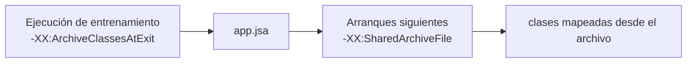
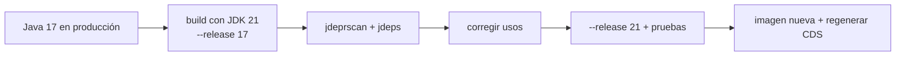

# Módulo 14: Java en producción — memoria, benchmarks y runtime seguro

El proyecto anterior usa concurrencia y produce un artefacto reproducible. Para operarlo profesionalmente todavía debes demostrar que los hilos observan estado válido, que las optimizaciones no engañan tus mediciones, que datos hostiles no construyen objetos arbitrarios y que el runtime puede actualizarse y diagnosticarse. Este módulo trabaja esas fronteras con experimentos.


## Aprende construyendo


### Tema 1: Compartir memoria requiere orden y visibilidad · Avanzado · 45 min

<details open>
<summary><strong>Capa 1 — Lectura</strong></summary>

#### ► DE QUÉ TRATA
Este tema te guía por compartir memoria requiere orden y visibilidad con foco en comprensión antes de implementación.

#### ► LA IDEA EN UNA FRASE
**Entender compartir memoria requiere orden y visibilidad te permite tomar mejores decisiones técnicas.**

#### ► POR QUÉ EXISTE ESTO
Resuelve un problema real de diseño o implementación y evita decisiones a ciegas.

#### ► LA ANALOGÍA
Piensa en compartir memoria requiere orden y visibilidad como una herramienta de taller: útil cuando conoces su propósito y sus límites.
**Dónde se rompe la analogía:** en software, los efectos dependen del contexto, la escala y los trade-offs.

#### ► CÓMO FUNCIONA
1. Identifica el problema que compartir memoria requiere orden y visibilidad resuelve.
2. Observa sus componentes y relaciones.
3. Aplica la opción más simple que funcione.
4. Verifica el resultado y los límites.

#### ► LO QUE PUEDE SALIR MAL
| Síntoma | Causa probable | Arreglo |
|---|---|---|
| Compartir memoria requiere orden y visibilidad se aplica pero el resultado no mejora | Se usó sin medir el problema real | Mide antes y compara contra la alternativa simple |
| Aparece complejidad inesperada | Se adoptó la técnica sin comprender sus trade-offs | Vuelve a la sección de trade-offs y reduce el alcance |
| Falla en un caso límite | Se asumió un contexto que no se cumple | Prueba el caso límite y documenta cuándo NO usarlo |

#### ► TRADE-OFFS
| Opción | Cuándo usarla | Cuándo NO usarla |
|---|---|---|
| Usar Compartir memoria requiere orden y visibilidad | Cuando el problema coincide con su propósito y el beneficio es observable | Cuando agrega complejidad sin resolver un problema real |
| Alternativa más simple | Cuando el contexto es pequeño, estable o fácil de razonar | Cuando ya demostró no escalar o no cumplir el requisito |
| Postergar la decisión | Cuando falta evidencia del problema | Cuando el costo de esperar es mayor que el costo de probar |

#### ► CUÁNDO NO USAR ESTO
No uses compartir memoria requiere orden y visibilidad por defecto. Aplícalo cuando el problema lo justifique y puedas verificar el beneficio; si una alternativa más simple resuelve igual, prefiérela.

#### ► DE VUELTA A LA ANALOGÍA
Volviendo a la analogía: compartir memoria requiere orden y visibilidad funciona como el modelo inicial, pero recuerda dónde se rompe: en producción importan la evidencia, la escala y el costo de equivocarte.

#### ► LO QUE DEBES RECORDAR
- Compartir memoria requiere orden y visibilidad existe para resolver un problema específico.
- Mide antes de adoptar complejidad.
- Conoce el caso donde NO usarlo.
- Verifica con evidencia observable.

#### ► PREGUNTAS PARA PENSAR
1. ¿Qué problema concreto resuelve compartir memoria requiere orden y visibilidad en tu contexto?
2. ¿Cómo sabrías que compartir memoria requiere orden y visibilidad no está funcionando bien?
3. ¿Qué alternativa más simple considerarías antes de usar compartir memoria requiere orden y visibilidad?

</details>

<details>
<summary><strong>Capa 2 — Construcción</strong></summary>

#### Código y verificación
```java
// src/Inventario.java
public class Inventario {
    private int disponibles;
    private int reservados;

    public synchronized boolean reservar() {
        if (disponibles <= 0) return false;
        disponibles--;
        reservados++;
        return true;
    }
}
```

```bash
javac -d out src/Inventario.java
java -cp out Inventario
```

</details>

### Tema 2: La JVM optimiza y puede invalidar un cronómetro ingenuo · Avanzado · 45 min

<details open>
<summary><strong>Capa 1 — Lectura</strong></summary>

#### ► DE QUÉ TRATA
Este tema te guía por la jvm optimiza y puede invalidar un cronómetro ingenuo con foco en comprensión antes de implementación.

#### ► LA IDEA EN UNA FRASE
**Entender la jvm optimiza y puede invalidar un cronómetro ingenuo te permite tomar mejores decisiones técnicas.**

#### ► POR QUÉ EXISTE ESTO
Resuelve un problema real de diseño o implementación y evita decisiones a ciegas.

#### ► LA ANALOGÍA
Piensa en la jvm optimiza y puede invalidar un cronómetro ingenuo como una herramienta de taller: útil cuando conoces su propósito y sus límites.
**Dónde se rompe la analogía:** en software, los efectos dependen del contexto, la escala y los trade-offs.

#### ► CÓMO FUNCIONA
1. Identifica el problema que la jvm optimiza y puede invalidar un cronómetro ingenuo resuelve.
2. Observa sus componentes y relaciones.
3. Aplica la opción más simple que funcione.
4. Verifica el resultado y los límites.

#### ► LO QUE PUEDE SALIR MAL
| Síntoma | Causa probable | Arreglo |
|---|---|---|
| La JVM optimiza y puede invalidar un cronómetro ingenuo se aplica pero el resultado no mejora | Se usó sin medir el problema real | Mide antes y compara contra la alternativa simple |
| Aparece complejidad inesperada | Se adoptó la técnica sin comprender sus trade-offs | Vuelve a la sección de trade-offs y reduce el alcance |
| Falla en un caso límite | Se asumió un contexto que no se cumple | Prueba el caso límite y documenta cuándo NO usarlo |

#### ► TRADE-OFFS
| Opción | Cuándo usarla | Cuándo NO usarla |
|---|---|---|
| Usar La JVM optimiza y puede invalidar un cronómetro ingenuo | Cuando el problema coincide con su propósito y el beneficio es observable | Cuando agrega complejidad sin resolver un problema real |
| Alternativa más simple | Cuando el contexto es pequeño, estable o fácil de razonar | Cuando ya demostró no escalar o no cumplir el requisito |
| Postergar la decisión | Cuando falta evidencia del problema | Cuando el costo de esperar es mayor que el costo de probar |

#### ► CUÁNDO NO USAR ESTO
No uses la jvm optimiza y puede invalidar un cronómetro ingenuo por defecto. Aplícalo cuando el problema lo justifique y puedas verificar el beneficio; si una alternativa más simple resuelve igual, prefiérela.

#### ► DE VUELTA A LA ANALOGÍA
Volviendo a la analogía: la jvm optimiza y puede invalidar un cronómetro ingenuo funciona como el modelo inicial, pero recuerda dónde se rompe: en producción importan la evidencia, la escala y el costo de equivocarte.

#### ► LO QUE DEBES RECORDAR
- La JVM optimiza y puede invalidar un cronómetro ingenuo existe para resolver un problema específico.
- Mide antes de adoptar complejidad.
- Conoce el caso donde NO usarlo.
- Verifica con evidencia observable.

#### ► PREGUNTAS PARA PENSAR
1. ¿Qué problema concreto resuelve la jvm optimiza y puede invalidar un cronómetro ingenuo en tu contexto?
2. ¿Cómo sabrías que la jvm optimiza y puede invalidar un cronómetro ingenuo no está funcionando bien?
3. ¿Qué alternativa más simple considerarías antes de usar la jvm optimiza y puede invalidar un cronómetro ingenuo?

</details>

<details>
<summary><strong>Capa 2 — Construcción</strong></summary>

#### Código y verificación
```java
// src/main/java/BusquedaBenchmark.java
@State(Scope.Thread)
public class BusquedaBenchmark {
    private int[] datos;

    @Setup
    public void preparar() { datos = /* arreglo ordenado preparado */ new int[0]; }

    @Benchmark
    public int busquedaBinaria(Blackhole bh) {
        int indice = Arrays.binarySearch(datos, 42);
        bh.consume(indice);
        return indice;
    }
}
```

```bash
mvn clean verify
java -jar target/benchmarks.jar -wi 2 -i 3 -f 1
```

</details>

### Tema 3: Deserializar es permitir construcción y comportamiento · Avanzado · 45 min

<details open>
<summary><strong>Capa 1 — Lectura</strong></summary>

#### ► DE QUÉ TRATA
Este tema te guía por deserializar es permitir construcción y comportamiento con foco en comprensión antes de implementación.

#### ► LA IDEA EN UNA FRASE
**Entender deserializar es permitir construcción y comportamiento te permite tomar mejores decisiones técnicas.**

#### ► POR QUÉ EXISTE ESTO
Resuelve un problema real de diseño o implementación y evita decisiones a ciegas.

#### ► LA ANALOGÍA
Piensa en deserializar es permitir construcción y comportamiento como una herramienta de taller: útil cuando conoces su propósito y sus límites.
**Dónde se rompe la analogía:** en software, los efectos dependen del contexto, la escala y los trade-offs.

#### ► CÓMO FUNCIONA
1. Identifica el problema que deserializar es permitir construcción y comportamiento resuelve.
2. Observa sus componentes y relaciones.
3. Aplica la opción más simple que funcione.
4. Verifica el resultado y los límites.

#### ► LO QUE PUEDE SALIR MAL
| Síntoma | Causa probable | Arreglo |
|---|---|---|
| Deserializar es permitir construcción y comportamiento se aplica pero el resultado no mejora | Se usó sin medir el problema real | Mide antes y compara contra la alternativa simple |
| Aparece complejidad inesperada | Se adoptó la técnica sin comprender sus trade-offs | Vuelve a la sección de trade-offs y reduce el alcance |
| Falla en un caso límite | Se asumió un contexto que no se cumple | Prueba el caso límite y documenta cuándo NO usarlo |

#### ► TRADE-OFFS
| Opción | Cuándo usarla | Cuándo NO usarla |
|---|---|---|
| Usar Deserializar es permitir construcción y comportamiento | Cuando el problema coincide con su propósito y el beneficio es observable | Cuando agrega complejidad sin resolver un problema real |
| Alternativa más simple | Cuando el contexto es pequeño, estable o fácil de razonar | Cuando ya demostró no escalar o no cumplir el requisito |
| Postergar la decisión | Cuando falta evidencia del problema | Cuando el costo de esperar es mayor que el costo de probar |

#### ► CUÁNDO NO USAR ESTO
No uses deserializar es permitir construcción y comportamiento por defecto. Aplícalo cuando el problema lo justifique y puedas verificar el beneficio; si una alternativa más simple resuelve igual, prefiérela.

#### ► DE VUELTA A LA ANALOGÍA
Volviendo a la analogía: deserializar es permitir construcción y comportamiento funciona como el modelo inicial, pero recuerda dónde se rompe: en producción importan la evidencia, la escala y el costo de equivocarte.

#### ► LO QUE DEBES RECORDAR
- Deserializar es permitir construcción y comportamiento existe para resolver un problema específico.
- Mide antes de adoptar complejidad.
- Conoce el caso donde NO usarlo.
- Verifica con evidencia observable.

#### ► PREGUNTAS PARA PENSAR
1. ¿Qué problema concreto resuelve deserializar es permitir construcción y comportamiento en tu contexto?
2. ¿Cómo sabrías que deserializar es permitir construcción y comportamiento no está funcionando bien?
3. ¿Qué alternativa más simple considerarías antes de usar deserializar es permitir construcción y comportamiento?

</details>

<details>
<summary><strong>Capa 2 — Construcción</strong></summary>

#### Código y verificación
```java
// src/EntradaJson.java
public record Registro(String guia, String estado) {}

// Jackson con un esquema cerrado: rechaza campos no declarados
ObjectMapper mapper = JsonMapper.builder()
    .configure(DeserializationFeature.FAIL_ON_UNKNOWN_PROPERTIES, true)
    .build();
```

```bash
mvn test
```

</details>

### Tema 4: El runtime es parte del artefacto y necesita ciclo de vida · Avanzado · 45 min

<details open>
<summary><strong>Capa 1 — Lectura</strong></summary>

#### ► DE QUÉ TRATA
Este tema te guía por el runtime es parte del artefacto y necesita ciclo de vida con foco en comprensión antes de implementación.

#### ► LA IDEA EN UNA FRASE
**Entender el runtime es parte del artefacto y necesita ciclo de vida te permite tomar mejores decisiones técnicas.**

#### ► POR QUÉ EXISTE ESTO
Resuelve un problema real de diseño o implementación y evita decisiones a ciegas.

#### ► LA ANALOGÍA
Piensa en el runtime es parte del artefacto y necesita ciclo de vida como una herramienta de taller: útil cuando conoces su propósito y sus límites.
**Dónde se rompe la analogía:** en software, los efectos dependen del contexto, la escala y los trade-offs.

#### ► CÓMO FUNCIONA
1. Identifica el problema que el runtime es parte del artefacto y necesita ciclo de vida resuelve.
2. Observa sus componentes y relaciones.
3. Aplica la opción más simple que funcione.
4. Verifica el resultado y los límites.

#### ► LO QUE PUEDE SALIR MAL
| Síntoma | Causa probable | Arreglo |
|---|---|---|
| El runtime es parte del artefacto y necesita ciclo de vida se aplica pero el resultado no mejora | Se usó sin medir el problema real | Mide antes y compara contra la alternativa simple |
| Aparece complejidad inesperada | Se adoptó la técnica sin comprender sus trade-offs | Vuelve a la sección de trade-offs y reduce el alcance |
| Falla en un caso límite | Se asumió un contexto que no se cumple | Prueba el caso límite y documenta cuándo NO usarlo |

#### ► TRADE-OFFS
| Opción | Cuándo usarla | Cuándo NO usarla |
|---|---|---|
| Usar El runtime es parte del artefacto y necesita ciclo de vida | Cuando el problema coincide con su propósito y el beneficio es observable | Cuando agrega complejidad sin resolver un problema real |
| Alternativa más simple | Cuando el contexto es pequeño, estable o fácil de razonar | Cuando ya demostró no escalar o no cumplir el requisito |
| Postergar la decisión | Cuando falta evidencia del problema | Cuando el costo de esperar es mayor que el costo de probar |

#### ► CUÁNDO NO USAR ESTO
No uses el runtime es parte del artefacto y necesita ciclo de vida por defecto. Aplícalo cuando el problema lo justifique y puedas verificar el beneficio; si una alternativa más simple resuelve igual, prefiérela.

#### ► DE VUELTA A LA ANALOGÍA
Volviendo a la analogía: el runtime es parte del artefacto y necesita ciclo de vida funciona como el modelo inicial, pero recuerda dónde se rompe: en producción importan la evidencia, la escala y el costo de equivocarte.

#### ► LO QUE DEBES RECORDAR
- El runtime es parte del artefacto y necesita ciclo de vida existe para resolver un problema específico.
- Mide antes de adoptar complejidad.
- Conoce el caso donde NO usarlo.
- Verifica con evidencia observable.

#### ► PREGUNTAS PARA PENSAR
1. ¿Qué problema concreto resuelve el runtime es parte del artefacto y necesita ciclo de vida en tu contexto?
2. ¿Cómo sabrías que el runtime es parte del artefacto y necesita ciclo de vida no está funcionando bien?
3. ¿Qué alternativa más simple considerarías antes de usar el runtime es parte del artefacto y necesita ciclo de vida?

</details>

<details>
<summary><strong>Capa 2 — Construcción</strong></summary>

#### Código y verificación
```bash
jdeps --multi-release 25 --print-module-deps target/rutas.jar
jlink --add-modules academia.rutas --module-path "$JAVA_HOME/jmods:out" --output runtime-rutas
cd runtime-rutas/bin && java -m academia.rutas/academia.rutas.app.Main
```

</details>

### Tema 5: Arranque más rápido: archivos CDS y la caché AOT · Avanzado · 40 min

<details open>
<summary><strong>Capa 1 — Lectura</strong></summary>

#### ► DE QUÉ TRATA
Usa JDK 21 o superior para CDS. Para la caché AOT necesitas JDK 24 o superior. Crea la carpeta academia-labs/java/arranque.

#### ► LA IDEA EN UNA FRASE
**Usa JDK 21 o superior para CDS.**

#### ► POR QUÉ EXISTE ESTO
Resuelve un problema real de diseño o implementación y evita decisiones a ciegas.

#### ► LA ANALOGÍA
**Conceptos clave:** CDS (*Class Data Sharing*), archivo compartido, `-XX:ArchiveClassesAtExit`, `-XX:SharedArchiveFile`, `-Xlog:class+load`, caché AOT, ejecución de entrenamiento.

Al arrancar, la JVM lee cada clase, la verifica y crea sus estructuras internas. **CDS** guarda ese resultado en un archivo que se mapea en memoria en el siguiente arranque.

- El JDK ya trae un archivo CDS para sus propias clases.
- Con `-XX:ArchiveClassesAtExit=app.jsa`, la JVM guarda al terminar **también las clases de tu aplicación** (deben venir de un JAR).
- Con `-XX:SharedArchiveFile=app.jsa` la usas en los siguientes arranques.

**Caché AOT (JDK 24 y 25):** va más allá: guarda clases ya cargadas y enlazadas, y en JDK 25 también perfiles de métodos. En JDK 25 basta una ejecución de entrenamiento con `-XX:AOTCacheOutput=app.aot` y luego `-XX:AOTCache=app.aot`.

**Analogía:** CDS es dejar la mesa puesta desde la noche anterior: por la mañana solo te sientas. La analogía falla en que, si cambias el menú (la versión de la aplicación o del JDK), la mesa puesta ya no sirve y hay que volver a ponerla.

**Límite de uso:** el archivo depende de la versión exacta del JDK y del classpath: si cambian, la JVM lo ignora con un aviso. Regenéralo en cada build. No acelera el código que ya está corriendo, solo el arranque.



**Dónde se rompe la analogía:** el modelo simplifica la realidad; en producción influyen escala, fallos, costo y contexto.

#### ► CÓMO FUNCIONA


#### ► LO QUE PUEDE SALIR MAL
| Síntoma | Causa probable | Arreglo |
|---|---|---|
| Arranque más rápido: archivos CDS y la caché AOT se aplica pero el resultado no mejora | Se usó sin medir el problema real | Mide antes y compara contra la alternativa simple |
| Aparece complejidad inesperada | Se adoptó la técnica sin comprender sus trade-offs | Vuelve a la sección de trade-offs y reduce el alcance |
| Falla en un caso límite | Se asumió un contexto que no se cumple | Prueba el caso límite y documenta cuándo NO usarlo |

#### ► TRADE-OFFS
| Opción | Cuándo usarla | Cuándo NO usarla |
|---|---|---|
| Usar Arranque más rápido: archivos CDS y la caché AOT | Cuando el problema coincide con su propósito y el beneficio es observable | Cuando agrega complejidad sin resolver un problema real |
| Alternativa más simple | Cuando el contexto es pequeño, estable o fácil de razonar | Cuando ya demostró no escalar o no cumplir el requisito |
| Postergar la decisión | Cuando falta evidencia del problema | Cuando el costo de esperar es mayor que el costo de probar |

#### ► CUÁNDO NO USAR ESTO
No uses arranque más rápido: archivos cds y la caché aot por defecto. Aplícalo cuando el problema lo justifique y puedas verificar el beneficio; si una alternativa más simple resuelve igual, prefiérela.

#### ► DE VUELTA A LA ANALOGÍA
Volviendo a la analogía: arranque más rápido: archivos cds y la caché aot funciona como el modelo inicial, pero recuerda dónde se rompe: en producción importan la evidencia, la escala y el costo de equivocarte.

#### ► LO QUE DEBES RECORDAR
- Arranque más rápido: archivos CDS y la caché AOT existe para resolver un problema específico.
- Mide antes de adoptar complejidad.
- Conoce el caso donde NO usarlo.
- Verifica con evidencia observable.

#### ► PREGUNTAS PARA PENSAR
1. ¿Qué problema concreto resuelve arranque más rápido: archivos cds y la caché aot en tu contexto?
2. ¿Cómo sabrías que arranque más rápido: archivos cds y la caché aot no está funcionando bien?
3. ¿Qué alternativa más simple considerarías antes de usar arranque más rápido: archivos cds y la caché aot?

</details>

<details>
<summary><strong>Capa 2 — Construcción</strong></summary>

#### Código y verificación


```java
import java.time.LocalDate;
import java.util.List;
import java.util.stream.Collectors;

public class Arranque {
    public static void main(String[] args) {
        var paradas = List.of("Bodega", "Calle 26", "Cliente");
        System.out.println(paradas.stream().collect(Collectors.joining(" -> ")) + " · " + LocalDate.of(2026, 11, 18));
    }
}
```

```bash
cd academia-labs/java/arranque
javac Arranque.java && jar --create --file app.jar Arranque.class
java -XX:ArchiveClassesAtExit=app.jsa -cp app.jar Arranque          # entrenamiento: crea app.jsa
java -Xshare:off -Xlog:class+load:file=sin.log -cp app.jar Arranque  # sin CDS
java -XX:SharedArchiveFile=app.jsa -Xlog:class+load:file=con.log -cp app.jar Arranque
grep -c "shared objects file" sin.log con.log
```

```text
Bodega -> Calle 26 -> Cliente · 2026-11-18
sin.log:0
con.log:652
```

</details>

### Tema 6: Migrar entre versiones LTS: de 17 a 21 y 25 con jdeprscan y jdeps · Avanzado · 45 min

<details open>
<summary><strong>Capa 1 — Lectura</strong></summary>

#### ► DE QUÉ TRATA
Usa el JDK de destino (21 o superior); jdeprscan y jdeps vienen incluidos. Crea la carpeta academia-labs/java/migracion con una subcarpeta legado/.

#### ► LA IDEA EN UNA FRASE
**Usa el JDK de destino (21 o superior); jdeprscan y jdeps vienen incluidos.**

#### ► POR QUÉ EXISTE ESTO
Resuelve un problema real de diseño o implementación y evita decisiones a ciegas.

#### ► LA ANALOGÍA
Piensa en migrar entre versiones lts: de 17 a 21 y 25 con jdeprscan y jdeps como una herramienta de taller: útil cuando conoces su propósito y sus límites.
**Dónde se rompe la analogía:** en software, los efectos dependen del contexto, la escala y los trade-offs.

#### ► CÓMO FUNCIONA


#### ► LO QUE PUEDE SALIR MAL
| Síntoma | Causa probable | Arreglo |
|---|---|---|
| Migrar entre versiones LTS: de 17 a 21 y 25 con jdeprscan y jdeps se aplica pero el resultado no mejora | Se usó sin medir el problema real | Mide antes y compara contra la alternativa simple |
| Aparece complejidad inesperada | Se adoptó la técnica sin comprender sus trade-offs | Vuelve a la sección de trade-offs y reduce el alcance |
| Falla en un caso límite | Se asumió un contexto que no se cumple | Prueba el caso límite y documenta cuándo NO usarlo |

#### ► TRADE-OFFS
| Opción | Cuándo usarla | Cuándo NO usarla |
|---|---|---|
| Usar Migrar entre versiones LTS: de 17 a 21 y 25 con jdeprscan y jdeps | Cuando el problema coincide con su propósito y el beneficio es observable | Cuando agrega complejidad sin resolver un problema real |
| Alternativa más simple | Cuando el contexto es pequeño, estable o fácil de razonar | Cuando ya demostró no escalar o no cumplir el requisito |
| Postergar la decisión | Cuando falta evidencia del problema | Cuando el costo de esperar es mayor que el costo de probar |

#### ► CUÁNDO NO USAR ESTO
No uses migrar entre versiones lts: de 17 a 21 y 25 con jdeprscan y jdeps por defecto. Aplícalo cuando el problema lo justifique y puedas verificar el beneficio; si una alternativa más simple resuelve igual, prefiérela.

#### ► DE VUELTA A LA ANALOGÍA
Volviendo a la analogía: migrar entre versiones lts: de 17 a 21 y 25 con jdeprscan y jdeps funciona como el modelo inicial, pero recuerda dónde se rompe: en producción importan la evidencia, la escala y el costo de equivocarte.

#### ► LO QUE DEBES RECORDAR
- Migrar entre versiones LTS: de 17 a 21 y 25 con jdeprscan y jdeps existe para resolver un problema específico.
- Mide antes de adoptar complejidad.
- Conoce el caso donde NO usarlo.
- Verifica con evidencia observable.

#### ► PREGUNTAS PARA PENSAR
1. ¿Qué problema concreto resuelve migrar entre versiones lts: de 17 a 21 y 25 con jdeprscan y jdeps en tu contexto?
2. ¿Cómo sabrías que migrar entre versiones lts: de 17 a 21 y 25 con jdeprscan y jdeps no está funcionando bien?
3. ¿Qué alternativa más simple considerarías antes de usar migrar entre versiones lts: de 17 a 21 y 25 con jdeprscan y jdeps?

</details>

<details>
<summary><strong>Capa 2 — Construcción</strong></summary>

#### Código y verificación


```java
import java.util.Date;

public class Legado {
    public static void main(String[] args) throws Exception {
        Integer peso = new Integer(5);              // obsoleto desde Java 9, marcado para eliminar
        Date fecha = new Date(2026 - 1900, 10, 18); // constructor obsoleto desde Java 1.1
        Runtime.getRuntime().runFinalization();     // marcado para eliminar desde Java 18
        System.out.println("peso " + peso + ", año " + (fecha.getYear() + 1900));
    }
}
```

```bash
cd academia-labs/java/migracion
javac -d legado/out legado/Legado.java
jdeprscan --release 21 --class-path legado/out Legado
jdeps --jdk-internals legado/out
```

```text
class Legado uses deprecated method java/lang/Integer::<init>(I)V (forRemoval=true)
class Legado uses deprecated method java/util/Date::<init>(III)V
class Legado uses deprecated method java/lang/Runtime::runFinalization()V (forRemoval=true)
class Legado uses deprecated method java/util/Date::getYear()I
```

</details>

### Java LTS frente a entregas semestrales

<details open>
<summary><strong>Capa 1 — Lectura</strong></summary>

#### ► DE QUÉ TRATA
Este tema te guía por java lts frente a entregas semestrales con foco en comprensión antes de implementación.

#### ► LA IDEA EN UNA FRASE
**Entender java lts frente a entregas semestrales te permite tomar mejores decisiones técnicas.**

#### ► POR QUÉ EXISTE ESTO
Resuelve un problema real de diseño o implementación y evita decisiones a ciegas.

#### ► LA ANALOGÍA
Piensa en java lts frente a entregas semestrales como una herramienta de taller: útil cuando conoces su propósito y sus límites.
**Dónde se rompe la analogía:** en software, los efectos dependen del contexto, la escala y los trade-offs.

#### ► CÓMO FUNCIONA
1. Identifica el problema que java lts frente a entregas semestrales resuelve.
2. Observa sus componentes y relaciones.
3. Aplica la opción más simple que funcione.
4. Verifica el resultado y los límites.

#### ► LO QUE PUEDE SALIR MAL
| Síntoma | Causa probable | Arreglo |
|---|---|---|
| Java LTS frente a entregas semestrales se aplica pero el resultado no mejora | Se usó sin medir el problema real | Mide antes y compara contra la alternativa simple |
| Aparece complejidad inesperada | Se adoptó la técnica sin comprender sus trade-offs | Vuelve a la sección de trade-offs y reduce el alcance |
| Falla en un caso límite | Se asumió un contexto que no se cumple | Prueba el caso límite y documenta cuándo NO usarlo |

#### ► TRADE-OFFS
| Opción | Cuándo usarla | Cuándo NO usarla |
|---|---|---|
| Usar Java LTS frente a entregas semestrales | Cuando el problema coincide con su propósito y el beneficio es observable | Cuando agrega complejidad sin resolver un problema real |
| Alternativa más simple | Cuando el contexto es pequeño, estable o fácil de razonar | Cuando ya demostró no escalar o no cumplir el requisito |
| Postergar la decisión | Cuando falta evidencia del problema | Cuando el costo de esperar es mayor que el costo de probar |

#### ► CUÁNDO NO USAR ESTO
No uses java lts frente a entregas semestrales por defecto. Aplícalo cuando el problema lo justifique y puedas verificar el beneficio; si una alternativa más simple resuelve igual, prefiérela.

#### ► DE VUELTA A LA ANALOGÍA
Volviendo a la analogía: java lts frente a entregas semestrales funciona como el modelo inicial, pero recuerda dónde se rompe: en producción importan la evidencia, la escala y el costo de equivocarte.

#### ► LO QUE DEBES RECORDAR
- Java LTS frente a entregas semestrales existe para resolver un problema específico.
- Mide antes de adoptar complejidad.
- Conoce el caso donde NO usarlo.
- Verifica con evidencia observable.

#### ► PREGUNTAS PARA PENSAR
1. ¿Qué problema concreto resuelve java lts frente a entregas semestrales en tu contexto?
2. ¿Cómo sabrías que java lts frente a entregas semestrales no está funcionando bien?
3. ¿Qué alternativa más simple considerarías antes de usar java lts frente a entregas semestrales?

</details>

<details>
<summary><strong>Capa 2 — Construcción</strong></summary>

#### Nota de construcción
Este tema es principalmente conceptual en esta versión. La verificación se realiza con las preguntas de comprensión y el criterio de cuándo NO usar java lts frente a entregas semestrales.

</details>

### Proyecto: endurecimiento medible del procesador concurrente

<details open>
<summary><strong>Capa 1 — Lectura</strong></summary>

#### ► DE QUÉ TRATA
Este tema te guía por proyecto: endurecimiento medible del procesador concurrente con foco en comprensión antes de implementación.

#### ► LA IDEA EN UNA FRASE
**Entender proyecto: endurecimiento medible del procesador concurrente te permite tomar mejores decisiones técnicas.**

#### ► POR QUÉ EXISTE ESTO
Resuelve un problema real de diseño o implementación y evita decisiones a ciegas.

#### ► LA ANALOGÍA
Piensa en proyecto: endurecimiento medible del procesador concurrente como una herramienta de taller: útil cuando conoces su propósito y sus límites.
**Dónde se rompe la analogía:** en software, los efectos dependen del contexto, la escala y los trade-offs.

#### ► CÓMO FUNCIONA
1. Identifica el problema que proyecto: endurecimiento medible del procesador concurrente resuelve.
2. Observa sus componentes y relaciones.
3. Aplica la opción más simple que funcione.
4. Verifica el resultado y los límites.

#### ► LO QUE PUEDE SALIR MAL
| Síntoma | Causa probable | Arreglo |
|---|---|---|
| Proyecto: endurecimiento medible del procesador concurrente se aplica pero el resultado no mejora | Se usó sin medir el problema real | Mide antes y compara contra la alternativa simple |
| Aparece complejidad inesperada | Se adoptó la técnica sin comprender sus trade-offs | Vuelve a la sección de trade-offs y reduce el alcance |
| Falla en un caso límite | Se asumió un contexto que no se cumple | Prueba el caso límite y documenta cuándo NO usarlo |

#### ► TRADE-OFFS
| Opción | Cuándo usarla | Cuándo NO usarla |
|---|---|---|
| Usar Proyecto: endurecimiento medible del procesador concurrente | Cuando el problema coincide con su propósito y el beneficio es observable | Cuando agrega complejidad sin resolver un problema real |
| Alternativa más simple | Cuando el contexto es pequeño, estable o fácil de razonar | Cuando ya demostró no escalar o no cumplir el requisito |
| Postergar la decisión | Cuando falta evidencia del problema | Cuando el costo de esperar es mayor que el costo de probar |

#### ► CUÁNDO NO USAR ESTO
No uses proyecto: endurecimiento medible del procesador concurrente por defecto. Aplícalo cuando el problema lo justifique y puedas verificar el beneficio; si una alternativa más simple resuelve igual, prefiérela.

#### ► DE VUELTA A LA ANALOGÍA
Volviendo a la analogía: proyecto: endurecimiento medible del procesador concurrente funciona como el modelo inicial, pero recuerda dónde se rompe: en producción importan la evidencia, la escala y el costo de equivocarte.

#### ► LO QUE DEBES RECORDAR
- Proyecto: endurecimiento medible del procesador concurrente existe para resolver un problema específico.
- Mide antes de adoptar complejidad.
- Conoce el caso donde NO usarlo.
- Verifica con evidencia observable.

#### ► PREGUNTAS PARA PENSAR
1. ¿Qué problema concreto resuelve proyecto: endurecimiento medible del procesador concurrente en tu contexto?
2. ¿Cómo sabrías que proyecto: endurecimiento medible del procesador concurrente no está funcionando bien?
3. ¿Qué alternativa más simple considerarías antes de usar proyecto: endurecimiento medible del procesador concurrente?

</details>

<details>
<summary><strong>Capa 2 — Construcción</strong></summary>

#### Nota de construcción
Este tema es principalmente conceptual en esta versión. La verificación se realiza con las preguntas de comprensión y el criterio de cuándo NO usar proyecto: endurecimiento medible del procesador concurrente.

</details>

### Método de estudio y proyecto de ampliación

<details open>
<summary><strong>Capa 1 — Lectura</strong></summary>

#### ► DE QUÉ TRATA
Este tema te guía por método de estudio y proyecto de ampliación con foco en comprensión antes de implementación.

#### ► LA IDEA EN UNA FRASE
**Entender método de estudio y proyecto de ampliación te permite tomar mejores decisiones técnicas.**

#### ► POR QUÉ EXISTE ESTO
Resuelve un problema real de diseño o implementación y evita decisiones a ciegas.

#### ► LA ANALOGÍA
Piensa en método de estudio y proyecto de ampliación como una herramienta de taller: útil cuando conoces su propósito y sus límites.
**Dónde se rompe la analogía:** en software, los efectos dependen del contexto, la escala y los trade-offs.

#### ► CÓMO FUNCIONA
1. Identifica el problema que método de estudio y proyecto de ampliación resuelve.
2. Observa sus componentes y relaciones.
3. Aplica la opción más simple que funcione.
4. Verifica el resultado y los límites.

#### ► LO QUE PUEDE SALIR MAL
| Síntoma | Causa probable | Arreglo |
|---|---|---|
| Método de estudio y proyecto de ampliación se aplica pero el resultado no mejora | Se usó sin medir el problema real | Mide antes y compara contra la alternativa simple |
| Aparece complejidad inesperada | Se adoptó la técnica sin comprender sus trade-offs | Vuelve a la sección de trade-offs y reduce el alcance |
| Falla en un caso límite | Se asumió un contexto que no se cumple | Prueba el caso límite y documenta cuándo NO usarlo |

#### ► TRADE-OFFS
| Opción | Cuándo usarla | Cuándo NO usarla |
|---|---|---|
| Usar Método de estudio y proyecto de ampliación | Cuando el problema coincide con su propósito y el beneficio es observable | Cuando agrega complejidad sin resolver un problema real |
| Alternativa más simple | Cuando el contexto es pequeño, estable o fácil de razonar | Cuando ya demostró no escalar o no cumplir el requisito |
| Postergar la decisión | Cuando falta evidencia del problema | Cuando el costo de esperar es mayor que el costo de probar |

#### ► CUÁNDO NO USAR ESTO
No uses método de estudio y proyecto de ampliación por defecto. Aplícalo cuando el problema lo justifique y puedas verificar el beneficio; si una alternativa más simple resuelve igual, prefiérela.

#### ► DE VUELTA A LA ANALOGÍA
Volviendo a la analogía: método de estudio y proyecto de ampliación funciona como el modelo inicial, pero recuerda dónde se rompe: en producción importan la evidencia, la escala y el costo de equivocarte.

#### ► LO QUE DEBES RECORDAR
- Método de estudio y proyecto de ampliación existe para resolver un problema específico.
- Mide antes de adoptar complejidad.
- Conoce el caso donde NO usarlo.
- Verifica con evidencia observable.

#### ► PREGUNTAS PARA PENSAR
1. ¿Qué problema concreto resuelve método de estudio y proyecto de ampliación en tu contexto?
2. ¿Cómo sabrías que método de estudio y proyecto de ampliación no está funcionando bien?
3. ¿Qué alternativa más simple considerarías antes de usar método de estudio y proyecto de ampliación?

</details>

<details>
<summary><strong>Capa 2 — Construcción</strong></summary>

#### Nota de construcción
Este tema es principalmente conceptual en esta versión. La verificación se realiza con las preguntas de comprensión y el criterio de cuándo NO usar método de estudio y proyecto de ampliación.

</details>
