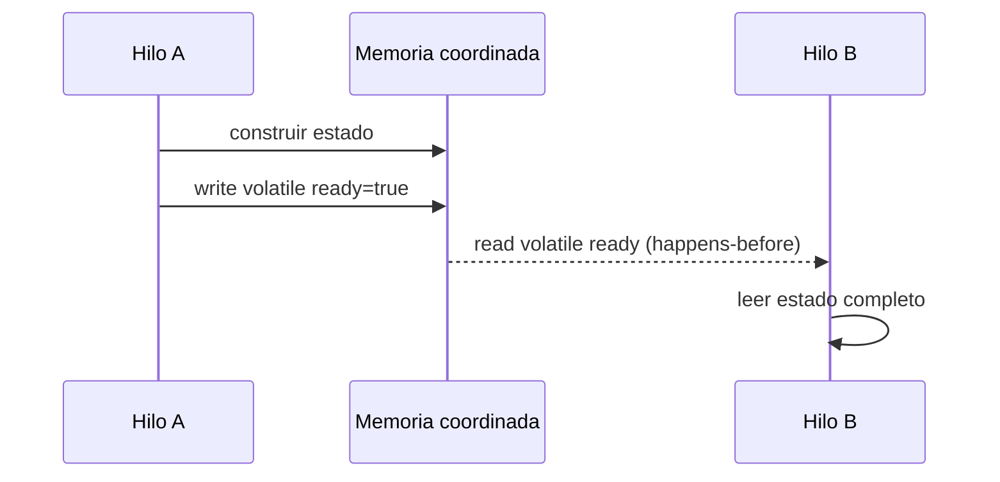
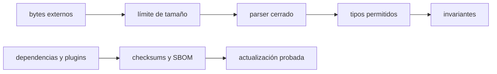
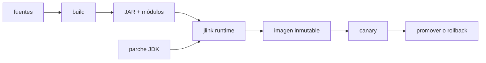

# Módulo 14: Java en producción — memoria, benchmarks y runtime seguro

El proyecto anterior usa concurrencia y produce un artefacto reproducible. Ahora debes demostrar que los hilos observan estado válido, que las optimizaciones no engañan tus mediciones, que datos hostiles no construyen objetos arbitrarios y que el runtime puede actualizarse y diagnosticarse. Cada experimento se crea desde una carpeta vacía.

## Aprende construyendo

### Tema 1: Compartir memoria requiere orden y visibilidad · Experto · 60 min

#### Aprende

**Prerrequisito:** JDK 27 y threads básicos. Comprueba `java --version`.

**Al terminar podrás:** explicar una relación happens-before, observar un fallo de visibilidad con una espera acotada y corregir una bandera de parada con `volatile` sin confundir visibilidad con atomicidad.

Un `WorkerControl` con una bandera compartida sin sincronización puede seguir leyendo un valor antiguo aunque otro hilo ya haya escrito `true`. El Java Memory Model no promete visibilidad por intuición: una escritura y una lectura necesitan una relación happens-before.

**¿Por qué es importante?** Porque estos defectos dependen del JIT, la arquitectura y el timing; pueden desaparecer al añadir logs y reaparecer bajo carga.

**Analogía:** dos pizarras privadas no se sincronizan solas; `volatile` es el protocolo que hace visible la última escritura.

Escribir y después leer el mismo campo `volatile` establece happens-before. También lo establecen desbloquear y bloquear el mismo monitor, las acciones anteriores a `Thread.start` y la terminación de un hilo antes de que `join` retorne. `volatile` no vuelve atómico `counter++`: para read-modify-write usa `AtomicLong`, `LongAdder` o un lock.



Un record tampoco vuelve inmutables sus componentes. Usa `Map.copyOf` u otra copia defensiva antes de publicar colecciones. OpenJDK jcstress permite explorar intercalados, pero una ejecución sin fallo no demuestra corrección.

#### Practica

Crea una carpeta vacía `ejemplo-visibilidad-volatile` y dentro un archivo `Visibilidad.java`:

```java
public final class Visibilidad {
    static final class WorkerControl {
        private boolean stopped;
        private long iterations;

        void stop() {
            stopped = true;
        }

        void runLoop() {
            while (!stopped) {
                iterations++;
            }
        }
    }

    public static void main(String[] args) throws InterruptedException {
        var control = new WorkerControl();
        var worker = Thread.ofPlatform().start(control::runLoop);
        Thread.sleep(1000);
        control.stop();
        worker.join(500);
        System.out.println("terminado=" + !worker.isAlive());
        System.out.println("iteraciones=" + control.iterations);
        System.exit(worker.isAlive() ? 1 : 0);
    }
}
```

Ejecuta desde esa carpeta:

```bash
java Visibilidad.java
```

El `join` acotado y `System.exit` evitan que el experimento quede colgado. En una ejecución observada con JDK 27 se obtuvo `terminado=false`; el JMM permite ese resultado, pero no garantiza que ocurra en todas las máquinas o ejecuciones. No uses `iteraciones` como medición fiable: también hay una carrera de datos.

**Corrección:** cambia la declaración a `private volatile boolean stopped;` y vuelve a ejecutar. El hilo debe terminar y el programa debe mostrar `terminado=true`.

**Fallo deliberado adicional:** sustituye la bandera por un contador `long` incrementado desde dos threads hasta un millón por thread. El total puede ser menor que dos millones. Añadir `volatile` no corrige la secuencia leer-sumar-escribir; reemplázala por `AtomicLong.incrementAndGet()`.

**Si falla.** Si la versión sin `volatile` termina, no concluyas que sea correcta: has observado otra ejecución permitida. Conserva la explicación happens-before y repite solo si necesitas volver a observar el síntoma.

#### Aplica

Crea `ConfiguracionRuta.java` con un record que reciba un `Map<String, Integer>` y haga una copia defensiva. Publica una instancia mediante un campo `volatile` y escribe dos clases: una actualiza la configuración completa y otra la lee. Añade un contador con `AtomicLong` y explica por qué no usas `volatile` para incrementarlo.

**Cuándo no usarlo:** `volatile` no protege invariantes compuestos ni secuencias leer-modificar-escribir; usa `AtomicLong`, un lock o una operación atómica que abarque el invariante completo.

**Checklist de salida**

- [ ] La bandera de parada es `volatile`.
- [ ] La espera del experimento está acotada.
- [ ] Una ejecución sin fallo no se presenta como prueba formal.
- [ ] Los incrementos compuestos usan atomicidad.
- [ ] Las colecciones publicadas tienen copia defensiva.
- [ ] Cada mecanismo se relaciona con su garantía happens-before.

**Proyecto integrador:** revisa el procesador del Módulo 13, enumera su estado compartido y documenta el mecanismo de publicación de cada dato.

**Errores comunes:** marcar todo `volatile`, publicar `this` desde un constructor y confundir inmutabilidad superficial con profunda.

Fuente oficial: [Java Language Specification, capítulo 17](https://docs.oracle.com/javase/specs/jls/se21/html/jls-17.html).

### Tema 2: La JVM optimiza y puede invalidar un cronómetro ingenuo · Experto · 65 min

#### Aprende

**Prerrequisito:** JDK 27 y Maven 3.9 o superior.

**Al terminar podrás:** construir un benchmark JMH con calentamiento, parámetros y consumo de resultados, y distinguir una operación medida de otra eliminable por el JIT.

Una sola llamada a `System.nanoTime()` mezcla carga de clases, compilación, GC y planificación. Si el resultado no se devuelve ni se consume, el JIT puede eliminar el cálculo. JMH organiza warmup, iteraciones y forks.

**¿Por qué es importante?** Porque una medición falsa puede justificar una optimización que empeora el servicio real.

**Analogía:** cronometrar a un atleta mientras se ata los zapatos mezcla preparación y carrera.

Un método `@Benchmark` que **devuelve** el resultado ya lo pone a disposición de JMH. No necesita además `Blackhole`. En un método `void`, consume el resultado con `Blackhole` para que no quede muerto.


Un microbenchmark explica una función, no la latencia de usuario. Registra JDK, CPU, SO, flags, forks, error e intervalos; confirma después con carga y JFR.

#### Practica

Crea `ejemplo-jmh-cronometro/pom.xml` manualmente. Declara el artefacto `search-benchmark`, `maven.compiler.release` en `27`, UTF-8 y la propiedad `jmh.version` en `1.37`. Añade dependencias `jmh-core` y `jmh-generator-annprocess` con esa versión; la segunda usa ámbito `provided`.

Dentro de `build/plugins`, añade `maven-compiler-plugin` `3.14.1` con esta ruta de procesamiento:

```xml
<configuration>
  <annotationProcessorPaths>
    <path>
      <groupId>org.openjdk.jmh</groupId>
      <artifactId>jmh-generator-annprocess</artifactId>
      <version>${jmh.version}</version>
    </path>
  </annotationProcessorPaths>
</configuration>
```

Añade `maven-shade-plugin` `3.6.2`, ejecútalo en la fase `package` con el goal `shade`, fija `finalName` a `benchmarks` y configura `ManifestResourceTransformer` con `org.openjdk.jmh.Main` como `mainClass`.

Crea `src/main/java/academia/bench/SearchBenchmark.java`:

```java
package academia.bench;

import java.util.List;
import java.util.concurrent.TimeUnit;
import java.util.stream.IntStream;
import org.openjdk.jmh.annotations.*;
import org.openjdk.jmh.infra.Blackhole;

@State(Scope.Thread)
@BenchmarkMode(Mode.AverageTime)
@OutputTimeUnit(TimeUnit.NANOSECONDS)
public class SearchBenchmark {
    @Param({"100", "10000"})
    int size;
    List<Integer> values;

    @Setup
    public void setup() {
        values = IntStream.range(0, size).boxed().toList();
    }

    @Benchmark
    public void linearConsumido(Blackhole blackhole) {
        blackhole.consume(values.indexOf(size - 1));
    }

    @Benchmark
    public int linearDevuelto() {
        return values.indexOf(size - 1);
    }

    @Benchmark
    public void linearEliminable() {
        int result = values.indexOf(size - 1);
    }
}
```

Compila y ejecuta una medición corta de diagnóstico:

```bash
mvn clean package
java -jar target/benchmarks.jar -wi 1 -w 1s -i 2 -r 1s -f 1
```

**Resultado esperado:** JMH genera `META-INF/BenchmarkList` y ejecuta seis combinaciones: tres métodos por dos tamaños. Compara las columnas `Score` y `Error`, no solo una ejecución. Para un resultado publicable aumenta warmups, iteraciones y forks.

**Fallo deliberado:** `linearEliminable` ya contiene el error: calcula un resultado local que nadie usa. Su tiempo puede resultar anormalmente bajo porque el trabajo es eliminable. Restaura el consumo devolviendo `result` o pasándolo a `Blackhole`.

**Si falla.** Si aparece `Unable to find the resource: /META-INF/BenchmarkList`, falta el procesador de anotaciones en la compilación; revisa `annotationProcessorPaths` y vuelve a ejecutar `mvn clean package`.

#### Aplica

Añade `Collections.binarySearch(values, size - 1)` como cuarto benchmark y el tamaño `1000000`. Ejecuta la configuración completa elegida y documenta el entorno. Escribe una conclusión condicionada a los datos; después contrasta el resultado con una carga del servicio.

**Cuándo no usarlo:** si dos implementaciones difieren claramente en orden de complejidad, el análisis puede bastar; reserva JMH para una pregunta acotada y confirma cualquier mejora con carga end-to-end y percentiles de usuario.

**Checklist de salida**

- [ ] El proyecto y el POM se crearon manualmente.
- [ ] El procesador JMH genera la lista de benchmarks.
- [ ] Cada cálculo se devuelve o se consume.
- [ ] La preparación queda fuera de la operación medida.
- [ ] La medición incluye warmup, iteraciones y forks.
- [ ] La conclusión registra error y entorno.

**Proyecto integrador:** formula una pregunta de optimización del procesador del Módulo 13 y conserva el benchmark que la responde.

**Errores comunes:** cronometrar una sola llamada, medir setup accidentalmente y extrapolar nanosegundos a latencia de usuario.

Fuente oficial: [OpenJDK JMH](https://openjdk.org/projects/code-tools/jmh/).

### Tema 3: Deserializar es permitir construcción y comportamiento · Experto · 60 min

#### Aprende

**Prerrequisito:** JDK 27, records e I/O de bytes.

**Al terminar podrás:** crear una deserialización nativa acotada con `ObjectInputFilter`, aceptar un DTO permitido y rechazar un tipo inesperado antes de usarlo.

La serialización nativa puede ejecutar callbacks mientras reconstruye un grafo. Para entradas nuevas prefiere JSON con DTO cerrado y validación; conserva `ObjectInputStream` solo en una frontera legacy controlada.

**¿Por qué es importante?** Porque los bytes externos se convierten en objetos con memoria y comportamiento dentro del proceso.

**Analogía:** no es leer una carta, sino aceptar un kit que puede ensamblar máquinas durante el desembalaje.

Una allowlist restringe tipos; `maxdepth`, `maxrefs` y `maxbytes` limitan complejidad. Después valida invariantes del DTO. El filtro no reemplaza autenticación, límites HTTP ni validación de negocio.



#### Practica

Crea `ejemplo-objectinputfilter/academia/dto/ImportBatch.java`:

```java
package academia.dto;

import java.io.Serial;
import java.io.Serializable;
import java.util.List;

public record ImportBatch(List<String> items) implements Serializable {
    @Serial
    private static final long serialVersionUID = 1L;
}
```

Crea `academia/dto/Unexpected.java` para representar un tipo que nunca debe entrar en este protocolo:

```java
package academia.dto;

import java.io.Serial;
import java.io.Serializable;

public record Unexpected(String value) implements Serializable {
    @Serial
    private static final long serialVersionUID = 1L;
}
```

Crea en la carpeta raíz `FiltroDemo.java`:

```java
import academia.dto.ImportBatch;
import academia.dto.Unexpected;
import java.io.*;
import java.util.ArrayList;
import java.util.List;

public final class FiltroDemo {
    static byte[] serialize(Object value) throws IOException {
        var bytes = new ByteArrayOutputStream();
        try (var output = new ObjectOutputStream(bytes)) {
            output.writeObject(value);
        }
        return bytes.toByteArray();
    }

    static Object read(byte[] bytes, boolean filtered) throws Exception {
        try (var input = new ObjectInputStream(new ByteArrayInputStream(bytes))) {
            if (filtered) {
                input.setObjectInputFilter(ObjectInputFilter.Config.createFilter(
                        "maxdepth=8;maxrefs=100;maxbytes=4096;"
                        + "academia.dto.ImportBatch;java.base/*;!*"));
            }
            return input.readObject();
        }
    }

    public static void main(String[] args) throws Exception {
        byte[] valid = serialize(new ImportBatch(new ArrayList<>(List.of("RF-1"))));
        System.out.println("valido=" + read(valid, true));

        byte[] unexpected = serialize(new Unexpected("tipo inesperado"));
        System.out.println("sin-filtro=" + read(unexpected, false).getClass().getName());
        try {
            System.out.println(read(unexpected, true));
        } catch (Exception e) {
            System.out.println("con-filtro=" + e.getClass().getSimpleName()
                    + ": " + e.getMessage());
        }
    }
}
```

Compila y ejecuta:

```bash
javac -d out academia/dto/ImportBatch.java academia/dto/Unexpected.java FiltroDemo.java
java -cp out FiltroDemo
```

**Resultado esperado:** primero aparece `valido=ImportBatch[items=[RF-1]]`; después `sin-filtro=academia.dto.Unexpected` y finalmente `con-filtro=InvalidClassException: filter status: REJECTED`. El filtro por sí solo no sustituye la comprobación del DTO ni la validación de sus campos.

**Fallo deliberado:** elimina `java.base/*` dejando únicamente el DTO y `!*`. La deserialización del lote válido también será rechazada porque `ArrayList` y su array interno necesitan clases de `java.base`. Restaura la regla y reduce después la allowlist a las clases estrictamente necesarias, incluidos los arrays observados.

**Si falla.** `filter status: REJECTED` indica que debes identificar qué clase o límite rechazó el filtro; no respondas abriendo `!*` a `*`. Ajusta una regla concreta y vuelve a probar el tipo hostil.

#### Aplica

Añade en `ImportBatch` una validación que rechace listas vacías y códigos en blanco. Prueba un lote con más de cien referencias y otro que supere 4096 bytes. Después crea una alternativa JSON con DTO cerrado y documenta por qué ya no necesita `ObjectInputFilter`.

**Checklist de salida**

- [ ] El DTO y el programa se escribieron desde cero.
- [ ] La allowlist termina en `!*`.
- [ ] Profundidad, referencias y bytes tienen límites.
- [ ] El DTO válido se deserializa correctamente.
- [ ] El tipo inesperado se diagnostica sin usarse.
- [ ] Los invariantes se validan antes de procesar el lote.

**Proyecto integrador:** aísla la entrada legacy del procesador detrás de un adaptador y conserva las pruebas hostiles.

**Errores comunes:** usar una denylist de gadgets, ampliar el filtro hasta aceptar todo y validar solo después de construir un grafo ilimitado.

Fuente oficial: [Serialization Filtering](https://docs.oracle.com/en/java/javase/25/core/serialization-filtering1.html).

### Tema 4: El runtime es parte del artefacto y necesita ciclo de vida · Experto · 60 min

#### Aprende

**Prerrequisito:** JDK 27 con `jdeps` y `jlink`; comprueba `java --version`.

**Al terminar podrás:** derivar módulos desde un JAR, construir un runtime con `jlink`, ejecutar la aplicación dentro de ese runtime y diagnosticar un módulo ausente.

Un JAR no define el runtime. `jdeps` descubre dependencias y `jlink` enlaza módulos en una imagen autocontenida. Reduce tamaño y módulos incluidos, pero el equipo debe reconstruirla con cada actualización relevante del JDK.

**¿Por qué es importante?** Porque seguridad, diagnóstico y memoria dependen del runtime exacto desplegado, no del JDK del portátil.

**Analogía:** una caja de herramientas a medida es más liviana, pero no recibe herramientas reparadas hasta que la reconstruyes.



`-Xmx` limita heap, no metaspace, stacks, buffers ni memoria nativa. En contenedor deja margen, usa usuario no root y forma exec para recibir señales. Versiona JAR y runtime, y define rollback compatible con los datos.

#### Practica

Crea `ejemplo-jlink-runtime/src/academia/runtime/RuntimeDemo.java`. Construye un `HttpClient` y un `HttpRequest`, pero no envíes tráfico: el objetivo es comprobar módulos, no depender de una red.

```java
package academia.runtime;

import java.net.URI;
import java.net.http.HttpClient;
import java.net.http.HttpRequest;
import java.util.logging.Logger;

public final class RuntimeDemo {
    private static final Logger LOG = Logger.getLogger(RuntimeDemo.class.getName());

    public static void main(String[] args) {
        HttpClient client = HttpClient.newHttpClient();
        HttpRequest request = HttpRequest.newBuilder(
                URI.create("http://127.0.0.1:9/salud")).GET().build();
        LOG.info(() -> "cliente=" + client.version() + ", destino=" + request.uri());
    }
}
```

Compila, empaqueta y consulta los módulos:

```bash
export JAVA_HOME="$(/usr/libexec/java_home -v 27)"
export PATH="$JAVA_HOME/bin:$PATH"
javac -d classes src/academia/runtime/RuntimeDemo.java
jar --create --file app.jar --main-class academia.runtime.RuntimeDemo -C classes .
jdeps --print-module-deps --ignore-missing-deps app.jar
```

**Resultado esperado:** `java.base,java.logging,java.net.http`. Construye y ejecuta el runtime completo:

```bash
jlink --add-modules java.base,java.logging,java.net.http \
  --strip-debug --no-header-files --no-man-pages \
  --output build/runtime
build/runtime/bin/java -jar app.jar
du -sh build/runtime "$JAVA_HOME"
```

Debe aparecer un log con `cliente=HTTP_2` y el URI local. En el entorno de referencia el runtime ocupó 48 MB frente a 296 MB del JDK; tus cifras pueden variar y debes medirlas en tu máquina.

**Fallo deliberado:** crea otra imagen con `--add-modules java.base,java.net.http --output build/runtime-sin-log` y ejecútala. La aplicación fallará por la ausencia de `java.util.logging`, normalmente con `NoClassDefFoundError`. Reconstruye con los tres módulos indicados por `jdeps`.

**Si falla.** Si `jdeps` no muestra un módulo usado solo mediante reflexión o `ServiceLoader`, la detección estática no basta: declara esa necesidad tras una prueba de ejecución. No añadas todos los módulos para ocultar el diagnóstico.

#### Aplica

Genera el argumento `--add-modules` desde la salida real de `jdeps`, documenta los módulos y compara tamaños. Añade un `Runtime.getRuntime().addShutdownHook(...)` que cierre un recurso con deadline y escribe un runbook para reconstruir el runtime ante un parche del JDK.

**Checklist de salida**

- [ ] El JAR contiene la clase creada manualmente.
- [ ] `jdeps` identifica los tres módulos.
- [ ] El runtime personalizado ejecuta el JAR.
- [ ] El fallo por módulo ausente queda diagnosticado.
- [ ] Los tamaños se miden en el entorno actual.
- [ ] El runbook versiona y reconstruye JAR y runtime.

**Proyecto integrador:** empaqueta el procesador del Módulo 13 con su runtime y conserva el artefacto anterior para rollback.

**Errores comunes:** crear la imagen una sola vez, fijar `-Xmx` igual al límite del contenedor y olvidar dependencias dinámicas.

Fuente oficial: [jlink](https://docs.oracle.com/en/java/javase/25/docs/specs/man/jlink.html).

## Revisión oficial de plataforma — octubre de 2026

Para producción, la base recomendada sigue siendo la LTS más reciente, **Java 25 LTS**. El curso exige **JDK 27** para estudiar la evolución de la plataforma sin confundir previews con contratos permanentes. Antes de adoptar una función nueva registra su JEP y estado, compila y prueba en el JDK objetivo y evita publicar artefactos que necesiten `--enable-preview` salvo decisión explícita.

## Construcción guiada del capítulo

### Proyecto: endurecimiento medible del procesador concurrente

Parte del proyecto creado en el Módulo 13 y conserva una copia funcional anterior.

1. Identifica cada estado compartido, su invariante y mecanismo happens-before.
2. Crea el experimento de visibilidad y corrígelo con el mecanismo mínimo.
3. Compara `volatile`, `AtomicLong`, `LongAdder` y lock solo donde tengan semántica equivalente.
4. Escribe benchmarks JMH con forks, warmup, parámetros y resultados consumidos.
5. Contrasta la optimización bajo carga del servicio y JFR; revierte si no mejora el objetivo.
6. Sustituye serialización nativa por DTO JSON cerrado; si conservas un caso legacy, aplica filtro y límites.
7. Prueba tipo no permitido, profundidad, array enorme, payload inválido y secreto ausente.
8. Fija versiones, registra dependencias y prueba cualquier actualización.
9. Usa `jdeps` y `jlink`; compara módulos, tamaño y arranque.
10. Construye el despliegue no root con límite de memoria, healthcheck y JFR habilitable.
11. Documenta parche JDK, canary, compatibilidad, backup y rollback.

**Verificación:** entrega grafo happens-before, salida JMH con entorno, pruebas hostiles, módulos jlink, tamaños y runbook. La revisión de jcstress, SBOM, contenedor y análisis visual de JFR permanece como revisión manual pendiente si no se ejecuta en el entorno correspondiente.

**Errores comunes y soluciones**

- Marcar todo volatile: protege visibilidad, no invariantes compuestos.
- Confiar en que no falló el stress: justifica con el JMM.
- Cronometrar un loop: usa JMH y consume resultados.
- Deserializar sin límites: restringe durante la construcción del grafo.
- Fijar `-Xmx` igual al límite: deja margen para memoria no heap.
- Crear jlink una vez: reconstruye ante actualizaciones del JDK.

<!-- OFFICIAL-TOPIC-ATLAS:START -->
## Atlas completo de temas oficiales

Derivado de la [documentación oficial](https://docs.oracle.com/en/java/javase/25/), sus referencias, migraciones y guías de operación. Inventariar no equivale a dominar: cada selección se demuestra con código, prueba, medición y explicación. **Cobertura: 49 temas.**

| Área | Temas que deben poder explicarse y aplicarse | Resultado verificable |
|---|---|---|
| Lenguaje | `tipos y control` · `objetos` · `records` · `sealed types` · `pattern matching` · `genéricos` · `anotaciones` · `JPMS` | tarifas |
| Biblioteca | `colecciones` · `streams` · `Optional` · `fechas` · `i18n` · `regex` · `NIO.2` · `HTTP Client` · `serialización segura` | tarifas |
| Concurrencia | `Java Memory Model` · `locks` · `atomics` · `concurrent collections` · `CompletableFuture` · `virtual threads` · `scoped values` · `structured concurrency` | tarifas |
| JVM | `bytecode` · `class loading` · `JIT` · `memoria` · `garbage collectors` · `Flight Recorder` · `jcmd y jstack` · `heap dumps` · `CDS y AOT` | tarifas |
| Integración | `JDBC` · `transacciones` · `ServiceLoader` · `reflection` · `method handles` · `Foreign Function and Memory API` · `JNI` | tarifas |
| Calidad | `JUnit` · `property testing` · `JMH` · `profiling` · `secure coding` · `criptografía` · `jlink y jpackage` · `migración LTS` | tarifas |

### Método de estudio y proyecto de ampliación

Para cada tema responde qué problema resuelve, cuál es su modelo mental, cómo falla, cómo se verifica y cuándo no conviene. Elige uno por área e intégralos en un proyecto propio de ampliación. Entrega diagrama, ADR, pruebas de éxito y fallo, una medición, una amenaza y el enlace oficial con versión y fecha. Una API preview se aísla en laboratorio y nunca se presenta como base estable.
<!-- OFFICIAL-TOPIC-ATLAS:END -->
