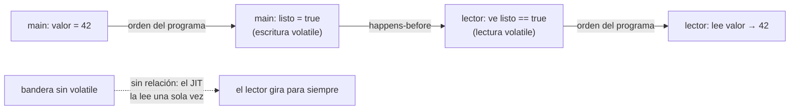
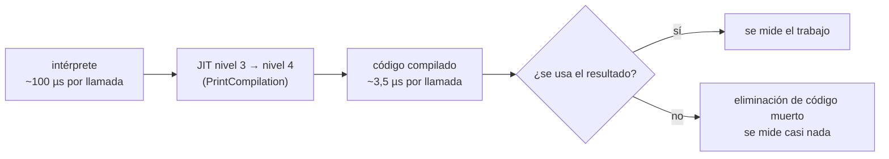
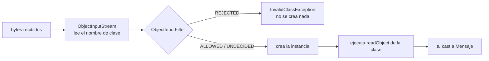
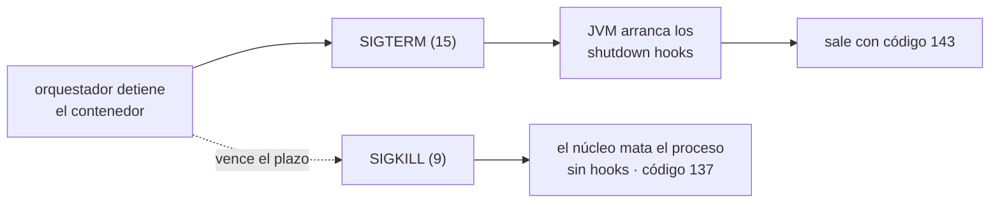
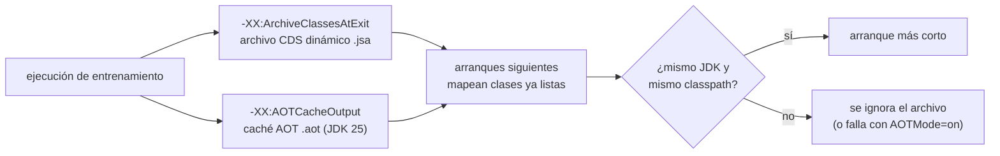
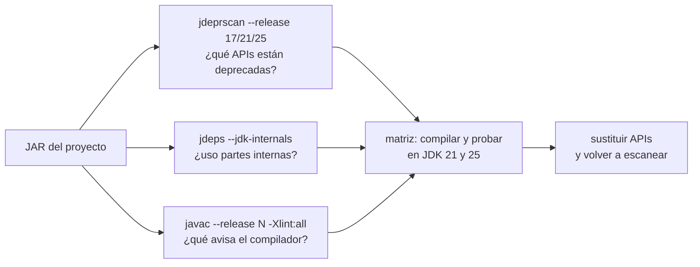

# Módulo 14: JVM, rendimiento y seguridad

**Entorno de las salidas.** Las salidas originales se capturaron el 2026-11-23 en `~/labs/aurora-m14` con macOS
arm64, JDK 27.0.1.0.2, Gradle 9.9.1 y toolchain Java 25 (ver «Entorno de referencia verificado»). Las salidas nuevas
de esta edición se capturaron el 2026-11-24 en Linux x86_64 con OpenJDK 25.0.5.1, y con OpenJDK 21.0.13.1 en el
Tema 6, usando `javac`, `jar`, `jlink` y `java` directos, sin Gradle. Son nuevas las salidas de los Problemas
resueltos, recuadros y pasos; las de «Cómo funciona» y «Verificación real» son las del Mac salvo donde se indica.
Tiempos, pids, tamaños y direcciones cambian en cada máquina y en cada corrida.

El runtime de Java no es un detalle invisible: decide cómo se ve la memoria entre hilos, cuándo se optimiza un método, qué objetos pueden crearse al deserializar y cómo se construye y apaga un artefacto. Este módulo trabaja esos bordes con ejemplos pequeños y verificables, y cierra con migración entre versiones LTS usando `jdeprscan` y `jdeps`.

## Apertura del módulo

**Al terminar este módulo podrás:**
- reproducir un fallo de visibilidad entre hilos y corregirlo con una relación *happens-before*;
- explicar por qué un cronómetro con `nanoTime()` no es un benchmark y qué controla JMH;
- rechazar clases no permitidas al deserializar con `ObjectInputFilter`;
- comprobar qué señales ejecutan un shutdown hook y construir una imagen mínima con `jlink`;
- reducir el arranque con un archivo CDS dinámico y una caché AOT de JDK 25;
- hacer el inventario de una migración LTS con `jdeprscan`, `jdeps` y una matriz de JDK.

**Esquema del módulo:**
1. Tema 1: modelo de memoria, *happens-before* y publicación segura.
2. Tema 2: microbenchmarks, código muerto y JMH.
3. Tema 3: deserialización nativa, gadgets y filtros.
4. Tema 4: shutdown hooks, señales e imagen con `jlink`.
5. Tema 5: CDS, archivo dinámico y caché AOT.
6. Tema 6: migración entre LTS con `jdeprscan` y `jdeps`.
7. Laboratorio integrador: runbook de producción de `tienda-aurora-java-m14`.

**Qué necesitas saber antes:** hilos, `volatile` y `AtomicInteger` (Java, Módulo 5); serialización y JSON (Java,
Módulo 6); Gradle (Java, Módulo 8); JUnit (Java, Módulo 9); módulos JPMS, `jdeps` y `jlink` (Java, Módulo 10); JIT,
calentamiento y JFR (Java, Módulo 11); señales y procesos (Fundamentos, Módulo 8).

## Visual del módulo

**Visual:** [Mapa de runtime JVM: visibilidad, JIT, deserialización y ciclo de vida](/visuals/temas/java/modulo-14-jvm-runtime.html)

Lectura: Visibilidad, JIT, deserialización y ciclo de vida son comportamientos de runtime que se diseñan y verifican.

## Proyecto desde cero: `tienda-aurora-java-m14`

#### Prerrequisitos

```bash
java -version
gradle --version
```

#### Bootstrap

Ejecuta estos comandos desde el directorio donde quieras crear el proyecto. Las rutas son completas y relativas a ese directorio.

```bash
mkdir -p tienda-aurora-java-m14/src/main/java/com/aurora/jvm
mkdir -p tienda-aurora-java-m14/src/test/java/com/aurora/jvm
cd tienda-aurora-java-m14
gradle wrapper --gradle-version 9.9.1
```

**Entorno de referencia verificado (2026-11-23):** macOS arm64, JDK 27.0.1.0.2, Gradle 9.9.1, toolchain Java 25, JUnit 5.13.4. Las herramientas `jlink`, `jdeps` y `jdeprscan` se invocan desde `$(/usr/libexec/java_home)/bin` porque no todas están en el `PATH` del shell.

#### Estructura final

```text
tienda-aurora-java-m14/
├── build.gradle.kts
├── settings.gradle.kts
├── gradlew
└── src/
    ├── main/java/
    │   ├── module-info.java
    │   └── com/aurora/jvm/
    │       ├── ApiObsoletaDemo.java
    │       ├── App.java
    │       ├── CicloVidaApp.java
    │       ├── CronometroIngenuo.java
    │       ├── DeserializacionSegura.java
    │       └── VisibilidadDemo.java
    └── test/java/com/aurora/jvm/JvmModuloTest.java
```

El build genera, además, `build/libs/tienda-aurora-java-m14-1.0.0.jar`, el archive CDS `build/aurora.jsa`, la grabación JFR `build/recording.jfr` y la imagen `build/runtime-aurora/`.

## Código completo, archivo por archivo

#### `settings.gradle.kts`

```kotlin
rootProject.name = "tienda-aurora-java-m14"
```

#### `build.gradle.kts`

```kotlin
plugins { java; application }
group = "com.aurora"
version = "1.0.0"
java { toolchain { languageVersion = JavaLanguageVersion.of(25) } }
repositories { mavenCentral() }
dependencies {
    testImplementation(platform("org.junit:junit-bom:5.13.4"))
    testImplementation("org.junit.jupiter:junit-jupiter")
    testRuntimeOnly("org.junit.platform:junit-platform-launcher")
}
application { mainClass = "com.aurora.jvm.App" }
tasks.test { useJUnitPlatform(); testLogging { events("passed","failed","skipped"); showStandardStreams=true } }
tasks.withType<JavaCompile>().configureEach {
    options.encoding = "UTF-8"
    options.compilerArgs.addAll(listOf("-Xlint:all","-Xlint:-processing","-Werror"))
}
```

#### `src/main/java/module-info.java`

```java
/** Módulo JPMS de la app Aurora: superficie explícita para jlink. */
module com.aurora.jvm {
    requires java.base;
    exports com.aurora.jvm;
}
```

`module-info.java` convierte el JAR en un módulo JPMS explícito: `exports com.aurora.jvm` define la superficie pública y `requires java.base` declara la única dependencia de runtime. Eso es lo que permite pasar el JAR a `jlink` con `--module-path`. Como el paquete está exportado y el compilador usa `-Xlint:all -Werror`, las clases con constructor implícito produjeron `[missing-explicit-ctor]` y hubo que declarar constructores explícitos. `VisibilidadDemo` tiene constructor `public` porque `App` la instancia; las utilidades estáticas tienen constructor `private`.

#### `src/main/java/com/aurora/jvm/VisibilidadDemo.java`

```java
package com.aurora.jvm;

import java.util.concurrent.CountDownLatch;
import java.util.concurrent.TimeUnit;
import java.util.concurrent.atomic.AtomicBoolean;

/** Demuestra visibilidad: con volatile el hilo lector ve la señal. */
public final class VisibilidadDemo {
    private volatile boolean listo = false;
    private int valor = 0;

    public String ejecutar() throws InterruptedException {
        CountDownLatch visto = new CountDownLatch(1);
        Thread lector = new Thread(() -> {
            while (!listo) {
                Thread.onSpinWait();
            }
            visto.countDown();
        }, "lector");
        lector.start();
        valor = 42;
        listo = true; // write volatile: publica valor=42 antes de listo=true
        boolean ok = visto.await(2, TimeUnit.SECONDS);
        lector.join(1000);
        return ok && valor == 42 ? "visible=42" : "timeout";
    }

    public VisibilidadDemo() {}
}
```

#### `src/main/java/com/aurora/jvm/CronometroIngenuo.java`

```java
package com.aurora.jvm;

/** Microbenchmark ingenuo: útil para mostrar por qué NO es confiable. */
public final class CronometroIngenuo {
    static int suma(int n) {
        int s = 0;
        for (int i = 0; i < n; i++) s += i;
        return s;
    }

    public static long medirUnaVez() {
        long t0 = System.nanoTime();
        int r = suma(10_000);
        long t1 = System.nanoTime();
        if (r == Integer.MIN_VALUE) System.out.println("nunca"); // evita dead-code obvio
        return t1 - t0;
    }

    private CronometroIngenuo() {}
}
```

#### `src/main/java/com/aurora/jvm/DeserializacionSegura.java`

```java
package com.aurora.jvm;

import java.io.ByteArrayInputStream;
import java.io.ByteArrayOutputStream;
import java.io.ObjectInputFilter;
import java.io.ObjectInputStream;
import java.io.ObjectOutputStream;
import java.io.Serializable;

public final class DeserializacionSegura {
    public record Mensaje(String texto) implements Serializable {}

    public static byte[] serializar(Serializable obj) throws Exception {
        try (ByteArrayOutputStream bos = new ByteArrayOutputStream();
             ObjectOutputStream out = new ObjectOutputStream(bos)) {
            out.writeObject(obj);
            out.flush();
            return bos.toByteArray();
        }
    }

    public static Object deserializarSeguro(byte[] bytes) throws Exception {
        ObjectInputFilter filtro = ObjectInputFilter.Config.createFilter(
                "com.aurora.jvm.DeserializacionSegura$Mensaje;java.lang.String;!*");
        try (ByteArrayInputStream bis = new ByteArrayInputStream(bytes);
             ObjectInputStream in = new ObjectInputStream(bis)) {
            in.setObjectInputFilter(filtro);
            return in.readObject();
        }
    }

    private DeserializacionSegura() {}
}
```

#### `src/main/java/com/aurora/jvm/CicloVidaApp.java`

```java
package com.aurora.jvm;

import java.util.concurrent.atomic.AtomicBoolean;

public final class CicloVidaApp {

    /** Variante de prueba: registra y retira el hook para no contaminar el test worker. */
    public static String simular() {
        AtomicBoolean cerrado = new AtomicBoolean(false);
        Thread hook = new Thread(() -> cerrado.set(true), "shutdown-demo");
        Runtime.getRuntime().addShutdownHook(hook);
        try {
            // En app real: cerrar pools, flush métricas, liberar recursos.
            return "hookRegistrado=" + true;
        } finally {
            Runtime.getRuntime().removeShutdownHook(hook);
        }
    }

    /** Variante de ejecución: mantiene el hook registrado hasta el apagado real de la JVM. */
    public static String registrarApagado() {
        Thread hook = new Thread(
                () -> System.out.println("shutdown-demo: limpieza ejecutada"),
                "shutdown-demo");
        Runtime.getRuntime().addShutdownHook(hook);
        return "hookRegistrado=" + true;
    }

    private CicloVidaApp() {}
}
```

#### `src/main/java/com/aurora/jvm/ApiObsoletaDemo.java`

```java
package com.aurora.jvm;

/** Demo controlada de APIs deprecadas para analizar con jdeprscan. */
@SuppressWarnings({"deprecation", "removal"})
public final class ApiObsoletaDemo {

    public static String explorar() {
        Integer numero = new Integer("7");
        SecurityManager manager = System.getSecurityManager();
        return "numero=" + numero + " securityManager=" + manager;
    }

    private ApiObsoletaDemo() {}
}
```

#### `src/main/java/com/aurora/jvm/App.java`

```java
package com.aurora.jvm;

public final class App {

    public static void main(String[] args) throws Exception {
        System.out.println(new VisibilidadDemo().ejecutar());
        System.out.println("ns=" + (CronometroIngenuo.medirUnaVez() >= 0));
        byte[] bytes = DeserializacionSegura.serializar(new DeserializacionSegura.Mensaje("hola"));
        Object obj = DeserializacionSegura.deserializarSeguro(bytes);
        System.out.println(obj);
        System.out.println(CicloVidaApp.registrarApagado());
        System.out.println(ApiObsoletaDemo.explorar());
    }

    private App() {}
}
```

#### `src/test/java/com/aurora/jvm/JvmModuloTest.java`

```java
package com.aurora.jvm;

import org.junit.jupiter.api.Test;

import static org.junit.jupiter.api.Assertions.*;

class JvmModuloTest {

    @Test
    void visibilidadConVolatile() throws Exception {
        assertEquals("visible=42", new VisibilidadDemo().ejecutar());
    }

    @Test
    void cronometroIngenuoRetornaNoNegativo() {
        assertTrue(CronometroIngenuo.medirUnaVez() >= 0);
    }

    @Test
    void deserializacionPermiteTipoAutorizado() throws Exception {
        byte[] bytes = DeserializacionSegura.serializar(new DeserializacionSegura.Mensaje("ok"));
        Object obj = DeserializacionSegura.deserializarSeguro(bytes);
        assertEquals("Mensaje[texto=ok]", obj.toString());
    }

    @Test
    void deserializacionRechazaTipoNoAutorizado() throws Exception {
        byte[] bytes = DeserializacionSegura.serializar(Integer.valueOf(7));
        assertThrows(Exception.class, () -> DeserializacionSegura.deserializarSeguro(bytes));
    }

    @Test
    void demoDeApisDeprecadasEjecuta() {
        assertEquals("numero=7 securityManager=null", ApiObsoletaDemo.explorar());
    }
}
```

### Tema 1: Compartir memoria requiere orden y visibilidad · Avanzado · 45 min

<details open>
<summary><strong>Capa 1 — Lectura</strong></summary>

#### Objetivos
Al terminar este tema podrás:
- reproducir un fallo de visibilidad y demostrar con `-Xint` que lo provoca la optimización del JIT;
- aplicar las reglas *happens-before* de `volatile`, `start()` y `join()` para predecir qué valor ve cada hilo;
- publicar un dato normal de forma segura a través de una escritura `volatile`;
- distinguir visibilidad de atomicidad y elegir entre `volatile`, `AtomicInteger` o un lock.

**Conceptos clave:** modelo de memoria de Java, happens-before, reordenamiento, publicación segura

Ya los conoces y no se repiten: *hilo*, *memoria compartida* y *condición de carrera* (Fundamentos, Módulo 5, Tema 2); *relación sucedió-antes* (Arquitectura, Módulo 1, Tema 5); `Thread`, `start` y `join` (Java, Módulo 5,
Tema 1); `CountDownLatch` (Java, Módulo 5, Tema 3); `volatile`, `AtomicInteger` y operación atómica (Java, Módulo 5,
Tema 4); compilador JIT (Java, Módulo 11, Tema 2).

#### El problema
El servicio de Tienda Aurora carga la tabla de precios en un hilo y la marca como lista con una bandera. Otro hilo
empieza a atender pedidos cuando ve la bandera. En las pruebas funciona; en producción, a veces el hilo de pedidos
no arranca nunca. ¿Qué garantiza que un hilo vea lo que otro escribió, y en qué orden lo ve?

#### Glosario del tema

**modelo de memoria de Java**
- **Definición técnica:** parte de la especificación del lenguaje (JLS, capítulo 17) que define qué valores puede leer un hilo cuando varios hilos usan los mismos campos; se abrevia JMM (*Java Memory Model*).
- **En palabras sencillas:** el reglamento que dice cuándo lo que escribe un hilo queda a la vista de los demás.
- **Dónde se rompe la comparación:** un reglamento suele prohibir; el JMM sobre todo permite: si ninguna regla aplica, leer un valor viejo es legal.
- **Ejemplo:** `VisibilidadRota.java` imprime `lector sigue vivo tras 2 s: true`; el JMM permite que el lector no vea nunca `listo = true`.
- **Error típico:** razonar como si hubiera una sola memoria que todos ven al instante; el JIT y la CPU trabajan con copias y reordenan.

**happens-before**
- **Definición técnica:** relación de orden del JMM: si la acción A *happens-before* B, B ve todo lo que A escribió. Nace del orden del programa, de la pareja escritura-lectura `volatile`, de `start()`, de `join()` y de los locks, y es transitiva.
- **En palabras sencillas:** una cadena de «esto pasó antes que aquello» que obliga a ver los cambios anteriores.
- **Dónde se rompe la comparación:** no habla del reloj: dos acciones pueden ocurrir una tras otra en el tiempo y no tener esta relación.
- **Ejemplo:** en `ReglasHappensBefore.java`, `main ve resultado=99` sin `volatile`, porque `join()` crea la relación.
- **Error típico:** creer que `Thread.sleep(500)` antes de leer crea la relación; dormir no sincroniza nada.

**reordenamiento**
- **Definición técnica:** cambio del orden de lecturas y escrituras que hacen el compilador JIT o la CPU, válido mientras el propio hilo no note la diferencia; incluye sacar una lectura fuera de un bucle (*hoisting*).
- **En palabras sencillas:** el cocinero cambia el orden de los pasos porque el plato le sale igual; quien mira desde fuera ve otro orden.
- **Dónde se rompe la comparación:** el cocinero no se salta pasos; el JIT sí puede leer un campo una sola vez si nada en ese hilo lo cambia.
- **Ejemplo:** `java -Xint VisibilidadRota.java`, sin JIT, termina con `lector vio valor=42`; con JIT, el lector se queda girando.
- **Error típico:** dar el código por correcto porque funciona con `-Xint` o con el depurador: ahí el JIT no optimiza igual.

**publicación segura**
- **Definición técnica:** entrega de un dato u objeto a otro hilo de forma que el receptor vea su estado completo: con un campo `volatile`, un lock, un campo `final` del constructor, `start()`/`join()` o una colección concurrente.
- **En palabras sencillas:** dejar el paquete completo en un buzón que el otro revisa, en vez de dejarlo en el suelo.
- **Dónde se rompe la comparación:** el buzón no es el dato sino la acción sincronizada; el dato puede ser un campo normal escrito antes.
- **Ejemplo:** en `VisibilidadDemo`, `valor = 42` es un campo normal; queda publicado porque se escribe antes de `listo = true`, que es `volatile`.
- **Error típico:** escribir la bandera antes del dato (`listo = true; valor = 42;`): un lector que vea `listo` puede leer `valor == 0`.

#### ► CÓMO FUNCIONA

##### 1. La idea en lenguaje sencillo

Dos cocineros comparten una pizarra. Uno escribe «salsa lista» y el otro, que espera ese aviso, empieza a servir. El
problema es que cada cocinero copió la pizarra en una libreta al empezar el turno y trabaja con su copia. Si nadie le
obliga a volver a mirar la pizarra, puede esperar para siempre un aviso que ya está escrito.

Eso pasó en Tienda Aurora. Un hilo carga los precios y pone una bandera en `true`. Otro hilo gira esperando la
bandera. En `VisibilidadRota.java`, el lector seguía vivo tras 2 segundos: `lector sigue vivo tras 2 s: true`.

Java no promete que un hilo vea al instante lo que escribe otro. Solo lo promete cuando entre las dos acciones existe
una relación concreta. Este tema enseña cuáles son esas relaciones y cómo construirlas a propósito.

##### 2. Definición formal y vocabulario

El **modelo de memoria de Java** (JMM, por *Java Memory Model*) es el capítulo 17 de la especificación del lenguaje.
Define qué valores puede devolver cada lectura de un campo compartido entre hilos. No describe cachés ni núcleos:
describe resultados permitidos.

Su pieza central es **happens-before**. Si la acción A *happens-before* la acción B, B ve todo lo que A escribió. En
lenguaje sencillo: una cadena de «esto pasó antes que aquello» que obliga a ver los cambios. La relación no tiene que
ver con el reloj. Dos acciones pueden ocurrir una tras otra en el tiempo sin estar relacionadas.

Cuando dos hilos acceden al mismo campo, al menos uno escribe y no hay happens-before entre ellos, el JMM lo llama
**carrera de datos** (*data race*). En una carrera, leer un valor viejo es un resultado legal.

El **reordenamiento** es el permiso que tienen el JIT y la CPU para cambiar el orden de lecturas y escrituras. Solo
deben respetar que el propio hilo no note la diferencia. Un caso extremo es el *hoisting*: sacar la lectura de un campo
fuera de un bucle porque, dentro de ese hilo, nadie la cambia.

La **publicación segura** es entregar un dato a otro hilo con una acción que crea happens-before. Así el receptor ve
el estado completo y no una versión a medias.

##### 3. Cómo funciona por dentro, paso a paso

Sigue primero el fallo de `VisibilidadRota.java`:

1. El hilo lector entra en `while (!listo)`. Al principio el intérprete ejecuta el bucle y lee `listo` en cada vuelta.
2. Tras miles de vueltas, el bucle se vuelve «caliente» y el JIT lo compila a código nativo.
3. El JIT analiza el cuerpo y ve que nada en ese hilo escribe `listo`. Como el campo no es `volatile`, puede leerlo una
   sola vez y convertir el bucle en uno infinito.
4. `main` escribe `listo = true` en memoria. El lector ya no mira el campo y nunca sale.
5. Con `-Xint` no hay JIT. El intérprete relee el campo en cada vuelta y el programa imprime `lector vio valor=42`.

Ahora sigue el arreglo de `VisibilidadDemo`, la clase del proyecto:

```java
private volatile boolean listo = false;
private int valor = 0;
// en el hilo principal:
valor = 42;
listo = true;   // escritura volatile: publica valor=42
```

1. `main` escribe `valor = 42`. Por el orden del programa, esta escritura ocurre antes que la siguiente.
2. `main` escribe `listo = true`. Al ser `volatile`, la JVM emite las barreras de memoria que la arquitectura necesite.
3. El lector lee `listo` en cada vuelta, porque el JIT no puede eliminar una lectura `volatile`.
4. Cuando la lectura devuelve `true`, la regla de `volatile` crea happens-before con la escritura de `main`.
5. Por transitividad, el lector también ve `valor == 42`, aunque `valor` sea un campo normal.



El diagrama muestra la cadena de cuatro eslabones. Si quitas el `volatile`, el eslabón central desaparece y queda la
rama inferior.

##### 4. Reglas, variantes y casos límite

La especificación (JLS §17.4.5) enumera las fuentes de happens-before. Las más usadas son estas:

- dentro de un hilo, cada acción ocurre antes que la siguiente en el orden del programa;
- una escritura `volatile` ocurre antes que toda lectura posterior de ese campo;
- liberar un monitor (`synchronized`) ocurre antes que el siguiente bloqueo del mismo monitor;
- la llamada a `start()` ocurre antes que cualquier acción del hilo iniciado;
- todo lo que hace un hilo ocurre antes de que otro vuelva con éxito de su `join()`.

La relación es transitiva. `ReglasHappensBefore.java` lo demuestra: dos campos normales bastan, porque `start()` y
`join()` crean los eslabones. Por eso `main ve resultado=99`.

`volatile` da visibilidad y orden, pero no atomicidad compuesta. `contador++` es leer, sumar y escribir. En
`ContadorVolatile.java` una corrida dio `volatile=191609` en vez de `200000`. Para eso usas `AtomicInteger` o un lock.

Dormir no sincroniza. `Thread.sleep` no crea happens-before, así que esperar 500 ms antes de leer no garantiza nada.

Hay casos límite con tipos de 64 bits. Según JLS §17.7, una escritura de `long` o `double` no `volatile` puede dividirse
en dos mitades de 32 bits. Otro hilo podría leer una mezcla. Con `volatile`, la escritura es indivisible.

Los campos `final` tienen su propia garantía (JLS §17.5). Si el constructor no deja escapar `this`, cualquier hilo que
vea el objeto ve sus campos `final` inicializados. Es otra forma de publicación segura.

El modelo actual nació con JSR-133 en Java 5. Desde Java 9, `VarHandle` (JEP 193) ofrece modos de acceso más finos,
como *acquire* y *release*. `Thread.onSpinWait()`, también de Java 9, solo avisa a la CPU de que el hilo gira; no
crea ninguna relación de memoria.

##### 5. Relación con lo que ya sabes y lo que viene

Este tema formaliza ideas de Java, Módulo 5: `Thread`, `start` y `join` (Tema 1), `CountDownLatch` (Tema 3) y
`volatile` con `AtomicInteger` (Tema 4). La relación sucedió-antes ya apareció en Arquitectura, Módulo 1, Tema 5, entre
servicios. Aquí la ves entre hilos de un mismo proceso.

El JIT de Java, Módulo 11, Tema 2 explica por qué el fallo aparece solo tras calentar el bucle. Es la misma
optimización que hace rápido tu código la que rompe el programa mal sincronizado.

No confundas visibilidad con atomicidad. La primera responde «¿lo ve el otro hilo?». La segunda responde «¿puede otro
hilo meterse en medio?». `volatile` resuelve solo la primera.

En el Tema 2 de este módulo verás al JIT desde el otro lado: cómo elimina código cuyo resultado nadie usa y por qué eso
invalida un cronómetro ingenuo. En el Módulo 13, el `ConcurrentHashMap` del repositorio ya publicaba los pedidos de
forma segura entre virtual threads.

#### Problema resuelto 1.1
Reproduce el fallo de visibilidad del problema y averigua quién lo provoca.

**Razonamiento:**
1. Un hilo lector gira mientras `listo` sea `false`; `main` cambia la bandera tras 500 ms.
2. El lector es daemon y `main` espera con `join(2000)`: el programa termina aunque el lector se atasque.
3. Si el fallo viene del JIT, debe desaparecer con `-Xint`, que solo interpreta.

```java
// VisibilidadRota.java — una bandera sin volatile que el hilo lector puede no ver nunca
public class VisibilidadRota {
    static boolean listo = false;          // sin volatile: no hay happens-before
    static int valor = 0;

    public static void main(String[] args) throws InterruptedException {
        Thread lector = new Thread(() -> {
            long vueltas = 0;
            while (!listo) {               // el JIT puede leer listo una sola vez
                vueltas++;
            }
            System.out.println("lector vio valor=" + valor + " tras " + vueltas + " vueltas");
        }, "lector");
        lector.setDaemon(true);            // si se queda atascado, no impide que la JVM termine
        lector.start();

        Thread.sleep(500);                 // deja que el bucle se vuelva caliente y se compile
        valor = 42;
        listo = true;
        lector.join(2000);                 // espera acotada
        System.out.println("lector sigue vivo tras 2 s: " + lector.isAlive());
    }
}
```

```text
$ java VisibilidadRota.java
lector sigue vivo tras 2 s: true
$ java VisibilidadRota.java
lector sigue vivo tras 2 s: true
$ java -Xint VisibilidadRota.java
lector vio valor=42 tras 45314755 vueltas
lector sigue vivo tras 2 s: false
```

**Explicación por partes.**
- Línea 3: `listo` es un campo normal. Ninguna acción relaciona la escritura de `main` con la lectura del lector.
- Líneas 9–11: en 500 ms de vueltas el JIT compila el bucle. Como nada en ese hilo cambia `listo`, lo lee una sola vez.
- Línea 19: `main` escribe `true`, pero el lector ya no mira el campo. Por eso nunca aparece la línea 12.
- Con `-Xint` el intérprete relee el campo en cada vuelta y el programa termina. El código no cambió: cambió la optimización.

Con `static volatile boolean listo` (archivo `VisibilidadVolatile.java`, igual salvo el nombre de la clase y la
línea 3) el lector termina siempre:

```text
$ java VisibilidadVolatile.java
lector vio valor=42 tras 1018506808 vueltas
lector sigue vivo tras 2 s: false
```

#### Problema resuelto 1.2
Comprueba qué ve cada hilo cuando la comunicación pasa por `start()` y `join()`, sin `volatile`.

**Razonamiento:**
1. Todo lo que `main` escribe antes de `start()` es visible para el hilo nuevo.
2. Todo lo que el hilo escribe antes de terminar es visible para quien vuelve de `join()`.
3. Entonces dos campos normales bastan si la comunicación sigue esas dos reglas.

```java
// ReglasHappensBefore.java — start() y join() publican campos normales sin volatile
public class ReglasHappensBefore {
    static String pedido;        // campo normal, sin volatile
    static int resultado;        // campo normal, sin volatile

    public static void main(String[] args) throws InterruptedException {
        pedido = "P-1";                                   // escrito ANTES de start()
        Thread trabajador = new Thread(() -> {
            System.out.println("trabajador ve pedido=" + pedido);   // regla de start()
            resultado = pedido.length() * 33;             // escrito antes de terminar
        }, "trabajador");
        trabajador.start();
        trabajador.join();                                // regla de join()
        System.out.println("main ve resultado=" + resultado);
    }
}
```

```text
$ java ReglasHappensBefore.java
trabajador ve pedido=P-1
main ve resultado=99
```

**Explicación por partes.**
- Línea 7: la escritura ocurre antes de `start()` (línea 12). La regla de `start()` la hace visible en la línea 9.
- Línea 10: el trabajador escribe `resultado`. La regla de `join()` (línea 13) la hace visible en la línea 14.
- `VisibilidadDemo` usa otro puente: la escritura `volatile` de `listo` publica la escritura anterior `valor = 42`.

> **Error común.** Usar `volatile` para contar. `volatile` da visibilidad, no atomicidad: `contador++` lee, suma y
> escribe en tres pasos, y dos hilos pueden pisarse. El fallo no aparece en todas las corridas:

```java
// ContadorVolatile.java — volatile da visibilidad, pero contador++ sigue sin ser atómico
import java.util.concurrent.atomic.AtomicInteger;

public class ContadorVolatile {
    static volatile int contador = 0;
    static final AtomicInteger atomico = new AtomicInteger();

    public static void main(String[] args) throws InterruptedException {
        Runnable tarea = () -> {
            for (int i = 0; i < 100_000; i++) {
                contador++;                 // leer, sumar, escribir: tres pasos
                atomico.incrementAndGet();  // un solo paso atómico
            }
        };
        Thread a = new Thread(tarea);
        Thread b = new Thread(tarea);
        a.start(); b.start();
        a.join(); b.join();
        System.out.println("esperado=200000 volatile=" + contador + " atomico=" + atomico.get());
    }
}
```

```text
$ java ContadorVolatile.java
esperado=200000 volatile=191609 atomico=200000
$ java ContadorVolatile.java
esperado=200000 volatile=200000 atomico=200000
$ java ContadorVolatile.java
esperado=200000 volatile=200000 atomico=200000
```

> La primera corrida perdió actualizaciones; las otras dos acertaron por azar. Ningún mensaje lo avisa: el síntoma
> es un total menor que `200000`. Usa `AtomicInteger` (línea 12) o un lock.

> **Buena práctica.** Publica siempre en este orden: primero los datos y al final la escritura `volatile` (o el
> `unlock`). El lector hace lo inverso: primero lee la bandera y después los datos.

> **Prevenir errores.** Una prueba que pasa no demuestra visibilidad. En las pruebas de concurrencia usa esperas
> acotadas (`join(2000)`, `await(2, SECONDS)`) para que un fallo produzca `timeout` en vez de colgar el build.

#### Checkpoint 1.1
Supón que el lector de `VisibilidadDemo` imprime `valor` al salir del bucle. ¿Qué garantiza el JMM si intercambias
las líneas `valor = 42;` y `listo = true;`?

Respuesta: nada sobre `valor`: podría imprimir `0` o `42`. La escritura de `valor` quedaría después de la escritura
`volatile` y fuera de la cadena *happens-before*. Con el orden original, el JMM garantiza `42`.

</details>

<details>
<summary><strong>Capa 2 — Construcción</strong></summary>

#### Paso 1 · Reproduce el fallo
En una carpeta de trabajo crea `VisibilidadRota.java` y ejecútalo dos veces con `java VisibilidadRota.java`. Después
ejecútalo con `java -Xint VisibilidadRota.java`. Anota en cada caso si aparece la línea `lector vio valor=42`.

#### Paso 2 · Corrige con volatile
Copia el archivo como `VisibilidadVolatile.java`, cambia el nombre de la clase y declara `static volatile boolean
listo`. La salida debe terminar en `lector sigue vivo tras 2 s: false`.

#### Paso 3 · Ejecuta la prueba del proyecto
En `tienda-aurora-java-m14` crea `VisibilidadDemo.java` y `JvmModuloTest.java` de la sección «Código completo».
Ejecuta `./gradlew test --rerun-tasks` y busca `JvmModuloTest > visibilidadConVolatile() PASSED`.

#### Paso 4 · Comprueba que una prueba verde no basta
Quita `volatile` de `listo` en una copia de `VisibilidadDemo` y ejecútala cinco veces con este programa:

```java
// CincoVeces.java — ejecuta VisibilidadDemo (ya sin volatile) cinco veces seguidas
public class CincoVeces {
    public static void main(String[] args) throws Exception {
        for (int i = 0; i < 5; i++) {
            System.out.println(new com.aurora.jvm.VisibilidadDemo().ejecutar());
        }
    }
}
```

```text
$ grep -n "boolean listo" src/com/aurora/jvm/VisibilidadDemo.java
9:    private boolean listo = false;
$ javac -d out src/com/aurora/jvm/VisibilidadDemo.java src/CincoVeces.java
$ java -cp out CincoVeces
visible=42
visible=42
visible=42
visible=42
visible=42
```

Sin `volatile` la prueba también pasa: `main` cambia la bandera antes de que el JIT compile el bucle. El código sigue
siendo incorrecto según el JMM. Vuelve a poner `volatile` antes de seguir.

#### Resumen
- El **modelo de memoria de Java** define qué valores puede leer un hilo; sin reglas que apliquen, un valor viejo es legal.
- **happens-before** nace del orden del programa, de `volatile`, de `start()`, de `join()` y de los locks, y es transitiva.
- El **reordenamiento** del JIT explica el bucle infinito: con `-Xint` el mismo código termina.
- La **publicación segura** escribe primero los datos y al final la acción sincronizada.
- `volatile` da visibilidad y orden; para `contador++` hace falta `AtomicInteger` o un lock.
- Una prueba de concurrencia que pasa no prueba que el código sea correcto.

#### Ejercicio verificable 1
Básico. En `ReglasHappensBefore.java`, cambia `pedido = "P-1"` por `pedido = "P-100"`. ¿Qué imprime la segunda línea?

Respuesta esperada: `main ve resultado=165`. El trabajador ve `P-100` por la regla de `start()`, calcula
`5 * 33 = 165`, y `main` lo ve por la regla de `join()`.

#### Ejercicio verificable 2
Intermedio. En `VisibilidadRota.java`, reemplaza `vueltas++;` por `Thread.onSpinWait();` y `vueltas` por `0` en el
mensaje. ¿Queda corregido el programa?

Respuesta esperada: no. `onSpinWait()` solo es una pista de rendimiento para la CPU; no crea una relación
*happens-before*. Aunque una corrida termine, el JMM sigue permitiendo que el lector no vea el cambio. La corrección
es declarar `listo` como `volatile`.

#### Ejercicio verificable 3
Reto. Cambia `ContadorVolatile.java` para que `contador` sea un `int` normal protegido con `synchronized` en un
método `incrementar()`. Ejecútalo tres veces. ¿Qué imprime?

Respuesta esperada: `esperado=200000 volatile=200000 atomico=200000` en las tres corridas. El lock hace atómica la
secuencia leer-sumar-escribir y además crea *happens-before* entre la salida de un hilo y la entrada del otro.

#### En el trabajo
Las banderas de «listo», las cachés que se recargan en segundo plano y los objetos de configuración compartidos son
los casos típicos. En revisión de código, pregunta siempre qué acción sincronizada publica cada campo. Para probar
estas garantías bajo estrés, los equipos usan jcstress, del proyecto OpenJDK; el Tema 2 explica por qué no se
ejecutó aquí.

</details>

### Tema 2: La JVM optimiza y puede invalidar un cronómetro ingenuo · Avanzado · 45 min

<details open>
<summary><strong>Capa 1 — Lectura</strong></summary>

#### Objetivos
Al terminar este tema podrás:
- medir el mismo método en frío y en caliente y explicar por qué los números difieren unas 30 veces;
- reconocer la eliminación de código muerto en un bucle cuyo resultado se descarta;
- comprobar con `-XX:+PrintCompilation` en qué momento el JIT compila el método medido;
- describir qué controla JMH (calentamiento, forks, blackholes) y qué no puede decirte un cronómetro casero.

**Conceptos clave:** microbenchmark, eliminación de código muerto, JMH

Ya los conoces y no se repiten: *compilador JIT*, *OSR*, *desoptimización*, *calentamiento* y *JFR* (Java, Módulo 11,
Tema 2); *complejidad temporal* y `System.nanoTime` (Fundamentos, Módulo 2, Temas 4 y 2); *percentil* (Fundamentos, Módulo 7, Tema 6).

#### El problema
Un compañero cambia el cálculo de totales de Tienda Aurora y afirma que ahora es diez veces más rápido. Su prueba:
rodeó una llamada con `System.nanoTime()` antes y después del cambio. ¿Puedes confiar en ese número? ¿Qué está
midiendo realmente?

#### Glosario del tema

**microbenchmark**
- **Definición técnica:** medición del tiempo de una porción muy pequeña de código (un método, un bucle) aislada del resto de la aplicación, normalmente en nanosegundos por operación.
- **En palabras sencillas:** cronometrar un solo movimiento de un atleta en vez de la carrera completa.
- **Dónde se rompe la comparación:** el atleta corre igual con o sin cronómetro; en la JVM, el código medido se compila, se optimiza y a veces desaparece.
- **Ejemplo:** en `MedicionIngenua.java`, la misma `suma(10_000)` mide `106866 ns` en frío y `3526 ns por llamada` en caliente.
- **Error típico:** medir con `System.currentTimeMillis()`: una llamada corta imprime `tardó 0 ms`.

**eliminación de código muerto**
- **Definición técnica:** optimización del compilador JIT que borra cálculos cuyo resultado nadie usa y que no tienen efectos visibles (*dead-code elimination*).
- **En palabras sencillas:** si nadie va a leer la respuesta, la JVM puede dejar de hacer la cuenta.
- **Dónde se rompe la comparación:** no siempre borra todo: puede borrar solo una parte, y el resultado cambia con la versión del JDK.
- **Ejemplo:** `descartado: 326 ns por llamada` frente a `usado: 3526 ns por llamada`, con el mismo método `suma`.
- **Error típico:** medir un bucle cuyo resultado se tira y anunciar que el código es diez veces más rápido.

**JMH**
- **Definición técnica:** *Java Microbenchmark Harness*, herramienta del proyecto OpenJDK que genera y ejecuta microbenchmarks controlando calentamiento, iteraciones de medición, forks de JVM y consumo de resultados con `Blackhole`.
- **En palabras sencillas:** un cronometrista profesional que repite la prueba, descarta las vueltas de calentamiento y te da el promedio con su margen de error.
- **Dónde se rompe la comparación:** el cronometrista no decide qué medir: si el benchmark no representa la carga real, JMH mide con precisión la cosa equivocada.
- **Ejemplo:** un método anotado `@Benchmark` que recibe `Blackhole bh` y llama `bh.consume(suma(10_000))`; no se ejecutó en este módulo (ver la nota de «Cómo funciona»).
- **Error típico:** usar JMH sin `Blackhole` ni `return`: el JIT elimina el cálculo y JMH mide un método vacío.

#### ► CÓMO FUNCIONA

##### 1. La idea en lenguaje sencillo

Si cronometras a un corredor en su primer paso, cuando apenas se levanta del bloque, no sabes nada de su velocidad en
la recta. Si además el corredor, al ver que nadie mira la meta, deja de correr la última parte, tu cronómetro miente
dos veces.

En la JVM pasan las dos cosas. El primer tiempo de un método corresponde al intérprete, no al código optimizado. Y si
nadie usa el resultado, el JIT puede quitar trabajo. En `MedicionIngenua.java`, la ronda 1 midió `106866 ns`; el mismo
método ya compilado midió `3526 ns`; y descartando su resultado, `326 ns`.

Por eso el número de tu compañero de Tienda Aurora no prueba nada. Este tema explica qué hay detrás de cada cifra y qué
herramienta da una medición defendible.

##### 2. Definición formal y vocabulario

Un **microbenchmark** mide el tiempo de una porción muy pequeña de código, aislada del resto de la aplicación. En
lenguaje sencillo: cronometrar un solo gesto del atleta. Su dificultad es que, en la JVM, el código medido cambia
mientras lo mides.

La **eliminación de código muerto** (*dead-code elimination*) es una optimización del compilador JIT. Borra cálculos
cuyo resultado nadie lee y que no tienen efectos visibles. Para el programa no hay diferencia; para el cronómetro, sí.

**JMH** (*Java Microbenchmark Harness*) es la herramienta de OpenJDK para escribir microbenchmarks. Genera el código
de medición, separa iteraciones de **calentamiento** y de medición, repite la prueba en varias JVM nuevas
(**forks**) y entrega los resultados a un objeto `Blackhole` para que no se conviertan en código muerto.

Conviene recordar dos términos del Módulo 11. **OSR** (*on-stack replacement*) es reemplazar un bucle que ya se está
ejecutando por su versión compilada. **Desoptimización** es volver al intérprete o a un nivel inferior cuando una
suposición del JIT deja de valer.

##### 3. Cómo funciona por dentro, paso a paso

Sigue lo que hace HotSpot con `suma(10_000)` durante `MedicionIngenua.java`:

1. Las primeras llamadas las ejecuta el **intérprete** (nivel 0). Lee bytecode instrucción por instrucción y cuenta
   invocaciones y vueltas de bucle.
2. Cuando el bucle supera un umbral, el compilador C1 genera una versión OSR con perfilado (nivel 3). En
   `-XX:+PrintCompilation` aparece como `%` y `@ 4`, el índice del bytecode donde empieza el bucle.
3. Con el perfil reunido, C2 compila la versión optimizada (nivel 4). Las versiones de nivel 3 quedan
   `made not entrant`: ya no se usan.
4. En el bucle que descarta el resultado, C2 ve que el valor devuelto no llega a ninguna parte. Puede eliminar parte
   del cálculo, y la medición cae a `326 ns`.
5. En el bucle que suma a `acumulado`, el valor alimenta una variable que se imprime al final. El trabajo se conserva.

La salida de `PrintCompilation` del Problema resuelto 2.2 confirma el orden. Las cinco rondas aparecen antes que la
primera línea de `MedicionIngenua::suma`. Todas midieron el intérprete.



El cronómetro del proyecto, `CronometroIngenuo`, intenta defenderse del código muerto con un truco:

```java
long t0 = System.nanoTime();
int r = suma(10_000);
long t1 = System.nanoTime();
if (r == Integer.MIN_VALUE) System.out.println("nunca"); // el resultado "se usa"
return t1 - t0;
```

La comparación obliga a conservar `r`. Pero el método sigue midiendo una sola llamada, normalmente en el intérprete.
Por eso la prueba del proyecto solo comprueba que el valor no sea negativo (`ns=true`).

##### 4. Reglas, variantes y casos límite

`System.nanoTime()` devuelve un reloj monótono, útil solo para restar dos lecturas. La documentación dice que ofrece
precisión de nanosegundos, no necesariamente resolución de nanosegundos. No tiene relación con la hora del día.

`System.currentTimeMillis()` sí es la hora del día, en milisegundos. Su granularidad depende del sistema operativo y
puede ser mayor que un milisegundo. Para una llamada corta imprime `tardó 0 ms`, que significa «menos que la
resolución», no «gratis».

La compilación por niveles (*tiered compilation*) está activa por defecto en HotSpot desde Java 8. Los umbrales y
niveles son detalles de HotSpot, no de la especificación. Otra JVM, u otra versión, puede optimizar distinto.

JMH ataca cada fuente de error por separado. El calentamiento deja que el JIT termine. Los forks evitan que un
benchmark herede el perfil de otro. `Blackhole.consume` impide la eliminación de código muerto. Además, JMH recomienda
leer las entradas de campos de estado (`@State`) para que el JIT no precalcule un argumento constante.

Ninguna herramienta corrige un benchmark que mide lo que no importa. Si la carga real hace E/S, un microbenchmark de
CPU no responde nada útil. Para buscar el cuello de botella se usa un perfilador como JFR.

Este curso no muestra salidas de JMH. JMH no está declarado en el build del proyecto verificado y no se ejecutó. Para
usarlo, se agregan `org.openjdk.jmh:jmh-core` y `org.openjdk.jmh:jmh-generator-annprocess` y se ejecuta como tarea
aparte.

##### 5. Relación con lo que ya sabes y lo que viene

El compilador JIT, OSR, la desoptimización, el calentamiento y JFR vienen de Java, Módulo 11, Tema 2. Aquí ves su
efecto sobre una medición. `System.nanoTime` y la complejidad temporal vienen de Fundamentos, Módulo 2. El percentil,
de Fundamentos, Módulo 7, Tema 6, es la forma correcta de resumir muchas mediciones.

Este tema es la otra cara del Tema 1. Allí el JIT leía un campo una sola vez y rompía un programa mal sincronizado.
Aquí borra trabajo sin uso y rompe una medición mal diseñada. En ambos casos el JIT cumple sus reglas; el error está
en las suposiciones del programador.

No confundas microbenchmark con perfilado. El primero compara dos versiones de un fragmento. El segundo busca dónde se
va el tiempo en la aplicación completa.

En el Tema 5 de este módulo volverás a medir, esta vez el arranque de la JVM con CDS y caché AOT. Allí también
repetirás corridas y desconfiarás de una sola cifra.

#### Problema resuelto 2.1
Mide `suma(10_000)` de tres formas y compara: una llamada en frío, un millón de llamadas en caliente con el resultado
usado y un millón con el resultado descartado.

**Razonamiento:**
1. Cinco rondas de una sola llamada muestran lo que vería un cronómetro casero.
2. Veinte mil llamadas previas dan tiempo al JIT para compilar `suma`.
3. Dos bucles iguales, uno que suma el resultado a `acumulado` y otro que lo tira, aíslan el efecto del código muerto.
4. `acumulado` se imprime al final para que su bucle no pueda eliminarse.

```java
// MedicionIngenua.java — el mismo método medido en frío, en caliente y con su resultado descartado
public class MedicionIngenua {
    static int suma(int n) {
        int s = 0;
        for (int i = 0; i < n; i++) s += i;
        return s;
    }

    public static void main(String[] args) {
        // 1) Una sola llamada por ronda: las primeras rondas miden intérprete y compilación
        for (int ronda = 1; ronda <= 5; ronda++) {
            long t0 = System.nanoTime();
            int r = suma(10_000);
            long t1 = System.nanoTime();
            System.out.println("ronda " + ronda + ": " + (t1 - t0) + " ns (r=" + r + ")");
        }
        // 2) Calentamiento: 20 000 llamadas para que el JIT compile suma
        int acumulado = 0;
        for (int i = 0; i < 20_000; i++) acumulado += suma(10_000);
        // 3) Un millón de llamadas cuyo resultado se descarta frente a uno que se usa
        long t0 = System.nanoTime();
        for (int i = 0; i < 1_000_000; i++) suma(10_000);              // resultado descartado
        long t1 = System.nanoTime();
        for (int i = 0; i < 1_000_000; i++) acumulado += suma(10_000); // resultado usado
        long t2 = System.nanoTime();
        System.out.println("descartado: " + (t1 - t0) / 1_000_000 + " ns por llamada");
        System.out.println("usado:      " + (t2 - t1) / 1_000_000 + " ns por llamada (acumulado=" + acumulado + ")");
    }
}
```

```text
$ java MedicionIngenua.java
ronda 1: 106866 ns (r=49995000)
ronda 2: 101147 ns (r=49995000)
ronda 3: 99758 ns (r=49995000)
ronda 4: 101782 ns (r=49995000)
ronda 5: 99427 ns (r=49995000)
descartado: 326 ns por llamada
usado:      3526 ns por llamada (acumulado=753294592)
$ java MedicionIngenua.java
ronda 1: 133748 ns (r=49995000)
ronda 2: 146641 ns (r=49995000)
ronda 3: 107259 ns (r=49995000)
ronda 4: 126897 ns (r=49995000)
ronda 5: 105865 ns (r=49995000)
descartado: 319 ns por llamada
usado:      3676 ns por llamada (acumulado=753294592)
```

**Explicación por partes.**
- Líneas 11–16: las cinco rondas dan entre 99 y 147 µs. Son todas del intérprete; el número no se parece al de producción.
- Línea 19: el calentamiento. Su resultado también se acumula, así que no se elimina.
- Líneas 22 y 24: el mismo método en el mismo programa. El bucle descartado cuesta unas 11 veces menos: el JIT quitó trabajo.
- Línea 27: imprimir `acumulado` es lo que mantiene vivo el bucle de la línea 24.
- Entre las dos corridas cambian los números, no las conclusiones. Por eso una medición necesita varias repeticiones.

#### Problema resuelto 2.2
Comprueba en qué momento el JIT compiló `suma` respecto a las cinco rondas.

**Razonamiento:**
1. `-XX:+PrintCompilation` imprime una línea por cada compilación, con el milisegundo y el nivel.
2. Si las rondas aparecen antes que cualquier compilación de `suma`, todas midieron el intérprete.
3. `grep` deja solo las líneas de rondas, de `suma` y de resultados.

```text
$ javac -d out MedicionIngenua.java
$ java -XX:+PrintCompilation -cp out MedicionIngenua | grep -E "^ronda|::suma|^descartado|^usado"
ronda 1: 132890 ns (r=49995000)
ronda 2: 188897 ns (r=49995000)
ronda 3: 165155 ns (r=49995000)
ronda 4: 140463 ns (r=49995000)
ronda 5: 134002 ns (r=49995000)
128   60 %     3       MedicionIngenua::suma @ 4 (21 bytes)
135   61       3       MedicionIngenua::suma (21 bytes)
136   62 %     4       MedicionIngenua::suma @ 4 (21 bytes)
138   60 %     3       MedicionIngenua::suma @ 4 (21 bytes)   made not entrant: OSR invalidation of lower level
138   63       4       MedicionIngenua::suma (21 bytes)
141   61       3       MedicionIngenua::suma (21 bytes)   made not entrant: not used
descartado: 314 ns por llamada
usado:      3581 ns por llamada (acumulado=753294592)
```

**Explicación por partes.**
- Las cinco rondas salen antes que la primera línea de `MedicionIngenua::suma`: ninguna midió código compilado.
- `%` con `@ 4` es una compilación OSR del bucle; luego llega la versión normal en nivel `4` (C2).
- `made not entrant` descarta versiones de nivel 3 que ya no se usan; es desoptimización normal, no un error.
- Los milisegundos (128, 135…) cambian en cada máquina; el orden se mantiene.

> **Error común.** Cronometrar una llamada corta con `System.currentTimeMillis()`. La resolución es de un
> milisegundo y el resultado parece instantáneo:

```java
// CronometroMilis.java — medir una llamada corta con currentTimeMillis
public class CronometroMilis {
    static int suma(int n) {
        int s = 0;
        for (int i = 0; i < n; i++) s += i;
        return s;
    }

    public static void main(String[] args) {
        long t0 = System.currentTimeMillis();
        int r = suma(10_000);
        long t1 = System.currentTimeMillis();
        System.out.println("tardó " + (t1 - t0) + " ms (r=" + r + ")");
    }
}
```

```text
$ java CronometroMilis.java
tardó 0 ms (r=49995000)
$ java CronometroMilis.java
tardó 0 ms (r=49995000)
```

> `0 ms` no significa «gratis»: significa «menos que la resolución del reloj». Para intervalos cortos usa
> `System.nanoTime()`, y para comparar implementaciones, JMH.

> **Buena práctica.** Reporta una medición con su contexto: JDK, máquina, número de repeticiones, calentamiento y
> dispersión. Un número suelto («3526 ns») no permite a nadie repetir ni discutir tu resultado.

> **Rendimiento.** Antes de optimizar, busca el método caliente con JFR (Módulo 11). Un microbenchmark responde
> «¿cuál de estas dos versiones es más rápida?», no «¿dónde está el cuello de botella?».

#### Checkpoint 2.1
En la línea 22, ¿por qué el JIT puede quitar trabajo y en la línea 24 no?

Respuesta: en la línea 22 nadie lee el valor que devuelve `suma` y el método no tiene efectos visibles; el JIT puede
eliminar parte del cálculo. En la línea 24 el valor alimenta `acumulado`, que se imprime en la línea 27.

</details>

<details>
<summary><strong>Capa 2 — Construcción</strong></summary>

#### Paso 1 · Mide en frío y en caliente
En una carpeta de trabajo crea `MedicionIngenua.java` y ejecútalo dos veces con `java MedicionIngenua.java`. Anota el
rango de las rondas y los dos valores por llamada.

#### Paso 2 · Mira trabajar al JIT
Compila con `javac -d out MedicionIngenua.java` y ejecuta
`java -XX:+PrintCompilation -cp out MedicionIngenua | grep -E "^ronda|::suma|^descartado|^usado"`. Comprueba que las
rondas salen antes que las compilaciones de `suma`.

#### Paso 3 · Ejecuta el cronómetro del proyecto
En `tienda-aurora-java-m14`, `CronometroIngenuo.medirUnaVez()` reproduce la ronda 1. La prueba
`cronometroIngenuoRetornaNoNegativo` solo comprueba que el valor es no negativo (`ns=true`), no que sea útil.

#### Paso 4 · Prepara el benchmark con JMH (opcional)
Si tu entorno descarga dependencias, agrega `org.openjdk.jmh:jmh-core` y `org.openjdk.jmh:jmh-generator-annprocess`
y escribe un método `@Benchmark` que reciba `Blackhole bh` y llame `bh.consume(suma(10_000))`. Este curso no muestra
su salida porque no se ejecutó.

#### Resumen
- Un **microbenchmark** mide código muy pequeño; en la JVM el resultado depende del momento y del uso del resultado.
- Las primeras llamadas miden el intérprete: aquí, unas 30 veces más lentas que el código compilado.
- La **eliminación de código muerto** borra trabajo cuyo resultado nadie usa; el bucle descartado midió 11 veces menos.
- `-XX:+PrintCompilation` muestra cuándo y en qué nivel se compiló el método medido.
- **JMH** separa calentamiento y medición, repite en forks y consume resultados con `Blackhole`.
- `currentTimeMillis` no sirve para llamadas cortas: imprime `0 ms`.

#### Ejercicio verificable 1
Básico. ¿Cuántos nanosegundos por llamada midió el bucle «usado» en la primera corrida de `MedicionIngenua.java`, y
cuántas veces más rápido es que la ronda 1 de esa corrida?

Respuesta esperada: `3526 ns`; la ronda 1 midió `106866 ns`, unas 30 veces más (106866 / 3526 ≈ 30,3).

#### Ejercicio verificable 2
Intermedio. Borra la línea 27 de `MedicionIngenua.java` (la que imprime «usado»). ¿Qué riesgo aparece para el bucle
de la línea 24?

Respuesta esperada: `acumulado` deja de leerse después del bucle, así que el resultado vuelve a ser código muerto. El
JIT puede eliminar también ese trabajo y los dos bucles medirían lo mismo: casi nada.

#### Ejercicio verificable 3
Reto. Escribe la clase JMH equivalente al Problema resuelto 2.1: un método `@Benchmark` con `Blackhole`, otro que
devuelva el valor y un tercero que lo descarte. ¿Qué anotaciones fijan el calentamiento y los forks?

Respuesta esperada: `@Warmup(iterations = …)`, `@Measurement(iterations = …)` y `@Fork(…)` sobre la clase o el
método, más `@BenchmarkMode(Mode.AverageTime)` y `@OutputTimeUnit(TimeUnit.NANOSECONDS)`. JMH no impide el código muerto:
el método que descarta el valor puede seguir midiendo menos trabajo que los otros dos.

#### En el trabajo
En equipos de backend, los microbenchmarks con JMH acompañan cambios en código muy caliente: serializadores, parsers
o cálculos de precio. Se ejecutan en una máquina dedicada, con el mismo JDK de producción, y el reporte incluye la
dispersión. Para decidir qué optimizar, primero se mira el perfil de JFR del servicio real.

</details>

### Tema 3: Deserializar es permitir construcción y comportamiento · Avanzado · 45 min

<details open>
<summary><strong>Capa 1 — Lectura</strong></summary>

#### Objetivos
Al terminar este tema podrás:
- demostrar que `readObject()` ejecuta código de la clase recibida antes de que tu programa compruebe el tipo;
- instalar un `ObjectInputFilter` con lista de permitidos y leer el error `filter status: REJECTED`;
- explicar por qué un patrón sin `!*` final deja pasar cualquier clase;
- elegir entre un filtro por flujo y el filtro global `jdk.serialFilter`, y preferir un formato explícito como JSON.

**Conceptos clave:** serialización nativa de Java, cadena de gadgets, `ObjectInputFilter`, lista de permitidos

Ya los conoces y no se repiten: *serialización*, *deserialización* y *JSON* (Java, Módulo 6, Tema 2);
`serialVersionUID` (Java, Módulo 3, Tema 3); `record` (Java, Módulo 1, Tema 5); try-with-resources (Java, Módulo 3,
Tema 2); *límite de confianza* (Seguridad, Módulo 0, Tema 1); *validación de entrada* (Seguridad, Módulo 0, Tema 4).

#### El problema
Un servicio antiguo de Tienda Aurora recibe mensajes entre procesos como bytes de `ObjectOutputStream`. El código
lee el objeto y hace un cast a `Mensaje`. Si alguien envía otra clase, el cast falla y se registra el error. ¿Es eso
suficiente defensa, o algo ya ocurrió antes del cast?

#### Glosario del tema

**serialización nativa de Java**
- **Definición técnica:** mecanismo de `java.io` que convierte un grafo de objetos `Serializable` en bytes con `ObjectOutputStream.writeObject` y lo reconstruye con `ObjectInputStream.readObject`, incluido el nombre de cada clase.
- **En palabras sencillas:** una caja que trae el objeto desarmado y, en la etiqueta, el nombre de la clase que debe armarlo.
- **Dónde se rompe la comparación:** quien abre la caja no elige el armador: lo elige la etiqueta, y la etiqueta la escribe el remitente.
- **Ejemplo:** `DeserializacionSegura.serializar(new Mensaje("ok"))` y `deserializarSeguro(bytes)` devuelven `Mensaje[texto=ok]`.
- **Error típico:** confundirla con JSON: JSON trae datos y tú eliges la clase; aquí la clase viene dentro de los bytes.

**cadena de gadgets**
- **Definición técnica:** secuencia de clases ya presentes en el classpath cuyos métodos de deserialización (`readObject`, `readResolve`, `hashCode`…) encadenados producen un efecto peligroso cuando se leen bytes manipulados.
- **En palabras sencillas:** piezas inofensivas por separado que, armadas en cierto orden, forman una herramienta para el atacante.
- **Dónde se rompe la comparación:** el atacante no trae piezas nuevas: usa las que tu aplicación ya tiene en sus dependencias.
- **Ejemplo:** `DeserializarEjecuta.java` imprime `readObject de Tarea ejecutado: borrar-cache` antes del `ClassCastException`.
- **Error típico:** pensar «no tengo clases peligrosas»: las cadenas conocidas usan clases de bibliotecas populares.

**`ObjectInputFilter`**
- **Definición técnica:** interfaz de `java.io` (Java 9+) que `ObjectInputStream` consulta por cada clase, profundidad y tamaño antes de crear objetos; responde `ALLOWED`, `REJECTED` o `UNDECIDED`.
- **En palabras sencillas:** un portero que lee la etiqueta de cada caja antes de dejarla abrir.
- **Dónde se rompe la comparación:** el portero solo ve nombres de clase y tamaños; no ve si los datos de una clase permitida son válidos.
- **Ejemplo:** con el filtro `DeserializarConFiltro$Mensaje;java.lang.String;!*`, la `Tarea` produce `java.io.InvalidClassException: filter status: REJECTED`.
- **Error típico:** instalar el filtro después de `readObject()`: `setObjectInputFilter` debe llamarse antes de leer.

**lista de permitidos**
- **Definición técnica:** política de seguridad que enumera lo aceptado y rechaza todo lo demás (*allow-list*); en un patrón de filtro termina con `!*`.
- **En palabras sencillas:** la lista de invitados de una fiesta: quien no está en la lista no entra.
- **Dónde se rompe la comparación:** en la fiesta, sin lista no entra nadie; en el filtro, si olvidas `!*`, la respuesta es `UNDECIDED` y la clase entra.
- **Ejemplo:** `DeserializarConFiltro$Mensaje;java.lang.String` sin `!*` deja pasar `Tarea` y ejecuta su `readObject`.
- **Error típico:** usar una lista de bloqueados (`!com.peligrosa.*`): siempre aparece una clase que no estaba en la lista.

#### ► CÓMO FUNCIONA

##### 1. La idea en lenguaje sencillo

Imagina que recibes un mueble desarmado. La caja trae las piezas y una etiqueta que dice qué técnico debe venir a
armarlo. Tú no eliges al técnico: lo elige la etiqueta. Y el técnico empieza a trabajar en tu casa antes de que veas
qué mueble era.

La serialización nativa de Java funciona así. Los bytes traen el nombre de la clase que debe reconstruir el objeto.
`ObjectInputStream` busca esa clase, crea la instancia y ejecuta sus métodos especiales. Solo después tu código recibe
el resultado y puede revisarlo.

En el servicio de Tienda Aurora, el cast a `Mensaje` parecía una defensa. `DeserializarEjecuta.java` demuestra que no:
primero aparece `readObject de Tarea ejecutado: borrar-cache` y solo después `ClassCastException`. El código del
remitente ya corrió.

##### 2. Definición formal y vocabulario

La **serialización nativa de Java** es el mecanismo de `java.io` que convierte un grafo de objetos `Serializable` en
bytes con `ObjectOutputStream.writeObject`. `ObjectInputStream.readObject` hace el camino inverso. El flujo incluye,
por cada clase, un **descriptor** con su nombre, su `serialVersionUID` y sus campos.

Una **cadena de gadgets** es una secuencia de clases que ya están en tu classpath. Cada una tiene un método que se
ejecuta al deserializar, como `readObject`, `readResolve` o un `hashCode` invocado al reconstruir un mapa. Encadenadas
con bytes manipulados, producen un efecto peligroso. En 2015 se publicaron cadenas que usaban la biblioteca Apache
Commons Collections, y muchas aplicaciones la tenían sin saberlo.

**`ObjectInputFilter`** es la interfaz que `ObjectInputStream` consulta antes de crear objetos. Para cada clase, y
también para profundidad, número de referencias y tamaño, responde `ALLOWED`, `REJECTED` o `UNDECIDED`. En lenguaje
sencillo: un portero que lee la etiqueta de cada caja antes de dejarla abrir.

Una **lista de permitidos** (*allow-list*) enumera lo aceptado y rechaza todo lo demás. En la sintaxis del filtro, ese
«todo lo demás» se escribe `!*` al final.

##### 3. Cómo funciona por dentro, paso a paso

Sigue `readObject()` sobre los bytes de una `Tarea`, sin filtro:

1. `ObjectInputStream` lee la cabecera del flujo y encuentra un objeto nuevo.
2. Lee el descriptor de clase y obtiene el nombre `DeserializarEjecuta$Tarea`.
3. Carga esa clase con el cargador de clases de la aplicación. Si existe en el classpath, sigue.
4. Crea la instancia **sin llamar al constructor de `Tarea`**. Solo ejecuta el constructor sin argumentos de la primera
   superclase que no es `Serializable`, aquí `Object`.
5. Si la clase declara un método privado `readObject`, lo invoca por reflexión. Ahí se imprime la línea del ataque.
6. Devuelve el objeto como `Object`. Recién entonces tu cast a `Mensaje` falla.

Con filtro, el paso 2 cambia. Al leer el descriptor, el flujo llama al filtro con el nombre de la clase. Si la
respuesta es `REJECTED`, lanza `InvalidClassException: filter status: REJECTED` y no ejecuta los pasos 3 a 6.

```java
ObjectInputFilter filtro = ObjectInputFilter.Config.createFilter(
        "DeserializarConFiltro$Mensaje;java.lang.String;!*");
try (ObjectInputStream in = new ObjectInputStream(new ByteArrayInputStream(bytes))) {
    in.setObjectInputFilter(filtro);   // antes de leer
    return in.readObject();
}
```

`createFilter` traduce el patrón en reglas. El punto y coma separa reglas; `$` separa la clase anidada de su clase
externa. La última regla, `!*`, rechaza cualquier nombre no listado.



El diagrama marca la distancia entre las dos defensas. El filtro actúa en el segundo nodo; tu cast, en el último.

##### 4. Reglas, variantes y casos límite

`ObjectInputFilter` llegó en Java 9 con JEP 290. Java 17 añadió, con JEP 415, las fábricas de filtros: la propiedad
`jdk.serialFilterFactory` permite combinar un filtro global con filtros por contexto.

Las reglas del patrón se evalúan de izquierda a derecha y la primera que coincide con el nombre decide. `pkg.*` cubre
las clases de un paquete; `pkg.**`, también sus subpaquetes. Un `!` delante rechaza. Si ninguna regla coincide, el
resultado es `UNDECIDED`, y `ObjectInputStream` lo acepta. Por eso, sin `!*`, la `Tarea` pasó en el recuadro del
error común.

Los límites `maxdepth`, `maxrefs`, `maxbytes` y `maxarray` se revisan aparte. Si uno se supera, la respuesta es
`REJECTED` aunque la clase esté permitida. Cortan grafos gigantes que buscan agotar memoria.

Hay dos niveles de filtro. `in.setObjectInputFilter(...)` protege un flujo concreto y debe llamarse antes de la
primera lectura. `-Djdk.serialFilter=...` instala un filtro para todo el proceso, incluidas las bibliotecas que
deserializan por su cuenta.

Observa el caso de los `record`. Desde Java 16, un `record` se deserializa llamando a su **constructor canónico**. Sus
validaciones se ejecutan. Una clase `Serializable` normal, en cambio, se crea sin su constructor, así que sus
invariantes no se comprueban.

El filtro no valida datos. Un `Mensaje` permitido puede traer un texto malicioso. Esa validación sigue siendo tuya.

La defensa principal es no usar serialización nativa con datos que cruzan un límite de confianza. Un formato como
JSON trae datos y tú eliges la clase destino. El filtro es la segunda línea.

##### 5. Relación con lo que ya sabes y lo que viene

Serialización, deserialización y JSON vienen de Java, Módulo 6, Tema 2; `serialVersionUID`, de Módulo 3, Tema 3. El
límite de confianza y la validación de entrada vienen de Seguridad, Módulo 0, Temas 1 y 4. Aquí ves por qué un formato
que elige la clase cruza ese límite de forma peligrosa.

Compara con JSON. Con JSON, el código receptor decide en qué tipo convertir los datos. Con serialización nativa, lo
decide el emisor. Esa diferencia es la raíz del problema, no un detalle de implementación.

El `record` también conecta con el Módulo 12, Tema 1: allí el constructor compacto protegía invariantes. Aquí descubres
que la serialización de un `record` respeta esa protección.

En el Tema 4 de este módulo pasarás de qué entra al proceso a cómo arranca y se apaga. En el Tema 6, `jdeprscan`
revisará APIs obsoletas, otra forma de reducir superficie de riesgo al migrar.

#### Problema resuelto 3.1
Comprueba si el cast a `Mensaje` protege al servicio cuando llega otra clase.

**Razonamiento:**
1. `Tarea` es `Serializable` y define `readObject` con un efecto visible: imprime su comando.
2. El atacante serializa una `Tarea`; el servicio lee y hace cast a `Mensaje`.
3. Si la línea de `readObject` aparece antes del error del cast, el código del atacante ya corrió.

```java
// DeserializarEjecuta.java — readObject corre código antes de que tu programa revise el tipo
import java.io.*;

public class DeserializarEjecuta {
    // Clase "inofensiva" que alguien dejó en el classpath: su readObject tiene un efecto
    static class Tarea implements Serializable {
        private static final long serialVersionUID = 1L;
        String comando = "borrar-cache";

        @Serial
        private void readObject(ObjectInputStream in) throws IOException, ClassNotFoundException {
            in.defaultReadObject();
            System.out.println("readObject de Tarea ejecutado: " + comando);  // aquí podría haber cualquier efecto
        }
    }

    record Mensaje(String texto) implements Serializable {}

    public static void main(String[] args) throws Exception {
        byte[] bytes = serializar(new Tarea());                 // el atacante envía una Tarea
        try (ObjectInputStream in = new ObjectInputStream(new ByteArrayInputStream(bytes))) {
            Mensaje m = (Mensaje) in.readObject();              // el programa esperaba un Mensaje
            System.out.println("recibido: " + m);
        } catch (ClassCastException e) {
            System.out.println("cast fallido, pero tarde: " + e.getClass().getSimpleName());
        }
    }

    static byte[] serializar(Object o) throws IOException {
        ByteArrayOutputStream bos = new ByteArrayOutputStream();
        try (ObjectOutputStream out = new ObjectOutputStream(bos)) { out.writeObject(o); }
        return bos.toByteArray();
    }
}
```

```text
$ java DeserializarEjecuta.java
readObject de Tarea ejecutado: borrar-cache
cast fallido, pero tarde: ClassCastException
```

**Explicación por partes.**
- Líneas 10–14: `@Serial` marca un método especial de serialización; `readObject` es llamado por la JVM, no por tu código.
- Línea 22: `in.readObject()` crea la `Tarea` y ejecuta su `readObject` (línea 13) antes de devolverla.
- Línea 24: el `ClassCastException` llega después. La primera línea de la salida ya ocurrió.

#### Problema resuelto 3.2
Rechaza la clase inesperada antes de que se construya.

**Razonamiento:**
1. El servicio solo necesita `Mensaje` y su campo `String`.
2. Una lista de permitidos con esas dos clases y `!*` al final rechaza el resto.
3. El filtro se instala en el flujo antes de `readObject()`.

```java
// DeserializarConFiltro.java — una allow-list rechaza la clase antes de crear el objeto
import java.io.*;

public class DeserializarConFiltro {
    static class Tarea implements Serializable {
        private static final long serialVersionUID = 1L;
        String comando = "borrar-cache";

        @Serial
        private void readObject(ObjectInputStream in) throws IOException, ClassNotFoundException {
            in.defaultReadObject();
            System.out.println("readObject de Tarea ejecutado: " + comando);
        }
    }

    record Mensaje(String texto) implements Serializable {}

    static Object leer(byte[] bytes, String patron) throws Exception {
        ObjectInputFilter filtro = ObjectInputFilter.Config.createFilter(patron);
        try (ObjectInputStream in = new ObjectInputStream(new ByteArrayInputStream(bytes))) {
            in.setObjectInputFilter(filtro);                       // antes de readObject
            return in.readObject();
        }
    }

    public static void main(String[] args) throws Exception {
        String patron = args.length > 0 ? args[0]
                : "DeserializarConFiltro$Mensaje;java.lang.String;!*";
        System.out.println("filtro: " + patron);
        System.out.println("Mensaje -> " + leer(serializar(new Mensaje("hola")), patron));
        try {
            System.out.println("Tarea -> " + leer(serializar(new Tarea()), patron));
        } catch (InvalidClassException e) {
            System.out.println("Tarea -> " + e);
        }
    }

    static byte[] serializar(Object o) throws IOException {
        ByteArrayOutputStream bos = new ByteArrayOutputStream();
        try (ObjectOutputStream out = new ObjectOutputStream(bos)) { out.writeObject(o); }
        return bos.toByteArray();
    }
}
```

```text
$ java DeserializarConFiltro.java
filtro: DeserializarConFiltro$Mensaje;java.lang.String;!*
Mensaje -> Mensaje[texto=hola]
Tarea -> java.io.InvalidClassException: filter status: REJECTED
```

**Explicación por partes.**
- Línea 19: `createFilter` traduce el patrón. `;` separa reglas, `$` separa la clase anidada y `!*` rechaza lo demás.
- Línea 21: el filtro se instala antes de leer. Ya no aparece `readObject de Tarea ejecutado`.
- Línea 34: `InvalidClassException: filter status: REJECTED` es el mensaje literal del JDK.
- La clase `DeserializacionSegura` del proyecto aplica el mismo patrón con `com.aurora.jvm.DeserializacionSegura$Mensaje`.

> **Error común.** Olvidar `!*` al final del patrón. Las clases que no aparecen quedan `UNDECIDED` y se aceptan:

```text
$ java DeserializarConFiltro.java 'DeserializarConFiltro$Mensaje;java.lang.String'
filtro: DeserializarConFiltro$Mensaje;java.lang.String
Mensaje -> Mensaje[texto=hola]
readObject de Tarea ejecutado: borrar-cache
Tarea -> DeserializarConFiltro$Tarea@4ac3c60d
```

> La `Tarea` pasó y su `readObject` se ejecutó. Una lista de permitidos sin `!*` no es una lista de permitidos.

> **Buena práctica.** Configura también el filtro global al arrancar, con `-Djdk.serialFilter`. Así protege a las
> bibliotecas que deserializan por su cuenta:

```text
$ java -Djdk.serialFilter='DeserializarEjecuta$Mensaje;!*' DeserializarEjecuta.java
Exception in thread "main" java.io.InvalidClassException: filter status: REJECTED
	at java.base/java.io.ObjectInputStream.filterCheck(ObjectInputStream.java:1351)
	at java.base/java.io.ObjectInputStream.readNonProxyDesc(ObjectInputStream.java:1920)
	at java.base/java.io.ObjectInputStream.readClassDesc(ObjectInputStream.java:1785)
```

> **Prevenir errores.** Agrega límites al patrón: `maxdepth=`, `maxrefs=`, `maxbytes=` y `maxarray=`. Cortan los
> grafos gigantes que buscan agotar memoria aunque usen clases permitidas.

#### Checkpoint 3.1
En el Problema resuelto 3.1, ¿por qué no basta con cambiar el `catch (ClassCastException e)` por un `catch
(Exception e)` más amplio?

Respuesta: porque el efecto ocurre dentro de `readObject()`, antes de cualquier excepción. Capturar más tipos solo
cambia el mensaje del final; la línea `readObject de Tarea ejecutado` ya se imprimió.

</details>

<details>
<summary><strong>Capa 2 — Construcción</strong></summary>

#### Paso 1 · Reproduce el ataque
Crea `DeserializarEjecuta.java` y ejecútalo con `java DeserializarEjecuta.java`. Confirma el orden: primero
`readObject de Tarea ejecutado`, después `cast fallido, pero tarde`.

#### Paso 2 · Instala la lista de permitidos
Crea `DeserializarConFiltro.java` y ejecútalo sin argumentos y con el patrón sin `!*`. Compara las dos líneas de `Tarea`.

#### Paso 3 · Activa el filtro global
Ejecuta `java -Djdk.serialFilter='DeserializarEjecuta$Mensaje;!*' DeserializarEjecuta.java`. El programa termina con
`InvalidClassException` sin imprimir la línea de `Tarea`.

#### Paso 4 · Verifica el proyecto
En `tienda-aurora-java-m14`, ejecuta `./gradlew test --rerun-tasks`. Busca
`deserializacionPermiteTipoAutorizado() PASSED` y `deserializacionRechazaTipoNoAutorizado() PASSED`.

#### Resumen
- La **serialización nativa de Java** guarda el nombre de la clase en los bytes: el remitente decide qué se construye.
- `readObject()` ejecuta el código de la clase recibida antes de que tu cast la compruebe.
- Una **cadena de gadgets** usa clases que ya están en tu classpath para lograr un efecto peligroso.
- **`ObjectInputFilter`** rechaza clases antes de crearlas; el JDK responde `filter status: REJECTED`.
- Una **lista de permitidos** termina en `!*`; sin eso, lo no listado queda `UNDECIDED` y entra.
- La mejor defensa es no deserializar datos no confiables con este mecanismo: usa JSON con clases explícitas.

#### Ejercicio verificable 1
Básico. En `DeserializarConFiltro.java`, ¿qué imprime la línea de `Mensaje` si ejecutas con el patrón `!*`?

Respuesta esperada: ninguna. Tras `filtro: !*`, el programa termina con `InvalidClassException: filter status: REJECTED`
en la línea 30, porque
`!*` rechaza también a `Mensaje`. El `catch` de la línea 33 solo rodea la lectura de `Tarea`.

#### Ejercicio verificable 2
Intermedio. Escribe el patrón que acepta `Mensaje` y `String`, rechaza todo lo demás y limita la profundidad del
grafo a 5.

Respuesta esperada: `maxdepth=5;DeserializarConFiltro$Mensaje;java.lang.String;!*`. Los límites se escriben como
reglas más del mismo patrón, separadas por `;`.

#### Ejercicio verificable 3
Reto. Reemplaza en el proyecto la serialización nativa de `Mensaje` por JSON con Jackson (Módulo 6). ¿Qué diferencia
de seguridad hay en quién elige la clase?

Respuesta esperada: con `mapper.readValue(json, Mensaje.class)` la clase la elige tu código, no los bytes recibidos.
Si llega `{"comando":"borrar-cache"}`, Jackson falla por la propiedad desconocida (su configuración por defecto),
pero nunca construye una `Tarea`. Evita activar el tipado polimórfico por defecto, que vuelve a poner la clase en los datos.

#### En el trabajo
Las vulnerabilidades de deserialización afectaron a servidores de aplicaciones y bibliotecas muy usadas. Por eso los
equipos fijan `jdk.serialFilter` en el arranque, eliminan los puntos que leen `ObjectInputStream` desde la red y
revisan con escáneres de dependencias las bibliotecas con cadenas de gadgets conocidas.

</details>

### Tema 4: El runtime es parte del artefacto y necesita ciclo de vida · Intermedio · 40 min

<details open>
<summary><strong>Capa 1 — Lectura</strong></summary>

#### Objetivos
Al terminar este tema podrás:
- registrar un shutdown hook y comprobar con `kill` qué señales lo ejecutan y cuál no;
- leer los códigos de salida 143, 130 y 137 y relacionarlos con la señal recibida;
- construir con `jlink` una imagen mínima del proyecto, ejecutarla con límites de memoria y JFR, y listar sus módulos;
- reconocer el error de `jlink` con un JAR no modular y el aviso de `--compress 2`.

**Conceptos clave:** shutdown hook, apagado ordenado, SIGTERM y SIGKILL

Ya los conoces y no se repiten: *señal*, `kill` y *proceso en segundo plano* (Fundamentos, Módulo 5, Tema 1);
*código de salida* (Fundamentos, Módulo 0, Tema 4); *usuario* (Fundamentos, Módulo 5, Tema 3); *contenedor*
(Fundamentos, Módulo 5, Tema 4); `module-info.java` y módulo JPMS (Java, Módulo 10, Tema 1); *jlink*, *jdeps* y
*runtime personalizado* (Java, Módulo 10, Tema 2); *JFR* (Java, Módulo 11, Tema 2).

#### El problema
Tienda Aurora despliega su servicio en contenedores. Cada despliegue detiene la versión anterior. A veces se pierden
las últimas métricas y quedan conexiones abiertas en la base. Además, la imagen lleva un JDK completo para una app de
consola. ¿Cómo apagas el proceso de forma ordenada y qué parte del runtime necesitas de verdad?

#### Glosario del tema

**shutdown hook**
- **Definición técnica:** hilo no iniciado que se registra con `Runtime.getRuntime().addShutdownHook(...)`; la JVM lo arranca cuando empieza a apagarse por fin normal, `System.exit` o una señal de terminación.
- **En palabras sencillas:** la lista de cosas que haces antes de salir de casa: apagar luces, cerrar llaves.
- **Dónde se rompe la comparación:** si alguien te saca a la fuerza (`kill -9`), no alcanzas a revisar la lista.
- **Ejemplo:** con `kill -TERM`, `ApagadoOrdenado` imprime `hook: cerrando conexiones y vaciando métricas`.
- **Error típico:** registrar dos veces el mismo hilo: `java.lang.IllegalArgumentException: Hook previously registered`.

**apagado ordenado**
- **Definición técnica:** secuencia de terminación en la que el proceso deja de aceptar trabajo, termina o abandona lo pendiente con un plazo y libera recursos antes de salir (*graceful shutdown*).
- **En palabras sencillas:** cerrar la tienda: no dejas entrar más clientes, atiendes a los de adentro y apagas la caja.
- **Dónde se rompe la comparación:** la tienda espera lo necesario; el orquestador espera un plazo fijo y después mata el proceso.
- **Ejemplo:** `CicloVidaApp.registrarApagado()` deja un hook que imprime `shutdown-demo: limpieza ejecutada` al terminar la JVM.
- **Error típico:** un hook lento o bloqueado: el plazo del orquestador vence y llega `SIGKILL` sin terminar la limpieza.

**SIGTERM y SIGKILL**
- **Definición técnica:** señales POSIX 15 y 9. `SIGTERM` pide terminar y la JVM la atiende ejecutando los hooks; `SIGKILL` la aplica el núcleo y el proceso muere sin ejecutar nada. El código de salida es 128 más el número de la señal.
- **En palabras sencillas:** `SIGTERM` es «por favor, cierra»; `SIGKILL` es desconectar el enchufe.
- **Dónde se rompe la comparación:** un enchufe desconectado no deja rastro; aquí el código `137` (128 + 9) delata el `SIGKILL`.
- **Ejemplo:** `kill -TERM` da código `143` y ejecuta el hook; `kill -KILL` da `137` y el hook no aparece.
- **Error típico:** probar el apagado solo con `Ctrl+C` (`SIGINT`, código 130) y suponer que `kill -9` se comporta igual.

#### ► CÓMO FUNCIONA

##### 1. La idea en lenguaje sencillo

Cerrar una tienda tiene un orden. Primero dejas de recibir clientes, luego atiendes a los que están adentro, cuadras
la caja y apagas las luces. Si el dueño del local corta la electricidad de golpe, nada de eso ocurre: la caja queda sin
cuadrar.

Un servicio de Tienda Aurora vive lo mismo en cada despliegue. El orquestador pide al proceso que termine y, si tarda
demasiado, lo mata. En el primer caso el programa alcanza a vaciar métricas y cerrar conexiones. En el segundo no
alcanza a nada.

El tema tiene una segunda mitad: qué parte del runtime viaja con la aplicación. Una app de consola no necesita el JDK
completo. Con `jlink` construyes una imagen que lleva solo los módulos que usa, y la imagen pasa a ser parte del
artefacto que despliegas.

##### 2. Definición formal y vocabulario

Un **shutdown hook** es un hilo creado pero no iniciado que registras con
`Runtime.getRuntime().addShutdownHook(...)`. La JVM lo arranca cuando comienza su secuencia de apagado. En lenguaje
sencillo, es la lista de tareas antes de salir de casa.

El **apagado ordenado** (*graceful shutdown*) es la secuencia en la que el proceso deja de aceptar trabajo, termina o
abandona lo pendiente con un plazo y libera recursos. El hook es una pieza; el plazo y la idempotencia son las otras.

**SIGTERM y SIGKILL** son señales POSIX. `SIGTERM` (15) pide terminar, y la JVM la atiende iniciando el apagado.
`SIGKILL` (9) la ejecuta el núcleo del sistema operativo: el proceso desaparece sin ejecutar ni una instrucción más.
Por convención de la shell, el código de salida de un proceso muerto por señal es 128 más su número: `143` para
`SIGTERM`, `130` para `SIGINT` y `137` para `SIGKILL`.

Un **runtime personalizado** es una imagen de JVM generada por `jlink` con un subconjunto de módulos. Para incluir tu
aplicación, `jlink` necesita un **módulo con nombre**, es decir, un JAR con `module-info.class`.

##### 3. Cómo funciona por dentro, paso a paso

Sigue lo que pasa cuando `kill -TERM` llega a `ApagadoOrdenado`:

1. El núcleo entrega `SIGTERM` al proceso. La JVM tiene un manejador instalado para esa señal.
2. El manejador inicia la secuencia de apagado. Desde ese momento, registrar un hook nuevo lanza
   `IllegalStateException`.
3. La JVM arranca todos los hooks registrados, en un orden no especificado y de forma concurrente.
4. Espera a que todos terminen. Los demás hilos, incluido `main` dormido en `sleep`, no reciben aviso y siguen hasta
   que la JVM se detiene.
5. La JVM sale. La shell ve un proceso terminado por la señal 15 y reporta `143`.

Con `kill -KILL` no hay paso 1 para la JVM. El núcleo destruye el proceso. La salida real solo muestra el pid y el
código `137`.

```java
Thread hook = new Thread(
        () -> System.out.println("shutdown-demo: limpieza ejecutada"),
        "shutdown-demo");
Runtime.getRuntime().addShutdownHook(hook);   // registrado, no iniciado
```

Este fragmento de `CicloVidaApp.registrarApagado()` explica la última línea de la ejecución del proyecto. El hook
corre cuando `main` termina y la JVM se apaga de forma normal.



Ahora sigue `jlink` en el Problema resuelto 4.2:

1. Lee el descriptor del módulo `com.aurora.jvm` y encuentra `requires java.base`.
2. Agrega `jdk.jfr` porque lo pediste en `--add-modules`, y resuelve sus dependencias.
3. Copia solo esos módulos del JDK y genera un lanzador `bin/java` propio.
4. Aplica `--strip-debug`, quita cabeceras y páginas de manual, y comprime con `zip-6`.

El resultado ocupó `43M` en Linux, y `--list-modules` muestra exactamente tres módulos.

##### 4. Reglas, variantes y casos límite

La documentación de `Runtime.addShutdownHook` define cuándo corren los hooks: al terminar el último hilo no daemon, al
llamar a `System.exit` o ante una interrupción del usuario o un evento del sistema. En una terminación anormal, como
`SIGKILL` o un fallo interno de la JVM, no hay garantía.

Registrar el mismo hilo dos veces lanza `IllegalArgumentException: Hook previously registered`. Llamar a `System.exit`
desde un hook bloquea para siempre, porque el apagado ya está en curso. `Runtime.halt` detiene la JVM sin ejecutar
hooks.

En contenedores, el plazo lo decide el orquestador. `docker stop` espera 10 segundos por defecto; Kubernetes usa 30.
Si el hook no termina antes, llega `SIGKILL`. El código `137` también aparece cuando el sistema mata el proceso por
falta de memoria.

`jlink` existe desde Java 9 (JEP 282). No acepta **módulos automáticos**, que son JAR sin `module-info.class`: responde
`automatic module cannot be used with jlink`. La opción de compresión cambió en Java 21. Los valores `zip-0` a `zip-9`
reemplazaron a `0`, `1` y `2`, que ahora producen un aviso de obsolescencia.

La imagen congela la versión del JDK. `java.base@25.0.5.1` en `--list-modules` es la versión que debes reconstruir
cuando salga un parche de seguridad. `jlink` no actualiza nada por sí mismo.

La imagen tampoco cambia privilegios. Se ejecuta con el usuario que la invoca. En un contenedor, configura un usuario
sin privilegios.

##### 5. Relación con lo que ya sabes y lo que viene

Señales, `kill`, procesos en segundo plano y contenedores vienen de Fundamentos, Módulo 5; el código de salida, de
Fundamentos, Módulo 0, Tema 4. `module-info.java` y `jlink` vienen de Java, Módulo 10, Temas 1 y 2. JFR, que la imagen
incluye con `jdk.jfr`, viene de Java, Módulo 11, Tema 2.

En el Módulo 13, el executor del caso de uso se cerraba con try-with-resources. Un hook real haría lo equivalente
para todo el proceso: cerrar pools con `awaitTermination` y un plazo menor que el del orquestador.

No confundas apagado ordenado con tolerancia a fallos. El hook mejora el caso normal. Contra `kill -9`, un crash o un
corte de energía necesitas persistencia segura y operaciones idempotentes.

En el Tema 5 de este módulo reutilizarás el mismo JAR del proyecto para reducir el arranque con CDS y caché AOT.
En el laboratorio integrador, el runbook de producción combina hooks, imagen y diagnóstico.

#### Problema resuelto 4.1
Comprueba qué señales ejecutan el shutdown hook y con qué código de salida termina la JVM en cada caso.

**Razonamiento:**
1. El programa registra un hook, imprime su pid y duerme 60 s, como un servicio vivo.
2. Se arranca en segundo plano y, 1,5 s después, recibe `kill -TERM`, `kill -INT` o `kill -KILL`.
3. `$?` tras `wait` da el código de salida; se compara con 128 más el número de la señal.

```java
// ApagadoOrdenado.java — qué señales ejecutan el shutdown hook y cuáles no
public class ApagadoOrdenado {
    public static void main(String[] args) throws InterruptedException {
        Thread hook = new Thread(() -> {
            System.out.println("hook: cerrando conexiones y vaciando métricas");
        }, "apagado");
        Runtime.getRuntime().addShutdownHook(hook);
        System.out.println("pid=" + ProcessHandle.current().pid() + " trabajando...");
        if (args.length > 0 && args[0].equals("doble")) {
            Runtime.getRuntime().addShutdownHook(hook);        // segundo registro del mismo hilo
        }
        Thread.sleep(60_000);                                  // simula un servicio vivo
        System.out.println("fin normal");
    }
}
```

```text
$ javac -d out ApagadoOrdenado.java
$ java -cp out ApagadoOrdenado &   # luego: kill -TERM 24516
pid=24516 trabajando...
hook: cerrando conexiones y vaciando métricas
$ echo $?
143
$ java -cp out ApagadoOrdenado &   # luego: kill -INT 24539
pid=24539 trabajando...
hook: cerrando conexiones y vaciando métricas
$ echo $?
130
$ java -cp out ApagadoOrdenado &   # luego: kill -KILL 24586
pid=24586 trabajando...
$ echo $?
137
$ java -cp out ApagadoOrdenado doble
pid=24656 trabajando...
Exception in thread "main" java.lang.IllegalArgumentException: Hook previously registered
	at java.base/java.lang.ApplicationShutdownHooks.add(ApplicationShutdownHooks.java:73)
	at java.base/java.lang.Runtime.addShutdownHook(Runtime.java:230)
	at ApagadoOrdenado.main(ApagadoOrdenado.java:10)
hook: cerrando conexiones y vaciando métricas
```

**Explicación por partes.**
- Línea 7: el hook se registra pero no arranca; la JVM lo arranca al apagarse.
- `SIGTERM` (15) y `SIGINT` (2) ejecutan el hook y salen con `143` y `130`. `fin normal` nunca se imprime.
- `SIGKILL` (9) no ejecuta nada: solo queda la línea del pid y el código `137`.
- Línea 10: con el argumento `doble`, el segundo registro lanza la excepción; el hook ya registrado corre al terminar `main`.

#### Problema resuelto 4.2
Construye una imagen mínima del proyecto con `jlink`, ejecútala con límites y JFR, y compárala con la del Mac.

**Razonamiento:**
1. `jar --describe-module` confirma que el JAR es un módulo con nombre, requisito de `jlink`.
2. `--add-modules com.aurora.jvm,jdk.jfr` toma la app y JFR; `java.base` entra como dependencia.
3. Se ejecuta con `-Xmx64m`, `-XX:MaxMetaspaceSize=64m` y una grabación de 2 s.

```text
$ javac -Xlint:all -Xlint:-processing -Werror -d build/classes $(find src/main -name "*.java")
$ mkdir -p build/libs
$ jar --create --file build/libs/tienda-aurora-java-m14-1.0.0.jar --main-class com.aurora.jvm.App -C build/classes .
$ java -jar build/libs/tienda-aurora-java-m14-1.0.0.jar
visible=42
ns=true
Mensaje[texto=hola]
hookRegistrado=true
numero=7 securityManager=null
shutdown-demo: limpieza ejecutada
$ jar --describe-module --file build/libs/tienda-aurora-java-m14-1.0.0.jar
com.aurora.jvm jar:file:///home/estudiante/labs/aurora-m14-local/build/libs/tienda-aurora-java-m14-1.0.0.jar!/module-info.class
exports com.aurora.jvm
requires java.base
main-class com.aurora.jvm.App

$ jlink --module-path build/libs/tienda-aurora-java-m14-1.0.0.jar --add-modules com.aurora.jvm,jdk.jfr --output build/runtime-aurora --strip-debug --no-header-files --no-man-pages --compress=zip-6
$ du -sh build/runtime-aurora
43M	build/runtime-aurora
$ build/runtime-aurora/bin/java --list-modules
com.aurora.jvm
java.base@25.0.5.1
jdk.jfr@25.0.5.1
$ build/runtime-aurora/bin/java -Xmx64m -XX:MaxMetaspaceSize=64m -XX:StartFlightRecording:filename=build/recording.jfr,duration=2s --module com.aurora.jvm/com.aurora.jvm.App
[0.582s][info][jfr,startup] Started recording 1. The result will be written to:
[0.582s][info][jfr,startup] 
[0.582s][info][jfr,startup] /home/estudiante/labs/aurora-m14-local/build/recording.jfr
visible=42
ns=true
Mensaje[texto=hola]
hookRegistrado=true
numero=7 securityManager=null
shutdown-demo: limpieza ejecutada
$ ls -l build/recording.jfr | awk '{print $5, $9}'
323380 build/recording.jfr
```

**Explicación por partes.**
- `requires java.base` es la única dependencia declarada; por eso la imagen solo lleva tres módulos.
- La imagen ocupa `43M` en Linux con JDK 25, frente a los 33 Mbytes del Mac con JDK 27.
- La última línea, `shutdown-demo: limpieza ejecutada`, la imprime el hook al terminar la JVM.
- `--list-modules` muestra la versión exacta del JDK copiado: `java.base@25.0.5.1`. Esa versión es la que hay que parchear.

> **Error común.** Pasar a `jlink` un JAR sin `module-info.class`. `jlink` lo trata como módulo automático y se niega:

```text
$ jlink --module-path build/libs/aurora-sin-modulo.jar --add-modules aurora.sin.modulo --output build/rt-sin-modulo
Error: automatic module cannot be used with jlink: aurora.sin.modulo from file:///home/estudiante/labs/aurora-m14-local/build/libs/aurora-sin-modulo.jar
```

> Declara `module-info.java` (Módulo 10) y vuelve a construir el JAR.

> **Prevenir errores.** Revisa los avisos de `jlink`: el valor antiguo de compresión sigue funcionando pero avisa.

```text
$ jlink --module-path build/libs/tienda-aurora-java-m14-1.0.0.jar --add-modules com.aurora.jvm --output build/rt-compress --compress 2
Warning: The 2 argument for --compress is deprecated and may be removed in a future release
$ du -sh build/rt-compress
44M	build/rt-compress
```

> Usa `--compress=zip-6` (o `zip-0` a `zip-9`), como el proyecto.

> **Buena práctica.** Haz el hook corto e idempotente y ponle un plazo. Si debe esperar un pool, usa
> `awaitTermination` con un tiempo menor que el plazo del orquestador.

> **Ingeniería de software.** `jlink` congela el runtime en la imagen. Reconstruye la imagen con cada parche del JDK
> y ejecútala con un usuario sin privilegios, como en el Mac de referencia.

#### Checkpoint 4.1
Un contenedor muestra `Exited (137)` y en sus logs no aparece la línea del hook. ¿Qué pasó?

Respuesta: recibió `SIGKILL` (128 + 9). Puede ser que el plazo de apagado venció o que el sistema lo mató por falta de
memoria. En ningún caso corren los shutdown hooks.

</details>

<details>
<summary><strong>Capa 2 — Construcción</strong></summary>

#### Paso 1 · Prueba las tres señales
Compila `ApagadoOrdenado.java` con `javac -d out ApagadoOrdenado.java`. Arráncalo con `java -cp out ApagadoOrdenado &`,
envía `kill -TERM <pid>` y ejecuta `wait <pid>; echo $?`. Repite con `-INT` y `-KILL`.

#### Paso 2 · Provoca el doble registro
Ejecuta `java -cp out ApagadoOrdenado doble` y lee la traza: el mensaje y la línea 10 identifican el problema.

#### Paso 3 · Construye la imagen
En `tienda-aurora-java-m14`, ejecuta `./gradlew -q jar` y luego el comando `jlink` del Problema resuelto 4.2. Comprueba
`du -sh build/runtime-aurora` y `build/runtime-aurora/bin/java --list-modules`.

#### Paso 4 · Ejecuta con límites y JFR
Ejecuta la imagen con `-Xmx64m -XX:MaxMetaspaceSize=64m -XX:StartFlightRecording:filename=build/recording.jfr,duration=2s`.
Comprueba que existe `build/recording.jfr` y que la última línea es la del hook.

#### Resumen
- Un **shutdown hook** es un hilo que la JVM arranca al apagarse; no se registra dos veces.
- El **apagado ordenado** deja de aceptar trabajo, termina con plazo y libera recursos.
- **SIGTERM y SIGKILL**: la primera ejecuta los hooks (código 143); la segunda no (código 137).
- `jlink` solo acepta módulos con nombre; un JAR sin `module-info` da `automatic module cannot be used with jlink`.
- La imagen mínima del proyecto ocupa 33–43 MB y lleva su propio `java.base`, que hay que parchear.

#### Ejercicio verificable 1
Básico. ¿Qué código de salida esperas si la JVM recibe `SIGHUP` (señal 1) y qué pasa con el hook?

Respuesta esperada: `129` (128 + 1). La JVM trata `SIGHUP` como una petición de terminación y ejecuta los hooks, igual
que con `SIGTERM`.

#### Ejercicio verificable 2
Intermedio. Agrega a `ApagadoOrdenado` un segundo hook distinto que imprima `hook 2`. Con `kill -TERM`, ¿en qué orden
salen las dos líneas?

Respuesta esperada: el orden no está garantizado. La JVM arranca todos los hooks a la vez, en hilos separados. Si
necesitas un orden, usa un solo hook que haga los pasos en secuencia.

#### Ejercicio verificable 3
Reto. Construye otra imagen solo con `--add-modules com.aurora.jvm` (sin `jdk.jfr`) y ejecútala con
`-XX:StartFlightRecording`. ¿Qué observas?

Respuesta esperada: la imagen baja de `43M` a `42M`, pero la JVM no arranca: imprime `Error occurred during
initialization of boot layer` y `java.lang.module.FindException: Module jdk.jfr not found`. Cada herramienta de
diagnóstico que quieras en producción debe incluirse al enlazar.

#### En el trabajo
Kubernetes envía `SIGTERM` y espera `terminationGracePeriodSeconds` (30 s por defecto) antes de `SIGKILL`. Spring
Boot ofrece `server.shutdown=graceful` para terminar peticiones en curso. Las imágenes de contenedor se construyen con
un runtime mínimo de `jlink`, se escanean y se reconstruyen con cada actualización del JDK.

</details>

### Tema 5: Arranque reproducible con CDS y el límite de AOT · Intermedio · 35 min

<details open>
<summary><strong>Capa 1 — Lectura</strong></summary>

#### Objetivos
Al terminar este tema podrás:
- contar con `-Xlog:class+load` cuántas clases vienen de un archivo compartido y cuántas se cargan desde cero;
- crear y reutilizar un archivo CDS dinámico del proyecto con el JAR en el classpath;
- crear y usar una caché AOT de JDK 25 y explicar en qué se diferencia de la AOT clásica (`jaotc`);
- reconocer el error de directorio en el classpath y el desajuste de classpath de una caché AOT.

**Conceptos clave:** CDS, archivo CDS dinámico, caché AOT

Ya los conoces y no se repiten: *classpath* y *bytecode* (Java, Módulo 0, Tema 1); *artefacto* (Java, Módulo 8,
Tema 4); *compilador JIT* y *calentamiento* (Java, Módulo 11, Tema 2); *runtime personalizado* (Java, Módulo 10,
Tema 2); *código de salida* (Fundamentos, Módulo 0, Tema 4).

#### El problema
Tienda Aurora ejecuta tareas cortas de consola cada pocos minutos: conciliar pagos, exportar reportes. Cada tarea
tarda casi más en arrancar la JVM que en trabajar. ¿Qué trabajo del arranque puede hacerse una sola vez y reutilizarse
en cada ejecución, y qué condiciones debe cumplir para que se aplique?

#### Glosario del tema

**CDS**
- **Definición técnica:** *Class Data Sharing*, mecanismo de HotSpot que guarda en un archivo los metadatos de clases ya cargadas y verificadas, y los mapea en memoria en el siguiente arranque. El JDK trae un archivo por defecto para sus propias clases.
- **En palabras sencillas:** llegar a la oficina y encontrar el escritorio ya ordenado, en vez de sacar cada carpeta del archivador.
- **Dónde se rompe la comparación:** el escritorio solo sirve si es el mismo: otro JDK u otro classpath invalidan el archivo.
- **Ejemplo:** con el archivo por defecto, 990 de 1130 clases del proyecto vienen de `shared objects file`; con `-Xshare:off`, ninguna.
- **Error típico:** medir con `-Xshare:off` sin saberlo y atribuir la lentitud del arranque al código.

**archivo CDS dinámico**
- **Definición técnica:** archivo `.jsa` que la JVM escribe al terminar una ejecución con `-XX:ArchiveClassesAtExit`; contiene las clases de la aplicación y de bibliotecas cargadas, y se usa con `-XX:SharedArchiveFile`.
- **En palabras sencillas:** una foto del escritorio al final del día, para dejarlo igual mañana.
- **Dónde se rompe la comparación:** la foto solo incluye lo que usaste ese día: clases que no se cargaron en la ejecución de entrenamiento no entran.
- **Ejemplo:** `build/aurora.jsa` ocupó 786432 bytes y 103 clases salieron de `shared objects file (top)`, entre ellas `com.aurora.jvm.App`.
- **Error típico:** crearlo con un directorio en el classpath: `Error: non-empty directory 'build/classes'`.

**caché AOT**
- **Definición técnica:** archivo que la JVM de JDK 24+ crea en una ejecución de entrenamiento con clases ya cargadas y enlazadas (y en JDK 25, perfiles de métodos); se crea con `-XX:AOTCacheOutput` y se usa con `-XX:AOTCache` (proyecto Leyden).
- **En palabras sencillas:** además de dejar el escritorio ordenado, dejas abiertas las carpetas que vas a usar primero.
- **Dónde se rompe la comparación:** no es código máquina precompilado: el JIT sigue compilando en cada ejecución.
- **Ejemplo:** `AOTCache creation is complete: build/aurora.aot 12328960 bytes`; con la caché, el arranque medido bajó a 91 ms.
- **Error típico:** usar la caché con otro classpath: `shared class paths mismatch` y la JVM arranca sin ella.

#### ► CÓMO FUNCIONA

##### 1. La idea en lenguaje sencillo

Cada mañana, un empleado llega a la oficina, abre el archivador, saca las carpetas que usará y las ordena en el
escritorio. Si cada noche dejara el escritorio tal como lo necesita al día siguiente, empezaría a trabajar al llegar.
Eso solo funciona si mañana usa las mismas carpetas y el mismo escritorio.

La JVM repite un trabajo parecido en cada arranque. Busca cada clase, lee su bytecode, la verifica y la enlaza. Para
un servicio que vive días, ese costo no importa. Para las tareas cortas de Tienda Aurora, que concilian pagos cada
pocos minutos, el arranque pesa casi tanto como el trabajo.

CDS y la caché AOT guardan ese trabajo en un archivo y lo reutilizan. En la medición real del tema, el arranque pasó de
`287 ms` sin compartir nada a `91 ms` con la caché AOT.

##### 2. Definición formal y vocabulario

**CDS** (*Class Data Sharing*) es un mecanismo de HotSpot. Guarda en un archivo los metadatos de clases ya cargadas y
verificadas, y en el siguiente arranque los **mapea** en memoria en vez de reconstruirlos. Mapear significa que el
sistema operativo asocia el archivo a una zona de memoria sin copiarlo byte a byte. El JDK incluye un archivo CDS por
defecto con sus propias clases.

Un **archivo CDS dinámico** es un archivo `.jsa` que la JVM escribe al terminar una ejecución con
`-XX:ArchiveClassesAtExit`. Contiene las clases de la aplicación que se cargaron en esa ejecución. Se apila sobre el
archivo del JDK; por eso el registro de carga lo llama `shared objects file (top)`.

La **caché AOT** es el paso siguiente, del proyecto OpenJDK Leyden. Además de las clases cargadas, guarda clases ya
enlazadas y, desde JDK 25, perfiles de métodos para que el JIT empiece con información. Se crea con
`-XX:AOTCacheOutput` y se usa con `-XX:AOTCache`.

La ejecución que produce cualquiera de estos archivos se llama **ejecución de entrenamiento**. Lo que no se cargó en
ella no entra en el archivo.

##### 3. Cómo funciona por dentro, paso a paso

Sigue la creación y el uso del archivo dinámico:

1. Ejecutas la aplicación con `-XX:ArchiveClassesAtExit=build/aurora.jsa` y el JAR en el classpath.
2. La aplicación trabaja normalmente. La JVM carga clases como siempre y las recuerda.
3. Al terminar, la JVM recorre las clases cargadas y escribe sus metadatos en el archivo. Omite las que no puede
   guardar, como las clases de eventos JFR; de ahí los avisos `Skipping ... JFR event class`.
4. En el siguiente arranque, con `-XX:SharedArchiveFile=build/aurora.jsa`, la JVM valida que el JDK y el classpath
   coincidan con los del entrenamiento.
5. Si coinciden, mapea el archivo. `com.aurora.jvm.App` aparece con `source: shared objects file (top)`.

La caché AOT de JDK 25 sigue un camino parecido, pero en dos procesos:

1. Con `-XX:AOTCacheOutput`, la JVM ejecuta la aplicación y registra una configuración temporal
   (`build/aurora.aot.config`).
2. Al terminar, lanza un proceso hijo con `-XX:AOTMode=create`. La línea `Picked up JAVA_TOOL_OPTIONS` de la salida
   real es la forma en que le pasa esas opciones.
3. El hijo lee la configuración y escribe la caché: `AOTCache creation is complete: build/aurora.aot 12328960 bytes`.
4. En los arranques siguientes, `-XX:AOTCache` mapea clases cargadas y enlazadas. En la prueba real, 1156 de 1179
   clases vinieron precargadas.



El rombo del diagrama es la condición que más se olvida. El archivo describe un JDK y un classpath concretos. Si
cualquiera cambia, el trabajo guardado deja de ser válido.

##### 4. Reglas, variantes y casos límite

CDS tiene una historia larga. JDK 10 abrió AppCDS para clases de aplicación (JEP 310). JDK 12 empezó a incluir un
archivo por defecto (JEP 341). JDK 13 añadió el archivo dinámico (JEP 350). La caché AOT llegó en JDK 24 (JEP 483).
JDK 25 simplificó su creación con `-XX:AOTCacheOutput` (JEP 514) y agregó perfiles de métodos (JEP 515).

No confundas la caché AOT con la compilación AOT clásica. `jaotc` generaba código máquina y se eliminó en JDK 17
(JEP 410). La caché actual no contiene código compilado: el JIT sigue compilando en cada ejecución.

El classpath de entrenamiento debe estar formado por archivos JAR. Un directorio no vacío falla con
`Error: non-empty directory 'build/classes'`. La solución es empaquetar las clases y usar el JAR.

El desajuste de classpath es silencioso por defecto. La JVM imprime `shared class paths mismatch`, arranca sin la caché
y termina con código `0`. Con `-XX:AOTMode=on` el desajuste se vuelve un error y lo detectas en el despliegue.

`-Xshare:off` desactiva todo el mecanismo, incluso el archivo del JDK. En la medición, `-Xshare:off` cargó 1139 clases
desde cero. Si mides el arranque con esa opción sin saberlo, culparás al código de un costo que no es suyo.

Los tiempos dependen de la máquina. Los números de este tema vienen de un equipo Linux con dos núcleos y quince
arranques por modo. Mide en el runtime objetivo antes de decidir.

##### 5. Relación con lo que ya sabes y lo que viene

El classpath y el bytecode vienen de Java, Módulo 0, Tema 1; el artefacto, de Módulo 8, Tema 4. El JIT y el
calentamiento, de Módulo 11, Tema 2, explican lo que la caché AOT no hace: el código sigue empezando en el intérprete,
aunque con perfiles previos.

Este tema continúa el Tema 4. Allí `jlink` reducía qué módulos viajan con la aplicación. Aquí reduces cuánto trabajo
repite cada arranque. Ambos tratan el runtime como parte del artefacto, con la misma regla: reconstruir cuando cambia
el JDK.

También conecta con el Tema 2. Una cifra de arranque es una medición, y necesita repeticiones y contexto como
cualquier microbenchmark.

En el Tema 6 cambiarás de versión de JDK. Recuerda que cada archivo CDS y cada caché AOT están atados a la versión
que los creó; una migración obliga a regenerarlos.

#### Problema resuelto 5.1
Cuenta cuántas clases del proyecto llegan de un archivo compartido en cada modo.

**Razonamiento:**
1. `-Xlog:class+load:file=...` escribe una línea por clase con su origen.
2. `grep -c 'shared objects file'` cuenta las que vienen de CDS; `wc -l` cuenta todas.
3. Se compara sin CDS, con el archivo por defecto del JDK y con el archivo dinámico del proyecto.

```text
$ java -Xshare:off -Xlog:class+load:file=build/off.log -cp build/libs/tienda-aurora-java-m14-1.0.0.jar com.aurora.jvm.App > /dev/null
$ grep -c 'shared objects file' build/off.log; wc -l < build/off.log
0
1139
$ java -Xlog:class+load:file=build/def.log -cp build/libs/tienda-aurora-java-m14-1.0.0.jar com.aurora.jvm.App > /dev/null
$ grep -c 'shared objects file' build/def.log; wc -l < build/def.log
990
1130
$ java -XX:ArchiveClassesAtExit=build/aurora.jsa -cp build/libs/tienda-aurora-java-m14-1.0.0.jar com.aurora.jvm.App
visible=42
ns=true
Mensaje[texto=hola]
hookRegistrado=true
numero=7 securityManager=null
shutdown-demo: limpieza ejecutada
[0.257s][warning][cds] Skipping jdk/internal/event/SerializationMisdeclarationEvent: JFR event class
[0.257s][warning][cds] Skipping jdk/internal/event/Event: JFR event class
[0.257s][warning][cds] Skipping jdk/internal/event/SerializationMisdeclarationEvent: Not in loaded state
[0.257s][warning][cds] Skipping jdk/internal/event/Event: Not in loaded state
[0.257s][warning][cds] Skipping jdk/internal/event/DeserializationEvent: Not in loaded state
[0.257s][warning][cds] Skipping jdk/internal/event/DeserializationEvent: JFR event class
$ ls -l build/aurora.jsa | awk '{print $5, $9}'
786432 build/aurora.jsa
$ java -Xshare:on -XX:SharedArchiveFile=build/aurora.jsa -Xlog:class+load:file=build/dyn.log -cp build/libs/tienda-aurora-java-m14-1.0.0.jar com.aurora.jvm.App
visible=42
ns=true
Mensaje[texto=hola]
hookRegistrado=true
numero=7 securityManager=null
shutdown-demo: limpieza ejecutada
$ grep -c 'shared objects file (top)' build/dyn.log
103
$ grep -m2 'com.aurora' build/dyn.log
[0.029s][info][class,load] com.aurora.jvm.App source: shared objects file (top)
[0.029s][info][class,load] com.aurora.jvm.VisibilidadDemo source: shared objects file (top)
```

**Explicación por partes.**
- Con `-Xshare:off`, las 1139 clases se cargan desde cero.
- Con el archivo por defecto, 990 de 1130 vienen compartidas: son clases del JDK.
- El archivo dinámico agrega 103 clases en la capa `(top)`, incluidas `App` y `VisibilidadDemo`.
- Los avisos `Skipping ... JFR event class` son clases que CDS no puede guardar; no impiden crear el archivo.

#### Problema resuelto 5.2
Crea una caché AOT del proyecto con JDK 25 y compara el tiempo de arranque de los cuatro modos.

**Razonamiento:**
1. `-XX:AOTCacheOutput` entrena con una ejecución normal y luego lanza un proceso hijo que arma la caché.
2. `-XX:AOTCache` la usa en las ejecuciones siguientes.
3. Quince arranques por modo reducen el ruido de una sola medición.

```text
$ java -XX:AOTCacheOutput=build/aurora.aot -cp build/libs/tienda-aurora-java-m14-1.0.0.jar com.aurora.jvm.App
visible=42
ns=true
Mensaje[texto=hola]
hookRegistrado=true
numero=7 securityManager=null
shutdown-demo: limpieza ejecutada
[0.365s][warning][aot] Skipping jdk/internal/event/Event: Not in loaded state
[0.365s][warning][aot] Skipping jdk/internal/event/Event: JFR event class
[0.366s][warning][aot] Skipping jdk/internal/event/DeserializationEvent: Not in loaded state
[0.366s][warning][aot] Skipping jdk/internal/event/DeserializationEvent: JFR event class
[0.366s][warning][aot] Skipping jdk/internal/event/SerializationMisdeclarationEvent: Not in loaded state
[0.366s][warning][aot] Skipping jdk/internal/event/SerializationMisdeclarationEvent: JFR event class
Temporary AOTConfiguration recorded: build/aurora.aot.config
Launching child process /usr/lib/jvm/java-25-openjdk-amd64/bin/java to assemble AOT cache build/aurora.aot using configuration build/aurora.aot.config
Picked up JAVA_TOOL_OPTIONS: -Djava.class.path=build/libs/tienda-aurora-java-m14-1.0.0.jar -XX:AOTCacheOutput=build/aurora.aot -XX:AOTConfiguration=build/aurora.aot.config -XX:AOTMode=create
Reading AOTConfiguration build/aurora.aot.config and writing AOTCache build/aurora.aot
AOTCache creation is complete: build/aurora.aot 12328960 bytes
Removed temporary AOT configuration file build/aurora.aot.config
$ java -XX:AOTCache=build/aurora.aot -Xlog:class+load:file=build/aot.log -cp build/libs/tienda-aurora-java-m14-1.0.0.jar com.aurora.jvm.App
visible=42
ns=true
Mensaje[texto=hola]
hookRegistrado=true
numero=7 securityManager=null
shutdown-demo: limpieza ejecutada
$ grep -c 'shared objects file' build/aot.log; wc -l < build/aot.log
1156
1179
$ for modo in -Xshare:off -Xshare:auto -XX:SharedArchiveFile=build/aurora.jsa -XX:AOTCache=build/aurora.aot; do t0=$(date +%s%N); for i in $(seq 15); do java $modo -cp build/libs/tienda-aurora-java-m14-1.0.0.jar com.aurora.jvm.App > /dev/null; done; echo "$modo: $(( ($(date +%s%N) - t0) / 15000000 )) ms por arranque"; done
-Xshare:off: 287 ms por arranque
-Xshare:auto: 186 ms por arranque
-XX:SharedArchiveFile=build/aurora.jsa: 145 ms por arranque
-XX:AOTCache=build/aurora.aot: 91 ms por arranque
```

**Explicación por partes.**
- `Picked up JAVA_TOOL_OPTIONS` lo imprime el proceso hijo: así le pasa la JVM la configuración de entrenamiento.
- Con la caché, 1156 de 1179 clases vienen precargadas, incluidas las de `com.aurora.jvm`.
- Promedios de esta máquina: 287 ms sin CDS, 186 ms con el archivo del JDK, 145 ms con el dinámico y 91 ms con AOT.
- Son números de una sola máquina con dos núcleos; repite la medición en tu entorno antes de decidir.

> **Error común.** Crear el archivo dinámico con el directorio de clases en el classpath. El mismo error del Mac
> aparece con JDK 25 al terminar el programa:

```text
$ java -XX:ArchiveClassesAtExit=build/dir.jsa -cp build/classes com.aurora.jvm.App
visible=42
ns=true
Mensaje[texto=hola]
hookRegistrado=true
numero=7 securityManager=null
shutdown-demo: limpieza ejecutada
[0.262s][error][cds] Error: non-empty directory 'build/classes'
Error occurred during CDS dumping
Cannot have non-empty directory in paths
```

> Empaqueta las clases en un JAR y usa el JAR como classpath.

> **Prevenir errores.** Si cambias el classpath, la caché AOT se ignora en silencio y el código de salida sigue siendo
> `0`. Con `-XX:AOTMode=on` la JVM falla y lo notas en el despliegue:

```text
$ java -XX:AOTCache=build/aurora.aot -cp build/libs/otra.jar com.aurora.jvm.App; echo "código=$?"
[0.015s][warning][aot] The name of app classpath [1] does not match: expected 'build/libs/tienda-aurora-java-m14-1.0.0.jar', got 'build/libs/otra.jar'
[0.015s][error  ][aot] An error has occurred while processing the AOT cache. Run with -Xlog:aot for details.
[0.015s][error  ][aot] shared class paths mismatch (hint: enable -Xlog:class+path=info to diagnose the failure)
[0.016s][error  ][aot] Unable to map shared spaces
visible=42
ns=true
Mensaje[texto=hola]
hookRegistrado=true
numero=7 securityManager=null
shutdown-demo: limpieza ejecutada
código=0
$ java -XX:AOTCache=build/aurora.aot -XX:AOTMode=on -cp build/libs/otra.jar com.aurora.jvm.App; echo "código=$?"
[0.011s][warning][aot] The name of app classpath [1] does not match: expected 'build/libs/tienda-aurora-java-m14-1.0.0.jar', got 'build/libs/otra.jar'
[0.011s][error  ][aot] shared class paths mismatch (hint: enable -Xlog:class+path=info to diagnose the failure)
[0.011s][error  ][aot] An error has occurred while processing the AOT cache. Run with -Xlog:aot for details.
[0.011s][error  ][aot] unrecoverable error
Error occurred during initialization of VM
Unable to use AOT cache.
código=1
```

> **Rendimiento.** CDS y AOT reducen el arranque, no el trabajo de la aplicación. En un servicio que vive horas, la
> ganancia es poca; en tareas cortas y en escalado rápido de contenedores es donde se nota.

#### Checkpoint 5.1
Tu pipeline construye `app.aot` con JDK 25.0.5 y producción corre JDK 25.0.6. ¿Qué esperas?

Respuesta: la caché fue creada por otra versión de la JVM y no se puede mapear. Con el modo por defecto la JVM arranca
sin ella; con `-XX:AOTMode=on` falla. La caché se genera con el mismo JDK que la ejecuta.

</details>

<details>
<summary><strong>Capa 2 — Construcción</strong></summary>

#### Paso 1 · Mide la línea base
En `tienda-aurora-java-m14`, ejecuta `./gradlew -q jar` y cuenta clases con `-Xshare:off` y sin opciones, como en el
Problema resuelto 5.1.

#### Paso 2 · Crea el archivo dinámico
Ejecuta `java -XX:ArchiveClassesAtExit=build/aurora.jsa -cp build/libs/tienda-aurora-java-m14-1.0.0.jar com.aurora.jvm.App`
y luego úsalo con `-Xshare:on -XX:SharedArchiveFile=build/aurora.jsa`. La salida funcional no debe cambiar.

#### Paso 3 · Crea la caché AOT (JDK 25 o posterior)
Ejecuta `java -XX:AOTCacheOutput=build/aurora.aot -cp build/libs/tienda-aurora-java-m14-1.0.0.jar com.aurora.jvm.App`
y comprueba la línea `AOTCache creation is complete`.

#### Paso 4 · Compara los arranques
Ejecuta el bucle de medición del Problema resuelto 5.2 y anota tus cuatro promedios junto a tu JDK y tu máquina.

#### Resumen
- **CDS** reutiliza metadatos de clases ya cargadas; el JDK trae un archivo para sus propias clases.
- Un **archivo CDS dinámico** agrega las clases de la aplicación; se crea al terminar una ejecución de entrenamiento.
- La **caché AOT** de JDK 24+ guarda clases enlazadas y perfiles; JDK 25 la crea con `-XX:AOTCacheOutput`.
- `jaotc` desapareció en JDK 17; la caché AOT no genera código máquina.
- Los dos archivos exigen el mismo JDK y el mismo classpath; si no coinciden, se ignoran o fallan.

#### Ejercicio verificable 1
Básico. En el Problema resuelto 5.1, ¿qué porcentaje de las clases vino compartido con el archivo por defecto?

Respuesta esperada: 990 de 1130, un 87,6 %.

#### Ejercicio verificable 2
Intermedio. Ejecuta la app con el archivo dinámico pero sin `-Xshare:on` y con otro JAR en el classpath. ¿Qué pasa?

Respuesta esperada: la JVM imprime `shared class paths mismatch` y `Unable to use shared archive. The top archive
failed to load: build/aurora.jsa`, pero la app corre y termina con código `0`. Con `-Xshare:on` imprime
`unrecoverable error` y termina con código `1`, porque exiges el archivo.

#### Ejercicio verificable 3
Reto. ¿Por qué el archivo dinámico del proyecto debe crearse con `./gradlew -q jar` ya ejecutado y no con
`./gradlew run`?

Respuesta esperada: `run` usa `build/classes/java/main`, un directorio, en el classpath. CDS no acepta directorios no
vacíos y termina con `Cannot have non-empty directory in paths`. El JAR es un archivo fijo que CDS puede validar.

#### En el trabajo
Las funciones *serverless* y los servicios que escalan con muchos contenedores pagan el arranque una y otra vez. Ahí se
generan archivos CDS o cachés AOT en el pipeline, con el mismo JDK y el mismo JAR de la imagen final. Spring Boot
documenta este flujo para sus aplicaciones empaquetadas.

</details>

### Tema 6: Migrar entre versiones LTS: de 17 a 21 y 25 con jdeprscan y jdeps · Avanzado · 45 min

<details open>
<summary><strong>Capa 1 — Lectura</strong></summary>

#### Objetivos
Al terminar este tema podrás:
- escanear un JAR con `jdeprscan --release 17|21|25` y leer qué APIs están marcadas para eliminación;
- distinguir los avisos `[removal]` y `[deprecation]` de `javac` y saber cuáles silencia `-nowarn`;
- ejecutar el mismo programa en JDK 21 y 25 y leer `UnsupportedClassVersionError`;
- preparar la sustitución de una API que dejó de funcionar, como el Security Manager.

**Conceptos clave:** LTS, jdeprscan, `forRemoval`, matriz de versiones

Ya los conoces y no se repiten: *deprecación* y *cambio compatible* (Arquitectura, Módulo 0, Tema 4); *versión de
class file* (Java, Módulo 0, Tema 1); `--release` (Java, Módulo 0, Tema 9); *toolchain* (Java, Módulo 8, Tema 4);
*jdeps* (Java, Módulo 10, Tema 2); *integración continua* (Fundamentos, Módulo 4, Tema 4).

#### El problema
Tienda Aurora corre en Java 17 y el soporte comercial de esa versión se acaba. El equipo quiere saltar a 21 o directo a
25. Nadie sabe qué APIs viejas usa el código ni si las bibliotecas tocan partes internas del JDK. ¿Cómo haces un
inventario antes de cambiar la versión en producción?

#### Glosario del tema

**LTS**
- **Definición técnica:** *Long-Term Support*, versión del JDK que los proveedores mantienen con parches durante años; desde Java 17 sale una cada dos años (17, 21, 25) y las intermedias reciben parches solo seis meses.
- **En palabras sencillas:** el modelo de carro al que el fabricante le garantiza repuestos por mucho tiempo.
- **Dónde se rompe la comparación:** el «fabricante» no es uno: Oracle, Eclipse Adoptium, Amazon o Ubuntu fijan sus propios plazos.
- **Ejemplo:** `java -version` en esta edición muestra `openjdk version "25.0.5.1" 2026-11-17`, una actualización de la LTS 25.
- **Error típico:** migrar a una versión intermedia (24, 26) en producción y quedarse sin parches a los seis meses.

**jdeprscan**
- **Definición técnica:** herramienta del JDK que analiza clases o JAR compilados y lista los usos de APIs deprecadas del JDK según el conjunto de una versión elegida con `--release`.
- **En palabras sencillas:** un inspector que revisa tu casa con el reglamento de construcción del año que le digas.
- **Dónde se rompe la comparación:** el inspector solo conoce las normas del JDK: no revisa las APIs deprecadas de tus bibliotecas.
- **Ejemplo:** `jdeprscan --release 21` reporta `java/lang/Integer::<init>(Ljava/lang/String;)V (forRemoval=true)` en `ApiObsoletaDemo`.
- **Error típico:** creer que `--release 17` ejecuta el código en Java 17: solo cambia el reglamento contra el que se compara.

**`forRemoval`**
- **Definición técnica:** atributo de `@Deprecated(forRemoval = true)` que anuncia que la API se eliminará en una versión futura; `javac` lo reporta como `[removal]` y no lo silencia `-nowarn`.
- **En palabras sencillas:** el letrero «este puente se cierra pronto», distinto de «hay un puente mejor».
- **Dónde se rompe la comparación:** el letrero puede cambiar: en JDK 25, `Integer(String)` pasó de `[removal]` a `[deprecation]`.
- **Ejemplo:** `javac --release 21` avisa `[removal] Integer(String) in Integer has been deprecated and marked for removal`.
- **Error típico:** apagar los avisos con `@SuppressWarnings("removal")` y olvidar la API hasta que desaparece.

**matriz de versiones**
- **Definición técnica:** conjunto de combinaciones de JDK (y sistema operativo) en las que el pipeline compila y prueba el mismo código, para detectar diferencias antes de producción.
- **En palabras sencillas:** probar la misma receta en varios hornos antes de venderla.
- **Dónde se rompe la comparación:** la matriz solo prueba lo que ejecutan tus pruebas; un camino sin prueba puede romperse igual.
- **Ejemplo:** el mismo `Obsoleta.class` compilado con `--release 21` imprime `numero=7 securityManager=null` en JDK 21 y en JDK 25.
- **Error típico:** compilar con JDK 25 sin `--release` y ejecutar en 21: `UnsupportedClassVersionError ... (class file version 69.0)`.

#### ► CÓMO FUNCIONA

##### 1. La idea en lenguaje sencillo

Antes de mudarte, revisas qué muebles caben en la casa nueva y cuáles ya no sirven. No esperas al día del trasteo para
descubrir que la nevera no entra por la puerta. Haces el inventario con tiempo, con las medidas de la casa nueva en la
mano.

Tienda Aurora corre en Java 17 y quiere pasar a 21 o a 25. El riesgo no está en el código que usas a diario, sino en
lo que el JDK nuevo ya no ofrece. `ApiObsoletaDemo` del proyecto usa dos APIs de ese tipo: `new Integer("7")` y
`System.getSecurityManager()`.

Este tema enseña a hacer el inventario con herramientas del JDK. Cada una responde una pregunta distinta, y la matriz
de versiones confirma las respuestas ejecutando el código.

##### 2. Definición formal y vocabulario

Una versión **LTS** (*Long-Term Support*) es una versión del JDK que los proveedores mantienen con parches durante
años. Desde Java 17 aparece una cada dos años: 17, 21 y 25. Las versiones intermedias reciben parches solo hasta la
siguiente, unos seis meses.

La **deprecación** marca una API que no deberías usar. Desde Java 9 (JEP 277), la anotación `@Deprecated` tiene dos
atributos. `since` indica desde qué versión, y **`forRemoval`** anuncia que la API se eliminará. En lenguaje sencillo,
la primera dice «hay algo mejor» y la segunda «este puente se cierra».

**jdeprscan** es la herramienta que analiza clases compiladas y lista los usos de APIs deprecadas del JDK. La opción
`--release N` elige el «reglamento» de la versión N. **jdeps** analiza dependencias entre módulos y, con
`--jdk-internals`, busca usos de clases internas del JDK.

Una **matriz de versiones** es el conjunto de JDK en los que el pipeline compila y prueba el mismo código. Es la única
de estas herramientas que ejecuta tu programa.

##### 3. Cómo funciona por dentro, paso a paso

Sigue `jdeprscan --release 21` sobre el JAR del proyecto:

1. Abre el JAR y recorre cada archivo `.class`. No necesita el código fuente.
2. Lee el **pool de constantes** de cada clase, la tabla donde el bytecode guarda las referencias a métodos y campos.
3. Para cada referencia a una API del JDK, consulta los datos de deprecación de la versión 21. El JDK los trae
   empaquetados para cada release soportado.
4. Si la API está deprecada, imprime la clase que la usa, la firma interna y, si aplica, `(forRemoval=true)`.

Por eso la salida usa firmas como `java/lang/Integer::<init>(Ljava/lang/String;)V`. Es el constructor de `Integer`
que recibe un `String`, escrito como lo ve la JVM.

`javac` hace una revisión parecida al compilar, pero con otro resultado. Emite un aviso por cada uso:

1. `[removal]` si la API tiene `forRemoval = true` en el release elegido.
2. `[deprecation]` si solo está deprecada.

En el Problema resuelto 6.2, `Integer(String)` produce `[removal]` con `--release 21` y `[deprecation]` con
`--release 25`. El mismo código cambió de categoría porque cambió el reglamento.



Si mantienes una biblioteca propia, usas la misma anotación para avisar a quienes dependen de ti:

```java
/** @deprecated usa {@link #calcular(long)}; se elimina en la versión 3.0. */
@Deprecated(since = "2.4", forRemoval = true)
public static int calcularViejo(int centavos) { return centavos * 2; }
```

`since` documenta la versión de tu biblioteca, no la de Java. La etiqueta `@deprecated` del Javadoc explica qué usar en
su lugar.

##### 4. Reglas, variantes y casos límite

Los usos `[deprecation]` se resumen en una nota (`uses or overrides a deprecated API`) si no activas
`-Xlint:deprecation`. Los `[removal]` se muestran siempre, uno por uso, incluso con `-nowarn`: la salida real conserva
los tres avisos. Para silenciar uno de eliminación tienes que escribir `@SuppressWarnings("removal")` en el código, una
decisión visible en revisión.

`--release N` existe desde Java 9 (JEP 247). Compila contra la API pública de la versión N y genera bytecode para
ella. Sin esa opción, un `.class` compilado con JDK 25 tiene **versión de class file** 69 y JDK 21 lo rechaza con
`UnsupportedClassVersionError`, porque solo reconoce hasta la 65. La versión mayor es el número de Java más 44.

`jdeprscan --release 17` no ejecuta nada en Java 17. Solo compara contra su lista. En este módulo, JDK 17 no se ejecutó
en ningún entorno; los resultados de 21 y 25 sí vienen de ejecuciones reales.

`jdeprscan` solo conoce las APIs del JDK. Las deprecaciones de tus bibliotecas requieren otras herramientas o los
avisos de `javac`.

Las clases internas del JDK tienen su propia historia. Java 16 las encapsuló por defecto (JEP 396) y Java 17 eliminó la
opción que permitía relajar ese bloqueo (JEP 403). Por eso `jdeps --jdk-internals` importa al salir de Java 8 u 11. En
este proyecto no imprimió nada.

El Security Manager muestra cómo evoluciona una eliminación. Java 17 lo marcó para eliminación (JEP 411). JDK 24 lo
desactivó de forma permanente (JEP 486). En JDK 25, `getSecurityManager()` devuelve `null`, pero activarlo detiene la
JVM. Una API deprecada no siempre «sigue funcionando igual».

##### 5. Relación con lo que ya sabes y lo que viene

La deprecación y el cambio compatible vienen de Arquitectura, Módulo 0, Tema 4. La versión de class file viene de Java,
Módulo 0, Tema 1, y `--release`, de Módulo 0, Tema 9. `jdeps` apareció en Módulo 10, Tema 2, para preparar `jlink`.
Aquí lo usas para auditar.

Compara las tres herramientas. `jdeprscan` responde «¿qué APIs están marcadas?». `jdeps` responde «¿de qué módulos e
internos dependo?». La matriz responde «¿funciona de verdad?». Ninguna reemplaza a las otras.

Este tema cierra el módulo uniendo los anteriores. Cambiar de JDK invalida la imagen de `jlink` del Tema 4 y los
archivos CDS y AOT del Tema 5. También puede cambiar decisiones del JIT, así que las mediciones del Tema 2 deben
repetirse.

En el Módulo 15 llevarás esta disciplina al build. Fijarás versiones de herramientas y dependencias, exigirás el JDK
con Enforcer y armarás un pipeline local de calidad, la base sobre la que se monta la matriz.

#### Problema resuelto 6.1
Repite el inventario del Mac con los JDK de Linux y compara los resultados.

**Razonamiento:**
1. `jdeprscan` de JDK 25 escanea contra 17, 21 y 25; el de JDK 21, contra 21.
2. `jdeps -s` resume los módulos que usa el JAR; `--jdk-internals` busca APIs internas.
3. Si la salida coincide con la del Mac, el inventario no depende de la máquina.

```text
$ $JDK25/bin/jdeprscan --release 17 build/libs/tienda-aurora-java-m14-1.0.0.jar
Jar file build/libs/tienda-aurora-java-m14-1.0.0.jar:
class com/aurora/jvm/ApiObsoletaDemo uses deprecated method java/lang/Integer::<init>(Ljava/lang/String;)V (forRemoval=true)
class com/aurora/jvm/ApiObsoletaDemo uses deprecated method java/lang/System::getSecurityManager()Ljava/lang/SecurityManager; (forRemoval=true)
$ $JDK25/bin/jdeprscan --release 21 build/libs/tienda-aurora-java-m14-1.0.0.jar
Jar file build/libs/tienda-aurora-java-m14-1.0.0.jar:
class com/aurora/jvm/ApiObsoletaDemo uses deprecated method java/lang/Integer::<init>(Ljava/lang/String;)V (forRemoval=true)
class com/aurora/jvm/ApiObsoletaDemo uses deprecated method java/lang/System::getSecurityManager()Ljava/lang/SecurityManager; (forRemoval=true)
$ $JDK25/bin/jdeprscan --release 25 build/libs/tienda-aurora-java-m14-1.0.0.jar
Jar file build/libs/tienda-aurora-java-m14-1.0.0.jar:
class com/aurora/jvm/ApiObsoletaDemo uses deprecated method java/lang/Integer::<init>(Ljava/lang/String;)V 
class com/aurora/jvm/ApiObsoletaDemo uses deprecated method java/lang/System::getSecurityManager()Ljava/lang/SecurityManager; (forRemoval=true)
$ $JDK21/bin/jdeprscan --release 21 build/libs/tienda-aurora-java-m14-1.0.0.jar
Jar file build/libs/tienda-aurora-java-m14-1.0.0.jar:
class com/aurora/jvm/ApiObsoletaDemo uses deprecated method java/lang/Integer::<init>(Ljava/lang/String;)V (forRemoval=true)
class com/aurora/jvm/ApiObsoletaDemo uses deprecated method java/lang/System::getSecurityManager()Ljava/lang/SecurityManager; (forRemoval=true)
$ $JDK25/bin/jdeps -s build/libs/tienda-aurora-java-m14-1.0.0.jar
com.aurora.jvm -> java.base
$ $JDK25/bin/jdeps --jdk-internals build/libs/tienda-aurora-java-m14-1.0.0.jar
```

**Explicación por partes.**
- Las líneas son idénticas a las del Mac, incluido el cambio en `--release 25`: `Integer(String)` pierde `forRemoval=true`.
- `getSecurityManager()` sigue `forRemoval=true` en las tres versiones.
- `jdeps --jdk-internals` no imprime nada: el JAR no usa clases internas del JDK.

#### Problema resuelto 6.2
Comprueba qué avisa el compilador y en qué JDK corre cada `.class`.

**Razonamiento:**
1. `Obsoleta.java` usa las dos APIs sin `@SuppressWarnings`.
2. Se compila con `--release 21` y `--release 25` para ver el cambio de aviso.
3. El `.class` de cada compilación se ejecuta en JDK 21 y en JDK 25.

```java
// Obsoleta.java — dos APIs deprecadas, sin @SuppressWarnings
public class Obsoleta {
    public static void main(String[] args) {
        Integer numero = new Integer("7");
        SecurityManager manager = System.getSecurityManager();
        System.out.println("numero=" + numero + " securityManager=" + manager);
    }
}
```

```text
$ $JDK25/bin/javac --release 21 -Xlint:all -Werror -d out21 Obsoleta.java
Obsoleta.java:4: warning: [removal] Integer(String) in Integer has been deprecated and marked for removal
        Integer numero = new Integer("7");
                         ^
Obsoleta.java:5: warning: [removal] SecurityManager in java.lang has been deprecated and marked for removal
        SecurityManager manager = System.getSecurityManager();
        ^
Obsoleta.java:5: warning: [removal] getSecurityManager() in System has been deprecated and marked for removal
        SecurityManager manager = System.getSecurityManager();
                                        ^
error: warnings found and -Werror specified
1 error
3 warnings
$ $JDK25/bin/javac --release 25 -Xlint:all -d out25 Obsoleta.java
Obsoleta.java:4: warning: [deprecation] Integer(String) in Integer has been deprecated
        Integer numero = new Integer("7");
                         ^
Obsoleta.java:5: warning: [removal] SecurityManager in java.lang has been deprecated and marked for removal
        SecurityManager manager = System.getSecurityManager();
        ^
Obsoleta.java:5: warning: [removal] getSecurityManager() in System has been deprecated and marked for removal
        SecurityManager manager = System.getSecurityManager();
                                        ^
3 warnings
$ $JDK21/bin/java -cp out25 Obsoleta
Error: LinkageError occurred while loading main class Obsoleta
	java.lang.UnsupportedClassVersionError: Obsoleta has been compiled by a more recent version of the Java Runtime (class file version 69.0), this version of the Java Runtime only recognizes class file versions up to 65.0
$ $JDK25/bin/javac --release 21 -nowarn -d out21 Obsoleta.java
Obsoleta.java:4: warning: [removal] Integer(String) in Integer has been deprecated and marked for removal
        Integer numero = new Integer("7");
                         ^
Obsoleta.java:5: warning: [removal] SecurityManager in java.lang has been deprecated and marked for removal
        SecurityManager manager = System.getSecurityManager();
        ^
Obsoleta.java:5: warning: [removal] getSecurityManager() in System has been deprecated and marked for removal
        SecurityManager manager = System.getSecurityManager();
                                        ^
3 warnings
$ $JDK21/bin/java -cp out21 Obsoleta
numero=7 securityManager=null
$ $JDK25/bin/java -cp out21 Obsoleta
numero=7 securityManager=null
```

**Explicación por partes.**
- Con `--release 21`, la línea 4 da `[removal]`; con `--release 25`, `[deprecation]`. El mismo código, otro reglamento.
- `-Werror` convierte los tres avisos en error: así `ApiObsoletaDemo` del proyecto necesita `@SuppressWarnings`.
- `-nowarn` no silencia los avisos `[removal]`: el JDK quiere que los veas.
- `class file version 69.0` es Java 25 y `65.0` es Java 21. Compilar con `--release 21` produce clases que corren en ambos.

> **Error común.** Suponer que una API deprecada «sigue funcionando igual». `System.getSecurityManager()` devuelve
> `null`, pero activar el Security Manager ya no es posible:

```java
// InstalarSM.java — intentar activar el Security Manager en tiempo de ejecución
public class InstalarSM {
    public static void main(String[] args) {
        System.out.println("java " + Runtime.version().feature());
        try {
            System.setSecurityManager(new SecurityManager());
            System.out.println("Security Manager activo");
        } catch (UnsupportedOperationException e) {
            System.out.println(e);
        }
    }
}
```

```text
$ $JDK25/bin/javac --release 21 -nowarn -d outsm InstalarSM.java
InstalarSM.java:6: warning: [removal] SecurityManager in java.lang has been deprecated and marked for removal
            System.setSecurityManager(new SecurityManager());
                                          ^
InstalarSM.java:6: warning: [removal] setSecurityManager(SecurityManager) in System has been deprecated and marked for removal
            System.setSecurityManager(new SecurityManager());
                  ^
2 warnings
$ $JDK21/bin/java -cp outsm InstalarSM
java 21
java.lang.UnsupportedOperationException: The Security Manager is deprecated and will be removed in a future release
$ $JDK25/bin/java -cp outsm InstalarSM
java 25
java.lang.UnsupportedOperationException: Setting a Security Manager is not supported
$ $JDK25/bin/java -Djava.security.manager=allow -cp outsm InstalarSM
Error occurred during initialization of VM
java.lang.Error: A command line option has attempted to allow or enable the Security Manager. Enabling a Security Manager is not supported.
	at java.lang.System.initPhase3(java.base@25.0.5.1/System.java:1970)
```

> En JDK 21 aún se podía permitir con `-Djava.security.manager=allow`; en JDK 25 esa opción detiene la JVM al
> arrancar. Si tu código depende del Security Manager, la migración exige rediseñar ese control.

> **Buena práctica.** Compila con `--release` (o con toolchain) igual a la versión mínima que soportas, y prueba en
> todas las versiones de la matriz. Compilar con un JDK nuevo no implica que el resultado corra en uno viejo.

> **Prevenir errores.** Ejecuta `jdeprscan` y `jdeps --jdk-internals` en el pipeline. Fallar el build por una API
> `forRemoval` nueva es más barato que descubrirla el día en que desaparece.

#### Checkpoint 6.1
Tu servidor de producción tiene JDK 21 y tu equipo compila con JDK 25 sin `--release`. ¿Qué ve el servidor al arrancar?

Respuesta: `UnsupportedClassVersionError`: la clase tiene versión 69.0 y JDK 21 solo reconoce hasta 65.0. Se corrige
con `--release 21` o con un toolchain de Java 21.

</details>

<details>
<summary><strong>Capa 2 — Construcción</strong></summary>

#### Paso 1 · Escanea el JAR del proyecto
En `tienda-aurora-java-m14`, ejecuta `./gradlew -q jar` y luego `jdeprscan --release` con 17, 21 y 25 sobre
`build/libs/tienda-aurora-java-m14-1.0.0.jar`. Guarda las tres salidas.

#### Paso 2 · Busca APIs internas
Ejecuta `jdeps -s` y `jdeps --jdk-internals` sobre el mismo JAR. La primera debe decir `com.aurora.jvm -> java.base` y
la segunda no imprimir nada.

#### Paso 3 · Arma una matriz mínima
Si tienes dos JDK instalados, compila `Obsoleta.java` con `--release 21` y ejecútalo en ambos. Luego compílalo sin
`--release` con el JDK nuevo y ejecútalo en el viejo.

#### Paso 4 · Sustituye y vuelve a escanear
En `ApiObsoletaDemo`, cambia `new Integer("7")` por `Integer.valueOf("7")` y elimina la llamada al Security Manager.
Quita `@SuppressWarnings`, recompila con `-Werror` y repite `jdeprscan`: ya no debe listar ningún uso. Ajusta
la prueba `demoDeApisDeprecadasEjecuta`, que todavía espera `numero=7 securityManager=null`.

#### Resumen
- Una **LTS** recibe parches durante años; las versiones intermedias, solo seis meses.
- **jdeprscan** compara tu JAR con las APIs deprecadas de la versión que elijas con `--release`.
- **`forRemoval`** marca APIs que van a desaparecer; `javac` las reporta como `[removal]` aunque uses `-nowarn`.
- `jdeps --jdk-internals` detecta usos de partes internas del JDK; aquí no hubo ninguno.
- Una **matriz de versiones** compila y prueba en varios JDK; `--release` controla dónde corre el `.class`.
- El Security Manager ya no se puede activar en JDK 25: la API deprecada existe, la función no.

#### Ejercicio verificable 1
Básico. ¿Qué versión de class file produce `javac --release 17`?

Respuesta esperada: `61.0`. Cada versión de Java suma uno: 17 → 61, 21 → 65, 25 → 69.

#### Ejercicio verificable 2
Intermedio. Tras el Paso 4, ¿qué imprime `jdeprscan --release 25` sobre el JAR nuevo?

Respuesta esperada: solo la cabecera `Jar file build/libs/tienda-aurora-java-m14-1.0.0.jar:`, sin líneas de uso.
`Integer.valueOf(String)` no está deprecado.

#### Ejercicio verificable 3
Reto. Escribe el bloque de un pipeline que pruebe el proyecto en Java 21 y 25. ¿Qué parte del build fija la versión
mínima y qué parte cambia por cada celda de la matriz?

Respuesta esperada: el build fija la versión mínima con `options.release = 21` (o un toolchain 21). Cada celda de la
matriz cambia el JDK que ejecuta las pruebas: en GitHub Actions, `strategy.matrix.java: [21, 25]` con
`actions/setup-java` y `./gradlew test`.

#### En el trabajo
Las migraciones de LTS se planifican como proyectos: inventario con `jdeps` y `jdeprscan`, actualización de
bibliotecas (frameworks, agentes de monitoreo), matriz en CI y despliegue gradual. Los frameworks publican qué JDK
soportan; Spring Boot 3, por ejemplo, exige Java 17 o posterior.

</details>

## Laboratorio integrador: runbook de producción de `tienda-aurora-java-m14`

El entregable es un runbook breve: una página con los comandos y la evidencia que otro equipo necesita para operar el
servicio. Usa el proyecto de la sección «Código completo» y pega en el runbook la salida de cada paso.

1. **Concurrencia.** Ejecuta `./gradlew test --rerun-tasks` y copia la línea de `visibilidadConVolatile`. Anota qué
   acción sincronizada publica `valor` (Tema 1).
2. **Rendimiento.** Ejecuta `MedicionIngenua.java` y escribe en dos frases por qué `ns=true` no es una medida (Tema 2).
3. **Seguridad de entrada.** Anota el patrón de filtro de `DeserializacionSegura` y el flag `-Djdk.serialFilter` que
   pondrías al arrancar (Tema 3).
4. **Apagado.** Construye la imagen con `jlink`, ejecútala con límites y JFR, y documenta qué pasa con `SIGTERM` y con
   `SIGKILL` (Tema 4).
5. **Arranque.** Crea el archivo CDS dinámico (y la caché AOT si usas JDK 25) y anota los tiempos de tu máquina (Tema 5).
6. **Migración.** Pega las salidas de `jdeprscan --release 17/21/25` y `jdeps --jdk-internals`, y lista las dos APIs
   que sustituirías (Tema 6).
7. **Conclusión.** Escribe qué JDK usarías en producción, cada cuánto reconstruirías la imagen y qué flags fijarías.

## Verificación real

Ejecutado el 2026-11-23 en `~/labs/aurora-m14` (macOS arm64, JDK 27.0.1.0.2, Gradle 9.9.1, toolchain Java 25). `JH=$(/usr/libexec/java_home)` apunta al JDK 27. Salida observada:

```text
$ ./gradlew -q test
(salida vacía: Gradle -q solo muestra errores)
$ grep -h "<testsuite " build/test-results/test/*.xml
<testsuite name="com.aurora.jvm.JvmModuloTest" tests="5" skipped="0" failures="0" errors="0" timestamp="2026-11-23T08:20:32.047Z" hostname="MacBook-Pro-de-Nicolas.local" time="0.019">
$ ./gradlew -q run
visible=42
ns=true
Mensaje[texto=hola]
hookRegistrado=true
numero=7 securityManager=null
shutdown-demo: limpieza ejecutada
$ ./gradlew -q jar
$ JH=$(/usr/libexec/java_home)
$ "$JH/bin/jdeps" -s build/libs/tienda-aurora-java-m14-1.0.0.jar
com.aurora.jvm -> java.base
$ "$JH/bin/jdeps" --jdk-internals build/libs/tienda-aurora-java-m14-1.0.0.jar
$ "$JH/bin/jdeprscan" --release 17 build/libs/tienda-aurora-java-m14-1.0.0.jar
Jar file build/libs/tienda-aurora-java-m14-1.0.0.jar:
class com/aurora/jvm/ApiObsoletaDemo uses deprecated method java/lang/Integer::<init>(Ljava/lang/String;)V (forRemoval=true)
class com/aurora/jvm/ApiObsoletaDemo uses deprecated method java/lang/System::getSecurityManager()Ljava/lang/SecurityManager; (forRemoval=true)
$ "$JH/bin/jdeprscan" --release 21 build/libs/tienda-aurora-java-m14-1.0.0.jar
Jar file build/libs/tienda-aurora-java-m14-1.0.0.jar:
class com/aurora/jvm/ApiObsoletaDemo uses deprecated method java/lang/Integer::<init>(Ljava/lang/String;)V (forRemoval=true)
class com/aurora/jvm/ApiObsoletaDemo uses deprecated method java/lang/System::getSecurityManager()Ljava/lang/SecurityManager; (forRemoval=true)
$ "$JH/bin/jdeprscan" --release 25 build/libs/tienda-aurora-java-m14-1.0.0.jar
Jar file build/libs/tienda-aurora-java-m14-1.0.0.jar:
class com/aurora/jvm/ApiObsoletaDemo uses deprecated method java/lang/Integer::<init>(Ljava/lang/String;)V 
class com/aurora/jvm/ApiObsoletaDemo uses deprecated method java/lang/System::getSecurityManager()Ljava/lang/SecurityManager; (forRemoval=true)
$ "$JH/bin/jlink" --module-path build/libs/tienda-aurora-java-m14-1.0.0.jar --add-modules com.aurora.jvm,jdk.jfr --output build/runtime-aurora --strip-debug --no-header-files --no-man-pages --compress=zip-6
$ du -sh build/runtime-aurora
 33M	build/runtime-aurora
$ build/runtime-aurora/bin/java --list-modules
com.aurora.jvm
java.base@27.0.1.0.2
jdk.jfr@27.0.1.0.2
$ build/runtime-aurora/bin/java -Xmx64m -XX:MaxMetaspaceSize=64m -XX:StartFlightRecording:filename=build/recording.jfr,duration=2s --module com.aurora.jvm/com.aurora.jvm.App
[0.194s][info][jfr,startup] Started recording 1. The result will be written to:
[0.194s][info][jfr,startup] 
[0.194s][info][jfr,startup] /Users/tu-usuario/labs/aurora-m14/build/recording.jfr
visible=42
ns=true
Mensaje[texto=hola]
hookRegistrado=true
numero=7 securityManager=null
shutdown-demo: limpieza ejecutada
$ ls -lh build/recording.jfr
-rw-r--r--@ 1 nicolasruiz  wheel   343K Nov 23 03:22 build/recording.jfr
$ id -u -un
nicolasruiz
$ "$JH/bin/java" -cp build/libs/tienda-aurora-java-m14-1.0.0.jar -XX:ArchiveClassesAtExit=build/aurora.jsa com.aurora.jvm.App
visible=42
ns=true
Mensaje[texto=hola]
hookRegistrado=true
numero=7 securityManager=null
shutdown-demo: limpieza ejecutada
$ ls -lh build/aurora.jsa
-rw-r--r--@ 1 nicolasruiz  wheel   816K Nov 23 03:22 build/aurora.jsa
$ "$JH/bin/java" -cp build/libs/tienda-aurora-java-m14-1.0.0.jar -Xshare:on -XX:SharedArchiveFile=build/aurora.jsa com.aurora.jvm.App
visible=42
ns=true
Mensaje[texto=hola]
hookRegistrado=true
numero=7 securityManager=null
shutdown-demo: limpieza ejecutada
```

Listado de pruebas (`./gradlew test --rerun-tasks`, filtrado):

```text
JvmModuloTest > cronometroIngenuoRetornaNoNegativo() PASSED
JvmModuloTest > demoDeApisDeprecadasEjecuta() PASSED
JvmModuloTest > visibilidadConVolatile() PASSED
JvmModuloTest > deserializacionPermiteTipoAutorizado() PASSED
JvmModuloTest > deserializacionRechazaTipoNoAutorizado() PASSED
BUILD SUCCESSFUL in 981ms
```

**Comprobación adicional (2026-11-24, Linux x86_64, OpenJDK 25.0.5.1 y 21.0.13.1).** El código de `src/main` se
compiló con `javac -Xlint:all -Xlint:-processing -Werror` y se empaquetó con `jar`, sin Gradle. Las pruebas de JUnit
no se repitieron en ese entorno (sin acceso al repositorio de dependencias); su resultado es el del Mac.

| Comando | Resultado observado |
|---|---|
| `java -jar build/libs/tienda-aurora-java-m14-1.0.0.jar` | las mismas seis líneas que `./gradlew -q run` en el Mac |
| `jlink ... --add-modules com.aurora.jvm,jdk.jfr` | imagen de `43M`; módulos `com.aurora.jvm`, `java.base@25.0.5.1`, `jdk.jfr@25.0.5.1` |
| imagen con `-Xmx64m` y JFR de 2 s | `recording.jfr` de 323380 bytes; el hook imprime `shutdown-demo: limpieza ejecutada` |
| `-XX:ArchiveClassesAtExit` con el JAR | `aurora.jsa` de 786432 bytes; 103 clases en `shared objects file (top)` |
| `-XX:ArchiveClassesAtExit` con `build/classes` | `Error: non-empty directory 'build/classes'`, igual que en el Mac |
| `-XX:AOTCacheOutput` (JDK 25) | `aurora.aot` de 12328960 bytes; 1156 de 1179 clases precargadas |
| `jdeprscan --release 17/21/25` (JDK 25) y `--release 21` (JDK 21) | las mismas líneas que en el Mac |
| `jdeps -s` / `jdeps --jdk-internals` | `com.aurora.jvm -> java.base` / sin salida |
| `Obsoleta` compilado con `--release 21` | `numero=7 securityManager=null` en JDK 21 y en JDK 25 |

#### No verificable en esta corrida

```text
$ ./gradlew -q dependencies --configuration testRuntimeClasspath | grep -iE "jmh|jcstress"
(sin coincidencias)
$ for t in jmh jcstress; do command -v "$t" || echo "$t: no instalado"; done
jmh: no instalado
jcstress: no instalado
$ command -v jaotc || echo "jaotc: no disponible en el JDK 27 instalado"
jaotc: no disponible en el JDK 27 instalado
```

Esto explica los límites del Mac: no hay benchmark JMH ni estrés jcstress ejecutados, no hay compilación con JDK
17/21/25 y no existe `jaotc`. La comprobación en Linux de 2026-11-24 cubrió JDK 21 y 25 y la caché AOT que reemplaza
a `jaotc`; JMH, jcstress y JDK 17 siguen sin ejecutarse. No se ha inventado salida para ninguno de ellos.

## Errores comunes y diagnóstico

| Síntoma | Causa probable | Diagnóstico | Corrección |
|---|---|---|---|
| Hilo no ve un cambio | Falta *happens-before* | Revisar sincronización | `volatile`, lock, atómico o estructura concurrente |
| `volatile` no arregla `contador++` | Falta atomicidad compuesta | Revisar la operación completa | `AtomicInteger`, `VarHandle` o lock |
| Benchmark “demuestra” una mejora irreal | Warmup, JIT o GC no controlados | Repetir con JMH | Declarar dependencias JMH y usar sus modos; JFR para diagnosticar |
| `jlink` falla con un JAR no modular | Falta `module-info.java` | `jar --describe-module --file build/libs/tienda-aurora-java-m14-1.0.0.jar` | Declarar módulo y pasar el JAR con `--module-path` |
| `jlink` avisa de `--compress 2` | Valor deprecado en JDK 27 | Leer `jlink --help` | Usar `--compress=zip-6` |
| Imagen “segura” sin actualizaciones | Runtime congelado | Revisar procedimiento de release | Reconstruir la imagen con cada JDK parcheado |
| Hook de apagado no corre | `kill -9`, crash o hook retirado | Revisar señal y registro | Hook corto, idempotente; probar apagado normal |
| CDSdump falla por directorio de clases | Classpath con directorio no vacío | Leer `[error][cds]` | Usar el JAR como classpath |
| Esperar AOT con `jaotc` | Herramienta eliminada en JDK 17 | `command -v jaotc` | CDS o caché AOT de JDK 24+ (`-XX:AOTCacheOutput`) |
| Caché AOT o `.jsa` ignorados | Otro classpath u otro JDK | `shared class paths mismatch` en el arranque | Regenerar con el mismo JAR y JDK; `-XX:AOTMode=on` para fallar |
| La clase rechazada igual se construye | Patrón de filtro sin `!*` | La clase aparece como `UNDECIDED` | Terminar la lista de permitidos con `!*` |
| `IllegalArgumentException: Hook previously registered` | Mismo hilo registrado dos veces | Traza en `addShutdownHook` | Registrar cada hook una sola vez |
| `UnsupportedClassVersionError` | Clase compilada para un JDK más nuevo | `class file version 69.0` frente a `65.0` | Compilar con `--release` igual al JDK mínimo |
| `automatic module cannot be used with jlink` | JAR sin `module-info.class` | `jar --describe-module` | Declarar `module-info.java` |
| API deprecada pasa desapercibida | `@SuppressWarnings` o JDK distinto | `jdeprscan --release 17/21/25` | Sustituir la API y volver a escanear |
| Uso de API interna del JDK | Dependencia a `jdk.internal.*` | `jdeps --jdk-internals` | Sustituir por API pública soportada |

## Cierre del módulo

**Resumen por tema.**
- Tema 1: el **modelo de memoria de Java** solo garantiza visibilidad a través de **happens-before**; el
  **reordenamiento** del JIT explica el bucle infinito, y la **publicación segura** escribe los datos antes de la
  acción sincronizada.
- Tema 2: un **microbenchmark** casero mide el intérprete o código que la **eliminación de código muerto** borró;
  **JMH** separa calentamiento y medición.
- Tema 3: la **serialización nativa de Java** deja que los bytes elijan la clase; una **cadena de gadgets** actúa en
  `readObject`, y un **`ObjectInputFilter`** con **lista de permitidos** la detiene antes.
- Tema 4: un **shutdown hook** corre con **SIGTERM** (143) y no con **SIGKILL** (137); el **apagado ordenado** necesita
  plazo, y `jlink` empaqueta un runtime mínimo que hay que parchear.
- Tema 5: **CDS**, el **archivo CDS dinámico** y la **caché AOT** reutilizan trabajo del arranque si el JDK y el
  classpath coinciden.
- Tema 6: una migración **LTS** empieza con **jdeprscan**, `jdeps` y los avisos **`forRemoval`**, y se confirma con
  una **matriz de versiones**.

**Autoevaluación con respuestas.**
1. ¿Por qué `volatile` aporta visibilidad pero no vuelve atómico a `contador++`?
   Respuesta: `volatile` ordena cada lectura y cada escritura, pero `contador++` son tres operaciones; otro hilo puede
   escribir entre la lectura y la escritura. Hace falta `AtomicInteger` o un lock.
2. ¿Cómo puede el JIT eliminar justamente el trabajo que intentas medir?
   Respuesta: si el resultado no se usa y el método no tiene efectos visibles, la eliminación de código muerto puede
   borrar el cálculo; el bucle descartado midió unas 11 veces menos.
3. ¿Por qué un cast después de `readObject()` no protege al servicio?
   Respuesta: `readObject()` ya construyó el objeto y ejecutó su `readObject` privado; el cast llega tarde.
4. ¿Quién actualiza las vulnerabilidades de una imagen creada con `jlink`?
   Respuesta: el equipo que publica la imagen. `jlink` copia un JDK concreto (`java.base@25.0.5.1`); hay que
   reconstruirla con cada parche.
5. ¿Qué diferencia hay entre `jaotc` y la caché AOT de JDK 25?
   Respuesta: `jaotc` generaba código máquina y se eliminó en JDK 17; la caché AOT guarda clases cargadas, enlazadas y
   perfiles, y el JIT sigue compilando.

**Ejercicios graduados.**
1. Básico. Ejecuta `ApagadoOrdenado` y envía `kill -TERM`. Respuesta esperada: la línea del hook y código `143`.
2. Intermedio. Escribe el patrón de filtro que acepte solo `com.aurora.jvm.DeserializacionSegura$Mensaje` y
   `java.lang.String`, con profundidad máxima 3. Respuesta esperada:
   `maxdepth=3;com.aurora.jvm.DeserializacionSegura$Mensaje;java.lang.String;!*`.
3. Reto. Elimina las dos APIs deprecadas de `ApiObsoletaDemo`, ajusta su prueba, reconstruye la imagen con `jlink` y
   la caché AOT, y demuestra con `jdeprscan --release 25` que el JAR quedó limpio. Respuesta esperada: `jdeprscan`
   imprime solo la cabecera `Jar file ...:`, la imagen arranca y la caché reporta `AOTCache creation is complete`.

**En el trabajo.** Estos seis temas son las preguntas de una revisión de salida a producción: qué datos comparten los
hilos, con qué evidencia se afirma una mejora de rendimiento, qué entrada se deserializa, cómo se apaga el proceso,
cuánto tarda en arrancar y en qué JDK corre. Un runbook con comandos y salidas reales responde todas.

## Checklist de cierre

- [ ] Puedo explicar por qué compartir memoria requiere *happens-before*.
- [ ] Sé por qué un cronómetro ingenuo no es un benchmark y qué aportaría JMH.
- [ ] Sé aplicar `ObjectInputFilter` y cuándo evitar Java serialization.
- [ ] Generé una imagen `jlink` modular, la ejecuté con JFR y límites y vi el hook de apagado.
- [ ] Generé y reutilicé un archive CDS con comandos reproducibles.
- [ ] Ejecuté `jdeps` y `jdeprscan --release 17/21/25` y sé qué límites tienen.
- [ ] Ejecuté `./gradlew -q test` y `./gradlew -q run` con salida real.
- [ ] Comprobé qué señales ejecutan un shutdown hook y leí los códigos 143 y 137.
- [ ] Generé una caché AOT con JDK 25 o sé por qué no aplica en mi JDK.
