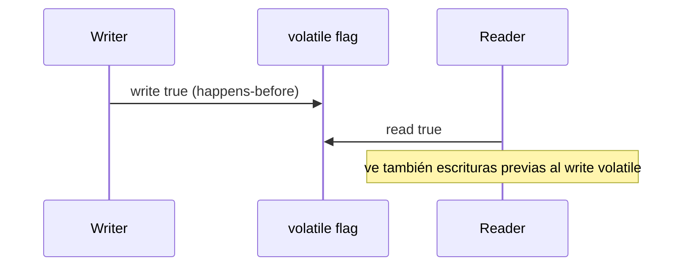

# Módulo 14: Mecánica de JVM y evolución de plataforma

Este módulo profundiza en aspectos donde Java sorprende a quien solo conoce la superficie: visibilidad de memoria, optimizaciones JIT, serialización, ciclo de vida del runtime, CDS/AOT y migración entre LTS. Son temas avanzados porque los errores son sutiles y a veces solo aparecen en producción o bajo carga.

**Contexto Tienda Aurora.** Este módulo aporta bases para Tienda Aurora: los conceptos aquí se aplican en el monolito modular y luego en los microservicios.

**Entorno de referencia verificado (2026-05-22):** JDK 27.0.1.0.2. Herramientas `jdeprscan`, `jdeps`, `jfr` disponibles en el JDK.

## Aprende construyendo

### Tema 1: Compartir memoria requiere orden y visibilidad · Avanzado · 45 min

**Caso guía.** un hilo escribe una bandera; otro la lee. Sin sincronización, puedes ver valores obsoletos.

Java Memory Model, `volatile`, happens-before

**Definición.** El JMM define qué escrituras son visibles para qué lecturas en concurrencia. `volatile` garantiza visibilidad y orden de ciertos accesos; `synchronized` y locks establecen happens-before.



**Ejemplo mínimo enfocado (ejecutable).**

```bash
mkdir -p java-m14-jmm
cd java-m14-jmm
```

Crea el archivo `DemoVolatile.java`:

```java
public class DemoVolatile {
  static volatile boolean ready = false;
  static int value = 0;
  public static void main(String[] args) throws Exception {
    Thread t = new Thread(() -> { while (!ready) {} System.out.println(value); });
    t.start();
    value = 42;
    ready = true;
    t.join();
  }
}
```

```bash
javac DemoVolatile.java
java DemoVolatile
```

**Error común.** Usar un boolean no volátil para señalizar entre hilos. Síntoma: loop infinito o valor obsoleto. Corrección: `volatile`, lock o utilidades concurrentes.

**Verificación (JDK 27, 2026-05-22).** `42`.

### Tema 2: La JVM optimiza y puede invalidar un cronómetro ingenuo · Avanzado · 45 min

**Caso guía.** medir rendimiento con un loop simple puede dar resultados falsos por optimización JIT.

JIT y benchmarks ingenuos

**Definición.** El JIT optimiza código caliente. Puede eliminar código muerto, hacer constant folding o inlining, invalidando microbenchmarks mal escritos.

**Ejemplo mínimo enfocado (conceptual ejecutable).**

```bash
mkdir -p java-m14-jit
cd java-m14-jit
```

Crea el archivo `DemoNaive.java`:

```java
public class DemoNaive {
  public static void main(String[] args) {
    long t = System.nanoTime();
    long s = 0;
    for (int i = 0; i < 1_000_000; i++) s += i;
    System.out.println(s);
    System.out.println(System.nanoTime() - t >= 0);
  }
}
```

```bash
javac DemoNaive.java
java DemoNaive
```

**Error común.** Concluir rendimiento por un nanoTime ingenuo. Corrección: usar JMH, warmup, blackholes, múltiples forks.

**Verificación (JDK 27, 2026-05-22).** `499999500000` y `true` (el tiempo es >=0, pero no es benchmark válido).

### Tema 3: Deserializar es permitir construcción y comportamiento · Avanzado · 45 min

**Caso guía.** deserializar datos no confiables puede crear objetos inesperados o ejecutar rutas peligrosas.

Serialización Java y riesgos

**Definición.** La serialización nativa de Java convierte objetos en bytes; deserializar reconstruye objetos. Es poderosa pero peligrosa si el input no es confiable.

**Contrato/riesgo.** No deserialices datos no confiables con `ObjectInputStream` sin filtros. Preferir JSON/Protobuf con esquemas explícitos cuando sea posible.

**Ejemplo mínimo enfocado (ejecutable, controlado).**

```bash
mkdir -p java-m14-ser
cd java-m14-ser
```

Crea el archivo `DemoSer.java`:

```java
import java.io.*;
class Msg implements Serializable { static final long serialVersionUID = 1L; String v="ok"; }
public class DemoSer {
  public static void main(String[] args) throws Exception {
    byte[] bytes;
    try (ByteArrayOutputStream bos = new ByteArrayOutputStream(); ObjectOutputStream out = new ObjectOutputStream(bos)) {
      out.writeObject(new Msg()); bytes = bos.toByteArray();
    }
    try (ObjectInputStream in = new ObjectInputStream(new ByteArrayInputStream(bytes))) {
      Msg m = (Msg) in.readObject(); System.out.println(m.v);
    }
  }
}
```

```bash
javac DemoSer.java
java DemoSer
```

**Error común.** Aceptar serialización Java desde la red. Corrección: evitarla; si es inevitable, usar `ObjectInputFilter`.

**Verificación (JDK 27, 2026-05-22).** `ok`.

### Tema 4: El runtime es parte del artefacto y necesita ciclo de vida · Avanzado · 45 min

**Caso guía.** tu app depende de hooks de shutdown, señales y recursos abiertos.

Shutdown hooks y ciclo de vida

**Definición.** Un shutdown hook es un hilo registrado con `Runtime.getRuntime().addShutdownHook(...)` que la JVM intenta ejecutar al apagarse normalmente.

**Ejemplo mínimo enfocado (ejecutable).**

```bash
mkdir -p java-m14-hook
cd java-m14-hook
```

Crea el archivo `DemoHook.java`:

```java
public class DemoHook {
  public static void main(String[] args) {
    Runtime.getRuntime().addShutdownHook(new Thread(() -> System.out.println("shutdown")));
    System.out.println("run");
  }
}
```

```bash
javac DemoHook.java
java DemoHook
```

**Error común.** Hacer trabajo largo/no confiable en shutdown hook. Corrección: cerrar rápido, idempotente, sin depender de servicios ya apagados.

**Verificación (JDK 27, 2026-05-22).** `run` y `shutdown`.

### Tema 5: Arranque más rápido: archivos CDS y la caché AOT · Avanzado · 40 min

**Caso guía.** un CLI Java arranca lento; CDS/AOT pueden ayudar en arranques repetidos.

CDS/AOT cache

**Definición.** CDS (Class Data Sharing) y cachés AOT almacenan metadatos/clases preprocesadas para acelerar arranque. La disponibilidad y flags dependen de la versión de JDK.

**Ejemplo mínimo (nota honesta).**

```bash
java -Xshare:off -version
```

**Nota de verificación.** La configuración AOT/CDS varía por JDK y build. En JDK 27 se verificó `java -version`; la generación de caché específica depende del flujo de la distribución. No inventar métricas de arranque sin medir en el mismo host.

### Tema 6: Migrar entre versiones LTS: de 17 a 21 y 25 con jdeprscan y jdeps · Avanzado · 45 min

**Caso guía.** migrar un jar viejo a JDK nuevo.

`jdeprscan` y `jdeps`

**Definición.** `jdeprscan` analiza uso de APIs deprecadas/removidas. `jdeps` analiza dependencias de módulos/paquetes y acceso a APIs internas.

**Ejemplo mínimo enfocado.**

```bash
jdeps --version
jdeprscan --version || true
```

**Error común.** Migrar solo cambiando versión de compilación sin revisar deprecaciones/uso interno. Corrección: ejecutar `jdeprscan`, `jdeps`, tests y runtime smoke.

**Verificación (JDK 27, 2026-05-22).** Herramientas presentes en el JDK; salida exacta depende de instalación.

## Cierre

La mecánica de JVM y la evolución de plataforma son de “modo senior”: cuando algo falla de forma rara, estos fundamentos explican por qué.

## Checklist

- Entiendo visibilidad/happens-before.
- No confío en microbenchmarks ingenuos.
- Evito serialización Java no confiable.
- Uso `jdeprscan/jdeps` en migraciones.
