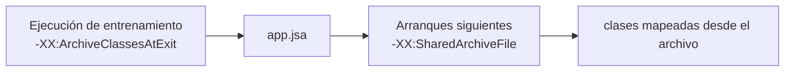
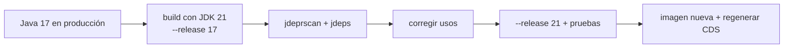

# Módulo 14: Java en producción — memoria, benchmarks y runtime seguro

El proyecto anterior usa concurrencia y produce un artefacto reproducible. Para operarlo profesionalmente todavía debes demostrar que los hilos observan estado válido, que las optimizaciones no engañan tus mediciones, que datos hostiles no construyen objetos arbitrarios y que el runtime puede actualizarse y diagnosticarse. Este módulo trabaja esas fronteras con experimentos.


## Aprende construyendo

### Tema 1: Compartir memoria requiere orden y visibilidad · Avanzado · 45 min

**¿Por qué es importante?** varios hilos pueden observar estado compartido en momentos distintos; `volatile` aporta visibilidad, pero no convierte operaciones compuestas en atómicas.

#### Subtema 1.1: Detén un hilo con un flag visible · 10 min

**1. Contexto**

Un worker debe terminar cuando el coordinador cambia su estado de ejecución.

**2. Hazlo tú**

Crea `src/WorkerControl.java` con `private volatile boolean detenido;`, un método `ejecutar()` que lea el flag en un bucle y `detener()` que lo cambie a `true`. Crea `src/Main.java`, arranca el worker, espera un segundo, llama a `detener()` y espera con `join()`. Ejecuta `javac -d out src/WorkerControl.java src/Main.java` y `java -cp out Main`.

**Resultado esperado:** el worker observa el cambio y termina; el hilo principal continúa después de `join()`.

**Fallo deliberado:** quita `volatile` y repite el experimento. **Diagnóstico:** puede terminar o no según JIT y máquina; una corrida no prueba ausencia de carrera. Restaura `volatile` y razona con el modelo de memoria.

**3. Entiende**

Una escritura volatile ocurre antes de una lectura posterior del mismo campo; no asumas que todo acceso compartido obtiene esa garantía.

**4. Cierra**

Guarda las dos versiones y explica por qué el test sin volatile no es una prueba determinista.

#### Subtema 1.2: Distingue visibilidad de atomicidad · 10 min

**1. Contexto**

Dos workers incrementan un contador; cada incremento debe conservarse.

**2. Hazlo tú**

En `src/ContadorConcurrente.java`, usa `volatile int contador`, lanza dos hilos que ejecuten `contador++` 100000 veces y espera ambos con `join()`. Imprime resultado y compáralo con `AtomicInteger.incrementAndGet()` en la misma carga. Compila con `javac -d out src/ContadorConcurrente.java` y ejecuta `java -cp out ContadorConcurrente` varias veces.

**Resultado esperado:** el volatile permite visibilidad, pero puede perder incrementos; `AtomicInteger` mantiene cada incremento indivisible.

**Fallo deliberado:** declara `volatile` como arreglo a la pérdida. **Diagnóstico:** `contador++` lee, suma y escribe en pasos; usa atomicidad o un lock.

**3. Entiende**

Visibilidad y atomicidad son garantías distintas. Una prueba puede no manifestar el error en cada ejecución.

**4. Cierra**

Registra resultados de varias ejecuciones y qué herramienta ofrece la operación atómica.

#### Subtema 1.3: Protege un invariante con synchronized · 10 min

**1. Contexto**

La cantidad disponible y el número de reservas deben cambiar juntos para no aceptar más pedidos que existencias.

**2. Hazlo tú**

Crea `src/Inventario.java` con campos `disponibles` y `reservados`; implementa `reservar()` como método `synchronized` que decrementa uno y aumenta el otro bajo la condición `disponibles > 0`. Lanza varios hilos para reservar y ejecuta `javac -d out src/Inventario.java` y `java -cp out Inventario`.

**Resultado esperado:** al final `disponibles + reservados` mantiene el total inicial y `disponibles` no es negativo.

**Fallo deliberado:** sincroniza solo la lectura de `disponibles`. **Diagnóstico:** la comprobación y los dos cambios forman una operación; protege el invariante completo bajo el mismo lock.

**3. Entiende**

Un monitor establece exclusión mutua y orden de memoria para el bloque protegido. Evita mezclar locks distintos para el mismo invariante.

**4. Cierra**

Guarda el invariante antes y después y nombra el lock que lo protege. Fuente: [Java Language Specification, memoria entre hilos](https://docs.oracle.com/javase/specs/jls/se25/html/jls-17.html).

#### Fragmento real

```java
// src/Inventario.java
public class Inventario {
    private int disponibles;
    private int reservados;

    public synchronized boolean reservar() {
        if (disponibles <= 0) return false;
        disponibles--;
        reservados++;
        return true;
    }
}
```

Ejecuta:

```bash
javac -d out src/Inventario.java
java -cp out Inventario
```

**Conexión con el proyecto integrador:** el procesador concurrente de tu proyecto integrador (módulo 13) necesita exactamente este tipo de invariante protegido; dos hilos reservando la última guía disponible es el mismo problema que dos hilos reservando el último cupo de inventario aquí.

**Límite:** `synchronized` protege el invariante dentro de un solo proceso; no coordina dos instancias de la aplicación corriendo en máquinas distintas contra la misma base de datos, donde se necesita bloqueo optimista o pesimista a nivel de base (como en JPA, módulo 16).

#### Practica

Modifica `reservar()` para que la comprobación `disponibles > 0` quede fuera del bloque `synchronized` y solo el decremento esté protegido; lanza varios hilos y explica por qué `disponibles` puede terminar en negativo.

### Tema 2: La JVM optimiza y puede invalidar un cronómetro ingenuo · Avanzado · 45 min

**¿Por qué es importante?** el resultado de una medición puede incluir calentamiento o trabajo que el compilador elimina; usa JMH para organizar las mediciones.

**Preparación:** crea un proyecto Maven con el arquetipo oficial JMH indicado por [OpenJDK JMH](https://openjdk.org/projects/code-tools/jmh/).

#### Subtema 2.1: Observa por qué un cronómetro ingenuo engaña · 10 min

**1. Contexto**

Una sola llamada cronometrada mezcla inicio de JVM, calentamiento y cálculo.

**2. Hazlo tú**

Crea `src/main/java/Cronometro.java` con un bucle que llame un millón de veces una función `contar(int n)` y mida con `System.nanoTime()`. Ejecuta `mvn package` y `java -cp target/classes Cronometro` cinco veces.

**Resultado esperado:** obtienes duraciones distintas entre arranque y ejecuciones repetidas; no puedes atribuir la diferencia a una mejora del algoritmo.

**Fallo deliberado:** conserva solo la corrida más rápida. **Diagnóstico:** reporta distribución y repeticiones; no selecciones un dato conveniente.

**3. Entiende**

Carga de clases, JIT, GC y scheduler afectan un cronómetro casero.

**4. Cierra**

Guarda las cinco medidas y una limitación del método.

#### Subtema 2.2: Escribe un benchmark consumible por JMH · 10 min

**1. Contexto**

El benchmark debe mantener observable el resultado para que la JVM no elimine el cálculo.

**2. Hazlo tú**

Crea `src/main/java/BusquedaBenchmark.java` con `@State(Scope.Thread)`, un arreglo preparado en `@Setup`, un método `@Benchmark` que busque un valor y entregue el índice con `Blackhole.consume`. Ejecuta `mvn clean verify` y `java -jar target/benchmarks.jar -wi 2 -i 3 -f 1`.

**Resultado esperado:** JMH ejecuta calentamiento e iteraciones y reporta la métrica en lugar de una única duración.

**Fallo deliberado:** elimina `Blackhole.consume`. **Diagnóstico:** el cálculo puede dejar de ser observable; devuelve el resultado o consúmelo.

**3. Entiende**

`@State` organiza datos, `@Setup` prepara fuera de la operación medida, `-wi` configura warmup y `-f` forks.

**4. Cierra**

Guarda los parámetros, resultado y versión del JDK.

#### Subtema 2.3: Compara algoritmos con el mismo trabajo · 10 min

**1. Contexto**

Quieres elegir entre búsqueda lineal y binaria para listas ordenadas.

**2. Hazlo tú**

En `src/main/java/BusquedaBenchmark.java`, añade dos métodos `@Benchmark` que busquen la misma clave en el mismo arreglo ordenado: uno con `Arrays.stream(...).filter(...)` o recorrido lineal, otro con `Arrays.binarySearch`. Ejecuta `java -jar target/benchmarks.jar -wi 3 -i 5 -f 2`.

**Resultado esperado:** JMH entrega medidas separadas de operaciones equivalentes sobre datos preparados.

**Fallo deliberado:** ordena el arreglo dentro del método binario pero no dentro del lineal. **Diagnóstico:** prepara los datos en `@Setup` para que cada método mida el mismo trabajo.

**3. Entiende**

Un benchmark compara una pregunta acotada. La carga del servicio real puede cambiar la decisión.

**4. Cierra**

Guarda salida, entorno, parámetros y conclusión provisional. Fuente: [OpenJDK JMH](https://openjdk.org/projects/code-tools/jmh/).

#### Fragmento real

```java
// src/main/java/BusquedaBenchmark.java
@State(Scope.Thread)
public class BusquedaBenchmark {
    private int[] datos;

    @Setup
    public void preparar() { datos = /* arreglo ordenado preparado */ new int[0]; }

    @Benchmark
    public int busquedaBinaria(Blackhole bh) {
        int indice = Arrays.binarySearch(datos, 42);
        bh.consume(indice);
        return indice;
    }
}
```

Ejecuta:

```bash
mvn clean verify
java -jar target/benchmarks.jar -wi 2 -i 3 -f 1
```

**Conexión con el proyecto integrador:** antes de optimizar el procesamiento concurrente del proyecto integrador (módulo 13), mide con JMH si el cambio realmente mejora algo; un `System.nanoTime()` suelto alrededor del código del proyecto puede llevarte a "optimizar" algo que la JIT ya eliminaba.

**Límite:** JMH mide una operación acotada con datos preparados; no reproduce la presión real de GC, red o contención de un servicio en producción — por eso el Módulo 11, Tema 2 insiste en comparar bajo carga real con JFR, no solo con el número que imprime JMH.

#### Practica

Modifica el benchmark para quitar `Blackhole.consume` y usa solo `System.out.println` fuera del método medido; ejecuta de nuevo y explica por qué el tiempo reportado puede caer a casi cero.

### Tema 3: Deserializar es permitir construcción y comportamiento · Avanzado · 45 min

**¿Por qué es importante?** datos serializados pueden intentar construir tipos inesperados; limitar la entrada antes de aceptar objetos es más seguro que confiar en su origen.

#### Subtema 3.1: Reconoce por qué evitar datos nativos no confiables · 10 min

**1. Contexto**

Un servicio recibe archivos de terceros; `ObjectInputStream` puede reconstruir un grafo de objetos y activar comportamiento de clases.

**2. Hazlo tú**

Crea `src/Registro.java` como `record Registro(String guia, String estado) {}` y `src/EntradaJson.java` que convierta JSON con Jackson a ese tipo. Declara un esquema permitido `guia` y `estado`, ejecuta `mvn test` y confirma el rechazo de un campo no esperado según la configuración elegida.

**Resultado esperado:** el programa acepta el DTO esperado y no crea clases arbitrarias a partir de la entrada.

**Fallo deliberado:** usa `ObjectInputStream` para datos enviados por usuarios. **Diagnóstico:** no uses serialización nativa como formato de entrada confiable; adopta un formato de datos con contrato y límites.

**3. Entiende**

Un DTO JSON también necesita límites de tamaño, esquema y validación; el formato no vuelve seguro cualquier dato automáticamente.

**4. Cierra**

Guarda caso válido e inválido y el contrato admitido.

#### Subtema 3.2: Filtra un formato legado · 10 min

**1. Contexto**

Un sistema antiguo aún debe leer una clase serializada local y controlada.

**2. Hazlo tú**

Crea `src/EventoLegacy.java` como una clase `Serializable` sencilla y `src/LeerLegacy.java` con `ObjectInputStream` y `ObjectInputFilter.Config.createFilter("maxdepth=5;maxrefs=100;EventoLegacy;!*")` (ajusta el paquete al ejemplo). Antes de leer, llama `in.setObjectInputFilter(filter)` y después `in.readObject()` dentro del try-with-resources. Ejecuta `mvn test` con datos propios generados localmente.

**Resultado esperado:** se admite el tipo permitido y se rechaza cualquier otro.

**Fallo deliberado:** elimina `!*` de la regla de rechazo final. **Diagnóstico:** la lista de clases queda abierta; cierra el filtro y prueba con un tipo no permitido.

**3. Entiende**

Un filtro de `ObjectInputFilter` limita clases y complejidad; configura profundidad y referencias conforme al formato real.

**4. Cierra**

Guarda prueba permitida y rechazada. Fuente: [filtrado de serialización JDK](https://docs.oracle.com/en/java/javase/25/core/java-serialization-filters.html).

#### Subtema 3.3: Limita tamaño y valida después de parsear · 10 min

**1. Contexto**

Un cuerpo JSON enorme puede agotar recursos aunque solo declare dos campos.

**2. Hazlo tú**

En `src/main/java/EntradaJson.java`, rechaza entradas mayores a un límite antes de llamar a Jackson, valida `guia` no vacía y añade una prueba para texto grande y otra para campo faltante. Ejecuta `mvn test`.

**Resultado esperado:** el programa rechaza contenido demasiado grande y valores que no cumplen el contrato.

**Fallo deliberado:** parsea primero un cuerpo sin límite y valida después. **Diagnóstico:** el parser ya pudo consumir memoria; limita bytes antes de construir el objeto.

**3. Entiende**

Seguridad requiere límite de entrada, contrato de tipos y validación semántica; cada capa protege un riesgo distinto.

**4. Cierra**

Conserva los dos tests fallidos y el límite adoptado.

#### Fragmento real

```java
// src/EntradaJson.java
public record Registro(String guia, String estado) {}

// Jackson con un esquema cerrado: rechaza campos no declarados
ObjectMapper mapper = JsonMapper.builder()
    .configure(DeserializationFeature.FAIL_ON_UNKNOWN_PROPERTIES, true)
    .build();
```

Ejecuta:

```bash
mvn test
```

**Conexión con el proyecto integrador:** cuando el proyecto integrador reciba datos externos (una API de terceros, un archivo subido), este es el contrato que necesita: un DTO cerrado con límite de tamaño, no `ObjectInputStream` ni un mapa abierto que acepte cualquier campo.

**Límite:** un esquema JSON cerrado evita construir clases arbitrarias, pero no reemplaza el límite de tamaño de entrada (Subtema 3.3, un JSON de 2 campos puede venir envuelto en un archivo de varios gigabytes) ni la validación semántica de cada campo (una guía con formato válido pero inexistente).

#### Practica

Modifica el mapper para que acepte campos desconocidos (`FAIL_ON_UNKNOWN_PROPERTIES, false`) y envía un JSON con un campo extra; confirma que se acepta en silencio y decide si eso es aceptable para tu caso.

### Tema 4: El runtime es parte del artefacto y necesita ciclo de vida · Avanzado · 45 min

**¿Por qué es importante?** el JDK, los módulos incluidos y el proceso de actualización forman parte de lo que se despliega.

#### Subtema 4.1: Averigua qué módulos necesita el programa · 10 min

**1. Contexto**

Antes de reducir el runtime, necesitas conocer qué módulos usa el JAR.

**2. Hazlo tú**

Desde el directorio del módulo ejecuta `mkdir -p target` y `jar --create --file target/rutas.jar -C out/academia.rutas .`. Después usa `jdeps --multi-release 25 --print-module-deps target/rutas.jar` y guarda la lista de módulos requeridos.

**Resultado esperado:** obtienes dependencias de módulos del JDK usadas por el artefacto analizado.

**Fallo deliberado:** entrega a `jdeps` una carpeta de clases de otro build. **Diagnóstico:** limpia y vuelve a empaquetar el artefacto objetivo antes de analizarlo.

**3. Entiende**

`jdeps` estima dependencias estáticas; reflexión o carga dinámica pueden requerir módulos que no detecta.

**4. Cierra**

Guarda el comando y su salida junto al hash del JAR.

#### Subtema 4.2: Construye un runtime mínimo con jlink · 10 min

**1. Contexto**

Una imagen de producción puede incluir solo los módulos necesarios para arrancar la aplicación.

**2. Hazlo tú**

Con un proyecto modular, ejecuta `jlink --add-modules academia.rutas --module-path "$JAVA_HOME/jmods:out" --output runtime-rutas`; luego inicia con `runtime-rutas/bin/java -m academia.rutas/academia.rutas.app.Main`. Comprueba módulos con `runtime-rutas/bin/java --list-modules`.

**Resultado esperado:** el runtime personalizado arranca la aplicación y lista sus módulos incluidos.

**Fallo deliberado:** omite un módulo que la aplicación realmente necesita. **Diagnóstico:** revisa `jdeps`, el error de resolución y los módulos cargados dinámicamente antes de reconstruir.

**3. Entiende**

`jlink` crea una imagen específica; quien despliega debe reconstruirla ante parches del JDK.

**4. Cierra**

Conserva el tamaño de la imagen y módulos listados. Fuente: [herramientas jlink/jdeps](https://docs.oracle.com/en/java/javase/25/docs/specs/man/jlink.html).

#### Subtema 4.3: Actualiza y valida el runtime como artefacto · 10 min

**1. Contexto**

Un runtime reducido creado una vez puede quedarse sin parches aunque el JAR de aplicación no cambie.

**2. Hazlo tú**

En `docs/runtime-java.md`, registra versión del JDK, módulos jlink, hash del JAR, comando de construcción y comando de smoke test. Reconstruye `runtime-rutas` con el JDK actualizado y corre `runtime-rutas/bin/java -m academia.rutas/academia.rutas.app.Main`.

**Resultado esperado:** el runbook permite reconstruir y comprobar el runtime desde los mismos artefactos.

**Fallo deliberado:** actualiza solo la imagen de contenedor base y conserva la carpeta `runtime-rutas` antigua. **Diagnóstico:** la imagen jlink debe reconstruirse con el JDK parcheado.

**3. Entiende**

El runtime personalizado es un artefacto versionado, no una carpeta desechable que se corrige automáticamente.

**4. Cierra**

Guarda versión antigua y nueva, smoke test y responsable de actualización.

#### Fragmento real

```bash
jdeps --multi-release 25 --print-module-deps target/rutas.jar
jlink --add-modules academia.rutas --module-path "$JAVA_HOME/jmods:out" --output runtime-rutas
cd runtime-rutas/bin && java -m academia.rutas/academia.rutas.app.Main
```

**Conexión con el proyecto integrador:** si empaquetas tu proyecto integrador para distribuirlo (un contenedor, un instalador), `jdeps` + `jlink` producen un runtime del tamaño real que usa tu aplicación, no el JDK completo.

**Límite:** `jdeps` detecta dependencias estáticas; si el proyecto integrador usa reflexión (Jackson, frameworks) o carga dinámica de clases, puede necesitar módulos que `jdeps` no reporta — prueba siempre el runtime reducido antes de confiar en él.

#### Practica

Modifica el comando `jlink` para omitir un módulo que la aplicación sí necesita, intenta arrancar el runtime resultante y registra el mensaje de error exacto antes de corregirlo.

---

### Tema 5: Arranque más rápido: archivos CDS y la caché AOT · Avanzado · 40 min

**Prerrequisito:** tema «El runtime es parte del artefacto y necesita ciclo de vida» de este módulo.

**Al finalizar podrás:** crear un archivo CDS dinámico de tu aplicación, comprobar con los registros de la JVM que las clases salen de ese archivo y conocer la caché AOT de JDK 24 y 25.

**¿Por qué es importante?** En contenedores y funciones serverless, cada arranque cuesta dinero y latencia. Una parte grande del arranque es leer y verificar clases. CDS guarda ese trabajo en un archivo y lo reutiliza.

#### Paso 1 · Objetivo y preparación

Usa JDK 21 o superior para CDS. Para la caché AOT necesitas JDK 24 o superior. Crea la carpeta `academia-labs/java/arranque`.

#### Paso 2 · Contexto y caso real

El servicio de cotización de RutaFlow escala a cero de noche y arranca con la primera petición del día. Ese primer cliente esperaba varios segundos. Con un archivo CDS dentro de la imagen del contenedor, el arranque bajó sin cambiar una línea de código.

#### Paso 3 · Teoría, modelo mental y analogía

**Conceptos clave:** CDS (*Class Data Sharing*), archivo compartido, `-XX:ArchiveClassesAtExit`, `-XX:SharedArchiveFile`, `-Xlog:class+load`, caché AOT, ejecución de entrenamiento.

Al arrancar, la JVM lee cada clase, la verifica y crea sus estructuras internas. **CDS** guarda ese resultado en un archivo que se mapea en memoria en el siguiente arranque.

- El JDK ya trae un archivo CDS para sus propias clases.
- Con `-XX:ArchiveClassesAtExit=app.jsa`, la JVM guarda al terminar **también las clases de tu aplicación** (deben venir de un JAR).
- Con `-XX:SharedArchiveFile=app.jsa` la usas en los siguientes arranques.

**Caché AOT (JDK 24 y 25):** va más allá: guarda clases ya cargadas y enlazadas, y en JDK 25 también perfiles de métodos. En JDK 25 basta una ejecución de entrenamiento con `-XX:AOTCacheOutput=app.aot` y luego `-XX:AOTCache=app.aot`.

**Analogía:** CDS es dejar la mesa puesta desde la noche anterior: por la mañana solo te sientas. La analogía falla en que, si cambias el menú (la versión de la aplicación o del JDK), la mesa puesta ya no sirve y hay que volver a ponerla.

**Límite de uso:** el archivo depende de la versión exacta del JDK y del classpath: si cambian, la JVM lo ignora con un aviso. Regenéralo en cada build. No acelera el código que ya está corriendo, solo el arranque.



#### Paso 4 · Demostración guiada desde cero

Archivo `academia-labs/java/arranque/Arranque.java`:

```java
import java.time.LocalDate;
import java.util.List;
import java.util.stream.Collectors;

public class Arranque {
    public static void main(String[] args) {
        var paradas = List.of("Bodega", "Calle 26", "Cliente");
        System.out.println(paradas.stream().collect(Collectors.joining(" -> ")) + " · " + LocalDate.of(2026, 11, 18));
    }
}
```

Ejecútalo:

```bash
cd academia-labs/java/arranque
javac Arranque.java && jar --create --file app.jar Arranque.class
java -XX:ArchiveClassesAtExit=app.jsa -cp app.jar Arranque          # entrenamiento: crea app.jsa
java -Xshare:off -Xlog:class+load:file=sin.log -cp app.jar Arranque  # sin CDS
java -XX:SharedArchiveFile=app.jsa -Xlog:class+load:file=con.log -cp app.jar Arranque
grep -c "shared objects file" sin.log con.log
```

**Explicación por bloques:** El programa es mínimo a propósito: lo importante es el arranque. Primero se empaqueta en un JAR, porque CDS solo archiva clases de JARs. La ejecución de entrenamiento crea `app.jsa` al terminar. Después se arranca dos veces registrando cada clase cargada: con `-Xshare:off` ninguna sale del archivo compartido; con `app.jsa` casi todas, incluida `Arranque`. El último comando cuenta esas líneas en cada registro. Los números exactos dependen de la versión del JDK.


**Resultado esperado:**

```text
Bodega -> Calle 26 -> Cliente · 2026-11-18
sin.log:0
con.log:652
```

**Fallo deliberado:** ejecuta el entrenamiento con `-cp .` en lugar del JAR. **Error esperado:** un aviso `[cds] Skipping Arranque: Unsupported location` y la clase de la aplicación no queda en el archivo. **Diagnóstico:** CDS solo archiva clases cargadas desde archivos JAR. Empaqueta la aplicación y vuelve a entrenar.

#### Paso 5 · Práctica guiada

1. **Reproducción:** ejecuta los comandos y compara las dos cuentas de `grep`.
2. **Variación:** mide el tiempo con `time java ...` diez veces con y sin archivo y calcula el promedio.
3. **Diagnóstico:** reproduce el fallo deliberado con `-cp .` y lee el aviso.
4. **Integración:** con JDK 25, crea una caché AOT con `-XX:AOTCacheOutput=app.aot` y úsala con `-XX:AOTCache=app.aot`.
5. **Diseño:** escribe en qué paso del `Dockerfile` de RutaFlow generarías el archivo y por qué debe ser en el mismo build.

**Pista:** si el archivo «no hace nada», revisa los avisos `[cds]`: casi siempre es otra versión del JDK u otro classpath.

#### Paso 6 · Práctica independiente

Genera un archivo CDS para un servicio Spring Boot propio con `-XX:ArchiveClassesAtExit` (Spring Boot 3.3+ ofrece `-Dspring.context.exit=onRefresh` para el entrenamiento) y mide el tiempo de arranque antes y después.

#### Paso 7 · Cierre

- [ ] Explicas qué trabajo de arranque guarda CDS.
- [ ] `con.log` muestra clases desde el archivo compartido y `sin.log` ninguna.
- [ ] Reprodujiste el aviso de ubicación no soportada.
- [ ] Sabes cuándo hay que regenerar el archivo.

Si fallas dos o más, vuelve al Paso 3. **Errores comunes:** entrenar con clases fuera de un JAR, reutilizar el archivo con otro JDK y esperar que acelere el código en caliente. **Siguiente paso:** el tema siguiente prepara la aplicación para cambiar de versión LTS, que obliga a regenerar estos archivos.

**Transferencia al proyecto integrador «RutaFlow»:** agrega al `Dockerfile` del servicio de cotización de RutaFlow un paso de entrenamiento que genere `app.jsa` y arranca el contenedor con `-XX:SharedArchiveFile`.

**Fuente oficial:** [Oracle — Class Data Sharing](https://docs.oracle.com/en/java/javase/21/vm/class-data-sharing.html) y [OpenJDK — JEP 483: Ahead-of-Time Class Loading & Linking](https://openjdk.org/jeps/483).

### Tema 6: Migrar entre versiones LTS: de 17 a 21 y 25 con jdeprscan y jdeps · Avanzado · 45 min

**Prerrequisito:** tema «El runtime es parte del artefacto y necesita ciclo de vida» de este módulo.

**Al finalizar podrás:** encontrar con `jdeprscan` y `jdeps` el código que dejará de compilar o de funcionar en la siguiente versión LTS, corregirlo y planear la migración por pasos.

**¿Por qué es importante?** Cada versión LTS elimina APIs que llevaban años marcadas como obsoletas. Si esperas a que el build falle, la migración se vuelve urgente. Con las herramientas del JDK sabes de antemano qué cambiar.

#### Paso 1 · Objetivo y preparación

Usa el JDK de destino (21 o superior); `jdeprscan` y `jdeps` vienen incluidos. Crea la carpeta `academia-labs/java/migracion` con una subcarpeta `legado/`.

#### Paso 2 · Contexto y caso real

El motor de liquidación de RutaFlow seguía en Java 17. Al probar Java 21 aparecieron avisos de APIs «marcadas para eliminación». El equipo los corrigió antes de cambiar la imagen del contenedor, en lugar de descubrirlos en producción.

#### Paso 3 · Teoría, modelo mental y analogía

**Conceptos clave:** LTS, obsoleto (*deprecated*), `forRemoval=true`, `jdeprscan`, `jdeps --jdk-internals`, `--release`, plan de migración.

Una API **obsoleta** sigue funcionando, pero se desaconseja. Si además tiene `forRemoval=true`, se eliminará en una versión futura y tu código dejará de compilar.

- `jdeprscan --release N` revisa clases compiladas y lista cada uso de APIs obsoletas en la versión N. Marca con `forRemoval=true` las que van a desaparecer.
- `jdeps --jdk-internals` lista usos de APIs internas del JDK (`sun.misc.*`), que los módulos encapsulan desde Java 17.
- `javac --release N` compila contra las APIs exactas de la versión N, aunque uses un JDK más nuevo.

**Plan por pasos:** (1) compila y prueba con el JDK nuevo usando `--release` de la versión actual; (2) corrige lo que marquen las herramientas; (3) sube `--release`; (4) actualiza la imagen y regenera los archivos de arranque (CDS, AOT).

**Analogía:** `jdeprscan` es la revisión técnica antes de un viaje largo: te dice qué piezas fallarán antes de salir a la carretera. La analogía falla en que no revisa el código que se carga por reflexión ni las dependencias que no le pasas.

**Límite de uso:** las herramientas solo ven lo que compilaste o les pasas: revisa también las dependencias (los JAR de terceros). No detectan cambios de comportamiento que no son eliminaciones, como valores por defecto nuevos; para eso están las pruebas.



#### Paso 4 · Demostración guiada desde cero

Archivo `academia-labs/java/migracion/legado/Legado.java`:

```java
import java.util.Date;

public class Legado {
    public static void main(String[] args) throws Exception {
        Integer peso = new Integer(5);              // obsoleto desde Java 9, marcado para eliminar
        Date fecha = new Date(2026 - 1900, 10, 18); // constructor obsoleto desde Java 1.1
        Runtime.getRuntime().runFinalization();     // marcado para eliminar desde Java 18
        System.out.println("peso " + peso + ", año " + (fecha.getYear() + 1900));
    }
}
```

Ejecútalo:

```bash
cd academia-labs/java/migracion
javac -d legado/out legado/Legado.java
jdeprscan --release 21 --class-path legado/out Legado
jdeps --jdk-internals legado/out
```

**Explicación por bloques:** `Legado` usa tres APIs antiguas a propósito. `javac` compila con avisos, que en un proyecto grande se pierden entre cientos de líneas. `jdeprscan` lista cada uso con la firma exacta del método: `Integer::<init>(I)V` es el constructor `new Integer(int)`, y `forRemoval=true` indica que desaparecerá. `jdeps --jdk-internals` no imprime nada porque la clase no usa APIs internas del JDK. Las correcciones son `Integer.valueOf(5)`, `LocalDate.of(2026, 11, 18)` y quitar `runFinalization`.


**Resultado esperado:**

```text
class Legado uses deprecated method java/lang/Integer::<init>(I)V (forRemoval=true)
class Legado uses deprecated method java/util/Date::<init>(III)V
class Legado uses deprecated method java/lang/Runtime::runFinalization()V (forRemoval=true)
class Legado uses deprecated method java/util/Date::getYear()I
```

**Fallo deliberado:** ejecuta `jdeprscan` sin `--class-path legado/out`. **Error esperado:** `error: cannot find class Legado`. **Diagnóstico:** la herramienta analiza clases compiladas, no código fuente; necesita saber dónde están. Pásale la carpeta de clases o el JAR.

#### Paso 5 · Práctica guiada

1. **Reproducción:** ejecuta los tres comandos y explica qué significa `forRemoval=true`.
2. **Variación:** corrige los cuatro usos y comprueba que `jdeprscan` ya no imprime nada.
3. **Diagnóstico:** reproduce el fallo deliberado y lee el mensaje.
4. **Integración:** ejecuta `jdeprscan --release 21` sobre el JAR de una dependencia real de tu proyecto.
5. **Diseño:** escribe el plan de migración de RutaFlow de 17 a 21 en cinco pasos con su criterio de salida.

**Pista:** empieza por las líneas con `forRemoval=true`: son las que romperán el build.

#### Paso 6 · Práctica independiente

Agrega a tu build (Maven o Gradle) un paso que ejecute `jdeprscan --release 21` sobre los JAR generados y falle si encuentra algún uso con `forRemoval=true`.

#### Paso 7 · Cierre

- [ ] Explicas la diferencia entre obsoleto y marcado para eliminación.
- [ ] `jdeprscan` lista los cuatro usos esperados.
- [ ] Corregiste el código hasta dejar el reporte vacío.
- [ ] Tienes un plan por pasos con `--release`.

Si fallas dos o más, vuelve al Paso 3. **Errores comunes:** saltar dos versiones LTS sin revisar, ignorar las dependencias de terceros y olvidar regenerar los archivos CDS o AOT. **Siguiente paso:** el módulo 15 automatiza estas comprobaciones dentro de Maven y Gradle.

**Transferencia al proyecto integrador «RutaFlow»:** en RutaFlow, ejecuta `jdeprscan` y `jdeps` sobre el motor de liquidación y documenta en un ADR el plan de migración a la siguiente LTS.

**Fuente oficial:** [Oracle — jdeprscan](https://docs.oracle.com/en/java/javase/21/docs/specs/man/jdeprscan.html) y [Oracle — JDK Migration Guide](https://docs.oracle.com/en/java/javase/21/migrate/getting-started.html).

## Revisión oficial de plataforma — octubre de 2026

### Java LTS frente a entregas semestrales

La base de producción recomendada para el curso sigue siendo **Java 25 LTS** (liberada en septiembre de 2025, con soporte bajo NFTC hasta septiembre de 2028, un año después de la próxima LTS); **JDK 27** —liberado el 15 de septiembre de 2026— es la entrega semestral más reciente para estudiar hacia dónde evoluciona la plataforma, sin confundir sus previews con contratos permanentes todavía no finalizados. El set final de JDK 27 incluye nueve JEPs: **G1 como recolector de basura por defecto en todos los entornos** (JEP 523 — G1 ya era el default desde Java 9 en máquinas "server-class", pero en entornos restringidos, con un solo CPU o menos de 1792&nbsp;MB de memoria, la JVM caía a Serial GC; desde JDK 27 usa G1 siempre, salvo que se especifique otro recolector explícitamente), intercambio de claves híbrido poscuántico para TLS 1.3, lazy constants, cabeceras de objeto compactas (compact object headers), redacción de datos en proceso para JFR, una Vector API continuada, codificaciones PEM para objetos criptográficos, coincidencia de patrones con tipos primitivos en `instanceof`/`switch`, y la **séptima ronda de preview** de Structured Concurrency (JEP 533) — que ya fue propuesta como candidata a finalizarse sin cambios adicionales, tras seis rondas previas desde JDK 21. Una preview sigue requiriendo flags explícitos (`--enable-preview`), puede cambiar entre rondas y no debe filtrarse a una API pública estable.

**Aplicación al proyecto:** compila y prueba en 25 y 27, confirma que el recolector por defecto (G1) sigue comportándose igual que antes tras el cambio de JDK 26→27, registra JEP/estado de cada función nueva antes de adoptarla, y evita publicar artefactos que necesiten preview (como Structured Concurrency) salvo decisión explícita y documentada.


## Construcción guiada del capítulo

### Proyecto: endurecimiento medible del procesador concurrente

Parte del proyecto 13 y conserva un tag funcional anterior.

1. Identifica cada estado compartido, su invariante y mecanismo happens-before. Elimina publicación de colecciones mutables.
2. Crea un ejemplo defectuoso de visibilidad y un test jcstress con outcomes aceptables/prohibidos; corrige con el mecanismo mínimo.
3. Compara `volatile`, `AtomicLong`, `LongAdder` y lock únicamente para workloads donde tengan semántica equivalente.
4. Escribe dos benchmarks JMH: uno ingenuo deliberadamente y otro con forks, warmup, parámetros y resultados consumidos. Explica la diferencia.
5. Contrasta la optimización elegida bajo carga del servicio y JFR; revierte si no mejora el objetivo.
6. Sustituye serialización nativa en una entrada por DTO JSON cerrado. Si conservas un caso legacy, aplica filtro y límites.
7. Prueba tipo no permitido, profundidad, array enorme, JSON extra, payload inválido y secreto ausente.
8. Genera SBOM, registra procedencia de dependencias y corrige una vulnerabilidad simulada mediante actualización con tests.
9. Usa `jdeps` y `jlink` para crear runtime mínimo. Compara módulos, tamaño y arranque con JDK completo.
10. Construye contenedor no root con límite de memoria, healthcheck y JFR habilitable. Fuerza carga, SIGTERM y presión de memoria.
11. Documenta reconstrucción ante parche JDK, canary, compatibilidad, backup y rollback.

**Verificación:** entrega grafo happens-before, resultados jcstress, salida JMH con entorno, JFR antes/después, pruebas hostiles, SBOM, módulos jlink, tamaños y runbook. CI ejecuta unitarias, stress acotado, verificación de dependencias y smoke test del runtime personalizado.

**Errores comunes y soluciones**

- Marcar todo volatile: protege visibilidad, no invariantes compuestos; diseña dueño y atomicidad.
- Confiar en que no falló el stress: justifica con JMM y usa stress para buscar ejecuciones.
- Cronometrar un loop: usa JMH y evita trabajo eliminado, constantes y falta de warmup.
- Deserializar y validar después sin límites: limita antes/durante construcción del grafo.
- Activar filtro global amplio: usa allowlist contextual y prueba clases y complejidad.
- Fijar `-Xmx` igual al límite: deja memoria para metaspace, stacks, buffers, JIT y nativa.
- Crear jlink una vez: versiona y reconstruye runtime ante cada actualización relevante.

<!-- OFFICIAL-TOPIC-ATLAS:START -->
## Atlas completo de temas oficiales

Derivado de la [documentación oficial](https://docs.oracle.com/en/java/javase/25/), sus referencias, migraciones y guías de operación. Inventariar no equivale a dominar: cada selección se demuestra con código, prueba, medición y explicación. **Cobertura: 49 temas.**

| Área | Temas que deben poder explicarse y aplicarse | Evidencia práctica |
|---|---|---|
| Lenguaje | `tipos y control` · `objetos` · `records` · `sealed types` · `pattern matching` · `genéricos` · `anotaciones` · `JPMS` | tarifas |
| Biblioteca | `colecciones` · `streams` · `Optional` · `fechas` · `i18n` · `regex` · `NIO.2` · `HTTP Client` · `serialización segura` | tarifas |
| Concurrencia | `Java Memory Model` · `locks` · `atomics` · `concurrent collections` · `CompletableFuture` · `virtual threads` · `scoped values` · `structured concurrency` | tarifas |
| JVM | `bytecode` · `class loading` · `JIT` · `memoria` · `garbage collectors` · `Flight Recorder` · `jcmd y jstack` · `heap dumps` · `CDS y AOT` | tarifas |
| Integración | `JDBC` · `transacciones` · `ServiceLoader` · `reflection` · `method handles` · `Foreign Function and Memory API` · `JNI` | tarifas |
| Calidad | `JUnit` · `property testing` · `JMH` · `profiling` · `secure coding` · `criptografía` · `jlink y jpackage` · `migración LTS` | tarifas |

### Método de estudio y proyecto de ampliación

Para cada tema responde qué problema resuelve, cuál es su modelo mental, cómo falla, cómo se verifica y cuándo no conviene. Elige uno por área e intégralos en un proyecto propio de ampliación. Entrega diagrama, ADR, pruebas de éxito y fallo, una medición, una amenaza y el enlace oficial con versión y fecha. Una API preview se aísla en laboratorio y nunca se presenta como base estable.
<!-- OFFICIAL-TOPIC-ATLAS:END -->

