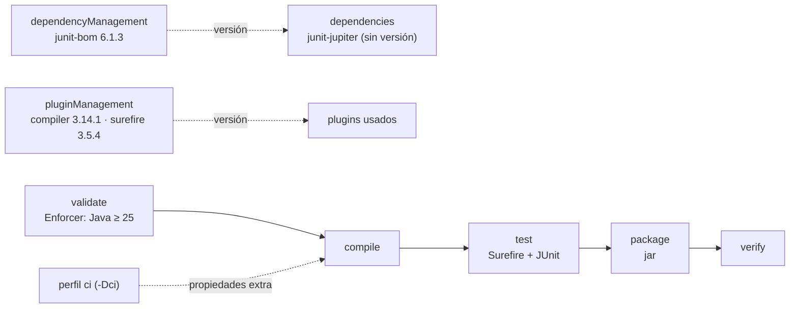
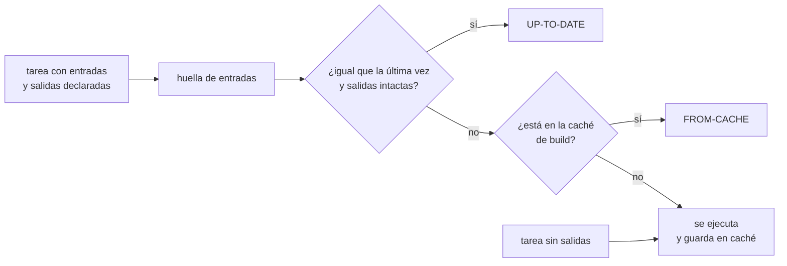
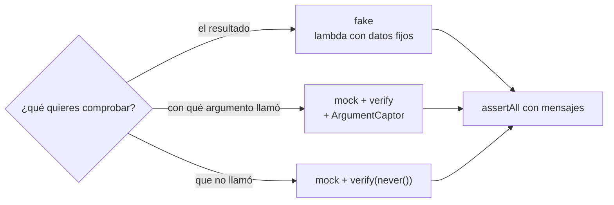
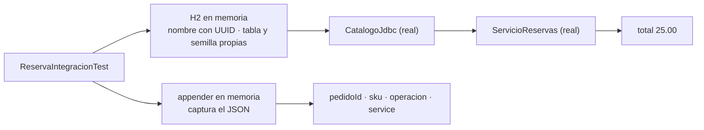
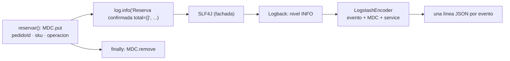

# Módulo 15: Build, testing y calidad

**Entorno de las salidas.** Las salidas originales se capturaron el 2026-11-23 en `~/labs/aurora-m15` con macOS
arm64 (ver «Entorno de referencia verificado»). Las salidas nuevas de esta edición se capturaron el 2026-11-24 en
Linux x86_64: Maven 3.9.11 sobre OpenJDK 21.0.13.1, Gradle 8.14.3 sobre OpenJDK 21.0.13.1 con toolchain Java 25, y
`java` de OpenJDK 25.0.5.1 para los programas de un solo archivo. Ese entorno no tenía acceso al repositorio de
dependencias, así que solo se ejecutó lo que no necesita descargar nada; las pruebas con JUnit 6, Mockito, H2 y
Logback se muestran con la salida del Mac. En las salidas de Gradle se omiten las líneas en blanco. Tiempos y fechas
cambian en cada corrida.

Un proyecto Java profesional no se define solo por compilar. Se define por poder construirse de forma repetible, dividir responsabilidades sin ciclos, probar reglas rápido y diagnosticar comportamiento en ejecución. Este módulo construye `tienda-aurora-build`, un multi-módulo Gradle con dominio, app, tests JUnit 6 + Mockito, integración con H2 y logging estructurado con SLF4J/Logback/MDC. Un proyecto Maven paralelo muestra el mismo criterio de reproducibilidad con `pom.xml`.

## Apertura del módulo

**Al terminar este módulo podrás:**
- centralizar versiones de dependencias y plugins en Maven y exigir el JDK con Enforcer;
- declarar entradas y salidas de tareas Gradle y aprovechar el build incremental y la caché;
- defender la frontera entre `domain` y `app` con el compilador y reconocer un ciclo de módulos;
- probar el dominio con fakes y con Mockito, con aserciones agrupadas y mensajes útiles;
- escribir una prueba de integración con JDBC y H2 aislada por prueba;
- registrar eventos JSON con SLF4J, Logback y MDC sin filtrar contexto entre tareas.

**Esquema del módulo:**
1. Tema 1: Maven avanzado (`dependencyManagement`, `pluginManagement`, Enforcer, perfiles, Surefire).
2. Tema 2: Gradle incremental, caché de build y `-Werror`.
3. Tema 3: multi-módulo con frontera compilable y sin ciclos.
4. Tema 4: JUnit 6, fakes, Mockito y aserciones expresivas.
5. Tema 5: integración con JDBC y H2 aislada.
6. Tema 6: logging estructurado con SLF4J, Logback y MDC.
7. Laboratorio integrador: pipeline local de calidad para `tienda-aurora-build`.

**Qué necesitas saber antes:** Maven y Gradle, ciclo de vida, scopes y multi-módulo (Java, Módulo 8); JUnit,
Mockito y cobertura (Java, Módulo 9); arquitectura por capas y puertos (Java, Módulo 13); `ThreadLocal` e ID de
correlación (Java, Módulo 5, Tema 6); pruebas y niveles (Fundamentos, Módulo 5); SQL (Fundamentos, Módulo 4).

## Visual del módulo

**Visual:** [Build reproducible, módulos domain/app, tests JUnit y logging estructurado](/visuals/temas/java/modulo-15-build-testing.html)

Lectura: Dominio aislado, app como adaptador, wrapper/build reproducible y tests como feedback rápido.

## Proyecto desde cero

#### Prerrequisitos

```bash
java -version
gradle --version
mvn -version
```

#### Bootstrap

```bash
mkdir -p tienda-aurora-build/domain/src/main/java/com/aurora/build/domain
mkdir -p tienda-aurora-build/domain/src/test/java/com/aurora/build/domain
mkdir -p tienda-aurora-build/app/src/main/java/com/aurora/build/app
mkdir -p tienda-aurora-build/app/src/main/resources
mkdir -p tienda-aurora-build/app/src/test/java/com/aurora/build/app
cd tienda-aurora-build
gradle wrapper --gradle-version 9.9.1
```

El proyecto Maven de comparación vive en `tienda-aurora-build/maven-demo`; Gradle solo incluye `domain` y `app`, por lo que ese subdirectorio no altera el build.

**Entorno de referencia verificado (2026-11-23):** macOS arm64, JDK 27.0.1.0.2 (Gradle) y 27.0.1.0.3 (Maven), Gradle 9.9.1, Maven 3.10.0, JUnit 6.1.3, Mockito 5.24.0, SLF4J 2.0.17, Logback 1.5.18, logstash-logback-encoder 8.1, H2 2.3.232.

## Código completo, archivo por archivo

#### `settings.gradle.kts`

```kotlin
rootProject.name = "tienda-aurora-build"
include("domain", "app")
```

#### `build.gradle.kts` (raíz)

Configura grupo, versión, repositorio y toolchain Java 25 para todos los subproyectos. También fija encoding, warnings estrictos y JUnit Platform con eventos de test visibles.

```kotlin
plugins {
    base
}

allprojects {
    group = "com.aurora"
    version = "1.0.0"
    repositories {
        mavenCentral()
    }
}

subprojects {
    apply(plugin = "java-library")

    extensions.configure<JavaPluginExtension> {
        toolchain {
            languageVersion = JavaLanguageVersion.of(25)
        }
    }

    tasks.withType<JavaCompile>().configureEach {
        options.encoding = "UTF-8"
        options.compilerArgs.addAll(listOf("-Xlint:all", "-Werror", "-parameters"))
    }

    tasks.withType<Test>().configureEach {
        useJUnitPlatform()
        testLogging {
            events("passed", "skipped", "failed")
        }
    }
}
```

#### `domain/build.gradle.kts`

El dominio conoce JUnit 6 y Mockito para tests. No conoce Logback, HTTP ni frameworks de aplicación.

```kotlin
dependencies {
    testImplementation(platform("org.junit:junit-bom:6.1.3"))
    testImplementation("org.junit.jupiter:junit-jupiter")
    testRuntimeOnly("org.junit.platform:junit-platform-launcher")
    testImplementation("org.mockito:mockito-junit-jupiter:5.24.0")
}
```

#### `app/build.gradle.kts`

`app` depende de `domain`, usa SLF4J como fachada, Logback en ejecución y el encoder JSON. H2 entra solo en el classpath de tests para la prueba de integración reproducible.

```kotlin
plugins {
    application
}

dependencies {
    implementation(project(":domain"))
    implementation("org.slf4j:slf4j-api:2.0.17")
    implementation("net.logstash.logback:logstash-logback-encoder:8.1")
    runtimeOnly("ch.qos.logback:logback-classic:1.5.18")

    testImplementation(platform("org.junit:junit-bom:6.1.3"))
    testImplementation("org.junit.jupiter:junit-jupiter")
    testRuntimeOnly("org.junit.platform:junit-platform-launcher")
    testImplementation("ch.qos.logback:logback-classic:1.5.18")
    testImplementation("net.logstash.logback:logstash-logback-encoder:8.1")
    testImplementation("com.h2database:h2:2.3.232")
}

application {
    mainClass = "com.aurora.build.app.TiendaAuroraBuildApp"
}
```

#### Dominio: `domain/src/main/java/com/aurora/build/domain/Dinero.java`

Value object con invariantes: no nulo, escala 2, no negativo. Centraliza reglas monetarias para evitar `BigDecimal` suelto por todo el código.

```java
package com.aurora.build.domain;

import java.math.BigDecimal;
import java.math.RoundingMode;
import java.util.Objects;

public record Dinero(BigDecimal monto) {
    public Dinero {
        Objects.requireNonNull(monto, "monto");
        monto = monto.setScale(2, RoundingMode.HALF_UP);
        if (monto.signum() < 0) throw new IllegalArgumentException("monto negativo: " + monto);
    }
    public static Dinero de(String valor) { return new Dinero(new BigDecimal(valor)); }
    public Dinero multiplicar(int cantidad) {
        if (cantidad < 0) throw new IllegalArgumentException("cantidad negativa: " + cantidad);
        return new Dinero(monto.multiply(BigDecimal.valueOf(cantidad)));
    }
    public Dinero sumar(Dinero otro) { Objects.requireNonNull(otro, "otro"); return new Dinero(monto.add(otro.monto)); }
}
```

#### Dominio: `domain/src/main/java/com/aurora/build/domain/Producto.java`

```java
package com.aurora.build.domain;
import java.util.Objects;
public record Producto(String sku, String nombre, Dinero precio) {
    public Producto {
        sku = validarTexto(sku, "sku");
        nombre = validarTexto(nombre, "nombre");
        Objects.requireNonNull(precio, "precio");
    }
    private static String validarTexto(String valor, String campo) {
        if (valor == null || valor.isBlank()) throw new IllegalArgumentException(campo + " vacío");
        return valor.trim();
    }
}
```

#### Dominio: `domain/src/main/java/com/aurora/build/domain/ResultadoReserva.java`

```java
package com.aurora.build.domain;
import java.util.Objects;
public record ResultadoReserva(String pedidoId, String sku, int cantidad, Dinero total) {
    public ResultadoReserva {
        if (pedidoId == null || pedidoId.isBlank()) throw new IllegalArgumentException("pedidoId vacío");
        if (sku == null || sku.isBlank()) throw new IllegalArgumentException("sku vacío");
        if (cantidad <= 0) throw new IllegalArgumentException("cantidad inválida: " + cantidad);
        Objects.requireNonNull(total, "total");
    }
}
```

#### Dominio: `domain/src/main/java/com/aurora/build/domain/CatalogoProductos.java`

```java
package com.aurora.build.domain;
import java.util.Optional;
public interface CatalogoProductos {
    Optional<Producto> buscarPorSku(String sku);
}
```

#### Dominio: `domain/src/main/java/com/aurora/build/domain/ServicioReservas.java`

Caso de uso puro: valida entrada, consulta catálogo por puerto y calcula total. No sabe si el catálogo es en memoria, JDBC o HTTP.

```java
package com.aurora.build.domain;

import java.util.Objects;

public final class ServicioReservas {
    private final CatalogoProductos catalogo;
    public ServicioReservas(CatalogoProductos catalogo) { this.catalogo = Objects.requireNonNull(catalogo, "catalogo"); }

    public ResultadoReserva reservar(String pedidoId, String sku, int cantidad) {
        if (pedidoId == null || pedidoId.isBlank()) throw new IllegalArgumentException("pedidoId vacío");
        if (sku == null || sku.isBlank()) throw new IllegalArgumentException("sku vacío");
        if (cantidad <= 0) throw new IllegalArgumentException("cantidad inválida: " + cantidad);
        Producto producto = catalogo.buscarPorSku(sku)
                .orElseThrow(() -> new IllegalArgumentException("producto no encontrado: " + sku));
        return new ResultadoReserva(pedidoId.trim(), producto.sku(), cantidad, producto.precio().multiplicar(cantidad));
    }
}
```

#### App: `app/src/main/java/com/aurora/build/app/CatalogoEnMemoria.java`

Adaptador simple para ejecutar la app sin base de datos. La integración usa `CatalogoJdbc` en el classpath de tests.

```java
package com.aurora.build.app;

import com.aurora.build.domain.*;
import java.util.Map;
import java.util.Optional;

public final class CatalogoEnMemoria implements CatalogoProductos {
    private final Map<String, Producto> productos = Map.of(
            "CAF-001", new Producto("CAF-001", "Café Aurora", Dinero.de("12.50")),
            "TET-002", new Producto("TET-002", "Tetera Norte", Dinero.de("45.00"))
    );
    @Override public Optional<Producto> buscarPorSku(String sku) { return Optional.ofNullable(productos.get(sku)); }
}
```

#### App: `app/src/main/resources/logback.xml`

Encoder JSON para que los logs sean procesables por herramientas de observabilidad. MDC agrega `pedidoId`, `sku` y `operacion`.

```xml
<configuration>
  <appender name="STDOUT" class="ch.qos.logback.core.ConsoleAppender">
    <encoder class="net.logstash.logback.encoder.LogstashEncoder">
      <customFields>{"service":"tienda-aurora-build"}</customFields>
    </encoder>
  </appender>

  <root level="INFO">
    <appender-ref ref="STDOUT" />
  </root>
</configuration>
```

#### App: `app/src/main/java/com/aurora/build/app/TiendaAuroraBuildApp.java`

Punto de entrada. `reservar` contiene el borde observable: dominio real + MDC + logging; `main` solo interpreta argumentos e imprime el resultado. El MDC se limpia en `finally`.

```java
package com.aurora.build.app;

import com.aurora.build.domain.ResultadoReserva;
import com.aurora.build.domain.ServicioReservas;
import org.slf4j.Logger;
import org.slf4j.LoggerFactory;
import org.slf4j.MDC;

public final class TiendaAuroraBuildApp {

    private static final Logger log = LoggerFactory.getLogger(TiendaAuroraBuildApp.class);

    private TiendaAuroraBuildApp() {
    }

    public static void main(String[] args) {
        String pedidoId = argumento(args, 0, "PED-100");
        String sku = argumento(args, 1, "CAF-001");
        int cantidad = Integer.parseInt(argumento(args, 2, "2"));

        try {
            ResultadoReserva resultado = reservar(pedidoId, sku, cantidad);
            System.out.println("RESERVA_OK " + resultado.pedidoId() + " " + resultado.total().monto());
        } catch (IllegalArgumentException e) {
            System.out.println("RESERVA_RECHAZADA " + e.getMessage());
            System.exit(2);
        }
    }

    /** Punto de integración observable: dominio real + MDC + logging estructurado. */
    public static ResultadoReserva reservar(String pedidoId, String sku, int cantidad) {
        ServicioReservas servicio = new ServicioReservas(new CatalogoEnMemoria());
        MDC.put("pedidoId", pedidoId);
        MDC.put("sku", sku);
        MDC.put("operacion", "reservar");
        try {
            log.info("Iniciando reserva");
            try {
                ResultadoReserva resultado = servicio.reservar(pedidoId, sku, cantidad);
                log.info("Reserva confirmada total={} cantidad={}", resultado.total().monto(), resultado.cantidad());
                return resultado;
            } catch (IllegalArgumentException e) {
                log.warn("Reserva rechazada motivo={}", e.getMessage());
                throw e;
            }
        } finally {
            MDC.remove("pedidoId");
            MDC.remove("sku");
            MDC.remove("operacion");
        }
    }

    private static String argumento(String[] args, int indice, String defecto) {
        if (args.length > indice && !args[indice].isBlank()) {
            return args[indice];
        }
        return defecto;
    }
}
```

#### Test unitario: `domain/src/test/java/com/aurora/build/domain/ServicioReservasTest.java`

Usa una lambda como `CatalogoProductos`: sin Spring, sin base de datos y sin Logback.

```java
package com.aurora.build.domain;

import org.junit.jupiter.api.Test;

import java.util.Map;
import java.util.Optional;

import static org.junit.jupiter.api.Assertions.assertEquals;
import static org.junit.jupiter.api.Assertions.assertThrows;

class ServicioReservasTest {

    @Test
    void calculaTotalDeReserva() {
        CatalogoProductos catalogo = sku -> Optional.ofNullable(Map.of(
                "CAF-001", new Producto("CAF-001", "Café Aurora", Dinero.de("12.50"))
        ).get(sku));
        ServicioReservas servicio = new ServicioReservas(catalogo);

        ResultadoReserva resultado = servicio.reservar("PED-100", "CAF-001", 2);

        assertEquals("PED-100", resultado.pedidoId());
        assertEquals("CAF-001", resultado.sku());
        assertEquals(Dinero.de("25.00"), resultado.total());
    }

    @Test
    void fallaCuandoProductoNoExiste() {
        ServicioReservas servicio = new ServicioReservas(sku -> Optional.empty());

        IllegalArgumentException error = assertThrows(IllegalArgumentException.class,
                () -> servicio.reservar("PED-101", "NO-EXISTE", 1));

        assertEquals("producto no encontrado: NO-EXISTE", error.getMessage());
    }
}
```

#### Test con Mockito: `domain/src/test/java/com/aurora/build/domain/ServicioReservasMockitoTest.java`

Aquí el doble sí aporta: permite verificar la interacción con el puerto y capturar el argumento, además de comprobar que una validación temprana no consulta el catálogo.

```java
package com.aurora.build.domain;

import org.junit.jupiter.api.Test;
import org.junit.jupiter.api.extension.ExtendWith;
import org.mockito.ArgumentCaptor;
import org.mockito.Captor;
import org.mockito.Mock;
import org.mockito.junit.jupiter.MockitoExtension;

import java.util.Optional;

import static org.junit.jupiter.api.Assertions.assertAll;
import static org.junit.jupiter.api.Assertions.assertEquals;
import static org.junit.jupiter.api.Assertions.assertThrows;
import static org.mockito.ArgumentMatchers.anyString;
import static org.mockito.Mockito.never;
import static org.mockito.Mockito.verify;
import static org.mockito.Mockito.when;

@ExtendWith(MockitoExtension.class)
class ServicioReservasMockitoTest {

    @Mock
    private CatalogoProductos catalogo;

    @Captor
    private ArgumentCaptor<String> skuCaptor;

    @Test
    void verificaInteraccionConElPuerto() {
        when(catalogo.buscarPorSku("TET-002"))
                .thenReturn(Optional.of(new Producto("TET-002", "Tetera Norte", Dinero.de("45.00"))));

        ResultadoReserva resultado = new ServicioReservas(catalogo).reservar("PED-200", "TET-002", 3);

        verify(catalogo).buscarPorSku(skuCaptor.capture());
        assertAll("reserva con doble Mockito",
                () -> assertEquals("TET-002", skuCaptor.getValue(), "sku consultado en el catálogo"),
                () -> assertEquals("PED-200", resultado.pedidoId(), "id de pedido devuelto"),
                () -> assertEquals(Dinero.de("135.00"), resultado.total(), "total calculado"));
    }

    @Test
    void noConsultaCatalogoConCantidadInvalida() {
        ServicioReservas servicio = new ServicioReservas(catalogo);

        IllegalArgumentException error = assertThrows(IllegalArgumentException.class,
                () -> servicio.reservar("PED-201", "TET-002", 0), "cantidad 0 debe rechazarse");

        assertAll("validación antes del puerto",
                () -> assertEquals("cantidad inválida: 0", error.getMessage()),
                () -> verify(catalogo, never()).buscarPorSku(anyString()));
    }
}
```

#### Test unitario: `app/src/test/java/com/aurora/build/app/CatalogoEnMemoriaTest.java`

```java
package com.aurora.build.app;
import org.junit.jupiter.api.Test;
import static org.junit.jupiter.api.Assertions.assertTrue;
class CatalogoEnMemoriaTest {
    @Test void encuentraProductoSemilla() { assertTrue(new CatalogoEnMemoria().buscarPorSku("CAF-001").isPresent()); }
}
```

#### Integración: `app/src/test/java/com/aurora/build/app/CatalogoJdbc.java`

Adaptador real sobre H2. Vive en el classpath de tests para que el unit test siga siendo puro.

```java
package com.aurora.build.app;

import com.aurora.build.domain.CatalogoProductos;
import com.aurora.build.domain.Dinero;
import com.aurora.build.domain.Producto;

import javax.sql.DataSource;
import java.sql.Connection;
import java.sql.PreparedStatement;
import java.sql.ResultSet;
import java.sql.SQLException;
import java.util.Optional;

/** Adaptador real de infraestructura: solo existe en el classpath de tests. */
public final class CatalogoJdbc implements CatalogoProductos {

    private final DataSource dataSource;

    public CatalogoJdbc(DataSource dataSource) {
        this.dataSource = dataSource;
    }

    @Override
    public Optional<Producto> buscarPorSku(String sku) {
        String sql = "SELECT sku, nombre, precio FROM productos WHERE sku = ?";
        try (Connection c = dataSource.getConnection();
             PreparedStatement ps = c.prepareStatement(sql)) {
            ps.setString(1, sku);
            try (ResultSet rs = ps.executeQuery()) {
                if (!rs.next()) return Optional.empty();
                return Optional.of(new Producto(rs.getString("sku"), rs.getString("nombre"),
                        Dinero.de(rs.getBigDecimal("precio").toPlainString())));
            }
        } catch (SQLException e) {
            throw new IllegalStateException("consulta de catálogo fallida", e);
        }
    }
}
```

#### Integración: `app/src/test/java/com/aurora/build/app/ReservaIntegracionTest.java`

Base de datos H2 con nombre único por test, catálogo JDBC real y un appender que captura el JSON de Logback. La prueba valida a la vez el resultado de negocio y los campos de correlación.

```java
package com.aurora.build.app;

import ch.qos.logback.classic.LoggerContext;
import ch.qos.logback.classic.spi.ILoggingEvent;
import ch.qos.logback.core.OutputStreamAppender;
import com.aurora.build.domain.ResultadoReserva;
import com.aurora.build.domain.ServicioReservas;
import net.logstash.logback.encoder.LogstashEncoder;
import org.h2.jdbcx.JdbcDataSource;
import org.junit.jupiter.api.Test;
import org.slf4j.LoggerFactory;

import javax.sql.DataSource;
import java.io.ByteArrayOutputStream;
import java.io.PrintStream;
import java.nio.charset.StandardCharsets;
import java.sql.Connection;
import java.sql.SQLException;
import java.sql.Statement;
import java.util.UUID;

import static org.junit.jupiter.api.Assertions.assertAll;
import static org.junit.jupiter.api.Assertions.assertEquals;
import static org.junit.jupiter.api.Assertions.assertTrue;

class ReservaIntegracionTest {

    @Test
    void reservaConH2YLogsJson() throws SQLException {
        DataSource ds = baseDatosAislada();
        CatalogoJdbc catalogo = new CatalogoJdbc(ds);

        LoggerContext contexto = (LoggerContext) LoggerFactory.getILoggerFactory();
        ch.qos.logback.classic.Logger root = contexto.getLogger(org.slf4j.Logger.ROOT_LOGGER_NAME);
        ByteArrayOutputStream buffer = new ByteArrayOutputStream();
        OutputStreamAppender<ILoggingEvent> appender = new OutputStreamAppender<>();
        LogstashEncoder encoder = new LogstashEncoder();
        encoder.setCustomFields("{\"service\":\"tienda-aurora-build\"}");
        encoder.setContext(contexto);
        encoder.start();
        appender.setEncoder(encoder);
        appender.setOutputStream(new PrintStream(buffer, true, StandardCharsets.UTF_8));
        appender.setContext(contexto);
        appender.start();
        root.addAppender(appender);

        try {
            ResultadoReserva resultado = new ServicioReservas(catalogo).reservar("PED-300", "CAF-001", 2);
            TiendaAuroraBuildApp.reservar("PED-300", "CAF-001", 2);

            String logs = buffer.toString(StandardCharsets.UTF_8);
            assertAll("integración dominio + JDBC + logging",
                    () -> assertEquals("25.00", resultado.total().monto().toPlainString()),
                    () -> assertTrue(logs.contains("\"pedidoId\":\"PED-300\""), "MDC pedidoId en JSON"),
                    () -> assertTrue(logs.contains("\"sku\":\"CAF-001\""), "MDC sku en JSON"),
                    () -> assertTrue(logs.contains("\"operacion\":\"reservar\""), "MDC operacion en JSON"),
                    () -> assertTrue(logs.contains("\"service\":\"tienda-aurora-build\""), "campo de servicio"));
        } finally {
            root.detachAppender(appender);
            appender.stop();
        }
    }

    private static DataSource baseDatosAislada() throws SQLException {
        JdbcDataSource ds = new JdbcDataSource();
        ds.setURL("jdbc:h2:mem:aurora-int-" + UUID.randomUUID() + ";DB_CLOSE_DELAY=-1");
        ds.setUser("sa");
        ds.setPassword("");
        try (Connection c = ds.getConnection(); Statement st = c.createStatement()) {
            st.execute("CREATE TABLE productos (sku VARCHAR(20) PRIMARY KEY, nombre VARCHAR(80) NOT NULL, precio DECIMAL(10,2) NOT NULL)");
            st.execute("INSERT INTO productos(sku, nombre, precio) VALUES ('CAF-001', 'Café Aurora', 12.50)");
        }
        return ds;
    }
}
```

#### Maven paralelo: `maven-demo/pom.xml`

`dependencyManagement` importa el BOM de JUnit, `pluginManagement` fija compilador y Surefire, Enforcer exige JDK 25 y el perfil `ci` activa advertencias explícitas.

```xml
<?xml version="1.0" encoding="UTF-8"?>
<project xmlns="http://maven.apache.org/POM/4.0.0"
         xmlns:xsi="http://www.w3.org/2001/XMLSchema-instance"
         xsi:schemaLocation="http://maven.apache.org/POM/4.0.0 https://maven.apache.org/xsd/maven-4.0.0.xsd">
  <modelVersion>4.0.0</modelVersion>

  <groupId>com.aurora</groupId>
  <artifactId>aurora-maven-demo</artifactId>
  <version>1.0.0</version>
  <packaging>jar</packaging>

  <properties>
    <project.build.sourceEncoding>UTF-8</project.build.sourceEncoding>
    <maven.compiler.release>25</maven.compiler.release>
    <junit.version>6.1.3</junit.version>
  </properties>

  <dependencyManagement>
    <dependencies>
      <dependency>
        <groupId>org.junit</groupId>
        <artifactId>junit-bom</artifactId>
        <version>${junit.version}</version>
        <type>pom</type>
        <scope>import</scope>
      </dependency>
    </dependencies>
  </dependencyManagement>

  <dependencies>
    <dependency>
      <groupId>org.junit.jupiter</groupId>
      <artifactId>junit-jupiter</artifactId>
      <scope>test</scope>
    </dependency>
    <dependency>
      <groupId>org.junit.platform</groupId>
      <artifactId>junit-platform-launcher</artifactId>
      <scope>test</scope>
    </dependency>
  </dependencies>

  <build>
    <pluginManagement>
      <plugins>
        <plugin>
          <groupId>org.apache.maven.plugins</groupId>
          <artifactId>maven-compiler-plugin</artifactId>
          <version>3.14.1</version>
        </plugin>
        <plugin>
          <groupId>org.apache.maven.plugins</groupId>
          <artifactId>maven-surefire-plugin</artifactId>
          <version>3.5.4</version>
        </plugin>
      </plugins>
    </pluginManagement>
    <plugins>
      <plugin>
        <groupId>org.apache.maven.plugins</groupId>
        <artifactId>maven-enforcer-plugin</artifactId>
        <version>3.6.2</version>
        <executions>
          <execution>
            <id>exige-jdk-25</id>
            <goals><goal>enforce</goal></goals>
            <configuration>
              <rules>
                <requireJavaVersion>
                  <version>[25,)</version>
                </requireJavaVersion>
              </rules>
            </configuration>
          </execution>
        </executions>
      </plugin>
    </plugins>
  </build>

  <profiles>
    <profile>
      <id>ci</id>
      <activation>
        <property><name>ci</name></property>
      </activation>
      <properties>
        <maven.compiler.showWarnings>true</maven.compiler.showWarnings>
      </properties>
    </profile>
  </profiles>
</project>
```

#### `maven-demo/src/main/java/com/aurora/maven/Importe.java`

```java
package com.aurora.maven;

import java.math.BigDecimal;
import java.math.RoundingMode;
import java.util.Objects;

public record Importe(BigDecimal valor) {
    public Importe {
        Objects.requireNonNull(valor, "valor");
        valor = valor.setScale(2, RoundingMode.HALF_UP);
        if (valor.signum() < 0) throw new IllegalArgumentException("valor negativo: " + valor);
    }

    public Importe sumar(Importe otro) {
        return new Importe(valor.add(Objects.requireNonNull(otro, "otro").valor));
    }
}
```

#### `maven-demo/src/test/java/com/aurora/maven/ImporteTest.java`

```java
package com.aurora.maven;

import org.junit.jupiter.api.Test;

import java.math.BigDecimal;

import static org.junit.jupiter.api.Assertions.assertAll;
import static org.junit.jupiter.api.Assertions.assertEquals;

class ImporteTest {
    @Test
    void sumaConEscalaDos() {
        Importe total = new Importe(new BigDecimal("10.5"))
                .sumar(new Importe(new BigDecimal("4.75")));

        assertAll("suma",
                () -> assertEquals(new BigDecimal("15.25"), total.valor()),
                () -> assertEquals(2, total.valor().scale()));
    }
}
```

### Tema 1: Maven avanzado · Intermedio · 40 min

<details open>
<summary><strong>Capa 1 — Lectura</strong></summary>

#### Objetivos
Al terminar este tema podrás:
- centralizar versiones de dependencias con `dependencyManagement` y leer el error de una versión faltante;
- fijar las versiones de los plugins con `pluginManagement` y explicar qué versión usa Maven si no lo haces;
- exigir una versión mínima de Java con Maven Enforcer y activar un perfil por propiedad;
- leer la salida de `mvn -B verify` fase por fase, hasta el resumen de Surefire.

**Conceptos clave:** `dependencyManagement`, `pluginManagement`, Maven Enforcer, perfil de Maven, Surefire

Ya los conoces y no se repiten: *build tool*, *coordenadas*, *repositorio Maven*, `pom.xml` y *plugin* (Java, Módulo 8,
Tema 1); *ciclo de vida*, *fase*, *scope* y *BOM* (Java, Módulo 8, Tema 2); *reactor* (Java, Módulo 8, Tema 3);
*artefacto* y *toolchain* (Java, Módulo 8, Tema 4); *JUnit Platform* (Java, Módulo 9, Tema 1); *build reproducible*
(Java, Módulo 13, Tema 2).

#### El problema
Tienda Aurora tiene varios servicios con Maven. En uno, la versión de JUnit está repetida en cinco lugares y nadie
sabe cuál manda. En otro, el build pasa en un portátil y falla en CI porque usa otra versión del plugin de pruebas.
¿Cómo declaras cada versión una sola vez y obligas a que todos compilen con el mismo Java?

#### Glosario del tema

**`dependencyManagement`**
- **Definición técnica:** sección del POM que fija versión y scope de dependencias sin agregarlas; las dependencias declaradas después sin `<version>` toman la versión de aquí. Con `<scope>import</scope>` importa un BOM.
- **En palabras sencillas:** la lista de precios oficial: no compras nada al leerla, pero cuando compras, el precio sale de ahí.
- **Dónde se rompe la comparación:** una lista de precios no se hereda; esta sección sí pasa a los módulos hijos del proyecto.
- **Ejemplo:** el `pom.xml` de `maven-modelo` fija `junit-jupiter` en `6.1.3` y la dependencia de la línea 19 omite `<version>`.
- **Error típico:** quitar la sección y dejar la dependencia sin versión: `'dependencies.dependency.version' for org.junit.jupiter:junit-jupiter:jar is missing.`

**`pluginManagement`**
- **Definición técnica:** sección de `<build>` que fija versión y configuración de plugins para este POM y sus hijos, sin ejecutarlos por sí misma.
- **En palabras sencillas:** el inventario de herramientas aprobadas, con su modelo exacto.
- **Dónde se rompe la comparación:** si no apruebas una herramienta, Maven no se queda sin ella: usa la versión que trae por defecto su propia instalación.
- **Ejemplo:** en el Mac, `maven-demo` fija `compiler:3.14.1` y `surefire:3.5.4`, y la salida de `mvn -B verify` muestra justo esas versiones.
- **Error típico:** no fijar plugins: Maven 3.9.11 eligió `maven-resources-plugin:3.3.1` por su cuenta; otra versión de Maven puede elegir otra.

**Maven Enforcer**
- **Definición técnica:** plugin `maven-enforcer-plugin` que comprueba reglas del entorno y del proyecto (versión de Java, de Maven, dependencias prohibidas) y detiene el build si alguna falla.
- **En palabras sencillas:** el portero que revisa la edad antes de dejarte entrar.
- **Dónde se rompe la comparación:** el portero no te ayuda a cumplir la regla: solo te detiene, y tú instalas el JDK correcto.
- **Ejemplo:** `[INFO] Rule 0: org.apache.maven.enforcer.rules.version.RequireJavaVersion passed` en la corrida del Mac con `[25,)`.
- **Error típico:** declarar la regla sin `<execution>` ni `<goal>enforce</goal>`: el plugin queda en el POM pero nunca se ejecuta.

**perfil de Maven**
- **Definición técnica:** bloque `<profile>` con un `id` que agrega o cambia propiedades, dependencias o plugins cuando se activa con `-P<id>` o por una condición (`<activation>`: propiedad, JDK, sistema operativo).
- **En palabras sencillas:** una configuración alternativa que guardas en el mismo archivo y enciendes cuando la necesitas.
- **Dónde se rompe la comparación:** un perfil mal escrito no avisa con un error: Maven sigue con un `[WARNING]` y el build pasa sin él.
- **Ejemplo:** el perfil `ci` se activa con `-Dci` y pone `maven.compiler.showWarnings` en `true`.
- **Error típico:** escribir mal el id: `[WARNING] The requested profile "inexistente" could not be activated because it does not exist.`

**Surefire**
- **Definición técnica:** plugin `maven-surefire-plugin`, ligado a la fase `test`, que ejecuta las pruebas unitarias en una JVM aparte mediante el proveedor de JUnit Platform y escribe reportes en `target/surefire-reports`.
- **En palabras sencillas:** el árbitro de las pruebas en Maven: las ejecuta y cuenta cuántas pasaron.
- **Dónde se rompe la comparación:** el árbitro solo ve las pruebas que reconoce por nombre: por defecto, clases `*Test`, `Test*`, `*Tests` y `*TestCase`.
- **Ejemplo:** `[INFO] Tests run: 1, Failures: 0, Errors: 0, Skipped: 0` para `ImporteTest` en el Mac.
- **Error típico:** usar una versión vieja sin proveedor de JUnit Platform: Maven imprime `Tests run: 0` y el build pasa.

#### ► CÓMO FUNCIONA
Maven organiza el build alrededor del POM (`pom.xml`), un ciclo de vida estándar y plugins. El POM declara coordenadas (`groupId`, `artifactId`, `version`), dependencias, plugins y propiedades. El ciclo de vida da fases predecibles: `validate`, `compile`, `test`, `package`, `verify`, `install`, `deploy`. Surefire ejecuta tests en `test`.

**Por qué existe:** en equipos, el problema no es compilar un archivo, sino compilar el mismo proyecto de la misma forma en CI, en laptops y en releases. Maven estandariza esa convención.

**Implicación práctica:** el `pom.xml` de `maven-demo` usa `dependencyManagement` con BOM para no repetir versiones de JUnit, `pluginManagement` para fijar compilador/Surefire, Enforcer para exigir JDK 25 y un perfil `ci`. `mvn -B verify` ejecuta `validate → compile → test → package` con la salida mostrada más abajo.

**Confusión común:** “Maven es solo XML”. El XML es el formato; el valor real está en el modelo de ciclo de vida, la resolución de dependencias y la reproducibilidad.

El POM tiene dos tipos de bloques: los que **gestionan** (fijan versiones, no ejecutan) y los que **usan**. Enforcer
y Surefire se ejecutan dentro de fases concretas del ciclo de vida:



#### Problema resuelto 1.1
Declara una dependencia de prueba sin repetir su versión y comprueba qué hace Maven sin la sección que la gestiona.

**Razonamiento:**
1. Primero el POM tiene la dependencia sin `<version>` y sin `dependencyManagement`.
2. `mvn -B -o validate` construye el modelo del proyecto sin descargar nada: el error aparece aunque no haya red.
3. Después se agrega `dependencyManagement` con la versión y se repite el comando.

Salida con la dependencia sin versión y sin `dependencyManagement`:

```text
$ mvn -B -o validate
[INFO] Scanning for projects...
[ERROR] [ERROR] Some problems were encountered while processing the POMs:
[ERROR] 'dependencies.dependency.version' for org.junit.jupiter:junit-jupiter:jar is missing. @ line 9, column 17
 @ 
[ERROR] The build could not read 1 project -> [Help 1]
[ERROR]   
[ERROR]   The project com.aurora:aurora-maven-modelo:1.0.0 (/home/estudiante/labs/maven-modelo/pom.xml) has 1 error
[ERROR]     'dependencies.dependency.version' for org.junit.jupiter:junit-jupiter:jar is missing. @ line 9, column 17
[ERROR] 
[ERROR] To see the full stack trace of the errors, re-run Maven with the -e switch.
[ERROR] Re-run Maven using the -X switch to enable full debug logging.
[ERROR] 
[ERROR] For more information about the errors and possible solutions, please read the following articles:
[ERROR] [Help 1] http://cwiki.apache.org/confluence/display/MAVEN/ProjectBuildingException
```

POM corregido:

```xml
<?xml version="1.0" encoding="UTF-8"?>
<project xmlns="http://maven.apache.org/POM/4.0.0">
  <modelVersion>4.0.0</modelVersion>
  <groupId>com.aurora</groupId>
  <artifactId>aurora-maven-modelo</artifactId>
  <version>1.0.0</version>

  <dependencyManagement>
    <dependencies>
      <dependency>
        <groupId>org.junit.jupiter</groupId>
        <artifactId>junit-jupiter</artifactId>
        <version>6.1.3</version>
      </dependency>
    </dependencies>
  </dependencyManagement>

  <dependencies>
    <dependency>
      <groupId>org.junit.jupiter</groupId>
      <artifactId>junit-jupiter</artifactId>
      <scope>test</scope>
    </dependency>
  </dependencies>

  <profiles>
    <profile>
      <id>ci</id>
      <activation>
        <property><name>ci</name></property>
      </activation>
      <properties>
        <maven.compiler.showWarnings>true</maven.compiler.showWarnings>
      </properties>
    </profile>
  </profiles>
</project>
```

```text
$ mvn -B -o validate
[INFO] Scanning for projects...
[INFO] 
[INFO] -------------------< com.aurora:aurora-maven-modelo >-------------------
[INFO] Building aurora-maven-modelo 1.0.0
[INFO]   from pom.xml
[INFO] --------------------------------[ jar ]---------------------------------
[INFO] ------------------------------------------------------------------------
[INFO] BUILD SUCCESS
[INFO] ------------------------------------------------------------------------
[INFO] Total time:  0.159 s
[INFO] Finished at: 2026-11-24T03:36:58-05:00
[INFO] ------------------------------------------------------------------------
```

**Explicación por partes.**
- `@ line 9, column 17` señala la dependencia sin versión del primer POM. Maven no adivina versiones.
- Líneas 8–16 del POM corregido: fijan la versión una sola vez. Las líneas 19–23 la usan sin repetirla.
- Líneas 26–36: el perfil `ci` solo se activa si existe la propiedad `ci` (`mvn -Dci ...`).
- `-B` es modo batch, sin colores ni preguntas, como en CI. `-o` trabaja sin red: aquí demuestra que el modelo se valida antes de descargar.

#### Problema resuelto 1.2
Lee la salida de `mvn -B verify` del proyecto `maven-demo` y relaciona cada línea con un bloque del POM.

**Razonamiento:**
1. Cada bloque `--- plugin:versión:goal (ejecución) @ proyecto ---` es un plugin ejecutándose en una fase.
2. La versión impresa debe coincidir con la fijada en `pluginManagement` o en el plugin.
3. El resumen de Surefire dice cuántas pruebas encontró y cuántas fallaron.

```text
[INFO] --- enforcer:3.6.2:enforce (exige-jdk-25) @ aurora-maven-demo ---
[INFO] Rule 0: org.apache.maven.enforcer.rules.version.RequireJavaVersion passed
[INFO] --- compiler:3.14.1:compile (default-compile) @ aurora-maven-demo ---
[INFO] --- surefire:3.5.4:test (default-test) @ aurora-maven-demo ---
[INFO] Tests run: 1, Failures: 0, Errors: 0, Skipped: 0
[INFO] --- jar:3.5.1:jar (default-jar) @ aurora-maven-demo ---
[INFO] BUILD SUCCESS
```

Estas líneas son un extracto de la corrida del Mac que aparece completa en «Verificación real».

**Explicación por partes.**
- `exige-jdk-25` es el `<id>` de la ejecución de Enforcer; la regla `[25,)` pasó con JDK 27.
- `compiler:3.14.1` y `surefire:3.5.4` salen de `pluginManagement`.
- `jar:3.5.1` no está fijado en el POM: es la versión por defecto de esa instalación de Maven (3.10.0).
- `Tests run: 1` confirma que Surefire encontró `ImporteTest` con el proveedor de JUnit Platform.

> **Error común.** Borrar `dependencyManagement` (o el BOM) y dejar las dependencias sin versión. Maven se detiene al
> leer el POM con `'dependencies.dependency.version' for org.junit.jupiter:junit-jupiter:jar is missing.` Lee la
> posición `@ line 9, column 17` y agrega la versión en un solo lugar: el `dependencyManagement` o un BOM importado.

> **Prevenir errores.** Fija también los plugins que no declaras. Sin red ni versión fijada, Maven 3.9.11 intenta su
> versión por defecto del plugin de recursos y falla:

```text
$ mvn -B -o test | grep -E "WARNING|BUILD|Plugin|Cannot"
[WARNING] The POM for org.apache.maven.plugins:maven-resources-plugin:jar:3.3.1 is missing, no dependency information available
[INFO] BUILD FAILURE
[ERROR] Plugin org.apache.maven.plugins:maven-resources-plugin:3.3.1 or one of its dependencies could not be resolved:
[ERROR] 	Cannot access central (https://repo.maven.apache.org/maven2) in offline mode and the artifact org.apache.maven.plugins:maven-resources-plugin:jar:3.3.1 has not been downloaded from it before.
[ERROR] [Help 1] http://cwiki.apache.org/confluence/display/MAVEN/PluginResolutionException
```

> Esa `3.3.1` la eligió la instalación de Maven, no tu POM. En el Mac, Maven 3.10.0 eligió `jar:3.5.1`.

> **Buena práctica.** En CI ejecuta siempre `mvn -B verify`: modo batch y la fase que incluye pruebas, empaquetado y
> verificaciones. `install` y `deploy` publican artefactos y no hacen falta para validar un cambio.

#### Checkpoint 1.1
Un compañero activa el perfil con `mvn -Pci verify` y otro con `mvn -Dci verify`. ¿Activan lo mismo en este POM?

Respuesta: sí. `-Pci` activa el perfil por su `id`; `-Dci` define la propiedad `ci`, que es la condición de
`<activation>`. Si escribieran `-Pcii`, Maven solo daría un `[WARNING]` y el build seguiría sin el perfil.

</details>

<details>
<summary><strong>Capa 2 — Construcción</strong></summary>

#### Paso 1 · Provoca el error de versión
Crea `maven-modelo/pom.xml` sin el bloque `dependencyManagement` y ejecuta `mvn -B -o validate`. Lee la línea y la
columna del error.

#### Paso 2 · Centraliza la versión
Agrega el bloque de las líneas 8–16 y repite el comando. Debe terminar en `BUILD SUCCESS`.

#### Paso 3 · Prueba el perfil
Ejecuta `mvn -B -o validate -Pinexistente` y encuentra el `[WARNING]`. Después ejecuta `mvn -B -o validate -Dci`.

#### Paso 4 · Ejecuta el proyecto completo
En `tienda-aurora-build/maven-demo`, con red y JDK 25 o posterior, ejecuta `mvn -B verify`. Compara tus versiones de
Enforcer, compilador, Surefire y jar con las del Problema resuelto 1.2.

#### Resumen
- **`dependencyManagement`** fija versiones sin agregar dependencias; un BOM importado hace lo mismo para una familia.
- **`pluginManagement`** fija versiones de plugins; sin eso, cada instalación de Maven elige las suyas.
- **Maven Enforcer** detiene el build si el entorno no cumple, por ejemplo Java menor que 25.
- Un **perfil de Maven** agrega configuración con `-P` o por condición; un id equivocado solo produce un aviso.
- **Surefire** ejecuta las pruebas en la fase `test`; `Tests run: 0` es una alarma, no un éxito.
- `mvn -B verify` es el comando de CI: modo batch y todas las fases hasta `verify`.

#### Ejercicio verificable 1
Básico. En la salida del Mac, ¿qué plugin se ejecutó en la fase `package` y con qué versión?

Respuesta esperada: `maven-jar-plugin` (`jar:3.5.1:jar (default-jar)`). No está en `pluginManagement`, así que la
versión vino de la instalación de Maven.

#### Ejercicio verificable 2
Intermedio. Agrega a `pluginManagement` el plugin `maven-jar-plugin` con versión `3.4.2`. ¿Qué línea de `mvn -B
verify` cambia?

Respuesta esperada: la cabecera de esa ejecución pasa a `--- jar:3.4.2:jar (default-jar) @ aurora-maven-demo ---`. El
resto del build no cambia.

#### Ejercicio verificable 3
Reto. Escribe la regla de Enforcer que exige además Maven 3.9 o posterior. ¿Dónde va?

Respuesta esperada: dentro de `<rules>`, junto a `<requireJavaVersion>`, agrega
`<requireMavenVersion><version>[3.9,)</version></requireMavenVersion>`. Se comprueba en la misma ejecución
`exige-jdk-25`, durante `validate`.

#### En el trabajo
Las empresas suelen tener un POM padre corporativo con `dependencyManagement`, `pluginManagement` y reglas de Enforcer.
Cada servicio lo hereda y solo declara lo que usa. Así una actualización de seguridad de una biblioteca se hace en un
lugar y llega a todos los servicios en la siguiente compilación.

</details>

### Tema 2: Gradle y builds reproducibles · Avanzado · 45 min

<details open>
<summary><strong>Capa 1 — Lectura</strong></summary>

#### Objetivos
Al terminar este tema podrás:
- declarar entradas y salidas de una tarea y predecir cuándo Gradle la marca `UP-TO-DATE`;
- leer en `--console=plain` qué tareas se ejecutaron, cuáles estaban al día y cuáles salieron de la caché;
- activar la caché de build y explicar por qué `clean` no obliga a recompilar;
- convertir avisos del compilador en errores con `-Xlint:all -Werror` y leer el fallo resultante.

**Conceptos clave:** entradas y salidas de una tarea, `UP-TO-DATE`, caché de build, `-Werror`

Ya los conoces y no se repiten: *tarea* y *grafo de tareas* (Java, Módulo 8, Tema 2); `build.gradle.kts`, *Kotlin
DSL*, *plugin* y *Gradle wrapper* (Java, Módulo 8, Tema 1); *toolchain* (Java, Módulo 8, Tema 4); *build
reproducible* (Java, Módulo 13, Tema 2).

#### El problema
El build de Tienda Aurora tarda varios minutos y el equipo ejecuta `clean build` «por si acaso». En CI cada rama
recompila todo desde cero. Además, los avisos del compilador se acumulan sin que nadie los lea. ¿Cómo sabe Gradle qué
trabajo puede saltarse sin arriesgar un resultado viejo, y cómo conviertes los avisos en algo que no se pueda ignorar?

#### Glosario del tema

**entradas y salidas de una tarea**
- **Definición técnica:** valores y archivos que una tarea declara como datos de trabajo (`inputs`) y como resultado (`outputs`); Gradle guarda su huella y compara la siguiente ejecución con ella.
- **En palabras sencillas:** la receta y el plato: si la receta y los ingredientes no cambiaron y el plato sigue ahí, no cocinas otra vez.
- **Dónde se rompe la comparación:** Gradle solo conoce lo que declaraste; si la tarea lee algo no declarado, puede saltarse un cambio real.
- **Ejemplo:** `generarInfo` declara la propiedad `etiqueta` como entrada y `build/info/version.txt` como salida.
- **Error típico:** registrar una tarea sin salidas: `sinSalidas` se ejecuta en cada build porque Gradle no puede saber si está al día.

**`UP-TO-DATE`**
- **Definición técnica:** estado que Gradle asigna a una tarea cuando sus entradas y salidas coinciden con las de la última ejecución en ese directorio; la tarea no se ejecuta.
- **En palabras sencillas:** «esto ya está hecho y nada cambió desde entonces».
- **Dónde se rompe la comparación:** «nada cambió» se mide por contenido, no por fecha: un comentario cambia el `.java` pero no el `.class`.
- **Ejemplo:** tras agregar un comentario, `:app:compileJava` se ejecuta pero `:app:jar` queda `UP-TO-DATE`.
- **Error típico:** ejecutar siempre `clean` antes de compilar: borra las salidas y anula este mecanismo.

**caché de build**
- **Definición técnica:** almacén de salidas de tareas indexado por la huella de sus entradas; con `--build-cache` (o `org.gradle.caching=true`) Gradle reutiliza salidas producidas en otro momento, otro directorio u otra máquina.
- **En palabras sencillas:** un congelador de platos: si alguien ya cocinó con la misma receta, sacas el plato en vez de cocinar.
- **Dónde se rompe la comparación:** solo las tareas marcadas como cacheables entran al congelador; `jar` en este proyecto se vuelve a ejecutar.
- **Ejemplo:** después de `clean`, la segunda corrida con `--build-cache` muestra `:domain:compileJava FROM-CACHE`.
- **Error típico:** compartir una caché remota con entradas no declaradas: otra máquina recibe una salida incorrecta.

**`-Werror`**
- **Definición técnica:** opción de `javac` que convierte cualquier aviso en error de compilación; combinada con `-Xlint:all`, activa todas las categorías de aviso.
- **En palabras sencillas:** la regla de la casa: ninguna advertencia se deja para mañana.
- **Dónde se rompe la comparación:** algunos avisos dependen del JDK: subir de versión puede romper un build que antes pasaba.
- **Ejemplo:** `warning: [cast] redundant cast to String` seguido de `error: warnings found and -Werror specified`.
- **Error típico:** apagar el aviso con `@SuppressWarnings("all")` en vez de corregir el código.

#### ► CÓMO FUNCIONA
Gradle modela el build como un grafo de tareas. Cada tarea declara inputs, outputs y dependencias; Gradle puede ejecutar en orden correcto, evitar trabajo innecesario y cachear resultados. El script Kotlin DSL (`build.gradle.kts`) es código tipado que configura plugins, toolchains y dependencias.

**Por qué existe:** los proyectos reales necesitan más que compilar: múltiples módulos, generación de código, tests, empaquetado, quality gates, publicación. Gradle da flexibilidad sin perder estructura.

**Implicación práctica:** reproducibilidad significa fijar Gradle con wrapper (`./gradlew`), fijar Java con toolchain, declarar repositorios y versiones, y evitar depender de estado local oculto. `-Werror` y `-Xlint:all` convierten warnings en deuda visible.

**Confusión común:** “Gradle siempre es no determinista porque es flexible”. La flexibilidad es un riesgo si se abusa, pero con wrapper, toolchain, inputs declarados y dependencias fijas el build puede ser muy estable. Otro error es commitear salidas `build/` en vez del wrapper.

Antes de ejecutar cada tarea, Gradle calcula una huella de sus entradas y decide entre cuatro caminos:



#### Problema resuelto 2.1
Escribe una tarea que genere un archivo con una etiqueta de versión y comprueba cuándo Gradle la salta.

**Razonamiento:**
1. La etiqueta llega como propiedad `-Petiqueta=...`; es la entrada.
2. El archivo `build/info/version.txt` es la salida.
3. Una segunda tarea sin entradas ni salidas sirve de contraste.

Proyecto local de comprobación, `aurora-m15-local` (Gradle 8.14.3 instalado; el curso usa `./gradlew` 9.9.1):

```kotlin
plugins { application }
dependencies { implementation(project(":domain")) }
application { mainClass = "com.aurora.build.app.App" }

val generarInfo by tasks.registering {
    val etiqueta = providers.gradleProperty("etiqueta").orElse("local")
    val salida = layout.buildDirectory.file("info/version.txt")
    inputs.property("etiqueta", etiqueta)
    outputs.file(salida)
    doLast {
        salida.get().asFile.writeText("etiqueta=${etiqueta.get()}\n")
        println("escrito etiqueta=${etiqueta.get()}")
    }
}

tasks.register("sinSalidas") {
    doLast { println("sinSalidas se ejecuta otra vez") }
}
```

```text
$ gradle :app:generarInfo -Petiqueta=v1 --console=plain
> Task :app:generarInfo
escrito etiqueta=v1
BUILD SUCCESSFUL in 835ms
1 actionable task: 1 executed
$ gradle :app:generarInfo -Petiqueta=v1 --console=plain
> Task :app:generarInfo UP-TO-DATE
BUILD SUCCESSFUL in 800ms
1 actionable task: 1 up-to-date
$ gradle :app:generarInfo -Petiqueta=v2 --console=plain
> Task :app:generarInfo
escrito etiqueta=v2
BUILD SUCCESSFUL in 767ms
1 actionable task: 1 executed
$ gradle :app:sinSalidas --console=plain
> Task :app:sinSalidas
sinSalidas se ejecuta otra vez
BUILD SUCCESSFUL in 820ms
1 actionable task: 1 executed
$ gradle :app:sinSalidas --console=plain
> Task :app:sinSalidas
sinSalidas se ejecuta otra vez
BUILD SUCCESSFUL in 896ms
1 actionable task: 1 executed
$ cat app/build/info/version.txt
etiqueta=v2
```

**Explicación por partes.**
- Líneas 6–9: la propiedad `etiqueta` es entrada y el archivo es salida. Gradle compara ambas en cada corrida.
- Con `v1` repetido, la tarea queda `UP-TO-DATE`; con `v2`, la entrada cambió y se ejecuta.
- Líneas 16–18: `sinSalidas` no declara nada. Gradle la ejecuta siempre: no puede saber si su trabajo sigue vigente.

#### Problema resuelto 2.2
Comprueba qué tareas se repiten al compilar dos veces, al cambiar solo un comentario y al usar la caché tras `clean`.

**Razonamiento:**
1. La primera compilación tras `clean` ejecuta todo.
2. La segunda, sin cambios, debe quedar `UP-TO-DATE`.
3. Un comentario cambia el `.java` pero no el `.class`: se recompila, y el `jar` puede quedar al día.
4. Con `--build-cache`, la segunda corrida tras `clean` puede traer las clases de la caché.

```text
$ gradle clean :app:jar --console=plain
> Task :clean UP-TO-DATE
> Task :app:clean
> Task :domain:clean
> Task :domain:compileJava
> Task :app:compileJava
> Task :app:processResources NO-SOURCE
> Task :app:classes
> Task :app:jar
BUILD SUCCESSFUL in 2s
6 actionable tasks: 5 executed, 1 up-to-date
$ gradle :app:jar --console=plain
> Task :domain:compileJava UP-TO-DATE
> Task :app:compileJava UP-TO-DATE
> Task :app:processResources NO-SOURCE
> Task :app:classes UP-TO-DATE
> Task :app:jar UP-TO-DATE
BUILD SUCCESSFUL in 949ms
3 actionable tasks: 3 up-to-date
# se agrega un comentario al final de la línea 6 de App.java
$ gradle :app:jar --console=plain
> Task :domain:compileJava UP-TO-DATE
> Task :app:compileJava
> Task :app:processResources NO-SOURCE
> Task :app:classes
> Task :app:jar UP-TO-DATE
BUILD SUCCESSFUL in 910ms
3 actionable tasks: 1 executed, 2 up-to-date
$ gradle clean :app:jar --build-cache --console=plain
> Task :clean UP-TO-DATE
> Task :app:clean
> Task :domain:clean
> Task :domain:compileJava
> Task :app:compileJava
> Task :app:processResources NO-SOURCE
> Task :app:classes
> Task :app:jar
BUILD SUCCESSFUL in 1s
6 actionable tasks: 5 executed, 1 up-to-date
$ gradle clean :app:jar --build-cache --console=plain
> Task :clean UP-TO-DATE
> Task :app:clean
> Task :domain:clean
> Task :domain:compileJava FROM-CACHE
> Task :app:compileJava FROM-CACHE
> Task :app:processResources NO-SOURCE
> Task :app:classes UP-TO-DATE
> Task :app:jar
BUILD SUCCESSFUL in 901ms
6 actionable tasks: 3 executed, 2 from cache, 1 up-to-date
```

**Explicación por partes.**
- Segunda corrida: `3 actionable tasks: 3 up-to-date`. Nada se ejecutó.
- Con el comentario, `:app:compileJava` se ejecuta, pero `:app:jar` queda `UP-TO-DATE`: sus entradas (los `.class`) no cambiaron.
- Con caché, las dos compilaciones salen `FROM-CACHE` aunque `clean` borró `build/`. `jar` se vuelve a armar porque no es cacheable aquí.
- `processResources NO-SOURCE` significa que no hay recursos: la tarea no tiene nada que hacer.

> **Error común.** Dejar que un aviso pase desapercibido. Con `-Xlint:all -Werror` en `subprojects`, un cast
> innecesario detiene el build:

```java
package com.aurora.build.domain;

public final class Etiqueta {
    private Etiqueta() {}

    public static String normalizar(String sku) {
        return ((String) sku).trim();   // cast redundante: sku ya es String
    }
}
```

```text
$ gradle -q :domain:compileJava
/home/estudiante/labs/aurora-m15-local/domain/src/main/java/com/aurora/build/domain/Etiqueta.java:7: warning: [cast] redundant cast to String
        return ((String) sku).trim();   // cast redundante: sku ya es String
                ^
error: warnings found and -Werror specified
1 error
1 warning
FAILURE: Build failed with an exception.
* What went wrong:
Execution failed for task ':domain:compileJava'.
> Compilation failed; see the compiler output below.
  /home/estudiante/labs/aurora-m15-local/domain/src/main/java/com/aurora/build/domain/Etiqueta.java:7: warning: [cast] redundant cast to String
          return ((String) sku).trim();   // cast redundante: sku ya es String
                  ^
  1 error
  1 warning
* Try:
> Run with --scan to get full insights.
BUILD FAILED in 2s
```

> Quita el cast de la línea 7. El mensaje nombra la categoría (`[cast]`), el archivo y la línea.

> **Buena práctica.** No ejecutes `clean` por costumbre. Si un build solo funciona después de `clean`, alguna tarea
> tiene entradas o salidas mal declaradas: ese es el defecto que hay que corregir.

> **Rendimiento.** Activa la caché en `gradle.properties` con `org.gradle.caching=true`. En CI, una caché compartida
> evita recompilar módulos que otra rama ya compiló con las mismas entradas.

#### Checkpoint 2.1
Cambias el valor de `version` en `allprojects` de `1.0.0` a `1.0.1`. ¿Qué pasa con `:domain:compileJava` y con
`:app:jar`?

Respuesta: `compileJava` queda `UP-TO-DATE`, porque la versión no es entrada del compilador. `jar` se ejecuta, porque
el nombre del archivo de salida pasa a `app-1.0.1.jar` y esa salida no existe.

</details>

<details>
<summary><strong>Capa 2 — Construcción</strong></summary>

#### Paso 1 · Agrega la tarea con entradas y salidas
En el `app/build.gradle.kts` de `tienda-aurora-build`, agrega `generarInfo` y `sinSalidas` (líneas 5–18). Ejecuta
`./gradlew :app:generarInfo -Petiqueta=v1 --console=plain` dos veces.

#### Paso 2 · Observa el build incremental
Ejecuta `./gradlew :app:jar --console=plain` dos veces. Agrega un comentario en una clase de `app` y repite: anota qué
tareas se ejecutan.

#### Paso 3 · Activa la caché
Ejecuta dos veces `./gradlew clean :app:jar --build-cache --console=plain` y busca `FROM-CACHE`.

#### Paso 4 · Rompe y arregla con `-Werror`
Crea `Etiqueta.java` en `domain`, ejecuta `./gradlew :domain:compileJava` y corrige el cast. El build debe volver a pasar.

#### Resumen
- Las **entradas y salidas de una tarea** permiten a Gradle decidir si un trabajo sigue vigente.
- **`UP-TO-DATE`** se decide por contenido: un comentario recompila la clase pero no rehace el `jar`.
- Una tarea sin salidas declaradas se ejecuta siempre.
- La **caché de build** reutiliza salidas aunque `clean` las haya borrado; el estado es `FROM-CACHE`.
- **`-Werror`** con `-Xlint:all` convierte cada aviso en un error que bloquea el build.
- Wrapper, toolchain, versiones fijas y entradas declaradas hacen el build reproducible y rápido.

#### Ejercicio verificable 1
Básico. En la salida del Problema resuelto 2.2, ¿cuántas tareas se ejecutaron realmente en la última corrida?

Respuesta esperada: tres: `:app:clean`, `:domain:clean` y `:app:jar`. Las dos compilaciones vinieron de la caché
(`2 from cache`) y `:clean` estaba al día (`1 up-to-date`).

#### Ejercicio verificable 2
Intermedio. Ejecuta `generarInfo` sin `-Petiqueta` después de haberla ejecutado con `v2`. ¿Qué imprime y qué queda en
`version.txt`?

Respuesta esperada: la entrada pasa a `local` (línea 6), así que la tarea se ejecuta, imprime `escrito
etiqueta=local` y el archivo queda con `etiqueta=local`.

#### Ejercicio verificable 3
Reto. Agrega a `sinSalidas` una salida `layout.buildDirectory.file("sin-salidas.txt")` y escribe ese archivo en
`doLast`. ¿Qué cambia en la segunda corrida?

Respuesta esperada: la segunda corrida muestra `> Task :app:sinSalidas UP-TO-DATE` y no imprime el mensaje. Una
tarea sin entradas pero con salidas se considera al día mientras su salida exista y no cambie.

#### En el trabajo
En monorepos grandes, la caché de build remota y las tareas bien declaradas reducen los tiempos de CI de decenas de
minutos a pocos. Los equipos de plataforma revisan los reportes de build (`--scan`) para encontrar tareas que nunca
quedan al día. `-Werror` suele activarse en CI para que los avisos nuevos no lleguen a la rama principal.

</details>

### Tema 3: Proyectos multi-módulo sin ciclos · Avanzado · 40 min

<details open>
<summary><strong>Capa 1 — Lectura</strong></summary>

#### Objetivos
Al terminar este tema podrás:
- compartir configuración entre subproyectos con `allprojects` y `subprojects` sin copiarla en cada módulo;
- explicar qué aporta el plugin `java-library` frente a `java` en un módulo que otros consumen;
- comprobar con `gradle projects` y `dependencies` la forma real del proyecto;
- leer el error de compilación que produce una frontera de módulo y el error de una dependencia circular.

**Conceptos clave:** `allprojects` y `subprojects`, plugin `java-library`, frontera compilable

Ya los conoces y no se repiten: *proyecto multi-módulo*, `settings.gradle.kts`, *dependencia de proyecto*,
*configuración `api`* y *dependencia circular* (Java, Módulo 8, Tema 3); *configuración de dependencias* (Java,
Módulo 8, Tema 2); *puerto* y *regla de dependencia* (Java, Módulo 13, Tema 1); *grafo de tareas* (Java, Módulo 8,
Tema 2).

#### El problema
En el proyecto de Tienda Aurora alguien importó una clase de la aplicación desde el dominio «solo para reutilizar un
método». Nadie lo notó en la revisión. Meses después, probar el dominio exige levantar Logback y una base de datos.
¿Cómo haces que el build, y no la buena voluntad, impida esa dependencia?

#### Glosario del tema

**`allprojects` y `subprojects`**
- **Definición técnica:** bloques del `build.gradle.kts` raíz que aplican configuración a todos los proyectos (raíz incluida) o solo a los subproyectos; forman la configuración entre proyectos (*cross-project configuration*).
- **En palabras sencillas:** el reglamento del edificio: lo escribe la administración una vez y vale para todos los apartamentos.
- **Dónde se rompe la comparación:** cada apartamento puede agregar reglas propias en su `build.gradle.kts`; el reglamento no le impide añadir más.
- **Ejemplo:** en `tienda-aurora-build`, `subprojects` aplica `java-library`, el toolchain 25 y `-Xlint:all -Werror -parameters` a `domain` y `app`.
- **Error típico:** meter en `allprojects` plugins de Java: la raíz no tiene código y recibe tareas que no necesita.

**plugin `java-library`**
- **Definición técnica:** plugin de Gradle que extiende `java` con la separación entre API e implementación: agrega la configuración `api` y publica para los consumidores solo lo que exporta.
- **En palabras sencillas:** la versión del plugin `java` pensada para módulos que otros van a usar.
- **Dónde se rompe la comparación:** `app` también lo recibe en este proyecto aunque nadie lo consume; no causa daño, solo sobra la separación.
- **Ejemplo:** `gradle -q :app:dependencies --configuration runtimeClasspath` muestra `\--- project :domain`.
- **Error típico:** declarar como `api` una dependencia interna: se filtra al classpath de compilación de todos los consumidores.

**frontera compilable**
- **Definición técnica:** límite entre módulos que el compilador hace cumplir porque cada módulo solo ve en su classpath los módulos que declara como dependencia.
- **En palabras sencillas:** una puerta con cerradura en vez de un letrero de «no pasar».
- **Dónde se rompe la comparación:** la cerradura solo cubre el código compilado; por reflexión o por configuración en texto alguien puede saltarla.
- **Ejemplo:** desde `domain`, `import com.aurora.build.app.App` produce `error: package com.aurora.build.app does not exist`.
- **Error típico:** «arreglar» ese error agregando `domain -> app`: el resultado es un ciclo que Gradle rechaza.

#### ► CÓMO FUNCIONA
Un multi-módulo divide el sistema en unidades con dependencias explícitas. En este proyecto, `domain` define reglas y puertos (`CatalogoProductos`, `ServicioReservas`, `Dinero`); `app` implementa adaptadores (`CatalogoEnMemoria`, `CatalogoJdbc`), configuración de logging y el `main`.

**Por qué existe:** cuando todo vive en un solo módulo, los límites se vuelven sociales (“no importes esto”). El build no puede defenderlos. Los módulos hacen que la frontera sea compilable.

**Implicación práctica:** la dirección de dependencia importa. `app` depende de `domain`; `domain` no conoce `app`. Si el dominio necesita algo externo, se expresa como puerto/interfaz en `domain` y se implementa en `app`. Esto permite probar dominio sin infraestructura.

**Confusión común:** crear muchos módulos sin criterio. Un módulo debe representar una frontera con razón clara. Otro error es “romper” ciclos con utilidades compartidas que terminan siendo un basurero; el ciclo suele indicar un contrato mal ubicado.

La dirección permitida es una sola. Si alguien intenta la inversa, falla el compilador; si además la declara en el
build, falla el grafo de tareas:

```mermaid
flowchart LR
  ROOT["raíz: subprojects<br/>java-library · toolchain 25 · -Werror"] -. "configura" .-> DOM
  ROOT -. "configura" .-> APP
  APP["app<br/>adaptadores · logback · main"] -->|implementation project(':domain')| DOM["domain<br/>reglas · puertos"]
  DOM -. "import app → no compila" .-> X["frontera compilable"]
  DOM -. "implementation project(':app')" .-> C["Circular dependency<br/>between the following tasks"]
```

#### Problema resuelto 3.1
Comprueba con Gradle la forma real del proyecto: qué subproyectos existen y de qué depende `app` al ejecutarse.

**Razonamiento:**
1. `gradle projects` lista lo que `settings.gradle.kts` incluye.
2. `dependencies --configuration runtimeClasspath` muestra lo que `app` lleva al ejecutarse.
3. `run` demuestra que la dependencia funciona.

Proyecto local `aurora-m15-local`: la misma estructura `domain`/`app`, sin dependencias externas.

```kotlin
rootProject.name = "aurora-gradle-local"
include("domain", "app")
```

```kotlin
plugins { base }

allprojects {
    group = "com.aurora"
    version = "1.0.0"
}

subprojects {
    apply(plugin = "java-library")
    extensions.configure<JavaPluginExtension> {
        toolchain { languageVersion = JavaLanguageVersion.of(25) }
    }
    tasks.withType<JavaCompile>().configureEach {
        options.encoding = "UTF-8"
        options.compilerArgs.addAll(listOf("-Xlint:all", "-Werror", "-parameters"))
    }
}
```

```java
package com.aurora.build.app;

import com.aurora.build.domain.Dinero;

public final class App {
    private App() {}

    public static void main(String[] args) {
        System.out.println("total=" + Dinero.de("12.50").multiplicar(2).monto());
    }
}
```

```text
$ gradle -q projects
Projects:
------------------------------------------------------------
Root project 'aurora-gradle-local'
------------------------------------------------------------
Root project 'aurora-gradle-local'
+--- Project ':app'
\--- Project ':domain'
To see a list of the tasks of a project, run gradle <project-path>:tasks
For example, try running gradle :app:tasks
$ gradle -q :app:dependencies --configuration runtimeClasspath
------------------------------------------------------------
Project ':app'
------------------------------------------------------------
runtimeClasspath - Runtime classpath of source set 'main'.
\--- project :domain
A web-based, searchable dependency report is available by adding the --scan option.
$ gradle -q :app:run
total=25.00
```

**Explicación por partes.**
- `settings.gradle.kts` incluye `domain` y `app`; `gradle projects` lo confirma.
- Líneas 8–17 del build raíz: `subprojects` aplica `java-library`, toolchain y avisos a los dos módulos.
- `runtimeClasspath` de `app` contiene solo `project :domain`: la única flecha del diagrama.
- `total=25.00` sale de `Dinero` (dominio) llamado desde `App` (aplicación).

#### Problema resuelto 3.2
Intenta usar la aplicación desde el dominio y observa qué detiene el build en cada intento.

**Razonamiento:**
1. Primer intento: un `import` de `app` dentro de `domain`, sin tocar el build.
2. Segundo intento: declarar `domain -> app` en `domain/build.gradle.kts` para que compile.
3. Cada intento debe fallar con un mensaje distinto.

```java
package com.aurora.build.domain;

import com.aurora.build.app.App;   // el dominio intenta usar la aplicación

public final class Atajo {
    private Atajo() {}

    public static void ejecutar() { App.main(new String[0]); }
}
```

```text
$ gradle -q :domain:compileJava
/home/estudiante/labs/aurora-m15-local/domain/src/main/java/com/aurora/build/domain/Atajo.java:3: error: package com.aurora.build.app does not exist
import com.aurora.build.app.App;   // el dominio intenta usar la aplicación
                           ^
/home/estudiante/labs/aurora-m15-local/domain/src/main/java/com/aurora/build/domain/Atajo.java:8: error: cannot find symbol
    public static void ejecutar() { App.main(new String[0]); }
                                    ^
  symbol:   variable App
  location: class Atajo
2 errors
FAILURE: Build failed with an exception.
* What went wrong:
Execution failed for task ':domain:compileJava'.
> Compilation failed; see the compiler output below.
  /home/estudiante/labs/aurora-m15-local/domain/src/main/java/com/aurora/build/domain/Atajo.java:3: error: package com.aurora.build.app does not exist
  import com.aurora.build.app.App;   // el dominio intenta usar la aplicación
                             ^
  2 errors
* Try:
> Check your code and dependencies to fix the compilation error(s)
> Run with --scan to get full insights.
BUILD FAILED in 929ms
```

**Explicación por partes.**
- Línea 3: el paquete existe en el proyecto, pero no en el classpath de `domain`. Eso es la frontera compilable.
- El error nombra el paquete y la línea; no menciona Gradle porque lo produce `javac`.
- La corrección correcta es mover lo que el dominio necesita a un puerto en `domain` e implementarlo en `app`.

> **Error común.** «Arreglar» el error anterior declarando la dependencia inversa. Gradle detecta el ciclo antes de
> compilar:

```text
$ cat domain/build.gradle.kts
dependencies { implementation(project(":app")) }   // dependencia inversa: domain -> app
$ gradle -q :app:compileJava
FAILURE: Build failed with an exception.
* What went wrong:
Circular dependency between the following tasks:
:app:compileJava
\--- :domain:compileJava
     \--- :app:compileJava (*)
(*) - details omitted (listed previously)
* Try:
> Run with --stacktrace option to get the stack trace.
> Run with --info or --debug option to get more log output.
> Run with --scan to get full insights.
> Get more help at https://help.gradle.org.
BUILD FAILED in 690ms
```

> El árbol muestra el ciclo `app → domain → app`. Borra la dependencia inversa y mueve el contrato al dominio.

> **Buena práctica.** Pon la configuración común en un solo lugar (`subprojects` o un plugin de convención en
> `buildSrc`) y deja en cada módulo solo sus dependencias. Así un cambio de toolchain toca un archivo.

> **Ingeniería de software.** Crea un módulo nuevo solo cuando haya una frontera que defender: otro ciclo de
> despliegue, otro equipo o una regla de dependencia. Un módulo por paquete multiplica builds sin proteger nada.

#### Checkpoint 3.1
Si mueves `CatalogoEnMemoria` de `app` a `domain`, ¿compila el proyecto? ¿Es buena idea?

Respuesta: compila, porque solo usa tipos del dominio y `java.util`. No es buena idea: es un adaptador de
infraestructura; en el dominio quedaría junto a las reglas y lo usarían las pruebas del dominio sin necesidad.

</details>

<details>
<summary><strong>Capa 2 — Construcción</strong></summary>

#### Paso 1 · Comprueba la estructura
En `tienda-aurora-build`, ejecuta `./gradlew -q projects` y `./gradlew -q :app:dependencies --configuration
runtimeClasspath`. Además de `project :domain`, verás SLF4J, Logback y el encoder JSON.

#### Paso 2 · Prueba la frontera
Crea `Atajo.java` en `domain` con el `import` de `TiendaAuroraBuildApp` y ejecuta `./gradlew :domain:compileJava`.
Lee el error y borra el archivo.

#### Paso 3 · Provoca el ciclo
Crea `domain/build.gradle.kts` con `dependencies { implementation(project(":app")) }` y ejecuta
`./gradlew :app:compileJava`. Lee el árbol del ciclo y borra el archivo.

#### Paso 4 · Verifica que todo vuelve a funcionar
Ejecuta `./gradlew test --console=plain`. Deben pasar las seis pruebas de «Verificación real».

#### Resumen
- **`allprojects` y `subprojects`** escriben una vez la configuración común; cada módulo agrega solo lo suyo.
- El **plugin `java-library`** separa `api` de `implementation` para los módulos que otros consumen.
- Una **frontera compilable** hace que el compilador rechace imports hacia módulos no declarados.
- Declarar la dependencia inversa produce `Circular dependency between the following tasks`.
- `gradle projects` y `dependencies` muestran la forma real del proyecto, no la que creemos tener.

#### Ejercicio verificable 1
Básico. ¿Qué imprime `gradle -q projects` si agregas `include("reportes")` en `settings.gradle.kts` sin crear la carpeta?

Respuesta esperada: lista `+--- Project ':app'`, `+--- Project ':domain'` y `\--- Project ':reportes'`. Gradle
acepta el proyecto vacío; fallará solo cuando una tarea necesite su código.

#### Ejercicio verificable 2
Intermedio. En el Problema resuelto 3.2, ¿cuántos errores reporta `javac` y por qué el segundo no aparece en el
resumen de Gradle?

Respuesta esperada: dos (`package ... does not exist` y `cannot find symbol`). Gradle repite en «What went wrong»
solo el primero y el total `2 errors`; la lista completa está arriba, en la salida del compilador.

#### Ejercicio verificable 3
Reto. El dominio necesita registrar un evento de auditoría y el único logger está en `app`. Diseña la solución sin
romper la frontera.

Respuesta esperada: define en `domain` un puerto, por ejemplo `interface RegistroAuditoria { void registrar(String
evento); }`. `ServicioReservas` lo recibe por constructor. `app` lo implementa con SLF4J y lo inyecta en `main`. Las
pruebas del dominio usan una lambda.

#### En el trabajo
Los proyectos grandes usan módulos para separar dominio, adaptadores y aplicaciones desplegables, y plugins de
convención para compartir configuración. Herramientas como ArchUnit o el propio JPMS (Módulo 10) agregan reglas que
el classpath no cubre, como prohibir dependencias entre paquetes del mismo módulo.

</details>

### Tema 4: JUnit 6, Mockito y assertions expresivas · Avanzado · 45 min

<details open>
<summary><strong>Capa 1 — Lectura</strong></summary>

#### Objetivos
Al terminar este tema podrás:
- escribir un fake con una lambda y saber cuándo basta y cuándo hace falta Mockito;
- agrupar comprobaciones relacionadas con `assertAll` y darle a cada una un mensaje útil;
- capturar el argumento con el que se llamó un mock con `ArgumentCaptor` y comprobar una llamada que no debe ocurrir con `never()`;
- reconocer qué cambia al pasar de JUnit 5 a JUnit 6 en el build.

**Conceptos clave:** JUnit 6, fake, `assertAll`, `ArgumentCaptor`, `never()`

Ya los conoces y no se repiten: *JUnit 5*, *JUnit Platform*, `@Test`, *aserción* y `assertThrows` (Java, Módulo 9,
Tema 1); *Mockito*, *mock*, *stub*, `verify`, `@Mock` y `@ExtendWith` (Java, Módulo 9, Tema 2); *JaCoCo* y
*cobertura* (Java, Módulo 9, Tema 3); *doble de prueba* (Fundamentos, Módulo 4, Tema 2); *lambda* e *interfaz
funcional* (Java, Módulo 4, Tema 1); `Optional` (Java, Módulo 4, Tema 2).

#### El problema
`ServicioReservas` calcula el total de una reserva consultando un catálogo. Quieres probar dos cosas distintas: que
el total es correcto y que, si la cantidad es inválida, el servicio ni siquiera consulta el catálogo. La segunda no se
ve en el resultado. ¿Cómo pruebas una interacción que no debe ocurrir, y cómo haces que un fallo diga exactamente qué
se rompió?

#### Glosario del tema

**JUnit 6**
- **Definición técnica:** versión mayor de JUnit publicada en 2025; unifica bajo un mismo número de versión Platform, Jupiter y Vintage, exige Java 17 o posterior y mantiene la API de Jupiter (`@Test`, `Assertions`).
- **En palabras sencillas:** el mismo JUnit 5 que ya conoces, con un número nuevo, un piso de Java más alto y una sola versión para todo.
- **Dónde se rompe la comparación:** no todo es igual: se retiraron APIs que JUnit 5 ya marcaba como obsoletas, y algunas extensiones de terceros deben actualizarse.
- **Ejemplo:** `testImplementation(platform("org.junit:junit-bom:6.1.3"))` en `domain/build.gradle.kts`; las seis pruebas del proyecto pasaron en el Mac.
- **Error típico:** olvidar `testRuntimeOnly("org.junit.platform:junit-platform-launcher")` en Gradle; la tabla de errores del módulo lo registra.

**fake**
- **Definición técnica:** doble de prueba con una implementación real pero simplificada del puerto (datos en memoria, respuesta fija), sin registrar ni verificar llamadas.
- **En palabras sencillas:** una maqueta que funciona de verdad, pero solo para la prueba.
- **Dónde se rompe la comparación:** la maqueta no te dice cómo la usaron; para eso necesitas un espía o un mock.
- **Ejemplo:** en `DobleManual.java`, la lambda `fake` devuelve el producto `TET-002` y el total sale `135.00`.
- **Error típico:** escribir el fake como lambda para un puerto con dos métodos: `CatalogoProductos is not a functional interface`.

**`assertAll`**
- **Definición técnica:** aserción de JUnit Jupiter que ejecuta todas las comprobaciones que recibe como lambdas y, si fallan varias, las reporta juntas en un `MultipleFailuresError` con el encabezado dado.
- **En palabras sencillas:** revisar toda la lista antes de devolver el examen, en vez de parar en el primer error.
- **Dónde se rompe la comparación:** solo agrupa: si una comprobación depende de otra (un objeto nulo), las siguientes también fallan.
- **Ejemplo:** `assertAll("reserva con doble Mockito", ...)` comprueba SKU, id y total en `verificaInteraccionConElPuerto`.
- **Error típico:** escribir aserciones sueltas sin mensaje: el primer fallo oculta los demás y el reporte no dice qué campo era.

**`ArgumentCaptor`**
- **Definición técnica:** clase de Mockito que, dentro de un `verify`, captura los argumentos con los que se llamó a un mock para comprobarlos después; con `@Captor` se crea por anotación.
- **En palabras sencillas:** una grabadora que guarda lo que le dijeron al mock.
- **Dónde se rompe la comparación:** la grabadora solo graba durante el `verify`; no sirve para preparar respuestas.
- **Ejemplo:** `verify(catalogo).buscarPorSku(skuCaptor.capture())` y luego `skuCaptor.getValue()` vale `"TET-002"`.
- **Error típico:** usar un captor cuando basta comparar el argumento: `verify(catalogo).buscarPorSku("TET-002")` es más claro.

**`never()`**
- **Definición técnica:** modo de verificación de Mockito que exige cero llamadas al método indicado: `verify(mock, never()).metodo(...)`.
- **En palabras sencillas:** comprobar que nadie tocó el timbre.
- **Dónde se rompe la comparación:** solo mira el mock; si el código llama a otro colaborador que no es un mock, `never()` no lo ve.
- **Ejemplo:** `verify(catalogo, never()).buscarPorSku(anyString())` en `noConsultaCatalogoConCantidadInvalida`.
- **Error típico:** verificar `never()` con un argumento exacto (`"TET-002"`): pasaría aunque el código consultara otro SKU; usa `anyString()`.

#### ► CÓMO FUNCIONA
JUnit 6.1.3 (Jupiter) ejecuta tests con un modelo extensible. `@Test` define casos; `assertAll` agrupa assertions relacionadas; `MockitoExtension`, `@Mock`, `ArgumentCaptor`, `when(...)` y `verify(...)` permiten aislar colaboradores y verificar interacciones.

**Por qué existe:** las reglas de dominio deben validarse rápido. Un test unitario rápido da feedback en segundos y localiza fallos. Los dobles aíslan dependencias lentas o externas sin levantar infraestructura.

**Implicación práctica:** `ServicioReservasTest` usa un lambda porque el puerto es simple; `ServicioReservasMockitoTest` usa Mockito cuando interesa verificar que se consultó el SKU esperado y que una validación temprana impidió la llamada. Las assertions son expresivas: mensaje descriptivo por condición y separación entre valor esperado y comportamiento observable.

**Confusión común:** confundir cobertura con calidad. Otro error clásico es mockear todo, incluso value objects o lógica pura, produciendo tests frágiles que replican implementación. Si un refactor interno rompe tests pero el comportamiento sigue bien, los tests estaban mal acoplados.

El tipo de doble depende de la pregunta. Si preguntas «¿qué devuelve?», basta un fake. Si preguntas «¿cómo lo
usó?», necesitas registrar las llamadas:



#### Problema resuelto 4.1
Escribe a mano lo que Mockito automatiza: un fake que responde y un espía que además anota las llamadas.

**Razonamiento:**
1. `CatalogoProductos` tiene un solo método abstracto, así que una lambda puede implementarlo.
2. El fake responde con datos fijos y sirve para comprobar el total.
3. El espía envuelve al fake y guarda cada SKU consultado en una lista.
4. Con cantidad `0`, la lista no debe crecer: la validación ocurre antes de consultar.

```java
// DobleManual.java — un fake con lambda y un espía escrito a mano: lo que Mockito automatiza
import java.math.BigDecimal;
import java.util.ArrayList;
import java.util.List;
import java.util.Optional;

public class DobleManual {
    record Producto(String sku, BigDecimal precio) {}

    interface CatalogoProductos {                        // puerto con un solo método abstracto
        Optional<Producto> buscarPorSku(String sku);
    }

    static final class ServicioReservas {
        private final CatalogoProductos catalogo;
        ServicioReservas(CatalogoProductos catalogo) { this.catalogo = catalogo; }

        BigDecimal reservar(String sku, int cantidad) {
            if (cantidad <= 0) throw new IllegalArgumentException("cantidad inválida: " + cantidad);
            Producto p = catalogo.buscarPorSku(sku)
                    .orElseThrow(() -> new IllegalArgumentException("producto no encontrado: " + sku));
            return p.precio().multiply(BigDecimal.valueOf(cantidad));
        }
    }

    public static void main(String[] args) {
        // 1) Fake: una lambda con datos fijos. Sirve para comprobar el resultado.
        CatalogoProductos fake = sku -> sku.equals("TET-002")
                ? Optional.of(new Producto("TET-002", new BigDecimal("45.00"))) : Optional.empty();
        System.out.println("total=" + new ServicioReservas(fake).reservar("TET-002", 3));

        // 2) Espía: además de responder, anota con qué argumentos lo llamaron.
        List<String> consultas = new ArrayList<>();
        CatalogoProductos espia = sku -> { consultas.add(sku); return fake.buscarPorSku(sku); };
        ServicioReservas servicio = new ServicioReservas(espia);
        servicio.reservar("TET-002", 3);
        try {
            servicio.reservar("TET-002", 0);
        } catch (IllegalArgumentException e) {
            System.out.println("rechazo: " + e.getMessage());
        }
        System.out.println("consultas al catálogo=" + consultas);   // equivale a verify y never
    }
}
```

```text
$ java DobleManual.java
total=135.00
rechazo: cantidad inválida: 0
consultas al catálogo=[TET-002]
```

**Explicación por partes.**
- Líneas 28–30: el fake. `45.00 × 3 = 135.00`.
- Línea 34: el espía anota el SKU y delega al fake. Es lo que hace un mock con `verify`.
- Línea 38: la cantidad `0` lanza la excepción en la línea 19, antes de la línea 20.
- La lista final tiene un solo `TET-002`: equivale a `verify(...)` de una llamada y a `never()` en el segundo caso.

#### Problema resuelto 4.2
Lee la prueba con Mockito del proyecto y relaciona cada línea con lo que hiciste a mano.

**Razonamiento:**
1. `@Mock` crea el catálogo y `when(...).thenReturn(...)` lo prepara (el fake).
2. `verify` con `ArgumentCaptor` reemplaza la lista `consultas`.
3. `verify(..., never())` reemplaza la comprobación de que la lista no creció.

El código está en «Código completo», archivo `ServicioReservasMockitoTest.java`. Resultado en el Mac (JUnit 6.1.3,
Mockito 5.24.0):

```text
ServicioReservasMockitoTest > verificaInteraccionConElPuerto() PASSED
ServicioReservasMockitoTest > noConsultaCatalogoConCantidadInvalida() PASSED
ServicioReservasTest > calculaTotalDeReserva() PASSED
ServicioReservasTest > fallaCuandoProductoNoExiste() PASSED
```

**Explicación por partes.**
- `ServicioReservasTest` usa lambdas: no necesita Mockito porque solo comprueba resultados.
- `verificaInteraccionConElPuerto` agrupa tres comprobaciones en `assertAll`, cada una con su mensaje.
- `noConsultaCatalogoConCantidadInvalida` usa `never()` con `anyString()`: ningún SKU debe consultarse.
- En el Mac apareció además `OpenJDK 64-Bit Server VM warning: Sharing is only supported for boot loader classes because bootstrap classpath has been appended`. Lo provoca el agente que Mockito instala para crear mocks; desactiva parte de CDS (Módulo 14, Tema 5) y no afecta el resultado.

> **Error común.** Usar una lambda como fake de un puerto con dos métodos abstractos. El compilador lo rechaza:

```java
// PuertoDosMetodos.java — una lambda no puede implementar un puerto con dos métodos
import java.util.Optional;

public class PuertoDosMetodos {
    interface CatalogoProductos {
        Optional<String> buscarPorSku(String sku);
        int contar();                                     // segundo método abstracto
    }

    public static void main(String[] args) {
        CatalogoProductos fake = sku -> Optional.of("Café Aurora");
        System.out.println(fake.buscarPorSku("CAF-001"));
    }
}
```

```text
$ java PuertoDosMetodos.java
PuertoDosMetodos.java:11: error: incompatible types: CatalogoProductos is not a functional interface
        CatalogoProductos fake = sku -> Optional.of("Café Aurora");
                                 ^
    multiple non-overriding abstract methods found in interface CatalogoProductos
1 error
error: compilation failed
```

> Escribe una clase que implemente el puerto, usa un mock de Mockito o divide el puerto si los dos métodos sirven a
> necesidades distintas.

> **Buena práctica.** Da a cada aserción un mensaje que diga qué se esperaba en palabras del negocio («total
> calculado», «sku consultado en el catálogo»). El reporte de un fallo en CI debe entenderse sin abrir el código.

> **Ingeniería de software.** Mockea solo los puertos. `Dinero`, `Producto` y `ResultadoReserva` son valores: se
> construyen y se comparan. Si un refactor interno rompe pruebas sin cambiar el comportamiento, sobran mocks.

#### Checkpoint 4.1
En `noConsultaCatalogoConCantidadInvalida`, ¿qué pasaría si el servicio validara la cantidad después de consultar el
catálogo?

Respuesta: la excepción seguiría siendo `cantidad inválida: 0`, así que la primera comprobación pasaría. Fallaría
`verify(catalogo, never())`, porque hubo una llamada a `buscarPorSku`. Esa prueba protege el orden de la validación.

</details>

<details>
<summary><strong>Capa 2 — Construcción</strong></summary>

#### Paso 1 · Ejecuta los dobles manuales
Crea `DobleManual.java` y ejecútalo con `java DobleManual.java`. Cambia la cantidad de la línea 38 a `2` y observa
cómo crece la lista de consultas.

#### Paso 2 · Fija JUnit 6 en el build
En `domain/build.gradle.kts` de `tienda-aurora-build`, declara `junit-bom:6.1.3`, `junit-jupiter`,
`junit-platform-launcher` y `mockito-junit-jupiter:5.24.0` como en «Código completo».

#### Paso 3 · Escribe las dos clases de prueba
Crea `ServicioReservasTest.java` (lambdas) y `ServicioReservasMockitoTest.java` (Mockito). Ejecuta
`./gradlew :domain:test --console=plain` y busca las cuatro líneas `PASSED`.

#### Paso 4 · Rompe una prueba a propósito
En `ServicioReservas`, mueve la validación de cantidad después de `catalogo.buscarPorSku(sku)`. Ejecuta las pruebas:
debe fallar solo `noConsultaCatalogoConCantidadInvalida`. Deshaz el cambio.

#### Resumen
- **JUnit 6** mantiene la API de Jupiter, unifica versiones y exige Java 17 o posterior.
- Un **fake** responde con datos fijos; sirve para comprobar resultados, no interacciones.
- **`assertAll`** reporta todas las comprobaciones de un grupo, cada una con su mensaje.
- **`ArgumentCaptor`** guarda el argumento con el que se llamó a un mock para compararlo después.
- **`never()`** comprueba que un método no se llamó; con `anyString()` cubre cualquier argumento.
- Una lambda solo sirve de fake si el puerto es una interfaz funcional.

#### Ejercicio verificable 1
Básico. En `DobleManual.java`, cambia el SKU de la línea 36 a `"CAF-001"`. ¿Qué imprime el programa?

Respuesta esperada: termina con `Exception in thread "main" java.lang.IllegalArgumentException: producto no
encontrado: CAF-001`. La línea 36 no está dentro del `try`, así que el programa se detiene antes de imprimir
`rechazo:` y la lista.

#### Ejercicio verificable 2
Intermedio. Reescribe la comprobación del captor de `verificaInteraccionConElPuerto` sin `ArgumentCaptor`.

Respuesta esperada: `verify(catalogo).buscarPorSku("TET-002");`. Comprueba la misma llamada con el mismo argumento y
evita el campo `@Captor`.

#### Ejercicio verificable 3
Reto. Escribe una prueba que verifique que, con un SKU inexistente, el servicio consulta el catálogo exactamente una
vez y lanza `producto no encontrado: NO-EXISTE`.

Respuesta esperada: prepara `when(catalogo.buscarPorSku("NO-EXISTE")).thenReturn(Optional.empty())`, usa
`assertThrows` para capturar la excepción y luego `assertAll` con `assertEquals("producto no encontrado: NO-EXISTE",
error.getMessage())` y `verify(catalogo, times(1)).buscarPorSku("NO-EXISTE")`.

#### En el trabajo
En un servicio real, la mayoría de pruebas usan fakes simples y unas pocas usan mocks para interacciones que importan:
no cobrar dos veces, no llamar a un servicio externo si la validación falla. Los mensajes de aserción son lo primero
que lee quien revisa un pipeline rojo.

</details>

### Tema 5: Pruebas de integración reproducibles · Avanzado · 40 min

<details open>
<summary><strong>Capa 1 — Lectura</strong></summary>

#### Objetivos
Al terminar este tema podrás:
- conectar un adaptador a una base de datos con JDBC a través de un `DataSource`;
- demostrar con un ejemplo por qué dos pruebas que comparten una base dependen del orden de ejecución;
- aislar cada prueba con una base H2 en memoria de nombre único y datos sembrados por la propia prueba;
- leer el error `No suitable driver found` y ubicar el driver en la configuración de dependencias correcta.

**Conceptos clave:** JDBC, `DataSource`, base de datos embebida, aislamiento de datos de prueba

Ya los conoces y no se repiten: *prueba unitaria*, *prueba de integración*, *pirámide de pruebas* y *doble de prueba*
(Fundamentos, Módulo 4, Tema 2); *conexión*, *SQL*, *tabla* y *clave primaria* (SQL, Módulo 0, Tema 1);
*consulta parametrizada* (SQL, Módulo 0, Tema 2); try-with-resources (Java, Módulo 3, Tema 2); *puerto*
(Java, Módulo 13, Tema 1); *scope* y *configuración de dependencias* (Java, Módulo 8, Tema 2).

#### El problema
Las pruebas unitarias de `ServicioReservas` pasan con un catálogo falso. En producción, el catálogo vive en una base
de datos y la columna `precio` es `DECIMAL(10,2)`. ¿Cómo compruebas que el adaptador real lee bien el precio, sin
depender de un servidor compartido que otras pruebas ensucian?

#### Glosario del tema

**JDBC**
- **Definición técnica:** *Java Database Connectivity*, API estándar del módulo `java.sql` para conectarse a bases relacionales, ejecutar SQL y leer resultados; cada motor aporta un driver que la implementa.
- **En palabras sencillas:** el enchufe universal de Java para bases de datos; cada base trae su adaptador.
- **Dónde se rompe la comparación:** el enchufe no traduce el SQL: cada motor tiene su dialecto y sus tipos.
- **Ejemplo:** `CatalogoJdbc` usa `PreparedStatement` con `SELECT sku, nombre, precio FROM productos WHERE sku = ?`.
- **Error típico:** usar una URL sin el driver en el classpath: `java.sql.SQLException: No suitable driver found for jdbc:h2:mem:aurora-int`.

**`DataSource`**
- **Definición técnica:** interfaz de `javax.sql` que entrega conexiones (`getConnection()`); oculta URL, usuario, contraseña y pool, y es la forma preferida frente a `DriverManager`.
- **En palabras sencillas:** la recepción de un edificio: pides una conexión y no necesitas saber de dónde sale.
- **Dónde se rompe la comparación:** la recepción no te dice si la oficina existe: un `DataSource` mal configurado falla al pedir la primera conexión.
- **Ejemplo:** `CatalogoJdbc(DataSource dataSource)` recibe un `JdbcDataSource` de H2 en la prueba; en producción recibiría un pool.
- **Error típico:** abrir conexiones sin try-with-resources: se agotan las conexiones del pool.

**base de datos embebida**
- **Definición técnica:** motor que corre dentro del mismo proceso que la aplicación o la prueba, como H2 con URL `jdbc:h2:mem:<nombre>`; vive en memoria y desaparece con la JVM.
- **En palabras sencillas:** una base de bolsillo que traes contigo a la prueba y botas al terminar.
- **Dónde se rompe la comparación:** no es el motor de producción: tipos, funciones y bloqueos pueden comportarse distinto que en PostgreSQL.
- **Ejemplo:** `jdbc:h2:mem:aurora-int-<UUID>;DB_CLOSE_DELAY=-1` en `ReservaIntegracionTest`.
- **Error típico:** olvidar `DB_CLOSE_DELAY=-1`: la base se borra al cerrar la última conexión y la tabla creada desaparece.

**aislamiento de datos de prueba**
- **Definición técnica:** propiedad por la que cada prueba crea y usa sus propios datos, sin leer ni dejar estado para otras; el resultado no depende del orden ni de pruebas previas.
- **En palabras sencillas:** cada estudiante recibe un examen nuevo, no el que dejó rayado el anterior.
- **Dónde se rompe la comparación:** aislar tiene costo: crear una base por prueba es más lento que reutilizar una.
- **Ejemplo:** en `EstadoCompartido.java`, con base compartida el orden B da `catalogoVacio=FAILED`; con base por prueba, todo pasa.
- **Error típico:** dar por estable una suite que pasa en un orden; JUnit no garantiza el orden de los métodos.

#### ► CÓMO FUNCIONA
Una prueba de integración verifica colaboración real entre componentes: persistencia, serialización, configuración, HTTP, colas o arranque de contexto. No reemplaza unit tests; cubre riesgos que los dobles no ven.

**Por qué existe:** dos piezas pueden pasar sus unit tests y fallar juntas por configuración, mapeo, transacciones, SQL real o formato de mensajes.

**Implicación práctica:** `ReservaIntegracionTest` crea una H2 con nombre UUID, crea el esquema (tabla y semilla) en código, usa `CatalogoJdbc` real, ejecuta el caso de uso y captura el JSON de Logback. No depende de servicios compartidos ni de orden entre tests. Para integraciones de BD/cola externas, el mismo principio aplica: declarar dependencias, aislar datos, limpiar estado y evitar servicios externos compartidos; el módulo siguiente muestra ese patrón con PostgreSQL efímero.

**Confusión común:** llamar “integración” a un test que levanta todo el sistema innecesariamente, o al revés, mockear la frontera que justamente querías validar. H2 es útil, pero no sustituye PostgreSQL cuando importan dialecto o comportamiento del motor.

La prueba de integración monta la pieza real de infraestructura y deja dobles solo donde no hay riesgo que probar:



#### Problema resuelto 5.1
Demuestra por qué una base compartida hace que el resultado dependa del orden de las pruebas.

**Razonamiento:**
1. Un mapa de mapas simula un servidor de bases en memoria: el nombre elige la base, como en H2.
2. Una prueba inserta un producto y espera uno; otra espera la base vacía.
3. Se ejecutan en los dos órdenes con nombre fijo, y en el orden peligroso con un nombre único por prueba.

```java
// EstadoCompartido.java — dos pruebas sobre una base con nombre fijo frente a una base por prueba
import java.util.HashMap;
import java.util.List;
import java.util.Map;
import java.util.UUID;

public class EstadoCompartido {
    // "Servidor" de bases en memoria: el nombre elige la base, como jdbc:h2:mem:<nombre>
    static final Map<String, Map<String, String>> SERVIDOR = new HashMap<>();

    static Map<String, String> abrir(String nombre) {
        return SERVIDOR.computeIfAbsent(nombre, n -> new HashMap<>());
    }

    static boolean pruebaInsertaUno(String nombreBase) {
        Map<String, String> productos = abrir(nombreBase);
        productos.put("CAF-001", "Café Aurora");
        return productos.size() == 1;                       // espera exactamente un producto
    }

    static boolean pruebaCatalogoVacio(String nombreBase) {
        return abrir(nombreBase).isEmpty();                 // espera una base vacía
    }

    static void correr(String titulo, List<String> orden, boolean aislada) {
        SERVIDOR.clear();
        StringBuilder sb = new StringBuilder(titulo + ":");
        for (String prueba : orden) {
            String base = aislada ? "aurora-" + UUID.randomUUID() : "aurora";
            boolean ok = prueba.equals("insertaUno") ? pruebaInsertaUno(base) : pruebaCatalogoVacio(base);
            sb.append(" ").append(prueba).append("=").append(ok ? "PASSED" : "FAILED");
        }
        System.out.println(sb);
    }

    public static void main(String[] args) {
        correr("compartida, orden A", List.of("catalogoVacio", "insertaUno"), false);
        correr("compartida, orden B", List.of("insertaUno", "catalogoVacio"), false);
        correr("aislada,    orden B", List.of("insertaUno", "catalogoVacio"), true);
    }
}
```

```text
$ java EstadoCompartido.java
compartida, orden A: catalogoVacio=PASSED insertaUno=PASSED
compartida, orden B: insertaUno=PASSED catalogoVacio=FAILED
aislada,    orden B: insertaUno=PASSED catalogoVacio=PASSED
```

**Explicación por partes.**
- Línea 29: con `aislada == false`, las dos pruebas abren la base `"aurora"`.
- Orden A: `catalogoVacio` corre primero y pasa. Orden B: `insertaUno` deja `CAF-001` y `catalogoVacio` falla.
- Con un nombre `aurora-<UUID>` por prueba, el orden deja de importar. Es lo que hace `baseDatosAislada()` del proyecto.

#### Problema resuelto 5.2
Lee `ReservaIntegracionTest` del proyecto e identifica qué es real y qué está aislado.

**Razonamiento:**
1. `baseDatosAislada()` crea la base con UUID, la tabla y un producto: datos propios.
2. `CatalogoJdbc` y `ServicioReservas` son las clases reales, sin dobles.
3. Un appender en memoria captura los logs JSON para comprobar los campos de correlación.

El código está en «Código completo», archivos `CatalogoJdbc.java` y `ReservaIntegracionTest.java`. Resultado en el
Mac (H2 2.3.232):

```text
ReservaIntegracionTest > reservaConH2YLogsJson() PASSED
```

**Explicación por partes.**
- `DB_CLOSE_DELAY=-1` mantiene viva la base mientras dure la JVM de pruebas, aunque se cierren las conexiones.
- La consulta usa `?` y `setString`: consulta parametrizada, nunca concatenación.
- `rs.getBigDecimal("precio").toPlainString()` lleva `12.50` a `Dinero` sin perder la escala; el total es `25.00`.
- H2 está en `testImplementation`: no viaja en el artefacto de producción.

> **Error común.** Abrir una URL de H2 cuando el driver no está en el classpath de esa ejecución:

```java
// SinDriver.java — abrir una URL de H2 cuando H2 no está en el classpath
import java.sql.Connection;
import java.sql.DriverManager;

public class SinDriver {
    public static void main(String[] args) throws Exception {
        try (Connection c = DriverManager.getConnection("jdbc:h2:mem:aurora-int", "sa", "")) {
            System.out.println("conectado: " + c.getMetaData().getDatabaseProductName());
        }
    }
}
```

```text
$ java SinDriver.java
Exception in thread "main" java.sql.SQLException: No suitable driver found for jdbc:h2:mem:aurora-int
	at java.sql/java.sql.DriverManager.getConnection(DriverManager.java:638)
	at java.sql/java.sql.DriverManager.getConnection(DriverManager.java:199)
	at SinDriver.main(SinDriver.java:7)
```

> `No suitable driver` significa que ningún driver registrado acepta esa URL. Revisa que H2 esté en la configuración
> correcta: `testImplementation` para pruebas, `runtimeOnly` si la aplicación lo usa al ejecutarse.

> **Buena práctica.** Cada prueba de integración siembra sus datos y usa un nombre de base único. Nunca dependas de
> datos que dejó otra prueba ni de una base compartida del equipo.

> **Prevenir errores.** H2 no es PostgreSQL. Cuando importe el dialecto (tipos, índices, bloqueos), prueba contra el
> motor real en un contenedor efímero; el Módulo 16 lo hace con Testcontainers.

#### Checkpoint 5.1
¿Por qué `CatalogoJdbc` vive en `app/src/test/java` y no en `app/src/main/java` en este proyecto?

Respuesta: porque la aplicación de consola no usa base de datos (usa `CatalogoEnMemoria`) y H2 solo está en el
classpath de pruebas. En un servicio real, el adaptador JDBC iría en `main` y el driver en `runtimeOnly`.

</details>

<details>
<summary><strong>Capa 2 — Construcción</strong></summary>

#### Paso 1 · Reproduce la dependencia de orden
Crea `EstadoCompartido.java` y ejecútalo con `java EstadoCompartido.java`. Confirma que solo el orden B con base
compartida falla.

#### Paso 2 · Provoca el error del driver
Ejecuta `java SinDriver.java` sin H2 en el classpath y lee la excepción.

#### Paso 3 · Escribe el adaptador y la prueba
En `tienda-aurora-build`, crea `CatalogoJdbc.java` y `ReservaIntegracionTest.java` en `app/src/test/java` y declara
`testImplementation("com.h2database:h2:2.3.232")`.

#### Paso 4 · Ejecuta solo la integración
Ejecuta `./gradlew :app:test --tests '*ReservaIntegracionTest' --console=plain` y busca
`ReservaIntegracionTest > reservaConH2YLogsJson() PASSED`.

#### Resumen
- **JDBC** conecta Java con bases relacionales; cada motor aporta su driver.
- Un **`DataSource`** entrega conexiones y permite cambiar H2 por un pool sin tocar el adaptador.
- Una **base de datos embebida** como H2 corre dentro de la JVM de pruebas y desaparece al terminar.
- El **aislamiento de datos de prueba** hace que el resultado no dependa del orden: nombre único y semilla propia.
- `No suitable driver found` indica que el driver falta en el classpath de esa ejecución.
- H2 sirve para el contrato del adaptador; el dialecto real se prueba contra el motor real.

#### Ejercicio verificable 1
Básico. En `EstadoCompartido.java`, agrega `correr("aislada,    orden A", List.of("catalogoVacio", "insertaUno"),
true);`. ¿Qué imprime la línea nueva?

Respuesta esperada: `aislada,    orden A: catalogoVacio=PASSED insertaUno=PASSED`. Con bases separadas, ningún orden
falla.

#### Ejercicio verificable 2
Intermedio. En `pruebaInsertaUno`, ¿qué imprime el orden B compartido si la prueba borra su producto al final
(`productos.remove("CAF-001")` antes del `return`)?

Respuesta esperada: `insertaUno=FAILED catalogoVacio=PASSED`. La limpieza deja la base vacía para la siguiente, pero
la propia prueba ahora mide el tamaño después de borrar y obtiene `0`. Limpiar en la prueba es frágil; aislar es
más simple.

#### Ejercicio verificable 3
Reto. Escribe la URL de H2 y el `CREATE TABLE` para que una prueba nueva, `reservaConDosProductos`, tenga su propia
base con `CAF-001` y `TET-002`. ¿Qué total espera para 3 unidades de `TET-002`?

Respuesta esperada: URL `jdbc:h2:mem:aurora-int-<UUID nuevo>;DB_CLOSE_DELAY=-1`, la misma tabla `productos` y dos
`INSERT`. Para 3 unidades a `45.00`, el total esperado es `135.00`.

#### En el trabajo
Los equipos separan las pruebas de integración en una tarea propia de Gradle o en la fase `verify` de Maven, porque
son más lentas. Se ejecutan en cada pull request contra bases efímeras, y nunca contra la base compartida de
desarrollo. Una prueba que falla según el orden se trata como defecto, no como mala suerte.

</details>

### Tema 6: SLF4J, Logback, MDC y logging estructurado · Intermedio · 30 min

<details open>
<summary><strong>Capa 1 — Lectura</strong></summary>

#### Objetivos
Al terminar este tema podrás:
- separar la fachada de logging (SLF4J) de su implementación (Logback) y ubicar cada una en el build;
- agregar contexto de correlación con MDC y limpiarlo en `finally`;
- demostrar con un pool de un hilo cómo se filtra el contexto de una tarea a la siguiente;
- explicar por qué los marcadores `{}` evitan trabajo cuando el nivel del log está apagado.

**Conceptos clave:** SLF4J, Logback, MDC, marcador de posición `{}`, encoder JSON

Ya los conoces y no se repiten: *registro estructurado* e *ID de correlación* (Arquitectura, Módulo 1, Tema 4);
`ThreadLocal` (Java, Módulo 5, Tema 6); `ExecutorService` y *pool de hilos* (Java, Módulo 5, Tema 1); `Logger` de
`java.util.logging` (Java, Módulo 12, Tema 4); *JSON* (Java, Módulo 6, Tema 2); *configuración de dependencias*
(Java, Módulo 8, Tema 2).

#### El problema
Un cliente reclama que su pedido `PED-100` falló. En los logs de Tienda Aurora hay miles de líneas de texto plano de
varios hilos mezcladas. Ninguna dice a qué pedido pertenece. ¿Cómo haces que cada línea lleve el pedido y la operación
sin pasarlos como parámetro por todos los métodos, y sin acoplar el dominio a una biblioteca de logs?

#### Glosario del tema

**SLF4J**
- **Definición técnica:** *Simple Logging Facade for Java*, API de logging (`org.slf4j.Logger`, `LoggerFactory`, `MDC`) que el código usa sin elegir implementación; la implementación se enlaza al ejecutar.
- **En palabras sencillas:** el enchufe estándar de los logs: tu código se conecta ahí y luego eliges qué aparato poner detrás.
- **Dónde se rompe la comparación:** sin aparato no hay corriente: si no hay implementación en el classpath, SLF4J avisa y descarta los mensajes.
- **Ejemplo:** `private static final Logger log = LoggerFactory.getLogger(TiendaAuroraBuildApp.class);`.
- **Error típico:** declarar Logback como `implementation` en vez de SLF4J: el código queda atado a la implementación.

**Logback**
- **Definición técnica:** implementación de SLF4J que recibe los eventos, los filtra por nivel y los envía a *appenders* (consola, archivo) con un *encoder* que define el formato; se configura con `logback.xml`.
- **En palabras sencillas:** el aparato que se conecta al enchufe y decide dónde y cómo se escribe cada log.
- **Dónde se rompe la comparación:** puede haber varios aparatos a la vez (consola y archivo), cada uno con su formato.
- **Ejemplo:** `runtimeOnly("ch.qos.logback:logback-classic:1.5.18")` en `app/build.gradle.kts`, más `logback.xml` en recursos.
- **Error típico:** poner dos implementaciones de SLF4J en el classpath: SLF4J avisa y elige una sola.

**MDC**
- **Definición técnica:** *Mapped Diagnostic Context*, mapa clave-valor asociado al hilo actual (implementado con `ThreadLocal`) que el encoder agrega a cada evento de log emitido desde ese hilo.
- **En palabras sencillas:** una etiqueta que el hilo lleva pegada en la espalda mientras atiende un pedido; cada log la copia.
- **Dónde se rompe la comparación:** la etiqueta no se cae sola: si el hilo pasa a otro pedido sin quitarla, la sigue mostrando.
- **Ejemplo:** `MDC.put("pedidoId", pedidoId)` produce `"pedidoId":"PED-100"` en cada línea JSON del Mac.
- **Error típico:** no limpiar en `finally`: en un pool, la tarea siguiente hereda `pedidoId=PED-100` (ver `ContextoFiltrado.java`).

**marcador de posición `{}`**
- **Definición técnica:** hueco en el mensaje de SLF4J que se reemplaza por un argumento solo si el evento se va a escribir; el argumento se pasa aparte (`log.info("total={}", total)`).
- **En palabras sencillas:** dejar el espacio en blanco en el formulario y llenarlo solo si alguien va a leerlo.
- **Dónde se rompe la comparación:** el argumento sí se calcula: `{}` solo ahorra su conversión a texto, no la llamada que lo produce.
- **Ejemplo:** con `java.util.logging`, el equivalente `{0}` dejó `toString llamado 0 veces` frente a 1000 al concatenar.
- **Error típico:** concatenar (`"total=" + total`): el texto se arma aunque el nivel esté apagado.

**encoder JSON**
- **Definición técnica:** componente de Logback que convierte cada evento en un objeto JSON con campos fijos (`@timestamp`, `level`, `message`, `logger_name`), los campos del MDC y campos personalizados; aquí es `LogstashEncoder`.
- **En palabras sencillas:** un formulario con casillas fijas en vez de una nota escrita a mano.
- **Dónde se rompe la comparación:** el formulario solo es útil si todos usan las mismas casillas: cambiar el nombre de un campo rompe las consultas del colector.
- **Ejemplo:** `<customFields>{"service":"tienda-aurora-build"}</customFields>` agrega `"service":"tienda-aurora-build"` a cada línea.
- **Error típico:** escribir JSON a mano en el mensaje: el resultado es un texto con comillas escapadas, no campos consultables.

#### ► CÓMO FUNCIONA
SLF4J es la fachada; Logback es la implementación; el dominio no importa ninguna de las dos. MDC asocia contexto a un hilo (`pedidoId`, `sku`, `operacion`) para que cada línea de log pueda correlacionarse con una operación.

**Por qué existe:** en producción, un log plano sin identificador de correlación obliga a reconstruir la secuencia a mano. JSON con campos estables permite filtrar y correlacionar en un colector de logs.

**Implicación práctica:** `TiendaAuroraBuildApp.reservar` hace `MDC.put` antes de loguear y `MDC.remove` en `finally`. `logback.xml` usa `LogstashEncoder` con `customFields` para `service`. La salida observada incluye `"pedidoId":"PED-100"`, `"sku":"CAF-001"`, `"operacion":"reservar"` y `"service":"tienda-aurora-build"` en cada evento.

**Confusión común:** usar Logback directamente en reglas de negocio (acopla el dominio a infraestructura), olvidar limpiar MDC en un pool de hilos (filtra contexto de la petición anterior) o loguear datos sensibles. Los placeholders `{}` evitan concatenar strings costosos y preservan parámetros tipados.

El dominio no ve nada de esto. La aplicación pone el contexto, llama al dominio, registra eventos y limpia:



#### Problema resuelto 6.1
Demuestra cómo se filtra el contexto de una tarea a la siguiente en un pool, usando el mismo mecanismo que MDC.

**Razonamiento:**
1. MDC guarda su mapa en un `ThreadLocal`; aquí se usa un `ThreadLocal<Map<String, String>>` directamente.
2. Un pool de un solo hilo ejecuta dos tareas seguidas: un pedido y una tarea de mantenimiento.
3. Se repite con y sin limpieza en `finally`.

```java
// ContextoFiltrado.java — el mecanismo de MDC: un mapa por hilo que hay que limpiar en un pool
import java.util.HashMap;
import java.util.Map;
import java.util.concurrent.ExecutorService;
import java.util.concurrent.Executors;
import java.util.concurrent.TimeUnit;

public class ContextoFiltrado {
    // Contexto de diagnóstico por hilo, como el que guarda MDC
    static final ThreadLocal<Map<String, String>> CONTEXTO = ThreadLocal.withInitial(HashMap::new);

    static void log(String mensaje) {
        System.out.println("{\"hilo\":\"" + Thread.currentThread().getName() + "\",\"message\":\"" + mensaje
                + "\",\"contexto\":" + CONTEXTO.get() + "}");
    }

    static void atender(String pedidoId, boolean limpiar) {
        if (pedidoId != null) CONTEXTO.get().put("pedidoId", pedidoId);
        try {
            log(pedidoId != null ? "reserva " + pedidoId : "tarea de mantenimiento");
        } finally {
            if (limpiar) CONTEXTO.get().remove("pedidoId");      // equivale a MDC.remove en finally
        }
    }

    static void correr(boolean limpiar) throws InterruptedException {
        ExecutorService pool = Executors.newFixedThreadPool(1, r -> new Thread(r, "pool-1"));
        pool.submit(() -> atender("PED-100", limpiar));
        pool.submit(() -> atender(null, limpiar));               // otra tarea en el MISMO hilo
        pool.shutdown();
        pool.awaitTermination(1, TimeUnit.SECONDS);
    }

    public static void main(String[] args) throws InterruptedException {
        System.out.println("-- sin limpiar");
        correr(false);
        System.out.println("-- con finally");
        correr(true);
    }
}
```

```text
$ java ContextoFiltrado.java
-- sin limpiar
{"hilo":"pool-1","message":"reserva PED-100","contexto":{pedidoId=PED-100}}
{"hilo":"pool-1","message":"tarea de mantenimiento","contexto":{pedidoId=PED-100}}
-- con finally
{"hilo":"pool-1","message":"reserva PED-100","contexto":{pedidoId=PED-100}}
{"hilo":"pool-1","message":"tarea de mantenimiento","contexto":{}}
```

**Explicación por partes.**
- Línea 18: la primera tarea pone `pedidoId=PED-100` en el mapa del hilo `pool-1`.
- Sin limpieza, la tarea de mantenimiento, que no tiene pedido, sale con `{pedidoId=PED-100}`: un log falso.
- Línea 22: con `remove` en `finally`, la segunda tarea sale con `{}`. Es lo que hace `TiendaAuroraBuildApp.reservar`.

#### Problema resuelto 6.2
Mide cuántas veces se convierte a texto un argumento cuando el nivel del log está apagado.

**Razonamiento:**
1. `Pedido.toString()` cuenta sus llamadas.
2. `java.util.logging` tiene `FINE` apagado por defecto, como `DEBUG` en el `logback.xml` del proyecto.
3. Se compara concatenar con pasar el argumento aparte; `{0}` es el equivalente de `{}` en esta API.

```java
// PlaceholderCosto.java — concatenar frente a pasar parámetros cuando el nivel está apagado
import java.util.logging.Level;
import java.util.logging.Logger;

public class PlaceholderCosto {
    static int conversiones = 0;

    record Pedido(String id) {
        @Override public String toString() { conversiones++; return "Pedido[" + id + "]"; }
    }

    public static void main(String[] args) {
        Logger log = Logger.getLogger("aurora");             // nivel por defecto: INFO, FINE apagado
        Pedido p = new Pedido("PED-100");

        for (int i = 0; i < 1000; i++) log.fine("detalle " + p);               // concatena siempre
        System.out.println("concatenando: toString llamado " + conversiones + " veces");

        conversiones = 0;
        for (int i = 0; i < 1000; i++) log.log(Level.FINE, "detalle {0}", p);  // parámetro diferido
        System.out.println("con parámetro: toString llamado " + conversiones + " veces");
    }
}
```

```text
$ java PlaceholderCosto.java
concatenando: toString llamado 1000 veces
con parámetro: toString llamado 0 veces
```

**Explicación por partes.**
- Línea 16: el `+` arma el texto antes de llamar a `fine`, aunque el nivel lo descarte: 1000 conversiones.
- Línea 20: el argumento viaja aparte y el logger no lo convierte si el nivel está apagado: 0 conversiones.
- SLF4J hace lo mismo con `{}`: `log.info("Reserva confirmada total={} cantidad={}", ...)` en el proyecto.

La salida del proyecto en el Mac muestra el resultado completo: cada línea es JSON con los campos del MDC y el de
servicio.

```text
{"@timestamp":"2026-11-23T03:29:18.676967-05:00","@version":"1","message":"Reserva confirmada total=25.00 cantidad=2","logger_name":"com.aurora.build.app.TiendaAuroraBuildApp","thread_name":"main","level":"INFO","level_value":20000,"pedidoId":"PED-100","sku":"CAF-001","operacion":"reservar","service":"tienda-aurora-build"}
```

> **Error común.** Olvidar limpiar el MDC en un pool. No hay mensaje de error: el síntoma es un log con un pedido que
> no le corresponde, como la segunda línea de «sin limpiar» en el Problema resuelto 6.1. Limpia siempre en `finally`.

> **Buena práctica.** El dominio no importa SLF4J ni Logback. Si una regla necesita registrar algo, define un puerto
> en el dominio y deja que la aplicación lo implemente con el logger.

> **Prevenir errores.** No registres datos sensibles (documentos, tarjetas, contraseñas) en el mensaje ni en el MDC.
> Una línea JSON llega a varios sistemas y se conserva meses.

#### Checkpoint 6.1
`TiendaAuroraBuildApp.reservar` llama a `MDC.remove` para tres claves. ¿Qué diferencia habría con `MDC.clear()`?

Respuesta: `clear()` borra todo el mapa del hilo, incluidas claves que haya puesto otra capa (por ejemplo, un filtro
HTTP con el ID de correlación). `remove` de las claves propias limpia solo lo que esta operación agregó.

</details>

<details>
<summary><strong>Capa 2 — Construcción</strong></summary>

#### Paso 1 · Reproduce la fuga de contexto
Crea `ContextoFiltrado.java` y ejecútalo con `java ContextoFiltrado.java`. Compara la segunda línea de cada bloque.

#### Paso 2 · Mide el costo de concatenar
Ejecuta `java PlaceholderCosto.java` y confirma `1000` frente a `0`.

#### Paso 3 · Configura SLF4J y Logback
En `app/build.gradle.kts` de `tienda-aurora-build`, declara `slf4j-api` y `logstash-logback-encoder` como
`implementation` y `logback-classic` como `runtimeOnly`. Crea `logback.xml` en `app/src/main/resources`.

#### Paso 4 · Ejecuta y filtra por pedido
Ejecuta `./gradlew -q :app:run --args="PED-100 CAF-001 2"` y comprueba que cada línea JSON trae `pedidoId`, `sku`,
`operacion` y `service`.

#### Resumen
- **SLF4J** es la fachada que usa el código; **Logback** es la implementación que se agrega en `runtimeOnly`.
- **MDC** asocia contexto al hilo; el **encoder JSON** lo copia en cada evento como campos.
- En un pool, el MDC sin limpiar se filtra a la tarea siguiente: limpia en `finally`.
- El **marcador de posición `{}`** evita convertir argumentos cuando el nivel está apagado.
- El dominio no conoce el logging; la aplicación pone el contexto y registra.

#### Ejercicio verificable 1
Básico. En `ContextoFiltrado.java`, cambia el pool a `Executors.newFixedThreadPool(2, ...)` con nombres distintos por
hilo. ¿Se garantiza que la segunda tarea vea el contexto filtrado?

Respuesta esperada: no. Con dos hilos, la segunda tarea puede caer en otro hilo con su mapa vacío. La fuga aparece
solo cuando un hilo reutilizado atiende otra tarea, y por eso es intermitente en producción.

#### Ejercicio verificable 2
Intermedio. Escribe la línea de log de SLF4J para el rechazo, con el motivo como argumento.

Respuesta esperada: `log.warn("Reserva rechazada motivo={}", e.getMessage());`, como en `TiendaAuroraBuildApp`.

#### Ejercicio verificable 3
Reto. Ejecuta la app del proyecto con un SKU inexistente (`--args="PED-101 NO-EXISTE 1"`). ¿Qué líneas esperas y con
qué código termina?

Respuesta esperada: una línea JSON `INFO` con `Iniciando reserva`, una `WARN` con `Reserva rechazada motivo=producto no
encontrado: NO-EXISTE`, ambas con `pedidoId` `PED-101`, y la línea `RESERVA_RECHAZADA producto no encontrado:
NO-EXISTE`. El proceso Java termina con código `2` por `System.exit(2)`, y Gradle marca la tarea `run` como fallida.

#### En el trabajo
Los servicios envían estos JSON a un colector (Elasticsearch, Loki, CloudWatch) y se consulta, por ejemplo,
`pedidoId:"PED-100"` para ver toda la historia de un pedido. En HTTP, un filtro pone el ID de correlación en el MDC
al entrar la petición y lo quita al salir; el trazado distribuido lo propaga entre servicios.

</details>

## Laboratorio integrador: pipeline local de calidad para `tienda-aurora-build`

El entregable es un archivo `CALIDAD.md` en la raíz del proyecto con los comandos y la evidencia de cada paso. Usa
los archivos de «Código completo».

1. **Build fijado.** Ejecuta `./gradlew --version` y `mvn -v`, y anota Gradle, Maven y JDK. Comprueba el toolchain 25
   y `junit-bom:6.1.3` en el build (Temas 1 y 2).
2. **Maven paralelo.** En `maven-demo`, ejecuta `mvn -B verify` y copia las líneas de Enforcer, compilador, Surefire y
   jar (Tema 1).
3. **Build incremental.** Ejecuta dos veces `./gradlew build --console=plain` y anota cuántas tareas quedaron
   `UP-TO-DATE` en la segunda (Tema 2).
4. **Frontera.** Pega la salida de `./gradlew -q :app:dependencies --configuration runtimeClasspath` y explica por qué
   `domain` no aparece dependiendo de `app` (Tema 3).
5. **Pruebas.** Ejecuta `./gradlew test --rerun-tasks --console=plain` y pega las seis líneas `PASSED` (Temas 4 y 5).
6. **Observabilidad.** Ejecuta la app con un SKU válido y con uno inexistente, y pega las líneas JSON con `pedidoId`
   (Tema 6).
7. **Conclusión.** Escribe qué comando ejecutaría CI en cada pull request y cuál antes de publicar una versión.

## Verificación real

Ejecutado nuevamente el 2026-11-23 en `~/labs/aurora-m15` (macOS arm64, JDK 27.0.1.0.2, Gradle 9.9.1, toolchain Java 25) y en `~/labs/aurora-m15/maven-demo` (Maven 3.10.0, JDK 27.0.1.0.3).

```bash
cd ~/labs/aurora-m15
./gradlew test --rerun-tasks --console=plain
./gradlew -q :app:run --args="PED-100 CAF-001 2"
cd ~/labs/aurora-m15/maven-demo
mvn -B verify
```

Salida observada de `./gradlew test --rerun-tasks --console=plain` (líneas de resultados):

```text
CatalogoEnMemoriaTest > encuentraProductoSemilla() PASSED
ReservaIntegracionTest > reservaConH2YLogsJson() PASSED
OpenJDK 64-Bit Server VM warning: Sharing is only supported for boot loader classes because bootstrap classpath has been appended
ServicioReservasMockitoTest > verificaInteraccionConElPuerto() PASSED
ServicioReservasMockitoTest > noConsultaCatalogoConCantidadInvalida() PASSED
ServicioReservasTest > calculaTotalDeReserva() PASSED
ServicioReservasTest > fallaCuandoProductoNoExiste() PASSED
BUILD SUCCESSFUL in 2s
```

El aviso de la JVM sobre `Sharing` aparece durante los tests de Mockito y no afecta el resultado: los seis tests pasan.

Salida observada de `./gradlew -q :app:run --args="PED-100 CAF-001 2"`:

```text
{"@timestamp":"2026-11-23T03:29:18.66899-05:00","@version":"1","message":"Iniciando reserva","logger_name":"com.aurora.build.app.TiendaAuroraBuildApp","thread_name":"main","level":"INFO","level_value":20000,"pedidoId":"PED-100","sku":"CAF-001","operacion":"reservar","service":"tienda-aurora-build"}
{"@timestamp":"2026-11-23T03:29:18.676967-05:00","@version":"1","message":"Reserva confirmada total=25.00 cantidad=2","logger_name":"com.aurora.build.app.TiendaAuroraBuildApp","thread_name":"main","level":"INFO","level_value":20000,"pedidoId":"PED-100","sku":"CAF-001","operacion":"reservar","service":"tienda-aurora-build"}
RESERVA_OK PED-100 25.00
```

Salida observada de `mvn -B verify` en esta corrida (los `target/` ya existían de una ejecución previa, por eso `Nothing to compile`):

```text
[INFO] --- enforcer:3.6.2:enforce (exige-jdk-25) @ aurora-maven-demo ---
[INFO] Rule 0: org.apache.maven.enforcer.rules.version.RequireJavaVersion passed
[INFO] --- compiler:3.14.1:compile (default-compile) @ aurora-maven-demo ---
[INFO] Nothing to compile - all classes are up to date.
[INFO] --- surefire:3.5.4:test (default-test) @ aurora-maven-demo ---
[INFO] Using auto detected provider org.apache.maven.surefire.junitplatform.JUnitPlatformProvider
[INFO] Running com.aurora.maven.ImporteTest
[INFO] Tests run: 1, Failures: 0, Errors: 0, Skipped: 0, Time elapsed: 0.030 s -- in com.aurora.maven.ImporteTest
[INFO] Tests run: 1, Failures: 0, Errors: 0, Skipped: 0
[INFO] --- jar:3.5.1:jar (default-jar) @ aurora-maven-demo ---
[INFO] BUILD SUCCESS
[INFO] Total time:  1.919 s
[INFO] Finished at: 2026-11-23T03:29:21-05:00
```

**Comprobación adicional (2026-11-24, Linux x86_64).** Las clases de `src/main` de `domain`, `CatalogoEnMemoria` y
`Importe` compilan sin avisos con OpenJDK 25.0.5.1 y `javac -Xlint:all -Werror -parameters`. `TiendaAuroraBuildApp`
y las pruebas necesitan SLF4J, Logback, JUnit, Mockito y H2, que no pudieron descargarse en ese entorno; su resultado
es el del Mac. Las demostraciones nuevas sin dependencias externas están en cada tema:

| Comando | Resultado observado |
|---|---|
| `mvn -B -o validate` sin versión ni `dependencyManagement` | `'dependencies.dependency.version' for org.junit.jupiter:junit-jupiter:jar is missing.` |
| `mvn -B -o validate` con `dependencyManagement` | `BUILD SUCCESS` |
| `mvn -B -o validate -Pinexistente` | `The requested profile "inexistente" could not be activated because it does not exist.` |
| `mvn -B -o test` sin plugins fijados ni red | `maven-resources-plugin:3.3.1 ... has not been downloaded from it before` |
| `gradle :app:generarInfo` dos veces con `v1` | la segunda, `UP-TO-DATE` |
| `gradle clean :app:jar --build-cache` dos veces | la segunda, `2 from cache` |
| cast redundante con `-Xlint:all -Werror` | `error: warnings found and -Werror specified` |
| `import` de `app` desde `domain` / dependencia inversa | `package com.aurora.build.app does not exist` / `Circular dependency between the following tasks` |
| `java DobleManual.java` | `total=135.00`, `consultas al catálogo=[TET-002]` |
| `java EstadoCompartido.java` | solo `compartida, orden B` falla |
| `java ContextoFiltrado.java` | sin `finally`, la segunda tarea hereda `pedidoId=PED-100` |

## Errores comunes y diagnóstico

| Síntoma | Causa probable | Diagnóstico | Corrección |
|---|---|---|---|
| Build distinto entre máquinas | Gradle/JDK/Maven no fijados | Revisar wrapper/toolchain/Enforcer | Usar `./gradlew`, toolchain Java 25 y `mvn -B verify` con JDK fijado |
| `Tests run: 0` en Maven | Surefire sin provider JUnit Platform | Revisar versión de Surefire y dependencias test | Fijar Surefire 3.5.4 y `junit-jupiter` + launcher |
| Falta `junit-platform-launcher` | JUnit 6 con Gradle | Stack trace de arranque de tests | Declarar `testRuntimeOnly("org.junit.platform:junit-platform-launcher")` |
| Ciclo entre módulos | Dependencia inversa | `gradle dependencies`, imports | Mover contrato a dominio/puerto |
| Test frágil con mocks | Acoplado a implementación | Revisar `verify`/capturas | Verificar comportamiento observable y mensajes de error |
| Integración inestable | BD compartida o sin limpieza | Flakiness, datos sucios | H2 con nombre UUID y seed explícito por test |
| Log sin contexto | MDC no seteado/limpiado | Revisar JSON del appender | `MDC.put` + `finally` con `MDC.remove` |
| Campos de correlación perdidos | Hilo reutilizado sin limpieza | Logs del request anterior en el siguiente | Limpiar MDC al cerrar cada operación |
| `'dependencies.dependency.version' ... is missing` | Dependencia sin versión ni gestión | Línea y columna del error | Fijarla en `dependencyManagement` o con un BOM |
| Plugin con versión distinta entre máquinas | Plugin sin fijar en `pluginManagement` | Cabecera `--- plugin:versión:goal` | Fijar la versión en `pluginManagement` |
| `The requested profile ... does not exist` | Id de perfil mal escrito | `[WARNING]` al inicio y al final | Corregir el id en `-P` |
| Tarea que nunca queda `UP-TO-DATE` | Tarea sin salidas declaradas | `--console=plain` | Declarar `inputs` y `outputs` |
| `error: warnings found and -Werror specified` | Aviso de `-Xlint:all` | Categoría entre corchetes, p. ej. `[cast]` | Corregir el código, no suprimir |
| `Circular dependency between the following tasks` | Dependencia inversa entre módulos | Árbol de tareas del error | Mover el contrato al dominio |
| `CatalogoProductos is not a functional interface` | Lambda para un puerto con dos métodos | Error de compilación | Clase fake, mock o puerto más pequeño |
| `No suitable driver found for jdbc:h2:...` | Driver fuera del classpath de esa ejecución | Configuración de la dependencia | `testImplementation` o `runtimeOnly` según el uso |

## Cierre del módulo

Build, tests y observabilidad son parte del producto. Un módulo bien separado, un wrapper reproducible, un POM con versiones centralizadas y tests que ejercitan la integración real hacen que cambiar código sea seguro. El siguiente módulo lleva ese criterio a la persistencia: JPA/Hibernate, SQL observable y pruebas contra PostgreSQL efímero.

**Resumen por tema.**
- Tema 1: **`dependencyManagement`** y **`pluginManagement`** fijan versiones una vez; **Maven Enforcer** exige el JDK,
  un **perfil de Maven** agrega configuración y **Surefire** ejecuta las pruebas.
- Tema 2: las **entradas y salidas de una tarea** permiten `UP-TO-DATE`; la **caché de build** sobrevive a `clean` y
  **`-Werror`** convierte avisos en errores.
- Tema 3: **`allprojects` y `subprojects`** comparten configuración, el **plugin `java-library`** separa API e
  implementación y la **frontera compilable** impide que `domain` use `app`.
- Tema 4: **JUnit 6** mantiene Jupiter; un **fake** comprueba resultados, y **`assertAll`**, **`ArgumentCaptor`** y
  **`never()`** hacen expresivas las pruebas de interacción.
- Tema 5: **JDBC** y un **`DataSource`** conectan el adaptador real; una **base de datos embebida** con
  **aislamiento de datos de prueba** hace la integración reproducible.
- Tema 6: **SLF4J** separa el código de **Logback**; **MDC** y el **encoder JSON** correlacionan cada línea, y el
  **marcador de posición `{}`** evita trabajo inútil.

**Autoevaluación con respuestas.**
1. ¿Qué diferencia hay entre `dependencyManagement` y `dependencies`?
   Respuesta: `dependencyManagement` fija versiones sin agregar nada; `dependencies` agrega dependencias, que toman la
   versión gestionada si omiten `<version>`.
2. ¿Por qué un build que solo funciona tras `clean` indica un defecto?
   Respuesta: porque alguna tarea lee o escribe algo que no declaró como entrada o salida, y Gradle la considera al
   día cuando no lo está.
3. ¿Por qué MDC debe limpiarse?
   Respuesta: vive en un `ThreadLocal`; en un pool, el hilo atiende otra tarea y sus logs heredan el contexto anterior.
4. ¿Qué prueba pertenece a unit y cuál a integration en este proyecto?
   Respuesta: `ServicioReservasTest` y `ServicioReservasMockitoTest` son unitarias (dominio con dobles, sin
   infraestructura); `ReservaIntegracionTest` es de integración (JDBC real sobre H2 y Logback real).
5. ¿Qué evita la frontera compilable que no evita una convención de equipo?
   Respuesta: que el código del dominio compile con un `import` de la aplicación; el error aparece en el build, no en
   la revisión.

**Ejercicios graduados.**
1. Básico. Ejecuta dos veces `./gradlew :domain:compileJava --console=plain`. Respuesta esperada: la segunda muestra
   `> Task :domain:compileJava UP-TO-DATE`.
2. Intermedio. Agrega a `maven-demo` la regla `requireMavenVersion` `[3.9,)` y ejecuta `mvn -B verify`. Respuesta
   esperada: la ejecución `exige-jdk-25` reporta dos reglas (`Rule 0` y `Rule 1`) y el build termina en `BUILD SUCCESS`.
3. Reto. Agrega a `ReservaIntegracionTest` una prueba con un SKU inexistente que compruebe el mensaje de error y la
   línea `WARN` con `"pedidoId":"PED-301"` en el JSON capturado. Respuesta esperada: la prueba pasa con su propia base
   (UUID nuevo) y no cambia el resultado de las otras cinco.

**En el trabajo.** Este módulo es el pipeline de calidad de un equipo Java: build fijado, pruebas rápidas del
dominio, integración aislada y logs que se pueden consultar por pedido. CI ejecuta `./gradlew build` o `mvn -B verify`
en cada pull request, y nadie fusiona con el pipeline en rojo.

## Checklist de cierre

- [ ] Puedo explicar wrapper, toolchain, POM, BOM y build reproducible.
- [ ] Ejecuto `mvn -B verify` y `./gradlew test` y sé interpretar su salida.
- [ ] Puedo justificar la separación `domain`/`app` sin ciclos.
- [ ] Escribo tests unitarios rápidos y sé cuándo usar fake/lambda vs Mockito.
- [ ] Sé qué hace reproducible una prueba de integración con BD embebida.
- [ ] Uso SLF4J/MDC sin acoplar el dominio al logging y verifico campos en el JSON.
- [ ] Sé declarar entradas y salidas de una tarea y leer `UP-TO-DATE` y `FROM-CACHE`.
- [ ] Reconozco el error de frontera y el de ciclo entre módulos.
