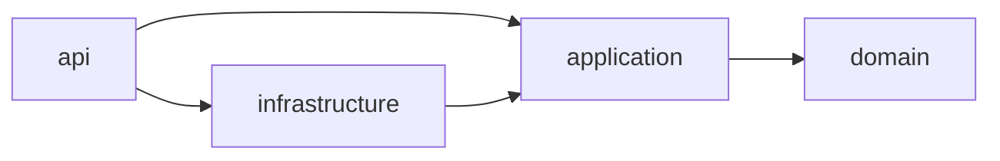

# Módulo 15: Java Master — builds, pruebas y observabilidad

Este capítulo convierte las prácticas de build, arquitectura, testing y diagnóstico en evidencias comprobables. Cada tema empieza en una carpeta vacía y produce su propio proyecto; no necesitas copiar código ni archivos de la academia.

**Proyecto del módulo:** seis proyectos independientes, escritos archivo por archivo, que aportan reglas y evidencias al Proyecto integrador del Módulo 13.

## Aprende construyendo

### Tema 1: Maven avanzado · Avanzado · 55 min

#### Aprende

**Prerrequisito:** JDK 27, Maven 3.9 o superior y un editor. Comprueba `java --version` y `mvn --version`.

**Al terminar podrás:** construir un reactor Maven, centralizar versiones con `dependencyManagement` y hacer que Enforcer rechace un JDK incompatible o dos rutas de dependencia que resuelven versiones divergentes.

Dos módulos pueden recibir el mismo artefacto por caminos distintos. Si cada camino selecciona una versión, el resultado puede compilar y aun así producir un classpath distinto del esperado. `dependencyManagement` fija versiones cuando un módulo declara una dependencia, pero no añade esa dependencia por sí solo. Un BOM coordina familias de artefactos; el reactor calcula el orden entre módulos; Enforcer convierte reglas del entorno y del grafo en restricciones del build.

**¿Por qué es importante?** Porque un artefacto aparentemente correcto no debe ocultar dependencias divergentes ni un entorno incompatible. Es preferible detener el build antes de desplegar.

**Analogía:** un catálogo corporativo de compras autoriza una versión por proveedor; cada departamento declara qué necesita, pero no negocia otra versión por su cuenta.

Los perfiles sirven para diferencias del proceso de construcción, no para guardar contraseñas ni reglas de negocio. El wrapper puede fijar Maven, pero aquí usarás el `mvn` instalado para que cada archivo necesario sea visible. En Gradle, las plataformas y las estrategias de resolución cumplen funciones comparables; no necesitas mantener dos builds para aprender la equivalencia.

**Cuándo no usarlo:** en un proyecto pequeño sin dependencias transitivas conflictivas, una colección extensa de reglas Enforcer puede ser ceremonia desproporcionada.

#### Practica

Crea una carpeta vacía y entra en ella:

```bash
mkdir ejemplo-maven-enforcer
cd ejemplo-maven-enforcer
mkdir -p domain/src/main/java/academia/domain app/src/main/java/academia/app
```

Escribe manualmente `pom.xml` en la raíz:

```xml
<?xml version="1.0" encoding="UTF-8"?>
<project xmlns="http://maven.apache.org/POM/4.0.0"
         xmlns:xsi="http://www.w3.org/2001/XMLSchema-instance"
         xsi:schemaLocation="http://maven.apache.org/POM/4.0.0 https://maven.apache.org/xsd/maven-4.0.0.xsd">
  <modelVersion>4.0.0</modelVersion>
  <groupId>academia</groupId>
  <artifactId>reactor</artifactId>
  <version>1.0.0</version>
  <packaging>pom</packaging>
  <modules>
    <module>domain</module>
    <module>app</module>
  </modules>
  <properties>
    <maven.compiler.release>27</maven.compiler.release>
    <project.build.sourceEncoding>UTF-8</project.build.sourceEncoding>
    <jackson.version>2.19.2</jackson.version>
    <domain.jackson>${jackson.version}</domain.jackson>
    <required.java>[27,28)</required.java>
  </properties>
  <dependencyManagement>
    <dependencies>
      <dependency>
        <groupId>com.fasterxml.jackson.core</groupId>
        <artifactId>jackson-databind</artifactId>
        <version>${jackson.version}</version>
      </dependency>
    </dependencies>
  </dependencyManagement>
  <build>
    <plugins>
      <plugin>
        <groupId>org.apache.maven.plugins</groupId>
        <artifactId>maven-enforcer-plugin</artifactId>
        <version>3.6.1</version>
        <executions>
          <execution>
            <id>reglas-del-producto</id>
            <goals><goal>enforce</goal></goals>
            <configuration>
              <rules>
                <requireJavaVersion><version>${required.java}</version></requireJavaVersion>
                <dependencyConvergence/>
              </rules>
            </configuration>
          </execution>
        </executions>
      </plugin>
    </plugins>
  </build>
</project>
```

Escribe `domain/pom.xml`; su propiedad permite introducir después una divergencia controlada:

```xml
<?xml version="1.0" encoding="UTF-8"?>
<project xmlns="http://maven.apache.org/POM/4.0.0"
         xmlns:xsi="http://www.w3.org/2001/XMLSchema-instance"
         xsi:schemaLocation="http://maven.apache.org/POM/4.0.0 https://maven.apache.org/xsd/maven-4.0.0.xsd">
  <modelVersion>4.0.0</modelVersion>
  <parent>
    <groupId>academia</groupId><artifactId>reactor</artifactId><version>1.0.0</version>
  </parent>
  <artifactId>domain</artifactId>
  <dependencies>
    <dependency>
      <groupId>com.fasterxml.jackson.core</groupId>
      <artifactId>jackson-databind</artifactId>
      <version>${domain.jackson}</version>
    </dependency>
  </dependencies>
</project>
```

Escribe `app/pom.xml` con una dependencia directa administrada y otra interna:

```xml
<?xml version="1.0" encoding="UTF-8"?>
<project xmlns="http://maven.apache.org/POM/4.0.0"
         xmlns:xsi="http://www.w3.org/2001/XMLSchema-instance"
         xsi:schemaLocation="http://maven.apache.org/POM/4.0.0 https://maven.apache.org/xsd/maven-4.0.0.xsd">
  <modelVersion>4.0.0</modelVersion>
  <parent>
    <groupId>academia</groupId><artifactId>reactor</artifactId><version>1.0.0</version>
  </parent>
  <artifactId>app</artifactId>
  <dependencies>
    <dependency><groupId>academia</groupId><artifactId>domain</artifactId><version>1.0.0</version></dependency>
    <dependency><groupId>com.fasterxml.jackson.core</groupId><artifactId>jackson-databind</artifactId></dependency>
  </dependencies>
  <build><plugins>
    <plugin>
      <groupId>org.codehaus.mojo</groupId><artifactId>exec-maven-plugin</artifactId><version>3.6.4</version>
      <configuration><mainClass>academia.app.App</mainClass></configuration>
    </plugin>
  </plugins></build>
</project>
```

Crea `domain/src/main/java/academia/domain/Serializador.java`:

```java
package academia.domain;

import com.fasterxml.jackson.databind.ObjectMapper;

public final class Serializador {
    public String versionJackson() {
        return ObjectMapper.class.getPackage().getImplementationVersion();
    }
}
```

Crea `app/src/main/java/academia/app/App.java`:

```java
package academia.app;

import academia.domain.Serializador;

public final class App {
    public static void main(String[] args) {
        System.out.println("Jackson resuelto: " + new Serializador().versionJackson());
    }
}
```

Construye, instala el reactor localmente y ejecuta la aplicación:

```bash
mvn -pl app -am clean verify
mvn -q -pl app -am install
mvn -q -pl app exec:java
```

**Resultado esperado:** `BUILD SUCCESS` y `Jackson resuelto: 2.19.2`. La opción `-pl app -am` selecciona `app` y también sus dependencias internas. Ejecuta `mvn -pl app dependency:tree -Dincludes=com.fasterxml.jackson.core:jackson-databind` para observar los dos caminos hacia el mismo artefacto.

**Fallo deliberado:** fuerza otra versión en el camino transitivo:

```bash
mvn -pl app -am verify -Ddomain.jackson=2.18.3
```

Debes obtener `Dependency convergence error`: la ruta directa apunta a `2.19.2` y la ruta `app -> domain` a `2.18.3`. **Corrección:** repite `mvn -pl app -am clean verify` sin sobrescribir la propiedad. Después ejecuta `mvn validate '-Drequired.java=[99,)'`; Enforcer debe rechazar el JDK. Restaura el valor omitiendo esa propiedad.

#### Aplica

Genera `mvn help:effective-pom` y localiza la versión efectiva de Jackson y las reglas de Enforcer. Como ejercicio independiente, sustituye la propiedad compartida por un BOM de Jackson importado con ámbito `import` en `dependencyManagement`, elimina las versiones redundantes de los hijos y demuestra de nuevo tanto el build alineado como el conflicto controlado. Documenta por qué administrar una versión no equivale a declarar la dependencia.

**Checklist de salida**

- [ ] El reactor construye `domain` antes de `app`.
- [ ] `app` recibe Jackson por una ruta directa y otra transitiva.
- [ ] `dependencyManagement` fija la versión directa sin añadir dependencias a `domain`.
- [ ] Enforcer detecta la divergencia `2.19.2`/`2.18.3`.
- [ ] El requisito `[99,)` falla y el valor normal vuelve a pasar.
- [ ] El POM efectivo y el árbol de dependencias explican la versión elegida.

**Proyecto integrador:** añade al reactor del Módulo 13 una regla de convergencia y un requisito de JDK equivalentes, usando su propio `pom.xml`; conserva el árbol antes y después de alinear versiones.

**Errores comunes:** usar perfiles para secretos, confundir un BOM con una dependencia y mantener builds Maven y Gradle de producción sin necesidad.

Fuentes oficiales: [Maven Enforcer Plugin](https://maven.apache.org/enforcer/maven-enforcer-plugin/) y [Maven POM Reference](https://maven.apache.org/pom.html).

### Tema 2: Gradle y builds reproducibles · Avanzado · 45 min

#### Aprende

**Prerrequisito:** JDK 27 y las herramientas `javac`, `java` y `jar` incluidas en el JDK. En macOS usa `shasum`; en Linux puedes usar `sha256sum`.

**Al terminar podrás:** producir dos JAR con el mismo hash a partir de las mismas fuentes, identificar un timestamp como entrada no determinista y explicar cómo wrapper, toolchains, bloqueo y verificación de dependencias completan la reproducibilidad en Gradle.

Un build reproducible hace explícitas sus entradas y evita incorporar hora actual, orden imprevisible o rutas locales al artefacto. En Gradle, el wrapper fija la distribución, una toolchain selecciona el JDK, el bloqueo registra versiones resueltas y verification metadata comprueba checksums. La caché solo es fiable para tareas deterministas; configuration cache exige declarar el estado que se lee durante la configuración.

**¿Por qué es importante?** Porque el mismo commit debe producir el mismo contenido en una laptop limpia y en CI. Así puedes firmar, auditar y desplegar exactamente lo que probaste.

**Analogía:** una receta reproducible fija ingredientes, cantidades y orden; escribir la hora de cocina dentro del plato haría distinto cada resultado aunque la receta no cambiara.

Este laboratorio ejecuta el mecanismo esencial con el JDK, sin exigir una instalación de Gradle. La equivalencia de JAR reproducible en Gradle es `isPreserveFileTimestamps = false` y `isReproducibleFileOrder = true`; una toolchain no cambia la JVM que ejecuta el propio Gradle.

**Cuándo no usarlo:** para un prototipo desechable que nunca se distribuye, perseguir igualdad bit a bit puede no compensar; la fijación de dependencias sigue siendo útil.

#### Practica

Parte de una carpeta vacía y crea manualmente la estructura:

```bash
mkdir ejemplo-jar-reproducible
cd ejemplo-jar-reproducible
mkdir -p src/academia
```

Escribe `src/academia/App.java`:

```java
package academia;

public final class App {
    public static void main(String[] args) {
        System.out.println("artefacto=logistica version=1.0.0");
    }
}
```

Compila y empaqueta dos veces con una fecha ZIP fija. Cada orden vuelve a crear las salidas desde las mismas fuentes:

```bash
rm -rf out build
mkdir -p out build
javac --release 27 -d out src/academia/App.java
jar --create --file build/logistica-1.0.0.jar --main-class academia.App --date=2026-01-01T00:00:00Z -C out .
java -jar build/logistica-1.0.0.jar
shasum -a 256 build/logistica-1.0.0.jar

rm -rf out build
mkdir -p out build
javac --release 27 -d out src/academia/App.java
jar --create --file build/logistica-1.0.0.jar --main-class academia.App --date=2026-01-01T00:00:00Z -C out .
shasum -a 256 build/logistica-1.0.0.jar
```

**Resultado esperado:** la ejecución imprime `artefacto=logistica version=1.0.0` y los dos SHA-256 son idénticos. `--date` fija las fechas de las entradas; con una sola clase también queda fijo su orden. En un proyecto con varios archivos, conserva un orden de entrada estable.

**Fallo deliberado:** repite el empaquetado dos veces sin `--date` y separa las ejecuciones para que cambie la fecha ZIP:

```bash
jar --create --file build/sin-fecha.jar --main-class academia.App -C out .
shasum -a 256 build/sin-fecha.jar
sleep 3
jar --create --file build/sin-fecha.jar --main-class academia.App -C out .
shasum -a 256 build/sin-fecha.jar
```

Los hashes deben diferir aunque el bytecode sea el mismo. **Corrección:** restaura `--date=2026-01-01T00:00:00Z`, repite las dos órdenes y comprueba la igualdad. Inspecciona las entradas con `jar --list --file build/logistica-1.0.0.jar`.

#### Aplica

Añade `src/academia/Version.java` con un método que devuelva la versión y úsalo desde `App`. Crea un script propio `build.sh` que compile todas las fuentes en orden estable, empaquete con fecha fija, ejecute y calcule el hash. Como ejercicio independiente, escribe `VERIFICACION.md` con las entradas del build, el JDK contractual, el hash obtenido y una tabla de equivalencias para wrapper, toolchain, dependency locking, verification metadata, build cache y configuration cache. Explica por qué una caché no corrige una tarea que consulta la hora.

**Checklist de salida**

- [ ] El JAR ejecuta e imprime la versión esperada.
- [ ] Dos builds con entradas iguales producen el mismo SHA-256.
- [ ] El experimento sin fecha produce hashes distintos.
- [ ] La fecha fija restaura la igualdad sin cambiar las fuentes.
- [ ] El script declara compilación, empaquetado, ejecución y hash.
- [ ] La explicación distingue reproducibilidad, bloqueo, verificación y caché.

**Proyecto integrador:** define en el Módulo 13 una orden de empaquetado reproducible y guarda el SHA-256 del artefacto que se probará y desplegará; si ese proyecto usa Gradle, traduce la fecha y el orden estables a sus tareas `Jar`.

**Errores comunes:** guardar credenciales en propiedades del build, pensar que una toolchain selecciona la JVM del lanzador y confiar en la caché para ocultar entradas no declaradas.

Fuentes oficiales: [Gradle Build Cache](https://docs.gradle.org/current/userguide/build_cache.html), [Gradle 9.1.0 Release Notes](https://docs.gradle.org/9.1.0/release-notes.html) y [JAR Tool](https://docs.oracle.com/en/java/javase/25/docs/specs/man/jar.html).

### Tema 3: Proyectos multi-módulo sin ciclos · Experto · 1 h 15 min

#### Aprende

**Prerrequisito:** JDK 27, Maven 3.9 o superior y conocimiento de paquetes y dependencias Maven.

**Al terminar podrás:** crear un reactor `domain/application/infrastructure/api`, hacer explícita la dirección de dependencias y escribir una regla ArchUnit que impida que el dominio conozca infraestructura.

`domain` contiene reglas sin frameworks; `application` coordina casos de uso y depende del dominio; `infrastructure` implementa puertos de aplicación; `api` ensambla los adaptadores. Una dependencia `implementation` no expone tipos a consumidores, mientras que una API pública sí forma parte del contrato. Los módulos justifican su costo cuando el límite necesita propiedad y dependencias distintas.

**¿Por qué es importante?** Porque un ciclo revela responsabilidades mal ubicadas y dificulta compilar, probar y evolucionar cada parte. La dirección debe quedar protegida tanto por el build como por una regla legible.

**Analogía:** un organigrama permite solicitar recursos solo a las áreas autorizadas; una solicitud en sentido contrario necesita cambiar el contrato, no ocultarse en una importación.



ArchUnit examina bytecode y puede detectar una dependencia aunque un nombre de paquete parezca correcto. Los convention plugins o configuraciones compartidas deben expresar decisiones estables; no conviertas cada paquete en un módulo.

**Cuándo no usarlo:** en una aplicación pequeña de un solo equipo, paquetes bien organizados y una prueba de arquitectura pueden bastar sin cinco módulos Maven.

#### Practica

Crea desde una carpeta vacía este reactor:

```bash
mkdir ejemplo-archunit-capas
cd ejemplo-archunit-capas
mkdir -p domain/src/main/java/academia/domain
mkdir -p application/src/main/java/academia/application
mkdir -p infrastructure/src/main/java/academia/infrastructure
mkdir -p api/src/main/java/academia/api
mkdir -p architecture-tests/src/test/java/academia/arquitectura
```

Escribe el `pom.xml` raíz:

```xml
<?xml version="1.0" encoding="UTF-8"?>
<project xmlns="http://maven.apache.org/POM/4.0.0"
         xmlns:xsi="http://www.w3.org/2001/XMLSchema-instance"
         xsi:schemaLocation="http://maven.apache.org/POM/4.0.0 https://maven.apache.org/xsd/maven-4.0.0.xsd">
  <modelVersion>4.0.0</modelVersion>
  <groupId>academia</groupId><artifactId>capas</artifactId><version>1.0.0</version><packaging>pom</packaging>
  <modules>
    <module>domain</module><module>application</module><module>infrastructure</module>
    <module>api</module><module>architecture-tests</module>
  </modules>
  <properties>
    <maven.compiler.release>27</maven.compiler.release><project.build.sourceEncoding>UTF-8</project.build.sourceEncoding>
  </properties>
  <build><plugins>
    <plugin><groupId>org.apache.maven.plugins</groupId><artifactId>maven-surefire-plugin</artifactId><version>3.5.5</version></plugin>
  </plugins></build>
</project>
```

Crea los cinco POM hijos. Todos comparten este encabezado de padre dentro de `<project>`:

```xml
<parent><groupId>academia</groupId><artifactId>capas</artifactId><version>1.0.0</version></parent>
```

`domain/pom.xml` solo añade su identidad al modelo Maven:

```xml
<?xml version="1.0" encoding="UTF-8"?>
<project xmlns="http://maven.apache.org/POM/4.0.0"><modelVersion>4.0.0</modelVersion>
  <parent><groupId>academia</groupId><artifactId>capas</artifactId><version>1.0.0</version></parent>
  <artifactId>domain</artifactId>
</project>
```

`application/pom.xml`:

```xml
<?xml version="1.0" encoding="UTF-8"?>
<project xmlns="http://maven.apache.org/POM/4.0.0"><modelVersion>4.0.0</modelVersion>
  <parent><groupId>academia</groupId><artifactId>capas</artifactId><version>1.0.0</version></parent>
  <artifactId>application</artifactId>
  <dependencies><dependency><groupId>academia</groupId><artifactId>domain</artifactId><version>1.0.0</version></dependency></dependencies>
</project>
```

`infrastructure/pom.xml`:

```xml
<?xml version="1.0" encoding="UTF-8"?>
<project xmlns="http://maven.apache.org/POM/4.0.0"><modelVersion>4.0.0</modelVersion>
  <parent><groupId>academia</groupId><artifactId>capas</artifactId><version>1.0.0</version></parent>
  <artifactId>infrastructure</artifactId>
  <dependencies><dependency><groupId>academia</groupId><artifactId>application</artifactId><version>1.0.0</version></dependency></dependencies>
</project>
```

`api/pom.xml`:

```xml
<?xml version="1.0" encoding="UTF-8"?>
<project xmlns="http://maven.apache.org/POM/4.0.0"><modelVersion>4.0.0</modelVersion>
  <parent><groupId>academia</groupId><artifactId>capas</artifactId><version>1.0.0</version></parent>
  <artifactId>api</artifactId>
  <dependencies>
    <dependency><groupId>academia</groupId><artifactId>application</artifactId><version>1.0.0</version></dependency>
    <dependency><groupId>academia</groupId><artifactId>infrastructure</artifactId><version>1.0.0</version></dependency>
  </dependencies>
</project>
```

`architecture-tests/pom.xml` concentra las pruebas y no es una dependencia de producción:

```xml
<?xml version="1.0" encoding="UTF-8"?>
<project xmlns="http://maven.apache.org/POM/4.0.0"><modelVersion>4.0.0</modelVersion>
  <parent><groupId>academia</groupId><artifactId>capas</artifactId><version>1.0.0</version></parent>
  <artifactId>architecture-tests</artifactId>
  <dependencies>
    <dependency><groupId>academia</groupId><artifactId>api</artifactId><version>1.0.0</version></dependency>
    <dependency><groupId>academia</groupId><artifactId>infrastructure</artifactId><version>1.0.0</version></dependency>
    <dependency><groupId>com.tngtech.archunit</groupId><artifactId>archunit-junit5</artifactId><version>1.4.1</version><scope>test</scope></dependency>
  </dependencies>
</project>
```

Crea `domain/src/main/java/academia/domain/Guia.java`:

```java
package academia.domain;

public record Guia(String referencia) {
    public Guia {
        if (referencia.isBlank()) throw new IllegalArgumentException("referencia requerida");
    }
}
```

Crea `application/src/main/java/academia/application/RepositorioGuias.java`:

```java
package academia.application;

import academia.domain.Guia;

public interface RepositorioGuias {
    void guardar(Guia guia);
}
```

Crea `infrastructure/src/main/java/academia/infrastructure/RepositorioMemoria.java`:

```java
package academia.infrastructure;

import academia.application.RepositorioGuias;
import academia.domain.Guia;
import java.util.ArrayList;
import java.util.List;

public final class RepositorioMemoria implements RepositorioGuias {
    private final List<Guia> guias = new ArrayList<>();
    @Override public void guardar(Guia guia) { guias.add(guia); }
    public int total() { return guias.size(); }
}
```

Crea `api/src/main/java/academia/api/App.java`:

```java
package academia.api;

import academia.domain.Guia;
import academia.infrastructure.RepositorioMemoria;

public final class App {
    public static void main(String[] args) {
        RepositorioMemoria repositorio = new RepositorioMemoria();
        repositorio.guardar(new Guia("GUIA-15"));
        System.out.println("guias=" + repositorio.total());
    }
}
```

Crea `architecture-tests/src/test/java/academia/arquitectura/DependencyRulesTest.java`:

```java
package academia.arquitectura;

import com.tngtech.archunit.core.importer.ClassFileImporter;
import org.junit.jupiter.api.Test;
import static com.tngtech.archunit.lang.syntax.ArchRuleDefinition.noClasses;

class DependencyRulesTest {
    @Test
    void dominioNoDependeDeInfraestructura() {
        var clases = new ClassFileImporter().importPackages("academia");
        noClasses().that().resideInAPackage("academia.domain..")
            .should().dependOnClassesThat().resideInAPackage("academia.infrastructure..")
            .check(clases);
    }
}
```

Ejecuta desde la raíz:

```bash
mvn clean verify
mvn -pl api -am package
```

**Resultado esperado:** `BUILD SUCCESS`, una prueba de arquitectura superada y el orden `domain`, `application`, `infrastructure`, `api`. El grafo coincide con el diagrama: infraestructura conoce el puerto, no al revés.

**Fallo deliberado:** crea `architecture-tests/src/test/java/academia/domain/ClienteHttp.java` como fixture de una clase indebida en dominio:

```java
package academia.domain;

import academia.infrastructure.RepositorioMemoria;

class ClienteHttp {
    private RepositorioMemoria repositorio;
}
```

Repite `mvn -pl architecture-tests -am test`. ArchUnit debe señalar el campo `repositorio` y la dependencia `academia.domain -> academia.infrastructure`. **Corrección:** borra ese fixture y repite la orden; la prueba vuelve a verde. Si en cambio añadieras esa referencia a `domain` de producción, el reactor la rechazaría incluso antes porque `domain` no declara infraestructura.

#### Aplica

Añade una segunda regla que impida ciclos de slices entre `academia.application` y `academia.infrastructure` usando `SlicesRuleDefinition.slices()` y `freeOfCycles()`. Como ejercicio independiente, extrae un caso de uso `RegistrarGuia` en aplicación, haz que `App` lo invoque y prueba que `domain` sigue compilando sin infraestructura. Ejecuta `mvn -pl domain -am clean package` y explica qué módulos no aparecen.

**Checklist de salida**

- [ ] Los cinco módulos y sus POM fueron creados manualmente.
- [ ] El reactor respeta el orden de dependencias del diagrama.
- [ ] Infraestructura implementa un puerto definido por aplicación.
- [ ] ArchUnit detecta y localiza la dependencia prohibida del fixture.
- [ ] La corrección elimina la violación y restaura el build.
- [ ] La segunda regla comprueba ausencia de ciclos sin dividir paquetes innecesariamente.

**Proyecto integrador:** reproduce en el Módulo 13 la frontera `domain/application/infrastructure/api` y añade estas reglas a su build, de modo que una importación apresurada de infraestructura en dominio no pueda llegar a producción.

**Errores comunes:** crear un módulo por paquete, exponer implementaciones en contratos públicos y escribir reglas tan amplias que fallen por clases generadas o fixtures no relacionados.

Fuente oficial: [ArchUnit User Guide](https://www.archunit.org/) y [Maven Multi-Module Projects](https://maven.apache.org/guides/mini/guide-multiple-modules.html).

### Tema 4: JUnit 5, Mockito y assertions expresivas · Avanzado · 55 min

#### Aprende

**Prerrequisito:** JDK 27, Maven y fundamentos de interfaces, records y excepciones.

**Al terminar podrás:** probar un caso de uso con un repositorio fake, un mock de notificación y una aserción AssertJ que distinga el estado de dominio de la interacción externa.

JUnit ejecuta y organiza pruebas; Mockito sustituye colaboradores; AssertJ expresa resultados legibles. Un fake en memoria sirve para un repositorio sencillo porque conserva comportamiento real. Un mock es apropiado cuando enviar una notificación es parte del contrato observable y el canal real sería lento o inseguro. Mockear la clase bajo prueba eliminaría precisamente lo que quieres verificar.

**¿Por qué es importante?** Porque una suite rápida pierde valor si da falsos positivos o se rompe con cualquier refactor interno. Las pruebas deben observar comportamiento y contratos, no cada llamada privada.

**Analogía:** en un ensayo de teatro, el protagonista es real, el escenario es una maqueta funcional y solo se comprueba que determinadas señales se emitan.

Un `ArgumentCaptor` permite inspeccionar un evento, pero suele ser más estable afirmar el estado resultante. `verifyNoMoreInteractions` es útil solo cuando una llamada adicional representa un riesgo real.

**Cuándo no usarlo:** no mocks para records o valores inmutables; instanciar el valor real es más claro.

#### Practica

Crea una carpeta vacía y un proyecto Maven completo:

```bash
mkdir ejemplo-confirmar-entrega
cd ejemplo-confirmar-entrega
mkdir -p src/main/java/academia/application src/test/java/academia/application
```

Escribe `pom.xml`:

```xml
<?xml version="1.0" encoding="UTF-8"?>
<project xmlns="http://maven.apache.org/POM/4.0.0"
         xmlns:xsi="http://www.w3.org/2001/XMLSchema-instance"
         xsi:schemaLocation="http://maven.apache.org/POM/4.0.0 https://maven.apache.org/xsd/maven-4.0.0.xsd">
  <modelVersion>4.0.0</modelVersion>
  <groupId>academia</groupId><artifactId>confirmar-entrega</artifactId><version>1.0.0</version>
  <properties><maven.compiler.release>27</maven.compiler.release><project.build.sourceEncoding>UTF-8</project.build.sourceEncoding></properties>
  <dependencies>
    <dependency><groupId>org.junit.jupiter</groupId><artifactId>junit-jupiter</artifactId><version>6.0.3</version><scope>test</scope></dependency>
    <dependency><groupId>org.mockito</groupId><artifactId>mockito-junit-jupiter</artifactId><version>5.21.0</version><scope>test</scope></dependency>
    <dependency><groupId>org.assertj</groupId><artifactId>assertj-core</artifactId><version>3.27.6</version><scope>test</scope></dependency>
  </dependencies>
  <build><plugins><plugin><groupId>org.apache.maven.plugins</groupId><artifactId>maven-surefire-plugin</artifactId><version>3.5.5</version></plugin></plugins></build>
</project>
```

Crea `src/main/java/academia/application/Guia.java`:

```java
package academia.application;

public record Guia(String referencia, Estado estado) {
    public enum Estado { REGISTRADA, ENTREGADA }
}
```

Crea `src/main/java/academia/application/RepositorioGuias.java`:

```java
package academia.application;

import java.util.Optional;

public interface RepositorioGuias {
    Optional<Guia> buscar(String referencia);
    void guardar(Guia guia);
}
```

Crea `src/main/java/academia/application/PuertoNotificacion.java`:

```java
package academia.application;

public interface PuertoNotificacion {
    void enviar(Guia entrega);
}
```

Crea `src/main/java/academia/application/ConfirmarEntrega.java`:

```java
package academia.application;

public final class ConfirmarEntrega {
    private final RepositorioGuias repositorio;
    private final PuertoNotificacion notificacion;

    public ConfirmarEntrega(RepositorioGuias repositorio, PuertoNotificacion notificacion) {
        this.repositorio = repositorio;
        this.notificacion = notificacion;
    }

    public Guia confirmar(String referencia) {
        Guia actual = repositorio.buscar(referencia)
            .orElseThrow(() -> new IllegalArgumentException("guía inexistente"));
        Guia entregada = new Guia(actual.referencia(), Guia.Estado.ENTREGADA);
        repositorio.guardar(entregada);
        notificacion.enviar(entregada);
        return entregada;
    }
}
```

Crea `src/test/java/academia/application/ConfirmarEntregaTest.java`:

```java
package academia.application;

import java.util.HashMap;
import java.util.Map;
import java.util.Optional;
import org.junit.jupiter.api.Test;
import org.junit.jupiter.api.extension.ExtendWith;
import org.mockito.Mock;
import org.mockito.junit.jupiter.MockitoExtension;
import static org.assertj.core.api.Assertions.assertThat;
import static org.mockito.Mockito.verify;

@ExtendWith(MockitoExtension.class)
class ConfirmarEntregaTest {
    @Mock PuertoNotificacion notificacion;

    @Test
    void confirmaYNotifica() {
        RepositorioGuias fake = new RepositorioMemoria();
        fake.guardar(new Guia("GUIA-1", Guia.Estado.REGISTRADA));
        var casoDeUso = new ConfirmarEntrega(fake, notificacion);

        Guia resultado = casoDeUso.confirmar("GUIA-1");

        assertThat(resultado.estado()).isEqualTo(Guia.Estado.ENTREGADA);
        assertThat(fake.buscar("GUIA-1")).contains(resultado);
        verify(notificacion).enviar(resultado);
    }

    static final class RepositorioMemoria implements RepositorioGuias {
        private final Map<String, Guia> datos = new HashMap<>();
        @Override public Optional<Guia> buscar(String referencia) {
            return Optional.ofNullable(datos.get(referencia));
        }
        @Override public void guardar(Guia guia) { datos.put(guia.referencia(), guia); }
    }
}
```

Ejecuta:

```bash
mvn clean test
```

**Resultado esperado:** `Tests run: 1, Failures: 0, Errors: 0` y `BUILD SUCCESS`. El test usa lógica real del caso de uso, estado real en el fake y un mock solo en la frontera de notificación.

**Fallo deliberado:** comenta `repositorio.guardar(entregada);` en `ConfirmarEntrega` y ejecuta de nuevo. La aserción sobre `fake.buscar("GUIA-1")` debe fallar porque conserva `REGISTRADA`; no es un problema de Mockito. **Corrección:** restaura la llamada y repite `mvn test`.

#### Aplica

Añade pruebas para guía inexistente y confirmación duplicada, definiendo antes si repetir la operación es idempotente o un error. Después añade `verifyNoMoreInteractions(notificacion)` y una segunda notificación legítima: observa cómo la verificación estricta bloquea el cambio y decide si ese riesgo justifica mantenerla. Como ejercicio independiente, captura el evento con `ArgumentCaptor<Guia>` y crea una aserción de dominio que muestre referencia y estado al fallar.

**Checklist de salida**

- [ ] El POM declara JUnit, Mockito, AssertJ y Surefire explícitamente.
- [ ] El fake conserva y devuelve estado real.
- [ ] El mock verifica únicamente el contrato de notificación.
- [ ] El fallo por escritura eliminada es detectado por el estado persistido.
- [ ] Las reglas de inexistencia y duplicado están probadas.
- [ ] La suite no depende de llamadas privadas ni interacciones irrelevantes.

**Proyecto integrador:** protege el caso de uso de confirmación del Módulo 13 con este patrón y ejecuta esa suite antes de cada cambio en reglas de entrega.

**Errores comunes:** mockear la clase bajo prueba, afirmar solo interacciones sin comprobar el resultado y convertir `verifyNoMoreInteractions` en una costumbre automática.

Fuentes oficiales: [JUnit 5 User Guide](https://junit.org/junit5/docs/current/user-guide/), [Mockito](https://javadoc.io/doc/org.mockito/mockito-core/latest/org.mockito/org/mockito/Mockito.html) y [AssertJ](https://assertj.github.io/doc/).

### Tema 5: Pruebas de integración reproducibles · Experto · 1 h

#### Aprende

**Prerrequisito:** JDK 27, Maven, Docker en ejecución y JDBC básico. Comprueba `docker info` antes de empezar.

**Al terminar podrás:** ejecutar una migración Flyway y probar un repositorio contra PostgreSQL real gestionado por Testcontainers, verificando decimales y fechas sin sustituir el protocolo SQL por mocks.

Una prueba de integración ejercita componentes reales y su protocolo. Testcontainers inicia una versión explícita de PostgreSQL; Flyway crea el esquema; JDBC inserta y lee tipos reales. Un mock de métodos no detecta una columna mal escrita, una restricción ni una conversión `NUMERIC`.

**¿Por qué es importante?** Porque los adaptadores fallan en sus contratos concretos: SQL, tipos, headers, timeouts y serialización. La prueba debe cruzar esa frontera real.

**Analogía:** probar un puente con una sección real y carga real aporta evidencia distinta de revisar únicamente sus cálculos en papel.

Cada prueba controla sus datos. No compartas una base mutable entre suites ni uses esperas fijas; Testcontainers espera una condición de disponibilidad y las pruebas limpian su estado. En CI, separa unitarias rápidas de integración, pero no omitas estas últimas antes de publicar.

**Cuándo no usarlo:** una regla pura de dominio sin recursos externos se prueba mejor con una unitaria rápida.

#### Practica

Crea desde cero el proyecto:

```bash
mkdir ejemplo-testcontainers-postgres
cd ejemplo-testcontainers-postgres
mkdir -p src/main/java/academia/infrastructure src/main/resources/db/migration src/integrationTest/java/academia/infrastructure
```

Escribe `pom.xml`; Build Helper incorpora el árbol de integración y Failsafe ejecuta las clases `*IT`:

```xml
<?xml version="1.0" encoding="UTF-8"?>
<project xmlns="http://maven.apache.org/POM/4.0.0"
         xmlns:xsi="http://www.w3.org/2001/XMLSchema-instance"
         xsi:schemaLocation="http://maven.apache.org/POM/4.0.0 https://maven.apache.org/xsd/maven-4.0.0.xsd">
  <modelVersion>4.0.0</modelVersion>
  <groupId>academia</groupId><artifactId>postgres-it</artifactId><version>1.0.0</version>
  <properties><maven.compiler.release>27</maven.compiler.release><project.build.sourceEncoding>UTF-8</project.build.sourceEncoding></properties>
  <dependencies>
    <dependency><groupId>org.flywaydb</groupId><artifactId>flyway-core</artifactId><version>10.22.0</version></dependency>
    <dependency><groupId>org.postgresql</groupId><artifactId>postgresql</artifactId><version>42.7.7</version></dependency>
    <dependency><groupId>org.junit.jupiter</groupId><artifactId>junit-jupiter</artifactId><version>6.0.3</version><scope>test</scope></dependency>
    <dependency><groupId>org.testcontainers</groupId><artifactId>junit-jupiter</artifactId><version>1.21.3</version><scope>test</scope></dependency>
    <dependency><groupId>org.testcontainers</groupId><artifactId>postgresql</artifactId><version>1.21.3</version><scope>test</scope></dependency>
    <dependency><groupId>org.assertj</groupId><artifactId>assertj-core</artifactId><version>3.27.6</version><scope>test</scope></dependency>
  </dependencies>
  <build><plugins>
    <plugin>
      <groupId>org.codehaus.mojo</groupId><artifactId>build-helper-maven-plugin</artifactId><version>3.6.1</version>
      <executions><execution><id>fuentes-integracion</id><phase>generate-test-sources</phase><goals><goal>add-test-source</goal></goals>
        <configuration><sources><source>src/integrationTest/java</source></sources></configuration>
      </execution></executions>
    </plugin>
    <plugin><groupId>org.apache.maven.plugins</groupId><artifactId>maven-surefire-plugin</artifactId><version>3.5.5</version></plugin>
    <plugin><groupId>org.apache.maven.plugins</groupId><artifactId>maven-failsafe-plugin</artifactId><version>3.5.5</version>
      <executions><execution><goals><goal>integration-test</goal><goal>verify</goal></goals></execution></executions>
    </plugin>
  </plugins></build>
</project>
```

Crea `src/main/resources/db/migration/V1__crear_guias.sql`:

```sql
create table guias (
    id bigint generated by default as identity primary key,
    referencia varchar(40) not null unique,
    monto numeric(10,2) not null,
    fecha date not null
);
```

Crea `src/main/java/academia/infrastructure/RepositorioGuias.java`:

```java
package academia.infrastructure;

import java.math.BigDecimal;
import java.sql.DriverManager;
import java.sql.SQLException;
import java.time.LocalDate;
import java.util.Optional;

public final class RepositorioGuias {
    public record Guia(String referencia, BigDecimal monto, LocalDate fecha) {}
    private final String url;
    private final String usuario;
    private final String clave;

    public RepositorioGuias(String url, String usuario, String clave) {
        this.url = url;
        this.usuario = usuario;
        this.clave = clave;
    }

    public void insertar(Guia guia) throws SQLException {
        String sql = "insert into guias(referencia, monto, fecha) values (?, ?, ?)";
        try (var connection = DriverManager.getConnection(url, usuario, clave);
             var statement = connection.prepareStatement(sql)) {
            statement.setString(1, guia.referencia());
            statement.setBigDecimal(2, guia.monto());
            statement.setObject(3, guia.fecha());
            statement.executeUpdate();
        }
    }

    public Optional<Guia> buscar(String referencia) throws SQLException {
        String sql = "select referencia, monto, fecha from guias where referencia = ?";
        try (var connection = DriverManager.getConnection(url, usuario, clave);
             var statement = connection.prepareStatement(sql)) {
            statement.setString(1, referencia);
            try (var result = statement.executeQuery()) {
                if (!result.next()) return Optional.empty();
                return Optional.of(new Guia(result.getString("referencia"),
                    result.getBigDecimal("monto"), result.getObject("fecha", LocalDate.class)));
            }
        }
    }
}
```

Crea `src/integrationTest/java/academia/infrastructure/RepositorioGuiasIT.java`:

```java
package academia.infrastructure;

import java.math.BigDecimal;
import java.sql.DriverManager;
import java.time.LocalDate;
import org.flywaydb.core.Flyway;
import org.junit.jupiter.api.BeforeAll;
import org.junit.jupiter.api.BeforeEach;
import org.junit.jupiter.api.Test;
import org.testcontainers.containers.PostgreSQLContainer;
import org.testcontainers.junit.jupiter.Container;
import org.testcontainers.junit.jupiter.Testcontainers;
import static org.assertj.core.api.Assertions.assertThat;

@Testcontainers
class RepositorioGuiasIT {
    @Container
    static PostgreSQLContainer<?> db = new PostgreSQLContainer<>("postgres:17-alpine");

    @BeforeAll
    static void migrar() {
        Flyway.configure().dataSource(db.getJdbcUrl(), db.getUsername(), db.getPassword())
            .load().migrate();
    }

    @BeforeEach
    void limpiar() throws Exception {
        try (var connection = DriverManager.getConnection(db.getJdbcUrl(), db.getUsername(), db.getPassword());
             var statement = connection.createStatement()) {
            statement.execute("truncate table guias");
        }
    }

    @Test
    void conservaDecimalYFecha() throws Exception {
        var repositorio = new RepositorioGuias(db.getJdbcUrl(), db.getUsername(), db.getPassword());
        var original = new RepositorioGuias.Guia("GUIA-1", new BigDecimal("1250.50"), LocalDate.of(2026, 11, 1));
        repositorio.insertar(original);
        var recuperada = repositorio.buscar("GUIA-1").orElseThrow();
        assertThat(recuperada.monto()).isEqualByComparingTo("1250.50");
        assertThat(recuperada.fecha()).isEqualTo(LocalDate.of(2026, 11, 1));
    }
}
```

Ejecuta con Docker disponible:

```bash
mvn clean verify
```

**Resultado esperado:** PostgreSQL se inicia en un contenedor, Flyway aplica `V1`, Failsafe ejecuta una integración y Maven informa `BUILD SUCCESS`. La fecha y el decimal recuperados coinciden con los insertados.

**Fallo deliberado:** cambia `monto` por `montoo` en `V1__crear_guias.sql`, detén el contenedor de la ejecución anterior si sigue activo y repite desde un proceso nuevo. El repositorio fallará con un error SQL de columna inexistente. **Corrección:** restaura `monto` y vuelve a ejecutar; no cambies el test para aceptar el esquema roto. Si Flyway informa que una migración ya aplicada cambió, explica por qué una migración inmutable no debe editarse en un entorno compartido.

#### Aplica

Ejecuta la integración dos veces y después en paralelo con otra clase que use su propio contenedor; comprueba que los datos no se contaminan. Como ejercicio independiente, añade WireMock como servidor HTTP de prueba: configura un `429 Too Many Requests` seguido de `200 OK`, escribe un cliente con un máximo de un reintento y verifica las dos solicitudes y un tercer caso que agota el límite. No uses una espera fija para sincronizar.

**Checklist de salida**

- [ ] Docker inicia PostgreSQL `17-alpine` mediante Testcontainers.
- [ ] Flyway crea el esquema antes de cada ejecución de integración.
- [ ] El repositorio usa SQL y JDBC reales.
- [ ] Decimal y fecha sobreviven a la ida y vuelta sin conversiones ambiguas.
- [ ] El error de columna se diagnostica y se corrige en la migración.
- [ ] Los datos se limpian y el reintento HTTP independiente tiene límite.

**Proyecto integrador:** ejecuta las migraciones y consultas del Módulo 13 contra PostgreSQL real antes de desplegar; añade una prueba de aislamiento para su operación de liquidación.

**Errores comunes:** reutilizar estado mutable entre pruebas, editar migraciones ya compartidas, probar SQL únicamente con mocks y ocultar integración en CI.

Fuentes oficiales: [Testcontainers for Java](https://java.testcontainers.org/), [Flyway](https://documentation.red-gate.com/flyway/) y [WireMock](https://wiremock.org/).

### Tema 6: SLF4J, Logback, MDC y logging estructurado · Avanzado · 55 min

#### Aprende

**Prerrequisito:** JDK 27, Maven, hilos y try-with-resources.

**Al terminar podrás:** emitir JSON con Logback, correlacionar operaciones mediante MDC y detectar contaminación de `traceId` cuando un pool reutiliza un hilo.

SLF4J es una fachada y Logback una implementación. La parametrización `log.info("guia={}", guia)` evita construir texto cuando el nivel está deshabilitado. MDC asocia contexto al hilo; `MDC.putCloseable` permite restaurarlo automáticamente. En un pool, olvidar la limpieza puede adjudicar una operación a la traza anterior sin lanzar ninguna excepción.

**¿Por qué es importante?** Porque durante un incidente necesitas reconstruir una operación sin adivinar por timestamps y sin registrar tokens, emails o documentos completos. Logs, métricas y trazas se complementan, pero no son intercambiables.

**Analogía:** una etiqueta de seguimiento acompaña cada escaneo del paquete; al terminar debe retirarse de la cinta para que el siguiente paquete no herede su identidad.

Logback y un encoder JSON producen campos consultables. Registra una excepción con contexto una sola vez, no en cada capa. Un `traceId` puede ser útil en logs aunque su alta cardinalidad lo haga inadecuado como etiqueta de métrica.

**Cuándo no usarlo:** un script de un solo uso, sin concurrencia ni operaciones que correlacionar, puede bastar con salida estándar sencilla.

#### Practica

Crea un proyecto desde una carpeta vacía:

```bash
mkdir ejemplo-mdc-correlacion
cd ejemplo-mdc-correlacion
mkdir -p src/main/java/academia/api src/main/resources
```

Escribe `pom.xml`:

```xml
<?xml version="1.0" encoding="UTF-8"?>
<project xmlns="http://maven.apache.org/POM/4.0.0"
         xmlns:xsi="http://www.w3.org/2001/XMLSchema-instance"
         xsi:schemaLocation="http://maven.apache.org/POM/4.0.0 https://maven.apache.org/xsd/maven-4.0.0.xsd">
  <modelVersion>4.0.0</modelVersion>
  <groupId>academia</groupId><artifactId>mdc-json</artifactId><version>1.0.0</version>
  <properties><maven.compiler.release>27</maven.compiler.release><project.build.sourceEncoding>UTF-8</project.build.sourceEncoding></properties>
  <dependencies>
    <dependency><groupId>org.slf4j</groupId><artifactId>slf4j-api</artifactId><version>2.0.17</version></dependency>
    <dependency><groupId>ch.qos.logback</groupId><artifactId>logback-classic</artifactId><version>1.5.18</version></dependency>
    <dependency><groupId>net.logstash.logback</groupId><artifactId>logstash-logback-encoder</artifactId><version>8.1</version></dependency>
  </dependencies>
  <build><plugins><plugin><groupId>org.codehaus.mojo</groupId><artifactId>exec-maven-plugin</artifactId><version>3.6.4</version>
    <configuration><mainClass>academia.api.App</mainClass></configuration>
  </plugin></plugins></build>
</project>
```

Crea `src/main/resources/logback.xml`:

```xml
<configuration>
  <appender name="JSON" class="ch.qos.logback.core.ConsoleAppender">
    <encoder class="net.logstash.logback.encoder.LogstashEncoder">
      <includeMdcKeyName>traceId</includeMdcKeyName>
      <includeMdcKeyName>guiaId</includeMdcKeyName>
    </encoder>
  </appender>
  <root level="INFO"><appender-ref ref="JSON"/></root>
</configuration>
```

Crea `src/main/java/academia/api/App.java`:

```java
package academia.api;

import java.util.concurrent.ExecutorService;
import java.util.concurrent.Executors;
import org.slf4j.Logger;
import org.slf4j.LoggerFactory;
import org.slf4j.MDC;

public final class App {
    private static final Logger log = LoggerFactory.getLogger(App.class);

    public static void main(String[] args) throws Exception {
        try (ExecutorService pool = Executors.newSingleThreadExecutor()) {
            pool.submit(() -> procesar("trace-A", "GUIA-1")).get();
            pool.submit(() -> procesar(null, "GUIA-2")).get();
        }
    }

    static void procesar(String traceId, String guiaId) {
        try (var guia = MDC.putCloseable("guiaId", guiaId)) {
            if (traceId == null) {
                log.info("operacion=sin_traza_externa");
                return;
            }
            try (var traza = MDC.putCloseable("traceId", traceId)) {
                log.info("operacion=confirmar_entrega");
            }
        }
    }
}
```

Ejecuta:

```bash
mvn clean compile exec:java
```

**Resultado esperado:** dos documentos JSON. El primero contiene `traceId=trace-A` y `guiaId=GUIA-1`; el segundo contiene `guiaId=GUIA-2` y no contiene `traceId`. Ambos incluyen `timestamp`, `level`, `logger_name` y `message`; los valores de tiempo varían.

**Fallo deliberado:** sustituye el bloque interno por `MDC.put("traceId", traceId); log.info("operacion=confirmar_entrega");` sin cerrar ni remover el valor. Repite la orden: el segundo evento hereda `traceId=trace-A` porque ambas tareas usan el mismo hilo. **Corrección:** restaura `try (var traza = MDC.putCloseable(...))` y comprueba que desaparece el contexto en la segunda operación. El fallo era silencioso; la evidencia está en el JSON.

#### Aplica

Añade un appender `ListAppender` en una prueba y verifica que ningún mensaje contiene un token o email completo. Como ejercicio independiente, propaga una excepción por dos capas y configura el registro para que el stack trace aparezca solo en la frontera; comprueba también que cambiar el nivel a `WARN` evita construir mensajes `INFO`. Explica qué identificadores sí registrarías y cuáles redactarías.

**Checklist de salida**

- [ ] SLF4J se usa como fachada y Logback como implementación.
- [ ] Cada evento es JSON con tiempo, nivel, logger y mensaje.
- [ ] La primera operación incluye su `traceId` y `guiaId`.
- [ ] La segunda no hereda contexto tras usar `putCloseable`.
- [ ] El experimento sin limpieza reproduce la contaminación del pool.
- [ ] La prueba independiente rechaza secretos y evita stack traces duplicados.

**Proyecto integrador:** incorpora al Módulo 13 un contexto `traceId` y `guiaId` con cierre garantizado, y conserva dos solicitudes correlacionadas sin datos sensibles como evidencia de diagnóstico.

**Errores comunes:** concatenar secretos en mensajes, registrar la misma excepción en todas las capas, abandonar MDC en un hilo reutilizado y confundir logs con métricas de baja cardinalidad.

Fuentes oficiales: [Logback MDC](https://logback.qos.ch/manual/mdc.html), [SLF4J Manual](https://www.slf4j.org/manual.html) y [Logstash Logback Encoder](https://github.com/logfellow/logstash-logback-encoder).

## Construcción guiada del capítulo

Conserva los seis proyectos como laboratorios independientes. La entrega reúne evidencias de cada uno sin convertir ninguno en una dependencia oculta de otro:

| Evidencia | Orden desde la carpeta correspondiente | Resultado que debes conservar |
|---|---|---|
| Build alineado | `mvn -pl app -am clean verify` en `ejemplo-maven-enforcer` | Reactor en verde y, por separado, convergencia rechazada |
| Artefacto reproducible | dos empaquetados con fecha fija en `ejemplo-jar-reproducible` | Dos SHA-256 iguales y el par diferente del fallo deliberado |
| Arquitectura | `mvn clean verify` en `ejemplo-archunit-capas` | Grafo sin ciclos y prueba ArchUnit |
| Unitarias | `mvn clean test` en `ejemplo-confirmar-entrega` | Estado y notificación verificados |
| Integración | `mvn clean verify` en `ejemplo-testcontainers-postgres` | Migración y PostgreSQL real |
| Observabilidad | `mvn clean compile exec:java` en `ejemplo-mdc-correlacion` | Dos JSON correlacionados sin fuga de MDC |

Antes de cerrar, inspecciona dependencias y artefactos, repite las órdenes desde una copia limpia de tus propios archivos y documenta cualquier configuración manual. Si otra persona necesita una carpeta prefabricada o una instrucción ausente, el laboratorio todavía no está completo.

## Trazabilidad de la auditoría original

- **Maven/Gradle:** los temas 1 y 2 explican ambos modelos; las prácticas usan Maven explícito y el JDK para no depender de generadores ni de una instalación Gradle.
- **Testing:** los temas 4 y 5 separan pruebas unitarias, dobles e integración real.
- **Logging:** el tema 6 implementa SLF4J, Logback, MDC y salida estructurada sin datos sensibles.
