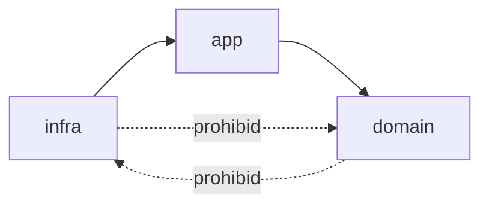

# Módulo 15: Build, testing e integraciones

M8 y M9 dieron la base; este módulo la lleva al contexto profesional: Maven/Gradle avanzados, multi-módulo, testing con dobles/assertions expresivas, integración reproducible y logging estructurado. El foco es confiabilidad de build y feedback.

**Contexto Tienda Aurora.** Este módulo aporta bases para Tienda Aurora: los conceptos aquí se aplican en el monolito modular y luego en los microservicios.

**Entorno de referencia verificado (2026-05-22):** JDK 27.0.1.0.2, Maven 3.10.0, Gradle 9.8.2.

## Aprende construyendo

### Tema 1: Maven avanzado · Intermedio · 40 min

**Caso guía.** estandarizar versiones y plugins en un build empresarial.

BOM, dependencyManagement, plugins, perfiles

**Definición.** `dependencyManagement` centraliza versiones; un BOM importa versiones coherentes; plugins se configuran en `build/plugins` o `pluginManagement`; perfiles activan variantes.

**Ejemplo mínimo enfocado.**

```xml
<dependencyManagement>
  <dependencies>
    <dependency>
      <groupId>org.junit</groupId><artifactId>junit-bom</artifactId><version>5.11.4</version>
      <type>pom</type><scope>import</scope>
    </dependency>
  </dependencies>
</dependencyManagement>
```

**Error común.** Duplicar versiones en cada dependencia. Corrección: BOM/dependencyManagement.

**Verificación.** `mvn help:effective-pom` muestra versiones resueltas.

### Tema 2: Gradle y builds reproducibles · Avanzado · 45 min

**Caso guía.** builds rápidos y reproducibles en CI.

Wrapper, version catalogs, caché

**Definición.** Gradle wrapper fija versión. Version catalogs (`libs.versions.toml`) centralizan versiones. Caches y incremental build aceleran; reproducibilidad exige fijar inputs.

**Ejemplo mínimo.** `gradle wrapper` genera wrapper; `./gradlew -v` fija versión.

**Error común.** Usar `latest.release`. Corrección: versiones explícitas.

### Tema 3: Proyectos multi-módulo sin ciclos · Avanzado · 40 min

**Caso guía.** `domain`, `app`, `infra`. `domain` no depende de `infra`.

Dependencias acíclicas

**Definición.** Un grafo de módulos sano es un DAG. Ciclos impiden build claro y señalan acoplamiento.



**Ejemplo mínimo enfocado.** Ver M8 multi-módulo; la regla: dependencias apuntan hacia el dominio, no desde el dominio a frameworks.

**Error común.** `domain` dependiendo de anotaciones/frameworks. Corrección: puertos, DTOs de mapeo en bordes.

### Tema 4: JUnit 6, Mockito y assertions expresivas · Avanzado · 35 min

**Caso guía.** tests legibles que fallen con mensaje útil.

Assertions expresivas

**Definición.** Una aserción expresiva comunica intención y muestra diferencia relevante al fallar. JUnit/AssertJ/Hamcrest son opciones; lo clave es claridad.

**Ejemplo mínimo enfocado (ejecutable).**

```bash
# reutiliza proyecto M9
mvn -q -Dtest=CalcTest test
```

**Error común.** `assertTrue(a.equals(b))`. Corrección: `assertEquals(expected, actual)`.

### Tema 5: Pruebas de integración reproducibles · Avanzado · 45 min

**Caso guía.** probar integración con DB/cola en entorno limpio.

Testcontainers / entornos efímeros

**Definición.** Pruebas de integración reproducibles crean dependencias efímeras controladas (contenedores, DB embebida) y limpian estado.

**Nota de verificación.** Testcontainers requiere Docker; este entorno tiene Docker 29.9.3, pero la ejecución completa puede ser pesada. Se recomienda ejecutar: `mvn -q -Dtest=*IT test` con configuración Testcontainers en proyecto real. No marcar como salida fija aquí.

**Error común.** Tests de integración contra DB compartida. Síntoma: flakiness. Corrección: contenedores efímeros o esquema aislado por test.

### Tema 6: SLF4J, Logback, MDC y logging estructurado · Avanzado · 40 min

**Caso guía.** logs útiles en producción con contexto.

Logging estructurado

**Definición.** Log estructurado emite campos clave-valor (JSON o patrón consistente) para consulta/agregación. MDC aporta contexto por request.

**Ejemplo mínimo enfocado.** Reusar M7: SLF4J + placeholders + MDC.clear en finally.

**Error común.** Loguear objetos gigantes o secretos. Corrección: campos seleccionados, redacción/masking.

## Cierre

Build y testing son infraestructura de confianza. Un repo maduro tiene feedback rápido, builds reproducibles y observabilidad desde los tests hasta producción.

## Checklist

- Centralizo versiones (BOM/catalog).
- Evito ciclos de módulo.
- Distingo unit, integration y e2e.
- Uso logging estructurado y MDC con limpieza.
