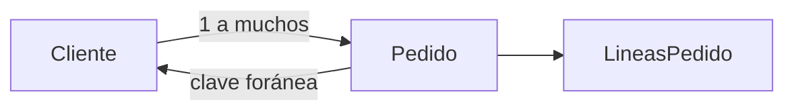
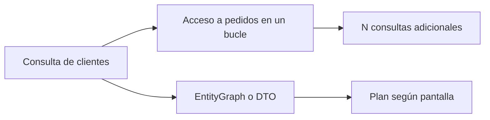
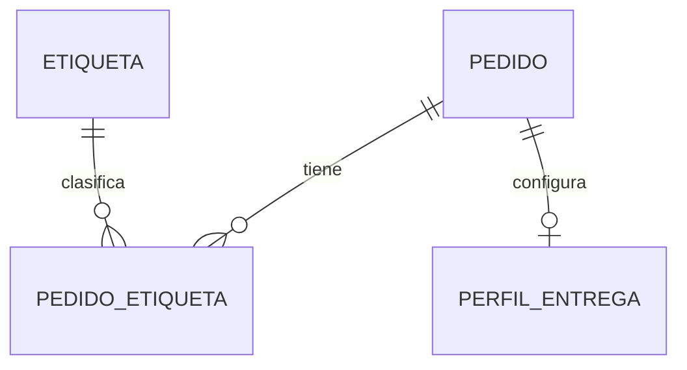
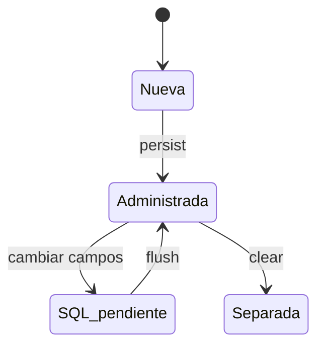
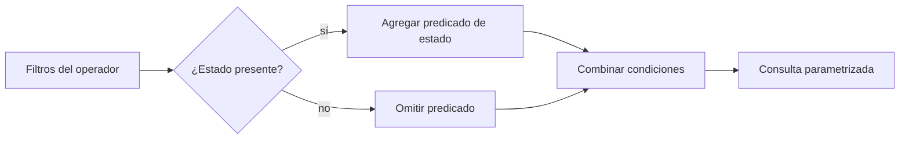
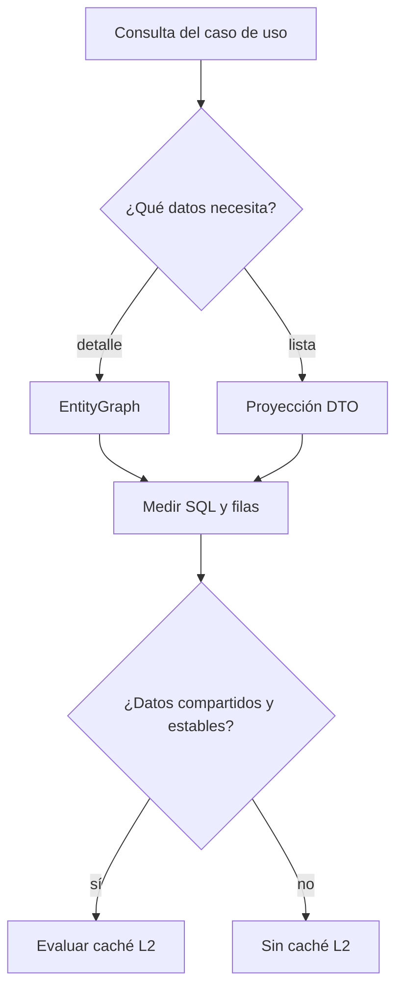
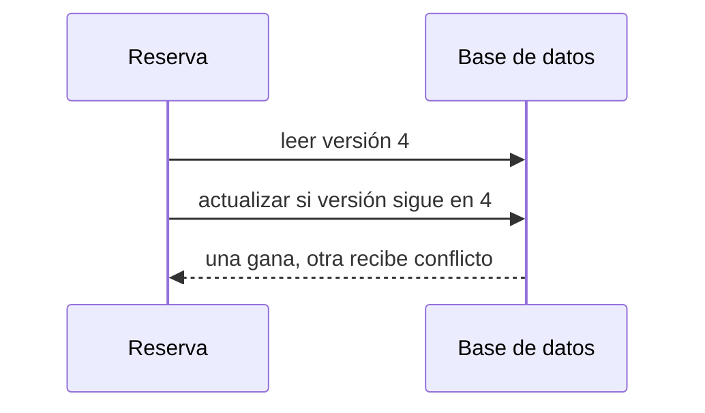
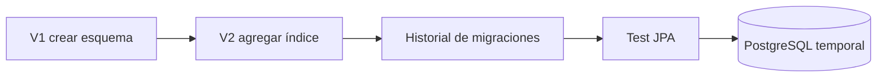

# Módulo 16: JPA, Hibernate y FetchType.LAZY vs EAGER

## Aprende construyendo

En este módulo vas a persistir un modelo pequeño de pedidos y medir las consultas que Hibernate ejecuta. La meta no es memorizar anotaciones: es decidir qué datos cargar para cada operación sin producir N+1, errores de sesión cerrada ni respuestas JSON cíclicas.

### Dos ejemplos: primero visible, luego real

- **Ejemplo sencillo:** dos clientes y tres pedidos en H2. Comprueba la clave foránea, carga los pedidos dentro de una transacción y compara el SQL de `LAZY` y `EAGER`.
- **Caso RutaFlow:** una pantalla paginada de envíos muestra referencia, estado y última parada. No serialices la entidad completa: crea una proyección DTO para el listado, una consulta de detalle con `@EntityGraph` y mide ambas con datos suficientes para que aparezca N+1.

La progresión importa: `EAGER` significa que la asociación debe estar disponible, no que Hibernate necesariamente use un `JOIN`. La evidencia del caso real es una prueba de integración con el número de filas y consultas observado, no solo una anotación en la entidad.

### Tema 1: Entidades y relaciones JPA

#### Paso 1 · Objetivo y preparación

Al finalizar podrás mapear `Cliente` y `Pedido` como entidades, crear una relación bidireccional y guardar el agregado con una transacción. Necesitas JDK 25 o superior y Maven; genera un proyecto desde Spring Initializr con `data-jpa` y `h2`.
**Conocimiento previo:** haber seguido el tema anterior de este módulo y tener instalado el entorno del stack.
#### Paso 2 · Contexto y caso real

Un sistema de reparto recibe pedidos y necesita consultarlos por cliente. Guardar el pedido como una fila desconectada pierde la relación; guardar el cliente completo dentro de cada pedido duplica datos y vuelve difícil actualizarlos.

#### Paso 3 · Teoría y modelo mental

JPA define el contrato de persistencia; Hibernate es una implementación que traduce entidades y operaciones a SQL. `@Entity` identifica una clase persistente, `@Id` su clave y las asociaciones describen referencias entre filas. En una relación bidireccional, `mappedBy` marca el lado inverso: el lado que declara `@JoinColumn` es el propietario que escribe la clave foránea.

Piensa en el lado propietario como la ficha que conserva la dirección oficial de la relación. Cambiar solo la colección inversa en memoria no garantiza que la base de datos cambie.
**Analogía:** una relación bidireccional es como una amistad registrada en dos agendas: el lado propietario (`@JoinColumn`) es la agenda donde se anota el teléfono real; el lado inverso (`mappedBy`) solo apunta "ver la otra agenda". Si actualizas una sola, las dos dejan de coincidir.
#### Paso 4 · Demostración guiada

Crea estos archivos en `src/main/java/academia/pedidos/`. El resto de la aplicación Spring Boot se genera con Initializr.

```java
// Cliente.java
package academia.pedidos;

import jakarta.persistence.*;
import java.util.ArrayList;
import java.util.List;

@Entity
public class Cliente {
    @Id @GeneratedValue
    private Long id;
    private String nombre;

    @OneToMany(mappedBy = "cliente", cascade = CascadeType.PERSIST)
    private List<Pedido> pedidos = new ArrayList<>();

    protected Cliente() {}

    public Cliente(String nombre) { this.nombre = nombre; }

    public void agregar(Pedido pedido) {
        pedidos.add(pedido);
        pedido.asignarCliente(this);
    }

    public Long getId() { return id; }
    public String getNombre() { return nombre; }
    public List<Pedido> getPedidos() { return List.copyOf(pedidos); }
}
```

**Ejecuta el ejemplo** (crea un proyecto desde cero con Maven o Gradle, pega el código y corre las pruebas; equivalencias en el Módulo 8, Tema 4):

```bash
# Maven
mvn -q archetype:generate -DgroupId=academia -DartifactId=app -DarchetypeArtifactId=maven-archetype-quickstart -DinteractiveMode=false
cd app && mvn test
# Gradle (equivalente): gradle init --type java-application --dsl kotlin && ./gradlew test
```


```java
// Pedido.java
package academia.pedidos;

import jakarta.persistence.*;

@Entity
public class Pedido {
    @Id @GeneratedValue
    private Long id;
    private String referencia;

    @ManyToOne(fetch = FetchType.LAZY, optional = false)
    @JoinColumn(name = "cliente_id", nullable = false)
    private Cliente cliente;

    protected Pedido() {}

    public Pedido(String referencia) { this.referencia = referencia; }
    void asignarCliente(Cliente cliente) { this.cliente = cliente; }
    public Long getId() { return id; }
    public String getReferencia() { return referencia; }
}
```

Un test `@DataJpaTest` debe crear un `Cliente`, llamar dos veces a `agregar(new Pedido(...))`, guardarlo con `EntityManager.persist(cliente)` y confirmar que se recuperan dos pedidos. Ejecuta `./mvnw test`.

**Resultado esperado:** el test termina en verde y la fila de `pedido` contiene `cliente_id`. **Fallo deliberado:** quita `pedido.asignarCliente(this)` y vuelve a probar. La asociación propietaria queda sin cliente; diagnostica inspeccionando la clave foránea, no solo la colección Java.

#### Paso 5 · Práctica guiada

1. Agrega `EstadoPedido` como enum persistido con `@Enumerated(EnumType.STRING)`.
2. Escribe un método de repositorio que busque los pedidos de un cliente.
3. Prueba borrar un cliente con pedidos sin `CascadeType.REMOVE`; decide y documenta la regla de negocio antes de añadir cascada.
**Pista:** sin `CascadeType.REMOVE`, borrar un `Cliente` con `Pedido` asociados falla por la restricción de clave foránea (`cliente_id` no puede quedar huérfano); decide explícitamente si la regla correcta es cascada, bloqueo o reasignación antes de agregarla.
#### Paso 6 · Práctica independiente

Modela `Pedido` y `LineaPedido` con una asociación uno-a-muchos. Agrega una línea mediante un método del agregado que actualice ambos lados. Escribe un test que compruebe la clave foránea y el total de líneas. No expongas setters públicos que permitan dejar el agregado inconsistente.



#### Paso 7 · Cierre y evidencia

Entrega las dos entidades, el test de persistencia y la consulta SQL observada como incremento del proyecto integrador de RutaFlow: modela el vínculo entre cliente y envío; como siguiente paso mide el costo real de cargar asociaciones con LAZY y EAGER. Errores comunes: convertir toda asociación en bidireccional sin necesidad, configurar cascadas amplias sin una regla de ciclo de vida definida, y actualizar solo la colección en memoria sin asignar también el lado propietario de la relación. Fuentes oficiales: https://jakarta.ee/specifications/persistence/ y https://docs.oracle.com/en/java/javase/25/.
**¿Por qué es importante?** Porque una relación persistida correctamente mantiene la integridad referencial aunque la aplicación se reinicie, y el lado propietario (el que declara `@JoinColumn`) es el único que garantiza que la base de datos refleje el cambio, no solo la colección Java en memoria.
**Evidencia de aprendizaje:** entrega el test de persistencia en verde, la fila con `cliente_id` poblado, y el fallo reproducido al omitir `asignarCliente` en el lado propietario.
**Conceptos clave:** `@Entity`, `@Id`, relación bidireccional, `mappedBy`, lado propietario frente a lado inverso.

**Cuándo no usarlo:** no conviertas toda asociación en bidireccional ni configures cascadas amplias sin una regla de ciclo de vida.

### Tema 2: FetchType.LAZY, EAGER y el problema N+1

#### Paso 1 · Objetivo y preparación

Al finalizar podrás elegir una estrategia de carga por caso de uso y demostrar el costo en número de consultas. Continúa con `Cliente` y `Pedido` del tema anterior; habilita `spring.jpa.show-sql=true` solo para este laboratorio.
**Conocimiento previo:** haber seguido el tema anterior de este módulo y tener instalado el entorno del stack.
#### Paso 2 · Contexto y caso real

La pantalla de clientes muestra diez clientes y el número de pedidos de cada uno. Una consulta para los clientes más diez consultas para pedidos es N+1: funciona con pocos datos y degrada al aumentar el lote.

#### Paso 3 · Teoría y modelo mental

`LAZY` difiere la carga hasta acceder a la asociación; `EAGER` exige que esté disponible al devolver la entidad, pero **no garantiza un único JOIN**. El proveedor puede emitir consultas adicionales. En JPA, `@ManyToOne` y `@OneToOne` son EAGER por defecto; `@OneToMany` y `@ManyToMany` son LAZY. Declara la intención explícitamente, especialmente `LAZY` en relaciones to-one.

La estrategia de mapeo es el valor por defecto, no un plan de consulta universal. Para cada pantalla o operación usa una consulta específica: `JOIN FETCH`, `@EntityGraph` o una proyección a DTO. El modelo mental: no pidas que el almacén abra cada caja por separado; especifica de antemano las cajas necesarias para esta operación.
**Analogía:** `LAZY` es pedir el menú y traer cada plato solo cuando lo pides; `EAGER` es que te traigan todo de golpe. El problema N+1 es pedir la lista de comensales (1 consulta) y luego preguntar el plato de cada uno por separado (N consultas): muchos viajes a la cocina por no pedir todo junto.
#### Paso 4 · Demostración guiada

En `src/test/java/academia/pedidos/ConsultasPedidoTest.java`, persiste diez clientes con pedidos. Limpia el contexto antes de medir para evitar que la caché de primer nivel oculte consultas:

```java
entityManager.flush();
entityManager.clear();
statistics.clear();

List<Cliente> clientes = entityManager.createQuery(
    "select c from Cliente c", Cliente.class
).getResultList();
clientes.forEach(c -> c.getPedidos().size());

System.out.println("Consultas: " + statistics.getPrepareStatementCount());
```

**Ejecuta el ejemplo** (crea un proyecto desde cero con Maven o Gradle, pega el código y corre las pruebas; equivalencias en el Módulo 8, Tema 4):

```bash
# Maven
mvn -q archetype:generate -DgroupId=academia -DartifactId=app -DarchetypeArtifactId=maven-archetype-quickstart -DinteractiveMode=false
cd app && mvn test
# Gradle (equivalente): gradle init --type java-application --dsl kotlin && ./gradlew test
```


Activa `hibernate.generate_statistics=true` en la configuración de test y obtiene `Statistics` desde `SessionFactory`. Ejecuta `./mvnw test -Dtest=ConsultasPedidoTest`.

**Resultado esperado:** el primer recorrido suele revelar una consulta de clientes y consultas adicionales por asociación. Los números exactos dependen de la versión y del caché; compara con el mismo conjunto de datos y contexto limpio. **Fallo deliberado:** elimina `entityManager.clear()`; explica por qué una sesión ya poblada puede hacer que el contador parezca mejor de lo que es.

#### Paso 5 · Práctica guiada

Reemplaza la consulta por:

```java
select distinct c from Cliente c
left join fetch c.pedidos
```

Mide otra vez. Luego intenta paginar esa consulta con una colección fetch-join: Hibernate puede advertir o paginar en memoria porque un join de colección multiplica las filas. Para una pantalla paginada, prueba cargar primero IDs paginados y luego los datos necesarios, o usa `@EntityGraph` con una estrategia evaluada.
**Pista:** si ves la advertencia "firstResult/maxResults specified with collection fetch; applying in memory", el join de colección ya multiplicó las filas antes de paginar; separa la consulta en dos pasos (IDs paginados primero, datos después) para evitar que Hibernate pagine en memoria.
#### Paso 6 · Práctica independiente

Implementa tres variantes: consulta base + acceso a relaciones, `JOIN FETCH` y proyección DTO. Registra el conteo de SQL, el número de filas duplicadas y si permite paginación segura. Responde: ¿cuándo es útil LAZY? ¿Cuándo se justifica EAGER? ¿Qué alternativa evita serializar accidentalmente la entidad completa?



#### Paso 7 · Cierre y evidencia

Entrega test, conteos comparables y decisión por caso de uso para el proyecto integrador de RutaFlow: la vista de detalle de un envío puede necesitar paradas, mientras que una lista resumida no; con esto cerrás el módulo. Errores comunes: usar EAGER global como "cura" para `LazyInitializationException` en vez de resolver cada caso de uso, usar `JOIN FETCH` sobre una colección sin considerar que multiplica filas, y paginar una consulta con fetch-join de colección sin verificar que Hibernate pagina correctamente. Fuentes oficiales: https://jakarta.ee/specifications/persistence/ y https://docs.oracle.com/en/java/javase/25/.
**¿Por qué es importante?** Porque elegir la estrategia de carga según cada operación evita convertir un endpoint aparentemente simple en cientos de viajes a la base de datos (N+1), sin caer en el extremo opuesto de cargar siempre todo con EAGER.
**Evidencia de aprendizaje:** entrega el test que reproduce N+1 con el conteo de consultas, y el test con la consulta optimizada (`JOIN FETCH` o proyección DTO) mostrando el conteo reducido.
**Conceptos clave:** `FetchType.LAZY`/`EAGER`, problema N+1, `JOIN FETCH`, `@EntityGraph`, proyección DTO.

**Cuándo no usarlo:** EAGER global no es una cura para `LazyInitializationException`; `JOIN FETCH` sin considerar cardinalidad puede multiplicar filas y memoria.
Como **siguiente** paso, lleva lo aprendido al próximo tema y conéctalo con el proyecto integrador del track.

### Tema 3: Relaciones uno a uno, muchos a muchos y herencia

#### Paso 1 · Objetivo y preparación

Al finalizar podrás elegir `@OneToOne`, `@ManyToMany` o una estrategia de herencia según el ciclo de vida de los datos. Necesitas el proyecto Spring Boot con JPA y H2 del Tema 1. **Prerrequisitos:** entidades y relaciones propietarias.

#### Paso 2 · Contexto y caso real

Un envío puede tener una etiqueta única y varios paquetes; un `ManyToMany` directo parece práctico para productos y etiquetas, pero luego alguien necesita guardar quién añadió la etiqueta y cuándo. Elegir la relación afecta dónde se guardan las claves y cómo se actualizan.

#### Paso 3 · Teoría y analogía

`@OneToOne` suele guardar la clave foránea en la tabla que depende del otro registro. `@ManyToMany` crea una tabla de unión, pero si esa unión tiene datos propios conviene convertirla en una entidad intermedia, por ejemplo `PedidoEtiqueta`. La herencia puede guardar toda la jerarquía en una tabla (`SINGLE_TABLE`), repartirla entre tablas unidas (`JOINED`) o crear una tabla por clase concreta (`TABLE_PER_CLASS`). Es como elegir entre una ficha con campos opcionales, varias fichas enlazadas o fichas separadas: no hay una estrategia gratis en consultas y esquema.

#### Paso 4 · Demostración guiada

En `src/main/java/academia/pedidos/PerfilEntrega.java`, crea el lado dependiente de la relación:

```java
@Entity
class PerfilEntrega {
  @Id @GeneratedValue Long id;
  @OneToOne(optional = false)
  @JoinColumn(name = "pedido_id", unique = true)
  Pedido pedido;
}
```

Agrega `src/test/java/academia/pedidos/PerfilEntregaTest.java` con `@DataJpaTest` y dos perfiles para el mismo pedido. Ejemplo independiente desde cero: genera un proyecto con Spring Initializr y dependencias `data-jpa`/`h2`, crea las dos clases y la prueba. Ejecuta:

```bash
./mvnw test -Dtest=PerfilEntregaTest
```

**Resultado esperado:** la restricción única rechaza la segunda fila; sin `unique = true`, la regla solo existiría en Java y otro cliente podría romperla.

#### Paso 5 · Práctica guiada

**Fallo deliberado:** quita `unique = true` y repite la inserción. **Pista:** la base deja pasar el dato inválido porque la cardinalidad declarada en el modelo no creó la restricción SQL. Restáurala y comprueba el nombre de la restricción en el error.

#### Paso 6 · Práctica independiente

Modela `PedidoEtiqueta` con `@ManyToOne` a `Pedido` y `Etiqueta`, más `creadaEn`. Añade dos filas con fechas distintas. Compara ese modelo con `@ManyToMany` y explica por qué una unión con información propia merece ser entidad. Prueba `JOINED` y `SINGLE_TABLE` en una jerarquía `Notificacion`/`Email`/`Sms` y registra las tablas creadas.



#### Paso 7 · Cierre y evidencia

Entrega el test de unicidad, el modelo de unión y el esquema observado. **Proyecto integrador RutaFlow:** aplica una relación uno-a-uno solo si ambos objetos comparten ciclo de vida; como siguiente paso controlarás lo que ocurre al guardar y consultar. Errores comunes: mantener duplicadas claves en ambos lados, escoger `ManyToMany` cuando la unión tiene atributos y elegir herencia sin observar las consultas. Fuentes oficiales: https://jakarta.ee/specifications/persistence/.

**¿Por qué es importante?** Porque cardinalidad, ciclo de vida y consultas dependen de cómo se mapean las relaciones.
**Evidencia de aprendizaje:** entrega el resultado del test de unicidad, el modelo intermedio y la comparación de dos estrategias de herencia.
**Cuándo no usarlo:** no uses una relación bidireccional ni herencia persistente si una clave foránea y composición simple expresan mejor el dominio.

### Tema 4: Ciclo de vida, EntityManager y consultas tipadas

#### Paso 1 · Objetivo y preparación

Al finalizar distinguirás entidades nuevas, administradas, separadas y eliminadas; usarás `flush()` con intención y escribirás JPQL tipado. **Prerrequisitos:** Tema 1 y una prueba `@DataJpaTest`.

#### Paso 2 · Contexto y caso real

Una prueba cambia el estado de un pedido, pero no llama a `save()` y aun así Hibernate actualiza la fila al terminar la transacción. Para saber por qué, hay que ver el contexto de persistencia y no tratar `EntityManager` como una caja negra.

#### Paso 3 · Teoría y analogía

El contexto de persistencia es el conjunto de entidades administradas por un `EntityManager`. Cambiar una entidad administrada se detecta al sincronizar; `flush()` envía los cambios pendientes a SQL, pero no confirma la transacción. `clear()` las separa del contexto. `@PrePersist` corre antes del primer guardado y `@PostLoad` después de materializar una fila. JPQL consulta entidades y sus campos, no nombres de tablas/columnas SQL. Es una mesa de trabajo: editar una ficha no la envía de inmediato al archivo; `flush` entrega los cambios pendientes, y el commit cierra la operación.

#### Paso 4 · Demostración guiada

Crea `src/test/java/academia/pedidos/CicloPedidoTest.java`. Agrega `@PrePersist` para completar `creadoEn` si está vacío, carga un `Pedido`, cambia su estado y sincroniza:

```java
// flush envía SQL; clear separa la entidad del contexto antes de volver a leer.
entityManager.persist(pedido);
entityManager.flush();
entityManager.clear();
var recargado = entityManager.find(Pedido.class, pedido.getId());
```

Consulta por estado con `entityManager.createQuery("select p from Pedido p where p.estado = :estado", Pedido.class)`. Ejemplo independiente desde cero: genera un proyecto con Spring Initializr (`data-jpa`, `h2`), crea las entidades y el test. Ejecuta:

```bash
./mvnw test -Dtest=CicloPedidoTest
```

**Resultado esperado:** el test ve el campo de fecha poblado y la consulta tipada devuelve pedidos del estado solicitado.

#### Paso 5 · Práctica guiada

**Fallo deliberado:** mueve la lectura SQL antes de `flush()` en una prueba con `FlushModeType.COMMIT`. **Pista:** las modificaciones en memoria aún no necesariamente se escribieron; coloca el `flush` antes de observar SQL. Recuerda: `flush` no hace commit ni evita rollback.

#### Paso 6 · Práctica independiente

Agrega un callback `@PostLoad` que derive un valor temporal y dos filtros JPQL parametrizados. Demuestra que concatenar texto de usuario en JPQL es inseguro y reemplázalo con parámetros nombrados. Escribe qué estado tiene la entidad antes y después de `clear()`.



#### Paso 7 · Cierre y evidencia

Entrega el test de estados del contexto, la salida del callback y JPQL tipado. **Proyecto integrador RutaFlow:** conserva reglas de negocio en servicios y usa callbacks solo para marcas técnicas como fechas. Como siguiente paso resolverás filtros variables con Criteria y Querydsl. Errores comunes: confundir flush con commit, consultar SQL en vez de entidades en JPQL y dejar entidades separadas sin volver a cargarlas. Fuentes oficiales: https://jakarta.ee/specifications/persistence/ y https://docs.hibernate.org/orm/.

**¿Por qué es importante?** Porque permite explicar cuándo un cambio está en memoria, cuándo llega a la base y cómo se traduce una consulta del dominio.
**Evidencia de aprendizaje:** test que muestra flush/clear, callback ejecutado y consulta JPQL parametrizada.
**Cuándo no usarlo:** no uses callbacks para enviar mensajes o ejecutar efectos externos; una transacción puede revertirse después.

### Tema 5: Búsquedas dinámicas con Criteria y Querydsl

#### Paso 1 · Objetivo y preparación

Al finalizar construirás búsquedas opcionales sin concatenar entrada del usuario en SQL y compararás Criteria API con Querydsl. **Prerrequisitos:** entidades Pedido y JPQL parametrizado.

#### Paso 2 · Contexto y caso real

El operador filtra pedidos por estado, cliente y fecha; cualquiera puede quedar vacío. Crear una consulta distinta para cada combinación multiplica métodos y concatenar valores abre riesgos de inyección.

#### Paso 3 · Teoría y analogía

Criteria API arma una consulta tipada con piezas (selección, predicados y orden) en tiempo de ejecución; es parte de Jakarta Persistence, pero puede ser verbosa. Querydsl genera tipos Java a partir de entidades y ofrece una forma más compacta; requiere plugin de generación y dependencia adicional. Ambas opciones parametrizan valores. Como una búsqueda con casillas, cada filtro activo se agrega al formulario y los valores nunca se pegan como texto de consulta.

#### Paso 4 · Demostración guiada

En `src/main/java/academia/pedidos/BusquedaPedido.java` usa Criteria para agregar solo filtros presentes:

```java
var cb = entityManager.getCriteriaBuilder();
var q = cb.createQuery(Pedido.class);
var p = q.from(Pedido.class);
var filtros = new ArrayList<Predicate>();
if (estado != null) filtros.add(cb.equal(p.get("estado"), estado));
if (clienteId != null) filtros.add(cb.equal(p.get("cliente").get("id"), clienteId));
q.select(p).where(filtros.toArray(Predicate[]::new));
var pedidos = entityManager.createQuery(q).getResultList();
```

Ejemplo independiente desde cero: genera un proyecto Spring con `data-jpa`/`h2`, crea `Pedido`, `BusquedaPedido` y `src/test/java/academia/pedidos/BusquedaDinamicaTest.java`. Ejecuta:

```bash
./mvnw test -Dtest=BusquedaDinamicaTest
```

**Resultado esperado:** estado y cliente pueden filtrarse por separado o juntos; un valor con comillas se trata como valor, no como parte de la consulta.

#### Paso 5 · Práctica guiada

**Fallo deliberado:** incorpora `" or 1=1` al concatenar el texto del filtro en una consulta JPQL. **Pista:** la consulta deja de representar un filtro de igualdad. Elimina concatenación y conserva únicamente parámetros o predicados Criteria.

#### Paso 6 · Práctica independiente

En una rama de ejemplo, añade Querydsl JPA y generación de `QPedido`; reescribe los mismos filtros con `BooleanBuilder`. Registra dependencias y comando de generación de tipos usados por tu versión. Compara legibilidad, errores de compilación y complejidad de build; no declares Querydsl obligatorio para una búsqueda con dos filtros.



#### Paso 7 · Cierre y evidencia

Entrega pruebas de filtro individual, combinado y entrada hostil, además de la comparación Criteria/Querydsl. **Proyecto integrador RutaFlow:** usa estos filtros en la búsqueda del operador y limita el tamaño de página. Como siguiente paso optimizarás qué asociaciones carga cada consulta. Errores comunes: concatenar filtros, construir predicados vacíos con semántica accidental y adoptar Querydsl sin justificar su plugin. Fuentes oficiales: https://jakarta.ee/specifications/persistence/ y https://querydsl.com/.

**¿Por qué es importante?** Porque un buscador real combina filtros opcionales con datos no confiables.
**Evidencia de aprendizaje:** tres pruebas, fallo de concatenación explicado y comparación de ambas APIs.
**Cuándo no usarlo:** una consulta JPQL fija y corta suele ser más clara que una API dinámica.

### Tema 6: EntityGraph y cachés de persistencia

#### Paso 1 · Objetivo y preparación

Al finalizar distinguirás el contexto/caché de primer nivel de una caché compartida de segundo nivel y cargarás una asociación con `@EntityGraph`. **Prerrequisitos:** N+1, EntityManager y relaciones del Tema 1.

#### Paso 2 · Contexto y caso real

La vista de un pedido necesita cliente y paradas, pero el listado solo necesita referencia y estado. Cargar todos los objetos en todas las consultas desperdicia memoria y consultas.

#### Paso 3 · Teoría y analogía

La caché de primer nivel vive dentro del `EntityManager` y garantiza identidad de una entidad administrada; no se comparte entre transacciones. La caché L2 es opcional, se configura por proveedor y se comparte entre contextos; puede quedar desactualizada si se escriben datos por fuera. `@EntityGraph` pide asociaciones para una consulta concreta sin volver EAGER globalmente. La primera caché es tu mesa de trabajo; la segunda es una copia compartida del archivo que necesita reglas de actualización.

#### Paso 4 · Demostración guiada

En `src/main/java/academia/pedidos/PedidoRepository.java` agrega `@EntityGraph(attributePaths = "cliente")` sobre un método de búsqueda de detalle. Limpia el contexto con `entityManager.clear()` y mide SQL con `src/test/java/academia/pedidos/PedidoGraphTest.java`. **Resultado esperado:** el detalle puede cargar el cliente en la consulta de esa operación y el listado sigue devolviendo solo los campos requeridos. Ejemplo independiente desde cero: genera el proyecto con Spring Initializr (`data-jpa`, `h2`), crea las entidades, repositorio y prueba. Ejecuta:

```bash
./mvnw test -Dtest=PedidoGraphTest
```

#### Paso 5 · Práctica guiada

**Fallo deliberado:** consulta dos veces el mismo pedido en el mismo `EntityManager` y cuenta SQL; luego inserta `clear()` entre consultas. **Pista:** con el contexto poblado, la segunda lectura puede resolverse desde L1. No atribuyas ese resultado a L2. Verifica la caché compartida aparte y habilítala solo para datos adecuados.

#### Paso 6 · Práctica independiente

Agrega un `EntityGraph` para cliente y otro para cliente más líneas. Compara consultas, filas y memoria estimada; documenta por qué no cachearías datos que cambian en cada lectura. Si habilitas L2, prueba actualización externa y define invalidación/expiración.

Al revisar la medición, separa tres cosas: entidades devueltas, sentencias ejecutadas y filas que viajan por la red. Una sola sentencia puede devolver filas repetidas por un join; por eso el número de consultas no basta para decidir que una vista está optimizada. Compara con el mismo tamaño de datos y contexto vacío, y registra la versión de Hibernate, el SQL y el plan usado. En producción, la caché L2 también requiere una política explícita para escrituras hechas por tareas batch u otros servicios.



#### Paso 7 · Cierre y evidencia

Entrega SQL medido, resultado por operación y prueba que separa L1 de L2. **Proyecto integrador RutaFlow:** documenta el plan de carga de lista y detalle; como siguiente paso manejarás cambios concurrentes. Errores comunes: creer que EAGER significa JOIN, olvidar limpiar el contexto al medir y cachear datos mutables sin invalidación. Fuentes oficiales: https://jakarta.ee/specifications/persistence/ y https://docs.hibernate.org/orm/.

**¿Por qué es importante?** Porque cada lectura necesita un conjunto de datos distinto y las cachés tienen límites distintos.
**Evidencia de aprendizaje:** prueba de EntityGraph y conteos diferenciados de primera y segunda caché.
**Cuándo no usarlo:** no habilites L2 para ocultar consultas incorrectas ni para datos con cambios externos frecuentes.

### Tema 7: Concurrencia, transacciones y propagación

#### Paso 1 · Objetivo y preparación

Al finalizar detectarás una actualización perdida, aplicarás `@Version` y distinguirás una transacción local de la propagación entre métodos. **Prerrequisitos:** `@Transactional` y persistencia de pedidos.

#### Paso 2 · Contexto y caso real

Dos operadores confirman simultáneamente el último cupo de un conductor. Si ambos leen disponibilidad antes de guardar, un cambio puede sobrescribir al otro.

#### Paso 3 · Teoría y analogía

El bloqueo optimista agrega una versión; al actualizar, la base comprueba que siga igual y rechaza cambios obsoletos. El bloqueo pesimista reserva la fila durante la transacción mediante una consulta con lock y puede hacer esperar a otros. Propagación decide si un método usa la transacción actual, crea otra o falla si no hay ninguna. Es una fila en una sola caja: optimistic verifica que nadie la cambió mientras trabajabas; pessimistic cierra la caja mientras la editas.

#### Paso 4 · Demostración guiada

En `src/main/java/academia/pedidos/Conductor.java` agrega `@Version private long version;` y en `src/main/java/academia/pedidos/ConductorRepository.java` crea el método con lock. Escribe `src/test/java/academia/pedidos/ReservaConcurrenteTest.java` con dos transacciones que cargan la misma fila:

```java
@Lock(LockModeType.PESSIMISTIC_WRITE)
@Query("select c from Conductor c where c.id = :id")
Optional<Conductor> buscarParaReserva(long id);
```

Ejemplo independiente desde cero: genera proyecto con Spring Initializr (`data-jpa`, `h2`), crea entidad, repositorio y test. Ejecuta:

```bash
./mvnw test -Dtest=ReservaConcurrenteTest
```

**Resultado esperado:** solo una actualización con versión antigua gana; la segunda produce conflicto. Con lock pesimista, la segunda espera o falla según timeout/configuración.

#### Paso 5 · Práctica guiada

**Fallo deliberado:** quita `@Version` y repite las dos escrituras. **Pista:** si ambas transacciones guardan el valor calculado sobre el mismo estado inicial, aparece actualización perdida. Restáuralo y verifica la excepción de concurrencia traducida por Spring.

#### Paso 6 · Práctica independiente

Implementa una operación `REQUIRED` y otra `REQUIRES_NEW`; fuerza una excepción después de llamar a ambas y observa qué se revierte. Anota por qué `REQUIRES_NEW` no debe usarse como arreglo genérico y qué pasa con la llamada a un método transaccional desde otra función del mismo objeto.

`REQUIRED` normalmente participa de la transacción existente o crea una si no hay. `REQUIRES_NEW` suspende la anterior y abre otra; su commit puede sobrevivir al rollback exterior. En Spring, la propagación declarada funciona a través del proxy; una llamada interna directa (`this.metodo()`) puede no atravesarlo. Diseña una prueba con un servicio llamador y otro servicio transaccional para observar esa diferencia sin asumir que una anotación cambia cada llamada automáticamente.



#### Paso 7 · Cierre y evidencia

Entrega la prueba de concurrencia, el resultado del lock y una tabla de rollback/commit de cada propagación. **Proyecto integrador RutaFlow:** define cuál operación protege la última asignación y qué respuesta recibe el operador ante conflicto; como siguiente paso harás reproducible el esquema y su prueba. Errores comunes: creer que `@Transactional` evita carreras, sostener locks durante llamadas de red y asumir que toda propagación inicia una transacción nueva. Fuentes oficiales: https://jakarta.ee/specifications/persistence/ y https://docs.spring.io/spring-framework/reference/data-access/transaction/declarative/tx-propagation.html.

**¿Por qué es importante?** Porque una transacción por sí sola no impide que dos usuarios sobrescriban un dato leído al mismo tiempo.
**Evidencia de aprendizaje:** dos transacciones concurrentes, conflicto reproducido y explicación del resultado de propagación.
**Cuándo no usarlo:** no mantengas un lock de base de datos mientras esperas un servicio HTTP o una intervención humana.

### Tema 8: Migraciones y pruebas JPA con Testcontainers

#### Paso 1 · Objetivo y preparación

Al finalizar podrás crear una migración versionada y probar el repositorio contra la misma familia de base de datos que producción. **Prerrequisitos:** Spring Boot, JPA, Maven y Docker disponible para Testcontainers.

#### Paso 2 · Contexto y caso real

H2 acepta algunas consultas y tipos que PostgreSQL maneja de otra manera. El test pasa localmente y el despliegue falla al crear una columna nueva.

#### Paso 3 · Teoría y analogía

Flyway o Liquibase aplican cambios de esquema ordenados y rastreables; en desarrollo y producción se ejecuta la misma secuencia. Testcontainers inicia una base aislada para una prueba y la elimina después. Una migración es como un historial de instrucciones para transformar cada copia de la base; la prueba con contenedor verifica esas instrucciones contra el motor real.

#### Paso 4 · Demostración guiada

Crea `src/main/resources/db/migration/V1__crear_pedidos.sql`:

```sql
create table pedido (
  id bigint generated by default as identity primary key,
  referencia varchar(40) not null unique,
  estado varchar(20) not null
);
```

Configura Flyway y `src/test/java/academia/pedidos/PedidoPostgresTest.java` con `@Testcontainers` y PostgreSQL; la integración `@ServiceConnection` depende de la versión de Spring Boot. Ejemplo independiente desde cero: genera proyecto con `data-jpa`, `flyway`, `postgresql` y Testcontainers; agrega migración y test. Ejecuta:

```bash
./mvnw test -Dtest=PedidoPostgresTest
```

**Resultado esperado:** Flyway crea el esquema y el test inserta/lee un pedido en PostgreSQL; el historial registra `V1`.

#### Paso 5 · Práctica guiada

**Fallo deliberado:** cambia `referencia` a nullable en la entidad, pero no agregues migración. **Pista:** el esquema de test se gobierna por los scripts, no por `ddl-auto`; añade `V2__...sql` con cambio explícito y conserva `ddl-auto=validate`.

#### Paso 6 · Práctica independiente

Agrega una migración que cree índice para búsquedas por estado y una prueba que compruebe la restricción única. Compara Testcontainers con H2 y anota qué comportamiento del motor real sería imposible afirmar basándote solo en H2. Registra versiones exactas del BOM y de la imagen usada.

Una migración aplicada no se edita para corregir el pasado: se agrega otra que lleve adelante tanto las bases nuevas como las existentes. Antes de hacerla irreversible, define si necesita una fase de expansión y contracción para que la versión anterior de la aplicación siga funcionando durante el despliegue. El contenedor de prueba debe usar una imagen con etiqueta fija y la misma versión mayor de PostgreSQL de producción; `latest` haría que el resultado cambiase sin modificar el código.



#### Paso 7 · Cierre y evidencia

Entrega los scripts, el log de migración y la salida del test con contenedor. **Proyecto integrador RutaFlow:** deja una migración revisable por cambio de esquema y conserva compatibilidad durante el despliegue; este módulo termina con evidencia de persistencia repetible. Errores comunes: editar migraciones ya aplicadas, usar `ddl-auto=create` en producción y declarar pruebas con contenedor como prueba de rendimiento. Fuentes oficiales: https://documentation.red-gate.com/flyway/ y https://java.testcontainers.org/.

**¿Por qué es importante?** Porque una base nueva debe alcanzar el mismo esquema de forma automática y comprobable. Siguiente paso: integra el esquema versionado y la prueba de base real en el pipeline del proyecto.
**Evidencia de aprendizaje:** historial Flyway, prueba contra PostgreSQL y comparación explícita con H2.
**Cuándo no usarlo:** no necesitas un contenedor por cada prueba unitaria; resérvalo para integración con el motor real.
