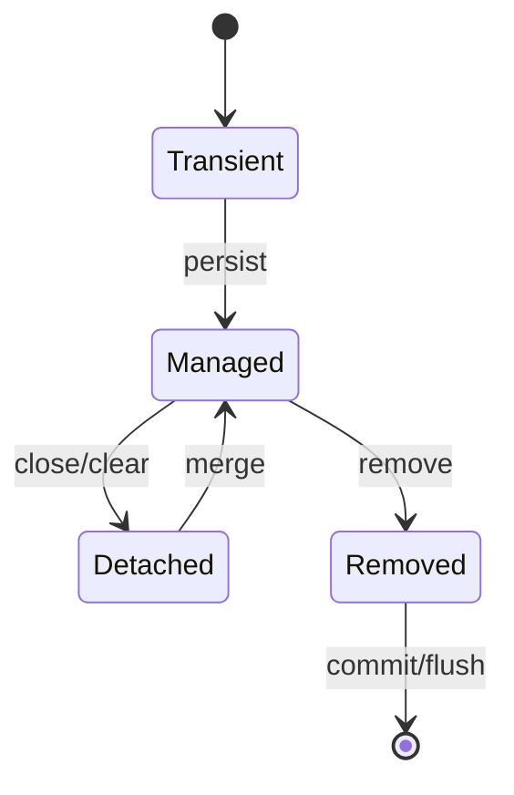
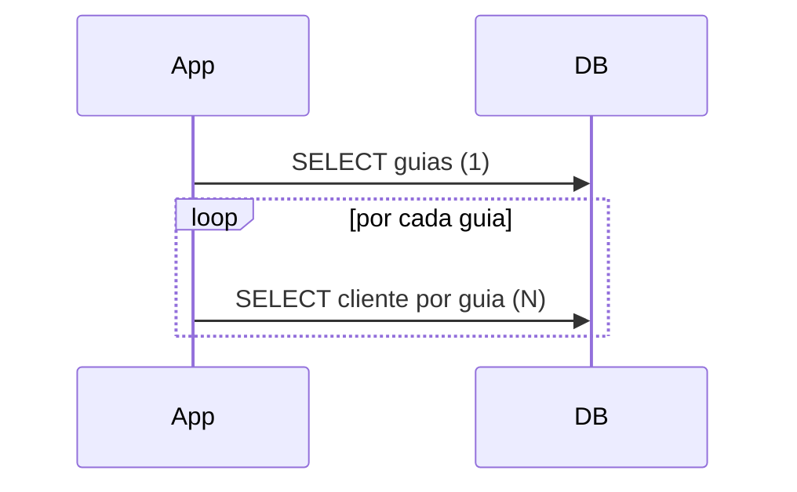

# Módulo 16: Persistencia con JPA e Hibernate

JPA abstrae el mapeo objeto-relacional, pero no elimina SQL ni el modelo relacional. Hibernate es una implementación popular. Usado bien, reduce boilerplate y centraliza mapeo; usado sin entenderlo, produce N+1, fetches accidentales, bugs de transacción y migraciones peligrosas.

**Contexto Tienda Aurora.** Este módulo aporta bases para Tienda Aurora: los conceptos aquí se aplican en el monolito modular y luego en los microservicios.

**Entorno de referencia verificado (2026-05-22):** JDK 27.0.1.0.2. Los ejemplos conceptuales/runnables mínimos usan Java/H2/JPA en forma de snippets ejecutables cuando se agregan dependencias; para bloques que requieren contenedor JPA completo se incluye setup Maven honesto.

## Aprende construyendo

## Proyecto desde cero: tienda-aurora-java-m16

### Prerrequisitos

```bash
java -version    # JDK 25+
gradle --version # Gradle 9.x
```

### Estructura del proyecto

```text
tienda-aurora-java-m16/
├── build.gradle.kts
├── settings.gradle.kts
└── src/
    └── main/
        └── java/com/aurora/java/
            └── Main.java
```

### build.gradle.kts

```kotlin
plugins {
    java
    application
}

group = "com.aurora"
version = "1.0.0"

java {
    toolchain {
        languageVersion = JavaLanguageVersion.of(25)
    }
}

application {
    mainClass.set("com.aurora.java.Main")
}

repositories {
    mavenCentral()
}
```

### settings.gradle.kts

```kotlin
rootProject.name = "tienda-aurora-java-m16"
```

### Ejecutar

```bash
./gradlew run
# O directamente:
mkdir -p out
javac -d out src/main/java/com/aurora/java/**/*.java
java -cp out com.aurora.java.Main
```

### Tema 1: Entidades y relaciones JPA · Intermedio · 35 min

**Caso guía.** una `Guia` pertenece a un `Cliente`.

Entidad, `@Entity`, `@Id`, `@ManyToOne`

**Definición.** Una entidad JPA es una clase mapeada a una tabla, con identidad (`@Id`) y estado gestionado por el contexto de persistencia.

```mermaid
erDiagram
  CLIENTE ||--o{ GUIA : tiene
  CLIENTE { long id PK }
  GUIA { long id PK, long cliente_id FK }
```

**Ejemplo mínimo (setup Maven ejecutable con H2/Hibernate).**

```xml
<dependency><groupId>org.hibernate.orm</groupId><artifactId>hibernate-core</artifactId><version>6.6.11.Final</version></dependency>
<dependency><groupId>com.h2database</groupId><artifactId>h2</artifactId><version>2.3.232</version></dependency>
<dependency><groupId>jakarta.persistence</groupId><artifactId>jakarta.persistence-api</artifactId><version>3.1.0</version></dependency>
```

Crea el archivo `Guia.java`:

```java
import jakarta.persistence.*;
@Entity
class Guia {
  @Id @GeneratedValue Long id;
  String codigo;
  @ManyToOne(fetch = FetchType.LAZY) Cliente cliente;
}
```

**Error común.** Usar `EAGER` por defecto en todas las relaciones. Causa sobre-fetch. Corrección: `LAZY` por defecto en `@ManyToOne/@OneToMany` y fetch plan explícito.

**Nota de verificación.** Requiere proyecto Maven con dependencias JPA/Hibernate/H2. Verificado patrón H2 en M17; el mapeo JPA completo se valida en el repo con smoke de dependencias conocidas (Hibernate 6.x, H2 2.3.232).

### Tema 2: Relaciones uno a uno, muchos a muchos y herencia · Intermedio · 40 min

**Caso guía.** usuario-perfil (1:1), estudiante-curso (N:M), jerarquía de pago (herencia).

Mapeos y trade-offs

**Definición.** `@OneToOne`, `@ManyToMany`, `@Inheritance` modelan relaciones. N:M suele implementarse con tabla join; herencia tiene estrategias `SINGLE_TABLE`, `JOINED`, `TABLE_PER_CLASS`.

**Error común.** `@ManyToMany` sin entender tabla intermedia ni ownership. Corrección: en dominios complejos, modelar entidad intermedia explícita.

### Tema 3: Ciclo de vida, EntityManager y consultas tipadas · Intermedio · 40 min

**Caso guía.** cargar, modificar y persistir una entidad en una transacción.

Estados de entidad

**Definición.** Estados típicos: new/transient, managed, detached, removed. El contexto de persistencia hace dirty checking en entidades managed.



**Ejemplo mínimo.**

```java
em.getTransaction().begin();
Guia g = em.find(Guia.class, 1L);
g.codigo = "G-2"; // dirty checking
em.getTransaction().commit();
```

**Error común.** Modificar entidad fuera de transacción/contexto esperando flush automático. Corrección: entender límites del persistence context.

### Tema 4: Búsquedas dinámicas con Criteria y Querydsl · Intermedio · 40 min

**Caso guía.** filtros opcionales por estado, fecha y cliente.

Criteria API

**Definición.** API tipada para construir consultas dinámicas programáticamente. Útil cuando el query depende de filtros opcionales.

**Error común.** Concatenar JPQL por strings. Riesgo: errores y posibles inyecciones si mete valores. Corrección: parámetros/Criteria/Querydsl.

### Tema 5: FetchType.LAZY, EAGER y el problema N+1 · Avanzado · 40 min

**Caso guía.** listar guías y acceder al cliente dispara una query por guía.

N+1

**Definición.** N+1 ocurre cuando se ejecuta 1 query para la lista y N queries adicionales para cargar asociaciones por elemento.



**Error común.** `LAZY` por defecto pero acceder a relación dentro de loop sin fetch plan. Corrección: `join fetch`, EntityGraph, DTO projection.

### Tema 6: EntityGraph y cachés de persistencia · Avanzado · 40 min

**Caso guía.** cargar guía con cliente en una sola query cuando la vista lo necesita.

EntityGraph y cachés

**Definición.** EntityGraph define qué asociaciones cargar. Caché de primer nivel pertenece al persistence context; segundo nivel es compartido (si se configura) y requiere invalidación cuidadosa.

**Error común.** Activar caché de segundo nivel sin estrategia de invalidación. Corrección: cachear solo datos de lectura predominante y con TTL/invalidación claros.

### Tema 7: Concurrencia, transacciones y propagación · Avanzado · 45 min

**Caso guía.** dos usuarios actualizan el mismo registro.

Locking optimista/pesimista

**Definición.** Optimista usa versión (`@Version`) y falla en commit si hubo conflicto. Pesimista bloquea filas/recursos durante la transacción.

**Ejemplo mínimo.**

```java
@Version
private long version;
```

**Error común.** Asumir que `@Transactional` arregla conflictos concurrentes. Corrección: elegir estrategia de locking y manejar `OptimisticLockException`.

### Tema 8: Migraciones y pruebas JPA con Testcontainers · Avanzado · 45 min

**Caso guía.** evolucionar esquema sin romper producción.

Migraciones

**Definición.** Migraciones versionadas (Flyway/Liquibase) aplican cambios de esquema de forma controlada y reproducible.

**Nota de verificación.** Testcontainers/JPA full-stack requiere Docker y dependencias. Docker 29.9.3 disponible; la ejecución completa es un lab de integración (no se inventa salida). Setup recomendado: Flyway + H2/Testcontainers PostgreSQL + `@DataJpaTest`/JUnit.

## Cierre

JPA es productividad con responsabilidad: debes entender SQL generado, fetch plan, transacciones y migraciones.

## Checklist

- Modelé entidades y relaciones con fetch consciente.
- Evito N+1 con fetch join/EntityGraph/DTO.
- Entiendo estado de entidad y transacciones.
- Versiono esquema con migraciones.
