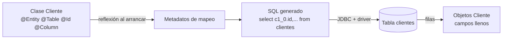
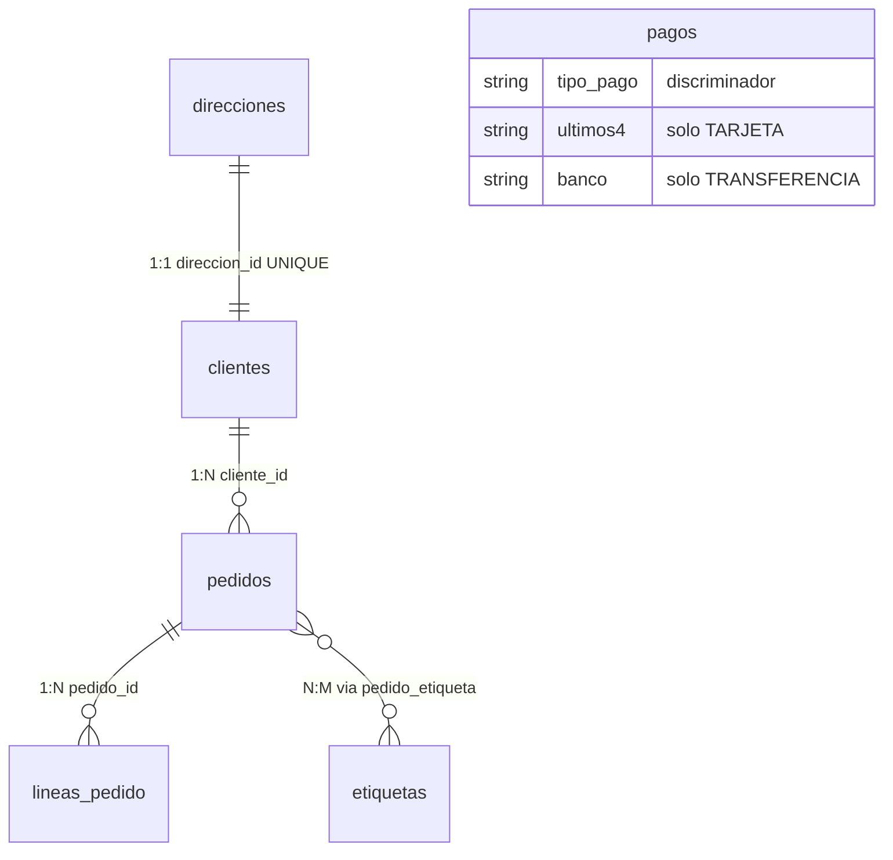
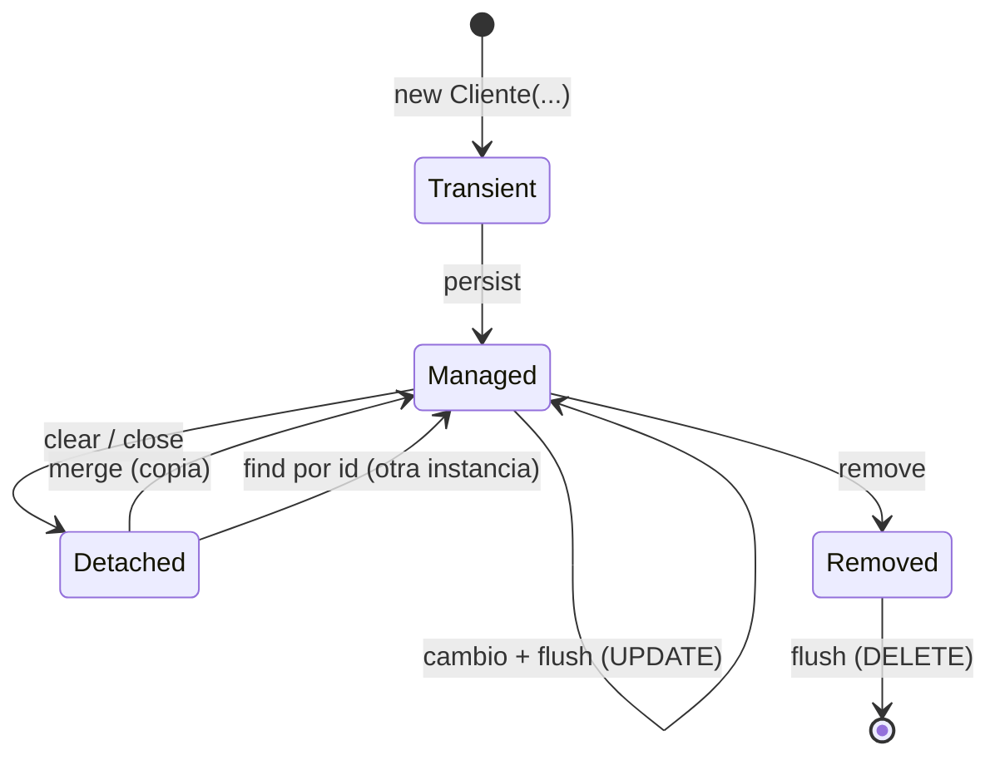
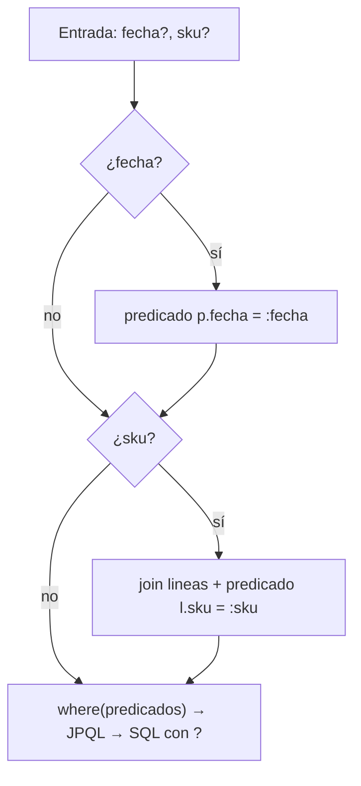
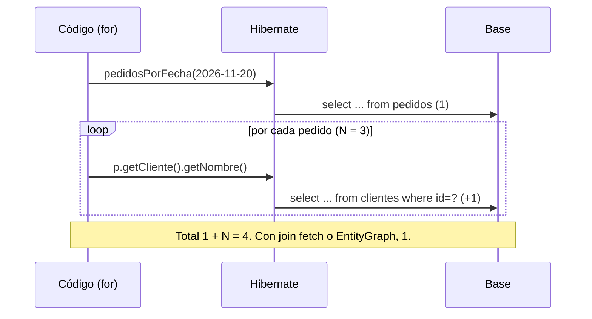
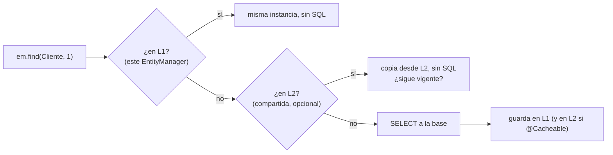
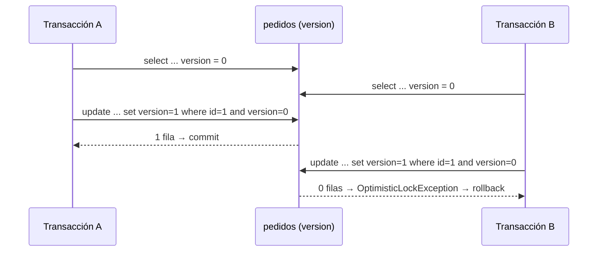
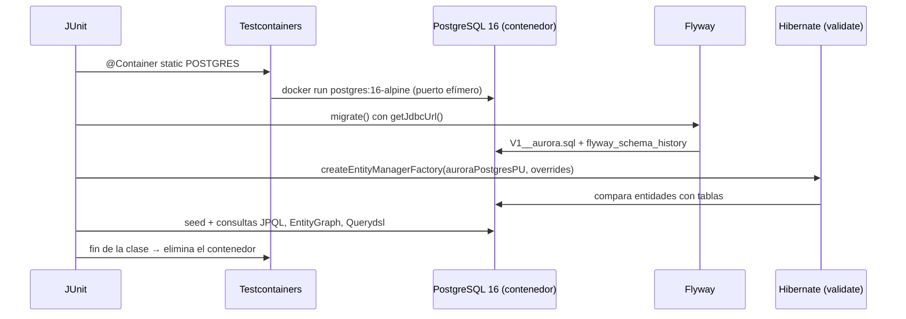

# Módulo 16: JPA e Hibernate

JPA es la especificación estándar de Java para mapear objetos a bases relacionales y administrar su ciclo de vida. Hibernate es la implementación más común. La promesa es productiva: trabajas con entidades y consultas orientadas al modelo, no con SQL manual en cada método. El costo real aparece cuando olvidas que debajo sigue habiendo SQL, transacciones, planes de ejecución, cardinalidades y locks.

Este módulo construye `tienda-aurora-jpa` con H2 para el día a día, Hibernate 7, consultas Criteria y Querydsl, `@Version`, EntityGraph, Flyway y una prueba contra PostgreSQL real con Testcontainers. El objetivo no es memorizar anotaciones, sino entender qué genera JPA y cómo detectar problemas como N+1 u optimistic locking.

## Apertura del módulo

Al terminar este módulo podrás:
- mapear clases Java a tablas con `@Entity`, `@Id`, `@Column` y asociaciones con su lado dueño;
- elegir entre 1:1, N:M, entidad intermedia y estrategias de herencia según la cardinalidad real;
- predecir el estado de una entidad tras `persist`, `flush`, `clear` y `find`;
- componer filtros opcionales con Criteria y Querydsl sin concatenar texto;
- detectar el problema N+1 contando sentencias SQL y corregirlo con `join fetch` o EntityGraph;
- distinguir la caché de primer nivel de la de segundo nivel y explicar el riesgo del dato viejo;
- proteger una actualización concurrente con `@Version` y comparar con un bloqueo pesimista;
- validar entidades y migraciones Flyway contra PostgreSQL real con Testcontainers.

**Esquema del módulo:** entidades y asociaciones (Tema 1), cardinalidades y herencia (Tema 2), ciclo de vida y
`EntityManager` (Tema 3), consultas dinámicas (Tema 4), estrategias de carga y N+1 (Tema 5), EntityGraph y cachés
(Tema 6), concurrencia (Tema 7) y migraciones con pruebas reales (Tema 8).

**Qué necesitas saber antes:** *entidad*, *tabla*, *fila*, *clave primaria*, *clave foránea* y *conexión*
(Fundamentos, Módulo 4, Tema 1); *JOIN*, *consulta parametrizada*, *inyección SQL* y *migración* (Fundamentos,
Módulo 4, Tema 2); *restricción*, *UNIQUE* e *índice* (Fundamentos, Módulo 4, Tema 3); *transacción*, *ACID*,
*modo autocommit*, *concurrencia* y *bloqueo* (Fundamentos, Módulo 4, Tema 4); *contenedor* e *imagen*
(Fundamentos, Módulo 8, Tema 4); anotaciones como `@Override` (Java, Módulo 1, Tema 2) y `@Test` (Java, Módulo 9,
Tema 1); *Proxy* (Java, Módulo 12, Tema 4); `Optional` (Java, Módulo 4, Tema 2); try-with-resources (Java, Módulo 3,
Tema 2); Gradle y dependencias (Java, Módulo 8, Tema 1); JUnit (Java, Módulo 9, Tema 1).

**Entorno de los programas de un solo archivo (2026-11-24):** Linux x86_64, OpenJDK 25.0.5.1 (`java Archivo.java`) y
Python 3.13.18 con SQLite 3.53.1 (módulo `sqlite3`). En ese entorno no había Hibernate, H2 ni drivers JDBC. Por eso
los programas nuevos de la Capa 1 son de dos clases: modelos en Java puro que muestran el mecanismo (se declaran
«modelo didáctico, no es Hibernate») y scripts de Python con SQLite que ejecutan el mismo SQL que Hibernate genera.
Sus transcripciones son literales. Las salidas de Hibernate, H2 y PostgreSQL son las capturadas en el Mac del
entorno de referencia, más abajo; no se cambiaron.

## Visual del módulo

**Visual:** [Mapa JPA: entidades, EntityManager, consultas, SQL real, N+1 y EntityGraph](/visuals/temas/java/modulo-16-jpa.html)

Lectura: JPA abstrae el mapeo, no el costo. El SQL generado y la estrategia de carga deben ser visibles.

## Proyecto desde cero

#### Prerrequisitos

```bash
java -version
gradle --version
docker version
```

La prueba de PostgreSQL usa Testcontainers; necesita un daemon Docker accesible. El resto del módulo funciona sin Docker.

#### Bootstrap

```bash
mkdir -p tienda-aurora-jpa/src/main/java/com/aurora/jpa/{dominio,repositorio,servicio}
mkdir -p tienda-aurora-jpa/src/main/resources/META-INF
mkdir -p tienda-aurora-jpa/src/main/resources/db/migration
mkdir -p tienda-aurora-jpa/src/test/java/com/aurora/jpa
cd tienda-aurora-jpa
gradle wrapper --gradle-version 9.9.1
```

**Entorno de referencia verificado (2026-11-23):** macOS arm64, JDK 27.0.1.0.2, Gradle 9.9.1, toolchain Java 25, Hibernate 7.0.0.Final, H2 2.3.232, Jakarta Persistence 3.2.0, Querydsl 5.1.0 (clasificador `jakarta`), Flyway 12.4.0, Testcontainers 2.0.5, PostgreSQL driver 42.7.14 e imagen `postgres:16-alpine`.

#### Estructura final

```text
tienda-aurora-jpa/
├── build.gradle.kts
├── settings.gradle.kts
└── src/
    ├── main/java/com/aurora/jpa/
    │   ├── DemoN1.java
    │   ├── DemoSql.java
    │   ├── DemoSqlLog.java
    │   ├── SqlCapture.java
    │   ├── dominio/{Cliente,Direccion,Pedido,LineaPedido,Etiqueta,Pago,PagoTarjeta,PagoTransferencia}.java
    │   ├── repositorio/PedidoRepositorio.java
    │   └── servicio/PedidoServicio.java
    ├── main/resources/
    │   ├── META-INF/persistence.xml
    │   ├── db/migration/V1__aurora.sql
    │   └── simplelogger.properties
    └── test/java/com/aurora/jpa/
        ├── JpaAuroraTest.java
        └── JpaPostgresTest.java
```

Las clases `QPedido`, `QLineaPedido`, etc., se generan en `build/generated/sources/annotationProcessor/java/main` durante `compileJava`; no se escriben a mano.

## Build y configuración

#### `settings.gradle.kts`

```kotlin
rootProject.name = "tienda-aurora-jpa"
```

#### `build.gradle.kts`

La tarea `demoN1` apunta a `com.aurora.jpa.DemoN1`, que existe y muestra el SQL capturado. Querydsl necesita el procesador de anotaciones con el clasificador `jakarta`. Las dos supresiones de `-Xlint` son exclusivas de código generado y metadatos de dependencias; el código propio sigue compilando con `-Werror`.

```kotlin
plugins {
    java
    application
}

application {
    mainClass = "com.aurora.jpa.DemoSql"
}

group = "com.aurora"
version = "1.0.0"

java {
    toolchain {
        languageVersion = JavaLanguageVersion.of(25)
    }
}

repositories {
    mavenCentral()
}

dependencies {
    implementation("org.hibernate.orm:hibernate-core:7.0.0.Final")
    implementation("com.h2database:h2:2.3.232")
    implementation("jakarta.persistence:jakarta.persistence-api:3.2.0")
    implementation("org.slf4j:slf4j-simple:2.0.17")
    implementation("com.querydsl:querydsl-jpa:5.1.0:jakarta")
    annotationProcessor("com.querydsl:querydsl-apt:5.1.0:jakarta")
    annotationProcessor("jakarta.persistence:jakarta.persistence-api:3.2.0")

    testImplementation(platform("org.junit:junit-bom:5.13.4"))
    testImplementation("org.junit.jupiter:junit-jupiter")
    testRuntimeOnly("org.junit.platform:junit-platform-launcher")
    testImplementation("org.testcontainers:testcontainers:2.0.5")
    testImplementation("org.testcontainers:testcontainers-junit-jupiter:2.0.5")
    testImplementation("org.testcontainers:testcontainers-postgresql:2.0.5")
    testImplementation("org.postgresql:postgresql:42.7.14")
    testImplementation("org.flywaydb:flyway-core:12.4.0")
    testImplementation("org.flywaydb:flyway-database-postgresql:12.4.0")
}

tasks.test {
    useJUnitPlatform()
    systemProperty("org.jboss.logging.provider", "slf4j")
    testLogging {
        events("passed", "skipped", "failed")
    }
}

tasks.withType<JavaExec>().configureEach {
    systemProperty("org.jboss.logging.provider", "slf4j")
}

tasks.register<JavaExec>("demoN1") {
    group = "verification"
    description = "Muestra el SQL real del N+1 y su corrección con EntityGraph"
    classpath = sourceSets.main.get().runtimeClasspath
    mainClass = "com.aurora.jpa.DemoN1"
}

tasks.withType<JavaCompile>().configureEach {
    options.encoding = "UTF-8"
    options.compilerArgs.addAll(listOf("-Xlint:all", "-Xlint:-processing", "-Xlint:-classfile", "-Xlint:-this-escape", "-Werror"))
}
```

#### `src/main/resources/META-INF/persistence.xml`

`auroraPU` usa H2 con `create-drop` para aprendizaje y tests. `auroraPostgresPU` usa `validate`: el esquema debe venir de Flyway, no de Hibernate. La URL se sobrescribe en el test con el puerto efímero de Testcontainers.

```xml
<?xml version="1.0" encoding="UTF-8"?>
<persistence xmlns="https://jakarta.ee/xml/ns/persistence" version="3.0">
  <persistence-unit name="auroraPU">
    <provider>org.hibernate.jpa.HibernatePersistenceProvider</provider>
    <class>com.aurora.jpa.dominio.Cliente</class>
    <class>com.aurora.jpa.dominio.Direccion</class>
    <class>com.aurora.jpa.dominio.Pedido</class>
    <class>com.aurora.jpa.dominio.LineaPedido</class>
    <class>com.aurora.jpa.dominio.Pago</class>
    <class>com.aurora.jpa.dominio.PagoTarjeta</class>
    <class>com.aurora.jpa.dominio.PagoTransferencia</class>
    <class>com.aurora.jpa.dominio.Etiqueta</class>
    <exclude-unlisted-classes>true</exclude-unlisted-classes>
    <properties>
      <property name="jakarta.persistence.jdbc.driver" value="org.h2.Driver"/>
      <property name="jakarta.persistence.jdbc.url" value="jdbc:h2:mem:aurora;DB_CLOSE_DELAY=-1"/>
      <property name="jakarta.persistence.jdbc.user" value="sa"/>
      <property name="jakarta.persistence.jdbc.password" value=""/>
      <property name="hibernate.hbm2ddl.auto" value="create-drop"/>
      <property name="hibernate.show_sql" value="false"/>
      <property name="hibernate.format_sql" value="false"/>
    </properties>
  </persistence-unit>

  <persistence-unit name="auroraPostgresPU" transaction-type="RESOURCE_LOCAL">
    <provider>org.hibernate.jpa.HibernatePersistenceProvider</provider>
    <class>com.aurora.jpa.dominio.Cliente</class>
    <class>com.aurora.jpa.dominio.Direccion</class>
    <class>com.aurora.jpa.dominio.Pedido</class>
    <class>com.aurora.jpa.dominio.LineaPedido</class>
    <class>com.aurora.jpa.dominio.Pago</class>
    <class>com.aurora.jpa.dominio.PagoTarjeta</class>
    <class>com.aurora.jpa.dominio.PagoTransferencia</class>
    <class>com.aurora.jpa.dominio.Etiqueta</class>
    <exclude-unlisted-classes>true</exclude-unlisted-classes>
    <properties>
      <property name="jakarta.persistence.jdbc.driver" value="org.postgresql.Driver"/>
      <property name="jakarta.persistence.jdbc.url" value="jdbc:postgresql://localhost:5432/aurora"/>
      <property name="jakarta.persistence.jdbc.user" value="postgres"/>
      <property name="jakarta.persistence.jdbc.password" value="postgres"/>
      <property name="hibernate.hbm2ddl.auto" value="validate"/>
      <property name="hibernate.show_sql" value="false"/>
    </properties>
  </persistence-unit>
</persistence>
```

#### `src/main/resources/db/migration/V1__aurora.sql`

Migración Flyway aplicada antes de abrir el `EntityManagerFactory` de PostgreSQL. Si una columna no coincide con el mapeo, `validate` falla en arranque.

```sql
CREATE TABLE direcciones (
    id BIGINT GENERATED BY DEFAULT AS IDENTITY PRIMARY KEY,
    ciudad VARCHAR(255) NOT NULL,
    linea1 VARCHAR(255) NOT NULL
);

CREATE TABLE clientes (
    id BIGINT GENERATED BY DEFAULT AS IDENTITY PRIMARY KEY,
    email VARCHAR(255) NOT NULL UNIQUE,
    nombre VARCHAR(255) NOT NULL,
    direccion_id BIGINT NOT NULL UNIQUE REFERENCES direcciones (id)
);

CREATE TABLE etiquetas (
    id BIGINT GENERATED BY DEFAULT AS IDENTITY PRIMARY KEY,
    nombre VARCHAR(255) NOT NULL UNIQUE
);

CREATE TABLE pedidos (
    id BIGINT GENERATED BY DEFAULT AS IDENTITY PRIMARY KEY,
    creado_en TIMESTAMP(6) NOT NULL,
    fecha DATE NOT NULL,
    version BIGINT NOT NULL,
    cliente_id BIGINT NOT NULL REFERENCES clientes (id)
);

CREATE TABLE lineas_pedido (
    id BIGINT GENERATED BY DEFAULT AS IDENTITY PRIMARY KEY,
    cantidad INTEGER NOT NULL,
    sku VARCHAR(255) NOT NULL,
    pedido_id BIGINT NOT NULL REFERENCES pedidos (id)
);

CREATE TABLE pedido_etiqueta (
    pedido_id BIGINT NOT NULL REFERENCES pedidos (id),
    etiqueta_id BIGINT NOT NULL REFERENCES etiquetas (id),
    PRIMARY KEY (pedido_id, etiqueta_id)
);

CREATE TABLE pagos (
    id BIGINT GENERATED BY DEFAULT AS IDENTITY PRIMARY KEY,
    tipo_pago VARCHAR(31) NOT NULL,
    monto NUMERIC(38,2) NOT NULL,
    ultimos4 VARCHAR(255),
    banco VARCHAR(255)
);
```

#### `src/main/resources/simplelogger.properties`

Mantiene las demos legibles: los eventos de arranque no tapan el SQL capturado ni los contadores.

```properties
org.slf4j.simpleLogger.defaultLogLevel=error
org.slf4j.simpleLogger.showDateTime=false
```

### Tema 1: Entidades y relaciones JPA · Avanzado · 60 min

<details open>
<summary><strong>Capa 1 — Lectura</strong></summary>

#### Objetivos
Al terminar este tema podrás:
- explicar qué hace un ORM y qué papel cumplen JPA, Hibernate y JDBC;
- mapear una clase a una tabla con `@Entity`, `@Table`, `@Id`, `@GeneratedValue` y `@Column`;
- leer el SQL que genera Hibernate y relacionar cada columna con un campo;
- declarar una asociación con su lado dueño, su `@JoinColumn` y su cascada.

**Conceptos clave:** ORM, JPA, Hibernate, JDBC, H2, entidad JPA, @Entity y @Table, @Id y @GeneratedValue, @Column, asociación, lado dueño, @JoinColumn, cascada, unidad de persistencia

Ya los conoces y no se repiten: *entidad*, *tabla*, *fila*, *clave primaria* y *clave foránea* (Fundamentos,
Módulo 4, Tema 1); *anotación* (`@Override` en Java, Módulo 1, Tema 2; `@Test` en Java, Módulo 9, Tema 1);
*reflexión profunda* (Java, Módulo 10, Tema 3).

#### El problema
Tienda Aurora guarda clientes, direcciones y pedidos en una base relacional. Con SQL a mano, cada clase necesita
su `INSERT`, su `SELECT` y el código que copia columnas a campos. Son decenas de métodos casi iguales. ¿Cómo
declaras una sola vez que `Cliente` vive en la tabla `clientes` y dejas que una librería escriba ese SQL?

#### Glosario del tema

**ORM**
- **Definición técnica:** *Object-Relational Mapping*; técnica que traduce entre objetos en memoria y filas de tablas relacionales a partir de metadatos de mapeo.
- **En palabras sencillas:** un traductor entre dos idiomas: el de las clases Java y el de las tablas SQL.
- **Dónde se rompe la comparación:** un traductor no cambia el costo de lo que dice; el ORM puede generar diez consultas donde bastaba una.
- **Ejemplo:** en `MiniOrm.java`, la clase `Cliente` se convierte en `select id,email,nombre from clientes where id=?`.
- **Error típico:** creer que el ORM elimina el SQL; solo lo escribe por ti, y sigue costando lo mismo.

**JPA**
- **Definición técnica:** *Jakarta Persistence*; especificación estándar de Java (paquete `jakarta.persistence`) con anotaciones de mapeo, el `EntityManager` y el lenguaje JPQL.
- **En palabras sencillas:** el reglamento que dice cómo debe comportarse cualquier ORM de Java.
- **Dónde se rompe la comparación:** un reglamento no hace nada solo; JPA necesita una implementación que lo ejecute.
- **Ejemplo:** `implementation("jakarta.persistence:jakarta.persistence-api:3.2.0")` en `build.gradle.kts` trae solo las interfaces y anotaciones.
- **Error típico:** importar `javax.persistence` en un proyecto con Hibernate 7: desde Jakarta EE 9 el paquete es `jakarta.persistence`.

**Hibernate**
- **Definición técnica:** implementación de JPA más usada; lee los metadatos, genera SQL, administra el contexto de persistencia y ejecuta todo con JDBC.
- **En palabras sencillas:** el motor que cumple el reglamento JPA.
- **Dónde se rompe la comparación:** también tiene funciones propias fuera del estándar, como `StatementInspector` o sus estadísticas.
- **Ejemplo:** `<provider>org.hibernate.jpa.HibernatePersistenceProvider</provider>` en `persistence.xml`.
- **Error típico:** usar clases `org.hibernate.*` en todo el dominio; el código queda atado a Hibernate sin necesidad.

**JDBC**
- **Definición técnica:** *Java Database Connectivity*; API estándar de Java (paquete `java.sql`) para conectarse a una base, enviar SQL y leer resultados mediante un driver.
- **En palabras sencillas:** el cable entre Java y la base de datos; Hibernate lo usa por debajo.
- **Dónde se rompe la comparación:** el cable no sabe de objetos: JDBC habla en filas y columnas, no en clases.
- **Ejemplo:** `hibernate.generate_statistics` cuenta las sentencias que Hibernate preparó con JDBC (`getPrepareStatementCount()`, Tema 5).
- **Error típico:** pensar que con JPA no hay JDBC; si falta el driver, Hibernate no arranca. El Módulo 17 lo usa directamente.

**H2**
- **Definición técnica:** base de datos relacional escrita en Java que puede vivir en memoria dentro del mismo proceso (`jdbc:h2:mem:...`).
- **En palabras sencillas:** una base de datos de bolsillo: arranca con la aplicación y desaparece con ella.
- **Dónde se rompe la comparación:** no es PostgreSQL; acepta SQL y tipos con reglas propias. El Tema 8 prueba contra el motor real.
- **Ejemplo:** `jdbc:h2:mem:aurora;DB_CLOSE_DELAY=-1` en `auroraPU` mantiene la base viva mientras la JVM corre.
- **Error típico:** olvidar `DB_CLOSE_DELAY=-1`: al cerrar la última conexión, la base en memoria y sus datos se pierden.

**entidad JPA**
- **Definición técnica:** clase anotada con `@Entity`, con identificador (`@Id`) y constructor sin argumentos no privado, cuyo estado JPA guarda y recarga desde una tabla.
- **En palabras sencillas:** una clase con ficha en la base: cada objeto corresponde a una fila.
- **Dónde se rompe la comparación:** dos objetos Java distintos pueden representar la misma fila; la identidad la da la clave primaria.
- **Ejemplo:** `Direccion` (línea 10 de su archivo) es una entidad; `Pedido` y `Cliente` también.
- **Error típico:** quitar el constructor sin argumentos: JPA no puede crear el objeto vacío antes de llenarlo.

**`@Entity` y `@Table`**
- **Definición técnica:** `@Entity` marca la clase como entidad administrada; `@Table(name = ...)` fija el nombre de la tabla. Sin `@Table`, la tabla toma el nombre de la entidad.
- **En palabras sencillas:** `@Entity` dice «esta clase se guarda»; `@Table` dice «en este cajón».
- **Dónde se rompe la comparación:** el cajón debe existir con las columnas correctas; la anotación no lo crea en producción.
- **Ejemplo:** `@Entity @Table(name = "direcciones") public class Direccion`.
- **Error típico:** escribir el nombre de la tabla en una consulta JPQL (`from direcciones`); JPQL usa el nombre de la entidad (`from Direccion`).

**`@Id` y `@GeneratedValue`**
- **Definición técnica:** `@Id` marca el campo que corresponde a la clave primaria; `@GeneratedValue(strategy = GenerationType.IDENTITY)` delega el valor a una columna autoincremental de la base.
- **En palabras sencillas:** `@Id` es el número de cédula del objeto; `IDENTITY` deja que la base lo asigne.
- **Dónde se rompe la comparación:** con `IDENTITY` el número solo existe tras el `INSERT`; antes, el campo vale `null`.
- **Ejemplo:** `@Id @GeneratedValue(strategy = GenerationType.IDENTITY) private Long id;` en `Direccion` (línea 13).
- **Error típico:** usar `long` primitivo para un id generado: vale `0` antes de guardar y no distingue «nuevo» de «id 0».

**`@Column`**
- **Definición técnica:** anotación que ajusta el mapeo de un campo a su columna: nombre, `nullable`, `unique`, `length`, `updatable`.
- **En palabras sencillas:** la etiqueta de cada casilla de la ficha.
- **Dónde se rompe la comparación:** `nullable = false` describe la columna; no valida el objeto en Java antes de enviarlo.
- **Ejemplo:** `@Column(nullable = false, unique = true) private String email;` en `Cliente` (línea 10).
- **Error típico:** confiar en `nullable = false` como única validación; el error llega tarde, como excepción de la base.

**asociación**
- **Definición técnica:** campo de una entidad que referencia otra entidad o una colección de entidades, anotado con `@OneToOne`, `@ManyToOne`, `@OneToMany` o `@ManyToMany` según la cardinalidad.
- **En palabras sencillas:** el hilo que une dos fichas: este cliente tiene esta dirección.
- **Dónde se rompe la comparación:** en Java es una referencia a un objeto; en la tabla es una clave foránea con un número.
- **Ejemplo:** `private Direccion direccion;` con `@OneToOne` en `Cliente` (línea 13).
- **Error típico:** modelar todo como `@ManyToMany` «por si acaso»; la cardinalidad debe salir del negocio.

**lado dueño**
- **Definición técnica:** extremo de la asociación cuyo mapeo controla la columna de clave foránea; los cambios en ese lado son los que JPA escribe en la base.
- **En palabras sencillas:** quien tiene el lápiz para escribir el vínculo.
- **Dónde se rompe la comparación:** puedes cambiar el otro lado en memoria y nada llega a la tabla.
- **Ejemplo:** `Cliente` es dueño de la relación con `Direccion` porque declara `@JoinColumn(name = "direccion_id")`.
- **Error típico:** agregar el objeto solo en el lado inverso (`mappedBy`, Tema 2) y esperar que la clave foránea se guarde.

**`@JoinColumn`**
- **Definición técnica:** anotación del lado dueño que nombra la columna de clave foránea y sus restricciones (`nullable`, `unique`).
- **En palabras sencillas:** el nombre de la casilla donde se anota el número de la otra ficha.
- **Dónde se rompe la comparación:** `unique = true` solo crea la restricción si Hibernate genera el esquema; con Flyway la escribes tú.
- **Ejemplo:** `@JoinColumn(name = "direccion_id", nullable = false, unique = true)` en `Cliente` (línea 14).
- **Error típico:** omitirla: Hibernate inventa un nombre (`direccion_id` por convención) que puede no coincidir con tu migración.

**cascada**
- **Definición técnica:** atributo `cascade` de una asociación que propaga operaciones del `EntityManager` (`PERSIST`, `MERGE`, `REMOVE`, `ALL`) a la entidad asociada.
- **En palabras sencillas:** «lo que le hagas al cliente, hazlo también a su dirección».
- **Dónde se rompe la comparación:** la cascada de JPA no es `ON DELETE CASCADE` de SQL; ocurre en memoria, antes de enviar SQL.
- **Ejemplo:** con `cascade = CascadeType.ALL`, `em.persist(ana)` también inserta su `Direccion` (método `seed`, Tema 3).
- **Error típico:** poner `CascadeType.REMOVE` en un `@ManyToOne`: borrar un pedido borraría al cliente.

**unidad de persistencia**
- **Definición técnica:** configuración con nombre en `META-INF/persistence.xml`: proveedor, clases administradas y propiedades de conexión. De ella sale el `EntityManagerFactory`.
- **En palabras sencillas:** la ficha técnica de una base: qué motor, qué clases y cómo conectarse.
- **Dónde se rompe la comparación:** puedes tener varias en el mismo archivo y sobrescribir propiedades al abrirla.
- **Ejemplo:** `auroraPU` (H2) y `auroraPostgresPU` (PostgreSQL) en el `persistence.xml` del proyecto.
- **Error típico:** con `exclude-unlisted-classes` en `true`, olvidar listar una entidad nueva: Hibernate no la reconoce.

#### ► CÓMO FUNCIONA
Una entidad JPA es un objeto cuyo estado se puede persistir y recargar desde una tabla. No es cualquier POJO: necesita identidad (`@Id`), mapeo y un ciclo de vida administrado por el `EntityManager`. La identidad de entidad no es lo mismo que igualdad Java por todos los campos; en JPA la identidad suele girar alrededor de la clave primaria y del contexto de persistencia.

Las relaciones expresan cómo se conectan entidades: `@OneToOne`, `@ManyToOne`, `@OneToMany`, `@ManyToMany`. El mapeo correcto depende de la cardinalidad real del negocio y de quién es dueño de la relación. Un error común es modelar todo como `@ManyToMany` o usar entidades donde solo se necesita un valor.

**Mecanismo.** Al abrir la unidad de persistencia, Hibernate lee por reflexión las anotaciones de cada clase
listada. Con esos metadatos arma el SQL de cada operación. Luego lo ejecuta con JDBC y copia cada columna del
resultado al campo correspondiente.



**Por qué existe.** Sin ORM, cada cambio de columna obliga a editar varios `SELECT`, `INSERT` y conversiones.
Con anotaciones, el mapeo vive en un solo sitio: la clase.

**Implicación.** Lo que no está en las anotaciones no lo sabe Hibernate. Lo que está mal en ellas llega a la
base como SQL incorrecto o como restricción ausente.

#### Problema resuelto 1.1
Construye un ORM de juguete. Debe leer anotaciones propias de una clase, generar el `SELECT` por id y convertir
una fila en objeto. Así ves qué hace Hibernate con `@Entity`, `@Id` y `@Column`.

**Razonamiento:**
1. Se necesitan tres anotaciones visibles en ejecución: tabla, clave y columna (`RetentionPolicy.RUNTIME`).
2. Para el SQL, se recorren los campos con reflexión y se juntan los nombres de columna.
3. Para convertir una fila, se crea el objeto con el constructor sin argumentos y se asigna cada campo.

```java
// MiniOrm.java — un ORM de juguete: lee anotaciones propias con reflexión y genera SQL
import java.lang.annotation.Retention;
import java.lang.annotation.RetentionPolicy;
import java.lang.reflect.Field;
import java.util.ArrayList;
import java.util.List;
import java.util.Map;

@Retention(RetentionPolicy.RUNTIME) @interface Entidad { String tabla(); }
@Retention(RetentionPolicy.RUNTIME) @interface Clave {}
@Retention(RetentionPolicy.RUNTIME) @interface Columna { String nombre(); }

@Entidad(tabla = "clientes")
class Cliente {
    @Clave @Columna(nombre = "id") Long id;
    @Columna(nombre = "email") String email;
    @Columna(nombre = "nombre") String nombre;
    Cliente() {}                                   // el mapeador necesita crear el objeto vacío
    @Override public String toString() { return "Cliente[id=" + id + ", email=" + email + ", nombre=" + nombre + "]"; }
}

public class MiniOrm {
    static String selectPorId(Class<?> tipo) {
        Entidad entidad = tipo.getAnnotation(Entidad.class);
        List<String> columnas = new ArrayList<>();
        String clave = null;
        for (Field f : tipo.getDeclaredFields()) {
            Columna c = f.getAnnotation(Columna.class);
            if (c == null) continue;
            columnas.add(c.nombre());
            if (f.isAnnotationPresent(Clave.class)) clave = c.nombre();
        }
        if (clave == null) throw new IllegalStateException(tipo.getSimpleName() + " no tiene @Clave");
        return "select " + String.join(",", columnas) + " from " + entidad.tabla() + " where " + clave + "=?";
    }

    static <T> T mapear(Class<T> tipo, Map<String, Object> fila) throws ReflectiveOperationException {
        T objeto = tipo.getDeclaredConstructor().newInstance();
        for (Field f : tipo.getDeclaredFields()) {
            Columna c = f.getAnnotation(Columna.class);
            if (c != null) f.set(objeto, fila.get(c.nombre()));
        }
        return objeto;
    }

    public static void main(String[] args) throws Exception {
        System.out.println("SQL: " + selectPorId(Cliente.class));
        Map<String, Object> fila = Map.of("id", 1L, "email", "ana@aurora.test", "nombre", "Ana");
        System.out.println("fila: " + new java.util.TreeMap<>(fila));
        System.out.println("objeto: " + mapear(Cliente.class, fila));
    }
}
```

```text
$ java MiniOrm.java
SQL: select id,email,nombre from clientes where id=?
fila: {email=ana@aurora.test, id=1, nombre=Ana}
objeto: Cliente[id=1, email=ana@aurora.test, nombre=Ana]
```

**Explicación por partes.**
- Líneas 9–11: las anotaciones propias. `RUNTIME` las conserva en el `.class` para leerlas al ejecutar.
- Líneas 13–17: `Cliente` declara tabla, clave y columnas, igual que haría con `@Table`, `@Id` y `@Column`.
- Línea 18: el constructor vacío. Línea 38: el mapeador lo usa para crear el objeto antes de llenarlo.
- Líneas 27–32: la reflexión recorre los campos y arma la lista de columnas y la clave.
- Línea 41: cada valor de la fila va al campo cuya columna coincide. Es la conversión fila → objeto.

Este modelo no es Hibernate: no tiene caché, ni transacciones, ni asociaciones. Muestra la idea central:
**metadatos + reflexión = SQL y objetos**.

#### Problema resuelto 1.2
Mapea `Direccion` y `Cliente` del proyecto con JPA y comprueba qué SQL genera Hibernate al cargar un cliente.

**Razonamiento:**
1. Cada clase lleva `@Entity`, su tabla y su clave generada por la base.
2. Un cliente tiene exactamente una dirección: la asociación es `@OneToOne` y `Cliente` es el lado dueño.
3. La evidencia es el SQL real: cada columna del `select` debe corresponder a un campo mapeado.

#### `src/main/java/com/aurora/jpa/dominio/Direccion.java`

```java
package com.aurora.jpa.dominio;

import jakarta.persistence.Column;
import jakarta.persistence.Entity;
import jakarta.persistence.GeneratedValue;
import jakarta.persistence.GenerationType;
import jakarta.persistence.Id;
import jakarta.persistence.Table;

@Entity
@Table(name = "direcciones")
public class Direccion {
    @Id @GeneratedValue(strategy = GenerationType.IDENTITY)
    private Long id;
    @Column(nullable = false) private String ciudad;
    @Column(nullable = false) private String linea1;
    protected Direccion() {}
    public Direccion(String ciudad, String linea1) { this.ciudad = ciudad; this.linea1 = linea1; }
    public Long getId() { return id; }
    public String getCiudad() { return ciudad; }
    public String getLinea1() { return linea1; }
}
```

#### `src/main/java/com/aurora/jpa/dominio/Cliente.java`

`Cliente` tiene una `Direccion` con `@OneToOne` LAZY y `CascadeType.ALL`. El lado dueño usa `@JoinColumn` con `unique=true`, lo que refleja que una dirección pertenece a un solo cliente en este modelo.

```java
package com.aurora.jpa.dominio;

import jakarta.persistence.*;

@Entity
@Table(name = "clientes")
public class Cliente {
    @Id @GeneratedValue(strategy = GenerationType.IDENTITY)
    private Long id;
    @Column(nullable = false, unique = true) private String email;
    @Column(nullable = false) private String nombre;

    @OneToOne(fetch = FetchType.LAZY, cascade = CascadeType.ALL, optional = false)
    @JoinColumn(name = "direccion_id", nullable = false, unique = true)
    private Direccion direccion;

    protected Cliente() {}
    public Cliente(String email, String nombre, Direccion direccion) {
        this.email = email; this.nombre = nombre; this.direccion = direccion;
    }
    public Long getId() { return id; }
    public String getEmail() { return email; }
    public String getNombre() { return nombre; }
    public Direccion getDireccion() { return direccion; }
}
```

SQL real que Hibernate 7 ejecutó para cargar un `Cliente` (fragmento de `./gradlew -q demoN1`, entorno de referencia):

```text
SQL: select c1_0.id,c1_0.direccion_id,c1_0.email,c1_0.nombre from clientes c1_0 where c1_0.id=?
```

**Explicación por partes.**
- `Direccion`, líneas 10–11: entidad en la tabla `direcciones`. Líneas 13–14: clave generada por la base.
- `Direccion`, línea 17: constructor `protected` sin argumentos. JPA lo usa; tu código usa el de la línea 18.
- `Cliente`, línea 10: `email` es obligatorio y único; la restricción aparece en `V1__aurora.sql`.
- `Cliente`, líneas 13–15: la asociación. `direccion_id` del SQL sale del `@JoinColumn` de la línea 14.
- En el SQL, `c1_0` es un alias que inventa Hibernate. Las cuatro columnas son los cuatro campos persistentes.
- `fetch = FetchType.LAZY` (línea 13) explica por qué el `select` no trae la dirección: se estudia en el Tema 5.

> **Error común.** Compilar las entidades sin la dependencia de JPA. Si falta
> `jakarta.persistence-api` en el classpath, `javac` se detiene en el primer `import`:

```text
$ javac -d out Direccion.java
Direccion.java:3: error: package jakarta.persistence does not exist
import jakarta.persistence.Column;
                          ^
Direccion.java:4: error: package jakarta.persistence does not exist
import jakarta.persistence.Entity;
                          ^
```

> El mensaje no habla de Hibernate: dice que el paquete no existe. Agrega la dependencia en `build.gradle.kts`
> y compila con `./gradlew compileJava`, que arma el classpath por ti.

> **Buena práctica.** Declara `@Table`, `@Column(nullable = ...)` y `@JoinColumn(name = ...)` aunque coincidan con
> los valores por defecto. El mapeo queda legible y no depende de la estrategia de nombres de la librería.

> **Prevenir errores.** Mira el SQL generado desde el primer día. Si una columna del `select` no te suena, hay un
> campo mapeado que no esperabas.

#### Checkpoint 1.1
En `MiniOrm.java`, quitas `@Clave` del campo `id`. ¿Qué pasa al ejecutar?

Respuesta: `selectPorId` no encuentra clave y lanza `IllegalStateException` con el mensaje `Cliente no tiene @Clave`
(línea 33). JPA aplica la misma regla: toda entidad necesita un `@Id`.

</details>

<details>
<summary><strong>Capa 2 — Construcción</strong></summary>

#### Paso 1 · Ejecuta el ORM de juguete
Guarda `MiniOrm.java` y ejecútalo con `java MiniOrm.java`. Agrega un campo `@Columna(nombre = "telefono") String
telefono;` a `Cliente` y comprueba que el `select` incluye `telefono`.

#### Paso 2 · Crea el proyecto
Ejecuta los comandos de «Proyecto desde cero» y copia `settings.gradle.kts`, `build.gradle.kts`,
`persistence.xml`, `V1__aurora.sql` y `simplelogger.properties` de «Build y configuración».

#### Paso 3 · Escribe las dos primeras entidades
Crea `Direccion.java` y `Cliente.java` en `src/main/java/com/aurora/jpa/dominio`. Compila con
`./gradlew compileJava`; debe terminar con `BUILD SUCCESSFUL`.

#### Paso 4 · Relaciona campos y columnas
Abre `V1__aurora.sql` y marca, para cada campo de `Cliente`, la columna que le corresponde. Debes encontrar
`id`, `email`, `nombre` y `direccion_id`, con `UNIQUE` en `email` y en `direccion_id`.

#### Resumen
- Un **ORM** traduce entre objetos y filas a partir de metadatos; **JPA** es el estándar y **Hibernate** su implementación.
- Debajo de todo sigue habiendo **JDBC** y SQL; **H2** es la base en memoria para aprender y probar.
- Una **entidad JPA** necesita `@Entity`, un `@Id` y un constructor sin argumentos no privado.
- `@Table`, `@Column` y `@GeneratedValue` ajustan nombres, restricciones y generación de la clave.
- Una **asociación** tiene un **lado dueño**; su `@JoinColumn` nombra la clave foránea.
- La **cascada** propaga `persist` y otras operaciones a la entidad asociada.
- La **unidad de persistencia** reúne proveedor, clases y conexión en `persistence.xml`.

#### Ejercicio verificable 1
Básico. Agrega a `Cliente` de `MiniOrm.java` el campo `@Columna(nombre = "ciudad") String ciudad;` después de
`nombre`. ¿Qué imprime la primera línea?

Respuesta esperada: `SQL: select id,email,nombre,ciudad from clientes where id=?`. La reflexión recorre los
campos en el orden declarado.

#### Ejercicio verificable 2
Intermedio. En `Cliente` del proyecto, ¿qué columna y qué restricción impiden que dos clientes compartan la misma
dirección? Señala la anotación y la línea de `V1__aurora.sql`.

Respuesta esperada: la columna `direccion_id` con `UNIQUE`. En Java, `@JoinColumn(name = "direccion_id",
nullable = false, unique = true)` (línea 14); en SQL, `direccion_id BIGINT NOT NULL UNIQUE REFERENCES direcciones (id)`.

#### Ejercicio verificable 3
Reto. Extiende `MiniOrm.java` con un método `insert(Class<?> tipo)` que genere `insert into clientes (id,email,nombre)
values (?,?,?)`. Imprímelo en `main`.

Respuesta esperada: `insert into clientes (id,email,nombre) values (?,?,?)`. Se arma con la misma lista de columnas
de `selectPorId` y `String.join(",", Collections.nCopies(columnas.size(), "?"))` para los marcadores.

#### En el trabajo
En Spring Boot, estas mismas anotaciones definen las entidades de Spring Data JPA. Las revisiones de código de un
equipo backend suelen pedir el SQL generado de cada consulta nueva. Activar el registro de SQL en desarrollo es la
primera herramienta para encontrar un mapeo mal hecho.

</details>

### Tema 2: Relaciones uno a uno, muchos a muchos y herencia · Avanzado · 60 min

<details open>
<summary><strong>Capa 1 — Lectura</strong></summary>

#### Objetivos
Al terminar este tema podrás:
- elegir entre `@OneToOne`, `@ManyToOne`, `@OneToMany` y `@ManyToMany` a partir de la cardinalidad del negocio;
- mapear una colección con `mappedBy` y `orphanRemoval`, y una tabla intermedia con `@JoinTable`;
- decidir cuándo una relación N:M necesita una entidad intermedia;
- comparar las estrategias de herencia `SINGLE_TABLE`, `JOINED` y `TABLE_PER_CLASS` mirando las tablas.

**Conceptos clave:** cardinalidad, @OneToOne, @ManyToOne y @OneToMany, mappedBy, orphanRemoval, @ManyToMany y @JoinTable, entidad intermedia, herencia JPA, SINGLE_TABLE, discriminador, JOINED y TABLE_PER_CLASS

Ya los conoces y no se repiten: *asociación*, *lado dueño*, `@JoinColumn` y *cascada* (Tema 1); *UNIQUE*
(Fundamentos, Módulo 4, Tema 3); *JOIN* (Fundamentos, Módulo 4, Tema 2); *herencia*, *clase abstracta* y
*polimorfismo* (Java, Módulo 1, Temas 2 y 3).

#### El problema
En Tienda Aurora, un pedido tiene varias líneas, un cliente y varias etiquetas («urgente», «web»). Una etiqueta
sirve para muchos pedidos. Además, un pago puede ser con tarjeta o por transferencia, y cada tipo guarda datos
distintos. ¿Qué tablas necesita cada caso y cómo se lo dices a JPA?

#### Glosario del tema

**cardinalidad**
- **Definición técnica:** número de instancias de una entidad que pueden asociarse con una instancia de otra: 1:1, 1:N o N:M.
- **En palabras sencillas:** cuántos de un lado van con cuántos del otro.
- **Dónde se rompe la comparación:** la cardinalidad la decide el negocio, no la comodidad del código.
- **Ejemplo:** un pedido tiene muchas líneas (1:N); una etiqueta va en muchos pedidos y un pedido tiene muchas etiquetas (N:M).
- **Error típico:** modelar 1:1 lo que en el negocio es 1:N, como «el teléfono del cliente» cuando tiene dos.

**`@OneToOne`**
- **Definición técnica:** asociación en la que cada instancia se relaciona con como máximo una del otro lado; en tabla, una clave foránea con restricción `UNIQUE`.
- **En palabras sencillas:** una cédula por persona y una persona por cédula.
- **Dónde se rompe la comparación:** la anotación sola no impide compartir; lo impide el `UNIQUE` de la columna.
- **Ejemplo:** `Cliente.direccion` con `@JoinColumn(name = "direccion_id", unique = true)` (Tema 1).
- **Error típico:** usarla con una tabla sin `UNIQUE`: dos clientes terminan con la misma dirección.

**`@ManyToOne` y `@OneToMany`**
- **Definición técnica:** los dos extremos de una relación 1:N. `@ManyToOne` está en el lado «muchos» y es dueño de la clave foránea; `@OneToMany` es la colección del lado «uno».
- **En palabras sencillas:** cada línea apunta a su pedido; el pedido tiene la lista de sus líneas.
- **Dónde se rompe la comparación:** la columna existe una sola vez, en `lineas_pedido.pedido_id`; la lista es una vista en memoria.
- **Ejemplo:** `LineaPedido.pedido` (línea 9 de su archivo) y `Pedido.lineas` (línea 42).
- **Error típico:** declarar `@OneToMany` sin `mappedBy`: Hibernate crea una tabla intermedia que no necesitas.

**`mappedBy`**
- **Definición técnica:** atributo del lado inverso que nombra el campo del lado dueño que ya mapea la relación; ese lado no escribe la clave foránea.
- **En palabras sencillas:** «el vínculo ya lo anota el otro; yo solo lo consulto».
- **Dónde se rompe la comparación:** en memoria debes mantener los dos lados coherentes; JPA no los sincroniza solo.
- **Ejemplo:** `@OneToMany(mappedBy = "pedido")` en `Pedido`, línea 42.
- **Error típico:** escribir el nombre de la columna (`mappedBy = "pedido_id"`); va el nombre del campo Java (`pedido`).

**`orphanRemoval`**
- **Definición técnica:** opción de `@OneToMany` y `@OneToOne` que borra de la base la entidad hija cuando se quita de la colección del padre.
- **En palabras sencillas:** si sacas una línea del pedido, la línea deja de existir.
- **Dónde se rompe la comparación:** no es lo mismo que `CascadeType.REMOVE`; aquí basta con quitarla de la lista.
- **Ejemplo:** `orphanRemoval = true` en `Pedido.lineas` (línea 42).
- **Error típico:** activarlo en hijos que otro padre puede adoptar: se borran al moverlos.

**`@ManyToMany` y `@JoinTable`**
- **Definición técnica:** relación N:M; `@JoinTable` nombra la tabla intermedia y sus dos claves foráneas (`joinColumns` e `inverseJoinColumns`).
- **En palabras sencillas:** una lista de parejas pedido–etiqueta guardada aparte.
- **Dónde se rompe la comparación:** la tabla intermedia no tiene clase Java; no le puedes agregar columnas.
- **Ejemplo:** `pedido_etiqueta (pedido_id, etiqueta_id)` en `Pedido`, líneas 45–48.
- **Error típico:** necesitar después «quién puso la etiqueta y cuándo»: con `@ManyToMany` no hay dónde guardarlo.

**entidad intermedia**
- **Definición técnica:** entidad propia que reemplaza una tabla intermedia N:M; tiene dos `@ManyToOne` y sus propios atributos.
- **En palabras sencillas:** convertir la pareja en una ficha con datos propios.
- **Dónde se rompe la comparación:** pierdes la comodidad de `pedido.getEtiquetas()`; ahora navegas por la entidad nueva.
- **Ejemplo:** `PedidoEtiqueta` con `pedido`, `etiqueta`, `asignadaEn` y `asignadaPor`.
- **Error típico:** esperar a tener datos en producción para hacer el cambio; migrar la tabla con datos cuesta más.

**herencia JPA**
- **Definición técnica:** mapeo de una jerarquía de entidades (`@Inheritance`) a tablas, con consultas polimórficas sobre la clase base.
- **En palabras sencillas:** guardar perros y gatos sabiendo después cuál era cuál.
- **Dónde se rompe la comparación:** en Java la herencia es gratis; en tablas, cada estrategia paga en columnas vacías o en `JOIN`.
- **Ejemplo:** `select p from Pago p` devuelve objetos `PagoTarjeta` y `PagoTransferencia`.
- **Error típico:** usar herencia solo para reutilizar campos; para eso basta `@MappedSuperclass` o composición.

**`SINGLE_TABLE`**
- **Definición técnica:** estrategia de herencia que guarda toda la jerarquía en una tabla; las columnas de las subclases admiten `NULL`.
- **En palabras sencillas:** un solo formulario con casillas para todos los tipos; cada fila llena las suyas.
- **Dónde se rompe la comparación:** no puedes poner `NOT NULL` en `ultimos4`: las transferencias la dejan vacía.
- **Ejemplo:** `@Inheritance(strategy = InheritanceType.SINGLE_TABLE)` en `Pago`, línea 17.
- **Error típico:** usarla con subclases de muchos campos distintos: la tabla se llena de columnas casi siempre vacías.

**discriminador**
- **Definición técnica:** columna (`@DiscriminatorColumn`) cuyo valor (`@DiscriminatorValue`) indica la subclase de cada fila.
- **En palabras sencillas:** la casilla que dice «esta fila es una tarjeta».
- **Dónde se rompe la comparación:** lo escribe Hibernate; no lo asignas desde tu código.
- **Ejemplo:** `tipo_pago` con valores `TARJETA` y `TRANSFERENCIA`.
- **Error típico:** cambiar un `@DiscriminatorValue` con datos guardados: las filas viejas ya no se reconocen.

**`JOINED` y `TABLE_PER_CLASS`**
- **Definición técnica:** `JOINED` usa una tabla por clase unida por clave primaria; `TABLE_PER_CLASS` usa una tabla completa por subclase concreta y consultas polimórficas con `UNION`.
- **En palabras sencillas:** `JOINED` reparte la ficha en varias hojas grapadas; `TABLE_PER_CLASS` tiene un archivador por tipo.
- **Dónde se rompe la comparación:** «grapar» es un `JOIN` en cada lectura; «buscar en todos los archivadores» es un `UNION`.
- **Ejemplo:** con `JOINED`, `pagos (id, monto)`, `pagos_tarjeta (id, ultimos4)` y `pagos_transferencia (id, banco)`.
- **Error típico:** elegir `TABLE_PER_CLASS` con `GenerationType.IDENTITY`: cada tabla numera por su cuenta y los ids se repetirían; usa una secuencia.

#### ► CÓMO FUNCIONA
**Uno a uno.** El `@OneToOne` entre `Cliente` y `Direccion` impone cardinalidad 1:1 con restricción única. El test `oneToOneYRestriccionUnica` intenta reutilizar la misma dirección para otro cliente y espera una excepción por la restricción de base de datos. Las anotaciones JPA declaran el mapeo; la base de datos debe reforzar invariantes.

**Muchos a muchos.** `Pedido` tiene etiquetas con `@ManyToMany`. Es apropiado cuando una etiqueta puede pertenecer a muchos pedidos y un pedido puede tener muchas etiquetas. Se usa `@JoinTable` para la tabla intermedia. Si la relación necesita atributos propios (fecha, rol, prioridad), suele ser mejor modelar una entidad intermedia explícita.

**Herencia.** `Pago` define una jerarquía con `SINGLE_TABLE`. `PagoTarjeta` y `PagoTransferencia` comparten tabla y se distinguen por `tipo_pago`. Es eficiente para lecturas polimórficas simples, pero concentra columnas de subclases en una sola tabla y permite columnas nullables según tipo.

**Mecanismo.** Cada anotación de cardinalidad se traduce en una forma de tabla. Una clave foránea simple da 1:N;
con `UNIQUE` da 1:1; una tabla de parejas da N:M; una columna discriminadora da herencia en una tabla.



**Regla práctica.** Primero dibuja las tablas que quieres; después elige la anotación que las produce. No al revés.

#### Problema resuelto 2.1
Crea en SQLite las tablas que esperan los mapeos del proyecto. Comprueba la tabla intermedia N:M, la tabla única
de pagos y la restricción 1:1.

**Razonamiento:**
1. Las tablas copian `V1__aurora.sql` con los tipos de SQLite.
2. Para N:M, la consulta debe pasar por `pedido_etiqueta` con dos `JOIN`.
3. Para 1:1, insertar otro cliente con la misma `direccion_id` debe fallar.

```python
# relaciones.py — las tablas que JPA espera para 1:1, N:M y herencia SINGLE_TABLE (SQLite)
import sqlite3

con = sqlite3.connect(":memory:")
con.execute("PRAGMA foreign_keys = ON")
con.executescript("""
CREATE TABLE direcciones (id INTEGER PRIMARY KEY, ciudad TEXT NOT NULL, linea1 TEXT NOT NULL);
CREATE TABLE clientes (id INTEGER PRIMARY KEY, email TEXT NOT NULL UNIQUE, nombre TEXT NOT NULL,
    direccion_id INTEGER NOT NULL UNIQUE REFERENCES direcciones (id));
CREATE TABLE pedidos (id INTEGER PRIMARY KEY, cliente_id INTEGER NOT NULL REFERENCES clientes (id));
CREATE TABLE etiquetas (id INTEGER PRIMARY KEY, nombre TEXT NOT NULL UNIQUE);
CREATE TABLE pedido_etiqueta (pedido_id INTEGER NOT NULL REFERENCES pedidos (id),
    etiqueta_id INTEGER NOT NULL REFERENCES etiquetas (id), PRIMARY KEY (pedido_id, etiqueta_id));
CREATE TABLE pagos (id INTEGER PRIMARY KEY, tipo_pago TEXT NOT NULL, monto NUMERIC NOT NULL,
    ultimos4 TEXT, banco TEXT);
""")
con.execute("INSERT INTO direcciones VALUES (1, 'Lima', 'Av. 1')")
con.execute("INSERT INTO clientes VALUES (1, 'ana@aurora.test', 'Ana', 1)")
con.executemany("INSERT INTO pedidos VALUES (?, 1)", [(1,), (2,)])
con.executemany("INSERT INTO etiquetas VALUES (?, ?)", [(1, "urgente"), (2, "web")])
con.executemany("INSERT INTO pedido_etiqueta VALUES (?, ?)", [(1, 1), (1, 2), (2, 2)])
con.execute("INSERT INTO pagos VALUES (1, 'TARJETA', 39.90, '4242', NULL)")
con.execute("INSERT INTO pagos VALUES (2, 'TRANSFERENCIA', 79.90, NULL, 'Banco Aurora')")

print("N:M ->", con.execute("""SELECT p.id, e.nombre FROM pedidos p
    JOIN pedido_etiqueta pe ON pe.pedido_id = p.id
    JOIN etiquetas e ON e.id = pe.etiqueta_id ORDER BY p.id, e.id""").fetchall())
print("SINGLE_TABLE ->", con.execute("SELECT * FROM pagos ORDER BY id").fetchall())
try:
    con.execute("INSERT INTO clientes VALUES (2, 'otro@aurora.test', 'Otro', 1)")  # misma dirección
except sqlite3.IntegrityError as error:
    print("1:1 ->", type(error).__name__ + ":", error)
```

```text
$ python3 relaciones.py
N:M -> [(1, 'urgente'), (1, 'web'), (2, 'web')]
SINGLE_TABLE -> [(1, 'TARJETA', 39.9, '4242', None), (2, 'TRANSFERENCIA', 79.9, None, 'Banco Aurora')]
1:1 -> IntegrityError: UNIQUE constraint failed: clientes.direccion_id
```

**Explicación por partes.**
- Línea 9: `direccion_id ... UNIQUE` convierte la clave foránea en 1:1.
- Líneas 12–13: la tabla intermedia tiene clave primaria compuesta: una pareja no se repite.
- Líneas 22–23: cada pago llena solo sus columnas; la otra queda en `NULL` (`None` en Python).
- Líneas 25–27: el pedido 1 aparece dos veces porque tiene dos etiquetas.
- Línea 30: la segunda fila con `direccion_id = 1` choca con el `UNIQUE`.

#### Problema resuelto 2.2
Mapea en el proyecto la jerarquía de pagos, las etiquetas, las líneas y el agregado `Pedido`.

**Razonamiento:**
1. `Pago` es abstracta: nadie paga «en general». Las subclases fijan su discriminador.
2. `LineaPedido` es dueña de la relación con `Pedido`; `Pedido` la ve con `mappedBy`.
3. `Etiqueta` es una entidad simple; `Pedido` la asocia con `@ManyToMany` y `@JoinTable`.

#### `src/main/java/com/aurora/jpa/dominio/Pago.java`

```java
package com.aurora.jpa.dominio;

import jakarta.persistence.Column;
import jakarta.persistence.DiscriminatorColumn;
import jakarta.persistence.Entity;
import jakarta.persistence.GeneratedValue;
import jakarta.persistence.GenerationType;
import jakarta.persistence.Id;
import jakarta.persistence.Inheritance;
import jakarta.persistence.InheritanceType;
import jakarta.persistence.Table;

import java.math.BigDecimal;

@Entity
@Table(name = "pagos")
@Inheritance(strategy = InheritanceType.SINGLE_TABLE)
@DiscriminatorColumn(name = "tipo_pago")
public abstract class Pago {

    @Id
    @GeneratedValue(strategy = GenerationType.IDENTITY)
    private Long id;

    @Column(nullable = false)
    private BigDecimal monto;

    protected Pago() {
    }

    protected Pago(BigDecimal monto) {
        this.monto = monto;
    }

    public Long getId() { return id; }
    public BigDecimal getMonto() { return monto; }
    public abstract String tipo();
}
```

#### `src/main/java/com/aurora/jpa/dominio/PagoTarjeta.java`

```java
package com.aurora.jpa.dominio;

import jakarta.persistence.DiscriminatorValue;
import jakarta.persistence.Entity;

import java.math.BigDecimal;

@Entity
@DiscriminatorValue("TARJETA")
public class PagoTarjeta extends Pago {

    private String ultimos4;

    protected PagoTarjeta() {
    }

    public PagoTarjeta(BigDecimal monto, String ultimos4) {
        super(monto);
        this.ultimos4 = ultimos4;
    }

    @Override
    public String tipo() { return "TARJETA"; }
    public String getUltimos4() { return ultimos4; }
}
```

#### `src/main/java/com/aurora/jpa/dominio/PagoTransferencia.java`

```java
package com.aurora.jpa.dominio;

import jakarta.persistence.DiscriminatorValue;
import jakarta.persistence.Entity;

import java.math.BigDecimal;

@Entity
@DiscriminatorValue("TRANSFERENCIA")
public class PagoTransferencia extends Pago {

    private String banco;

    protected PagoTransferencia() {
    }

    public PagoTransferencia(BigDecimal monto, String banco) {
        super(monto);
        this.banco = banco;
    }

    @Override
    public String tipo() { return "TRANSFERENCIA"; }
    public String getBanco() { return banco; }
}
```

#### `src/main/java/com/aurora/jpa/dominio/Etiqueta.java`

```java
package com.aurora.jpa.dominio;

import jakarta.persistence.*;
import java.util.Objects;

@Entity @Table(name = "etiquetas")
public class Etiqueta {
    @Id @GeneratedValue(strategy = GenerationType.IDENTITY) private Long id;
    @Column(nullable = false, unique = true) private String nombre;
    protected Etiqueta() {}
    public Etiqueta(String nombre) {
        this.nombre = Objects.requireNonNull(nombre, "nombre").trim();
        if (this.nombre.isEmpty()) throw new IllegalArgumentException("nombre vacío");
    }
    public Long getId() { return id; }
    public String getNombre() { return nombre; }
}
```

#### `src/main/java/com/aurora/jpa/dominio/LineaPedido.java`

```java
package com.aurora.jpa.dominio;

import jakarta.persistence.*;

@Entity
@Table(name = "lineas_pedido")
public class LineaPedido {
    @Id @GeneratedValue(strategy = GenerationType.IDENTITY) private Long id;
    @ManyToOne(fetch = FetchType.LAZY, optional = false)
    @JoinColumn(name = "pedido_id", nullable = false) private Pedido pedido;
    @Column(nullable = false) private String sku;
    @Column(nullable = false) private int cantidad;
    protected LineaPedido() {}
    LineaPedido(Pedido pedido, String sku, int cantidad) { this.pedido = pedido; this.sku = sku; this.cantidad = cantidad; }
    public Long getId() { return id; }
    public String getSku() { return sku; }
    public int getCantidad() { return cantidad; }
}
```

#### `src/main/java/com/aurora/jpa/dominio/Pedido.java`

`Pedido` es el agregado principal: cliente (`ManyToOne` LAZY), líneas (`OneToMany` con cascade y orphanRemoval), etiquetas (`ManyToMany`), `@Version` para locking optimista y `@PrePersist` para timestamp. El timestamp usa `Clock.systemUTC()`; el test verifica el rango `[antes, después]` en vez de compararlo con una fecha literal, para no acoplar la prueba a un valor fijo del reloj.

```java
package com.aurora.jpa.dominio;

import jakarta.persistence.CascadeType;
import jakarta.persistence.Column;
import jakarta.persistence.Entity;
import jakarta.persistence.FetchType;
import jakarta.persistence.GeneratedValue;
import jakarta.persistence.GenerationType;
import jakarta.persistence.Id;
import jakarta.persistence.JoinColumn;
import jakarta.persistence.ManyToOne;
import jakarta.persistence.JoinTable;
import jakarta.persistence.ManyToMany;
import jakarta.persistence.OneToMany;
import jakarta.persistence.PrePersist;
import jakarta.persistence.Table;
import jakarta.persistence.Version;

import java.time.Clock;
import java.time.LocalDate;
import java.time.LocalDateTime;
import java.util.ArrayList;
import java.util.Collections;
import java.util.List;
import java.util.Objects;

@Entity
@Table(name = "pedidos")
public class Pedido {

    @Id
    @GeneratedValue(strategy = GenerationType.IDENTITY)
    private Long id;

    @Column(nullable = false)
    private LocalDate fecha;

    @ManyToOne(fetch = FetchType.LAZY, optional = false)
    @JoinColumn(name = "cliente_id", nullable = false)
    private Cliente cliente;

    @OneToMany(mappedBy = "pedido", cascade = CascadeType.ALL, orphanRemoval = true)
    private List<LineaPedido> lineas = new ArrayList<>();

    @ManyToMany
    @JoinTable(name = "pedido_etiqueta",
            joinColumns = @JoinColumn(name = "pedido_id"),
            inverseJoinColumns = @JoinColumn(name = "etiqueta_id"))
    private List<Etiqueta> etiquetas = new ArrayList<>();

    @Version
    private long version;

    @Column(name = "creado_en", nullable = false, updatable = false)
    private LocalDateTime creadoEn;

    protected Pedido() {
        // Requerido por JPA
    }

    public Pedido(LocalDate fecha, Cliente cliente) {
        this.fecha = Objects.requireNonNull(fecha, "fecha");
        this.cliente = Objects.requireNonNull(cliente, "cliente");
    }

    /**
     * Marca de auditoría derivada del reloj del sistema. No es una fecha fija de
     * fixture: el test verifica el rango [antes, después] para no acoplarse a un valor literal.
     */
    @PrePersist
    void antesDePersistir() {
        if (creadoEn == null) {
            creadoEn = LocalDateTime.now(Clock.systemUTC());
        }
    }

    public void agregarLinea(String sku, int cantidad) {
        String skuNormalizado = Objects.requireNonNull(sku, "sku").trim();
        if (skuNormalizado.isEmpty()) {
            throw new IllegalArgumentException("sku no puede estar vacío");
        }
        if (cantidad <= 0) {
            throw new IllegalArgumentException("cantidad debe ser > 0");
        }
        lineas.add(new LineaPedido(this, skuNormalizado, cantidad));
    }

    public void reprogramar(LocalDate nuevaFecha) {
        this.fecha = Objects.requireNonNull(nuevaFecha, "nuevaFecha");
    }

    public Long getId() { return id; }
    public LocalDate getFecha() { return fecha; }
    public Cliente getCliente() { return cliente; }
    public List<LineaPedido> getLineas() { return Collections.unmodifiableList(lineas); }
    public List<Etiqueta> getEtiquetas() { return Collections.unmodifiableList(etiquetas); }
    public void agregarEtiqueta(Etiqueta etiqueta) { etiquetas.add(Objects.requireNonNull(etiqueta, "etiqueta")); }
    public long getVersion() { return version; }
    public LocalDateTime getCreadoEn() { return creadoEn; }
}
```

Resultado real de las pruebas de estas relaciones (`./gradlew test`, entorno de referencia):

```text
JpaAuroraTest > herenciaSingleTable() PASSED
JpaAuroraTest > oneToOneYRestriccionUnica() PASSED
```

**Explicación por partes.**
- `Pago`, líneas 17–19: una tabla, columna `tipo_pago` y clase abstracta.
- `PagoTarjeta`, línea 9: el valor `TARJETA` que Hibernate escribe en `tipo_pago`.
- `LineaPedido`, líneas 9–10: el lado dueño, con la columna `pedido_id`. Línea 14: constructor de paquete; solo `Pedido` crea líneas.
- `Pedido`, línea 42: colección inversa con cascada y `orphanRemoval`. Línea 85: `agregarLinea` crea la línea con el pedido ya asignado.
- `Pedido`, línea 95: la lista se entrega sin permitir cambios desde fuera; así nadie salta la validación de `agregarLinea`.
- `Pedido`, líneas 45–48: la tabla intermedia `pedido_etiqueta`.
- `@Version` (líneas 51–52) y `@PrePersist` (líneas 70–75) se estudian en los Temas 7 y 3.
- `herenciaSingleTable` comprueba que `select p from Pago p` devuelve un `TARJETA` y un `TRANSFERENCIA`. `oneToOneYRestriccionUnica` espera la excepción del `UNIQUE`.

> **Error común.** Repetir una pareja en la tabla intermedia. Si agregas `(2, 2)` otra vez en la línea 21, la
> clave primaria compuesta lo rechaza:
> `sqlite3.IntegrityError: UNIQUE constraint failed: pedido_etiqueta.pedido_id, pedido_etiqueta.etiqueta_id`.
> En JPA pasa lo mismo si agregas la misma `Etiqueta` dos veces a la `List` de `Pedido`. Revisa antes con `contains`.

> **Buena práctica.** Si la pareja necesita datos propios (fecha, usuario, prioridad), crea una entidad intermedia
> desde el principio. `@ManyToMany` solo sirve para parejas sin atributos.

> **Ingeniería de software.** `SINGLE_TABLE` es rápida para leer pagos de cualquier tipo, pero no permite
> `NOT NULL` en columnas de subclase. Si la integridad de esas columnas importa más, usa `JOINED`.

#### Checkpoint 2.1
En `relaciones.py`, ¿qué pasa si quitas `UNIQUE` de `direccion_id` (línea 9)?

Respuesta: el segundo `INSERT` funciona y la línea `1:1 -> ...` no aparece. Ahora dos clientes comparten
dirección: la relación ya es N:1, aunque Java siga diciendo `@OneToOne`.

</details>

<details>
<summary><strong>Capa 2 — Construcción</strong></summary>

#### Paso 1 · Ejecuta el modelo en SQLite
Ejecuta `python3 relaciones.py`. Luego agrega un tercer pago `('EFECTIVO', 10.00, NULL, NULL)` y observa que las
dos columnas de subclase quedan vacías.

#### Paso 2 · Crea las entidades del proyecto
Crea `Pago`, `PagoTarjeta`, `PagoTransferencia`, `Etiqueta`, `LineaPedido` y `Pedido`. Compila con
`./gradlew compileJava`.

#### Paso 3 · Ejecuta las pruebas de relaciones
Copia `JpaAuroraTest.java` (sección «Pruebas») y ejecuta
`./gradlew test --tests "com.aurora.jpa.JpaAuroraTest.herenciaSingleTable"`. Repite con
`oneToOneYRestriccionUnica`.

#### Paso 4 · Dibuja tu entidad intermedia
Escribe en papel la entidad `PedidoEtiqueta` con `@ManyToOne` a `Pedido`, `@ManyToOne` a `Etiqueta` y el campo
`asignadaEn`. Indica qué tabla reemplaza.

#### Resumen
- La **cardinalidad** del negocio decide la anotación: 1:1, 1:N o N:M.
- `@OneToOne` exige `UNIQUE` en la clave foránea; sin él, la tabla permite compartir.
- En 1:N, `@ManyToOne` es el dueño y `@OneToMany(mappedBy = ...)` es la vista inversa; **orphanRemoval** borra hijos huérfanos.
- `@ManyToMany` con `@JoinTable` sirve para parejas sin datos; si hay datos, usa una **entidad intermedia**.
- La **herencia JPA** tiene tres estrategias: **SINGLE_TABLE** (una tabla y **discriminador**), **JOINED** y **TABLE_PER_CLASS**.

#### Ejercicio verificable 1
Básico. En `relaciones.py`, agrega la pareja `(2, 2)` otra vez a la lista de la línea 21. ¿Qué ocurre?

Respuesta esperada: el programa termina con
`sqlite3.IntegrityError: UNIQUE constraint failed: pedido_etiqueta.pedido_id, pedido_etiqueta.etiqueta_id`.
La clave primaria compuesta impide parejas repetidas.

#### Ejercicio verificable 2
Intermedio. Escribe el `CREATE TABLE` de la estrategia `JOINED` para `Pago`, `PagoTarjeta` y
`PagoTransferencia`, y la consulta que reconstruye todos los pagos.

Respuesta esperada: tres tablas, `pagos (id PK, monto NOT NULL)`, `pagos_tarjeta (id PK REFERENCES pagos (id),
ultimos4 NOT NULL)` y `pagos_transferencia (id PK REFERENCES pagos (id), banco NOT NULL)`. La consulta polimórfica
usa `pagos LEFT JOIN pagos_tarjeta USING (id) LEFT JOIN pagos_transferencia USING (id)`. Ahora sí cabe `NOT NULL`.

#### Ejercicio verificable 3
Reto. Reemplaza el `@ManyToMany` de etiquetas por una entidad intermedia `PedidoEtiqueta` con `asignadaEn`.
Escribe la clase y la tabla.

Respuesta esperada: `@Entity @Table(name = "pedido_etiqueta")` con su propio `@Id`, `@ManyToOne` a `Pedido`
(`pedido_id`), `@ManyToOne` a `Etiqueta` (`etiqueta_id`) y `@Column(nullable = false) LocalDateTime asignadaEn`.
En `Pedido`, `@OneToMany(mappedBy = "pedido", cascade = CascadeType.ALL, orphanRemoval = true)`. La tabla agrega
`asignada_en` y un `UNIQUE (pedido_id, etiqueta_id)`.

#### En el trabajo
Las relaciones mal elegidas son de los errores más caros de un backend: se notan meses después, con datos reales.
En los equipos que usan Spring Data JPA, la revisión del modelo de tablas va antes que el código. Muchos prohíben
`@ManyToMany` y usan siempre entidad intermedia.

</details>

### Tema 3: Ciclo de vida, EntityManager y consultas tipadas · Avanzado · 60 min

<details open>
<summary><strong>Capa 1 — Lectura</strong></summary>

#### Objetivos
Al terminar este tema podrás:
- predecir el estado de una entidad (transient, managed, detached, removed) después de cada operación;
- explicar qué hace `flush` y por qué un cambio en un objeto managed llega a la base sin llamar a ningún método;
- delimitar una unidad de trabajo con `EntityTransaction` y deshacerla con `rollback`;
- escribir una consulta JPQL tipada con parámetros y un callback `@PrePersist`.

**Conceptos clave:** EntityManagerFactory, EntityManager, contexto de persistencia, estado de la entidad, persist, flush, clear, find, merge, dirty checking, EntityTransaction, callback de ciclo de vida, JPQL, TypedQuery

Ya los conoces y no se repiten: *entidad JPA* y *unidad de persistencia* (Tema 1); *transacción*, `COMMIT` y
`ROLLBACK` (Fundamentos, Módulo 4, Tema 4); *consulta parametrizada* (Fundamentos, Módulo 4, Tema 2); interfaz
funcional y lambda (Java, Módulo 4, Tema 1); *identidad* frente a *igualdad* (Java, Módulo 2, Tema 2).

#### El problema
Un empleado de Tienda Aurora cambia el nombre de un cliente en pantalla. El código hace
`cliente.setNombre("Ana María")` y no llama a ningún `save`. A veces el cambio aparece en la base y a veces no.
¿De qué depende? Necesitas saber en qué estado está el objeto y quién lo vigila.

#### Glosario del tema

**EntityManagerFactory**
- **Definición técnica:** objeto pesado y seguro entre hilos que se crea una vez por unidad de persistencia; guarda los metadatos y fabrica `EntityManager`.
- **En palabras sencillas:** la fábrica: se monta una vez al arrancar y produce sesiones de trabajo.
- **Dónde se rompe la comparación:** montarla cuesta segundos; crear un `EntityManager` desde ella cuesta casi nada.
- **Ejemplo:** `Persistence.createEntityManagerFactory("auroraPU")` en `JpaAuroraTest.setup()`.
- **Error típico:** crear una fábrica por petición: la aplicación lee los metadatos una y otra vez y abre conexiones de más.

**EntityManager**
- **Definición técnica:** interfaz de JPA para una unidad de trabajo: `persist`, `find`, `merge`, `remove`, `flush`, `clear` y creación de consultas. No es seguro entre hilos.
- **En palabras sencillas:** la sesión de trabajo con la base: se abre, se usa y se cierra.
- **Dónde se rompe la comparación:** no es una conexión; la pide al pool solo cuando necesita enviar SQL.
- **Ejemplo:** `EntityManager em = emf.createEntityManager();` en `txRet`, línea 141 de `PedidoServicio`.
- **Error típico:** compartir un `EntityManager` entre hilos o guardarlo en un campo `static`.

**contexto de persistencia**
- **Definición técnica:** conjunto de instancias managed de un `EntityManager`, con a lo sumo una instancia por identificador de entidad (mapa de identidad).
- **En palabras sencillas:** la mesa de trabajo de la sesión: cada ficha está una sola vez sobre la mesa.
- **Dónde se rompe la comparación:** la mesa no se ordena sola con la base; si otro sistema cambia la fila, la copia de la mesa queda vieja.
- **Ejemplo:** en `MiniContexto.java`, `find(1) == ana` imprime `true`: el mismo id devuelve el mismo objeto.
- **Error típico:** comparar entidades de dos contextos con `==`; son objetos distintos aunque sean la misma fila.

**estado de la entidad**
- **Definición técnica:** relación de una instancia con un contexto: **transient** (nueva, sin contexto), **managed** (en el contexto), **detached** (tuvo contexto y lo perdió) o **removed** (marcada para borrar en el próximo `flush`).
- **En palabras sencillas:** la ficha está fuera de la mesa, sobre ella, caída de ella o en la pila de borrar.
- **Dónde se rompe la comparación:** el objeto Java no guarda su estado; lo sabe el contexto. Pregúntalo con `em.contains(objeto)`.
- **Ejemplo:** pasos 1, 2 y 6 de `MiniContexto.java`: `contains=false`, `contains=true`, `contains=false`.
- **Error típico:** modificar una entidad detached y esperar que se guarde.

**persist**
- **Definición técnica:** operación que vuelve managed una entidad transient y programa su `INSERT`.
- **En palabras sencillas:** poner la ficha nueva sobre la mesa.
- **Dónde se rompe la comparación:** con `GenerationType.IDENTITY`, Hibernate ejecuta el `INSERT` dentro de `persist`, porque solo la base conoce el id.
- **Ejemplo:** `em.persist(c)` en `demoCicloVida`, línea 68.
- **Error típico:** llamar `persist` con una entidad detached: JPA la rechaza; para eso existe `merge`.

**flush**
- **Definición técnica:** sincronización del contexto con la base: envía los `INSERT`, `UPDATE` y `DELETE` pendientes dentro de la transacción actual, sin confirmarla.
- **En palabras sencillas:** pasar en limpio a la base lo que cambió sobre la mesa, sin firmar todavía.
- **Dónde se rompe la comparación:** tras `flush` todavía puedes hacer `rollback`; lo escrito no es definitivo.
- **Ejemplo:** `em.flush(); // fuerza INSERT, transacción sigue activa` en la línea 69.
- **Error típico:** creer que `flush` es `commit`; si después hay `rollback`, nada queda.

**clear**
- **Definición técnica:** vacía el contexto de persistencia; todas sus entidades pasan a detached y los cambios no enviados se descartan.
- **En palabras sencillas:** barrer la mesa: las fichas siguen existiendo, pero ya nadie las vigila.
- **Dónde se rompe la comparación:** lo que ya se envió con `flush` sigue en la transacción; solo se pierde lo pendiente.
- **Ejemplo:** `em.clear(); // desasocia todas las entidades managed` en la línea 71.
- **Error típico:** llamar `clear` antes de `flush` en un proceso por lotes: se pierden los cambios del lote.

**find**
- **Definición técnica:** busca una entidad por clave primaria; primero en el contexto y, si no está, con un `SELECT`.
- **En palabras sencillas:** pedir una ficha por su número; si ya está en la mesa, no se va a buscar al archivo.
- **Dónde se rompe la comparación:** si no existe la fila, devuelve `null`; no lanza excepción.
- **Ejemplo:** `em.find(Cliente.class, id)` en la línea 72.
- **Error típico:** usar `find` dentro de un bucle de cientos de ids; cada id ausente del contexto es una consulta.

**merge**
- **Definición técnica:** copia el estado de una instancia detached sobre la instancia managed del mismo id (cargándola si hace falta) y devuelve la managed.
- **En palabras sencillas:** pasar los datos de una fotocopia a la ficha que está sobre la mesa.
- **Dónde se rompe la comparación:** el objeto que pasas sigue detached; el que vale es el que devuelve `merge`.
- **Ejemplo:** `Cliente m = em.merge(desacoplado); m.setNombre(...)` cambia la managed.
- **Error típico:** ignorar el valor devuelto y seguir modificando el objeto original.

**dirty checking**
- **Definición técnica:** en `flush`, Hibernate compara cada entidad managed con la foto tomada al cargarla y genera `UPDATE` solo para los campos que cambiaron.
- **En palabras sencillas:** la sesión revisa qué fichas tienen tachones y solo esas se reescriben.
- **Dónde se rompe la comparación:** no hay método `save`; basta con cambiar el objeto mientras esté managed.
- **Ejemplo:** paso 4 de `MiniContexto.java`: `ana.nombre = "Ana María"` produce un `update` sin llamar a nada.
- **Error típico:** cambiar un objeto managed «solo para mostrarlo» y descubrir el `UPDATE` en la base.

**EntityTransaction**
- **Definición técnica:** transacción local de un `EntityManager` con `begin`, `commit`, `rollback` e `isActive`; se usa en aplicaciones sin servidor JTA.
- **En palabras sencillas:** el `BEGIN`/`COMMIT` de la sesión JPA.
- **Dónde se rompe la comparación:** en Spring no la escribes; `@Transactional` la abre y la cierra por ti.
- **Ejemplo:** líneas 144–149 de `txRet`: `begin`, trabajo, `commit`, y `rollback` si hubo excepción.
- **Error típico:** olvidar `rollback` en el `catch`; la transacción queda activa hasta cerrar el `EntityManager`.

**callback de ciclo de vida**
- **Definición técnica:** método anotado con `@PrePersist`, `@PreUpdate`, `@PostLoad` u otros, que JPA invoca en ese momento del ciclo de la entidad.
- **En palabras sencillas:** una alarma que suena justo antes de guardar.
- **Dónde se rompe la comparación:** se ejecuta dentro del `flush` o del `persist`, no cuando tú quieres.
- **Ejemplo:** `@PrePersist void antesDePersistir()` llena `creadoEn` en `Pedido` (Tema 2, líneas 70–75).
- **Error típico:** llamar a repositorios o enviar correos desde un callback; solo debe tocar el estado de la entidad.

**JPQL**
- **Definición técnica:** *Jakarta Persistence Query Language*; lenguaje de consultas sobre entidades y campos, que Hibernate traduce al SQL del motor.
- **En palabras sencillas:** SQL escrito con los nombres de tus clases en vez de los de tus tablas.
- **Dónde se rompe la comparación:** no admite todo el SQL del motor; para eso existen las consultas nativas.
- **Ejemplo:** `select count(p) from Pedido p` en `contarPedidos`, línea 61.
- **Error típico:** concatenar valores en el texto JPQL; usa parámetros `:fecha`, igual que en SQL.

**TypedQuery**
- **Definición técnica:** consulta JPA con el tipo del resultado declarado (`em.createQuery(jpql, Pedido.class)`), que devuelve `List<Pedido>` o `Long` sin casts.
- **En palabras sencillas:** una consulta que ya sabe qué te va a entregar.
- **Dónde se rompe la comparación:** el tipo se comprueba al ejecutar, no al compilar el texto JPQL.
- **Ejemplo:** `em.createQuery("select count(p) from Pedido p", Long.class).getSingleResult()`.
- **Error típico:** `getSingleResult()` sin filas: lanza `NoResultException`; si puede no haber, usa `getResultList()`.

#### ► CÓMO FUNCIONA
El `EntityManager` administra el contexto de persistencia. Una entidad puede estar en estado **transient** (nueva, no conocida), **managed** (administrada por el contexto), **detached** (ya no administrada) o **removed**. `persist` hace managed una entidad transient; `flush` sincroniza cambios pendientes con la BD; `clear` desasocia entidades; `find` recarga por id.

En `PedidoServicio.demoCicloVida()` se crea un cliente, se persiste, se hace `flush`, se obtiene id, se llama `clear` y luego `find`. Esto evidencia el paso transient → managed → BD → detached/recarga.



**Mecanismo.** El contexto guarda, por cada entidad managed, el objeto y una foto de sus valores. En `flush`
compara objeto y foto y genera el SQL necesario. `clear` tira objetos y fotos: desde ese momento nadie vigila.

**Por qué existe.** Te deja programar con objetos y métodos de negocio (`pedido.reprogramar(...)`) sin escribir
un `UPDATE` por cada cambio.

**Implicación.** El límite de la transacción y del `EntityManager` decide qué se guarda. Un objeto que sale del
`EntityManager` (detached) ya no lleva sus cambios a la base.

#### Problema resuelto 3.1
Escribe un modelo del contexto de persistencia en Java puro. Debe mostrar `persist`, `flush`, dirty checking,
caché por id, `clear` y recarga.

**Razonamiento:**
1. Un mapa `id → objeto` es el mapa de identidad; otro mapa `id → valor leído` es la foto.
2. `flush` inserta los pendientes y compara cada objeto con su foto para decidir los `update`.
3. `find` mira primero el mapa; solo si no está, imprime un `select`.
4. `clear` vacía los mapas: el objeto sigue en memoria, pero ya no está administrado.

```java
// MiniContexto.java — modelo didáctico del contexto de persistencia (no es Hibernate)
import java.util.ArrayList;
import java.util.HashMap;
import java.util.LinkedHashMap;
import java.util.List;
import java.util.Map;

class Cliente {
    Long id;
    String nombre;
    Cliente(String nombre) { this.nombre = nombre; }
}

class Contexto {
    static final Map<Long, String> BD = new LinkedHashMap<>();   // la "tabla" clientes
    private final Map<Long, Cliente> administradas = new HashMap<>();
    private final Map<Long, String> fotos = new HashMap<>();      // estado leído, para detectar cambios
    private final List<Cliente> pendientes = new ArrayList<>();
    private static long secuencia = 0;

    void persist(Cliente c) { pendientes.add(c); }                 // transient -> managed

    void flush() {
        for (Cliente c : pendientes) {
            c.id = ++secuencia;
            BD.put(c.id, c.nombre);
            System.out.println("  SQL insert into clientes values (" + c.id + ", '" + c.nombre + "')");
            administrar(c);
        }
        pendientes.clear();
        for (Cliente c : administradas.values()) {                 // dirty checking
            if (!c.nombre.equals(fotos.get(c.id))) {
                BD.put(c.id, c.nombre);
                System.out.println("  SQL update clientes set nombre='" + c.nombre + "' where id=" + c.id);
                fotos.put(c.id, c.nombre);
            }
        }
    }

    Cliente find(long id) {
        Cliente c = administradas.get(id);
        if (c != null) return c;                                   // caché de primer nivel: sin SQL
        System.out.println("  SQL select id,nombre from clientes where id=" + id);
        c = new Cliente(BD.get(id));
        c.id = id;
        administrar(c);
        return c;
    }

    boolean contains(Cliente c) { return pendientes.contains(c) || administradas.get(c.id) == c; }
    void clear() { administradas.clear(); fotos.clear(); pendientes.clear(); }  // todas -> detached

    private void administrar(Cliente c) { administradas.put(c.id, c); fotos.put(c.id, c.nombre); }
}

public class MiniContexto {
    public static void main(String[] args) {
        Contexto em = new Contexto();
        Cliente ana = new Cliente("Ana");
        System.out.println("1. new      -> contains=" + em.contains(ana) + " id=" + ana.id);
        em.persist(ana);
        System.out.println("2. persist  -> contains=" + em.contains(ana) + " id=" + ana.id);
        em.flush();
        System.out.println("3. flush    -> id=" + ana.id + " BD=" + Contexto.BD);
        ana.nombre = "Ana María";                                  // sin llamar a ningún método
        em.flush();
        System.out.println("4. cambio + flush -> BD=" + Contexto.BD);
        System.out.println("5. find(1) == ana -> " + (em.find(1) == ana));
        em.clear();
        System.out.println("6. clear    -> contains=" + em.contains(ana));
        ana.nombre = "Cambio perdido";
        em.flush();
        Cliente recargado = em.find(1);
        System.out.println("7. find tras clear -> " + recargado.nombre + ", mismo objeto=" + (recargado == ana));
    }
}
```

```text
$ java MiniContexto.java
1. new      -> contains=false id=null
2. persist  -> contains=true id=null
  SQL insert into clientes values (1, 'Ana')
3. flush    -> id=1 BD={1=Ana}
  SQL update clientes set nombre='Ana María' where id=1
4. cambio + flush -> BD={1=Ana María}
5. find(1) == ana -> true
6. clear    -> contains=false
  SQL select id,nombre from clientes where id=1
7. find tras clear -> Ana María, mismo objeto=false
```

**Explicación por partes.**
- Línea 21 y paso 2: tras `persist`, el contexto conoce el objeto aunque el id siga en `null`.
- Líneas 24–29 y paso 3: `flush` envía el `insert` y asigna el id. Con `IDENTITY`, Hibernate lo hace ya en `persist`.
- Líneas 31–36 y paso 4: el dirty checking compara con la foto y genera el `update` sin ningún `save`.
- Líneas 41–42 y paso 5: `find(1)` encuentra el objeto en el mapa: no hay `select` y es el mismo objeto.
- Línea 51 y paso 6: `clear` vacía el contexto; `ana` pasa a detached.
- Líneas 71–74 y paso 7: el cambio a `"Cambio perdido"` no llega a la base; `find` carga otra instancia.

Este modelo no es Hibernate: no tiene transacciones ni `remove`. Reproduce el contrato que observarás en el proyecto.

#### Problema resuelto 3.2
Crea el servicio del proyecto. Debe sembrar datos, contar pedidos con JPQL, demostrar el ciclo de vida y envolver
cada unidad de trabajo en una transacción.

**Razonamiento:**
1. Una transacción por operación: `txRet` abre `EntityManager` y transacción, ejecuta la lambda y confirma.
2. Si la lambda lanza excepción, `rollback` y se relanza; en `finally`, siempre `close`.
3. `demoCicloVida` repite el recorrido del modelo con Hibernate real y devuelve si todo se cumplió.

#### `src/main/java/com/aurora/jpa/servicio/PedidoServicio.java`

```java
package com.aurora.jpa.servicio;

import com.aurora.jpa.dominio.Cliente;
import com.aurora.jpa.dominio.Direccion;
import com.aurora.jpa.dominio.Etiqueta;
import com.aurora.jpa.dominio.PagoTarjeta;
import com.aurora.jpa.dominio.PagoTransferencia;
import com.aurora.jpa.dominio.Pedido;
import jakarta.persistence.EntityManager;
import jakarta.persistence.EntityManagerFactory;
import jakarta.persistence.EntityTransaction;
import jakarta.persistence.OptimisticLockException;

import java.math.BigDecimal;
import java.time.LocalDate;
import java.util.Objects;
import java.util.function.Consumer;
import java.util.function.Function;

public final class PedidoServicio {

    private final EntityManagerFactory emf;

    public PedidoServicio(EntityManagerFactory emf) {
        this.emf = Objects.requireNonNull(emf, "emf");
    }

    public void seed() {
        tx(em -> {
            Cliente ana = new Cliente("ana@aurora.test", "Ana", new Direccion("Lima", "Av. 1"));
            Cliente bruno = new Cliente("bruno@aurora.test", "Bruno", new Direccion("Cusco", "Av. 2"));
            Cliente carla = new Cliente("carla@aurora.test", "Carla", new Direccion("Arequipa", "Av. 3"));
            em.persist(ana);
            em.persist(bruno);
            em.persist(carla);

            Etiqueta urgente = new Etiqueta("urgente");
            Etiqueta web = new Etiqueta("web");
            em.persist(urgente);
            em.persist(web);

            Pedido p1 = new Pedido(LocalDate.of(2026, 11, 20), ana);
            p1.agregarLinea("CAF-100", 2);
            p1.agregarEtiqueta(urgente);
            p1.agregarEtiqueta(web);
            Pedido p2 = new Pedido(LocalDate.of(2026, 11, 20), bruno);
            p2.agregarLinea("MOL-200", 1);
            p2.agregarEtiqueta(web);
            Pedido p3 = new Pedido(LocalDate.of(2026, 11, 20), carla);
            p3.agregarLinea("FIL-300", 3);
            em.persist(p1);
            em.persist(p2);
            em.persist(p3);

            em.persist(new PagoTarjeta(new BigDecimal("39.90"), "4242"));
            em.persist(new PagoTransferencia(new BigDecimal("79.90"), "Banco Aurora"));
        });
    }

    public long contarPedidos() {
        return query(em -> em.createQuery("select count(p) from Pedido p", Long.class).getSingleResult());
    }

    /** Demuestra transient->managed->flush->clear->detached->find. */
    public boolean demoCicloVida() {
        return txRet(em -> {
            Cliente c = new Cliente("tmp@aurora.test", "Tmp", new Direccion("Piura", "Calle 1"));
            em.persist(c);
            em.flush(); // fuerza INSERT, transacción sigue activa
            Long id = Objects.requireNonNull(c.getId(), "id asignado tras flush/persist");
            em.clear(); // desasocia todas las entidades managed
            Cliente recargado = em.find(Cliente.class, id);
            return recargado != null && em.contains(c) == false;
        });
    }

    /**
     * Simula dos transacciones concurrentes sobre el mismo pedido.
     * La segunda debe fallar con OptimisticLockException por @Version.
     */
    public String demoOptimista() {
        Long id = txRet(em -> {
            Cliente c = new Cliente("lock@aurora.test", "Lock", new Direccion("Tacna", "Calle 9"));
            Pedido p = new Pedido(LocalDate.of(2026, 11, 21), c);
            p.agregarLinea("CAF-100", 1);
            em.persist(c);
            em.persist(p);
            em.flush();
            return p.getId();
        });

        EntityManager em1 = emf.createEntityManager();
        EntityManager em2 = emf.createEntityManager();
        EntityTransaction tx1 = em1.getTransaction();
        EntityTransaction tx2 = em2.getTransaction();
        try {
            tx1.begin();
            tx2.begin();

            Pedido a = em1.find(Pedido.class, id);
            Pedido b = em2.find(Pedido.class, id);
            a.reprogramar(LocalDate.of(2026, 11, 22));
            b.reprogramar(LocalDate.of(2026, 11, 23));

            em1.flush();
            tx1.commit();

            try {
                em2.flush();
                tx2.commit();
                return "ok";
            } catch (RuntimeException e) {
                if (tx2.isActive()) tx2.rollback();
                Throwable cause = e;
                while (cause != null) {
                    if (cause instanceof OptimisticLockException) {
                        return "OptimisticLockException";
                    }
                    cause = cause.getCause();
                }
                return e.getClass().getSimpleName();
            }
        } catch (RuntimeException e) {
            if (tx1.isActive()) tx1.rollback();
            if (tx2.isActive()) tx2.rollback();
            throw e;
        } finally {
            if (em1.isOpen()) em1.close();
            if (em2.isOpen()) em2.close();
        }
    }

    public void tx(Consumer<EntityManager> work) {
        txRet(em -> {
            work.accept(em);
            return null;
        });
    }

    public <T> T txRet(Function<EntityManager, T> work) {
        EntityManager em = emf.createEntityManager();
        EntityTransaction tx = em.getTransaction();
        try {
            tx.begin();
            T result = work.apply(em);
            tx.commit();
            return result;
        } catch (RuntimeException e) {
            if (tx.isActive()) tx.rollback();
            throw e;
        } finally {
            em.close();
        }
    }

    public <T> T query(Function<EntityManager, T> work) {
        EntityManager em = emf.createEntityManager();
        try {
            return work.apply(em);
        } finally {
            em.close();
        }
    }
}
```

Resultado real (`./gradlew test`, entorno de referencia):

```text
JpaAuroraTest > cicloVidaYCallback() PASSED
```

**Explicación por partes.**
- Líneas 28–58: `seed` persiste tres clientes. Sus direcciones entran por la cascada (Tema 1).
- Línea 61: JPQL tipada que devuelve `Long`. Habla de `Pedido`, no de la tabla `pedidos`.
- Líneas 68–73: `persist`, `flush`, `clear` y `find`. Devuelve `true` si recargó la fila y `c` ya no está managed.
- Líneas 140–154: el patrón de transacción: `begin`, trabajo, `commit`; `rollback` en el `catch`; `close` en `finally`.
- Líneas 156–163: `query` abre un `EntityManager` sin transacción, solo para leer.
- Líneas 81–131 (`demoOptimista`) se estudian en el Tema 7.
- La prueba `cicloVidaYCallback` comprueba `demoCicloVida` y que `@PrePersist` dejó `creadoEn` entre dos instantes medidos.

> **Error común.** Cambiar una entidad después de `clear` y esperar el `UPDATE`. En el paso 7 del modelo, la
> base sigue con `Ana María` y la salida dice `mismo objeto=false`. Si necesitas guardar un objeto detached,
> pásalo por `merge` y sigue trabajando con la instancia que devuelve.

> **Error común.** Leer una relación LAZY después de cerrar el `EntityManager`. Hibernate lanza
> `LazyInitializationException`. Ocurre al devolver una entidad desde `query(...)` y recorrer después
> `getLineas()`. Carga lo necesario dentro del contexto (Temas 5 y 6).

> **Buena práctica.** Una transacción por caso de uso, abierta y cerrada en un solo método como `txRet`. Así el
> `rollback` y el `close` nunca dependen de que el llamador se acuerde.

#### Checkpoint 3.1
¿Qué estado tiene una entidad después de `flush`? ¿Y después de `clear`?

Respuesta: después de `flush` sigue managed; su SQL ya se envió, pero la transacción no está confirmada. Después
de `clear` está detached: sus cambios futuros no se guardan.

</details>

<details>
<summary><strong>Capa 2 — Construcción</strong></summary>

#### Paso 1 · Ejecuta el modelo
Ejecuta `java MiniContexto.java` y cuenta las líneas que empiezan con `SQL`. Compáralas con los pasos que las
producen.

#### Paso 2 · Crea el servicio
Crea `PedidoServicio.java` en `src/main/java/com/aurora/jpa/servicio` y compila con `./gradlew compileJava`.

#### Paso 3 · Ejecuta la prueba del ciclo de vida
Ejecuta `./gradlew test --tests "com.aurora.jpa.JpaAuroraTest.cicloVidaYCallback"`. Luego cambia en
`demoCicloVida` la línea `em.clear()` por un comentario y vuelve a ejecutar: la prueba falla, porque `c` sigue managed.

#### Paso 4 · Escribe una consulta tipada
Agrega a `PedidoServicio` un método `contarPorCliente(String email)` con
`select count(p) from Pedido p where p.cliente.email = :email` y `setParameter("email", email)`.

#### Resumen
- El **EntityManagerFactory** se crea una vez; cada unidad de trabajo usa su propio **EntityManager**.
- El **contexto de persistencia** tiene una instancia por id y una foto para el **dirty checking**.
- El **estado de la entidad** cambia con **persist** (managed), **clear** (detached), **merge** (copia sobre la managed) y `remove` (removed).
- **flush** envía SQL dentro de la transacción; solo `commit` lo vuelve definitivo.
- **find** busca primero en el contexto; si no, consulta la base.
- **EntityTransaction** delimita el trabajo; los **callbacks de ciclo de vida** como `@PrePersist` corren dentro de él.
- **JPQL** habla de entidades; **TypedQuery** devuelve el tipo declarado sin casts.

#### Ejercicio verificable 1
Básico. ¿Cuántas sentencias SQL imprime `MiniContexto.java` y qué paso produce cada una?

Respuesta esperada: tres. El `insert` del paso 3 (`flush`), el `update` del paso 4 (dirty checking) y el `select`
del paso 7 (`find` tras `clear`). El paso 5 no consulta porque el objeto estaba en el contexto.

#### Ejercicio verificable 2
Intermedio. En `demoCicloVida`, ¿qué devolvería `em.contains(c)` si lo llamas justo después de `flush` (línea 69)?
¿Y después de `clear`?

Respuesta esperada: `true` después de `flush`, porque sigue managed; `false` después de `clear`. Por eso la
línea 73 exige `em.contains(c) == false`.

#### Ejercicio verificable 3
Reto. Agrega a `Contexto` un método `Cliente merge(Cliente desacoplada)` que cargue la instancia managed con
`find`, copie el nombre y la devuelva. Úsalo antes del `flush` de la línea 72. ¿Qué cambia en la salida?

Respuesta esperada: aparecen `SQL select id,nombre from clientes where id=1` y
`SQL update clientes set nombre='Cambio perdido' where id=1`. El paso 7 imprime
`find tras clear -> Cambio perdido, mismo objeto=false`: `merge` devolvió otra instancia y `ana` sigue detached.

#### En el trabajo
En Spring Boot, cada método `@Transactional` tiene un `EntityManager` y su contexto. El dirty checking explica
muchos `UPDATE` inesperados en los registros de producción. También explica por qué los equipos convierten las
entidades en DTO antes de devolverlas por una API.

</details>

### Tema 4: Búsquedas dinámicas con Criteria y Querydsl · Avanzado · 55 min

<details open>
<summary><strong>Capa 1 — Lectura</strong></summary>

#### Objetivos
Al terminar este tema podrás:
- reconocer por qué concatenar texto para filtros opcionales rompe consultas y abre la puerta a la inyección;
- construir una consulta dinámica con `CriteriaBuilder`, `Root` y una lista de `Predicate`;
- escribir la misma consulta con Querydsl y su tipo generado `QPedido`;
- configurar el procesador de anotaciones de Querydsl en Gradle.

**Conceptos clave:** consulta dinámica, Criteria API, CriteriaBuilder, Root, Predicate, Querydsl, procesador de anotaciones, BooleanBuilder

Ya los conoces y no se repiten: *JPQL* y *TypedQuery* (Tema 3); *inyección SQL* y *consulta parametrizada*
(Fundamentos, Módulo 4, Tema 2); *Builder* e *interfaz fluida* (Java, Módulo 12, Tema 1).

#### El problema
La pantalla de búsqueda de pedidos de Tienda Aurora tiene dos filtros opcionales: fecha y SKU. Pueden venir los
dos, uno o ninguno. Con texto concatenado, cada combinación es un caso especial y un olvido produce un `WHERE AND`.
¿Cómo armas la consulta pieza por pieza sin escribir texto SQL?

#### Glosario del tema

**consulta dinámica**
- **Definición técnica:** consulta cuya forma (condiciones, uniones, orden) se decide en tiempo de ejecución según los datos de entrada.
- **En palabras sencillas:** un formulario de búsqueda donde cada casilla vacía desaparece de la pregunta.
- **Dónde se rompe la comparación:** que la forma cambie no autoriza a meter los valores en el texto; siguen yendo como parámetros.
- **Ejemplo:** `compuesto(None, "CAF-100")` en `filtros.py` arma solo la condición del SKU.
- **Error típico:** escribir un `if` por cada combinación de filtros: con tres filtros ya son ocho casos.

**Criteria API**
- **Definición técnica:** API de JPA que representa una consulta como un árbol de objetos Java (`CriteriaQuery`, expresiones, predicados) en lugar de texto JPQL.
- **En palabras sencillas:** armar la pregunta con piezas de Lego en vez de escribirla a mano.
- **Dónde se rompe la comparación:** las piezas por nombre (`root.get("fecha")`) siguen siendo texto; un error de nombre aparece al ejecutar.
- **Ejemplo:** `buscarDinamico` en `PedidoRepositorio`, líneas 57–73.
- **Error típico:** usarla para consultas fijas y simples; ahí JPQL es más legible.

**CriteriaBuilder**
- **Definición técnica:** fábrica que se obtiene con `em.getCriteriaBuilder()` y crea consultas, predicados (`equal`, `like`, `and`) y órdenes (`asc`).
- **En palabras sencillas:** la caja de herramientas de donde salen todas las piezas.
- **Dónde se rompe la comparación:** no ejecuta nada; solo construye. Ejecuta `em.createQuery(cq)`.
- **Ejemplo:** `cb.equal(root.get("fecha"), fecha)` en la línea 65.
- **Error típico:** crear predicados con un `CriteriaBuilder` y usarlos en la consulta de otro `EntityManager`.

**Root**
- **Definición técnica:** `Root<T>` representa la entidad del `FROM` y es el punto de partida para navegar campos (`get`) y asociaciones (`join`).
- **En palabras sencillas:** la `p` de `from Pedido p`.
- **Dónde se rompe la comparación:** cada `root.join(...)` agrega un `JOIN` nuevo, aunque ya hayas pedido uno igual.
- **Ejemplo:** `Root<Pedido> root = cq.from(Pedido.class);` en la línea 60.
- **Error típico:** llamar `root.join("lineas")` dos veces para dos condiciones: el SQL tiene dos uniones y duplica filas.

**Predicate**
- **Definición técnica:** expresión booleana de Criteria que se pasa a `cq.where(...)`; varios predicados en `where` se combinan con `AND`.
- **En palabras sencillas:** cada condición del filtro, guardada como objeto.
- **Dónde se rompe la comparación:** una lista vacía no es un error: `where()` sin predicados devuelve todo.
- **Ejemplo:** `List<Predicate> predicates` en la línea 63 se llena solo con los filtros presentes.
- **Error típico:** filtrar después en Java con `stream().filter(...)`: trae todas las filas a memoria.

**Querydsl**
- **Definición técnica:** librería externa a JPA que genera una clase `Q` por entidad y ofrece una API fluida y tipada para consultas, traducida a JPQL.
- **En palabras sencillas:** Criteria con nombres de campos que el compilador sí revisa.
- **Dónde se rompe la comparación:** no es estándar; añade una dependencia y un paso de generación al build.
- **Ejemplo:** `p.fecha.eq(fecha)` en la línea 80; si `fecha` no existiera, no compilaría.
- **Error típico:** escribir a mano las clases `Q*` o versionarlas: se regeneran en cada compilación.

**procesador de anotaciones**
- **Definición técnica:** programa que `javac` ejecuta durante la compilación para leer anotaciones y generar código fuente nuevo.
- **En palabras sencillas:** un ayudante que, mientras compilas, escribe clases que tú no escribiste.
- **Dónde se rompe la comparación:** el código generado no está en `src`; vive en `build/generated/...`.
- **Ejemplo:** `annotationProcessor("com.querydsl:querydsl-apt:5.1.0:jakarta")` genera `QPedido` desde `@Entity`.
- **Error típico:** olvidar el clasificador `:jakarta`: el procesador busca `javax.persistence` y no genera `QPedido`.

**BooleanBuilder**
- **Definición técnica:** clase de Querydsl que acumula condiciones con `and`/`or`; vacía, no filtra nada.
- **En palabras sencillas:** la lista de predicados de Criteria, en versión Querydsl.
- **Dónde se rompe la comparación:** es mutable: cada `and` cambia el mismo objeto.
- **Ejemplo:** `BooleanBuilder filtros = new BooleanBuilder();` en la línea 78.
- **Error típico:** reutilizar el mismo `BooleanBuilder` en dos búsquedas: la segunda arrastra los filtros de la primera.

#### ► CÓMO FUNCIONA
JPQL es útil cuando la consulta es fija. Cuando los filtros son opcionales (fecha puede venir o no, SKU puede venir o no), concatenar strings JPQL es frágil. Criteria API construye la consulta de forma tipada y programática; Querydsl ofrece la misma idea con tipos generados por un procesador de anotaciones.

`PedidoRepositorio.buscarDinamico` agrega predicados solo cuando existen. `buscarDinamicoQuerydsl` expresa lo mismo con `QPedido` y `BooleanBuilder`. El test `querydslDinamica` comprueba que ambas devuelven el mismo pedido. Los tipos `Q*` se generan en `build/generated/sources/annotationProcessor/java/main/com/aurora/jpa/dominio` al compilar; no se versionan.



**Mecanismo.** Cada filtro presente agrega un objeto a una lista. Al final, la lista se combina con `AND` y la
librería genera la consulta con parámetros. Un filtro ausente no deja texto colgando.

**Regla práctica.** Consulta fija: JPQL. Filtros opcionales: Criteria o Querydsl. Nunca texto concatenado.

#### Problema resuelto 4.1
Compara, en SQL directo, la búsqueda concatenada con una búsqueda compuesta por predicados y parámetros.

**Razonamiento:**
1. La versión concatenada asume que siempre hay fecha; sin ella, el `AND` queda pegado al `WHERE`.
2. La versión compuesta junta condiciones en una lista y los valores en otra.
3. El `JOIN` con las líneas solo se agrega si hay filtro de SKU, como hace `buscarDinamico`.

```python
# filtros.py — filtros opcionales: concatenar texto frente a componer predicados (SQLite)
import sqlite3

con = sqlite3.connect(":memory:")
con.executescript("""
CREATE TABLE pedidos (id INTEGER PRIMARY KEY, fecha TEXT NOT NULL);
CREATE TABLE lineas_pedido (id INTEGER PRIMARY KEY, pedido_id INTEGER NOT NULL, sku TEXT NOT NULL);
INSERT INTO pedidos VALUES (1, '2026-11-20'), (2, '2026-11-20'), (3, '2026-11-21');
INSERT INTO lineas_pedido VALUES (1, 1, 'CAF-100'), (2, 2, 'MOL-200'), (3, 3, 'CAF-100');
""")

def concatenado(fecha, sku):
    sql = "SELECT DISTINCT p.id FROM pedidos p JOIN lineas_pedido l ON l.pedido_id = p.id WHERE"
    if fecha:
        sql += " p.fecha = '" + fecha + "'"
    if sku:
        sql += " AND l.sku = '" + sku + "'"
    return sql + " ORDER BY p.id"

def compuesto(fecha, sku):
    desde, predicados, parametros = "pedidos p", [], []
    if fecha:
        predicados.append("p.fecha = ?"); parametros.append(fecha)
    if sku:                                     # el JOIN solo aparece si hace falta
        desde += " JOIN lineas_pedido l ON l.pedido_id = p.id"
        predicados.append("l.sku = ?"); parametros.append(sku)
    where = " WHERE " + " AND ".join(predicados) if predicados else ""
    return "SELECT DISTINCT p.id FROM " + desde + where + " ORDER BY p.id", parametros

for fecha, sku in [("2026-11-20", "CAF-100"), (None, "CAF-100"), (None, None)]:
    sql, params = compuesto(fecha, sku)
    print(f"compuesto  fecha={fecha} sku={sku} -> {[f[0] for f in con.execute(sql, params)]}  params={params}")

try:
    con.execute(concatenado(None, "CAF-100"))
except sqlite3.OperationalError as error:
    print("concatenado fecha=None sku=CAF-100 ->", type(error).__name__ + ":", error)
```

```text
$ python3 filtros.py
compuesto  fecha=2026-11-20 sku=CAF-100 -> [1]  params=['2026-11-20', 'CAF-100']
compuesto  fecha=None sku=CAF-100 -> [1, 3]  params=['CAF-100']
compuesto  fecha=None sku=None -> [1, 2, 3]  params=[]
concatenado fecha=None sku=CAF-100 -> OperationalError: near "AND": syntax error
```

**Explicación por partes.**
- Líneas 13–17: el texto supone que la fecha llega; sin ella queda `WHERE AND l.sku = ...`.
- Líneas 22–26: cada filtro presente agrega su condición y su parámetro por separado.
- Línea 27: `" AND ".join(...)` solo pone `AND` entre condiciones existentes. Sin filtros no hay `WHERE`.
- Primera línea de salida: con los dos filtros, solo el pedido 1. Tercera: sin filtros, todos.
- Última línea: la versión concatenada falla en cuanto falta la fecha.

#### Problema resuelto 4.2
Escribe el repositorio del proyecto con la consulta fija, sus dos correcciones de carga (Temas 5 y 6) y la
búsqueda dinámica en Criteria y en Querydsl.

**Razonamiento:**
1. `buscarDinamico` repite la idea de `compuesto`: lista de `Predicate`, `join` solo si hay SKU.
2. `distinct(true)` evita repetir un pedido que tenga dos líneas con el mismo SKU.
3. `buscarDinamicoQuerydsl` expresa lo mismo con `QPedido`; `any()` genera una subconsulta `exists`.

#### `src/main/java/com/aurora/jpa/repositorio/PedidoRepositorio.java`

```java
package com.aurora.jpa.repositorio;

import com.aurora.jpa.dominio.Pedido;
import com.aurora.jpa.dominio.QPedido;
import com.querydsl.core.BooleanBuilder;
import com.querydsl.jpa.impl.JPAQuery;
import jakarta.persistence.EntityGraph;
import jakarta.persistence.EntityManager;
import jakarta.persistence.TypedQuery;
import jakarta.persistence.criteria.CriteriaBuilder;
import jakarta.persistence.criteria.CriteriaQuery;
import jakarta.persistence.criteria.Predicate;
import jakarta.persistence.criteria.Root;

import java.time.LocalDate;
import java.util.ArrayList;
import java.util.List;
import java.util.Objects;

public final class PedidoRepositorio {

    private final EntityManager em;

    public PedidoRepositorio(EntityManager em) {
        this.em = Objects.requireNonNull(em, "em");
    }

    /** Consulta base: carga pedidos, pero cliente queda LAZY. */
    public List<Pedido> pedidosPorFecha(LocalDate fecha) {
        TypedQuery<Pedido> q = em.createQuery(
                "select p from Pedido p where p.fecha = :fecha order by p.id", Pedido.class);
        q.setParameter("fecha", fecha);
        return q.getResultList();
    }

    /** Corrección con join fetch: una sola consulta SQL. */
    public List<Pedido> pedidosConClienteJoinFetch(LocalDate fecha) {
        TypedQuery<Pedido> q = em.createQuery(
                "select distinct p from Pedido p join fetch p.cliente where p.fecha = :fecha order by p.id",
                Pedido.class);
        q.setParameter("fecha", fecha);
        return q.getResultList();
    }

    /** Corrección declarativa por caso de uso. */
    public List<Pedido> pedidosConClientePorFecha(LocalDate fecha) {
        EntityGraph<Pedido> graph = em.createEntityGraph(Pedido.class);
        graph.addAttributeNodes("cliente");
        TypedQuery<Pedido> q = em.createQuery(
                "select p from Pedido p where p.fecha = :fecha order by p.id", Pedido.class);
        q.setParameter("fecha", fecha);
        q.setHint("jakarta.persistence.fetchgraph", graph);
        return q.getResultList();
    }

    /** Filtros opcionales sin concatenar JPQL. */
    public List<Pedido> buscarDinamico(LocalDate fecha, String sku) {
        CriteriaBuilder cb = em.getCriteriaBuilder();
        CriteriaQuery<Pedido> cq = cb.createQuery(Pedido.class);
        Root<Pedido> root = cq.from(Pedido.class);
        cq.select(root).distinct(true);

        List<Predicate> predicates = new ArrayList<>();
        if (fecha != null) {
            predicates.add(cb.equal(root.get("fecha"), fecha));
        }
        if (sku != null && !sku.isBlank()) {
            predicates.add(cb.equal(root.join("lineas").get("sku"), sku.trim()));
        }
        cq.where(predicates.toArray(Predicate[]::new));
        cq.orderBy(cb.asc(root.get("id")));
        return em.createQuery(cq).getResultList();
    }

    /** Misma consulta dinámica con tipos generados por Querydsl. */
    public List<Pedido> buscarDinamicoQuerydsl(LocalDate fecha, String sku) {
        QPedido p = QPedido.pedido;
        BooleanBuilder filtros = new BooleanBuilder();
        if (fecha != null) {
            filtros.and(p.fecha.eq(fecha));
        }
        if (sku != null && !sku.isBlank()) {
            filtros.and(p.lineas.any().sku.eq(sku.trim()));
        }
        return new JPAQuery<>(em)
                .select(p).from(p)
                .where(filtros)
                .distinct()
                .orderBy(p.id.asc())
                .fetch();
    }
}
```

Resultado real (`./gradlew test` y `JpaPostgresTest`, entorno de referencia):

```text
JpaAuroraTest > criteriaDinamica() PASSED
JpaAuroraTest > querydslDinamica() PASSED
POSTGRES_QUERYDSL=1
```

**Explicación por partes.**
- Líneas 29–34: JPQL fijo con parámetro `:fecha`. Es la consulta base del Tema 5.
- Líneas 58–61: fábrica, consulta, raíz y `select distinct`.
- Líneas 64–69: cada filtro presente agrega su predicado; el `join("lineas")` solo existe si hay SKU.
- Líneas 70–72: `where` con la lista, orden por id y ejecución tipada.
- Líneas 77–90: Querydsl. `QPedido.pedido` es la variable `p` y cada campo es un objeto con métodos (`eq`, `any`).
- `criteriaDinamica` y `querydslDinamica` comprueban que ambas devuelven el mismo pedido. En PostgreSQL también fue uno.

> **Error común.** Construir los filtros con texto. Sin fecha, el SQL queda con `WHERE AND` y SQLite responde
> `OperationalError: near "AND": syntax error`. Además, si el usuario escribe `x' OR '1'='1` en el SKU, la versión
> concatenada devuelve los tres pedidos. La versión con predicados y parámetros devuelve una lista vacía.

> **Error común.** Compilar sin el procesador de Querydsl. `PedidoRepositorio` importa `com.aurora.jpa.dominio.QPedido`
> y `javac` informa que esa clase no existe. Revisa las dos líneas `annotationProcessor` de `build.gradle.kts` y
> busca `QPedido.java` en `build/generated/sources/annotationProcessor/java/main`.

> **Buena práctica.** Pon los nombres de campo de Criteria en constantes o usa el metamodelo de JPA
> (`Pedido_.fecha`). Así un cambio de nombre falla al compilar y no en producción.

#### Checkpoint 4.1
En `buscarDinamico`, ¿qué SQL resulta si `fecha` y `sku` llegan en `null`?

Respuesta: un `select distinct` de todos los pedidos, sin `WHERE` y sin `JOIN`, ordenado por id. La lista de
predicados queda vacía y `where()` sin argumentos no filtra.

</details>

<details>
<summary><strong>Capa 2 — Construcción</strong></summary>

#### Paso 1 · Rompe la versión concatenada
Ejecuta `python3 filtros.py`. Luego llama a `concatenado("2026-11-20", "x' OR '1'='1")` y observa que devuelve
`[1, 2, 3]`.

#### Paso 2 · Crea el repositorio
Crea `PedidoRepositorio.java` en `src/main/java/com/aurora/jpa/repositorio` y ejecuta `./gradlew compileJava`.

#### Paso 3 · Encuentra el código generado
Ejecuta `ls build/generated/sources/annotationProcessor/java/main/com/aurora/jpa/dominio`. Debes ver `QPedido.java`
y una clase `Q` por cada entidad.

#### Paso 4 · Ejecuta las pruebas dinámicas
Ejecuta `./gradlew test --tests "com.aurora.jpa.JpaAuroraTest.criteriaDinamica"` y luego `querydslDinamica`.

#### Resumen
- Una **consulta dinámica** cambia de forma según la entrada, pero los valores siempre van como parámetros.
- La **Criteria API** arma la consulta con objetos: **CriteriaBuilder** crea las piezas y **Root** es la entidad del `FROM`.
- Cada filtro presente es un **Predicate**; la lista vacía significa «sin filtro».
- **Querydsl** ofrece lo mismo con tipos generados; **BooleanBuilder** acumula las condiciones.
- Las clases `Q*` las genera un **procesador de anotaciones** durante `compileJava`.

#### Ejercicio verificable 1
Básico. ¿Qué devuelve `compuesto("2026-11-21", None)` en `filtros.py`?

Respuesta esperada: `('SELECT DISTINCT p.id FROM pedidos p WHERE p.fecha = ? ORDER BY p.id', ['2026-11-21'])`.
No hay `JOIN` porque no se filtró por SKU.

#### Ejercicio verificable 2
Intermedio. Ejecuta `compuesto("2026-11-20", "x' OR '1'='1")` y `concatenado` con los mismos valores. ¿Qué
pedidos devuelve cada una?

Respuesta esperada: la compuesta devuelve `[]`, porque ningún SKU se llama literalmente así. La concatenada devuelve
`[1, 2, 3]`: el `OR '1'='1'` se volvió parte del SQL.

#### Ejercicio verificable 3
Reto. Agrega a `buscarDinamico` un tercer filtro opcional `String emailCliente`. Escribe el predicado en Criteria
y en Querydsl.

Respuesta esperada: Criteria, `if (emailCliente != null) predicates.add(cb.equal(root.get("cliente").get("email"),
emailCliente));`. Querydsl, `if (emailCliente != null) filtros.and(p.cliente.email.eq(emailCliente));`. La
navegación a `cliente` agrega un `JOIN` con `clientes` en el SQL.

#### En el trabajo
Las pantallas de búsqueda con filtros son comunes en backoffice, reportes y APIs de listado. Spring Data JPA ofrece
`Specification`, que es Criteria con otra envoltura, y soporte directo para Querydsl. Muchas incidencias de
inyección SQL en sistemas reales salen de filtros armados con texto.

</details>

### Tema 5: FetchType.LAZY, EAGER y el problema N+1 · Avanzado · 60 min

<details open>
<summary><strong>Capa 1 — Lectura</strong></summary>

#### Objetivos
Al terminar este tema podrás:
- explicar qué carga JPA con `FetchType.LAZY` y con `FetchType.EAGER`, y cuáles son sus valores por defecto;
- reproducir el problema N+1 y contarlo con estadísticas de Hibernate y con un `StatementInspector`;
- corregirlo con `join fetch` y decidir por qué `EAGER` no es la solución;
- reconocer `LazyInitializationException` y su causa.

**Conceptos clave:** FetchType, LAZY, EAGER, proxy de Hibernate, problema N+1, join fetch, LazyInitializationException, StatementInspector, estadísticas de Hibernate

Ya los conoces y no se repiten: *Proxy* (Java, Módulo 12, Tema 4); *JOIN* (Fundamentos, Módulo 4, Tema 2);
*contexto de persistencia* y *find* (Tema 3); `@ManyToOne` (Tema 2).

#### El problema
La pantalla «pedidos del día» de Tienda Aurora muestra cada pedido con el nombre de su cliente. Con 3 pedidos va
rápido. Con 500 tarda varios segundos, aunque el código es un `for` de dos líneas. ¿Cuántas consultas SQL
dispara ese `for`, y cómo lo averiguas?

#### Glosario del tema

**FetchType**
- **Definición técnica:** atributo `fetch` de una asociación que indica cuándo cargarla: `LAZY` (al usarla) o `EAGER` (junto con la entidad dueña). Por defecto, `@ManyToOne` y `@OneToOne` son `EAGER`; las colecciones, `LAZY`.
- **En palabras sencillas:** la regla de «¿traigo esto ya o cuando me lo pidan?».
- **Dónde se rompe la comparación:** `LAZY` es una pista para la implementación; `EAGER` es obligatorio.
- **Ejemplo:** `@ManyToOne(fetch = FetchType.LAZY, optional = false)` en `Pedido.cliente`.
- **Error típico:** olvidar que `@ManyToOne` es `EAGER` por defecto y cargar clientes en cada consulta de pedidos.

**LAZY**
- **Definición técnica:** estrategia que retrasa la carga de la asociación hasta el primer acceso a un dato que no sea el id; mientras tanto, el campo tiene un proxy o una colección sin inicializar.
- **En palabras sencillas:** un vale por el cliente; se cambia por el cliente real cuando lo necesitas.
- **Dónde se rompe la comparación:** cambiar el vale exige que la sesión siga abierta.
- **Ejemplo:** el primer `select` de `demoN1` trae `p1_0.cliente_id`, pero no el nombre del cliente.
- **Error típico:** acceder a la relación dentro de un bucle sin haberla cargado: eso es el N+1.

**EAGER**
- **Definición técnica:** estrategia que carga la asociación siempre que se carga la entidad, con un `JOIN` o con consultas adicionales.
- **En palabras sencillas:** traer siempre el cliente con el pedido, lo necesites o no.
- **Dónde se rompe la comparación:** «siempre» incluye los casos de uso que no lo usan, y no se puede desactivar por consulta.
- **Ejemplo:** con `EAGER` en `Pedido.cliente`, `select p from Pedido p` también genera consultas a `clientes`.
- **Error típico:** «arreglar» un N+1 con `EAGER`: en JPQL sigue haciendo una consulta por cliente, ahora en todas partes.

**proxy de Hibernate**
- **Definición técnica:** subclase generada en ejecución que reemplaza a la entidad LAZY; conoce su id y, al primer acceso a otro dato, ejecuta el `SELECT` y delega en la entidad real.
- **En palabras sencillas:** un doble del cliente que solo sabe su número; si le preguntas el nombre, va a buscar al original.
- **Dónde se rompe la comparación:** `getClass()` devuelve la clase del proxy, no `Cliente`.
- **Ejemplo:** `p.getCliente()` devuelve el proxy sin SQL; `p.getCliente().getNombre()` dispara el `select ... from clientes`.
- **Error típico:** comparar clases con `getClass()` en `equals`; con proxies falla. Usa `instanceof`.

**problema N+1**
- **Definición técnica:** patrón en que una consulta devuelve N entidades y el código ejecuta una consulta adicional por cada una para cargar una asociación: N+1 viajes a la base.
- **En palabras sencillas:** pedir la lista de pedidos y luego ir a la bodega una vez por cada cliente.
- **Dónde se rompe la comparación:** no lanza error ni aparece en las pruebas pequeñas; solo se nota con datos reales.
- **Ejemplo:** `SQL_COUNT=4` en `demoN1`: 1 consulta de pedidos + 3 de clientes.
- **Error típico:** medir con 3 filas en desarrollo y desplegar con 3 000 en producción.

**join fetch**
- **Definición técnica:** cláusula de JPQL (`join fetch p.cliente`) que carga la asociación en la misma consulta con un `JOIN` y deja la entidad inicializada.
- **En palabras sencillas:** «tráeme los pedidos y, en el mismo viaje, sus clientes».
- **Dónde se rompe la comparación:** con colecciones, el `JOIN` repite el padre por cada hijo; hace falta `distinct`.
- **Ejemplo:** `pedidosConClienteJoinFetch` en `PedidoRepositorio`, línea 39 (Tema 4).
- **Error típico:** hacer `join fetch` de dos colecciones a la vez: el producto cartesiano multiplica filas.

**LazyInitializationException**
- **Definición técnica:** excepción de Hibernate al inicializar un proxy o una colección LAZY cuando su `EntityManager` ya está cerrado.
- **En palabras sencillas:** quisiste cambiar el vale cuando la tienda ya había cerrado.
- **Dónde se rompe la comparación:** no indica un problema de la base; indica que cargaste menos de lo que usas.
- **Ejemplo:** devolver un `Pedido` desde `servicio.query(...)` y llamar fuera `pedido.getCliente().getNombre()`.
- **Error típico:** «resolverla» abriendo la sesión durante toda la petición HTTP; esconde el N+1 en lugar de quitarlo.

**StatementInspector**
- **Definición técnica:** interfaz de Hibernate cuyo método `inspect(String sql)` recibe cada sentencia SQL antes de prepararla; se registra con `hibernate.session_factory.statement_inspector`.
- **En palabras sencillas:** un micrófono en la línea entre Hibernate y la base.
- **Dónde se rompe la comparación:** ve el texto con `?`, no los valores de los parámetros.
- **Ejemplo:** `SqlCapture` guarda cada SQL en una lista y `DemoN1` lo imprime.
- **Error típico:** dejar un inspector que acumula en memoria activo en producción: la lista crece sin fin.

**estadísticas de Hibernate**
- **Definición técnica:** contadores de la `SessionFactory` (`Statistics`) que se activan con `setStatisticsEnabled(true)` o `hibernate.generate_statistics`; incluyen `getPrepareStatementCount()`.
- **En palabras sencillas:** el cuentakilómetros de Hibernate: cuántas sentencias, cargas y aciertos de caché.
- **Dónde se rompe la comparación:** son globales para la fábrica: si otro hilo consulta a la vez, cuenta también.
- **Ejemplo:** `stats.getPrepareStatementCount()` devuelve `4` y luego `1` en `DemoSql`.
- **Error típico:** olvidar `stats.clear()` entre mediciones y sumar consultas de la anterior.

#### ► CÓMO FUNCIONA
`FetchType.LAZY` difiere la carga de una relación hasta que se accede. `EAGER` la carga antes. LAZY suele ser el default seguro porque evita traer grafos enormes sin querer. El problema de LAZY es que, si accedes a la relación dentro de un loop, puedes disparar una consulta por elemento: el clásico N+1.

`DemoSql` consulta pedidos por fecha y accede a `pedido.getCliente().getNombre()`. `DemoN1` usa `SqlCapture` (un `StatementInspector`) para mostrar cada SQL y `hibernate.generate_statistics` para contar sentencias preparadas. La salida real es `SQL_COUNT=4` sin grafo (1 consulta de pedidos + 3 de clientes) y `SQL_COUNT=1` con EntityGraph. `demoN1` es la tarea que muestra esa evidencia.

EAGER no es la solución automática al N+1: puede causar cargas masivas en otros casos de uso. La solución es elegir la estrategia de carga por caso de uso y observar el SQL real.



**Mecanismo.** La primera consulta llena cada pedido con un proxy de cliente que solo tiene el id. Cada
`getNombre()` sobre un proxy sin inicializar dispara su propio `SELECT`.

**Por qué existe.** `LAZY` evita traer grafos enormes cuando no se usan. El costo aparece cuando el caso de uso sí
los usa y nadie lo dijo en la consulta.

**Regla práctica.** `LAZY` en todas las asociaciones y carga explícita por caso de uso. Mide el número de
sentencias en una prueba.

#### Problema resuelto 5.1
Reproduce el N+1 en SQL directo y cuenta cada sentencia que llega al motor, con 3 y con 100 pedidos.

**Razonamiento:**
1. La versión perezosa hace lo que hace el proxy: una consulta de pedidos y una por cliente.
2. La versión con `JOIN` trae pedido y nombre del cliente en una sola consulta.
3. `set_trace_callback` registra cada sentencia, como `StatementInspector` en Hibernate.

```python
# n_mas_uno.py — cuenta las sentencias SQL de una carga perezosa en bucle frente a un JOIN (SQLite)
import sqlite3

con = sqlite3.connect(":memory:")
con.executescript("""
CREATE TABLE clientes (id INTEGER PRIMARY KEY, nombre TEXT NOT NULL);
CREATE TABLE pedidos (id INTEGER PRIMARY KEY, fecha TEXT NOT NULL, cliente_id INTEGER NOT NULL REFERENCES clientes (id));
""")
for i in range(1, 101):
    con.execute("INSERT INTO clientes VALUES (?, ?)", (i, f"Cliente {i}"))
    con.execute("INSERT INTO pedidos VALUES (?, '2026-11-20', ?)", (i, i))
con.commit()

sentencias = []
con.set_trace_callback(sentencias.append)       # registra cada SQL que llega al motor

def perezoso(limite):
    pedidos = con.execute("SELECT id, cliente_id FROM pedidos WHERE fecha = ? ORDER BY id LIMIT ?",
                          ("2026-11-20", limite)).fetchall()
    for pedido_id, cliente_id in pedidos:       # cada acceso a p.getCliente() dispara una consulta
        con.execute("SELECT nombre FROM clientes WHERE id = ?", (cliente_id,)).fetchone()

def con_join(limite):
    con.execute("""SELECT p.id, c.nombre FROM pedidos p JOIN clientes c ON c.id = p.cliente_id
                   WHERE p.fecha = ? ORDER BY p.id LIMIT ?""", ("2026-11-20", limite)).fetchall()

for limite in (3, 100):
    for estrategia in (perezoso, con_join):
        sentencias.clear()
        estrategia(limite)
        print(f"{estrategia.__name__:9} pedidos={limite:3} SQL_COUNT={len(sentencias)}")
```

```text
$ python3 n_mas_uno.py
perezoso  pedidos=  3 SQL_COUNT=4
con_join  pedidos=  3 SQL_COUNT=1
perezoso  pedidos=100 SQL_COUNT=101
con_join  pedidos=100 SQL_COUNT=1
```

**Explicación por partes.**
- Línea 15: cada sentencia ejecutada se agrega a la lista `sentencias`.
- Líneas 18–21: una consulta de pedidos y, dentro del `for`, una por cliente. Es el acceso perezoso.
- Líneas 24–25: un solo `SELECT` con `JOIN`.
- Salida: con 3 pedidos, 4 contra 1. Con 100, 101 contra 1. El N+1 crece con los datos; el `JOIN` no.

#### Problema resuelto 5.2
Muestra el N+1 real de Hibernate en el proyecto: el SQL capturado, el conteo de sentencias y la corrección.

**Razonamiento:**
1. `SqlCapture` registra cada SQL; las estadísticas los cuentan.
2. `DemoN1` ejecuta la consulta base y recorre los clientes; luego repite con la consulta corregida.
3. `DemoSql` hace las mismas dos mediciones e imprime solo los números.

#### `src/main/java/com/aurora/jpa/DemoSql.java`

```java
package com.aurora.jpa;
import com.aurora.jpa.dominio.Pedido;
import com.aurora.jpa.repositorio.PedidoRepositorio;
import com.aurora.jpa.servicio.PedidoServicio;
import jakarta.persistence.Persistence;
import java.time.LocalDate;
import java.util.List;
public class DemoSql {
  public static void main(String[] args) {
    var emf = Persistence.createEntityManagerFactory("auroraPU");
    var svc = new PedidoServicio(emf);
    svc.seed();
    var stats = emf.unwrap(org.hibernate.SessionFactory.class).getStatistics();
    stats.setStatisticsEnabled(true);
    stats.clear();
    svc.query(em -> { List<Pedido> ps = new PedidoRepositorio(em).pedidosPorFecha(LocalDate.of(2026,11,20)); for (Pedido p: ps) p.getCliente().getNombre(); return null; });
    System.out.println("sinGraph="+stats.getPrepareStatementCount());
    stats.clear();
    svc.query(em -> { List<Pedido> ps = new PedidoRepositorio(em).pedidosConClientePorFecha(LocalDate.of(2026,11,20)); for (Pedido p: ps) p.getCliente().getNombre(); return null; });
    System.out.println("conGraph="+stats.getPrepareStatementCount());
    emf.close();
  }
}
```

#### `src/main/java/com/aurora/jpa/SqlCapture.java`

```java
package com.aurora.jpa;

import org.hibernate.resource.jdbc.spi.StatementInspector;

import java.io.Serial;
import java.util.ArrayList;
import java.util.List;

public class SqlCapture implements StatementInspector {
    @Serial
    private static final long serialVersionUID = 1L;
    static final List<String> SQL = new ArrayList<>();

    public static void clear() { SQL.clear(); }
    public static List<String> all() { return List.copyOf(SQL); }

    @Override
    public String inspect(String sql) {
        SQL.add(sql);
        return sql;
    }
}
```

#### `src/main/java/com/aurora/jpa/DemoN1.java`

```java
package com.aurora.jpa;

import com.aurora.jpa.dominio.Pedido;
import com.aurora.jpa.repositorio.PedidoRepositorio;
import com.aurora.jpa.servicio.PedidoServicio;
import jakarta.persistence.EntityManagerFactory;
import jakarta.persistence.Persistence;
import org.hibernate.SessionFactory;
import org.hibernate.stat.Statistics;

import java.time.LocalDate;
import java.util.HashMap;
import java.util.List;
import java.util.Map;

public final class DemoN1 {
    public static void main(String[] args) {
        Map<String, String> props = new HashMap<>();
        props.put("hibernate.session_factory.statement_inspector", "com.aurora.jpa.SqlCapture");
        EntityManagerFactory emf = Persistence.createEntityManagerFactory("auroraPU", props);
        PedidoServicio servicio = new PedidoServicio(emf);
        servicio.seed();
        Statistics stats = emf.unwrap(SessionFactory.class).getStatistics();
        stats.setStatisticsEnabled(true);

        SqlCapture.clear();
        stats.clear();
        servicio.query(em -> {
            List<Pedido> pedidos = new PedidoRepositorio(em).pedidosPorFecha(LocalDate.of(2026, 11, 20));
            for (Pedido p : pedidos) {
                System.out.println("pedido=" + p.getId() + " cliente=" + p.getCliente().getNombre());
            }
            return null;
        });
        System.out.println("SQL_COUNT=" + stats.getPrepareStatementCount());
        for (String sql : SqlCapture.all()) {
            System.out.println("SQL: " + sql.replaceAll("\\s+", " ").trim());
        }

        System.out.println("---ENTITY_GRAPH---");
        SqlCapture.clear();
        stats.clear();
        servicio.query(em -> {
            List<Pedido> pedidos = new PedidoRepositorio(em).pedidosConClientePorFecha(LocalDate.of(2026, 11, 20));
            for (Pedido p : pedidos) {
                System.out.println("pedido=" + p.getId() + " cliente=" + p.getCliente().getNombre());
            }
            return null;
        });
        System.out.println("SQL_COUNT=" + stats.getPrepareStatementCount());
        for (String sql : SqlCapture.all()) {
            System.out.println("SQL: " + sql.replaceAll("\\s+", " ").trim());
        }
        emf.close();
    }
}
```

Salida real de `./gradlew -q demoN1` (entorno de referencia):

```text
pedido=1 cliente=Ana
pedido=2 cliente=Bruno
pedido=3 cliente=Carla
SQL_COUNT=4
SQL: select p1_0.id,p1_0.cliente_id,p1_0.creado_en,p1_0.fecha,p1_0.version from pedidos p1_0 where p1_0.fecha=? order by p1_0.id
SQL: select c1_0.id,c1_0.direccion_id,c1_0.email,c1_0.nombre from clientes c1_0 where c1_0.id=?
SQL: select c1_0.id,c1_0.direccion_id,c1_0.email,c1_0.nombre from clientes c1_0 where c1_0.id=?
SQL: select c1_0.id,c1_0.direccion_id,c1_0.email,c1_0.nombre from clientes c1_0 where c1_0.id=?
---ENTITY_GRAPH---
pedido=1 cliente=Ana
pedido=2 cliente=Bruno
pedido=3 cliente=Carla
SQL_COUNT=1
SQL: select p1_0.id,p1_0.cliente_id,c1_0.id,c1_0.direccion_id,c1_0.email,c1_0.nombre,p1_0.creado_en,p1_0.fecha,p1_0.version from pedidos p1_0 join clientes c1_0 on c1_0.id=p1_0.cliente_id where p1_0.fecha=? order by p1_0.id
```

Salida real de `./gradlew -q run` (entorno de referencia):

```text
sinGraph=4
conGraph=1
```

**Explicación por partes.**
- `DemoN1`, línea 19: registra `SqlCapture` como inspector. Líneas 23–24: activa las estadísticas.
- `DemoN1`, línea 31: `p.getCliente().getNombre()` dentro del `for`. Ahí nacen las consultas 2, 3 y 4.
- `SqlCapture`, líneas 18–21: guarda el SQL y lo devuelve sin cambios.
- Primer bloque de salida: el `select` de pedidos trae `cliente_id`, y luego hay tres `select ... from clientes`.
- Segundo bloque: un solo `select` con `join clientes`. El Tema 6 explica cómo lo pidió `pedidosConClientePorFecha`.
- `sinGraph=4` y `conGraph=1` confirman lo mismo con otro programa.

> **Error común.** El N+1 no lanza ninguna excepción. Su único mensaje es el contador: `SQL_COUNT=4` para 3
> pedidos, y `SQL_COUNT=101` para 100 en la versión SQLite. Si una prueba no mide sentencias, el N+1 pasa
> desapercibido hasta producción.

> **Error común.** Cambiar a `FetchType.EAGER` para «arreglarlo». En una consulta JPQL, Hibernate carga los
> clientes `EAGER` con consultas adicionales: el conteo no baja a 1 y ahora pasa en todos los casos de uso.

> **Prevenir errores.** Deja una prueba con `assertEquals(1L, conGraph)` como `nPlusUnoYEntityGraph`. Si alguien
> cambia la consulta, la prueba lo avisa.

> **Rendimiento.** Cada sentencia es un viaje de red. Con 2 ms por viaje, 101 sentencias suman unos 200 ms antes
> de procesar nada. Un `JOIN` paga el viaje una vez.

#### Checkpoint 5.1
Con el `for` de `DemoN1` y 50 pedidos de 50 clientes distintos, ¿cuántas sentencias cuenta `SQL_COUNT` sin
corrección?

Respuesta: 51. Una para la lista de pedidos y una por cada cliente distinto.

</details>

<details>
<summary><strong>Capa 2 — Construcción</strong></summary>

#### Paso 1 · Mide en SQLite
Ejecuta `python3 n_mas_uno.py`. Cambia `(3, 100)` por `(3, 10, 100)` y comprueba que la versión perezosa da
`N + 1` en cada caso.

#### Paso 2 · Crea las demos del proyecto
Crea `DemoSql.java`, `SqlCapture.java` y `DemoN1.java` en `src/main/java/com/aurora/jpa`.

#### Paso 3 · Ejecuta la evidencia
Ejecuta `./gradlew -q demoN1` y `./gradlew -q run`. Compara tu salida con la del entorno de referencia.

#### Paso 4 · Prueba `join fetch`
En `DemoN1`, cambia `pedidosConClientePorFecha` por `pedidosConClienteJoinFetch`. El conteo debe seguir en
`SQL_COUNT=1`.

#### Resumen
- **FetchType** decide cuándo se carga una asociación: **LAZY** al usarla, **EAGER** siempre.
- Un campo **LAZY** contiene un **proxy de Hibernate**; su primer uso real dispara un `SELECT`.
- El **problema N+1** es 1 consulta de lista más 1 por elemento; crece con los datos.
- **join fetch** carga la asociación en la misma consulta.
- **LazyInitializationException** aparece al usar un proxy fuera de su `EntityManager`.
- **StatementInspector** y las **estadísticas de Hibernate** convierten la sospecha en un número.

#### Ejercicio verificable 1
Básico. En la salida de `demoN1`, ¿qué columna del primer `select` permite a Hibernate crear el proxy del cliente
sin consultar `clientes`?

Respuesta esperada: `p1_0.cliente_id`. Con el id basta para crear el proxy; el nombre exige otra consulta.

#### Ejercicio verificable 2
Intermedio. En `n_mas_uno.py`, ¿qué imprime la versión perezosa con 10 pedidos? ¿Y la versión con `JOIN`?

Respuesta esperada: `perezoso  pedidos= 10 SQL_COUNT=11` y `con_join  pedidos= 10 SQL_COUNT=1`.

#### Ejercicio verificable 3
Reto. Cambia `n_mas_uno.py` para que los pedidos se repartan entre 3 clientes (`(i - 1) % 3 + 1`) y la versión
perezosa guarde en un diccionario los clientes ya leídos. ¿Cuántas sentencias hay con 100 pedidos?

Respuesta esperada: `perezoso  pedidos=100 SQL_COUNT=4`: 1 de pedidos y 3 de clientes. El diccionario imita el
contexto de persistencia: Hibernate tampoco repite la consulta de un cliente que ya cargó en la misma sesión.

#### En el trabajo
El N+1 es la causa más común de lentitud en aplicaciones con JPA. Los equipos lo detectan con el registro de SQL,
con herramientas de APM que cuentan consultas por petición o con pruebas que fallan si se supera un número.

</details>

### Tema 6: EntityGraph y cachés de persistencia · Avanzado · 50 min

<details open>
<summary><strong>Capa 1 — Lectura</strong></summary>

#### Objetivos
Al terminar este tema podrás:
- declarar con un EntityGraph qué asociaciones carga una consulta concreta;
- distinguir `fetchgraph` de `loadgraph`;
- diferenciar la caché de primer nivel (por `EntityManager`) de la de segundo nivel (compartida);
- explicar con un ejemplo cuándo una caché compartida devuelve un dato viejo y cómo se invalida.

**Conceptos clave:** EntityGraph, fetchgraph y loadgraph, caché de primer nivel, caché de segundo nivel, invalidación de caché

Ya los conoces y no se repiten: *contexto de persistencia* y *find* (Tema 3); *LAZY*, *problema N+1* y
*join fetch* (Tema 5); `TypedQuery` (Tema 3).

#### El problema
La vista de detalle de un pedido necesita el cliente; el listado de pedidos para contabilidad, no. Con `EAGER`,
los dos pagarían la carga. Además, alguien propone «activar la caché» para que todo vaya más rápido. ¿Cómo eliges
qué cargar por caso de uso, y qué riesgo trae una caché compartida?

#### Glosario del tema

**EntityGraph**
- **Definición técnica:** objeto de JPA (`em.createEntityGraph(Pedido.class)` o `@NamedEntityGraph`) que lista los atributos y asociaciones que una operación debe cargar.
- **En palabras sencillas:** la lista de compras de una consulta: «esta vez, tráeme también el cliente».
- **Dónde se rompe la comparación:** no cambia el mapeo; la misma entidad sigue siendo `LAZY` en las demás consultas.
- **Ejemplo:** `graph.addAttributeNodes("cliente")` en `pedidosConClientePorFecha`, línea 48 de `PedidoRepositorio` (Tema 4).
- **Error típico:** escribir mal el nombre del atributo: `addAttributeNodes("clientes")` falla al ejecutar, no al compilar.

**fetchgraph y loadgraph**
- **Definición técnica:** dos formas de aplicar un grafo como sugerencia (`setHint`). `jakarta.persistence.fetchgraph` carga lo del grafo y trata el resto como `LAZY`; `jakarta.persistence.loadgraph` carga lo del grafo y respeta el `fetch` declarado del resto.
- **En palabras sencillas:** `fetchgraph` es «solo esto»; `loadgraph` es «esto, además de lo de siempre».
- **Dónde se rompe la comparación:** los ids y atributos básicos se cargan igual con los dos.
- **Ejemplo:** `q.setHint("jakarta.persistence.fetchgraph", graph)` en la línea 52.
- **Error típico:** usar `loadgraph` con asociaciones `EAGER` y sorprenderse de que se carguen.

**caché de primer nivel**
- **Definición técnica:** el propio contexto de persistencia: dentro de un `EntityManager`, una entidad ya cargada se devuelve sin SQL y siempre es la misma instancia.
- **En palabras sencillas:** la memoria de corto plazo de la sesión.
- **Dónde se rompe la comparación:** no se puede apagar y muere con el `EntityManager`; no acelera otras peticiones.
- **Ejemplo:** `L1: misma instancia en la sesión -> True consultas = 1` en `cache_l2.py`; en JPA, `em.find` dos veces da un solo `SELECT`.
- **Error típico:** procesar 100 000 entidades en un solo `EntityManager`: la caché crece hasta agotar memoria. Usa `flush` y `clear` por lotes.

**caché de segundo nivel**
- **Definición técnica:** caché opcional, compartida por todos los `EntityManager` de una `EntityManagerFactory`, que guarda el estado de entidades marcadas con `@Cacheable`.
- **En palabras sencillas:** un tablero en la pared que todas las sesiones consultan antes de ir a la base.
- **Dónde se rompe la comparación:** el tablero no se entera si alguien cambia la base por otra puerta.
- **Ejemplo:** `L2: otra sesión -> Ana consultas = 1`: la segunda sesión no consultó la base.
- **Error típico:** activarla para datos que otros sistemas modifican: la aplicación sirve valores viejos.

**invalidación de caché**
- **Definición técnica:** acción de quitar o marcar como vencida una entrada de caché cuando su dato de origen cambia, o al pasar su tiempo de vida.
- **En palabras sencillas:** borrar el aviso del tablero cuando deja de ser cierto.
- **Dónde se rompe la comparación:** saber *cuándo* cambió el dato es la parte difícil; la caché no lo adivina.
- **Ejemplo:** con `cache_l2.pop(1, None)` tras el `UPDATE` externo, la siguiente sesión lee `Ana María`.
- **Error típico:** confiar solo en el tiempo de vida para datos de dinero o inventario.

#### ► CÓMO FUNCIONA
`EntityGraph` declara qué atributos cargar para una consulta específica. Es más expresivo que poner EAGER en todas partes porque el grafo se aplica por caso de uso. En `PedidoRepositorio.pedidosConClientePorFecha` se usa `jakarta.persistence.fetchgraph` y la salida de `demoN1` confirma una sola consulta SQL.

Las cachés en JPA tienen niveles. La caché de primer nivel es el propio `EntityManager`: dentro de un contexto, encontrar la misma entidad por id puede devolver la misma instancia administrada. La caché de segundo nivel es opcional y compartida entre contextos; puede mejorar lecturas, pero introduce invalidación, consistencia y complejidad operativa. No se debe activar por defecto sin medir y entender la semántica de consistencia.



**Mecanismo.** Un EntityGraph cambia el SQL de una consulta: agrega el `JOIN` que pediste. Las cachés no cambian
el SQL; evitan enviarlo. L1 es segura porque vive dentro de una transacción. L2 cruza transacciones y puede envejecer.

**Regla práctica.** Primero corrige las consultas con grafos. Activa L2 solo para datos que cambian poco, que solo
tu aplicación escribe, y después de medir.

#### Problema resuelto 6.1
Corrige el N+1 del Tema 5 sin tocar el mapeo: pide el cliente solo en la consulta del listado diario.

**Razonamiento:**
1. El mapeo de `Pedido.cliente` queda `LAZY`; cambiarlo afectaría todas las consultas.
2. Un EntityGraph con `cliente` se aplica a una sola consulta con `fetchgraph`.
3. La evidencia es el número de sentencias y el SQL con `join`.

El código está completo en el Tema 4 (`pedidosConClientePorFecha`, líneas 46–54 de `PedidoRepositorio`) y en el
Tema 5 (segunda mitad de `DemoN1`, líneas 40–50). Esta es su salida real (entorno de referencia):

```text
---ENTITY_GRAPH---
pedido=1 cliente=Ana
pedido=2 cliente=Bruno
pedido=3 cliente=Carla
SQL_COUNT=1
SQL: select p1_0.id,p1_0.cliente_id,c1_0.id,c1_0.direccion_id,c1_0.email,c1_0.nombre,p1_0.creado_en,p1_0.fecha,p1_0.version from pedidos p1_0 join clientes c1_0 on c1_0.id=p1_0.cliente_id where p1_0.fecha=? order by p1_0.id
```

**Explicación por partes.**
- Línea 47: el grafo se crea para la entidad `Pedido`. Línea 48: incluye el atributo `cliente`.
- Línea 52: el grafo se aplica como `fetchgraph` a esta consulta y a ninguna otra.
- En el SQL, las columnas `c1_0.*` y el `join clientes` muestran que el cliente llegó en el mismo viaje.
- Los tres `getNombre()` del bucle no generan SQL: los clientes ya están en la caché de primer nivel.

#### Problema resuelto 6.2
Compara una caché por sesión con una compartida cuando otro sistema actualiza la base.

**Razonamiento:**
1. Cada sesión tiene su diccionario L1; todas comparten un diccionario L2.
2. `find` busca en L1, luego en L2 y solo al final consulta la base, contando consultas.
3. Otra conexión cambia el nombre directo en la base, sin pasar por la aplicación.

```python
# cache_l2.py — caché por sesión (L1) frente a caché compartida (L2) y el dato viejo (SQLite)
import sqlite3

URI = "file:aurora?mode=memory&cache=shared"
app = sqlite3.connect(URI, uri=True)
otro_sistema = sqlite3.connect(URI, uri=True)       # otro proceso que escribe en la misma base
app.execute("CREATE TABLE clientes (id INTEGER PRIMARY KEY, nombre TEXT NOT NULL)")
app.execute("INSERT INTO clientes VALUES (1, 'Ana')")
app.commit()

consultas = 0
cache_l2 = {}                                        # compartida por todas las sesiones

class Sesion:
    def __init__(self, usar_l2):
        self.l1 = {}                                 # vive y muere con la sesión
        self.usar_l2 = usar_l2

    def find(self, id_):
        global consultas
        if id_ in self.l1:
            return self.l1[id_]
        if self.usar_l2 and id_ in cache_l2:
            fila = cache_l2[id_]
        else:
            consultas += 1
            fila = app.execute("SELECT id, nombre FROM clientes WHERE id = ?", (id_,)).fetchone()
            if self.usar_l2:
                cache_l2[id_] = fila
        objeto = {"id": fila[0], "nombre": fila[1]}
        self.l1[id_] = objeto
        return objeto

s1 = Sesion(usar_l2=True)
print("L1: misma instancia en la sesión ->", s1.find(1) is s1.find(1), "consultas =", consultas)
s2 = Sesion(usar_l2=True)
print("L2: otra sesión ->", s2.find(1)["nombre"], "consultas =", consultas)

otro_sistema.execute("UPDATE clientes SET nombre = 'Ana María' WHERE id = 1")
otro_sistema.commit()
print("BD real ->", app.execute("SELECT nombre FROM clientes WHERE id = 1").fetchone()[0])
print("L2 tras el UPDATE externo ->", Sesion(usar_l2=True).find(1)["nombre"], "consultas =", consultas)
print("sin L2 ->", Sesion(usar_l2=False).find(1)["nombre"], "consultas =", consultas)
```

```text
$ python3 cache_l2.py
L1: misma instancia en la sesión -> True consultas = 1
L2: otra sesión -> Ana consultas = 1
BD real -> Ana María
L2 tras el UPDATE externo -> Ana consultas = 1
sin L2 -> Ana María consultas = 2
```

**Explicación por partes.**
- Líneas 21–22 y primera salida: en la misma sesión, el segundo `find` devuelve el mismo objeto sin consultar.
- Líneas 23–24 y segunda salida: otra sesión encuentra a Ana en L2; el contador sigue en 1.
- Líneas 39–41: otro sistema cambia el nombre y la base ya dice `Ana María`.
- Línea 42 y cuarta salida: una sesión nueva lee de L2 y recibe `Ana`, un dato viejo.
- Línea 43: sin L2, la sesión consulta y obtiene el dato correcto; el contador sube a 2.

Este script es un modelo: Hibernate guarda en L2 el estado desarmado de la entidad, no el objeto, y usa un
proveedor externo (por ejemplo, Ehcache o Infinispan). El riesgo del dato viejo es el mismo.

> **Error común.** Activar la caché de segundo nivel en una tabla que otro sistema actualiza. La salida lo muestra
> sin excepción: `BD real -> Ana María` y, justo después, `L2 tras el UPDATE externo -> Ana`. Nadie avisó a la caché.

> **Error común.** Nombrar mal un atributo del grafo. `graph.addAttributeNodes("clientes")` compila, porque el
> nombre es texto, y falla al ejecutar la consulta. Usa el metamodelo (`Pedido_.cliente`) o una prueba que la ejecute.

> **Buena práctica.** Define un grafo por caso de uso con nombre claro (`pedido.detalle`, `pedido.listado`) y no
> por entidad. Así cada pantalla declara lo que necesita.

> **Rendimiento.** L1 ahorra consultas repetidas dentro de una transacción sin costo de consistencia. L2 ahorra
> consultas entre peticiones a cambio de memoria compartida e invalidación. Mide la tasa de aciertos antes de decidir.

#### Checkpoint 6.1
En `cache_l2.py`, si después del `UPDATE` externo vuelves a llamar `s1.find(1)`, ¿qué nombre obtienes?

Respuesta: `Ana`, sin consulta nueva. La sesión `s1` ya tiene el objeto en su L1. También la caché de primer nivel
puede quedar vieja, pero solo dura lo que dura la sesión.

</details>

<details>
<summary><strong>Capa 2 — Construcción</strong></summary>

#### Paso 1 · Ejecuta el modelo de cachés
Ejecuta `python3 cache_l2.py` y compara la cuarta y la quinta línea.

#### Paso 2 · Invalida la entrada
Agrega `cache_l2.pop(1, None)` después de `otro_sistema.commit()` y vuelve a ejecutar.

#### Paso 3 · Compara grafo y `join fetch`
Ejecuta `./gradlew -q demoN1` con `pedidosConClientePorFecha` y luego con `pedidosConClienteJoinFetch`. Las dos
dan `SQL_COUNT=1`. Anota cuál prefieres y por qué.

#### Paso 4 · Ejecuta la prueba de grafo
Ejecuta `./gradlew test --tests "com.aurora.jpa.JpaAuroraTest.nPlusUnoYEntityGraph"`. Comprueba sus dos
aserciones: `4L` sin grafo y `1L` con grafo.

#### Resumen
- Un **EntityGraph** declara qué cargar en una consulta sin cambiar el mapeo.
- **fetchgraph** carga solo lo del grafo; **loadgraph** suma el grafo al `fetch` declarado.
- La **caché de primer nivel** es el contexto de persistencia: siempre activa y por sesión.
- La **caché de segundo nivel** es compartida y opcional; evita consultas entre sesiones.
- Sin **invalidación de caché**, una caché compartida sirve datos viejos cuando otro sistema escribe.

#### Ejercicio verificable 1
Básico. Agrega `cache_l2.pop(1, None)` después de `otro_sistema.commit()`. ¿Qué imprimen las dos últimas líneas?

Respuesta esperada: `L2 tras el UPDATE externo -> Ana María consultas = 2` y `sin L2 -> Ana María consultas = 3`.
Al invalidar, la sesión nueva tuvo que consultar la base.

#### Ejercicio verificable 2
Intermedio. Agrega al final `print("s1 tras el UPDATE ->", s1.find(1)["nombre"], "consultas =", consultas)`.
¿Qué imprime y por qué?

Respuesta esperada: `s1 tras el UPDATE -> Ana consultas = 2`. La sesión `s1` responde desde su L1, sin consultar.

#### Ejercicio verificable 3
Reto. Escribe un `@NamedEntityGraph` llamado `pedido.detalle` que cargue `cliente` y `lineas`, y úsalo en una
consulta por id.

Respuesta esperada: en `Pedido`, `@NamedEntityGraph(name = "pedido.detalle", attributeNodes = {@NamedAttributeNode("cliente"),
@NamedAttributeNode("lineas")})`. En el repositorio, `em.find(Pedido.class, id, Map.of("jakarta.persistence.fetchgraph",
em.getEntityGraph("pedido.detalle")))`. El SQL une `pedidos`, `clientes` y `lineas_pedido`.

#### En el trabajo
Spring Data JPA permite `@EntityGraph(attributePaths = "cliente")` sobre un método del repositorio. Es la
corrección de N+1 más usada en proyectos con Spring. La caché de segundo nivel se reserva para catálogos estables:
países, monedas o tipos de documento.

</details>

### Tema 7: Concurrencia, transacciones y propagación · Avanzado · 60 min

<details open>
<summary><strong>Capa 1 — Lectura</strong></summary>

#### Objetivos
Al terminar este tema podrás:
- reproducir una actualización perdida y evitarla con una columna de versión;
- explicar qué SQL genera `@Version` y cuándo aparece `OptimisticLockException`;
- comparar el bloqueo optimista con el pesimista y elegir según el nivel de conflicto;
- describir la propagación de transacciones `REQUIRED` y `REQUIRES_NEW`.

**Conceptos clave:** actualización perdida, bloqueo optimista, @Version, OptimisticLockException, bloqueo pesimista, LockModeType, propagación de transacciones

Ya los conoces y no se repiten: *transacción*, *ACID*, *concurrencia* y *bloqueo* (Fundamentos, Módulo 4, Tema 4);
*EntityTransaction* y *flush* (Tema 3); *deadlock* (Java, Módulo 5, Tema 4).

#### El problema
Dos empleados de Tienda Aurora abren el mismo pedido a la vez. Uno lo reprograma para el 22 y el otro para el 23.
Los dos guardan. Sin control, gana el último y el primero nunca se entera de que su cambio desapareció. ¿Cómo
detectas el choque?

#### Glosario del tema

**actualización perdida**
- **Definición técnica:** anomalía en que dos transacciones leen el mismo valor, ambas escriben y la segunda sobrescribe a la primera sin haber visto su cambio.
- **En palabras sencillas:** dos personas editan la misma hoja; la que guarda último borra el trabajo de la otra sin saberlo.
- **Dónde se rompe la comparación:** la base no ve error: cada `UPDATE` es válido por sí solo.
- **Ejemplo:** sin la condición de versión, B actualiza `filas = 1` y el estado final es `('2026-11-23', 2)`: el 22 de A se perdió.
- **Error típico:** creer que una transacción evita esto; con el aislamiento por defecto, no.

**bloqueo optimista**
- **Definición técnica:** control de concurrencia que no reserva filas al leer; al escribir, verifica que la versión leída siga vigente y falla si otra transacción la cambió.
- **En palabras sencillas:** confiar en que nadie más va a editar, pero revisar antes de guardar.
- **Dónde se rompe la comparación:** no evita el choque; lo detecta. El usuario debe reintentar o resolver.
- **Ejemplo:** `UPDATE ... WHERE id = 1 AND version = ?` en `bloqueos.py`, línea 20.
- **Error típico:** atrapar la excepción y reintentar a ciegas, sobrescribiendo el cambio ajeno de todos modos.

**`@Version`**
- **Definición técnica:** anotación de un campo numérico o de fecha que Hibernate incrementa en cada `UPDATE` y agrega a la condición `WHERE` para el bloqueo optimista.
- **En palabras sencillas:** un contador de ediciones pegado a la fila.
- **Dónde se rompe la comparación:** no lo modificas tú; si lo cambias a mano, Hibernate lo sobrescribe.
- **Ejemplo:** `@Version private long version;` en `Pedido`, líneas 51–52 (Tema 2).
- **Error típico:** olvidar la columna `version` en la migración; con `validate`, el arranque falla (Tema 8).

**OptimisticLockException**
- **Definición técnica:** excepción de JPA que se lanza en `flush` o `commit` cuando un `UPDATE` o `DELETE` con condición de versión afecta cero filas.
- **En palabras sencillas:** el aviso de «alguien guardó antes que tú».
- **Dónde se rompe la comparación:** Hibernate puede envolverla en otra excepción; hay que recorrer las causas.
- **Ejemplo:** `demoOptimista` recorre `getCause()` hasta encontrarla (líneas 114–120 de `PedidoServicio`).
- **Error típico:** buscarla solo con `catch (OptimisticLockException e)`: si viene envuelta, no entra.

**bloqueo pesimista**
- **Definición técnica:** control de concurrencia que reserva la fila al leerla (`SELECT ... FOR UPDATE`) hasta el fin de la transacción; otras transacciones que la quieran escribir esperan o fallan.
- **En palabras sencillas:** sacar la hoja del archivador y llevártela mientras la editas.
- **Dónde se rompe la comparación:** los demás esperan aunque solo quieran leer con `FOR UPDATE`; con mucho tráfico, se forman colas y deadlocks.
- **Ejemplo:** en `bloqueos.py`, B no puede reservar mientras A tiene la transacción: `database is locked`.
- **Error típico:** tomar el bloqueo y luego esperar una respuesta del usuario; todos los demás se quedan esperando.

**LockModeType**
- **Definición técnica:** enumeración de JPA que pide un bloqueo en `find`, `lock` o una consulta: `OPTIMISTIC`, `OPTIMISTIC_FORCE_INCREMENT`, `PESSIMISTIC_READ`, `PESSIMISTIC_WRITE`.
- **En palabras sencillas:** el botón para elegir qué tipo de candado quieres en esta lectura.
- **Dónde se rompe la comparación:** el SQL real depende del motor; H2 y PostgreSQL traducen `PESSIMISTIC_WRITE` a `FOR UPDATE`.
- **Ejemplo:** `em.find(Pedido.class, id, LockModeType.PESSIMISTIC_WRITE)` bloquea la fila hasta el `commit`.
- **Error típico:** pedir un bloqueo pesimista fuera de una transacción: JPA lo rechaza.

**propagación de transacciones**
- **Definición técnica:** regla que decide qué hace un método transaccional cuando ya hay una transacción activa: `REQUIRED` se une a ella; `REQUIRES_NEW` suspende la actual y abre otra independiente.
- **En palabras sencillas:** si ya hay una caja abierta, ¿meto mis cosas en ella o abro mi propia caja?
- **Dónde se rompe la comparación:** JPA con `EntityTransaction` no la ofrece; la dan Spring (`@Transactional(propagation = ...)`) y Jakarta EE con JTA.
- **Ejemplo:** un registro de auditoría con `REQUIRES_NEW` se confirma aunque el pedido falle y haga `rollback`.
- **Error típico:** usar `REQUIRES_NEW` para todo: cada método abre su conexión y el pool se agota.

#### ► CÓMO FUNCIONA
Las transacciones delimitan una unidad de trabajo atómica. JPA opera normalmente dentro de transacciones; `flush` sincroniza con la BD, `commit` confirma. En concurrencia, dos usuarios pueden leer el mismo dato y actualizarlo. El locking optimista usa `@Version`: si otra transacción actualizó la fila, el `flush`/`commit` falla con `OptimisticLockException`.

`PedidoServicio.demoOptimista()` abre dos `EntityManager`, carga el mismo pedido, modifica fechas distintas, hace flush/commit del primero y espera que el segundo falle. El test lo verifica.

La propagación de transacciones (REQUIRED, REQUIRES_NEW, etc.) pertenece a Spring/JTA: define cómo se comporta un método transaccional cuando ya existe una transacción. Aquí se maneja transacción explícita con `EntityTransaction`; la base es la misma: límites claros y comportamiento ante fallos.



**Mecanismo.** Con `@Version`, cada `UPDATE` de Hibernate lleva `and version=?` con el valor leído y suma 1. Si
otra transacción ya la cambió, el `UPDATE` no encuentra la fila. Hibernate ve cero filas y lanza la excepción.

**Regla práctica.** Pocos choques y usuarios que editan formularios: optimista. Muchos choques sobre la misma fila
y operaciones cortas (descontar inventario, saldo): pesimista, con la transacción lo más breve posible.

#### Problema resuelto 7.1
Reproduce en SQL directo el bloqueo optimista con columna de versión y luego un bloqueo pesimista.

**Razonamiento:**
1. A y B leen la misma versión. Cada uno actualiza con `WHERE ... AND version = ?`.
2. El que llega segundo afecta cero filas: ese número es la señal de conflicto.
3. Para el pesimista, A reserva la base antes de leer (`BEGIN IMMEDIATE`); B no puede reservar.

```python
# bloqueos.py — bloqueo optimista con columna version y bloqueo pesimista (SQLite)
import os
import sqlite3
import tempfile

ruta = os.path.join(tempfile.mkdtemp(), "aurora.db")
setup = sqlite3.connect(ruta)
setup.execute("CREATE TABLE pedidos (id INTEGER PRIMARY KEY, fecha TEXT NOT NULL, version INTEGER NOT NULL)")
setup.execute("INSERT INTO pedidos VALUES (1, '2026-11-21', 0)")
setup.commit()
setup.close()

# --- Optimista: nadie espera; el conflicto se detecta al escribir ---
a = sqlite3.connect(ruta, isolation_level=None, timeout=0)
b = sqlite3.connect(ruta, isolation_level=None, timeout=0)
version_a = a.execute("SELECT version FROM pedidos WHERE id = 1").fetchone()[0]
version_b = b.execute("SELECT version FROM pedidos WHERE id = 1").fetchone()[0]
print("A y B leen version =", version_a, version_b)

UPDATE = "UPDATE pedidos SET fecha = ?, version = version + 1 WHERE id = 1 AND version = ?"
filas_a = a.execute(UPDATE, ("2026-11-22", version_a)).rowcount
print("A actualiza -> filas =", filas_a)
filas_b = b.execute(UPDATE, ("2026-11-23", version_b)).rowcount
print("B actualiza -> filas =", filas_b, "(conflicto)" if filas_b == 0 else "")
print("estado final ->", a.execute("SELECT fecha, version FROM pedidos WHERE id = 1").fetchone())

# --- Pesimista: A reserva antes de leer; B no puede escribir hasta que A termine ---
a.execute("BEGIN IMMEDIATE")
a.execute("SELECT fecha FROM pedidos WHERE id = 1").fetchone()
try:
    b.execute("BEGIN IMMEDIATE")
except sqlite3.OperationalError as error:
    print("B intenta reservar ->", type(error).__name__ + ":", error)
a.execute("UPDATE pedidos SET fecha = '2026-11-24', version = version + 1 WHERE id = 1")
a.execute("COMMIT")
b.execute("BEGIN IMMEDIATE")
print("B tras el COMMIT de A ->", b.execute("SELECT fecha, version FROM pedidos WHERE id = 1").fetchone())
b.execute("COMMIT")
```

```text
$ python3 bloqueos.py
A y B leen version = 0 0
A actualiza -> filas = 1
B actualiza -> filas = 0 (conflicto)
estado final -> ('2026-11-22', 1)
B intenta reservar -> OperationalError: database is locked
B tras el COMMIT de A -> ('2026-11-24', 2)
```

**Explicación por partes.**
- Línea 20: el mismo `UPDATE` que genera Hibernate con `@Version`: cambia el dato, suma 1 y exige la versión leída.
- Líneas 21–24: A afecta 1 fila; B, 0. Hibernate convierte ese 0 en `OptimisticLockException`.
- Línea 25: queda el cambio de A (`2026-11-22`) con versión 1. Nada se sobrescribió en silencio.
- Líneas 28–33: A reserva; B no puede. SQLite bloquea toda la base; PostgreSQL con `FOR UPDATE` bloquea solo la fila.
- Líneas 34–37: cuando A confirma, B reserva y ve el dato nuevo con versión 2.

#### Problema resuelto 7.2
Comprueba en el proyecto que `@Version` detecta dos transacciones concurrentes sobre el mismo pedido.

**Razonamiento:**
1. Dos `EntityManager` con su transacción leen el mismo pedido (versión 0).
2. Cada uno lo reprograma; el primero hace `flush` y `commit`.
3. El `flush` del segundo debe fallar, y el servicio debe hacer `rollback` e informar la causa.

El código es `demoOptimista` de `PedidoServicio` (Tema 3, líneas 81–131). Resultado real (entorno de referencia):

```text
JpaAuroraTest > optimisticLock() PASSED
```

**Explicación por partes.**
- Líneas 92–98: dos contextos y dos transacciones abiertas a la vez.
- Líneas 100–103: cada contexto carga su copia y cambia la fecha. Los dos tienen versión 0.
- Líneas 105–106: el primero confirma; la fila queda con versión 1.
- Líneas 109–117: el `flush` del segundo envía `... and version=0`, afecta 0 filas y falla. El servicio hace
  `rollback` y busca `OptimisticLockException` en la cadena de causas.
- La prueba `optimisticLock` exige el texto `"OptimisticLockException"`.

> **Error común.** Quitar la condición de versión «porque molesta». En `bloqueos.py`, sin `AND version = ?`, B
> obtiene `filas = 1` y el estado final es `('2026-11-23', 2)`. El cambio de A desapareció sin ningún error.

> **Error común.** Esperar un bloqueo cuando otro ya lo tiene, sin límite de tiempo. Con `timeout=0`, SQLite
> responde de inmediato `OperationalError: database is locked`. En producción, configura un tiempo de espera y
> trata el fallo como reintentable.

> **Buena práctica.** Ante `OptimisticLockException`, recarga la entidad, muestra al usuario la versión nueva y
> deja que decida. Reintentar solo es seguro si la operación se puede recalcular desde el dato nuevo.

> **Ingeniería de software.** Envía la versión al cliente (por ejemplo, en un campo oculto o en el encabezado
> `If-Match`). Así detectas también los choques entre peticiones HTTP distintas, no solo dentro del servidor.

#### Checkpoint 7.1
¿Qué diferencia hay entre un bloqueo optimista y uno pesimista?

Respuesta: el optimista no reserva nada; detecta el choque al escribir, por la versión. El pesimista reserva la
fila al leer y hace esperar a los demás hasta el `commit`.

</details>

<details>
<summary><strong>Capa 2 — Construcción</strong></summary>

#### Paso 1 · Ejecuta los dos bloqueos
Ejecuta `python3 bloqueos.py` y relaciona cada línea de salida con la línea del programa que la produce.

#### Paso 2 · Provoca la actualización perdida
Quita `AND version = ?` de la línea 20 y pasa solo la fecha en las líneas 21 y 23. Ejecuta y observa el estado final.

#### Paso 3 · Ejecuta la prueba de `@Version`
Ejecuta `./gradlew test --tests "com.aurora.jpa.JpaAuroraTest.optimisticLock"`.

#### Paso 4 · Prueba el bloqueo pesimista en JPA
En una copia de `demoOptimista`, carga el pedido en `em1` con `em1.find(Pedido.class, id,
LockModeType.PESSIMISTIC_WRITE)`. Ejecuta contra PostgreSQL (Tema 8) y observa que `em2` espera hasta el `commit` de `em1`.

#### Resumen
- La **actualización perdida** ocurre sin errores cuando dos escrituras se pisan.
- El **bloqueo optimista** detecta el choque al escribir; `@Version` lo activa en JPA.
- Un `UPDATE` con versión vieja afecta 0 filas y produce **OptimisticLockException**.
- El **bloqueo pesimista** reserva la fila al leer; se pide con **LockModeType** `PESSIMISTIC_WRITE`.
- La **propagación de transacciones** (`REQUIRED`, `REQUIRES_NEW`) la ofrecen Spring y JTA, no `EntityTransaction`.

#### Ejercicio verificable 1
Básico. En `bloqueos.py`, ¿qué valor tiene `version` al final y por qué?

Respuesta esperada: `2`. A la subió a 1 en el optimista y la subió a 2 en el pesimista. El `UPDATE` de B no se
aplicó.

#### Ejercicio verificable 2
Intermedio. Quita `AND version = ?` de la línea 20 y pasa solo la fecha en las líneas 21 y 23. ¿Qué imprimen
las líneas de B y del estado final?

Respuesta esperada: `B actualiza -> filas = 1` y `estado final -> ('2026-11-23', 2)`. Sin la condición, B
sobrescribe el cambio de A: es una actualización perdida.

#### Ejercicio verificable 3
Reto. Después del conflicto de B (línea 24), haz que B vuelva a leer la versión y reintente. ¿Qué imprime?

Respuesta esperada: `B reintenta con version = 1 -> filas = 1` y luego `estado final -> ('2026-11-23', 2)`. El
reintento funciona porque usa la versión vigente. En una aplicación real, B debería ver primero el cambio de A.

#### En el trabajo
En Spring Boot, `@Version` en las entidades es la protección estándar de formularios de edición. Para descontar
inventario o saldos, se usa `@Lock(LockModeType.PESSIMISTIC_WRITE)` en el repositorio o un `UPDATE` atómico
(`set stock = stock - ? where stock >= ?`). El Módulo 17 muestra el pesimista con `SELECT ... FOR UPDATE` en JDBC.

</details>

### Tema 8: Migraciones y pruebas JPA con Testcontainers · Avanzado · 60 min

<details open>
<summary><strong>Capa 1 — Lectura</strong></summary>

#### Objetivos
Al terminar este tema podrás:
- versionar el esquema con migraciones Flyway y explicar su tabla de historial;
- elegir el valor de `hibernate.hbm2ddl.auto` según el entorno y usar `validate` como alarma;
- levantar PostgreSQL efímero con Testcontainers y apuntar la unidad de persistencia a él;
- explicar qué evidencia da una prueba contra PostgreSQL que H2 no puede dar.

**Conceptos clave:** Flyway, historial de migraciones, hbm2ddl.auto, Testcontainers, @Testcontainers y @Container, puerto efímero

Ya los conoces y no se repiten: *migración* (Fundamentos, Módulo 4, Tema 2); *contenedor* e *imagen* (Fundamentos,
Módulo 8, Tema 4); *H2*, *JDBC* y *unidad de persistencia* (Tema 1); JUnit, `@Test` y `@BeforeAll` (Java,
Módulo 9, Tema 1).

#### El problema
Las pruebas de Tienda Aurora pasan con H2, pero producción usa PostgreSQL. Un día, alguien agrega `creadoEn` a
`Pedido` y olvida la columna en la base. En H2 todo pasa porque Hibernate crea las tablas. En producción, el
primer `INSERT` falla. ¿Cómo haces que ese error aparezca en la prueba y no en producción?

#### Glosario del tema

**Flyway**
- **Definición técnica:** herramienta que aplica archivos SQL versionados (`V1__aurora.sql`, `V2__...`) en orden y registra cuáles ya se aplicaron en cada base.
- **En palabras sencillas:** un control de cambios para la estructura de la base.
- **Dónde se rompe la comparación:** no deshace solo; una migración aplicada no se edita, se corrige con otra nueva.
- **Ejemplo:** `Flyway.configure().dataSource(...).locations("classpath:db/migration").load().migrate()` en `JpaPostgresTest`, líneas 39–43.
- **Error típico:** editar `V1__aurora.sql` después de aplicarla: Flyway detecta que su suma de verificación cambió y se detiene.

**historial de migraciones**
- **Definición técnica:** tabla que Flyway crea en la base (`flyway_schema_history`) con versión, descripción, suma de verificación y resultado de cada migración aplicada.
- **En palabras sencillas:** la bitácora de la base: qué cambios recibió y cuándo.
- **Dónde se rompe la comparación:** la bitácora vive en cada base; desarrollo y producción pueden ir en versiones distintas.
- **Ejemplo:** `SELECT count(*) FROM flyway_schema_history WHERE success = true` devuelve `1` (`POSTGRES_MIGRACIONES=1`).
- **Error típico:** borrar filas del historial para «reaplicar»: Flyway vuelve a ejecutar y choca con tablas existentes.

**hbm2ddl.auto**
- **Definición técnica:** propiedad `hibernate.hbm2ddl.auto` que decide qué hace Hibernate con el esquema al arrancar: `create-drop`, `create`, `update`, `validate` o `none`.
- **En palabras sencillas:** el permiso que le das a Hibernate sobre las tablas: crearlas, cambiarlas, solo revisarlas o nada.
- **Dónde se rompe la comparación:** `validate` no arregla nada; solo compara entidades con tablas y falla si no coinciden.
- **Ejemplo:** `create-drop` en `auroraPU` (H2) y `validate` en `auroraPostgresPU`.
- **Error típico:** usar `update` en producción: agrega columnas, pero nunca borra ni renombra, y no deja historial.

**Testcontainers**
- **Definición técnica:** librería de pruebas que arranca contenedores Docker desde el código de la prueba y entrega sus datos de conexión; los elimina al terminar.
- **En palabras sencillas:** un PostgreSQL de usar y tirar para cada corrida de pruebas.
- **Dónde se rompe la comparación:** necesita un daemon Docker; sin él, la prueba no puede ejecutarse.
- **Ejemplo:** `new PostgreSQLContainer("postgres:16-alpine")` en la línea 32.
- **Error típico:** fijar la imagen como `postgres:latest`: la versión cambia sola y las pruebas dejan de ser reproducibles.

**`@Testcontainers` y `@Container`**
- **Definición técnica:** `@Testcontainers` registra una extensión de JUnit 5 que administra los campos `@Container`; un campo `static` arranca una vez por clase y uno de instancia, una vez por prueba.
- **En palabras sencillas:** las etiquetas que le dicen a JUnit «enciende este contenedor antes y apágalo después».
- **Dónde se rompe la comparación:** el orden importa: los `@BeforeAll` corren con el contenedor ya encendido.
- **Ejemplo:** líneas 27 y 30–32 de `JpaPostgresTest`.
- **Error típico:** declarar el contenedor sin `static`: arranca un PostgreSQL nuevo por cada `@Test` y la clase tarda minutos.

**puerto efímero**
- **Definición técnica:** puerto TCP que el sistema asigna libre al arrancar el contenedor; `getJdbcUrl()` lo incluye en la URL.
- **En palabras sencillas:** el número de puerta que te dan al llegar, distinto cada vez.
- **Dónde se rompe la comparación:** la URL de `persistence.xml` (`localhost:5432`) no sirve; hay que sobrescribirla.
- **Ejemplo:** `"jakarta.persistence.jdbc.url", POSTGRES.getJdbcUrl()` en las líneas 53–57.
- **Error típico:** escribir el puerto 5432 en la prueba: choca con un PostgreSQL local o no encuentra nada.

#### ► CÓMO FUNCIONA
H2 `create-drop` es cómodo para aprendizaje, pero no demuestra que el esquema y el mapeo funcionen en el motor de producción. La prueba `JpaPostgresTest` levanta `postgres:16-alpine` con Testcontainers, aplica `V1__aurora.sql` con Flyway, abre `auroraPostgresPU` con `hibernate.hbm2ddl.auto=validate`, siembra datos con `PedidoServicio` y ejecuta repositorios JPQL, EntityGraph y Querydsl contra PostgreSQL real.

**Por qué existe:** H2 puede aceptar SQL o inferir tipos distinto de PostgreSQL. Testcontainers da una instancia efímera y aislada por corrida; Flyway convierte el esquema en un artefacto versionado; `validate` falla rápido si entidad y migración divergen.

**Implicación práctica:** `@Container` gestiona el ciclo de vida del contenedor. La URL, usuario y contraseña se toman del contenedor y se pasan como overrides a `Persistence.createEntityManagerFactory`. La migración se ejecuta antes de abrir el `EntityManagerFactory`. Si Docker no está disponible, esta prueba no puede ejecutarse; el resto del módulo sí.



**Regla práctica.** El esquema lo escribe Flyway; Hibernate solo lo valida. Las pruebas que dependan del motor
corren contra el mismo motor y la misma versión que producción.

#### Problema resuelto 8.1
Modela en Python lo que hacen Flyway y `validate`: aplicar solo migraciones nuevas y comparar columnas esperadas
con columnas reales.

**Razonamiento:**
1. Una tabla `schema_history` guarda qué versiones se aplicaron; `migrar` aplica las que faltan.
2. `validar` lee las columnas reales con `PRAGMA table_info` y las compara con las del mapeo de `Pedido`.
3. Falta `creado_en`: la validación falla hasta que una `V2` la agrega.

```python
# migraciones.py — qué hacen Flyway (historial de versiones) y hbm2ddl=validate (SQLite)
import sqlite3

MIGRACIONES = {
    "V1__aurora.sql": "CREATE TABLE pedidos (id INTEGER PRIMARY KEY, fecha DATE NOT NULL, version BIGINT NOT NULL);",
}
ENTIDAD_PEDIDO = {"id", "fecha", "version", "creado_en"}   # columnas que espera el mapeo de Pedido

def migrar(con):
    con.execute("CREATE TABLE IF NOT EXISTS schema_history (version TEXT PRIMARY KEY, success INTEGER)")
    aplicadas = {fila[0] for fila in con.execute("SELECT version FROM schema_history")}
    nuevas = [nombre for nombre in sorted(MIGRACIONES) if nombre not in aplicadas]
    for nombre in nuevas:
        con.executescript(MIGRACIONES[nombre])
        con.execute("INSERT INTO schema_history VALUES (?, 1)", (nombre,))
    con.commit()
    return len(nuevas)

def validar(con, tabla, esperadas):
    reales = {fila[1] for fila in con.execute(f"PRAGMA table_info({tabla})")}
    faltan = sorted(esperadas - reales)
    if faltan:
        raise RuntimeError(f"validación: faltan columnas {faltan} en la tabla {tabla}")
    return "esquema válido"

con = sqlite3.connect(":memory:")
print("primera corrida  -> migraciones aplicadas =", migrar(con))
print("segunda corrida  -> migraciones aplicadas =", migrar(con))
print("historial        ->", con.execute("SELECT * FROM schema_history").fetchall())
try:
    print(validar(con, "pedidos", ENTIDAD_PEDIDO))
except RuntimeError as error:
    print("validate         ->", error)

MIGRACIONES["V2__creado_en.sql"] = "ALTER TABLE pedidos ADD COLUMN creado_en TIMESTAMP;"
print("con V2           -> migraciones aplicadas =", migrar(con))
print("validate         ->", validar(con, "pedidos", ENTIDAD_PEDIDO))
```

```text
$ python3 migraciones.py
primera corrida  -> migraciones aplicadas = 1
segunda corrida  -> migraciones aplicadas = 0
historial        -> [('V1__aurora.sql', 1)]
validate         -> validación: faltan columnas ['creado_en'] en la tabla pedidos
con V2           -> migraciones aplicadas = 1
validate         -> esquema válido
```

**Explicación por partes.**
- Líneas 10–12: lee el historial y calcula las migraciones pendientes.
- Línea 28: la segunda corrida no aplica nada; las migraciones son idempotentes por historial.
- Líneas 19–23: la comparación de `validate`. Una columna mapeada que no existe es un error de arranque.
- Líneas 35–37: la corrección es una migración nueva, no editar `V1`.

Este script es un modelo: Flyway guarda además descripción, suma de verificación y fecha. Hibernate compara
también tipos de columna.

#### Problema resuelto 8.2
Ejecuta el repositorio del proyecto contra PostgreSQL real: migra con Flyway, valida con Hibernate y consulta.

**Razonamiento:**
1. El contenedor arranca antes de `@BeforeAll`; de él salen URL, usuario y contraseña.
2. Flyway aplica `V1__aurora.sql`; una consulta JDBC directa cuenta las migraciones exitosas.
3. La unidad `auroraPostgresPU` se abre con esos datos; si el mapeo no coincide, `validate` falla aquí.

#### `src/test/java/com/aurora/jpa/JpaPostgresTest.java`

```java
package com.aurora.jpa;

import com.aurora.jpa.dominio.Pedido;
import com.aurora.jpa.repositorio.PedidoRepositorio;
import com.aurora.jpa.servicio.PedidoServicio;
import jakarta.persistence.EntityManagerFactory;
import jakarta.persistence.Persistence;
import org.flywaydb.core.Flyway;
import org.junit.jupiter.api.AfterAll;
import org.junit.jupiter.api.BeforeAll;
import org.junit.jupiter.api.Test;
import org.testcontainers.postgresql.PostgreSQLContainer;
import org.testcontainers.junit.jupiter.Container;
import org.testcontainers.junit.jupiter.Testcontainers;

import java.sql.Connection;
import java.sql.DriverManager;
import java.sql.ResultSet;
import java.sql.Statement;
import java.time.LocalDate;
import java.util.List;
import java.util.Map;

import static org.junit.jupiter.api.Assertions.assertEquals;
import static org.junit.jupiter.api.Assertions.assertTrue;

@Testcontainers
class JpaPostgresTest {

    @Container
    @SuppressWarnings("rawtypes")
    static final PostgreSQLContainer POSTGRES = new PostgreSQLContainer("postgres:16-alpine");

    private static EntityManagerFactory emf;
    private static int migraciones;

    @BeforeAll
    static void arrancar() throws Exception {
        Flyway.configure()
                .dataSource(POSTGRES.getJdbcUrl(), POSTGRES.getUsername(), POSTGRES.getPassword())
                .locations("classpath:db/migration")
                .load()
                .migrate();

        try (Connection c = DriverManager.getConnection(
                POSTGRES.getJdbcUrl(), POSTGRES.getUsername(), POSTGRES.getPassword());
             Statement st = c.createStatement();
             ResultSet rs = st.executeQuery("SELECT count(*) FROM flyway_schema_history WHERE success = true")) {
            rs.next();
            migraciones = rs.getInt(1);
        }

        emf = Persistence.createEntityManagerFactory("auroraPostgresPU", Map.of(
                "jakarta.persistence.jdbc.url", POSTGRES.getJdbcUrl(),
                "jakarta.persistence.jdbc.user", POSTGRES.getUsername(),
                "jakarta.persistence.jdbc.password", POSTGRES.getPassword(),
                "jakarta.persistence.jdbc.driver", "org.postgresql.Driver"));
    }

    @AfterAll
    static void cerrar() {
        if (emf != null) emf.close();
    }

    @Test
    void flywayYRepositorioConPostgresReal() {
        PedidoServicio servicio = new PedidoServicio(emf);
        servicio.seed();
        List<Pedido> pedidos = servicio.query(em -> new PedidoRepositorio(em)
                .pedidosPorFecha(LocalDate.of(2026, 11, 20)));
        List<Pedido> querydsl = servicio.query(em -> new PedidoRepositorio(em)
                .buscarDinamicoQuerydsl(LocalDate.of(2026, 11, 20), "CAF-100"));
        List<String> nombres = servicio.query(em -> new PedidoRepositorio(em)
                .pedidosConClientePorFecha(LocalDate.of(2026, 11, 20)).stream()
                .map(p -> p.getCliente().getNombre())
                .toList());

        System.out.println("POSTGRES_MIGRACIONES=" + migraciones);
        System.out.println("POSTGRES_PEDIDOS=" + pedidos.size());
        System.out.println("POSTGRES_QUERYDSL=" + querydsl.size());
        System.out.println("POSTGRES_CLIENTES=" + nombres);

        assertEquals(1, migraciones);
        assertEquals(3, pedidos.size());
        assertEquals(1, querydsl.size());
        assertTrue(nombres.contains("Ana"));
    }
}
```

Resultado real (`./gradlew test` y reporte XML de JUnit, entorno de referencia con Docker Desktop 29.9.3):

```text
JpaPostgresTest > flywayYRepositorioConPostgresReal() PASSED
POSTGRES_MIGRACIONES=1
POSTGRES_PEDIDOS=3
POSTGRES_QUERYDSL=1
POSTGRES_CLIENTES=[Ana, Bruno, Carla]
```

**Explicación por partes.**
- Línea 27: activa la extensión. Líneas 30–32: un PostgreSQL 16 por clase, con imagen fija.
- Líneas 39–43: Flyway migra antes de que Hibernate mire las tablas.
- Líneas 45–51: consulta JDBC directa al historial. El Módulo 17 explica `Connection`, `Statement` y `ResultSet`.
- Líneas 53–57: la URL de `persistence.xml` se reemplaza por la del contenedor.
- `POSTGRES_MIGRACIONES=1`: se aplicó `V1`. `POSTGRES_PEDIDOS=3` y `POSTGRES_QUERYDSL=1`: las consultas del Tema 4
  funcionan en PostgreSQL.
- `POSTGRES_CLIENTES=[Ana, Bruno, Carla]`: el EntityGraph del Tema 6 cargó los clientes en el motor real.

> **Error común.** Agregar un campo a una entidad sin su migración. Con `create-drop` en H2 no pasa nada, porque
> Hibernate crea la columna. Con `validate`, el arranque falla. El modelo lo muestra:
> `validate         -> validación: faltan columnas ['creado_en'] en la tabla pedidos`. Corrígelo con `V2`, nunca editando `V1`.

> **Error común.** Nombrar `V10` sin pensar en el orden. Si tu herramienta ordena como texto, `V10__indice.sql` va
> antes que `V1__aurora.sql`, y el índice falla con `sqlite3.OperationalError: no such table: main.pedidos`. Flyway
> compara versiones como números, pero tus scripts propios no siempre.

> **Buena práctica.** Fija la imagen con versión (`postgres:16-alpine`) y usa la misma versión mayor que
> producción. Una prueba contra otra versión prueba otra cosa.

> **Prevenir errores.** Ejecuta la prueba con Testcontainers en la integración continua, no solo en tu equipo.
> Si Docker no está disponible ahí, esa prueba no protege a nadie.

#### Checkpoint 8.1
¿Qué evidencia ofrece Testcontainers que H2 no puede dar?

Respuesta: que el esquema real (creado por Flyway, no por Hibernate) coincide con las entidades, y que el SQL
generado funciona en el mismo motor y versión de producción, con sus tipos y su dialecto.

</details>

<details>
<summary><strong>Capa 2 — Construcción</strong></summary>

#### Paso 1 · Ejecuta el modelo de migraciones
Ejecuta `python3 migraciones.py`. Luego comenta la línea 35 y comprueba que la última línea falla con la misma
validación.

#### Paso 2 · Crea la prueba con PostgreSQL
Crea `JpaPostgresTest.java` en `src/test/java/com/aurora/jpa`. Comprueba que `V1__aurora.sql` está en
`src/main/resources/db/migration`.

#### Paso 3 · Ejecuta todas las pruebas
Con Docker en marcha, ejecuta `./gradlew test --rerun-tasks --console=plain`. Debes ver las ocho pruebas en
`PASSED`, como en «Verificación real».

#### Paso 4 · Provoca el fallo de `validate`
Agrega a `Pedido` un campo `@Column(nullable = false) private String canal;` sin migración. Ejecuta
`JpaPostgresTest` y lee el error de arranque. Luego crea `V2__canal.sql` con el `ALTER TABLE` y vuelve a ejecutar.

#### Resumen
- **Flyway** aplica migraciones SQL versionadas en orden y una sola vez cada una.
- El **historial de migraciones** (`flyway_schema_history`) dice qué versión tiene cada base.
- **hbm2ddl.auto** en `create-drop` sirve para aprender; en PostgreSQL se usa `validate` y el esquema lo crea Flyway.
- **Testcontainers** levanta PostgreSQL desechable; **@Testcontainers y @Container** administran su ciclo de vida.
- El **puerto efímero** obliga a sobrescribir la URL de la unidad de persistencia.
- La prueba contra el motor real detecta diferencias de esquema y de dialecto que H2 oculta.

#### Ejercicio verificable 1
Básico. En `migraciones.py`, ¿cuántas migraciones aplicaría una tercera llamada a `migrar(con)` al final?

Respuesta esperada: `0`. `V1` y `V2` ya están en `schema_history`.

#### Ejercicio verificable 2
Intermedio. En una base recién migrada con `V1`, renombra `version` a `revision` con
`ALTER TABLE pedidos RENAME COLUMN version TO revision` y valida contra `{"id", "fecha", "version"}`. ¿Qué mensaje obtienes?

Respuesta esperada: `validación: faltan columnas ['version'] en la tabla pedidos`. En el proyecto, `@Version` se
quedaría sin columna y `validate` detendría el arranque.

#### Ejercicio verificable 3
Reto. Antes de la primera llamada a `migrar`, agrega `V2__creado_en.sql` y
`V10__indice.sql` (`CREATE INDEX idx_pedidos_creado_en ON pedidos (creado_en);`). ¿En qué orden se aplican y qué pasa?

Respuesta esperada: `sorted` da `['V10__indice.sql', 'V1__aurora.sql', 'V2__creado_en.sql']` y la primera falla con
`sqlite3.OperationalError: no such table: main.pedidos`. La corrección es ordenar por el número de versión
(`int(nombre[1:].split("__")[0])`), como hace Flyway.

#### En el trabajo
Flyway y Liquibase son el estándar para versionar esquemas en Spring Boot; se ejecutan solos al arrancar la
aplicación. Testcontainers es la forma habitual de escribir pruebas de integración de repositorios en equipos
Java. Spring Boot lo integra con `@ServiceConnection`.

</details>

## Pruebas

#### `src/test/java/com/aurora/jpa/JpaAuroraTest.java`

Verifica restricción 1:1, herencia SINGLE_TABLE, ciclo de vida y rango de `@PrePersist`, Criteria dinámica, Querydsl, N+1 vs EntityGraph con estadísticas de Hibernate y `OptimisticLockException`.

```java
package com.aurora.jpa;

import com.aurora.jpa.dominio.Cliente;
import com.aurora.jpa.dominio.Direccion;
import com.aurora.jpa.dominio.Pago;
import com.aurora.jpa.dominio.Pedido;
import com.aurora.jpa.repositorio.PedidoRepositorio;
import com.aurora.jpa.servicio.PedidoServicio;
import jakarta.persistence.EntityManagerFactory;
import jakarta.persistence.Persistence;
import org.hibernate.SessionFactory;
import org.hibernate.stat.Statistics;
import org.junit.jupiter.api.AfterAll;
import org.junit.jupiter.api.BeforeAll;
import org.junit.jupiter.api.Test;

import java.time.Clock;
import java.time.LocalDate;
import java.time.LocalDateTime;
import java.util.List;

import static org.junit.jupiter.api.Assertions.*;

class JpaAuroraTest {

    static EntityManagerFactory emf;
    static PedidoServicio servicio;

    @BeforeAll
    static void setup() {
        emf = Persistence.createEntityManagerFactory("auroraPU");
        servicio = new PedidoServicio(emf);
        servicio.seed();
    }

    @AfterAll
    static void close() {
        if (emf != null) emf.close();
    }

    @Test
    void oneToOneYRestriccionUnica() {
        RuntimeException ex = assertThrows(RuntimeException.class, () -> servicio.tx(em -> {
            Direccion dir = em.find(Cliente.class, 1L).getDireccion();
            Cliente otro = new Cliente("otro@aurora.test", "Otro", dir);
            em.persist(otro);
            em.flush();
        }));
        assertNotNull(ex);
    }

    @Test
    void herenciaSingleTable() {
        Long pagos = servicio.query(em -> em.createQuery("select count(p) from Pago p", Long.class).getSingleResult());
        List<Pago> lista = servicio.query(em -> em.createQuery("select p from Pago p order by p.id", Pago.class).getResultList());
        assertEquals(2L, pagos);
        assertEquals("TARJETA", lista.get(0).tipo());
        assertEquals("TRANSFERENCIA", lista.get(1).tipo());
    }

    @Test
    void cicloVidaYCallback() {
        assertTrue(servicio.demoCicloVida());
        LocalDateTime antes = LocalDateTime.now(Clock.systemUTC());
        Long id = servicio.txRet(em -> {
            Cliente cliente = em.find(Cliente.class, 1L);
            Pedido pedido = new Pedido(LocalDate.of(2026, 11, 24), cliente);
            pedido.agregarLinea("AUD-001", 1);
            em.persist(pedido);
            return pedido.getId();
        });
        LocalDateTime despues = LocalDateTime.now(Clock.systemUTC());
        Pedido pedido = servicio.query(em -> em.find(Pedido.class, id));
        assertAll("callback de auditoría",
                () -> assertNotNull(pedido.getCreadoEn()),
                () -> assertFalse(pedido.getCreadoEn().isBefore(antes), "creadoEn no puede ser anterior al inicio"),
                () -> assertFalse(pedido.getCreadoEn().isAfter(despues), "creadoEn no puede ser posterior al fin"));
        assertTrue(servicio.contarPedidos() >= 3);
    }

    @Test
    void criteriaDinamica() {
        List<Pedido> pedidos = servicio.query(em -> new PedidoRepositorio(em)
                .buscarDinamico(LocalDate.of(2026, 11, 20), "CAF-100"));
        assertEquals(1, pedidos.size());
    }

    @Test
    void querydslDinamica() {
        List<Pedido> conCriteria = servicio.query(em -> new PedidoRepositorio(em)
                .buscarDinamico(LocalDate.of(2026, 11, 20), "CAF-100"));
        List<Pedido> conQuerydsl = servicio.query(em -> new PedidoRepositorio(em)
                .buscarDinamicoQuerydsl(LocalDate.of(2026, 11, 20), "CAF-100"));

        assertEquals(1, conCriteria.size());
        assertEquals(1, conQuerydsl.size());
        assertEquals(conCriteria.get(0).getId(), conQuerydsl.get(0).getId());
    }

    @Test
    void nPlusUnoYEntityGraph() {
        Statistics stats = emf.unwrap(SessionFactory.class).getStatistics();
        stats.setStatisticsEnabled(true);

        stats.clear();
        long sinGraph = servicio.query(em -> {
            PedidoRepositorio repo = new PedidoRepositorio(em);
            List<Pedido> pedidos = repo.pedidosPorFecha(LocalDate.of(2026, 11, 20));
            for (Pedido p : pedidos) {
                p.getCliente().getNombre();
            }
            return stats.getPrepareStatementCount();
        });

        stats.clear();
        long conGraph = servicio.query(em -> {
            PedidoRepositorio repo = new PedidoRepositorio(em);
            List<Pedido> pedidos = repo.pedidosConClientePorFecha(LocalDate.of(2026, 11, 20));
            for (Pedido p : pedidos) {
                p.getCliente().getNombre();
            }
            return stats.getPrepareStatementCount();
        });

        assertEquals(4L, sinGraph); // 1 lista + 3 clientes
        assertEquals(1L, conGraph);
    }

    @Test
    void optimisticLock() {
        String resultado = servicio.demoOptimista();
        assertEquals("OptimisticLockException", resultado);
    }
}
```

## Verificación real

Ejecutado nuevamente el 2026-11-23 en `~/labs/aurora-m16` (macOS arm64, JDK 27.0.1.0.2, Gradle 9.9.1, toolchain Java 25, Docker Desktop 29.9.3 con imagen `postgres:16-alpine` disponible).

```bash
cd ~/labs/aurora-m16
./gradlew test --rerun-tasks --console=plain
./gradlew -q demoN1
./gradlew -q run
```

Salida observada de `./gradlew test --rerun-tasks --console=plain` (resultados de tests):

```text
JpaAuroraTest > nPlusUnoYEntityGraph() PASSED
JpaAuroraTest > herenciaSingleTable() PASSED
JpaAuroraTest > cicloVidaYCallback() PASSED
JpaAuroraTest > criteriaDinamica() PASSED
JpaAuroraTest > oneToOneYRestriccionUnica() PASSED
JpaAuroraTest > optimisticLock() PASSED
JpaAuroraTest > querydslDinamica() PASSED
JpaPostgresTest > flywayYRepositorioConPostgresReal() PASSED
BUILD SUCCESSFUL in 14s
```

Datos impresos por `JpaPostgresTest` (recolectados del reporte XML de JUnit):

```text
POSTGRES_MIGRACIONES=1
POSTGRES_PEDIDOS=3
POSTGRES_QUERYDSL=1
POSTGRES_CLIENTES=[Ana, Bruno, Carla]
```

Salida observada de `./gradlew -q demoN1`:

```text
pedido=1 cliente=Ana
pedido=2 cliente=Bruno
pedido=3 cliente=Carla
SQL_COUNT=4
SQL: select p1_0.id,p1_0.cliente_id,p1_0.creado_en,p1_0.fecha,p1_0.version from pedidos p1_0 where p1_0.fecha=? order by p1_0.id
SQL: select c1_0.id,c1_0.direccion_id,c1_0.email,c1_0.nombre from clientes c1_0 where c1_0.id=?
SQL: select c1_0.id,c1_0.direccion_id,c1_0.email,c1_0.nombre from clientes c1_0 where c1_0.id=?
SQL: select c1_0.id,c1_0.direccion_id,c1_0.email,c1_0.nombre from clientes c1_0 where c1_0.id=?
---ENTITY_GRAPH---
pedido=1 cliente=Ana
pedido=2 cliente=Bruno
pedido=3 cliente=Carla
SQL_COUNT=1
SQL: select p1_0.id,p1_0.cliente_id,c1_0.id,c1_0.direccion_id,c1_0.email,c1_0.nombre,p1_0.creado_en,p1_0.fecha,p1_0.version from pedidos p1_0 join clientes c1_0 on c1_0.id=p1_0.cliente_id where p1_0.fecha=? order by p1_0.id
```

Salida observada de `./gradlew -q run`:

```text
sinGraph=4
conGraph=1
```

`create-drop` y H2 en memoria son para aprendizaje/tests. En producción corresponde usar migraciones versionadas, un datasource real y revisar SQL/planes con datos representativos; la prueba con PostgreSQL cubre esa última frontera en esta corrida.

## Errores comunes y diagnóstico

| Síntoma | Causa probable | Diagnóstico | Corrección |
|---|---|---|---|
| N+1 consultas | LAZY accedido en loop | `Statistics.getPrepareStatementCount()`, `demoN1` | `join fetch`/EntityGraph por caso de uso |
| `LazyInitializationException` | Acceso a relación fuera de sesión | Stack trace, revisar límites transaccionales | Cargar grafo dentro de la consulta o usar DTO |
| `OptimisticLockException` | Actualización concurrente sobre misma versión | Revisar `@Version` y flujo concurrente | Reintentar o resolver conflicto |
| Duplicados en join fetch | Join de colección multiplica filas | SQL + resultado | `distinct`, consultas separadas o EntityGraph |
| Schema inesperado | `hbm2ddl.auto` en entorno equivocado | Configuración de persistence | `validate` + Flyway en PostgreSQL |
| No aparece `QPedido` | Falta procesador de anotaciones | Revisar `build/generated/sources/...` | Declarar `querydsl-apt:5.1.0:jakarta` y la API Jakarta |
| Error de compilación por warnings de código generado | `-Werror` con Q-classes o metadatos de librerías | Mensaje `this-escape`/`classfile` | Suprimir solo esos lint en `build.gradle.kts` |
| Testcontainers no arranca | Docker no disponible | Log de Ryuk/daemon | Habilitar Docker; ejecutar el resto de tests sin esa prueba |
| Flyway falla en arranque | Migración no coincide con entidades | Error de `validate` | Ajustar `V1__aurora.sql` a los tipos mapeados |

## Cierre

JPA productivo exige que el mapeo, el SQL y el esquema sean observables. Separar la carga por caso de uso, medir con estadísticas y validar contra PostgreSQL efímero convierte sospechas en evidencia. El siguiente módulo baja un nivel: JDBC explícito, DAO y transacciones, con una comparación verificada frente a JPA.

## Checklist de cierre

- [ ] Distingo entidad managed/transient/detached/removed.
- [ ] Modelo relaciones con cardinalidad real y dueño claro.
- [ ] Uso LAZY por defecto y cargo explícitamente por caso de uso.
- [ ] Detecto N+1 con stats y SQL real (`demoN1`).
- [ ] Compongo filtros con Criteria y con Querydsl generando `Q*`.
- [ ] Entiendo `@Version` y locking optimista.
- [ ] Aplico Flyway y valido el esquema contra PostgreSQL con Testcontainers.
