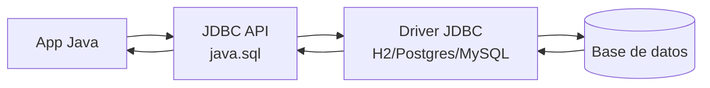
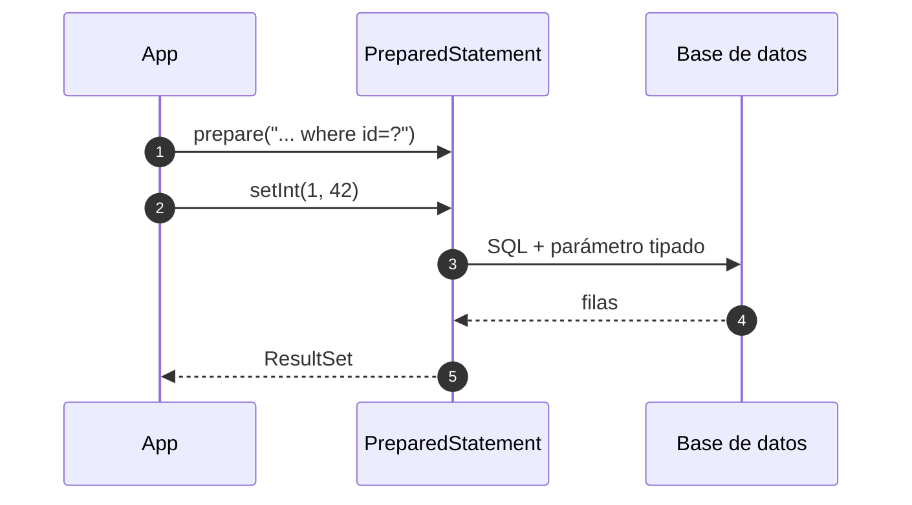
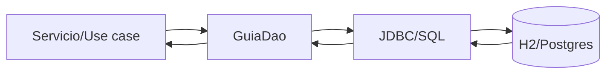
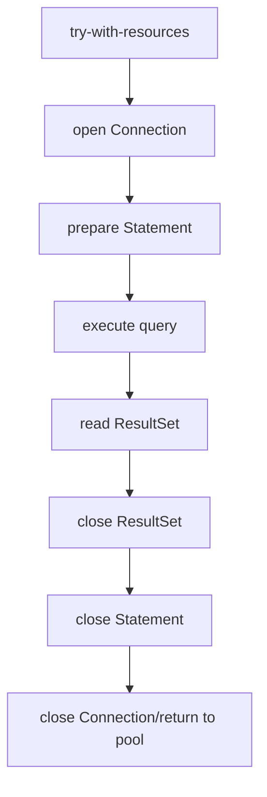
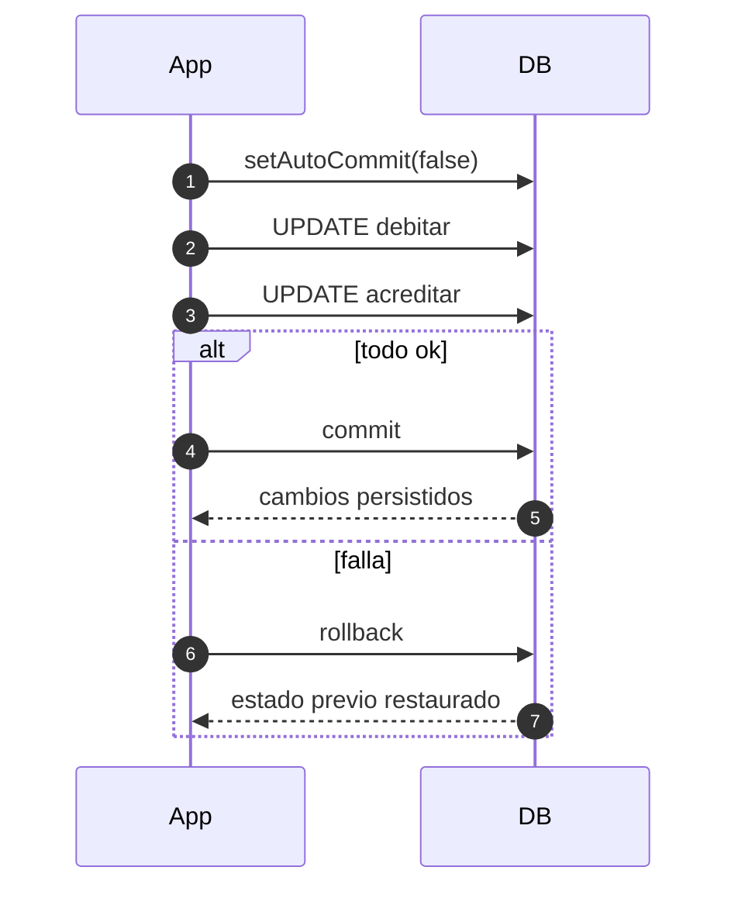
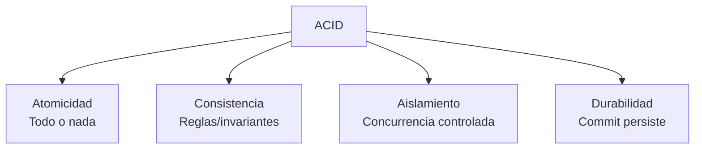
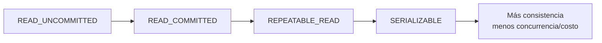

# Módulo 17: JDBC

Una aplicación puede validar reglas en memoria, pero si no persiste datos con garantías, pierde confiabilidad en cuanto hay reinicios, concurrencia o fallos parciales. JDBC es la capa estándar que Java ofrece para hablar con bases de datos relacionales. Aunque uses JPA/Hibernate en el día a día, JDBC sigue siendo la base: entenderlo te permite depurar ORMs, escribir consultas críticas, controlar transacciones y razonar sobre aislamiento, recursos y latencia.

**Contexto Tienda Aurora.** Este módulo aporta bases para Tienda Aurora: los conceptos aquí se aplican en el monolito modular y luego en los microservicios.

**Entorno de referencia verificado (2026-05-22):** JDK 27.0.1.0.2, H2 2.3.232 (jar local), Docker 29.9.3 disponible para pruebas opcionales con PostgreSQL. Todos los ejemplos ejecutables de este módulo usan H2 en memoria para ser reproducibles desde cero.

## Setup ejecutable del módulo

```bash
```bash
mkdir -p jdbc-m17
cd jdbc-m17
curl -L -o h2.jar https://repo1.maven.org/maven2/com/h2database/h2/2.3.232/h2-2.3.232.jar
```

Compila y ejecuta cada ejemplo con:

```bash
javac -cp ".:h2.jar" Archivo.java
java -cp ".:h2.jar" Archivo
```

> En Windows, el separador de classpath es `;` en lugar de `:`.

## Aprende construyendo

## Proyecto desde cero: tienda-aurora-java-m17

## Prerrequisitos

```bash
java -version    # JDK 25+
gradle --version # Gradle 9.x
```

## Estructura del proyecto

```text
tienda-aurora-java-m17/
├── build.gradle.kts
├── settings.gradle.kts
└── src/
    └── main/
        └── java/com/aurora/java/
            └── Main.java
```

## build.gradle.kts

```kotlin
plugins {
    java
    application
}

group = "com.aurora"
version = "1.0.0"

java {
    toolchain {
        languageVersion = JavaLanguageVersion.of(25)
    }
}

application {
    mainClass.set("com.aurora.java.Main")
}

repositories {
    mavenCentral()
}
```

## settings.gradle.kts

```kotlin
rootProject.name = "tienda-aurora-java-m17"
```

## Ejecutar

```bash
./gradlew run
# O directamente:
mkdir -p out
javac -d out src/main/java/com/aurora/java/**/*.java
java -cp out com.aurora.java.Main
```

### Tema 1: JDBC, PreparedStatement y DAO · Intermedio · 40 min

**Caso guía.** un servicio interno debe registrar guías de envío y consultarlas por ID. No puede permitir inyección SQL, no debe filtrar `ResultSet` a la capa de negocio y debe cerrar recursos siempre, incluso ante errores.

JDBC

**Definición.** JDBC (Java Database Connectivity) es la API estándar del paquete `java.sql`/`javax.sql` que define contratos para conectar aplicaciones Java con bases de datos relacionales mediante drivers.

**Cómo funciona por dentro.** La aplicación no habla directamente con PostgreSQL, MySQL u H2; habla con interfaces JDBC. El driver JDBC traduce esas llamadas al protocolo del motor. `DriverManager` localiza un driver compatible con la URL JDBC, abre una `Connection`, y sobre esa conexión se crean sentencias SQL. Esto desacopla el código Java del motor específico, aunque el SQL y algunos detalles transaccionales sigan siendo propios de cada base.



**Contrato/reglas clave.** La URL JDBC identifica el motor y destino (`jdbc:h2:mem:db`, `jdbc:postgresql://host/db`). La conexión es un recurso costoso: debe cerrarse. JDBC no elimina diferencias SQL entre motores; abstrae el acceso, no la semántica completa.

**Cuándo usarlo y cuándo no.** Úsalo cuando necesites control directo de SQL, transacciones, batch, rendimiento o depuración bajo un ORM. No lo uses como excusa para esparcir SQL por toda la UI/capa web; encapsula el acceso.

**Ejemplo mínimo enfocado (ejecutable).**

```bash
mkdir -p jdbc-m17
cd jdbc-m17
```

Crea el archivo `DemoJdbcApi.java`:

```java
import java.sql.Connection;
import java.sql.DriverManager;

public class DemoJdbcApi {
  public static void main(String[] args) throws Exception {
    try (Connection c = DriverManager.getConnection("jdbc:h2:mem:j1;DB_CLOSE_DELAY=-1", "sa", "")) {
      System.out.println(c.getMetaData().getDatabaseProductName());
      System.out.println(c.isValid(1));
    }
  }
}
```


```bash
javac -cp ".:h2.jar" DemoJdbcApi.java
java -cp ".:h2.jar" DemoJdbcApi
```

**Caso de uso real.** Un job batch de conciliación ejecuta SQL optimizado directamente con JDBC porque necesita control de fetch size, batch inserts y tiempos.

**Error común.** Driver no en classpath. Síntoma: `No suitable driver found for jdbc:...` o `ClassNotFoundException`. Causa: jar ausente o URL mal escrita. Corrección: incluir el driver en classpath y verificar la URL exacta del motor.

**Verificación (JDK 27, H2 2.3.232, 2026-05-22).** Salida real:

```text
H2
true
```

`PreparedStatement`

**Definición.** `PreparedStatement` es una sentencia SQL precompilada/parametrizada que separa el texto SQL de los valores, asignados mediante placeholders `?` y setters tipados.

**Cómo funciona por dentro.** En vez de construir `"select ... where id=" + id`, envías la plantilla SQL y luego los parámetros como datos. El driver/envía los valores con su tipo, evitando que el input del usuario se interprete como SQL. Además, muchos motores pueden reutilizar el plan para la misma sentencia parametrizada.



**Contrato/reglas clave.** Los parámetros se indexan desde 1, no desde 0. Usa el setter correcto (`setInt`, `setString`, `setTimestamp`, etc.). `PreparedStatement` no sirve para parametrizar identificadores SQL (nombres de tabla/columna/order by dinámico); esos casos requieren allow-list controlada.

**Cuándo usarlo y cuándo no.** Úsalo siempre con input externo o variable. No concatenes strings para SQL. No lo uses para inyectar nombres de columna recibidos del usuario sin validación estricta.

**Ejemplo mínimo enfocado (ejecutable).**

```bash
mkdir -p jdbc-m17
cd jdbc-m17
```

Crea el archivo `DemoPs.java`:

```java
import java.sql.*;

public class DemoPs {
  public static void main(String[] args) throws Exception {
    try (Connection c = DriverManager.getConnection("jdbc:h2:mem:j2;DB_CLOSE_DELAY=-1", "sa", "")) {
      try (Statement st = c.createStatement()) {
        st.execute("create table guia(id int primary key, codigo varchar(50), estado varchar(20))");
      }
      try (PreparedStatement ps = c.prepareStatement("insert into guia(id,codigo,estado) values(?,?,?)")) {
        ps.setInt(1, 1);
        ps.setString(2, "G-1");
        ps.setString(3, "CREADA");
        System.out.println(ps.executeUpdate());
      }
      try (PreparedStatement ps = c.prepareStatement("select codigo, estado from guia where id=?")) {
        ps.setInt(1, 1);
        try (ResultSet rs = ps.executeQuery()) {
          rs.next();
          System.out.println(rs.getString("codigo") + ":" + rs.getString("estado"));
        }
      }
    }
  }
}
```


```bash
javac -cp ".:h2.jar" DemoPs.java
java -cp ".:h2.jar" DemoPs
```

**Caso de uso real.** Endpoint `GET /guias/{id}` consulta por ID sin exponer la base a inyección SQL.

**Error común.** Concatenar input: `"where codigo='" + input + "'"`. Síntoma: inyección SQL, errores de comillas, o consultas manipuladas. Causa: input tratado como código SQL. Corrección: `prepareStatement` + `setString`.

**Verificación (JDK 27, H2 2.3.232, 2026-05-22).** Salida real:

```text
1
G-1:CREADA
```

DAO

**Definición.** DAO (Data Access Object) es un patrón que encapsula el acceso a persistencia detrás de una interfaz/métodos orientados al dominio, ocultando SQL, JDBC y mapeo de filas.

**Cómo funciona por dentro.** El servicio de negocio pide `dao.buscarPorId(id)` o `dao.guardar(guia)`; no arma SQL ni recorre `ResultSet`. El DAO traduce objetos de dominio a parámetros SQL y filas a objetos. Esto concentra el conocimiento de persistencia, reduce duplicación y permite probar la lógica de negocio con dobles del DAO.



**Contrato/reglas clave.** El DAO no debe exponer `Connection`, `Statement` o `ResultSet`. Debe mapear errores de persistencia de forma consistente. Mantén métodos pequeños y con intención (`insertar`, `buscarPorId`, `listar`).

**Cuándo usarlo y cuándo no.** Úsalo cuando haya acceso a datos repetido o quieras separar persistencia de negocio. No lo conviertas en “god class” con reglas de negocio complejas, validaciones HTTP o UI.

**Ejemplo mínimo enfocado (ejecutable).**

```bash
mkdir -p jdbc-m17
cd jdbc-m17
```

Crea el archivo `DemoDao.java`:

```java
import java.sql.*;
import java.util.*;

record Guia(int id, String codigo) {}

class GuiaDao {
  private final String url;
  GuiaDao(String url) { this.url = url; }
  private Connection open() throws SQLException { return DriverManager.getConnection(url, "sa", ""); }

  void crearTabla() throws SQLException {
    try (Connection c = open(); Statement st = c.createStatement()) {
      st.execute("create table if not exists guia(id int primary key, codigo varchar(50) not null)");
    }
  }

  void insertar(Guia guia) throws SQLException {
    try (Connection c = open();
         PreparedStatement ps = c.prepareStatement("insert into guia(id,codigo) values(?,?)")) {
      ps.setInt(1, guia.id());
      ps.setString(2, guia.codigo());
      ps.executeUpdate();
    }
  }

  Optional<Guia> buscarPorId(int id) throws SQLException {
    try (Connection c = open();
         PreparedStatement ps = c.prepareStatement("select id,codigo from guia where id=?")) {
      ps.setInt(1, id);
      try (ResultSet rs = ps.executeQuery()) {
        if (!rs.next()) return Optional.empty();
        return Optional.of(new Guia(rs.getInt("id"), rs.getString("codigo")));
      }
    }
  }
}

public class DemoDao {
  public static void main(String[] args) throws Exception {
    GuiaDao dao = new GuiaDao("jdbc:h2:mem:j3;DB_CLOSE_DELAY=-1");
    dao.crearTabla();
    dao.insertar(new Guia(1, "G-1"));
    System.out.println(dao.buscarPorId(1).map(Guia::codigo).orElse("NA"));
    System.out.println(dao.buscarPorId(99).isEmpty());
  }
}
```


```bash
javac -cp ".:h2.jar" DemoDao.java
java -cp ".:h2.jar" DemoDao
```

**Caso de uso real.** En un monolito legacy sin JPA, los DAOs JDBC aíslan SQL y permiten migrar gradualmente a repositorios más modernos.

**Error común.** Devolver `ResultSet` o `Connection` al servicio. Síntoma: fugas de recursos y acoplamiento. Causa: DAO incompleto. Corrección: mapear a objetos/dtos y cerrar recursos dentro del DAO.

**Verificación (JDK 27, H2 2.3.232, 2026-05-22).** Salida real:

```text
G-1
true
```

`Connection`, `ResultSet` y try-with-resources

**Definición.** `Connection` representa una sesión con la base; `Statement/PreparedStatement` ejecuta SQL; `ResultSet` itera filas. Todos son `AutoCloseable` o recursos asociados que deben liberarse determinísticamente.

**Cómo funciona por dentro.** Una conexión abierta ocupa socket, memoria y, en pools, un slot limitado. Un `ResultSet` puede mantener cursor/recursos del lado del driver/DB. Si no se cierran, el sistema degrada hasta agotar el pool: las nuevas peticiones esperan o fallan por timeout.



**Contrato/reglas clave.** Usa try-with-resources para cada recurso. Cierra en orden inverso al de apertura; try-with-resources lo hace por ti. No reutilices un `ResultSet` después de cerrar su statement.

**Cuándo usarlo.** Siempre. Especialmente en servicios web con pool de conexiones.

**Ejemplo mínimo enfocado (ejecutable).**

```bash
mkdir -p jdbc-m17
cd jdbc-m17
```

Crea el archivo `DemoClose.java`:

```java
import java.sql.*;

public class DemoClose {
  public static void main(String[] args) throws Exception {
    try (Connection c = DriverManager.getConnection("jdbc:h2:mem:j4;DB_CLOSE_DELAY=-1", "sa", "");
         Statement st = c.createStatement()) {
      st.execute("create table t(id int)");
      st.execute("insert into t values(1)");
      try (ResultSet rs = st.executeQuery("select count(*) from t")) {
        rs.next();
        System.out.println(rs.getInt(1));
      }
    }
    System.out.println("cerrado");
  }
}
```


```bash
javac -cp ".:h2.jar" DemoClose.java
java -cp ".:h2.jar" DemoClose
```

**Caso de uso real.** En un servicio con HikariCP, cerrar la conexión devuelve el slot al pool; no cerrarla provoca `Connection is not available`.

**Error común.** Abrir conexión y depender del GC. Síntoma: saturación de pool, latencia creciente, timeouts. Causa: recursos no liberados. Corrección: try-with-resources y monitoreo de pool.

**Verificación (JDK 27, H2 2.3.232, 2026-05-22).** Salida real:

```text
1
cerrado
```

### Tema 2: Transacciones, ACID y aislamiento · Avanzado · 45 min

**Caso guía.** una transferencia interna debita una cuenta y acredita otra. Si el segundo paso falla, el sistema no puede dejar dinero descontado sin acreditar. Además, dos transacciones concurrentes no deben corromper saldos.

Transacciones

**Definición.** Una transacción es una unidad lógica de trabajo que agrupa operaciones para que se apliquen como todo-o-nada, típicamente controlada con `commit` y `rollback`.

**Cómo funciona por dentro.** Con `autoCommit=true`, cada sentencia se confirma individualmente. Para operaciones multi-paso, se desactiva auto-commit, se ejecutan las sentencias, y se decide `commit()` si todo salió bien o `rollback()` ante error. La base garantiza atomicidad del conjunto.



**Contrato/reglas clave.** `commit` confirma; `rollback` revierte. Usa `setAutoCommit(false)` solo en el alcance necesario. Siempre cierra la conexión y restaura comportamiento si usas pool.

**Cuándo usarlo.** Transferencias, creación de pedido + ítems, reserva de stock + registro de evento: cualquier flujo donde el estado parcial sea inválido.

**Ejemplo mínimo enfocado (ejecutable).**

```bash
mkdir -p jdbc-m17
cd jdbc-m17
```

Crea el archivo `DemoTx.java`:

```java
import java.sql.*;

public class DemoTx {
  static Connection open() throws SQLException {
    return DriverManager.getConnection("jdbc:h2:mem:j5;DB_CLOSE_DELAY=-1", "sa", "");
  }
  static void print(Connection c) throws SQLException {
    try (Statement st = c.createStatement();
         ResultSet rs = st.executeQuery("select id,saldo from cuentas order by id")) {
      while (rs.next()) System.out.print(rs.getInt("saldo") + (rs.getInt("id") == 1 ? "," : "\n"));
    }
  }
  public static void main(String[] args) throws Exception {
    try (Connection c = open(); Statement st = c.createStatement()) {
      st.execute("create table cuentas(id int primary key, saldo int)");
      st.execute("insert into cuentas values(1,100),(2,100)");
    }
    try (Connection c = open()) {
      c.setAutoCommit(false);
      try (PreparedStatement d = c.prepareStatement("update cuentas set saldo=saldo-? where id=?");
           PreparedStatement cr = c.prepareStatement("update cuentas set saldo=saldo+? where id=?")) {
        d.setInt(1, 30); d.setInt(2, 1); d.executeUpdate();
        cr.setInt(1, 30); cr.setInt(2, 2); cr.executeUpdate();
        c.commit();
      }
    }
    try (Connection c = open()) { print(c); }
    try (Connection c = open()) {
      c.setAutoCommit(false);
      try (PreparedStatement d = c.prepareStatement("update cuentas set saldo=saldo-? where id=?")) {
        d.setInt(1, 200); d.setInt(2, 1); d.executeUpdate();
        if (true) throw new SQLException("fallo simulado");
        c.commit();
      } catch (Exception e) {
        c.rollback();
        System.out.println("rollback");
      }
    }
    try (Connection c = open()) { print(c); }
  }
}
```


```bash
javac -cp ".:h2.jar" DemoTx.java
java -cp ".:h2.jar" DemoTx
```

**Caso de uso real.** Pago: se registra cobro, se descuenta inventario y se crea envío; si el envío falla, se revierte toda la operación o se compensa según diseño.

**Error común.** Hacer commit por paso en un flujo multi-paso. Síntoma: estados parciales difíciles de reparar. Causa: no delimitar transacción. Corrección: una frontera transaccional por unidad de negocio.

**Verificación (JDK 27, H2 2.3.232, 2026-05-22).** Salida real:

```text
70,130
rollback
70,130
```

ACID

**Definición.** ACID es el conjunto de propiedades que caracterizan transacciones confiables: Atomicidad, Consistencia, Aislamiento y Durabilidad.

**Cómo funciona por dentro.** Atomicidad garantiza todo-o-nada. Consistencia exige que la transacción lleve la BD de un estado válido a otro según restricciones. Aislamiento controla interferencia entre transacciones concurrentes. Durabilidad asegura que, una vez confirmado, el cambio sobrevive fallos del sistema (según garantías del motor).



**Cuándo usarlo como criterio.** Al diseñar operaciones financieras, inventario, reservas, o cualquier estado donde una inconsistencia tenga costo real. No todo flujo necesita la misma rigidez; a veces se aceptan compensaciones/eventual consistency.

**Ejemplo mínimo enfocado (ejecutable).** La verificación de atomicidad se observa con `DemoTx`: el fallo fuerza rollback y el saldo final se mantiene consistente.

**Caso de uso real.** Una transferencia contable no puede dejar débito sin crédito.

**Error común.** Confundir "usa transacción" con "es consistente en negocio". Corrección: ACID protege la transacción en BD; las invariantes de negocio también deben modelarse (constraints, validaciones, diseño).

**Verificación (2026-05-22).** Evidencia: `DemoTx` produce `70,130` tras commit y `70,130` tras rollback.

Aislamiento

**Definición.** El aislamiento define cómo una transacción ve cambios realizados por otras transacciones concurrentes. JDBC expone niveles con `Connection.setTransactionIsolation(...)`.

**Cómo funciona por dentro.** Niveles más estrictos evitan más anomalías (dirty read, non-repeatable read, phantom read), pero suelen costar más en bloqueos, abortos o versión de filas. El nivel correcto depende del motor y del caso de uso.



**Contrato/reglas clave.** Los niveles son constantes de `Connection`. No todos los motores implementan igual todos los niveles; por ejemplo, algunos mapean internamente. Verifica el comportamiento real del motor.

**Cuándo usarlo y cuándo no.** Usa el nivel mínimo que evite la anomalía que te importa. No uses `SERIALIZABLE` por defecto sin medir contención.

**Ejemplo mínimo enfocado (ejecutable).**

```bash
mkdir -p jdbc-m17
cd jdbc-m17
```

Crea el archivo `DemoIsolation.java`:

```java
import java.sql.*;
public class DemoIsolation {
  public static void main(String[] args) throws Exception {
    try (Connection c = DriverManager.getConnection("jdbc:h2:mem:j6;DB_CLOSE_DELAY=-1","sa","")) {
      c.setTransactionIsolation(Connection.TRANSACTION_READ_COMMITTED);
      System.out.println(c.getTransactionIsolation() == Connection.TRANSACTION_READ_COMMITTED);
      System.out.println(Connection.TRANSACTION_SERIALIZABLE);
    }
  }
}
```


```bash
javac -cp ".:h2.jar" DemoIsolation.java
java -cp ".:h2.jar" DemoIsolation
```

**Caso de uso real.** Un reporte puede tolerar `READ_COMMITTED`; una reserva crítica puede requerir mayor aislamiento o bloqueo explícito.

**Error común.** Asumir que el aislamiento resuelve todas las carreras de negocio. Corrección: combinar aislamiento, constraints, locks optimistas/pesimistas y diseño idempotente según el caso.

**Verificación (JDK 27, H2 2.3.232, 2026-05-22).** Salida real:

```text
true
8
```

Rollback ante error

**Definición.** `rollback()` deshace los cambios no confirmados de la transacción actual, restaurando el estado previo visible para esa unidad transaccional.

**Cómo funciona por dentro.** Cuando ocurre una excepción, la app debe capturarla en la frontera transaccional, ejecutar `rollback()` y propagar o manejar el error. Si no lo hace, puede dejar la transacción en estado inválido o depender de comportamientos implícitos al cerrar la conexión.

**Contrato/reglas clave.** Rollback solo afecta lo no commiteado en la transacción actual. En pools, asegúrate de dejar la conexión en estado limpio.

**Cuándo usarlo.** En todo flujo multi-paso con `autoCommit=false`.

**Ejemplo mínimo enfocado (ejecutable).** `DemoTx` demuestra el caso: tras `SQLException`, se ejecuta `rollback` y el estado vuelve a `70,130`.

**Caso de uso real.** Falla al insertar detalle de factura después de actualizar cabecera; rollback evita factura inconsistente.

**Error común.** `catch (Exception e) { log(e); }` sin rollback. Síntoma: datos parciales o transacción colgada. Corrección: `catch -> rollback -> throw/log con contexto`.

**Verificación (2026-05-22).** Evidencia real en `DemoTx`: línea `rollback` y saldos finales `70,130`.

## Cierre del módulo

JDBC es la base operativa de la persistencia relacional en Java. Si dominas `PreparedStatement`, DAO, cierre de recursos y transacciones, puedes usar JPA con criterio y depurar problemas que el ORM oculta. La siguiente capa natural es comparar este control explícito con JPA/Hibernate, sabiendo exactamente qué garantías estás delegando.

## Checklist de verificación

- Puedo abrir una conexión JDBC y ejecutar SQL parametrizado.
- No concateno input de usuario en SQL.
- Encapsulo acceso a datos en DAO y cierro recursos con try-with-resources.
- Puedo delimitar una transacción con commit/rollback.
- Entiendo qué problema resuelve ACID y qué trade-offs introduce el aislamiento.
