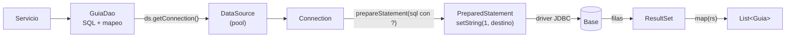
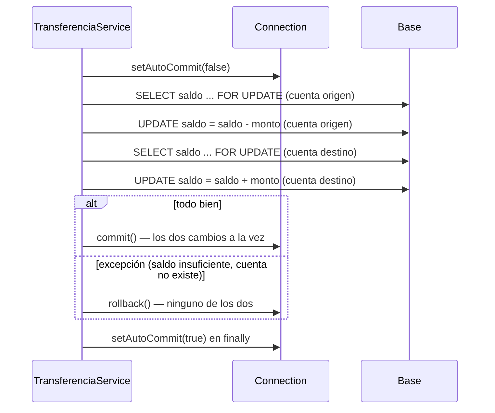

# Módulo 17: JDBC, DAO y transacciones

Una aplicación de envíos puede validar objetos en memoria, pero si no persiste bien sus datos, el negocio pierde trazabilidad. El problema aparece en los bordes: un `INSERT` con concatenación de strings abre la puerta a SQL injection; una transferencia que debita una cuenta y falla antes de acreditar la otra deja saldos inconsistentes; una consulta sin mapeo claro mezcla SQL, infraestructura y dominio.

En este módulo se construye `tienda-aurora-java-m17` desde cero. La primera parte resuelve persistencia con JDBC y el patrón DAO usando H2 en memoria para que sea ejecutable localmente. La segunda modela transacciones con commit/rollback y verifica aislamiento `READ COMMITTED`. La comparación final ejecuta un `count`/`insert` con JDBC y con JPA sobre la misma tabla y documento cuándo conviene cada abstracción. PostgreSQL/MySQL comparten el contrato JDBC; los cambios de motor se enumeran al cierre.

## Apertura del módulo

Al terminar este módulo podrás:
- conectarte a una base con JDBC a través de un `DataSource` y cerrar cada recurso con try-with-resources;
- consultar y escribir con `PreparedStatement` y explicar por qué evita la inyección SQL;
- convertir filas de `ResultSet` en objetos dentro de un DAO;
- agrupar varias escrituras en una transacción JDBC con `commit` y `rollback`;
- elegir un nivel de aislamiento según la anomalía que el negocio no tolera;
- comparar el mismo `count`/`insert` en JDBC y en JPA y decidir cuándo conviene cada uno.

**Esquema del módulo:** JDBC, `PreparedStatement` y DAO (Tema 1); transacciones, ACID y aislamiento (Tema 2).

**Qué necesitas saber antes:** *conexión*, *tabla* y *clave primaria* (SQL, Módulo 0, Tema 1); *consulta parametrizada* e *inyección SQL* (SQL, Módulo 0, Tema 2); *cursor* (SQL, Módulo 0, Tema 6); *transacción*, `BEGIN`, `COMMIT`,
`ROLLBACK`, *ACID*, *modo autocommit*, *concurrencia* y *bloqueo* (SQL, Módulo 0, Tema 4); try-with-resources
(Java, Módulo 3, Tema 2); `Optional` (Java, Módulo 4, Tema 2); `record` (Java, Módulo 1, Tema 5); JUnit (Java,
Módulo 9, Tema 1); *ORM*, *JPA*, *Hibernate*, *JDBC*, *H2* y *entidad JPA* (Java, Módulo 16, Tema 1); *EntityManager*
y *JPQL* (Java, Módulo 16, Tema 3); *bloqueo pesimista* (Java, Módulo 16, Tema 7).

**Entorno de los programas de un solo archivo (2026-11-24):** Linux x86_64, OpenJDK 25.0.5.1 (`java Archivo.java`)
y H2 2.3.232, el mismo driver del proyecto. Los programas usan solo `java.sql` y la biblioteca estándar; los que
hablan con una base ejecutan contra H2 en memoria el mismo SQL que el DAO envía por JDBC. Sus transcripciones son
literales.

**Cómo ejecutar los programas con H2.** Después del primer `./gradlew build`, el JAR de H2 está en la caché de
Gradle. Guarda su ruta una vez por terminal y pásala con `-cp`:

```bash
export H2="$(find ~/.gradle/caches -name 'h2-2.3.232.jar' | head -1)"
java -cp "$H2" Inyeccion.java
```

Las salidas del proyecto Gradle son las
capturadas en el Mac del entorno de referencia; no se cambiaron.

## Visual del módulo

**Visual:** [Servicio, DAO con PreparedStatement y transacción con commit o rollback](/visuals/temas/java/modulo-17-jdbc-transaccion.html)

Lectura: El servicio llama al DAO; el DAO usa `PreparedStatement`; la transacción confirma todas las operaciones o ninguna.

## Prerrequisitos y bootstrap

Necesitas JDK 25 y Gradle 9.x.

```bash
java -version
gradle --version
mkdir -p tienda-aurora-java-m17/src/main/java/com/aurora/jdbc
mkdir -p tienda-aurora-java-m17/src/main/resources/META-INF
mkdir -p tienda-aurora-java-m17/src/test/java/com/aurora/jdbc
cd tienda-aurora-java-m17
gradle wrapper --gradle-version 9.9.1
```

Estructura:

```text
tienda-aurora-java-m17/
├── build.gradle.kts
├── settings.gradle.kts
└── src/
    ├── main/java/com/aurora/jdbc/
    │   ├── App.java
    │   ├── DataSourceFactory.java
    │   ├── Guia.java
    │   ├── GuiaDao.java
    │   ├── GuiaEntity.java
    │   ├── GuiaJpaDao.java
    │   ├── Schema.java
    │   └── TransferenciaService.java
    ├── main/resources/
    │   ├── META-INF/persistence.xml
    │   └── simplelogger.properties
    └── test/java/com/aurora/jdbc/
        ├── ConteoJpaVsJdbcTest.java
        └── JdbcTest.java
```

**Entorno de referencia verificado (2026-11-23):** macOS arm64, JDK 27.0.1.0.2, Gradle 9.9.1, toolchain Java 25, H2 2.3.232, Hibernate 7.0.0.Final, Jakarta Persistence 3.2.0.

## Build desde cero

#### `settings.gradle.kts`

```kotlin
rootProject.name = "tienda-aurora-java-m17"
```

#### `build.gradle.kts`

H2 es la BD embebida para ejecución local verificable. Hibernate y la API Jakarta Persistence entran solo para la comparación JDBC/JPA del Tema 1 (Problema resuelto 1.5). JUnit 5 cubre las pruebas.

```kotlin
plugins {
    java
    application
}

group = "com.aurora"
version = "1.0.0"

java {
    toolchain {
        languageVersion = JavaLanguageVersion.of(25)
    }
}

repositories {
    mavenCentral()
}

dependencies {
    implementation("com.h2database:h2:2.3.232")
    implementation("org.hibernate.orm:hibernate-core:7.0.0.Final")
    implementation("jakarta.persistence:jakarta.persistence-api:3.2.0")
    implementation("org.slf4j:slf4j-simple:2.0.17")
    testImplementation(platform("org.junit:junit-bom:5.13.4"))
    testImplementation("org.junit.jupiter:junit-jupiter")
    testRuntimeOnly("org.junit.platform:junit-platform-launcher")
}

application {
    mainClass = "com.aurora.jdbc.App"
}

tasks.test {
    useJUnitPlatform()
    systemProperty("org.jboss.logging.provider", "slf4j")
    testLogging {
        events("passed", "skipped", "failed")
    }
}

tasks.withType<JavaExec>().configureEach {
    systemProperty("org.jboss.logging.provider", "slf4j")
}

tasks.withType<JavaCompile>().configureEach {
    options.encoding = "UTF-8"
    options.compilerArgs.addAll(listOf("-Xlint:all", "-Xlint:-processing", "-Werror"))
}
```

#### `src/main/resources/simplelogger.properties`

Mantiene la salida de `run` legible al crear el `EntityManagerFactory` de la comparación.

```properties
org.slf4j.simpleLogger.defaultLogLevel=error
org.slf4j.simpleLogger.showDateTime=false
```

### Tema 1: JDBC, PreparedStatement y DAO · Intermedio · 75 min

<details open>
<summary><strong>Capa 1 — Lectura</strong></summary>

#### Objetivos
Al terminar este tema podrás:
- explicar qué parte de JDBC pone Java y qué parte pone el driver de cada base;
- obtener una `Connection` desde un `DataSource`, ejecutar un `PreparedStatement` y recorrer un `ResultSet`;
- demostrar con una entrada maliciosa la diferencia entre `Statement` concatenado y `PreparedStatement`;
- encapsular SQL y mapeo de filas en un DAO, y explicar por qué un pool reutiliza conexiones;
- comparar el mismo `count` e `insert` en JDBC y en JPA.

**Conceptos clave:** driver JDBC, URL JDBC, DriverManager, DataSource, Connection, Statement, PreparedStatement, ResultSet, executeQuery, executeUpdate, SQLException, DAO, mapeo de filas, pool de conexiones

Ya los conoces y no se repiten: *JDBC* y *H2* (Java, Módulo 16, Tema 1); *conexión* (SQL, Módulo 0, Tema 1); *consulta parametrizada* e *inyección SQL* (SQL, Módulo 0, Tema 2); try-with-resources y
*AutoCloseable* (Java, Módulo 3, Tema 2); *excepción checked* (Java, Módulo 3, Tema 1); *puerto* (Java, Módulo 9,
Tema 2).

#### El problema
Tienda Aurora registra guías de envío con remitente, destino y peso. El buscador por destino recibe texto del
usuario. Si ese texto se pega dentro del SQL, un usuario puede listar todas las guías escribiendo
`CAL' OR '1'='1`. Además, el servicio no debería saber de conexiones ni de columnas. ¿Cómo hablas con la base desde
Java de forma segura y ordenada?

#### Glosario del tema

**driver JDBC**
- **Definición técnica:** librería de un fabricante que implementa las interfaces de `java.sql` y traduce cada llamada al protocolo de red de su base.
- **En palabras sencillas:** el adaptador de enchufe: Java define la forma y cada base trae el suyo.
- **Dónde se rompe la comparación:** el driver no traduce el SQL; si usas una función propia de PostgreSQL, en H2 falla igual.
- **Ejemplo:** `implementation("com.h2database:h2:2.3.232")` trae el driver de H2; para PostgreSQL, `org.postgresql:postgresql`.
- **Error típico:** olvidar la dependencia del driver: `No suitable driver found for jdbc:h2:mem:aurora-m17`.

**URL JDBC**
- **Definición técnica:** texto `jdbc:<subprotocolo>:<datos>` que identifica el driver y la base; cada driver define el resto del formato.
- **En palabras sencillas:** la dirección de la base, con el nombre del adaptador al principio.
- **Dónde se rompe la comparación:** las opciones van en la misma URL (`;DB_CLOSE_DELAY=-1` en H2, `?sslmode=require` en PostgreSQL) y cambian por motor.
- **Ejemplo:** `jdbc:h2:mem:aurora-m17;DB_CLOSE_DELAY=-1` y `jdbc:postgresql://localhost:5432/aurora`.
- **Error típico:** escribir `jdbc:postgres://...`: el subprotocolo correcto es `postgresql` y ningún driver acepta la URL.

**DriverManager**
- **Definición técnica:** clase de `java.sql` que busca, entre los drivers registrados, uno que acepte la URL y le pide una conexión nueva.
- **En palabras sencillas:** la recepcionista que mira la dirección y llama al adaptador correcto.
- **Dónde se rompe la comparación:** abre una conexión física cada vez; no reutiliza nada.
- **Ejemplo:** `DriverManager.getConnection("jdbc:h2:mem:aurora-m17", "sa", "")` en `SinDriver.java`, línea 14.
- **Error típico:** usarlo en un servidor con tráfico: cada petición paga abrir y cerrar una conexión.

**DataSource**
- **Definición técnica:** interfaz `javax.sql.DataSource` con `getConnection()`; oculta cómo se obtienen las conexiones (directas o de un pool) y es lo que se inyecta en el código.
- **En palabras sencillas:** un grifo de conexiones: abres y sale una, sin saber de qué tanque viene.
- **Dónde se rompe la comparación:** cerrar la conexión obtenida puede devolverla al pool en vez de cerrarla de verdad.
- **Ejemplo:** `DataSourceFactory.h2Mem("aurora-m17")` devuelve un `JdbcDataSource` de H2.
- **Error típico:** pasar URL, usuario y contraseña a cada DAO en lugar de un solo `DataSource`.

**Connection**
- **Definición técnica:** interfaz de `java.sql` que representa una sesión con la base; crea sentencias y controla la transacción (`setAutoCommit`, `commit`, `rollback`).
- **En palabras sencillas:** la llamada telefónica abierta con la base.
- **Dónde se rompe la comparación:** colgar es obligatorio: una conexión sin cerrar ocupa un lugar del servidor o del pool.
- **Ejemplo:** `try (Connection c = ds.getConnection(); ...)` en `GuiaDao`, línea 21.
- **Error típico:** guardar una `Connection` en un campo compartido entre hilos.

**Statement**
- **Definición técnica:** interfaz que envía a la base un texto SQL completo, sin parámetros, con `execute`, `executeQuery` o `executeUpdate`.
- **En palabras sencillas:** mandar la pregunta ya escrita, tal cual.
- **Dónde se rompe la comparación:** sirve para SQL fijo, como el `CREATE TABLE` de `Schema`; con datos del usuario es peligroso.
- **Ejemplo:** `st.execute("CREATE TABLE guias (...)")` en `Schema.init`, línea 13.
- **Error típico:** concatenar datos del usuario en el texto: abre la puerta a la inyección SQL.

**PreparedStatement**
- **Definición técnica:** sentencia precompilada con marcadores `?`; los valores se asignan con `setInt`, `setString`, `setBigDecimal` y viajan aparte del texto SQL.
- **En palabras sencillas:** un formulario con casillas: el texto del usuario va dentro de la casilla y nunca cambia la pregunta.
- **Dónde se rompe la comparación:** solo los valores pueden ser `?`; nombres de tabla o columna no se parametrizan.
- **Ejemplo:** `"... WHERE destino = ? ORDER BY id"` y `ps.setString(1, destino)` en `listarPorDestino`.
- **Error típico:** contar los parámetros desde 0: el primer `?` es el índice 1.

**ResultSet**
- **Definición técnica:** cursor sobre las filas de un `SELECT`; `next()` avanza a la siguiente y devuelve `false` al terminar; `getString("columna")` lee un valor.
- **En palabras sencillas:** un lector de filas que avanza de una en una.
- **Dónde se rompe la comparación:** empieza antes de la primera fila: sin `next()`, no hay nada que leer.
- **Ejemplo:** `while (rs.next()) out.add(map(rs));` en `GuiaDao`, línea 50.
- **Error típico:** leer `rs.getInt(1)` sin llamar antes a `next()`: el driver lanza `SQLException`.

**executeQuery**
- **Definición técnica:** método de `Statement` y `PreparedStatement` para sentencias que devuelven filas (`SELECT`); retorna un `ResultSet`.
- **En palabras sencillas:** «pregunta y dame la tabla de respuesta».
- **Dónde se rompe la comparación:** el `ResultSet` también hay que cerrarlo; va en el try-with-resources.
- **Ejemplo:** `try (ResultSet rs = ps.executeQuery())` en `buscarPorId`, línea 36.
- **Error típico:** usarlo con un `INSERT`: el driver lo rechaza porque no hay filas que devolver.

**executeUpdate**
- **Definición técnica:** método para `INSERT`, `UPDATE`, `DELETE` y DDL; devuelve el número de filas afectadas.
- **En palabras sencillas:** «haz este cambio y dime a cuántas filas tocó».
- **Dónde se rompe la comparación:** `0` no es un error para JDBC; si esperabas 1, debes comprobarlo tú.
- **Ejemplo:** `ps.executeUpdate();` en `insertar`, línea 27.
- **Error típico:** ignorar el número: un `UPDATE` con un id inexistente «funciona» y no cambia nada.

**SQLException**
- **Definición técnica:** excepción checked de JDBC con mensaje, código del fabricante (`getErrorCode`) y estado estándar (`getSQLState`, cinco caracteres).
- **En palabras sencillas:** el aviso de que la base o el driver no pudieron hacer lo pedido, con un código para clasificarlo.
- **Dónde se rompe la comparación:** el mensaje cambia por motor; el `SQLState` es más estable para decidir qué hacer.
- **Ejemplo:** sin driver, `SQLState: 08001`; la clase `08` agrupa los errores de conexión.
- **Error típico:** atraparla y devolver `null`: el servicio sigue como si la guía existiera.

**DAO**
- **Definición técnica:** *Data Access Object*; clase que encapsula el acceso a una tabla o agregado: recibe objetos o parámetros, ejecuta SQL y devuelve objetos.
- **En palabras sencillas:** el empleado del archivo: tú le pides una guía y él sabe en qué cajón está.
- **Dónde se rompe la comparación:** no decide reglas de negocio; si el DAO valida saldos, ya no es solo acceso a datos.
- **Ejemplo:** `GuiaDao` con `insertar`, `buscarPorId`, `listarPorDestino` y `contar`.
- **Error típico:** escribir SQL en el servicio «solo esta vez»: el SQL queda repartido y no se puede probar aparte.

**mapeo de filas**
- **Definición técnica:** conversión de la fila actual de un `ResultSet` en un objeto del dominio, columna por columna.
- **En palabras sencillas:** pasar los datos de la planilla a una ficha con nombre.
- **Dónde se rompe la comparación:** es lo que un ORM hace solo; aquí lo escribes y lo controlas tú.
- **Ejemplo:** `map(ResultSet rs)` en `GuiaDao`, líneas 66–72, crea un `Guia`.
- **Error típico:** repetir el mapeo en cada consulta: un cambio de columna obliga a corregir varios sitios.

**pool de conexiones**
- **Definición técnica:** conjunto de conexiones abiertas de antemano que un `DataSource` presta y recupera; limita cuántas hay y cuánto espera un pedido.
- **En palabras sencillas:** una fila de taxis esperando: tomas uno, lo usas y vuelve a la fila.
- **Dónde se rompe la comparación:** si no devuelves el taxi (no cierras), la fila se vacía y los demás esperan hasta fallar.
- **Ejemplo:** en `MiniPool.java`, cinco consultas usan solo 2 conexiones físicas.
- **Error típico:** obtener conexiones sin try-with-resources: `pool agotado: 0 libres tras 200 ms`.

#### ► CÓMO FUNCIONA

##### 1. La idea en lenguaje sencillo

Piensa en los enchufes de un viaje. Tu cargador tiene una forma fija, y en cada país compras el adaptador local.
El cargador no cambia; cambia la pieza que lo conecta con la pared. Así puedes cargar el mismo teléfono en
cualquier lugar.

JDBC es ese diseño aplicado a las bases de datos. Java define la forma del enchufe: unas interfaces fijas para
conectarse, enviar SQL y leer filas. Cada base trae su adaptador, el driver. Tu código habla con las interfaces y no
sabe qué motor hay detrás.

En Tienda Aurora quieres registrar guías y buscarlas por destino. El destino lo escribe un usuario, así que debe
viajar como dato, nunca como parte de la instrucción. Además, el servicio no debería ver conexiones ni columnas.
Para eso existe el DAO: una clase que guarda todo el SQL de las guías en un solo lugar.

##### 2. Definición formal y vocabulario

**JDBC** es la API estándar de los paquetes `java.sql` y `javax.sql`. Casi todo en ella son interfaces; el
**driver JDBC** de cada fabricante las implementa. Identificas la base con una **URL JDBC**, como
`jdbc:h2:mem:aurora-m17`, cuyo segundo segmento elige el driver.

Una conexión se obtiene de dos maneras. **`DriverManager`** abre una conexión física nueva por cada pedido. Un
**`DataSource`** oculta de dónde sale la conexión, y suele respaldarse con un **pool de conexiones**. Ambos entregan
una **`Connection`**: la sesión con la base.

Desde la conexión creas sentencias. Un **`Statement`** envía texto SQL completo. Un **`PreparedStatement`** envía una
plantilla con marcadores `?` y los valores por separado. Con **`executeQuery`** obtienes un **`ResultSet`**, un cursor
sobre filas; con **`executeUpdate`** obtienes el número de filas afectadas. Los fallos llegan como
**`SQLException`**, una excepción checked.

Un **DAO** (*Data Access Object*) encapsula ese trabajo para una tabla. Su pieza central es el **mapeo de filas**:
convertir la fila actual del cursor en un objeto `Guia`.

##### 3. Cómo funciona por dentro, paso a paso

El diagrama sigue una llamada a `listarPorDestino` desde el servicio hasta la lista de guías:



1. Al arrancar la JVM, `DriverManager` descubre los drivers del classpath. Cada JAR de driver declara su clase en
   `META-INF/services/java.sql.Driver`, y el `ServiceLoader` la carga. Sin JAR, la lista queda vacía.
2. `ds.getConnection()` entrega una `Connection`. Con el `JdbcDataSource` de H2 es una conexión nueva; con un pool
   sería una prestada.
3. `c.prepareStatement(sql)` envía la plantilla con `?`. El motor puede analizarla antes de conocer ningún valor.
4. `ps.setString(1, destino)` guarda el valor en la posición 1. El driver lo envía aparte, con su tipo, y la base lo
   trata siempre como dato.
5. `ps.executeQuery()` ejecuta la consulta y devuelve un `ResultSet` situado antes de la primera fila.
6. Cada `rs.next()` avanza una fila y devuelve `true` mientras queden filas. `map(rs)` lee las columnas por nombre.
7. Al salir del bloque `try`, los recursos se cierran en orden inverso: `ResultSet`, `PreparedStatement` y
   `Connection`.

El código del DAO sigue esos pasos casi literalmente:

```java
String sql = "SELECT id, remitente, destino, peso_kg FROM guias WHERE destino = ? ORDER BY id";
try (Connection c = ds.getConnection();
     PreparedStatement ps = c.prepareStatement(sql)) {
    ps.setString(1, destino);
    try (ResultSet rs = ps.executeQuery()) {
        List<Guia> out = new ArrayList<>();
        while (rs.next()) out.add(map(rs));
        return out;
    }
}
```

Observa por qué el paso 4 detiene la inyección. En `Inyeccion.java`, la entrada `CAL' OR '1'='1` concatenada cierra
la comilla y agrega una condición. Como parámetro, la base busca un destino con ese texto exacto y no encuentra
ninguno.

##### 4. Reglas, variantes y casos límite

- Los índices de parámetros y columnas empiezan en 1, no en 0. Un índice fuera de rango lanza `SQLException`.
- Solo los valores pueden ir en un `?`. Nombres de tabla, de columna o la dirección de `ORDER BY` no se
  parametrizan. Si dependen del usuario, elígelos de una lista blanca fija en tu código.
- Para guardar un `NULL` usa `ps.setNull(indice, Types.VARCHAR)` o pasa `null` a `setObject`. Al leer, `getInt`
  devuelve `0` para un `NULL`; `rs.wasNull()` te dice si era nulo de verdad.
- Cerrar un `Statement` cierra su `ResultSet`. Cerrar la `Connection` debería cerrar sus sentencias, pero no
  dependas de eso: el try-with-resources cierra cada recurso de forma explícita.
- `executeUpdate` devuelve `0` sin error cuando nada coincide. Si esperabas una fila, compruébalo tú.
- El **`SQLState`** tiene cinco caracteres; los dos primeros son la clase. `08` agrupa errores de conexión, `23`
  violaciones de integridad y `42` errores de sintaxis o acceso. El mensaje cambia por motor; la clase es estable.
- Para muchas inserciones iguales, `addBatch` y `executeBatch` envían el lote junto. Para recuperar una clave
  generada, prepara la sentencia con `Statement.RETURN_GENERATED_KEYS` y lee `getGeneratedKeys()`.

Un cambio de versión importante: desde JDBC 4.0 (Java 6) los drivers se registran solos con `ServiceLoader`. Antes
era obligatorio `Class.forName("org.h2.Driver")`; hoy sobra. Java 25 incluye JDBC 4.3.

##### 5. Relación con lo que ya sabes y lo que viene

Ya usaste JDBC sin verlo en el Módulo 16: Hibernate lo usaba por debajo (Java, Módulo 16, Tema 1). La consulta
parametrizada y la inyección SQL vienen de SQL (SQL, Módulo 0, Tema 2). El cierre automático es el
try-with-resources de `AutoCloseable` (Java, Módulo 3, Tema 2), y `Optional` expresa la guía ausente.

La diferencia con JPA está en quién escribe el SQL y quién mapea. Aquí ambas cosas son tuyas, visibles y
predecibles. En JPA, Hibernate genera el SQL y llena las entidades. El Problema resuelto 1.5 mide los dos caminos
sobre la misma tabla.

El Tema 2 usa la misma `Connection` para agrupar varias escrituras en una transacción. Allí `setAutoCommit(false)`,
`commit` y `rollback` cambian lo que ocurre entre los pasos 4 y 7.

#### Problema resuelto 1.1
Comprueba que JDBC es un contrato de interfaces y observa qué pasa cuando no hay driver en el classpath.

**Razonamiento:**
1. Si `Connection`, `PreparedStatement` y `ResultSet` son interfaces, alguien debe implementarlas: el driver.
2. `DriverManager.drivers()` lista los drivers registrados.
3. Sin driver, pedir una conexión debe fallar con una `SQLException` y un `SQLState`.

```java
// SinDriver.java — JDBC es un contrato de interfaces; sin driver en el classpath no hay conexión
import java.sql.Connection;
import java.sql.DriverManager;
import java.sql.PreparedStatement;
import java.sql.ResultSet;
import java.sql.SQLException;

public class SinDriver {
    public static void main(String[] args) {
        System.out.println("Connection es interfaz: " + Connection.class.isInterface());
        System.out.println("PreparedStatement es interfaz: " + PreparedStatement.class.isInterface());
        System.out.println("ResultSet es interfaz: " + ResultSet.class.isInterface());
        System.out.println("drivers registrados: " + DriverManager.drivers().count());
        try (Connection c = DriverManager.getConnection("jdbc:h2:mem:aurora-m17", "sa", "")) {
            System.out.println("conectado a " + c.getMetaData().getDatabaseProductName());
        } catch (SQLException e) {
            System.out.println(e.getClass().getName() + ": " + e.getMessage());
            System.out.println("SQLState: " + e.getSQLState());
        }
    }
}
```

```text
$ java SinDriver.java
Connection es interfaz: true
PreparedStatement es interfaz: true
ResultSet es interfaz: true
drivers registrados: 0
java.sql.SQLException: No suitable driver found for jdbc:h2:mem:aurora-m17
SQLState: 08001
```

**Explicación por partes.**
- Líneas 10–12: las tres son interfaces. El JDK no sabe hablar con ninguna base concreta.
- Línea 13: el JDK no trae drivers; el contador da 0.
- Línea 14: ningún driver acepta `jdbc:h2:...`, así que no hay conexión.
- Líneas 17–18: el mensaje nombra la URL y el `SQLState` `08001` indica «no se pudo establecer la conexión».

#### Problema resuelto 1.2
Muestra qué hace la base con un dato malicioso cuando lo concatenas y cuando lo pasas como parámetro.

**Razonamiento:**
1. `Statement` con concatenación envía el texto del usuario como parte del SQL.
2. `PreparedStatement` envía la plantilla con `?` y el valor aparte con `setString`.
3. Un apellido con apóstrofo legítimo (`D'Angelo`) también rompe la versión concatenada.

```java
// Inyeccion.java — lo que hace Statement con texto concatenado frente a PreparedStatement con ? (H2 en memoria)
import java.sql.*;
import java.util.*;

public class Inyeccion {
    public static void main(String[] args) throws SQLException {
        try (Connection con = DriverManager.getConnection("jdbc:h2:mem:guias")) {
            con.createStatement().execute("""
                CREATE TABLE guias (id BIGINT PRIMARY KEY, remitente VARCHAR(60), destino VARCHAR(3), peso_kg NUMERIC(6, 2));
                INSERT INTO guias VALUES (1, 'Ana', 'BOG', 2.5), (2, 'Luis', 'MED', 1.2), (3, 'Marta', 'BOG', 3.0);
                """);

            String entrada = "CAL' OR '1'='1";                  // lo que escribe un usuario en el buscador de destino
            String sql = "SELECT id, remitente FROM guias WHERE destino = '" + entrada + "' ORDER BY id";
            System.out.println("SQL concatenado : " + sql);
            System.out.println("filas           : " + filas(con.createStatement().executeQuery(sql)));

            String plantilla = "SELECT id, remitente FROM guias WHERE destino = ? ORDER BY id";
            System.out.println("SQL con ?       : " + plantilla + " | parámetro: \"" + entrada + "\"");
            try (PreparedStatement ps = con.prepareStatement(plantilla)) {
                ps.setString(1, entrada);
                System.out.println("filas           : " + filas(ps.executeQuery()));
            }

            try {
                con.createStatement().executeQuery("SELECT id FROM guias WHERE remitente = '" + "D'Angelo" + "'");
            } catch (SQLException error) {
                System.out.println("apellido D'Angelo concatenado -> SQLState " + error.getSQLState() + ": "
                        + error.getMessage().lines().findFirst().orElse("").replaceAll("; (expected|SQL statement).*", ""));
            }
            try (PreparedStatement ps = con.prepareStatement("SELECT id FROM guias WHERE remitente = ?")) {
                ps.setString(1, "D'Angelo");
                System.out.println("apellido D'Angelo con ?       -> " + filas(ps.executeQuery()));
            }
        }
    }

    static List<String> filas(ResultSet rs) throws SQLException {
        List<String> salida = new ArrayList<>();
        int columnas = rs.getMetaData().getColumnCount();
        while (rs.next()) {
            StringJoiner fila = new StringJoiner(", ", "(", ")");
            for (int c = 1; c <= columnas; c++) fila.add(String.valueOf(rs.getObject(c)));
            salida.add(fila.toString());
        }
        rs.close();
        return salida;
    }
}
```

```text
$ java -cp "$H2" Inyeccion.java
SQL concatenado : SELECT id, remitente FROM guias WHERE destino = 'CAL' OR '1'='1' ORDER BY id
filas           : [(1, Ana), (2, Luis), (3, Marta)]
SQL con ?       : SELECT id, remitente FROM guias WHERE destino = ? ORDER BY id | parámetro: "CAL' OR '1'='1"
filas           : []
apellido D'Angelo concatenado -> SQLState 42000: Syntax error in SQL statement "SELECT id FROM guias WHERE remitente = 'D'Angelo[*]'"
apellido D'Angelo con ?       -> []
```

**Explicación por partes.**
- Línea 14: la comilla de la entrada cierra el texto y `OR '1'='1'` se vuelve condición. Salen las tres guías.
- Líneas 18–23: con `?` y `setString`, la base busca un destino llamado literalmente `CAL' OR '1'='1`. No hay ninguno.
- Líneas 25–30: un dato honesto con apóstrofo rompe la sintaxis concatenada; `[*]` marca dónde se perdió el analizador.
- Líneas 31–34: con `?`, el mismo apellido es solo un valor.

Es el mismo `Statement` y el mismo `PreparedStatement` que usará el DAO del proyecto; solo cambia la base.

#### Problema resuelto 1.3
Construye el modelo, la fábrica de `DataSource`, el esquema y el DAO de guías del proyecto.

**Razonamiento:**
1. `Guia` valida sus datos antes de llegar al DAO.
2. Un único `DataSource` se crea en un sitio y se pasa a quien lo necesita.
3. Cada método del DAO abre conexión y sentencia en try-with-resources, usa `?` y mapea con `map`.

#### `src/main/java/com/aurora/jdbc/Guia.java`

El record representa el dato que viaja entre la aplicación y el DAO. Valida invariantes antes de persistir; el DAO no debería tener que defenderse de objetos inválidos.

```java
package com.aurora.jdbc;

import java.math.BigDecimal;
import java.util.Objects;

public record Guia(int id, String remitente, String destino, BigDecimal pesoKg) {
    public Guia {
        Objects.requireNonNull(remitente, "remitente");
        Objects.requireNonNull(destino, "destino");
        Objects.requireNonNull(pesoKg, "pesoKg");
        if (id <= 0) throw new IllegalArgumentException("id debe ser > 0");
        if (remitente.isBlank() || destino.isBlank()) throw new IllegalArgumentException("texto vacío");
        if (pesoKg.signum() <= 0) throw new IllegalArgumentException("pesoKg debe ser > 0");
    }
}
```

#### `src/main/java/com/aurora/jdbc/DataSourceFactory.java`

`DataSource` es el punto de entrada a conexiones. En producción suele venir de un pool (HikariCP). Aquí creamos un H2 en memoria para que el ejemplo sea reproducible sin instalar BD externa.

```java
package com.aurora.jdbc;

import org.h2.jdbcx.JdbcDataSource;

import javax.sql.DataSource;

public final class DataSourceFactory {
    private DataSourceFactory() {}

    public static DataSource h2Mem(String dbName) {
        JdbcDataSource ds = new JdbcDataSource();
        ds.setURL("jdbc:h2:mem:" + dbName + ";DB_CLOSE_DELAY=-1");
        ds.setUser("sa");
        ds.setPassword("");
        return ds;
    }
}
```

`DB_CLOSE_DELAY=-1` mantiene la BD viva mientras la JVM esté activa. Sin eso, la BD en memoria puede desaparecer al cerrar la última conexión.

#### `src/main/java/com/aurora/jdbc/Schema.java`

El esquema es código ejecutable, no una suposición. Lo creamos al inicio para que el módulo sea autocontenido.

```java
package com.aurora.jdbc;

import javax.sql.DataSource;
import java.sql.Connection;
import java.sql.SQLException;
import java.sql.Statement;

public final class Schema {
    private Schema() {}

    public static void init(DataSource ds) throws SQLException {
        try (Connection c = ds.getConnection(); Statement st = c.createStatement()) {
            st.execute("""
                CREATE TABLE guias (
                  id INT PRIMARY KEY,
                  remitente VARCHAR(100) NOT NULL,
                  destino VARCHAR(100) NOT NULL,
                  peso_kg DECIMAL(10,2) NOT NULL
                )
                """);
            st.execute("""
                CREATE TABLE cuentas (
                  id INT PRIMARY KEY,
                  titular VARCHAR(100) NOT NULL,
                  saldo DECIMAL(12,2) NOT NULL
                )
                """);
        }
    }
}
```

#### `src/main/java/com/aurora/jdbc/GuiaDao.java`

```java
package com.aurora.jdbc;

import javax.sql.DataSource;
import java.sql.Connection;
import java.sql.PreparedStatement;
import java.sql.ResultSet;
import java.sql.SQLException;
import java.util.ArrayList;
import java.util.List;
import java.util.Optional;

public class GuiaDao {
    private final DataSource ds;

    public GuiaDao(DataSource ds) {
        this.ds = ds;
    }

    public void insertar(Guia guia) throws SQLException {
        String sql = "INSERT INTO guias(id, remitente, destino, peso_kg) VALUES (?, ?, ?, ?)";
        try (Connection c = ds.getConnection();
             PreparedStatement ps = c.prepareStatement(sql)) {
            ps.setInt(1, guia.id());
            ps.setString(2, guia.remitente());
            ps.setString(3, guia.destino());
            ps.setBigDecimal(4, guia.pesoKg());
            ps.executeUpdate();
        }
    }

    public Optional<Guia> buscarPorId(int id) throws SQLException {
        String sql = "SELECT id, remitente, destino, peso_kg FROM guias WHERE id = ?";
        try (Connection c = ds.getConnection();
             PreparedStatement ps = c.prepareStatement(sql)) {
            ps.setInt(1, id);
            try (ResultSet rs = ps.executeQuery()) {
                if (!rs.next()) return Optional.empty();
                return Optional.of(map(rs));
            }
        }
    }

    public List<Guia> listarPorDestino(String destino) throws SQLException {
        String sql = "SELECT id, remitente, destino, peso_kg FROM guias WHERE destino = ? ORDER BY id";
        try (Connection c = ds.getConnection();
             PreparedStatement ps = c.prepareStatement(sql)) {
            ps.setString(1, destino);
            try (ResultSet rs = ps.executeQuery()) {
                List<Guia> out = new ArrayList<>();
                while (rs.next()) out.add(map(rs));
                return out;
            }
        }
    }

    public long contar() throws SQLException {
        String sql = "SELECT COUNT(*) FROM guias";
        try (Connection c = ds.getConnection();
             PreparedStatement ps = c.prepareStatement(sql);
             ResultSet rs = ps.executeQuery()) {
            rs.next();
            return rs.getLong(1);
        }
    }

    private Guia map(ResultSet rs) throws SQLException {
        return new Guia(
                rs.getInt("id"),
                rs.getString("remitente"),
                rs.getString("destino"),
                rs.getBigDecimal("peso_kg")
        );
    }
}
```

Puntos que vale leer con calma:

- `try-with-resources` cierra `Connection`, `PreparedStatement` y `ResultSet`. Un leak de conexiones en producción derriba el pool.
- `buscarPorId` devuelve `Optional<Guia>` para hacer explícita la ausencia.
- `map` concentra la conversión de fila a objeto. Si la tabla cambia, el cambio se localiza aquí.
- El SQL usa `?`, nunca concatenación de input.
- `executeUpdate()` devuelve filas afectadas; en inserts críticos conviene inspeccionarlo. Aquí el id es PK y un duplicado lanza excepción SQL.
- Crear una `Connection` por consulta funciona en demos; en producción se usa un `DataSource` con pool (HikariCP).

Resultado real (`./gradlew test` y `./gradlew -q run`, entorno de referencia):

```text
JdbcTest > preparedStatementInsertaYConsulta() PASSED
G1=Ana
BOG=2
```

**Explicación por partes.**
- `GuiaDao`, líneas 20–27: `INSERT` con cuatro `?`, un `set` por columna y `executeUpdate`.
- Líneas 36–38: `executeQuery`, un `next()` y `Optional.empty()` si no hay fila.
- Línea 50: el bucle típico de JDBC; cada vuelta mapea una fila.
- Líneas 66–72: el único lugar donde se nombran las columnas al leer.
- `G1=Ana`: `buscarPorId(1)` encontró la guía. `BOG=2`: `listarPorDestino("BOG")` devolvió dos.

#### Problema resuelto 1.4
Explica con un modelo por qué un pool necesita que cada conexión se devuelva.

**Razonamiento:**
1. Un pool de 2 conexiones es una cola con 2 objetos creados al inicio.
2. `close()` no cierra: devuelve la conexión a la cola.
3. Si se toma sin devolver, la cola se vacía y el siguiente pedido espera hasta su límite.

```java
// MiniPool.java — modelo didáctico de un pool de conexiones: reutilizar y no filtrar (no es HikariCP)
import java.util.concurrent.ArrayBlockingQueue;
import java.util.concurrent.BlockingQueue;
import java.util.concurrent.TimeUnit;

public class MiniPool {
    static int aperturasFisicas = 0;

    final class Conexion implements AutoCloseable {
        final int numero = ++aperturasFisicas;               // abrir una conexión real es caro
        @Override public void close() { libres.add(this); }  // "cerrar" = devolver al pool
    }

    private final BlockingQueue<Conexion> libres;

    MiniPool(int tamano) {
        libres = new ArrayBlockingQueue<>(tamano);
        for (int i = 0; i < tamano; i++) libres.add(new Conexion());
    }

    Conexion obtener() throws InterruptedException {
        Conexion c = libres.poll(200, TimeUnit.MILLISECONDS);  // como connectionTimeout
        if (c == null) throw new IllegalStateException("pool agotado: 0 libres tras 200 ms");
        return c;
    }

    public static void main(String[] args) throws Exception {
        MiniPool pool = new MiniPool(2);
        for (int consulta = 1; consulta <= 5; consulta++) {
            try (Conexion c = pool.obtener()) {
                System.out.println("consulta " + consulta + " usa la conexión " + c.numero);
            }
        }
        System.out.println("aperturas físicas = " + aperturasFisicas);

        for (int consulta = 6; consulta <= 8; consulta++) {
            try {
                Conexion c = pool.obtener();                  // sin try-with-resources: nunca vuelve
                System.out.println("consulta " + consulta + " toma la conexión " + c.numero + " y no la devuelve");
            } catch (IllegalStateException e) {
                System.out.println("consulta " + consulta + " -> " + e.getMessage());
            }
        }
    }
}
```

```text
$ java MiniPool.java
consulta 1 usa la conexión 1
consulta 2 usa la conexión 2
consulta 3 usa la conexión 1
consulta 4 usa la conexión 2
consulta 5 usa la conexión 1
aperturas físicas = 2
consulta 6 toma la conexión 2 y no la devuelve
consulta 7 toma la conexión 1 y no la devuelve
consulta 8 -> pool agotado: 0 libres tras 200 ms
```

**Explicación por partes.**
- Línea 11: `close` devuelve la conexión al pool. Es lo que hace HikariCP con sus conexiones prestadas.
- Líneas 29–34: cinco consultas con try-with-resources reutilizan las mismas 2 conexiones físicas.
- Línea 22: el pedido espera como máximo 200 ms, como `connectionTimeout`.
- Líneas 36–42: las consultas 6 y 7 se llevan las conexiones; la 8 encuentra el pool vacío.

Este programa es un modelo didáctico; no es HikariCP. HikariCP agrega validación, tiempos de vida y métricas.

#### Problema resuelto 1.5
Compara un `count` y un `insert` hechos con JDBC y con JPA sobre la misma tabla.

**Razonamiento:**
1. Las dos capas deben apuntar a la misma base H2 y a la misma tabla `guias`.
2. JPA no debe crear tablas: `Schema.init` ya lo hizo, así que `hbm2ddl.auto` va en `none`.
3. Si lo insertado por una capa es visible para la otra, la comparación es justa.

El track propone comparar un `count`/`insert` en JDBC con su versión JPA. Para que la comparación no sea conceptual, ambos accesos apuntan a la misma tabla H2, en el mismo proceso y con datos compartidos. JPA usa `hibernate.hbm2ddl.auto=none` porque `Schema.init` ya creó la tabla.

| Operación | JDBC | JPA/Hibernate |
|---|---|---|
| Obtener conexión/contexto | `ds.getConnection()` | `EntityManagerFactory` + `EntityManager` |
| Count | `SELECT COUNT(*) FROM guias` con `PreparedStatement` | JPQL `select count(g) from GuiaEntity g` |
| Insert | `INSERT ... VALUES (?, ?, ?, ?)` | `em.persist(new GuiaEntity(guia))` dentro de transacción |
| Mapeo | `map(ResultSet)` explícito | Anotaciones `@Entity`, `@Column` |
| Transacción | `setAutoCommit(false)`, `commit`/`rollback` | `em.getTransaction()` |
| Cuándo conviene | SQL exacto, batch, reporting, control total de locks | Grafo de entidades, cambios unitarios, menos SQL repetitivo |

La comparación no dice que una capa reemplace a la otra. JDBC sigue siendo necesario cuando el caso de uso exige SQL específico del motor, cargas masivas o control fino de transacciones; JPA reduce código cuando el modelo y las relaciones dominan. En esta corrida ambas implementaciones devolvieron `CONTEO_JDBC=3` y `CONTEO_JPA=3`, y la inserción hecha por JPA fue visible para el DAO JDBC.

#### `src/main/resources/META-INF/persistence.xml`

```xml
<?xml version="1.0" encoding="UTF-8"?>
<persistence xmlns="https://jakarta.ee/xml/ns/persistence" version="3.0">
  <persistence-unit name="auroraJdbcComparePU" transaction-type="RESOURCE_LOCAL">
    <provider>org.hibernate.jpa.HibernatePersistenceProvider</provider>
    <class>com.aurora.jdbc.GuiaEntity</class>
    <exclude-unlisted-classes>true</exclude-unlisted-classes>
    <properties>
      <property name="jakarta.persistence.jdbc.driver" value="org.h2.Driver"/>
      <property name="jakarta.persistence.jdbc.url" value="jdbc:h2:mem:aurora-jpa;DB_CLOSE_DELAY=-1"/>
      <property name="jakarta.persistence.jdbc.user" value="sa"/>
      <property name="jakarta.persistence.jdbc.password" value=""/>
      <property name="hibernate.hbm2ddl.auto" value="none"/>
    </properties>
  </persistence-unit>
</persistence>
```

#### `src/main/java/com/aurora/jdbc/GuiaEntity.java`

```java
package com.aurora.jdbc;

import jakarta.persistence.Column;
import jakarta.persistence.Entity;
import jakarta.persistence.Id;
import jakarta.persistence.Table;

import java.math.BigDecimal;

@Entity
@Table(name = "guias")
public class GuiaEntity {

    @Id
    private int id;

    @Column(name = "remitente", nullable = false)
    private String remitente;

    @Column(name = "destino", nullable = false)
    private String destino;

    @Column(name = "peso_kg", nullable = false)
    private BigDecimal pesoKg;

    protected GuiaEntity() {
        // requerido por JPA
    }

    public GuiaEntity(Guia guia) {
        this.id = guia.id();
        this.remitente = guia.remitente();
        this.destino = guia.destino();
        this.pesoKg = guia.pesoKg();
    }

    public Guia toGuia() {
        return new Guia(id, remitente, destino, pesoKg);
    }
}
```

#### `src/main/java/com/aurora/jdbc/GuiaJpaDao.java`

```java
package com.aurora.jdbc;

import jakarta.persistence.EntityManager;
import jakarta.persistence.EntityManagerFactory;
import jakarta.persistence.Persistence;

import java.util.Map;

/** Contraparte JPA del DAO JDBC: misma tabla, mismo motor, otra abstracción. */
public final class GuiaJpaDao {

    private final EntityManagerFactory emf;

    public GuiaJpaDao(String jdbcUrl) {
        this.emf = Persistence.createEntityManagerFactory("auroraJdbcComparePU", Map.of(
                "jakarta.persistence.jdbc.url", jdbcUrl));
    }

    public long contar() {
        try (EntityManager em = emf.createEntityManager()) {
            return em.createQuery("select count(g) from GuiaEntity g", Long.class).getSingleResult();
        }
    }

    public void insertar(Guia guia) {
        try (EntityManager em = emf.createEntityManager()) {
            em.getTransaction().begin();
            try {
                em.persist(new GuiaEntity(guia));
                em.getTransaction().commit();
            } catch (RuntimeException e) {
                if (em.getTransaction().isActive()) em.getTransaction().rollback();
                throw e;
            }
        }
    }

    public void close() {
        emf.close();
    }
}
```

#### `src/test/java/com/aurora/jdbc/ConteoJpaVsJdbcTest.java`

```java
package com.aurora.jdbc;

import org.junit.jupiter.api.Test;

import javax.sql.DataSource;
import java.math.BigDecimal;

import static org.junit.jupiter.api.Assertions.assertEquals;

class ConteoJpaVsJdbcTest {

    @Test
    void conteoEInsercionCoincidenEntreJdbcYJpa() throws Exception {
        String db = "jpa-" + System.nanoTime();
        DataSource ds = DataSourceFactory.h2Mem(db);
        Schema.init(ds);
        GuiaDao jdbc = new GuiaDao(ds);
        GuiaJpaDao jpa = new GuiaJpaDao("jdbc:h2:mem:" + db + ";DB_CLOSE_DELAY=-1");

        try {
            jdbc.insertar(new Guia(1, "Ana", "BOG", new BigDecimal("2.50")));
            jdbc.insertar(new Guia(2, "Luis", "MED", new BigDecimal("1.20")));
            assertEquals(2L, jpa.contar(), "JPA ve las filas insertadas por JDBC");

            jpa.insertar(new Guia(3, "Marta", "BOG", new BigDecimal("3.00")));
            long conteoJdbc = jdbc.contar();
            long conteoJpa = jpa.contar();

            System.out.println("CONTEO_JDBC=" + conteoJdbc);
            System.out.println("CONTEO_JPA=" + conteoJpa);
            assertEquals(3L, conteoJdbc);
            assertEquals(conteoJdbc, conteoJpa);
        } finally {
            jpa.close();
        }
    }
}
```

Resultado real (`./gradlew test` y `./gradlew -q run`, entorno de referencia):

```text
ConteoJpaVsJdbcTest > conteoEInsercionCoincidenEntreJdbcYJpa() PASSED
CONTEO_JDBC=3
CONTEO_JPA=3
```

**Explicación por partes.**
- `GuiaEntity` mapea la misma tabla con `@Entity`, `@Id` y `@Column` (Java, Módulo 16, Tema 1).
- `GuiaJpaDao.contar` usa JPQL `select count(g) from GuiaEntity g`; `GuiaDao.contar` usa `SELECT COUNT(*) FROM guias`.
- La prueba inserta dos guías con JDBC, comprueba que JPA las ve y luego inserta una tercera con JPA.
- `CONTEO_JDBC=3` y `CONTEO_JPA=3`: las dos capas ven las mismas filas.

> **Error común.** Olvidar la dependencia del driver. Compila, porque `java.sql` está en el JDK, pero al conectar
> falla: `java.sql.SQLException: No suitable driver found for jdbc:h2:mem:aurora-m17`. Revisa la dependencia
> `com.h2database:h2` y que la URL empiece con el subprotocolo que el driver acepta.

> **Error común.** Concatenar datos del usuario. Con la entrada `CAL' OR '1'='1`, la consulta devuelve las tres
> guías. Con un apellido como `D'Angelo`, falla con `OperationalError: near "Angelo": syntax error`. Usa
> `PreparedStatement` y `setString`.

> **Error común.** Obtener conexiones sin try-with-resources. En el modelo, la tercera consulta sin cierre recibe
> `pool agotado: 0 libres tras 200 ms`. En producción, HikariCP lanza una `SQLTransientConnectionException` por
> tiempo de espera y la aplicación deja de responder.

> **Buena práctica.** Un DAO por agregado, con SQL constante y un único método `map`. Así un cambio de columna se
> corrige en un solo lugar.

> **Ingeniería de software.** Usa JDBC cuando necesites SQL exacto del motor, cargas masivas con `addBatch` o
> control fino de bloqueos. Usa JPA cuando dominan el modelo y sus relaciones. Pueden convivir en el mismo proyecto.

#### Checkpoint 1.1
¿Qué diferencia hay entre usar `Statement` y `PreparedStatement`?

Respuesta: `Statement` envía un texto SQL completo; si contiene datos del usuario, esos datos pueden cambiar la
consulta. `PreparedStatement` envía la plantilla con `?` y los valores aparte, tipados; un valor nunca se vuelve SQL.

</details>

<details>
<summary><strong>Capa 2 — Construcción</strong></summary>

#### Paso 1 · Ejecuta los programas de un solo archivo
Ejecuta `java SinDriver.java`, `java -cp "$H2" Inyeccion.java` y `java MiniPool.java`. Relaciona cada línea de salida con
la línea del programa que la produce.

#### Paso 2 · Crea el proyecto
Ejecuta «Prerrequisitos y bootstrap» y copia `settings.gradle.kts`, `build.gradle.kts` y `simplelogger.properties`.

#### Paso 3 · Escribe el modelo y el DAO
Crea `Guia`, `DataSourceFactory`, `Schema` y `GuiaDao` en `src/main/java/com/aurora/jdbc`. Compila con
`./gradlew compileJava`.

#### Paso 4 · Agrega la comparación con JPA
Crea `persistence.xml`, `GuiaEntity`, `GuiaJpaDao` y `ConteoJpaVsJdbcTest`. Ejecuta
`./gradlew test --tests "com.aurora.jdbc.ConteoJpaVsJdbcTest"`.

#### Resumen
- JDBC es un contrato de interfaces; el **driver JDBC** lo implementa y la **URL JDBC** elige cuál.
- **DriverManager** abre conexiones nuevas; un **DataSource** las entrega, normalmente desde un **pool de conexiones**.
- **Connection**, **PreparedStatement** y **ResultSet** se cierran siempre con try-with-resources.
- **Statement** sirve para SQL fijo; con datos del usuario, usa **PreparedStatement** y `?`.
- **executeQuery** devuelve filas; **executeUpdate** devuelve cuántas filas cambió.
- **SQLException** trae mensaje y `SQLState` para clasificar el fallo.
- Un **DAO** encapsula el SQL de una tabla y su **mapeo de filas** a objetos.

#### Ejercicio verificable 1
Básico. En `Inyeccion.java`, cambia `entrada` por `"BOG"`. ¿Qué filas devuelven las dos consultas?

Respuesta esperada: las dos devuelven `[(1, Ana), (3, Marta)]`. Con datos honestos son iguales; la diferencia
aparece con datos maliciosos o con apóstrofos.

#### Ejercicio verificable 2
Intermedio. En `MiniPool.java`, crea el pool con 3 conexiones. ¿Cuántas aperturas físicas hay y qué pasa con la
consulta 8?

Respuesta esperada: `aperturas físicas = 3` y `consulta 8 toma la conexión 2 y no la devuelve`. Con 3 conexiones
caben las tres fugas; la cuarta consulta sin cierre recibiría el error.

#### Ejercicio verificable 3
Reto. Escribe un `UsuarioDao` con `insertar`, `buscarPorEmail`, `actualizarNombre` y `eliminar` sobre
`usuarios (id INT PRIMARY KEY, email VARCHAR(255) UNIQUE NOT NULL, nombre VARCHAR(100) NOT NULL)`.

Respuesta esperada: misma forma que `GuiaDao`. `buscarPorEmail` devuelve `Optional<Usuario>`. `actualizarNombre`
y `eliminar` devuelven `boolean` con `executeUpdate() == 1`, para que el servicio sepa si el usuario existía. Un
`map(ResultSet)` privado concentra la lectura de columnas.

#### En el trabajo
En Spring Boot, el `DataSource` es HikariCP por defecto y `JdbcTemplate` o `JdbcClient` ocultan el
try-with-resources. Por debajo siguen `Connection`, `PreparedStatement` y `ResultSet`. Los informes, las cargas
masivas y las consultas muy afinadas suelen escribirse con JDBC aunque el resto del proyecto use JPA.

</details>

### Tema 2: Transacciones, ACID y aislamiento · Avanzado · 60 min

<details open>
<summary><strong>Capa 1 — Lectura</strong></summary>

#### Objetivos
Al terminar este tema podrás:
- abrir una transacción JDBC con `setAutoCommit(false)` y cerrarla con `commit` o `rollback`;
- demostrar que una transferencia fallida a mitad de camino no deja saldos inconsistentes;
- reconocer lectura sucia, lectura no repetible y lectura fantasma, y el nivel de aislamiento que evita cada una;
- bloquear una fila con `SELECT ... FOR UPDATE` para que dos transferencias no lean el mismo saldo.

**Conceptos clave:** setAutoCommit, commit y rollback en JDBC, nivel de aislamiento, lectura sucia, lectura no repetible, lectura fantasma, READ COMMITTED, REPEATABLE READ y SERIALIZABLE, SELECT FOR UPDATE

Ya los conoces y no se repiten: *transacción*, `BEGIN`, `COMMIT`, `ROLLBACK`, *atomicidad*, *ACID*, *modo
autocommit*, *concurrencia* y *bloqueo* (SQL, Módulo 0, Tema 4); *Connection* y *PreparedStatement*
(Tema 1); *bloqueo pesimista* y *actualización perdida* (Java, Módulo 16, Tema 7); *deadlock* (Java, Módulo 5,
Tema 4).

#### El problema
Una transferencia de Tienda Aurora son dos `UPDATE`: restar en una cuenta y sumar en otra. JDBC confirma cada
sentencia apenas se ejecuta. Si la segunda falla, la primera ya quedó guardada y el dinero desapareció. Y mientras
tanto, otro proceso puede estar leyendo ese saldo a medias. ¿Cómo agrupas las dos escrituras y qué puede ver el resto?

#### Glosario del tema

**setAutoCommit**
- **Definición técnica:** método de `Connection` que activa o desactiva la confirmación automática; con `false`, las sentencias quedan en una transacción hasta `commit` o `rollback`.
- **En palabras sencillas:** el interruptor entre «guarda cada cosa al momento» y «espera a que yo diga».
- **Dónde se rompe la comparación:** en JDBC no hay `BEGIN` explícito; la transacción empieza sola con la primera sentencia.
- **Ejemplo:** `c.setAutoCommit(false);` en `transferir`, línea 41 de `TransferenciaService`.
- **Error típico:** olvidarlo: cada `UPDATE` se confirma solo y el `rollback` no tiene nada que deshacer.

**commit y rollback en JDBC**
- **Definición técnica:** `Connection.commit()` confirma la transacción en curso; `Connection.rollback()` descarta todos sus cambios. Ambos exigen `autoCommit` en `false`.
- **En palabras sencillas:** firmar el paquete de cambios o romperlo sin abrirlo, desde Java.
- **Dónde se rompe la comparación:** se aplican a la conexión, no a un `PreparedStatement`: todo lo hecho con esa conexión entra.
- **Ejemplo:** `c.commit()` en la línea 45 y `c.rollback()` en la línea 47.
- **Error típico:** no restaurar `setAutoCommit(true)` antes de devolver la conexión al pool; el siguiente usuario hereda el modo.

**nivel de aislamiento**
- **Definición técnica:** grado en que una transacción ve los cambios de otras concurrentes; JDBC lo fija con `setTransactionIsolation` y los niveles estándar son READ UNCOMMITTED, READ COMMITTED, REPEATABLE READ y SERIALIZABLE.
- **En palabras sencillas:** qué tan gruesa es la pared entre dos transacciones que trabajan a la vez.
- **Dónde se rompe la comparación:** cada motor implementa los niveles a su manera; PostgreSQL trata READ UNCOMMITTED como READ COMMITTED.
- **Ejemplo:** `c2.setTransactionIsolation(Connection.TRANSACTION_READ_COMMITTED)` en `JdbcTest`, línea 59.
- **Error típico:** subir todo a SERIALIZABLE «por seguridad»: aparecen esperas y transacciones abortadas que hay que reintentar.

**lectura sucia**
- **Definición técnica:** anomalía en que una transacción lee datos escritos por otra que todavía no confirmó.
- **En palabras sencillas:** leer el borrador de otro, que quizá nunca se publique.
- **Dónde se rompe la comparación:** si el otro hace `rollback`, leíste un dato que nunca existió.
- **Ejemplo:** en `Aislamiento.java`, paso 1, A ve `90` y B sigue viendo `100`: no hay lectura sucia.
- **Error típico:** usar READ UNCOMMITTED para reportes «rápidos» de dinero.

**lectura no repetible**
- **Definición técnica:** anomalía en que una transacción lee la misma fila dos veces y obtiene valores distintos porque otra confirmó un cambio entre ambas lecturas.
- **En palabras sencillas:** mirar el saldo, voltear la cabeza y encontrar otro número.
- **Dónde se rompe la comparación:** no hay error: los dos valores eran correctos en su momento.
- **Ejemplo:** paso 2 de `Aislamiento.java`: B lee `100` y luego `90`.
- **Error típico:** calcular con la primera lectura y escribir después, suponiendo que el dato no cambió.

**lectura fantasma**
- **Definición técnica:** anomalía en que una transacción repite una consulta con condición y aparecen o desaparecen filas porque otra insertó o borró y confirmó.
- **En palabras sencillas:** contar las guías a Bogotá dos veces y que aparezca una nueva en medio.
- **Dónde se rompe la comparación:** afecta conjuntos de filas, no el valor de una fila conocida.
- **Ejemplo:** `SELECT COUNT(*) FROM guias WHERE destino = 'BOG'` da `2` y luego `3` en la misma transacción.
- **Error típico:** validar «no hay más de 10 pedidos» con un `COUNT` y luego insertar, sin bloqueo ni SERIALIZABLE.

**READ COMMITTED**
- **Definición técnica:** nivel en que cada sentencia ve solo datos confirmados antes de empezar; evita la lectura sucia, pero permite lecturas no repetibles y fantasmas.
- **En palabras sencillas:** solo lees lo publicado, aunque lo publicado cambie entre una mirada y otra.
- **Dónde se rompe la comparación:** es el nivel por defecto de PostgreSQL y de H2, no de todos los motores; MySQL InnoDB usa REPEATABLE READ.
- **Ejemplo:** la prueba `aislamientoReadCommittedNoVeDirtyRead` exige que B vea `100.00` mientras A no confirma.
- **Error típico:** creer que evita la actualización perdida; no la evita.

**REPEATABLE READ y SERIALIZABLE**
- **Definición técnica:** REPEATABLE READ garantiza que las filas ya leídas no cambian dentro de la transacción; SERIALIZABLE garantiza un resultado equivalente a ejecutar las transacciones una tras otra.
- **En palabras sencillas:** REPEATABLE READ te da una foto fija; SERIALIZABLE además impide que la foto choque con la de otros.
- **Dónde se rompe la comparación:** más aislamiento cuesta más esperas, bloqueos o reintentos.
- **Ejemplo:** paso 3 de `Aislamiento.java`: dentro de su transacción, B sigue leyendo `90` aunque A confirmó `80`.
- **Error típico:** no programar el reintento: en SERIALIZABLE, PostgreSQL aborta transacciones con conflicto y espera que repitas.

**SELECT FOR UPDATE**
- **Definición técnica:** `SELECT ... FOR UPDATE` lee filas y las bloquea para escritura hasta el fin de la transacción; otra transacción que quiera bloquearlas o modificarlas espera.
- **En palabras sencillas:** leer el saldo y quedarse con la llave hasta terminar.
- **Dónde se rompe la comparación:** solo protege dentro de una transacción; con `autoCommit` en `true`, el bloqueo dura una sentencia.
- **Ejemplo:** `saldoForUpdate` en `TransferenciaService`, líneas 74–75.
- **Error típico:** bloquear las cuentas en orden distinto en dos transferencias (A→B y B→A): se produce un deadlock.

#### ► CÓMO FUNCIONA

##### 1. La idea en lenguaje sencillo

Piensa en un traspaso de mercancía entre dos bodegas. El encargado saca diez cajas de la bodega norte y las anota
en la sur. Si el camión se accidenta a mitad de camino, nadie aceptaría que las cajas salieran de una bodega sin
llegar a la otra. O se completa el traspaso, o se anula entero.

Una transferencia de saldo en Tienda Aurora tiene la misma forma: restar en una cuenta y sumar en otra. Son dos
sentencias, pero para el negocio son una sola operación. Además, mientras haces el traspaso, otros procesos leen
esos saldos. Debes decidir qué pueden ver.

Este tema responde ambas cosas con JDBC. Agrupas las dos escrituras en una transacción y eliges cuánto se aíslan
de las transacciones vecinas.

##### 2. Definición formal y vocabulario

Una transacción cumple las propiedades **ACID**. **Atomicidad**: todo o nada. **Consistencia**: la base pasa de un
estado válido a otro, según sus restricciones. **Aislamiento**: las transacciones concurrentes no se ven de formas
que rompan el contrato elegido. **Durabilidad**: lo confirmado sobrevive a una caída.

En JDBC, una `Connection` nueva está en modo autocommit. **`setAutoCommit(false)`** lo desactiva: la transacción
empieza sola con la siguiente sentencia. **`commit` y `rollback` en JDBC** la cierran, confirmando o descartando
todo lo hecho con esa conexión.

El **nivel de aislamiento** define qué ve una transacción de las otras. Se describe por las anomalías que evita:
**lectura sucia**, **lectura no repetible** y **lectura fantasma**. Los niveles estándar son READ UNCOMMITTED,
**READ COMMITTED**, **REPEATABLE READ y SERIALIZABLE**. Para reservar filas concretas usas **`SELECT FOR UPDATE`**.

##### 3. Cómo funciona por dentro, paso a paso

El diagrama sigue `TransferenciaService.transferir` con una sola conexión para todo el caso de uso:



1. `setAutoCommit(false)` cambia el modo de la conexión. No envía ningún `BEGIN`: la base abre la transacción con la
   primera sentencia.
2. `saldoForUpdate` lee el saldo de origen y bloquea esa fila. Otra transacción que intente bloquearla o
   modificarla espera hasta el final de esta.
3. Si el saldo alcanza, el `UPDATE` resta el monto. El cambio queda pendiente: otras conexiones con READ COMMITTED
   siguen viendo el valor confirmado.
4. Se bloquea y actualiza la cuenta destino. Si no existe, `saldoForUpdate` lanza `SQLException`.
5. Sin errores, `commit()` publica los dos cambios a la vez y libera los bloqueos.
6. Con cualquier excepción, el `catch` llama a `rollback()`: la base descarta ambos cambios y libera los bloqueos.
7. El `finally` devuelve la conexión a autocommit antes de cerrarla.

El esqueleto que garantiza los pasos 5 a 7 es corto:

```java
c.setAutoCommit(false);
try {
    debitar(c, desde, monto);
    acreditar(c, hacia, monto);
    c.commit();
} catch (Exception e) {
    c.rollback();
    throw e;
} finally {
    c.setAutoCommit(true);
}
```

El `throw e` es importante: el `rollback` no esconde el fallo. Quien llamó a `transferir` se entera del motivo.
`Transferencia.java` muestra la diferencia: en autocommit el total baja a 120; con transacción se mantiene en 150.

##### 4. Reglas, variantes y casos límite

La norma SQL define qué anomalías permite cada nivel:

| Nivel | Lectura sucia | Lectura no repetible | Lectura fantasma |
|---|---|---|---|
| READ UNCOMMITTED | posible | posible | posible |
| READ COMMITTED | no | posible | posible |
| REPEATABLE READ | no | no | posible |
| SERIALIZABLE | no | no | no |

- Cada motor implementa los niveles a su manera. PostgreSQL trata READ UNCOMMITTED como READ COMMITTED, y su
  REPEATABLE READ tampoco muestra fantasmas. Comprueba siempre en el motor real.
- El nivel por defecto cambia por motor: READ COMMITTED en PostgreSQL y en H2 2.x; REPEATABLE READ en MySQL InnoDB.
- Fija el nivel con `setTransactionIsolation` antes de empezar la transacción. Cambiarlo a mitad de una
  transacción tiene un efecto que depende del driver.
- Llamar a `commit()` en modo autocommit lanza `SQLException`. Llamar a `setAutoCommit(true)` con una transacción
  abierta la confirma, según la especificación JDBC.
- READ COMMITTED no evita la **actualización perdida** de «leer, calcular y escribir». `FOR UPDATE` la evita
  porque reserva la fila desde la lectura.
- Si dos transferencias bloquean las mismas cuentas en orden opuesto, se produce un **deadlock**. Bloquea siempre en
  un orden fijo, por ejemplo por id ascendente.
- Los **puntos de guardado** (`setSavepoint` y `rollback(savepoint)`) deshacen solo una parte de la transacción.

##### 5. Relación con lo que ya sabes y lo que viene

Las propiedades ACID y `BEGIN`, `COMMIT` y `ROLLBACK` vienen de SQL (SQL, Módulo 0, Tema 4). Aquí los manejas desde
Java con la misma `Connection` del Tema 1. Un DAO que abre su propia conexión por método queda fuera de la
transacción. Por eso el servicio pasa `c` a `debitar` y `acreditar`.

Compara con el Módulo 16. Allí `EntityTransaction` envolvía lo mismo, y `@Version` detectaba choques sin bloquear
(Java, Módulo 16, Tema 7). `FOR UPDATE` es el bloqueo pesimista de ese tema, escrito a mano. El deadlock es el mismo
fenómeno que viste con hilos (Java, Módulo 5, Tema 4), ahora entre transacciones.

En una aplicación Spring, `@Transactional` hace estos pasos por ti. Saber qué ocurre debajo te permite leer sus
errores y elegir bien el aislamiento.

#### Problema resuelto 2.1
Ejecuta la misma transferencia fallida con confirmación automática y con transacción explícita.

**Razonamiento:**
1. La cuenta 99 no existe: el segundo `UPDATE` afecta 0 filas y se lanza un error.
2. En autocommit, el primer `UPDATE` ya se confirmó. Con transacción, `ROLLBACK` lo deshace.
3. La prueba es el total: antes de transferir, 150.

```java
// Transferencia.java — la misma transferencia con autocommit y con transacción explícita (H2 en memoria)
import java.sql.*;
import java.util.*;

public class Transferencia {
    static Connection nuevaBase(String nombre) throws SQLException {
        Connection con = DriverManager.getConnection("jdbc:h2:mem:" + nombre);  // autocommit: así abre JDBC
        con.createStatement().execute("""
            CREATE TABLE cuentas (id BIGINT PRIMARY KEY, titular VARCHAR(60), saldo NUMERIC(12, 2) NOT NULL);
            INSERT INTO cuentas VALUES (10, 'Ana', 100), (20, 'Luis', 50);
            """);
        return con;
    }

    static void transferir(Connection con, long desde, long hacia, int monto) throws SQLException {
        try (var debito = con.prepareStatement("UPDATE cuentas SET saldo = saldo - ? WHERE id = ?");
             var credito = con.prepareStatement("UPDATE cuentas SET saldo = saldo + ? WHERE id = ?")) {
            debito.setInt(1, monto); debito.setLong(2, desde); debito.executeUpdate();
            credito.setInt(1, monto); credito.setLong(2, hacia);
            if (credito.executeUpdate() != 1) throw new SQLException("cuenta no existe: " + hacia);
        }
    }

    static String saldos(Connection con) throws SQLException {
        List<String> filas = new ArrayList<>();
        int total = 0;
        try (ResultSet rs = con.createStatement().executeQuery("SELECT id, saldo FROM cuentas ORDER BY id")) {
            while (rs.next()) {
                filas.add("(" + rs.getLong(1) + ", " + rs.getInt(2) + ")");
                total += rs.getInt(2);
            }
        }
        return filas + " total = " + total;
    }

    public static void main(String[] args) throws SQLException {
        try (Connection sinTx = nuevaBase("sin_tx")) {
            try {
                transferir(sinTx, 10, 99, 30);
            } catch (SQLException error) {
                System.out.println("autocommit  -> " + error.getMessage() + " | " + saldos(sinTx));
            }
        }

        try (Connection conTx = nuevaBase("con_tx")) {
            conTx.setAutoCommit(false);                          // a partir de aquí, nada se confirma solo
            try {
                transferir(conTx, 10, 99, 30);
                conTx.commit();
            } catch (SQLException error) {
                conTx.rollback();
                System.out.println("transacción -> " + error.getMessage() + " | " + saldos(conTx));
            }
        }
    }
}
```

```text
$ java -cp "$H2" Transferencia.java
autocommit  -> cuenta no existe: 99 | [(10, 70), (20, 50)] total = 120
transacción -> cuenta no existe: 99 | [(10, 100), (20, 50)] total = 150
```

**Explicación por partes.**
- Línea 7: una `Connection` JDBC recién abierta está en autocommit: cada sentencia se confirma sola.
- Líneas 15–21: el débito ocurre; el crédito a la cuenta 99 afecta 0 filas y lanza el error.
- Primera salida: en autocommit, la cuenta 10 quedó en 70 y el total bajó a 120. Se perdieron 30.
- Líneas 46–52 y segunda salida: con `setAutoCommit(false)` y `rollback`, el total sigue en 150.

#### Problema resuelto 2.2
Observa qué ve una conexión mientras otra escribe: sin confirmar, confirmando entre dos lecturas y dentro de una
transacción de lectura.

**Razonamiento:**
1. Dos conexiones a la misma base en memoria: A escribe y B lee.
2. Si B ve el `90` de A antes del `COMMIT`, hay lectura sucia.
3. Si B lee dos valores distintos de la misma fila, hay lectura no repetible.

```java
// Aislamiento.java — lectura sucia, lectura no repetible y foto estable de una transacción (H2 en memoria)
import java.sql.*;

public class Aislamiento {
    static final String URL = "jdbc:h2:mem:cuentas;DB_CLOSE_DELAY=-1";
    static final String LEER = "SELECT saldo FROM cuentas WHERE id = 1";

    public static void main(String[] args) throws SQLException {
        try (Connection a = DriverManager.getConnection(URL);    // A escribe
             Connection b = DriverManager.getConnection(URL)) {  // B lee
            a.createStatement().execute("""
                CREATE TABLE cuentas (id BIGINT PRIMARY KEY, saldo INT NOT NULL);
                INSERT INTO cuentas VALUES (1, 100);
                """);

            a.setAutoCommit(false);
            a.createStatement().executeUpdate("UPDATE cuentas SET saldo = saldo - 10 WHERE id = 1");
            System.out.println("1. A restó 10 sin confirmar; A ve " + leer(a) + " y B ve " + leer(b));
            a.rollback();
            a.setAutoCommit(true);

            System.out.print("2. B sin transacción lee " + leer(b) + "; ");
            a.createStatement().executeUpdate("UPDATE cuentas SET saldo = 90 WHERE id = 1");   // A confirma (autocommit)
            System.out.println("A confirma 90; B vuelve a leer " + leer(b));

            b.setTransactionIsolation(Connection.TRANSACTION_REPEATABLE_READ);
            b.setAutoCommit(false);
            System.out.print("3. B dentro de su transacción lee " + leer(b) + "; ");
            a.createStatement().executeUpdate("UPDATE cuentas SET saldo = 80 WHERE id = 1");
            System.out.print("A confirma 80; B vuelve a leer " + leer(b) + "; ");
            b.commit();
            System.out.println("tras commit de B lee " + leer(b));
        }
    }

    static int leer(Connection c) throws SQLException {
        try (ResultSet rs = c.createStatement().executeQuery(LEER)) {
            rs.next();
            return rs.getInt(1);
        }
    }
}
```

```text
$ java -cp "$H2" Aislamiento.java
1. A restó 10 sin confirmar; A ve 90 y B ve 100
2. B sin transacción lee 100; A confirma 90; B vuelve a leer 90
3. B dentro de su transacción lee 90; A confirma 80; B vuelve a leer 90; tras commit de B lee 80
```

**Explicación por partes.**
- Líneas 16–20 y paso 1: A ve su propio cambio; B no lo ve. H2, como PostgreSQL, no permite lectura sucia.
- Líneas 22–24 y paso 2: sin transacción, cada lectura de B ve lo último confirmado: `100` y luego `90`.
- Líneas 26–31 y paso 3: en `REPEATABLE READ`, B mantiene su foto: lee `90` aunque A confirmó `80`.
- Al terminar su transacción, B ve `80`.

El nivel por defecto de H2 y de PostgreSQL es READ COMMITTED: sin la línea 26, el paso 3 leería `80` en la segunda
lectura. `REPEATABLE READ` le da a la transacción una foto fija.

#### Problema resuelto 2.3
Implementa la transferencia del proyecto con JDBC: bloqueo de filas, validación de saldo, `commit` o `rollback`.

**Razonamiento:**
1. Una sola `Connection` para todo el caso de uso, con `autoCommit` en `false`.
2. Cada cuenta se lee con `FOR UPDATE` antes de modificarla; si no hay saldo, se lanza excepción.
3. `catch` hace `rollback` y relanza; `finally` restaura `autoCommit`.

#### `src/main/java/com/aurora/jdbc/TransferenciaService.java`

```java
package com.aurora.jdbc;

import javax.sql.DataSource;
import java.math.BigDecimal;
import java.sql.Connection;
import java.sql.PreparedStatement;
import java.sql.ResultSet;
import java.sql.SQLException;

public class TransferenciaService {
    private final DataSource ds;

    public TransferenciaService(DataSource ds) {
        this.ds = ds;
    }

    public void crearCuenta(int id, String titular, BigDecimal saldo) throws SQLException {
        try (Connection c = ds.getConnection();
             PreparedStatement ps = c.prepareStatement("INSERT INTO cuentas(id,titular,saldo) VALUES(?,?,?)")) {
            ps.setInt(1, id);
            ps.setString(2, titular);
            ps.setBigDecimal(3, saldo);
            ps.executeUpdate();
        }
    }

    public BigDecimal saldo(int id) throws SQLException {
        try (Connection c = ds.getConnection();
             PreparedStatement ps = c.prepareStatement("SELECT saldo FROM cuentas WHERE id=?")) {
            ps.setInt(1, id);
            try (ResultSet rs = ps.executeQuery()) {
                if (!rs.next()) throw new SQLException("cuenta no existe: " + id);
                return rs.getBigDecimal("saldo");
            }
        }
    }

    public void transferir(int desde, int hacia, BigDecimal monto) throws SQLException {
        if (monto.signum() <= 0) throw new IllegalArgumentException("monto debe ser > 0");
        try (Connection c = ds.getConnection()) {
            c.setAutoCommit(false);
            try {
                debitar(c, desde, monto);
                acreditar(c, hacia, monto);
                c.commit();
            } catch (Exception e) {
                c.rollback();
                throw e;
            } finally {
                c.setAutoCommit(true);
            }
        }
    }

    private void debitar(Connection c, int id, BigDecimal monto) throws SQLException {
        BigDecimal actual = saldoForUpdate(c, id);
        if (actual.compareTo(monto) < 0) throw new IllegalStateException("saldo insuficiente");
        try (PreparedStatement ps = c.prepareStatement("UPDATE cuentas SET saldo = saldo - ? WHERE id=?")) {
            ps.setBigDecimal(1, monto);
            ps.setInt(2, id);
            ps.executeUpdate();
        }
    }

    private void acreditar(Connection c, int id, BigDecimal monto) throws SQLException {
        saldoForUpdate(c, id); // valida existencia
        try (PreparedStatement ps = c.prepareStatement("UPDATE cuentas SET saldo = saldo + ? WHERE id=?")) {
            ps.setBigDecimal(1, monto);
            ps.setInt(2, id);
            ps.executeUpdate();
        }
    }

    private BigDecimal saldoForUpdate(Connection c, int id) throws SQLException {
        try (PreparedStatement ps = c.prepareStatement("SELECT saldo FROM cuentas WHERE id=? FOR UPDATE")) {
            ps.setInt(1, id);
            try (ResultSet rs = ps.executeQuery()) {
                if (!rs.next()) throw new SQLException("cuenta no existe: " + id);
                return rs.getBigDecimal("saldo");
            }
        }
    }
}
```

La parte crítica es `setAutoCommit(false)`. Sin eso, cada sentencia se confirma sola y no hay transacción de negocio. El `rollback()` en `catch` evita el estado parcial. El `finally` restaura auto-commit; si la conexión vuelve a un pool, es buena higiene.

`FOR UPDATE` bloquea la fila seleccionada dentro de la transacción (según motor/aislamiento). Sirve para evitar que dos transferencias lean el mismo saldo y ambas debiten.

La prueba de aislamiento se ejecutó en H2 con `READ_COMMITTED` y confirmó que no hay dirty read. Los niveles de aislamiento y el comportamiento de bloqueos varían entre motores; antes de asumirlo en PostgreSQL/MySQL, corresponde ejecutar pruebas de integración equivalentes contra ese motor.

#### `src/main/java/com/aurora/jdbc/App.java`

```java
package com.aurora.jdbc;

import javax.sql.DataSource;
import java.math.BigDecimal;

public final class App {
    public static void main(String[] args) throws Exception {
        DataSource ds = DataSourceFactory.h2Mem("aurora-m17");
        Schema.init(ds);

        GuiaDao dao = new GuiaDao(ds);
        dao.insertar(new Guia(1, "Ana", "BOG", new BigDecimal("2.50")));
        dao.insertar(new Guia(2, "Luis", "MED", new BigDecimal("1.20")));
        dao.insertar(new Guia(3, "Marta", "BOG", new BigDecimal("3.00")));

        System.out.println("G1=" + dao.buscarPorId(1).map(Guia::remitente).orElse("NA"));
        System.out.println("BOG=" + dao.listarPorDestino("BOG").size());

        GuiaJpaDao jpa = new GuiaJpaDao("jdbc:h2:mem:aurora-m17;DB_CLOSE_DELAY=-1");
        try {
            System.out.println("CONTEO_JDBC=" + dao.contar());
            System.out.println("CONTEO_JPA=" + jpa.contar());
        } finally {
            jpa.close();
        }

        TransferenciaService tx = new TransferenciaService(ds);
        tx.crearCuenta(10, "Ana", new BigDecimal("100.00"));
        tx.crearCuenta(20, "Luis", new BigDecimal("50.00"));
        tx.transferir(10, 20, new BigDecimal("30.00"));
        System.out.println("SALDO_10=" + tx.saldo(10));
        System.out.println("SALDO_20=" + tx.saldo(20));
        try {
            tx.transferir(10, 20, new BigDecimal("1000.00"));
        } catch (Exception e) {
            System.out.println("ROLLBACK=" + e.getClass().getSimpleName());
        }
        System.out.println("SALDO_10_POST=" + tx.saldo(10));
        System.out.println("SALDO_20_POST=" + tx.saldo(20));
    }
}
```

#### `src/test/java/com/aurora/jdbc/JdbcTest.java`

```java
package com.aurora.jdbc;

import org.junit.jupiter.api.BeforeEach;
import org.junit.jupiter.api.Test;

import javax.sql.DataSource;
import java.math.BigDecimal;
import java.sql.Connection;
import java.util.Optional;

import static org.junit.jupiter.api.Assertions.*;

class JdbcTest {
    private DataSource ds;
    private GuiaDao dao;
    private TransferenciaService tx;

    @BeforeEach
    void setup() throws Exception {
        ds = DataSourceFactory.h2Mem("test-" + System.nanoTime());
        Schema.init(ds);
        dao = new GuiaDao(ds);
        tx = new TransferenciaService(ds);
    }

    @Test
    void preparedStatementInsertaYConsulta() throws Exception {
        dao.insertar(new Guia(1, "Ana", "BOG", new BigDecimal("2.50")));
        Optional<Guia> g = dao.buscarPorId(1);
        assertTrue(g.isPresent());
        assertEquals("Ana", g.get().remitente());
        assertEquals(1, dao.listarPorDestino("BOG").size());
    }

    @Test
    void transaccionHaceCommit() throws Exception {
        tx.crearCuenta(1, "A", new BigDecimal("100.00"));
        tx.crearCuenta(2, "B", new BigDecimal("50.00"));
        tx.transferir(1, 2, new BigDecimal("30.00"));
        assertEquals(new BigDecimal("70.00"), tx.saldo(1));
        assertEquals(new BigDecimal("80.00"), tx.saldo(2));
    }

    @Test
    void transaccionHaceRollback() throws Exception {
        tx.crearCuenta(1, "A", new BigDecimal("100.00"));
        tx.crearCuenta(2, "B", new BigDecimal("50.00"));
        assertThrows(IllegalStateException.class, () -> tx.transferir(1, 2, new BigDecimal("1000.00")));
        assertEquals(new BigDecimal("100.00"), tx.saldo(1));
        assertEquals(new BigDecimal("50.00"), tx.saldo(2));
    }

    @Test
    void aislamientoReadCommittedNoVeDirtyRead() throws Exception {
        tx.crearCuenta(1, "A", new BigDecimal("100.00"));
        try (Connection c1 = ds.getConnection(); Connection c2 = ds.getConnection()) {
            c1.setAutoCommit(false);
            c2.setAutoCommit(false);
            c2.setTransactionIsolation(Connection.TRANSACTION_READ_COMMITTED);
            try (var ps = c1.prepareStatement("UPDATE cuentas SET saldo = saldo - ? WHERE id=?")) {
                ps.setBigDecimal(1, new BigDecimal("10.00"));
                ps.setInt(2, 1);
                ps.executeUpdate();
            }
            BigDecimal vistoPorC2;
            try (var ps = c2.prepareStatement("SELECT saldo FROM cuentas WHERE id=?")) {
                ps.setInt(1, 1);
                try (var rs = ps.executeQuery()) {
                    rs.next();
                    vistoPorC2 = rs.getBigDecimal("saldo");
                }
            }
            c1.rollback();
            c2.commit();
            assertEquals(new BigDecimal("100.00"), vistoPorC2);
        }
    }
}
```

Resultado real (`./gradlew test --rerun-tasks --console=plain` y `./gradlew -q run`, entorno de referencia):

```text
JdbcTest > transaccionHaceCommit() PASSED
JdbcTest > transaccionHaceRollback() PASSED
JdbcTest > aislamientoReadCommittedNoVeDirtyRead() PASSED
SALDO_10=70.00
SALDO_20=80.00
ROLLBACK=IllegalStateException
SALDO_10_POST=70.00
SALDO_20_POST=80.00
```

**Explicación por partes.**
- `TransferenciaService`, línea 41: empieza la transacción. Líneas 43–45: débito, crédito y `commit`.
- Líneas 46–47: cualquier excepción provoca `rollback`; luego se relanza para que el llamador se entere.
- Línea 50: `finally` deja la conexión como la encontró.
- Línea 57: «saldo insuficiente» se lanza antes de tocar la cuenta; igual queda cubierto por el `rollback`.
- Líneas 74–75: `FOR UPDATE` reserva la fila mientras dura la transacción.
- `SALDO_10=70.00` y `SALDO_20=80.00`: la primera transferencia se confirmó.
- `ROLLBACK=IllegalStateException` y los saldos `_POST` iguales: la transferencia de 1000 no dejó rastro.
- `JdbcTest`, líneas 57–75: c1 resta sin confirmar; c2, en READ COMMITTED, lee `100.00`; c1 hace `rollback`.

> **Error común.** Olvidar `setAutoCommit(false)`. El `rollback` no deshace nada porque cada `UPDATE` ya se
> confirmó. En `Transferencia.java` se ve en los números: `[(10, 70), (20, 50)] total = 120`. Faltan 30 y no hubo
> ninguna excepción de la base.

> **Error común.** Leer el saldo sin `FOR UPDATE` y restar después. Dos transferencias leen `100`, las dos
> validan y las dos restan: es la actualización perdida del Módulo 16, Tema 7. El bloqueo hace esperar a la
> segunda hasta que la primera confirme.

> **Buena práctica.** Una transacción por caso de uso, con una sola conexión, lo más corta posible. Nada de
> llamadas HTTP ni esperas de usuario entre `setAutoCommit(false)` y `commit`.

> **Prevenir errores.** Bloquea siempre las cuentas en el mismo orden (por ejemplo, por id ascendente). Así dos
> transferencias cruzadas no se esperan una a la otra en círculo.

#### Checkpoint 2.1
¿Cómo garantiza una transacción que las dos escrituras de la transferencia queden consistentes?

Respuesta: ambas usan la misma `Connection` con `autoCommit` en `false`. Si las dos terminan, `commit` las publica
juntas; si cualquiera falla, `rollback` descarta las dos. Nadie ve un estado intermedio confirmado.

</details>

<details>
<summary><strong>Capa 2 — Construcción</strong></summary>

#### Paso 1 · Ejecuta los programas con H2
Ejecuta `java -cp "$H2" Transferencia.java` y `java -cp "$H2" Aislamiento.java`. Anota qué anomalía aparece en cada paso.

#### Paso 2 · Crea el servicio de transferencias
Crea `TransferenciaService.java` y `App.java` en `src/main/java/com/aurora/jdbc`.

#### Paso 3 · Ejecuta las pruebas
Crea `JdbcTest.java` y ejecuta `./gradlew test --rerun-tasks --console=plain`. Debes ver las cinco pruebas en
`PASSED`, como en «Verificación real».

#### Paso 4 · Rompe y repara la transacción
Agrega a `JdbcTest` una prueba que transfiera 30 de la cuenta 1 (saldo 100) a la cuenta 99, que no existe. Debe
esperar `SQLException` y comprobar que la cuenta 1 sigue en `100.00`. Luego comenta `c.setAutoCommit(false);` y
ejecútala otra vez: el débito ya quedó confirmado antes del fallo y la prueba deja de pasar. Restaura la línea.

#### Resumen
- **setAutoCommit(false)** abre la transacción en JDBC; sin ella, cada sentencia se confirma sola.
- **commit y rollback en JDBC** actúan sobre todo lo hecho con esa `Connection`.
- El **nivel de aislamiento** decide qué ve una transacción de las demás.
- **Lectura sucia**, **lectura no repetible** y **lectura fantasma** son las tres anomalías clásicas.
- **READ COMMITTED** evita la lectura sucia; **REPEATABLE READ y SERIALIZABLE** evitan más a mayor costo.
- **SELECT FOR UPDATE** bloquea las filas leídas hasta el fin de la transacción.

#### Ejercicio verificable 1
Básico. En `Transferencia.java`, haz con autocommit una transferencia válida de 30 de la cuenta 10 a la 20 e imprime
`saldos`. ¿Qué obtienes?

Respuesta esperada: `[(10, 70), (20, 80)] total = 150`. Si nada falla, autocommit y transacción dan lo mismo; la
diferencia aparece solo con fallos.

#### Ejercicio verificable 2
Intermedio. En `Aislamiento.java`, quita `b.setTransactionIsolation(...)` (línea 26). B queda en READ COMMITTED, el
nivel por defecto. ¿Qué imprime el paso 3 y qué anomalía aparece?

Respuesta esperada: `3. B dentro de su transacción lee 90; A confirma 80; B vuelve a leer 80; tras commit de B lee 80`.
Dentro de la misma transacción, B ve dos valores distintos: lectura no repetible.

#### Ejercicio verificable 3
Reto. Diseña la compra de Tienda Aurora en una transacción JDBC: descontar `stock` en `productos` e insertar una
fila en `pedidos`. Si no hay stock, nada debe quedar guardado.

Respuesta esperada: una `Connection` con `setAutoCommit(false)`; `SELECT stock FROM productos WHERE id = ? FOR UPDATE`;
si `stock < cantidad`, `IllegalStateException`; si no, `UPDATE productos SET stock = stock - ?` e
`INSERT INTO pedidos ...`; `commit`. En el `catch`, `rollback` y relanzar; en `finally`, `setAutoCommit(true)`. Una
prueba con stock insuficiente comprueba que `stock` y el número de pedidos no cambian.

#### En el trabajo
En Spring, `@Transactional` hace `setAutoCommit(false)`, `commit` y `rollback` por ti sobre la conexión del pool.
Conocer el mecanismo explica sus límites: una excepción atrapada sin relanzar no provoca `rollback`. Los sistemas de
pagos e inventario combinan transacciones cortas, `FOR UPDATE` en orden fijo y reintentos ante conflictos.

</details>

## Verificación real

Ejecutado nuevamente el 2026-11-23 en `~/labs/aurora-m17` (macOS arm64, JDK 27.0.1.0.2, Gradle 9.9.1, toolchain Java 25, H2 2.3.232).

```bash
cd ~/labs/aurora-m17
./gradlew test --rerun-tasks --console=plain
./gradlew -q run
```

Salida observada de `./gradlew test --rerun-tasks --console=plain` (resultados de tests):

```text
ConteoJpaVsJdbcTest > conteoEInsercionCoincidenEntreJdbcYJpa() PASSED
JdbcTest > transaccionHaceCommit() PASSED
JdbcTest > preparedStatementInsertaYConsulta() PASSED
JdbcTest > transaccionHaceRollback() PASSED
JdbcTest > aislamientoReadCommittedNoVeDirtyRead() PASSED
BUILD SUCCESSFUL in 8s
```

Salida observada de `./gradlew -q run`:

```text
G1=Ana
BOG=2
CONTEO_JDBC=3
CONTEO_JPA=3
SALDO_10=70.00
SALDO_20=80.00
ROLLBACK=IllegalStateException
SALDO_10_POST=70.00
SALDO_20_POST=80.00
```

La salida confirma tres cosas: el DAO consulta por id y por destino; JDBC y JPA ven las mismas tres filas; la transferencia fallida hace rollback y los saldos quedan intactos.

## Errores comunes y diagnóstico

| Síntoma | Causa probable | Diagnóstico | Corrección |
|---|---|---|---|
| SQL injection o errores raros con comillas | Concatenar input en SQL | Revisar strings SQL con `+` | Usar `PreparedStatement` con `?` |
| Saldos inconsistentes | Falta `setAutoCommit(false)` o no hay rollback | Reproducir falla intermedia | Envolver en transacción, `commit`/`rollback` en `try/catch/finally` |
| Agotamiento de conexiones | No cerrar recursos o no usar pool | Métricas del pool, errores `too many connections` | `try-with-resources` y `DataSource` con pool |
| Datos no visibles entre tests | BD en memoria cerrada | URL H2 sin `DB_CLOSE_DELAY=-1` | Controlar ciclo de vida del `DataSource` por test |
| Bloqueos/deadlocks | Orden de locks inconsistente, transacciones largas | Logs del motor, `FOR UPDATE`, tiempos | Ordenar acceso a filas, acortar transacciones, elegir aislamiento adecuado |
| `count` distinto entre JDBC y JPA | EMF apunta a otra BD | Comparar URLs H2 de ambos | Pasar la misma URL al override de `persistence.xml` |
| `LazyInitializationException` | Acceso a entidad fuera de `EntityManager` | Stack trace | Consultar DTO/grafo dentro del contexto |

## De H2 a PostgreSQL/MySQL

Este módulo se ejecutó con H2 por reproducibilidad. Para llevarlo a PostgreSQL o MySQL:

- cambia la dependencia del driver y la URL JDBC;
- ajusta tipos SQL si usas características específicas del motor;
- usa pool (HikariCP) en vez de `JdbcDataSource` simple;
- valida aislamiento/bloqueos con el motor real.

En esta corrida no se ejecutó PostgreSQL/MySQL/Testcontainers desde este proyecto. El contrato JDBC y la lógica de transacción son los mismos; la verificación de motor real queda cubierta en el módulo anterior con PostgreSQL efímero y Flyway.

## Cierre

JDBC obliga a hacer explícitos SQL, parámetros, mapeo y límites transaccionales; JPA automatiza parte de ese trabajo sin eliminar la necesidad de entenderlo. Saber alternar entre ambos con evidencia ejecutable es la frontera entre usar una librería y diseñar acceso a datos.

## Checklist de cierre

- [ ] Puedo explicar por qué `PreparedStatement` evita inyección y mejora claridad.
- [ ] El DAO encapsula SQL y mapeo; el servicio no arma queries.
- [ ] Sé cuándo usar `commit` y `rollback`.
- [ ] Puedo explicar ACID y el trade-off de aislamiento.
- [ ] Comparé `count`/`insert` en JDBC y JPA sobre la misma tabla con salida real.
- [ ] Probé el comportamiento con salida real, no solo leyendo código.

Siguiente paso natural: **Módulo 18 — HTTP, seguridad y backend con Java**, donde el mismo criterio de bordes explícitos se aplica a clientes HTTP, timeouts, validación y criptografía.
