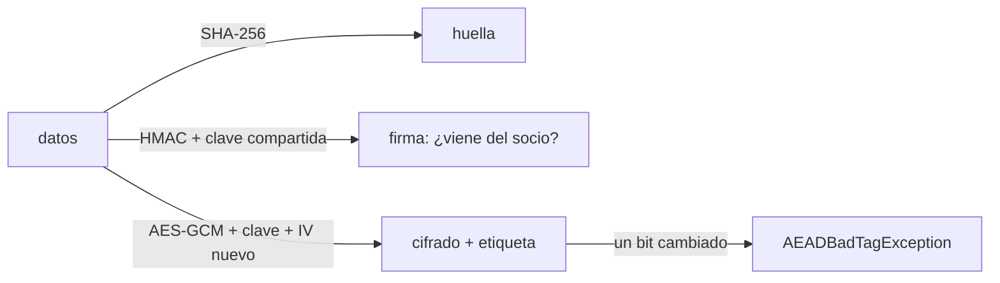

# Módulo 18: HTTP, seguridad y backend con Java

## Aprende construyendo

Java estándar incluye un cliente HTTP moderno, pero un cliente seguro no equivale a un servidor seguro. En este módulo construirás una llamada saliente robusta y reconocerás cómo transportar credenciales sin confundir JWT con autorización.


### Dos ejemplos: primero visible, luego real

<details open>
<summary><strong>Capa 1 — Lectura</strong></summary>

#### ► DE QUÉ TRATA
Este tema te guía por dos ejemplos: primero visible, luego real con foco en comprensión antes de implementación.

#### ► LA IDEA EN UNA FRASE
**Entender dos ejemplos: primero visible, luego real te permite tomar mejores decisiones técnicas.**

#### ► POR QUÉ EXISTE ESTO
Resuelve un problema real de diseño o implementación y evita decisiones a ciegas.

#### ► LA ANALOGÍA
Piensa en dos ejemplos: primero visible, luego real como una herramienta de taller: útil cuando conoces su propósito y sus límites.
**Dónde se rompe la analogía:** en software, los efectos dependen del contexto, la escala y los trade-offs.

#### ► CÓMO FUNCIONA
1. Identifica el problema que dos ejemplos: primero visible, luego real resuelve.
2. Observa sus componentes y relaciones.
3. Aplica la opción más simple que funcione.
4. Verifica el resultado y los límites.

#### ► LO QUE PUEDE SALIR MAL
| Síntoma | Causa probable | Arreglo |
|---|---|---|
| Dos ejemplos: primero visible, luego real se aplica pero el resultado no mejora | Se usó sin medir el problema real | Mide antes y compara contra la alternativa simple |
| Aparece complejidad inesperada | Se adoptó la técnica sin comprender sus trade-offs | Vuelve a la sección de trade-offs y reduce el alcance |
| Falla en un caso límite | Se asumió un contexto que no se cumple | Prueba el caso límite y documenta cuándo NO usarlo |

#### ► TRADE-OFFS
| Opción | Cuándo usarla | Cuándo NO usarla |
|---|---|---|
| Usar Dos ejemplos: primero visible, luego real | Cuando el problema coincide con su propósito y el beneficio es observable | Cuando agrega complejidad sin resolver un problema real |
| Alternativa más simple | Cuando el contexto es pequeño, estable o fácil de razonar | Cuando ya demostró no escalar o no cumplir el requisito |
| Postergar la decisión | Cuando falta evidencia del problema | Cuando el costo de esperar es mayor que el costo de probar |

#### ► CUÁNDO NO USAR ESTO
No uses dos ejemplos: primero visible, luego real por defecto. Aplícalo cuando el problema lo justifique y puedas verificar el beneficio; si una alternativa más simple resuelve igual, prefiérela.

#### ► DE VUELTA A LA ANALOGÍA
Volviendo a la analogía: dos ejemplos: primero visible, luego real funciona como el modelo inicial, pero recuerda dónde se rompe: en producción importan la evidencia, la escala y el costo de equivocarte.

#### ► LO QUE DEBES RECORDAR
- Dos ejemplos: primero visible, luego real existe para resolver un problema específico.
- Mide antes de adoptar complejidad.
- Conoce el caso donde NO usarlo.
- Verifica con evidencia observable.

#### ► PREGUNTAS PARA PENSAR
1. ¿Qué problema concreto resuelve dos ejemplos: primero visible, luego real en tu contexto?
2. ¿Cómo sabrías que dos ejemplos: primero visible, luego real no está funcionando bien?
3. ¿Qué alternativa más simple considerarías antes de usar dos ejemplos: primero visible, luego real?

</details>

<details>
<summary><strong>Capa 2 — Construcción</strong></summary>

#### Nota de construcción
Este tema es principalmente conceptual en esta versión. La verificación se realiza con las preguntas de comprensión y el criterio de cuándo NO usar dos ejemplos: primero visible, luego real.

</details>

### Tema 1: HttpClient, REST, timeouts y fallos · Intermedio · 45 min

<details open>
<summary><strong>Capa 1 — Lectura</strong></summary>

#### ► DE QUÉ TRATA
Al finalizar podrás enviar un GET HTTP con HttpClient, timeout acotado, validación del estado y parseo separado de la respuesta. Requiere JDK 25+ y una API de prueba local o simulada. Comprueba java -version y crea la carpeta mkdir -p java-http-t01/src. Conocimiento previo: Java…

#### ► LA IDEA EN UNA FRASE
**Al finalizar podrás enviar un GET HTTP con HttpClient, timeout acotado, validación del estado y parseo separado de la respuesta.**

#### ► POR QUÉ EXISTE ESTO
Resuelve un problema real de diseño o implementación y evita decisiones a ciegas.

#### ► LA ANALOGÍA
Piensa en httpclient, rest, timeouts y fallos como una herramienta de taller: útil cuando conoces su propósito y sus límites.
**Dónde se rompe la analogía:** en software, los efectos dependen del contexto, la escala y los trade-offs.

#### ► CÓMO FUNCIONA
1. Identifica el problema que httpclient, rest, timeouts y fallos resuelve.
2. Observa sus componentes y relaciones.
3. Aplica la opción más simple que funcione.
4. Verifica el resultado y los límites.

#### ► LO QUE PUEDE SALIR MAL
| Síntoma | Causa probable | Arreglo |
|---|---|---|
| HttpClient, REST, timeouts y fallos se aplica pero el resultado no mejora | Se usó sin medir el problema real | Mide antes y compara contra la alternativa simple |
| Aparece complejidad inesperada | Se adoptó la técnica sin comprender sus trade-offs | Vuelve a la sección de trade-offs y reduce el alcance |
| Falla en un caso límite | Se asumió un contexto que no se cumple | Prueba el caso límite y documenta cuándo NO usarlo |

#### ► TRADE-OFFS
| Opción | Cuándo usarla | Cuándo NO usarla |
|---|---|---|
| Usar HttpClient, REST, timeouts y fallos | Cuando el problema coincide con su propósito y el beneficio es observable | Cuando agrega complejidad sin resolver un problema real |
| Alternativa más simple | Cuando el contexto es pequeño, estable o fácil de razonar | Cuando ya demostró no escalar o no cumplir el requisito |
| Postergar la decisión | Cuando falta evidencia del problema | Cuando el costo de esperar es mayor que el costo de probar |

#### ► CUÁNDO NO USAR ESTO
No uses httpclient, rest, timeouts y fallos por defecto. Aplícalo cuando el problema lo justifique y puedas verificar el beneficio; si una alternativa más simple resuelve igual, prefiérela.

#### ► DE VUELTA A LA ANALOGÍA
Volviendo a la analogía: httpclient, rest, timeouts y fallos funciona como el modelo inicial, pero recuerda dónde se rompe: en producción importan la evidencia, la escala y el costo de equivocarte.

#### ► LO QUE DEBES RECORDAR
- HttpClient, REST, timeouts y fallos existe para resolver un problema específico.
- Mide antes de adoptar complejidad.
- Conoce el caso donde NO usarlo.
- Verifica con evidencia observable.

#### ► PREGUNTAS PARA PENSAR
1. ¿Qué problema concreto resuelve httpclient, rest, timeouts y fallos en tu contexto?
2. ¿Cómo sabrías que httpclient, rest, timeouts y fallos no está funcionando bien?
3. ¿Qué alternativa más simple considerarías antes de usar httpclient, rest, timeouts y fallos?

</details>

<details>
<summary><strong>Capa 2 — Construcción</strong></summary>

#### Código y verificación
```java
package academia.http;

import java.net.URI;
import java.net.http.*;
import java.time.Duration;

public final class ConsultaDireccion {
    private final HttpClient client = HttpClient.newBuilder()
        .connectTimeout(Duration.ofSeconds(2))
        .followRedirects(HttpClient.Redirect.NEVER)
        .build();

    public String consultar(URI uri) throws Exception {
        HttpRequest request = HttpRequest.newBuilder(uri)
            .timeout(Duration.ofSeconds(3))
            .header("Accept", "application/json")
            .GET()
            .build();
        HttpResponse<String> response =
            client.send(request, HttpResponse.BodyHandlers.ofString());
        if (response.statusCode() != 200) {
            throw new IllegalStateException("API respondió HTTP " + response.statusCode());
        }
        return response.body();
    }
}
```

```bash
# Maven
mvn -q archetype:generate -DgroupId=academia -DartifactId=app -DarchetypeArtifactId=maven-archetype-quickstart -DinteractiveMode=false
cd app && mvn test
# Gradle (equivalente): gradle init --type java-application --dsl kotlin && ./gradlew test
```

```java
import com.sun.net.httpserver.HttpServer;
import java.net.InetSocketAddress;
import java.net.URI;
import java.net.http.*;
import java.time.Duration;

public class Salud {
    public static void main(String[] args) throws Exception {
        var server = HttpServer.create(new InetSocketAddress("127.0.0.1", 0), 0);
        server.createContext("/health", exchange -> {
            byte[] body = "ok".getBytes();
            exchange.sendResponseHeaders(200, body.length);
            exchange.getResponseBody().write(body);
            exchange.close();
        });
        server.start();
        try {
            var uri = URI.create("http://127.0.0.1:" + server.getAddress().getPort() + "/health");
            var request = HttpRequest.newBuilder(uri).timeout(Duration.ofSeconds(2)).GET().build();
            var response = HttpClient.newHttpClient().send(request, HttpResponse.BodyHandlers.ofString());
            System.out.println("HTTP " + response.statusCode() + ": " + response.body());
        } finally { server.stop(0); }
    }
}
```

```java
import com.sun.net.httpserver.HttpServer;
import java.net.InetSocketAddress;
import java.net.URI;
import java.net.http.*;
import java.time.Duration;

public class NoExiste {
    public static void main(String[] args) throws Exception {
        var server = HttpServer.create(new InetSocketAddress("127.0.0.1", 0), 0);
        server.createContext("/envios/RT-404", e -> {
            byte[] body = "Guía no existe".getBytes();
            e.sendResponseHeaders(404, body.length);
            e.getResponseBody().write(body);
            e.close();
        });
        server.start();
        try {
            var uri = URI.create("http://127.0.0.1:" + server.getAddress().getPort() + "/envios/RT-404");
            var request = HttpRequest.newBuilder(uri).timeout(Duration.ofSeconds(2)).GET().build();
            var response = HttpClient.newHttpClient().send(request, HttpResponse.BodyHandlers.ofString());
            if (response.statusCode() != 200)
                throw new IllegalStateException("API respondió HTTP " + response.statusCode() + ": " + response.body());
        } finally { server.stop(0); }
    }
}
```

```java
import com.sun.net.httpserver.HttpServer;
import java.net.InetSocketAddress;
import java.net.URI;
import java.net.http.*;
import java.net.http.HttpTimeoutException;
import java.time.Duration;

public class Espera {
    public static void main(String[] args) throws Exception {
        var server = HttpServer.create(new InetSocketAddress("127.0.0.1", 0), 0);
        server.createContext("/lento", e -> {
            try { Thread.sleep(800); } catch (InterruptedException x) { Thread.currentThread().interrupt(); }
            try { e.sendResponseHeaders(200, -1); } catch (Exception ignored) { }
            e.close();
        });
        server.start();
        try {
            var uri = URI.create("http://127.0.0.1:" + server.getAddress().getPort() + "/lento");
            var request = HttpRequest.newBuilder(uri).timeout(Duration.ofMillis(100)).GET().build();
            try { HttpClient.newHttpClient().send(request, HttpResponse.BodyHandlers.ofString()); }
            catch (HttpTimeoutException e) { System.out.println("timeout: 100 ms"); }
        } finally { server.stop(0); }
    }
}
```

```java
import com.sun.net.httpserver.HttpServer;
import java.net.InetSocketAddress;
import java.net.URI;
import java.net.http.*;
import java.util.concurrent.atomic.AtomicInteger;

public class Reintento {
    public static void main(String[] args) throws Exception {
        var llamadas = new AtomicInteger();
        var server = HttpServer.create(new InetSocketAddress("127.0.0.1", 0), 0);
        server.createContext("/cotizacion", e -> {
            int status = llamadas.incrementAndGet() == 1 ? 503 : 200;
            byte[] body = (status == 200 ? "ok" : "temporal").getBytes();
            e.sendResponseHeaders(status, body.length);
            e.getResponseBody().write(body);
            e.close();
        });
        server.start();
        try {
            var uri = URI.create("http://127.0.0.1:" + server.getAddress().getPort() + "/cotizacion");
            for (int intento = 1; intento <= 2; intento++) {
                var request = HttpRequest.newBuilder(uri).GET().build();
                var response = HttpClient.newHttpClient().send(request, HttpResponse.BodyHandlers.ofString());
                System.out.println("intento=" + intento + " HTTP " + response.statusCode());
                if (response.statusCode() != 503) break;
                Thread.sleep(50);
            }
            System.out.println("llamadas=" + llamadas.get());
        } finally { server.stop(0); }
    }
}
```

</details>

### Tema 2: Tokens, validación y límites de seguridad · Avanzado · 45 min

<details open>
<summary><strong>Capa 1 — Lectura</strong></summary>

#### ► DE QUÉ TRATA
Al finalizar podrás explicar y probar el transporte seguro de una credencial bearer, validar datos no confiables y distinguir autenticación de autorización. El ejercicio usa una API local de laboratorio; no implementes criptografía propia. Crea la carpeta mkdir -p java-http-t02/s…

#### ► LA IDEA EN UNA FRASE
**Al finalizar podrás explicar y probar el transporte seguro de una credencial bearer, validar datos no confiables y distinguir autenticación de autorización.**

#### ► POR QUÉ EXISTE ESTO
Resuelve un problema real de diseño o implementación y evita decisiones a ciegas.

#### ► LA ANALOGÍA
Piensa en tokens, validación y límites de seguridad como una herramienta de taller: útil cuando conoces su propósito y sus límites.
**Dónde se rompe la analogía:** en software, los efectos dependen del contexto, la escala y los trade-offs.

#### ► CÓMO FUNCIONA
1. Identifica el problema que tokens, validación y límites de seguridad resuelve.
2. Observa sus componentes y relaciones.
3. Aplica la opción más simple que funcione.
4. Verifica el resultado y los límites.

#### ► LO QUE PUEDE SALIR MAL
| Síntoma | Causa probable | Arreglo |
|---|---|---|
| Tokens, validación y límites de seguridad se aplica pero el resultado no mejora | Se usó sin medir el problema real | Mide antes y compara contra la alternativa simple |
| Aparece complejidad inesperada | Se adoptó la técnica sin comprender sus trade-offs | Vuelve a la sección de trade-offs y reduce el alcance |
| Falla en un caso límite | Se asumió un contexto que no se cumple | Prueba el caso límite y documenta cuándo NO usarlo |

#### ► TRADE-OFFS
| Opción | Cuándo usarla | Cuándo NO usarla |
|---|---|---|
| Usar Tokens, validación y límites de seguridad | Cuando el problema coincide con su propósito y el beneficio es observable | Cuando agrega complejidad sin resolver un problema real |
| Alternativa más simple | Cuando el contexto es pequeño, estable o fácil de razonar | Cuando ya demostró no escalar o no cumplir el requisito |
| Postergar la decisión | Cuando falta evidencia del problema | Cuando el costo de esperar es mayor que el costo de probar |

#### ► CUÁNDO NO USAR ESTO
No uses tokens, validación y límites de seguridad por defecto. Aplícalo cuando el problema lo justifique y puedas verificar el beneficio; si una alternativa más simple resuelve igual, prefiérela.

#### ► DE VUELTA A LA ANALOGÍA
Volviendo a la analogía: tokens, validación y límites de seguridad funciona como el modelo inicial, pero recuerda dónde se rompe: en producción importan la evidencia, la escala y el costo de equivocarte.

#### ► LO QUE DEBES RECORDAR
- Tokens, validación y límites de seguridad existe para resolver un problema específico.
- Mide antes de adoptar complejidad.
- Conoce el caso donde NO usarlo.
- Verifica con evidencia observable.

#### ► PREGUNTAS PARA PENSAR
1. ¿Qué problema concreto resuelve tokens, validación y límites de seguridad en tu contexto?
2. ¿Cómo sabrías que tokens, validación y límites de seguridad no está funcionando bien?
3. ¿Qué alternativa más simple considerarías antes de usar tokens, validación y límites de seguridad?

</details>

<details>
<summary><strong>Capa 2 — Construcción</strong></summary>

#### Código y verificación
```java
String token = System.getenv("ACADEMIA_API_TOKEN");
if (token == null || token.isBlank()) {
    throw new IllegalStateException("Falta ACADEMIA_API_TOKEN");
}

HttpRequest request = HttpRequest.newBuilder(uri)
    .timeout(Duration.ofSeconds(3))
    .header("Authorization", "Bearer " + token)
    .GET()
    .build();
```

```bash
# Maven
mvn -q archetype:generate -DgroupId=academia -DartifactId=app -DarchetypeArtifactId=maven-archetype-quickstart -DinteractiveMode=false
cd app && mvn test
# Gradle (equivalente): gradle init --type java-application --dsl kotlin && ./gradlew test
```

```java
import com.sun.net.httpserver.HttpServer;
import java.net.InetSocketAddress;
import java.net.URI;
import java.net.http.*;

public class BearerLocal {
    public static void main(String[] args) throws Exception {
        String token = System.getenv("ACADEMIA_API_TOKEN");
        if (token == null || token.isBlank()) throw new IllegalStateException("Falta ACADEMIA_API_TOKEN");
        var server = HttpServer.create(new InetSocketAddress("127.0.0.1", 0), 0);
        server.createContext("/privado", e -> {
            boolean presente = ("Bearer " + token).equals(e.getRequestHeaders().getFirst("Authorization"));
            byte[] body = (presente ? "credencial presente" : "credencial ausente").getBytes();
            e.sendResponseHeaders(presente ? 200 : 401, body.length);
            e.getResponseBody().write(body);
            e.close();
        });
        server.start();
        try {
            var uri = URI.create("http://127.0.0.1:" + server.getAddress().getPort() + "/privado");
            var request = HttpRequest.newBuilder(uri).header("Authorization", "Bearer " + token).GET().build();
            var response = HttpClient.newHttpClient().send(request, HttpResponse.BodyHandlers.ofString());
            System.out.println("HTTP " + response.statusCode() + ": " + response.body());
        } finally { server.stop(0); }
    }
}
```

```java
import java.net.URI;
import java.util.Set;

public class DestinoSeguro {
    static URI validar(String valor) {
        URI uri = URI.create(valor);
        if (!"https".equalsIgnoreCase(uri.getScheme())) throw new IllegalArgumentException("Se requiere HTTPS");
        if (!Set.of("api.rutaflow.example").contains(uri.getHost()))
            throw new IllegalArgumentException("Host fuera de allowlist");
        if (uri.getUserInfo() != null) throw new IllegalArgumentException("No se permite userinfo");
        return uri;
    }
    public static void main(String[] args) {
        try { validar("http://127.0.0.1/admin"); }
        catch (IllegalArgumentException e) { System.out.println("rechazada: " + e.getMessage()); }
    }
}
```

```java
public class Propiedad {
    record Envio(String guia, String propietario) {}
    static boolean puedeLeer(String usuario, Envio envio) {
        return usuario.equals(envio.propietario());
    }
    public static void main(String[] args) {
        var envio = new Envio("RT-8", "ana");
        System.out.println("ana=" + puedeLeer("ana", envio));
        System.out.println("leo=" + puedeLeer("leo", envio));
    }
}
```

```java
public class ValidarGuia {
    static String validar(String guia) {
        if (guia == null || !guia.matches("RT-[0-9]{1,6}"))
            throw new IllegalArgumentException("Guía inválida");
        return guia;
    }
    public static void main(String[] args) {
        System.out.println(validar("RT-82"));
        try { System.out.println(validar("RT-82 OR 1=1")); }
        catch (IllegalArgumentException e) { System.out.println(e.getMessage()); }
    }
}
```

</details>

### Tema 3: Criptografía con la JCA: SHA-256, HMAC y AES-GCM sin inventar algoritmos · Avanzado · 45 min

<details open>
<summary><strong>Capa 1 — Lectura</strong></summary>

#### ► DE QUÉ TRATA
Usa JDK 17 o superior; todo viene en el JDK. Crea la carpeta academia-labs/java/cripto.

#### ► LA IDEA EN UNA FRASE
**Usa JDK 17 o superior; todo viene en el JDK.**

#### ► POR QUÉ EXISTE ESTO
Resuelve un problema real de diseño o implementación y evita decisiones a ciegas.

#### ► LA ANALOGÍA
Piensa en criptografía con la jca: sha-256, hmac y aes-gcm sin inventar algoritmos como una herramienta de taller: útil cuando conoces su propósito y sus límites.
**Dónde se rompe la analogía:** en software, los efectos dependen del contexto, la escala y los trade-offs.

#### ► CÓMO FUNCIONA


#### ► LO QUE PUEDE SALIR MAL
| Síntoma | Causa probable | Arreglo |
|---|---|---|
| Criptografía con la JCA: SHA-256, HMAC y AES-GCM sin inventar algoritmos se aplica pero el resultado no mejora | Se usó sin medir el problema real | Mide antes y compara contra la alternativa simple |
| Aparece complejidad inesperada | Se adoptó la técnica sin comprender sus trade-offs | Vuelve a la sección de trade-offs y reduce el alcance |
| Falla en un caso límite | Se asumió un contexto que no se cumple | Prueba el caso límite y documenta cuándo NO usarlo |

#### ► TRADE-OFFS
| Opción | Cuándo usarla | Cuándo NO usarla |
|---|---|---|
| Usar Criptografía con la JCA: SHA-256, HMAC y AES-GCM sin inventar algoritmos | Cuando el problema coincide con su propósito y el beneficio es observable | Cuando agrega complejidad sin resolver un problema real |
| Alternativa más simple | Cuando el contexto es pequeño, estable o fácil de razonar | Cuando ya demostró no escalar o no cumplir el requisito |
| Postergar la decisión | Cuando falta evidencia del problema | Cuando el costo de esperar es mayor que el costo de probar |

#### ► CUÁNDO NO USAR ESTO
No uses criptografía con la jca: sha-256, hmac y aes-gcm sin inventar algoritmos por defecto. Aplícalo cuando el problema lo justifique y puedas verificar el beneficio; si una alternativa más simple resuelve igual, prefiérela.

#### ► DE VUELTA A LA ANALOGÍA
Volviendo a la analogía: criptografía con la jca: sha-256, hmac y aes-gcm sin inventar algoritmos funciona como el modelo inicial, pero recuerda dónde se rompe: en producción importan la evidencia, la escala y el costo de equivocarte.

#### ► LO QUE DEBES RECORDAR
- Criptografía con la JCA: SHA-256, HMAC y AES-GCM sin inventar algoritmos existe para resolver un problema específico.
- Mide antes de adoptar complejidad.
- Conoce el caso donde NO usarlo.
- Verifica con evidencia observable.

#### ► PREGUNTAS PARA PENSAR
1. ¿Qué problema concreto resuelve criptografía con la jca: sha-256, hmac y aes-gcm sin inventar algoritmos en tu contexto?
2. ¿Cómo sabrías que criptografía con la jca: sha-256, hmac y aes-gcm sin inventar algoritmos no está funcionando bien?
3. ¿Qué alternativa más simple considerarías antes de usar criptografía con la jca: sha-256, hmac y aes-gcm sin inventar algoritmos?

</details>

<details>
<summary><strong>Capa 2 — Construcción</strong></summary>

#### Código y verificación


```java
import java.nio.charset.StandardCharsets;
import java.security.MessageDigest;
import java.security.SecureRandom;
import java.util.HexFormat;
import javax.crypto.AEADBadTagException;
import javax.crypto.Cipher;
import javax.crypto.KeyGenerator;
import javax.crypto.Mac;
import javax.crypto.SecretKey;
import javax.crypto.spec.GCMParameterSpec;
import javax.crypto.spec.SecretKeySpec;

public class Cripto {
    public static void main(String[] args) throws Exception {
        byte[] datos = "ENV-42;Calle 26;5000".getBytes(StandardCharsets.UTF_8);
        HexFormat hex = HexFormat.of();

        // 1) Hash SHA-256: huella del contenido. Mismo dato, misma huella.
        byte[] huella = MessageDigest.getInstance("SHA-256").digest(datos);
        System.out.println("SHA-256: " + hex.formatHex(huella).substring(0, 16) + "…");

        // 2) HMAC: huella con clave. Prueba que el mensaje viene de quien tiene la clave.
        Mac mac = Mac.getInstance("HmacSHA256");
        mac.init(new SecretKeySpec("clave-compartida-de-prueba".getBytes(StandardCharsets.UTF_8), "HmacSHA256"));
        byte[] firma = mac.doFinal(datos);
        System.out.println("HMAC válido: " + MessageDigest.isEqual(firma, mac.doFinal(datos)));

        // 3) AES-GCM: cifra y además detecta alteraciones.
        KeyGenerator generador = KeyGenerator.getInstance("AES");
        generador.init(256);
        SecretKey clave = generador.generateKey();
        byte[] iv = new byte[12];
        new SecureRandom().nextBytes(iv); // nunca repitas un IV con la misma clave

        Cipher cifrador = Cipher.getInstance("AES/GCM/NoPadding");
        cifrador.init(Cipher.ENCRYPT_MODE, clave, new GCMParameterSpec(128, iv));
        byte[] cifrado = cifrador.doFinal(datos);
        System.out.println("Cifrado: " + cifrado.length + " bytes (" + datos.length + " de datos + 16 de etiqueta)");

        Cipher descifrador = Cipher.getInstance("AES/GCM/NoPadding");
        descifrador.init(Cipher.DECRYPT_MODE, clave, new GCMParameterSpec(128, iv));
        System.out.println("Descifrado: " + new String(descifrador.doFinal(cifrado), StandardCharsets.UTF_8));

        cifrado[0] ^= 1; // un atacante cambia un bit
        try {
            descifrador.init(Cipher.DECRYPT_MODE, clave, new GCMParameterSpec(128, iv));
            descifrador.doFinal(cifrado);
        } catch (AEADBadTagException e) {
            System.out.println("Alteración detectada: " + e.getClass().getSimpleName());
        }
    }
}
```

```bash
cd academia-labs/java/cripto
java Cripto.java
```

```text
SHA-256: 4ae9d9fa731b5bbc…
HMAC válido: true
Cifrado: 36 bytes (20 de datos + 16 de etiqueta)
Descifrado: ENV-42;Calle 26;5000
Alteración detectada: AEADBadTagException
```

</details>
