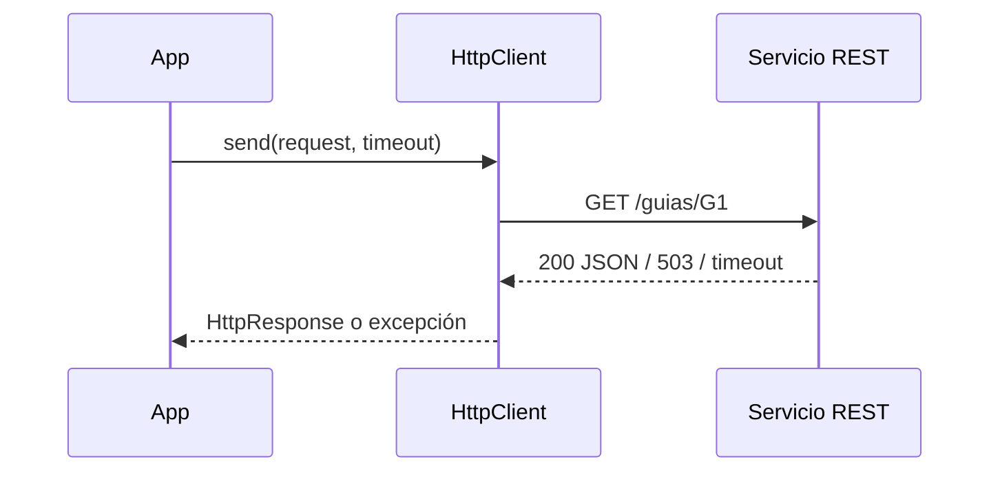
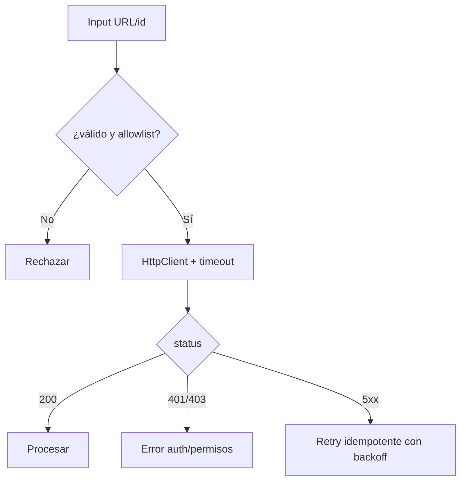

# Módulo 18: HTTP, REST y seguridad

Las aplicaciones modernas se integran por HTTP. Consumir una API parece simple hasta que aparecen timeouts, retries incorrectos, 401/403, SSRF, secretos filtrados o criptografía mal usada. Este módulo cubre `HttpClient`, contratos REST, validación/seguridad básica y criptografía con JCA.

**Contexto Tienda Aurora.** Este módulo aporta bases para Tienda Aurora: los conceptos aquí se aplican en el monolito modular y luego en los microservicios.

**Entorno de referencia verificado (2026-05-22):** JDK 27.0.1.0.2 (incluye `java.net.http.HttpClient`).

## Aprende construyendo

### Tema 1: HttpClient, REST, timeouts y fallos · Intermedio · 45 min

**Caso guía.** consultar el estado de una guía en un servicio REST. Si la red tarda, el hilo no puede quedar colgado indefinidamente.

HttpClient, request/response, timeouts

**Definición.** `HttpClient` (Java 11+) es el cliente HTTP estándar. `HttpRequest` define URI, método, headers y body; `HttpResponse` expone status, headers y body.

**Contrato/reglas.** Configura timeout de conexión y de request. Maneja códigos 2xx/4xx/5xx explícitamente. Reintenta solo operaciones idempotentes y con backoff.



**Ejemplo mínimo enfocado (ejecutable, servidor local).**

```bash
mkdir -p java-m18-http
cd java-m18-http
```

Crea el archivo `DemoHttp.java`:

```java
import com.sun.net.httpserver.*;
import java.net.*;
import java.net.http.*;
import java.io.*;
import java.time.Duration;

public class DemoHttp {
  public static void main(String[] args) throws Exception {
    HttpServer server = HttpServer.create(new InetSocketAddress(0), 0);
    server.createContext("/guias/G1", ex -> {
      byte[] body = "{\"id\":\"G1\",\"estado\":\"EN_RUTA\"}".getBytes();
      ex.sendResponseHeaders(200, body.length);
      try (OutputStream os = ex.getResponseBody()) { os.write(body); }
    });
    server.start();
    int port = server.getAddress().getPort();
    HttpClient client = HttpClient.newBuilder().connectTimeout(Duration.ofSeconds(2)).build();
    HttpRequest req = HttpRequest.newBuilder(URI.create("http://localhost:" + port + "/guias/G1"))
      .timeout(Duration.ofSeconds(2)).GET().build();
    HttpResponse<String> res = client.send(req, HttpResponse.BodyHandlers.ofString());
    System.out.println(res.statusCode());
    System.out.println(res.body().contains("EN_RUTA"));
    server.stop(0);
  }
}
```

```bash
javac DemoHttp.java
java DemoHttp
```

**Error común.** Sin timeout. Síntoma: hilos colgados bajo falla de red. Corrección: `connectTimeout` + `request.timeout()`.

**Verificación (JDK 27, 2026-05-22).** `200`, `true`.

### Tema 2: Tokens, validación y límites de seguridad · Avanzado · 45 min

**Caso guía.** la API requiere Bearer token; además debes validar entradas y evitar SSRF.

Seguridad básica en clientes HTTP

**Definición.** El cliente debe enviar credenciales/tokens solo a destinos confiables, validar entradas, manejar 401/403 y no filtrar secretos en logs.

**Reglas.** Nunca interpolar URLs sin validar; allowlist de hosts; no seguir redirects a dominios no confiables; no loguear `Authorization`.



**Ejemplo mínimo enfocado (validación).**

```bash
mkdir -p java-m18-sec
cd java-m18-sec
```

Crea el archivo `DemoAllowlist.java`:

```java
import java.net.URI;
import java.util.Set;

public class DemoAllowlist {
  static boolean permitido(String raw) {
    URI u = URI.create(raw);
    return "https".equals(u.getScheme()) && Set.of("api.example.com").contains(u.getHost());
  }
  public static void main(String[] args) {
    System.out.println(permitido("https://api.example.com/guias/1"));
    System.out.println(permitido("http://127.0.0.1/admin"));
  }
}
```

```bash
javac DemoAllowlist.java
java DemoAllowlist
```

**Error común.** Aceptar cualquier URL provista por usuario. Riesgo: SSRF. Corrección: allowlist, esquema HTTPS, resolución/puertos controlados.

**Verificación (JDK 27, 2026-05-22).** `true`, `false`.

### Tema 3: Criptografía con la JCA: SHA-256, HMAC y AES-GCM · Avanzado · 45 min

**Caso guía.** hashear contenido, firmar mensaje con clave compartida y cifrar dato sensible.

JCA/JCE, hash, HMAC, AES-GCM

**Definición.** JCA/JCE es la API criptográfica de Java. SHA-256 es hash; HMAC provee integridad/autenticidad con clave; AES-GCM cifra y autentica (AEAD).

**Reglas.** No inventes criptografía. Usa algoritmos estándar, IV aleatorio único por cifrado en GCM, claves gestionadas con cuidado, y no uses hashes simples para passwords (usa BCrypt/Argon2/PBKDF2).

**Ejemplo mínimo enfocado (ejecutable).**

```bash
mkdir -p java-m18-crypto
cd java-m18-crypto
```

Crea el archivo `DemoCrypto.java`:

```java
import javax.crypto.*; import javax.crypto.spec.*;
import java.security.*; import java.util.*;

public class DemoCrypto {
  static String hex(byte[] b){ StringBuilder s=new StringBuilder(); for(byte x:b) s.append(String.format("%02x",x)); return s.toString(); }
  public static void main(String[] args) throws Exception {
    MessageDigest md = MessageDigest.getInstance("SHA-256");
    System.out.println(hex(md.digest("hola".getBytes())).length());
    Mac mac = Mac.getInstance("HmacSHA256");
    mac.init(new SecretKeySpec("k".getBytes(), "HmacSHA256"));
    System.out.println(hex(mac.doFinal("msg".getBytes())).length());
    KeyGenerator kg = KeyGenerator.getInstance("AES"); kg.init(128);
    SecretKey key = kg.generateKey();
    byte[] iv = new byte[12]; new SecureRandom().nextBytes(iv);
    Cipher c = Cipher.getInstance("AES/GCM/NoPadding");
    c.init(Cipher.ENCRYPT_MODE, key, new GCMParameterSpec(128, iv));
    byte[] ct = c.doFinal("secreto".getBytes());
    Cipher d = Cipher.getInstance("AES/GCM/NoPadding");
    d.init(Cipher.DECRYPT_MODE, key, new GCMParameterSpec(128, iv));
    System.out.println(new String(d.doFinal(ct)));
  }
}
```

```bash
javac DemoCrypto.java
java DemoCrypto
```

**Error común.** Reusar IV en AES-GCM o usar ECB. Corrección: IV aleatorio único por mensaje; usar GCM/AEAD.

**Verificación (JDK 27, 2026-05-22).** `64`, `64`, `secreto`.

## Cierre

HTTP y seguridad son fronteras de confianza. Timeouts, validación, allowlists, manejo de códigos y criptografía estándar son mínimos, no extras.

## Checklist

- Configuro timeouts y manejo de status.
- Valido URLs/entradas y evito SSRF/secrets en logs.
- Uso JCA estándar; no invento crypto.
