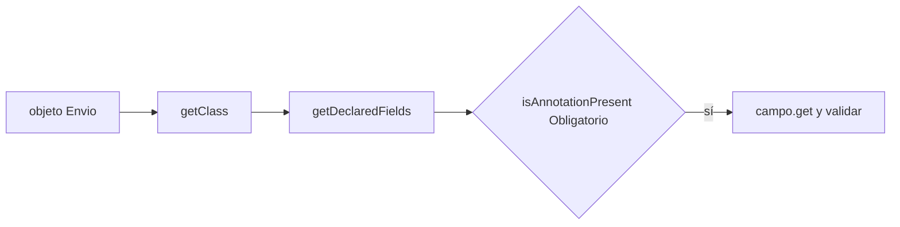
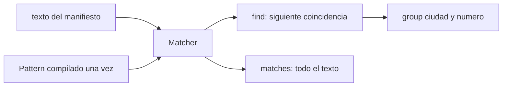
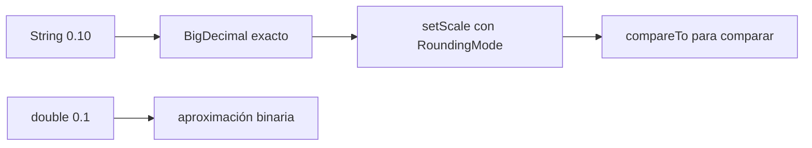
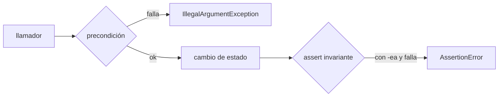
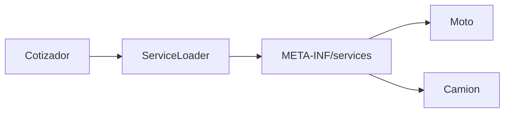
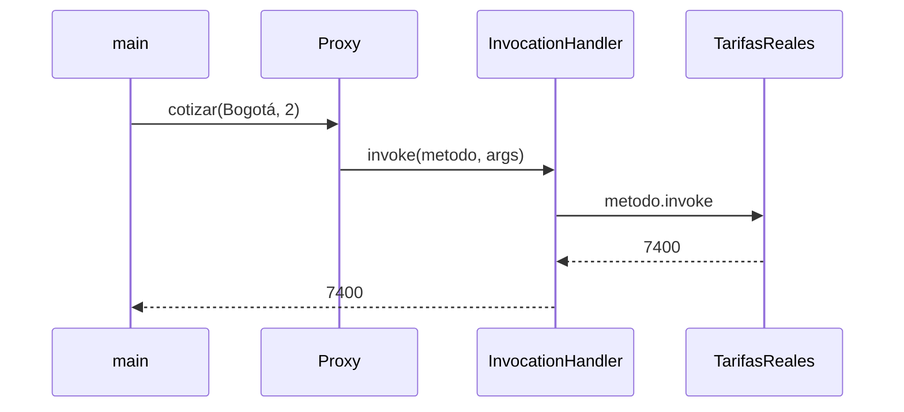
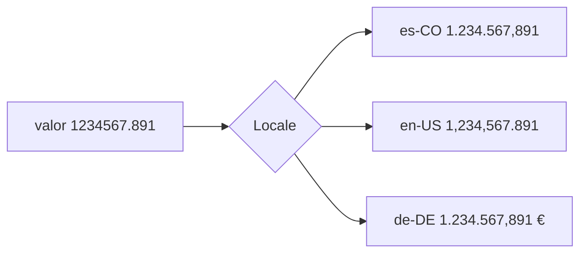

# Módulo 19: Java del día a día — reflexión, regex, dinero, contratos, plugins e i18n


## Aprende construyendo

### Tema 1: Reflexión y anotaciones en tiempo de ejecución

#### Paso 1 · Objetivo y preparación
Al finalizar podrás inspeccionar clases, campos y métodos con la API de reflexión, leer anotaciones propias en tiempo de ejecución y explicar cómo la usan Spring, Jackson y JUnit. Prerrequisitos: Módulo 4 (orientación a objetos) y Módulo 10 (módulos y `opens`).

#### Paso 2 · Contexto y caso real
Spring encuentra tus `@RestController`, Jackson convierte objetos a JSON y JUnit ejecuta los métodos `@Test` sin que escribas una línea que los llame. Todo eso es reflexión. En RutaFlow la usaremos para un caso real: un validador genérico de campos obligatorios que sirve para cualquier clase.

#### Paso 3 · Teoría, modelo mental y analogía
Cada clase cargada tiene un objeto `Class<?>` que describe sus **campos** (`Field`), **métodos** (`Method`) y **constructores**. Con ellos puedes leer o escribir valores y llamar métodos por nombre. Una **anotación** es metadato; solo existe en tiempo de ejecución si tiene `@Retention(RetentionPolicy.RUNTIME)`. `setAccessible(true)` salta la encapsulación de `private`, y con módulos (JPMS) solo funciona si el paquete está abierto (`opens`).

**Analogía:** la reflexión es la radiografía de un objeto: ves sus huesos sin abrirlo, pero mirar radiografías todo el tiempo es más lento y riesgoso que hablar con el paciente.

**Diagrama:**



#### Paso 4 · Demostración guiada desde cero
**Ejemplo independiente (desde cero):** este tema se reproduce en una **carpeta vacía**, como **proyecto nuevo**, sin estado de otros temas.

```bash
mkdir java-dia-a-dia && cd java-dia-a-dia
```

Crea `Reflexion.java`:

```java
import java.lang.annotation.*;
import java.lang.reflect.*;
import java.util.*;

public class Reflexion {
    @Retention(RetentionPolicy.RUNTIME)          // sin RUNTIME la anotación no existe al ejecutar
    @Target(ElementType.FIELD)
    @interface Obligatorio {}

    static class Envio {
        @Obligatorio private String guia;
        @Obligatorio private String destino;
        private String nota;
        Envio(String guia, String destino, String nota) {
            this.guia = guia; this.destino = destino; this.nota = nota;
        }
    }

    // Un validador genérico: no conoce la clase Envio, la inspecciona en tiempo de ejecución
    static List<String> validar(Object objeto) throws IllegalAccessException {
        List<String> errores = new ArrayList<>();
        Class<?> clase = objeto.getClass();
        for (Field campo : clase.getDeclaredFields()) {
            if (campo.isAnnotationPresent(Obligatorio.class)) {
                campo.setAccessible(true);           // permite leer un campo privado
                Object valor = campo.get(objeto);
                if (valor == null || valor.toString().isBlank()) {
                    errores.add(clase.getSimpleName() + "." + campo.getName() + " es obligatorio");
                }
            }
        }
        return errores;
    }

    public static void main(String[] args) throws Exception {
        Class<?> clase = Envio.class;
        System.out.println("Campos de " + clase.getSimpleName() + ":");
        for (Field campo : clase.getDeclaredFields()) {
            System.out.printf("  %-8s %-7s obligatorio=%s%n", campo.getName(),
                campo.getType().getSimpleName(), campo.isAnnotationPresent(Obligatorio.class));
        }
        System.out.println(validar(new Envio("G-1", "Cali", null)));
        System.out.println(validar(new Envio("", null, "frágil")));

        Method metodo = String.class.getMethod("toUpperCase");   // invocar por nombre
        System.out.println(metodo.invoke("entregado"));
    }
}
```

**Ejecuta el ejemplo:**

```bash
java Reflexion.java
```

**Resultado esperado:**

```text
Campos de Envio:
  guia     String  obligatorio=true
  destino  String  obligatorio=true
  nota     String  obligatorio=false
[]
[Envio.guia es obligatorio, Envio.destino es obligatorio]
ENTREGADO
```

El validador no menciona `Envio` en ningún lugar: lo descubrió todo con `getDeclaredFields()`. La última línea invoca `toUpperCase` buscándolo por su nombre.

**Fallo deliberado:** Borra la línea `@Retention(RetentionPolicy.RUNTIME)`. El programa compila y corre, pero ahora los tres campos dicen `obligatorio=false` y el envío vacío pasa la validación (`[]`). La retención por defecto es `CLASS`: la anotación queda en el bytecode pero no es visible para la reflexión. Es una falla silenciosa típica al crear anotaciones propias.

#### Paso 5 · Práctica guiada
Crea la anotación `@Rango(min, max)` para enteros y valida que `kilos` esté entre 1 y 30. **Pista:** declara `int min(); int max();` dentro de la anotación y léelos con `campo.getAnnotation(Rango.class).min()`.

#### Paso 6 · Práctica independiente
Mide con `System.nanoTime()` cuánto tarda leer un campo 1 000 000 de veces por reflexión frente a un getter normal, y explica la diferencia.

#### Paso 7 · Cierre
**¿Por qué es importante?** porque entender la reflexión quita la magia a los frameworks y te ayuda a diagnosticar errores como `InaccessibleObjectException` o anotaciones que "no hacen nada".
**Fuente oficial:** [Reflection API (dev.java)](https://dev.java/learn/reflection/), [java.lang.reflect (docs.oracle.com)](https://docs.oracle.com/en/java/javase/21/docs/api/java.base/java/lang/reflect/package-summary.html).
**Conceptos clave:** `Class`, `Field`, `Method`, anotación, `RetentionPolicy.RUNTIME`, `setAccessible`, `opens` en JPMS.
**Cuándo no usarlo:** en código de negocio normal: pierdes la verificación del compilador, el rendimiento y la claridad. Resérvala para frameworks, herramientas y validadores genéricos.

**Transferencia al proyecto integrador «Motor de asignación de entregas»:** valida con anotaciones los campos obligatorios de las solicitudes de asignación antes de procesarlas.
Como **siguiente** paso, aplica lo aprendido en el proyecto integrador del track y compara el resultado con lo que esperabas.
**Errores comunes:** crear una anotación propia sin `@Retention(RetentionPolicy.RUNTIME)` y no entender por qué `isAnnotationPresent` siempre devuelve `false` en tiempo de ejecución (la retención por defecto es `CLASS`), y llamar `setAccessible(true)` sobre un campo de un paquete no abierto (`opens`) esperando que siempre funcione.

### Tema 2: Expresiones regulares con Pattern y Matcher

#### Paso 1 · Objetivo y preparación
Al finalizar podrás escribir expresiones regulares con clases de caracteres, cuantificadores, límites de palabra y grupos con nombre, y usarlas para buscar, validar y reemplazar. Prerrequisito: Módulo 2 (strings).

#### Paso 2 · Contexto y caso real
El manifiesto diario de RutaFlow es texto libre con guías mezcladas (`BO-004512`). Hay que extraerlas, contarlas por ciudad, validar correos y enmascarar números antes de enviar el texto a un log. Es un caso real de cualquier backend: parsear y sanear texto.

#### Paso 3 · Teoría, modelo mental y analogía
Un `Pattern` es la expresión compilada (compílala una vez y reutilízala; es inmutable y segura entre hilos). Un `Matcher` la aplica a un texto: `find()` busca la siguiente coincidencia, `matches()` exige que **todo** el texto coincida. `\b` marca un límite de palabra, `\d{6}` exige seis dígitos y `(?<nombre>...)` crea un grupo con nombre. En un literal de Java cada `\` del regex se escribe doble: `\d` se escribe `"\\d"`.

**Analogía:** el patrón es un molde de galletas y el texto es la masa: `find` busca dónde cabe el molde y `matches` pregunta si toda la masa tiene esa forma.

**Diagrama:**



#### Paso 4 · Demostración guiada desde cero
**Ejemplo independiente (desde cero):** este tema se reproduce en una **carpeta vacía**, como **proyecto nuevo**, sin estado de otros temas.

```bash
mkdir java-dia-a-dia && cd java-dia-a-dia
```

Crea `Regex.java`:

```java
import java.util.regex.*;
import java.util.*;

public class Regex {
    // Guía RutaFlow: dos letras, guion, 6 dígitos. Grupos con nombre para extraer partes.
    private static final Pattern GUIA = Pattern.compile("\\b(?<ciudad>[A-Z]{2})-(?<numero>\\d{6})\\b");
    private static final Pattern CORREO = Pattern.compile("^[\\w.+-]+@[\\w-]+(\\.[\\w-]+)+$");

    public static void main(String[] args) {
        String manifiesto = "Despacho 28/10: BO-004512 a Chapinero, CA-998001 a Cali, bo-1 inválida, ME-12345 corta.";
        Matcher m = GUIA.matcher(manifiesto);
        Map<String, Integer> porCiudad = new TreeMap<>();
        while (m.find()) {
            System.out.printf("guía %s -> ciudad=%s número=%s (posición %d)%n",
                m.group(), m.group("ciudad"), m.group("numero"), m.start());
            porCiudad.merge(m.group("ciudad"), 1, Integer::sum);
        }
        System.out.println("Por ciudad: " + porCiudad);

        for (String correo : List.of("ana@rutaflow.co", "beto@@rutaflow", "caro.ruiz+pedidos@mail.com")) {
            System.out.printf("%-28s válido=%s%n", correo, CORREO.matcher(correo).matches());
        }
        // replaceAll con referencia a grupos: enmascarar el número de guía
        System.out.println(GUIA.matcher(manifiesto).replaceAll("${ciudad}-******"));
    }
}
```

**Ejecuta el ejemplo:**

```bash
java Regex.java
```

**Resultado esperado:**

```text
guía BO-004512 -> ciudad=BO número=004512 (posición 16)
guía CA-998001 -> ciudad=CA número=998001 (posición 39)
Por ciudad: {BO=1, CA=1}
ana@rutaflow.co              válido=true
beto@@rutaflow               válido=false
caro.ruiz+pedidos@mail.com   válido=true
Despacho 28/10: BO-****** a Chapinero, CA-****** a Cali, bo-1 inválida, ME-12345 corta.
```

`bo-1` y `ME-12345` no coinciden: la primera está en minúsculas y la segunda tiene solo cinco dígitos.

**Fallo deliberado:** En el patrón `GUIA` cambia `\\d{6}` por `\d{6}` (una sola barra). El programa no compila: `error: illegal escape character`. Java interpreta `\d` como un escape de string, no de regex. Diagnostica qué barras son de Java y cuáles del regex.

#### Paso 5 · Práctica guiada
Agrega un patrón para teléfonos colombianos de 10 dígitos que empiecen por 3 y extrae los teléfonos del manifiesto. **Pista:** algo como `\\b3\\d{9}\\b`; prueba también un número de 11 dígitos para confirmar que no coincide.

#### Paso 6 · Práctica independiente
Escribe una prueba con el texto `"a".repeat(30) + "!"` y el patrón `(a+)+$`, mide el tiempo y explica qué es el *backtracking catastrófico* (ReDoS).

#### Paso 7 · Cierre
**¿Por qué es importante?** porque las regex aparecen en validaciones, logs, rutas y búsquedas, y un patrón mal escrito es una vulnerabilidad de denegación de servicio.
**Fuente oficial:** [Regular Expressions (dev.java)](https://dev.java/learn/regex/), [java.util.regex.Pattern (docs.oracle.com)](https://docs.oracle.com/en/java/javase/21/docs/api/java.base/java/util/regex/Pattern.html).
**Conceptos clave:** `Pattern`, `Matcher`, `find` frente a `matches`, cuantificador, límite de palabra, grupo con nombre, ReDoS.
**Cuándo no usarlo:** para formatos estructurados (JSON, XML, URL, fechas) usa un parser o la API específica (`URI`, `LocalDate.parse`). Una regex enorme es difícil de mantener.

**Transferencia al proyecto integrador «Motor de asignación de entregas»:** extrae y valida los códigos de guía de las solicitudes de asignación antes de procesarlas.
Como **siguiente** paso, aplica lo aprendido en el proyecto integrador del track y compara el resultado con lo que esperabas.
**Errores comunes:** escribir `\d{6}` con una sola barra en un literal de Java en vez de `\\d{6}` (Java lo interpreta como escape de string y falla con `illegal escape character`), y confundir `find()` con `matches()`, validando solo un fragmento del texto cuando se necesitaba que coincidiera entero, o al revés.

### Tema 3: Dinero exacto con BigDecimal

#### Paso 1 · Objetivo y preparación
Al finalizar podrás explicar por qué `double` no sirve para dinero, operar con `BigDecimal` creado desde texto, fijar escala y modo de redondeo, y comparar valores correctamente. Prerrequisito: Módulo 2 (tipos primitivos).

#### Paso 2 · Contexto y caso real
RutaFlow cobra tarifas, IVA y cuotas. Sumar diez recargos de 0,10 con `double` no da exactamente 1. En contabilidad, un peso de diferencia multiplicado por un millón de facturas es un problema real de auditoría.

#### Paso 3 · Teoría, modelo mental y analogía
`double` usa binario en punto flotante: 0,1 no tiene representación exacta, igual que 1/3 en decimal. `BigDecimal` guarda un entero sin límite y una **escala** (cantidad de decimales). Créalo desde `String` (`new BigDecimal("0.10")`), no desde `double`. En divisiones y redondeos indica siempre la escala y el `RoundingMode` (`HALF_UP` comercial, `HALF_EVEN` bancario). `equals` compara valor **y** escala; para comparar cantidades usa `compareTo`.

**Analogía:** `double` es medir con una regla de goma, cómoda pero que se estira; `BigDecimal` es contar billetes uno por uno.

**Diagrama:**



#### Paso 4 · Demostración guiada desde cero
**Ejemplo independiente (desde cero):** este tema se reproduce en una **carpeta vacía**, como **proyecto nuevo**, sin estado de otros temas.

```bash
mkdir java-dia-a-dia && cd java-dia-a-dia
```

Crea `Dinero.java`:

```java
import java.math.BigDecimal;
import java.math.RoundingMode;

public class Dinero {
    public static void main(String[] args) {
        double totalDouble = 0;
        BigDecimal totalExacto = BigDecimal.ZERO;
        for (int i = 0; i < 10; i++) {               // diez recargos de 0,10 USD
            totalDouble += 0.10;
            totalExacto = totalExacto.add(new BigDecimal("0.10"));
        }
        System.out.println("double:     " + totalDouble + "  ¿igual a 1.0? " + (totalDouble == 1.0));
        System.out.println("BigDecimal: " + totalExacto + "  ¿igual a 1.00? " + (totalExacto.compareTo(BigDecimal.ONE) == 0));

        BigDecimal tarifa = new BigDecimal("18750");    // pesos colombianos
        BigDecimal iva = new BigDecimal("0.19");
        BigDecimal impuesto = tarifa.multiply(iva).setScale(0, RoundingMode.HALF_UP);
        System.out.println("IVA de " + tarifa + " = " + impuesto + "  total = " + tarifa.add(impuesto));

        BigDecimal cuota = new BigDecimal("100000").divide(new BigDecimal("3"), 2, RoundingMode.HALF_EVEN);
        System.out.println("100000 / 3 con 2 decimales = " + cuota);
        System.out.println("new BigDecimal(0.1) = " + new BigDecimal(0.1));
        System.out.println("equals 2.0 vs 2.00: " + new BigDecimal("2.0").equals(new BigDecimal("2.00"))
            + "  compareTo: " + new BigDecimal("2.0").compareTo(new BigDecimal("2.00")));
    }
}
```

**Ejecuta el ejemplo:**

```bash
java Dinero.java
```

**Resultado esperado:**

```text
double:     0.9999999999999999  ¿igual a 1.0? false
BigDecimal: 1.00  ¿igual a 1.00? true
IVA de 18750 = 3563  total = 22313
100000 / 3 con 2 decimales = 33333.33
new BigDecimal(0.1) = 0.1000000000000000055511151231257827021181583404541015625
equals 2.0 vs 2.00: false  compareTo: 0
```

La penúltima línea muestra lo que realmente guarda un `double` 0.1, y la última por qué `equals` no sirve para comparar montos.

**Fallo deliberado:** En la cuota quita la escala y el modo: `new BigDecimal("100000").divide(new BigDecimal("3"))`. Obtienes `java.lang.ArithmeticException: Non-terminating decimal expansion; no exact representable decimal result.` porque 100000/3 tiene infinitos decimales y no le dijiste dónde cortar.

#### Paso 5 · Práctica guiada
Reparte un total de 100000 en 3 cuotas de modo que la suma de las cuotas sea exactamente el total. **Pista:** calcula dos cuotas redondeadas a 2 decimales y deja que la última sea el total menos la suma de las anteriores.

#### Paso 6 · Práctica independiente
Representa el dinero como `long` de centavos y compara legibilidad y riesgos frente a `BigDecimal`. Investiga también la API `javax.money` (JSR 354).

#### Paso 7 · Cierre
**¿Por qué es importante?** porque los errores de redondeo en dinero son bugs reales, difíciles de detectar y con consecuencias legales.
**Fuente oficial:** [BigDecimal (docs.oracle.com)](https://docs.oracle.com/en/java/javase/21/docs/api/java.base/java/math/BigDecimal.html), [Numbers and Strings (dev.java)](https://dev.java/learn/numbers-strings/).
**Conceptos clave:** punto flotante binario, `BigDecimal`, escala, `RoundingMode`, `HALF_UP`, `HALF_EVEN`, `compareTo` frente a `equals`.
**Cuándo no usarlo:** para cálculos científicos o gráficos, donde el rendimiento importa y un error relativo minúsculo es aceptable, `double` es lo correcto.

**Transferencia al proyecto integrador «Motor de asignación de entregas»:** calcula con `BigDecimal` la tarifa y el IVA de cada asignación y verifica que el total del día cuadre al peso.
Como **siguiente** paso, aplica lo aprendido en el proyecto integrador del track y compara el resultado con lo que esperabas.
**Errores comunes:** crear un `BigDecimal` desde un `double` (`new BigDecimal(0.1)`) en vez de desde `String`, arrastrando la imprecisión binaria original, y usar `equals` para comparar montos en vez de `compareTo` (`2.0` y `2.00` no son `equals` aunque representen la misma cantidad).

### Tema 4: Assertions y diseño por contrato

#### Paso 1 · Objetivo y preparación
Al finalizar podrás distinguir precondiciones públicas (excepciones) de invariantes internas (`assert`), activar assertions con `-ea` y usarlas para detectar bugs propios. Prerrequisito: Módulo 3 (excepciones).

#### Paso 2 · Contexto y caso real
El cargador de camiones de RutaFlow mantiene el total de kilos para no recalcularlo. Si un cambio futuro olvida actualizarlo, el camión saldría sobrecargado. Las assertions detectan ese bug durante el desarrollo, y las excepciones protegen la entrada pública en producción: un caso real de cualquier clase con estado.

#### Paso 3 · Teoría, modelo mental y analogía
El **diseño por contrato** define **precondiciones** (lo que debe cumplir quien llama), **postcondiciones** (lo que garantiza el método) e **invariantes** (lo que siempre es cierto del objeto). Las precondiciones de métodos públicos se validan **siempre** con excepciones, porque las assertions vienen **desactivadas** por defecto. `assert condicion : mensaje` sirve para invariantes internas: si es falsa y la JVM corre con `-ea`, lanza `AssertionError`.

**Analogía:** la excepción es el guardia de la puerta, que siempre revisa a los visitantes; la assertion es la alarma interna que solo se enciende en los ensayos de evacuación.

**Diagrama:**



#### Paso 4 · Demostración guiada desde cero
**Ejemplo independiente (desde cero):** este tema se reproduce en una **carpeta vacía**, como **proyecto nuevo**, sin estado de otros temas.

```bash
mkdir java-dia-a-dia && cd java-dia-a-dia
```

Crea `Contratos.java`:

```java
import java.util.*;

public class Contratos {
    static final class Carga {
        private final List<Integer> pesos = new ArrayList<>();
        private int total;                          // invariante: total == suma(pesos)
        private final int capacidad;

        Carga(int capacidad) {
            if (capacidad <= 0) throw new IllegalArgumentException("capacidad debe ser positiva: " + capacidad);
            this.capacidad = capacidad;
        }

        void subir(int kilos) {
            // Precondición pública: se valida SIEMPRE con una excepción, nunca con assert
            if (kilos <= 0) throw new IllegalArgumentException("kilos debe ser positivo: " + kilos);
            if (total + kilos > capacidad) throw new IllegalStateException("excede la capacidad de " + capacidad + " kg");
            pesos.add(kilos);
            total += kilos;
            assert invarianteValida() : "total=" + total + " no coincide con " + pesos;   // chequeo interno
        }

        void bajarUltimo() {
            int kilos = pesos.remove(pesos.size() - 1);
            total -= kilos;
            assert invarianteValida() : "total=" + total + " no coincide con " + pesos;
        }

        private boolean invarianteValida() {
            return total == pesos.stream().mapToInt(Integer::intValue).sum();
        }
        int total() { return total; }
    }

    public static void main(String[] args) {
        boolean activas = false;
        assert activas = true;                      // truco: solo se ejecuta con -ea
        System.out.println("Assertions activas: " + activas);

        Carga carga = new Carga(30);
        carga.subir(12);
        carga.subir(10);
        carga.bajarUltimo();
        System.out.println("Total: " + carga.total() + " kg");
        try {
            carga.subir(25);
        } catch (IllegalStateException e) {
            System.out.println("Rechazado: " + e.getMessage());
        }
    }
}
```

**Ejecuta el ejemplo:**

```bash
java Contratos.java
java -ea Contratos.java
```

**Resultado esperado:**

```text
Assertions activas: false
Total: 12 kg
Rechazado: excede la capacidad de 30 kg
Assertions activas: true
Total: 12 kg
Rechazado: excede la capacidad de 30 kg
```

Con y sin `-ea` el resultado es igual porque el código es correcto; la diferencia está en la primera línea.

**Fallo deliberado:** En `bajarUltimo` borra la línea `total -= kilos;`. Sin `-ea` el programa imprime `Total: 22 kg` (incorrecto) sin ningún aviso. Con `java -ea Contratos.java` falla en el momento exacto del bug: `java.lang.AssertionError: total=22 no coincide con [12]`. Por eso las pruebas y el entorno de desarrollo deben correr con `-ea`.

#### Paso 5 · Práctica guiada
Agrega una postcondición a `subir`: después de subir, `total` debe ser mayor que antes. **Pista:** guarda `int antes = total;` al inicio y escribe `assert total > antes : ...` al final.

#### Paso 6 · Práctica independiente
Configura tu herramienta de pruebas (Maven Surefire o Gradle) para ejecutar con `-ea` y comprueba que una invariante rota hace fallar una prueba.

#### Paso 7 · Cierre
**¿Por qué es importante?** porque separar validación de entrada y verificación interna hace el código más honesto y encuentra bugs cerca de su causa.
**Fuente oficial:** [Programming With Assertions (docs.oracle.com)](https://docs.oracle.com/javase/8/docs/technotes/guides/language/assert.html), [Exceptions (dev.java)](https://dev.java/learn/exceptions/).
**Conceptos clave:** precondición, postcondición, invariante, `assert`, `-ea`, `AssertionError`, excepción de argumento.
**Cuándo no usarlo:** nunca uses `assert` para validar datos del usuario o de otra API ni con efectos secundarios necesarios: en producción suelen estar desactivadas.

**Transferencia al proyecto integrador «Motor de asignación de entregas»:** protege con una invariante que un mensajero nunca tenga más entregas asignadas que su capacidad.
Como **siguiente** paso, aplica lo aprendido en el proyecto integrador del track y compara el resultado con lo que esperabas.
**Errores comunes:** validar una precondición pública (datos de quien llama) con `assert` en vez de una excepción, confiando en que siempre esté activa; en producción las assertions vienen desactivadas por defecto y ese control desaparece sin avisar. También: ejecutar la suite de pruebas sin `-ea`, dejando que una invariante rota pase en silencio.

### Tema 5: ServiceLoader: plugins sin acoplar implementaciones

#### Paso 1 · Objetivo y preparación
Al finalizar podrás definir un servicio como interfaz, registrar implementaciones en `META-INF/services` y descubrirlas con `ServiceLoader` sin que el código principal las conozca. Prerrequisitos: interfaces (Módulo 4) y classpath (Módulo 10).

#### Paso 2 · Contexto y caso real
RutaFlow trabaja con varias transportadoras y cada mes se suma una. Si el cotizador hace `new Moto()` y `new Camion()`, cada transportadora nueva obliga a modificarlo. Así funcionan en la realidad los drivers JDBC, los proveedores de logging de SLF4J y los motores de plantillas: se agregan con un JAR.

#### Paso 3 · Teoría, modelo mental y analogía
Un **servicio** es una interfaz. Un **proveedor** es una clase que la implementa y tiene constructor público sin argumentos. El archivo `META-INF/services/<nombre completo de la interfaz>` lista los proveedores, uno por línea. `ServiceLoader.load(Interfaz.class)` los busca en el classpath y los instancia de forma perezosa. Con módulos se declara `provides ... with ...` y `uses ...` en `module-info.java`.

**Analogía:** es un enchufe estándar: el cotizador expone la toma y cada transportadora trae su propio aparato con la clavija correcta.

**Diagrama:**



#### Paso 4 · Demostración guiada desde cero
**Ejemplo independiente (desde cero):** este tema se reproduce en una **carpeta vacía**, como **proyecto nuevo**, sin estado de otros temas.

```bash
mkdir plugins && cd plugins && mkdir -p src/rutaflow src/META-INF/services
```

Crea `src/rutaflow/Transportadora.java`:

```java
package rutaflow;

public interface Transportadora {
    String nombre();
    boolean cubre(String ciudad);
    int cotizar(int kilos);
}
```

Crea `src/rutaflow/Moto.java`:

```java
package rutaflow;

public class Moto implements Transportadora {
    public String nombre() { return "Moto urbana"; }
    public boolean cubre(String ciudad) { return ciudad.equals("Bogotá"); }
    public int cotizar(int kilos) { return 6000 + kilos * 800; }
}
```

Crea `src/rutaflow/Camion.java`:

```java
package rutaflow;

public class Camion implements Transportadora {
    public String nombre() { return "Camión nacional"; }
    public boolean cubre(String ciudad) { return true; }
    public int cotizar(int kilos) { return 15000 + kilos * 500; }
}
```

Crea `src/META-INF/services/rutaflow.Transportadora`:

```text
rutaflow.Moto
rutaflow.Camion
```

Crea `src/rutaflow/Cotizador.java`:

```java
package rutaflow;

import java.util.ServiceLoader;

public class Cotizador {
    public static void main(String[] args) {
        String ciudad = args.length > 0 ? args[0] : "Bogotá";
        int kilos = 10;
        // El cotizador no menciona Moto ni Camion: los descubre en el classpath
        ServiceLoader<Transportadora> cargador = ServiceLoader.load(Transportadora.class);
        int encontradas = 0;
        for (Transportadora t : cargador) {
            encontradas++;
            if (t.cubre(ciudad)) {
                System.out.printf("%-16s %s %d kg = %d COP%n", t.nombre(), ciudad, kilos, t.cotizar(kilos));
            }
        }
        System.out.println("Implementaciones descubiertas: " + encontradas);
    }
}
```

**Ejecuta el ejemplo:**

```bash
javac -d out src/rutaflow/*.java && cp -r src/META-INF out/
java -cp out rutaflow.Cotizador
java -cp out rutaflow.Cotizador Cali
```

**Resultado esperado:**

```text
Moto urbana      Bogotá 10 kg = 14000 COP
Camión nacional  Bogotá 10 kg = 20000 COP
Implementaciones descubiertas: 2
Camión nacional  Cali 10 kg = 20000 COP
Implementaciones descubiertas: 2
```

`Cotizador` nunca escribe `new Moto()`; para agregar una transportadora basta con una clase nueva y una línea en el archivo de servicios.

**Fallo deliberado:** Compila en otra carpeta sin copiar los servicios: `javac -d out2 src/rutaflow/*.java && java -cp out2 rutaflow.Cotizador`. Imprime `Implementaciones descubiertas: 0` y ninguna cotización, sin errores. El archivo de servicios no está en el classpath: es la causa más común de "mi plugin no carga".

#### Paso 5 · Práctica guiada
Agrega la transportadora `Bicicleta` que solo cubre Bogotá y pedidos de hasta 5 kg, sin modificar `Cotizador`. **Pista:** crea la clase, agrega `rutaflow.Bicicleta` al archivo de servicios y vuelve a compilar y copiar `META-INF`.

#### Paso 6 · Práctica independiente
Convierte el ejemplo a módulos con `module-info.java` usando `uses` y `provides ... with ...`, y explica qué ventaja da frente al archivo de texto.

#### Paso 7 · Cierre
**¿Por qué es importante?** porque es el mecanismo estándar de extensión de Java y explica por qué un driver aparece o no aparece en tiempo de ejecución.
**Fuente oficial:** [ServiceLoader (docs.oracle.com)](https://docs.oracle.com/en/java/javase/21/docs/api/java.base/java/util/ServiceLoader.html), [Modules (dev.java)](https://dev.java/learn/modules/).
**Conceptos clave:** servicio, proveedor, `META-INF/services`, `ServiceLoader`, carga perezosa, `uses` y `provides`.
**Cuándo no usarlo:** dentro de una aplicación Spring, la inyección de dependencias ya resuelve el descubrimiento; usa `ServiceLoader` en librerías o aplicaciones sin contenedor.

**Transferencia al proyecto integrador «Motor de asignación de entregas»:** carga las estrategias de asignación (por cercanía, por carga) como proveedores intercambiables.
Como **siguiente** paso, aplica lo aprendido en el proyecto integrador del track y compara el resultado con lo que esperabas.
**Errores comunes:** olvidar copiar la carpeta `META-INF/services` al mismo classpath que las clases compiladas (el proveedor existe pero `ServiceLoader` reporta cero implementaciones sin lanzar ningún error), y escribir mal el nombre completo de la interfaz en el archivo de servicios en vez del nombre calificado con su paquete.

### Tema 6: Proxies dinámicos: así funcionan @Transactional y los mocks

#### Paso 1 · Objetivo y preparación
Al finalizar podrás crear un proxy dinámico con `java.lang.reflect.Proxy` que intercepte todas las llamadas de una interfaz, y explicar cómo los frameworks agregan transacciones, logs y mocks sin tocar tu código. Prerrequisito: Tema 1 de este módulo.

#### Paso 2 · Contexto y caso real
Spring envuelve tus servicios para abrir y cerrar transacciones; Mockito crea objetos falsos; los clientes HTTP declarativos generan implementaciones a partir de interfaces. En RutaFlow agregaremos registro de llamadas al servicio de tarifas sin modificar `TarifasReales`: el caso real que explica por qué `@Transactional` no funciona en una llamada interna.

#### Paso 3 · Teoría, modelo mental y analogía
`Proxy.newProxyInstance` genera en tiempo de ejecución una clase que implementa las interfaces indicadas. Cada llamada llega a un `InvocationHandler` con el `Method` y los argumentos; el manejador decide qué hacer antes y después de delegar en el objeto real. Si el método real lanza una excepción, la reflexión la envuelve en `InvocationTargetException` y hay que relanzar la causa original. Solo funciona con **interfaces**; para clases, librerías como ByteBuddy generan subclases.

**Analogía:** es la recepcionista de una oficina: todas las llamadas pasan por ella, las anota y las transfiere a la persona correcta.

**Diagrama:**



#### Paso 4 · Demostración guiada desde cero
**Ejemplo independiente (desde cero):** este tema se reproduce en una **carpeta vacía**, como **proyecto nuevo**, sin estado de otros temas.

```bash
mkdir java-dia-a-dia && cd java-dia-a-dia
```

Crea `Proxies.java`:

```java
import java.lang.reflect.*;
import java.util.*;

public class Proxies {
    interface Tarifas {
        int cotizar(String ciudad, int kilos);
        String moneda();
    }

    static class TarifasReales implements Tarifas {
        public int cotizar(String ciudad, int kilos) {
            if (kilos > 30) throw new IllegalArgumentException("máximo 30 kg");
            return (ciudad.equals("Bogotá") ? 5000 : 9000) + kilos * 1200;
        }
        public String moneda() { return "COP"; }
    }

    // Un proxy dinámico: una clase generada en tiempo de ejecución que implementa la interfaz
    // y envía TODAS las llamadas a este manejador. Así funcionan @Transactional o los mocks.
    static <T> T conRegistro(Class<T> interfaz, T real) {
        InvocationHandler manejador = (proxy, metodo, argumentos) -> {
            long inicio = System.nanoTime();
            try {
                Object resultado = metodo.invoke(real, argumentos);
                System.out.printf("  [log] %s%s -> %s%n", metodo.getName(),
                    Arrays.toString(argumentos == null ? new Object[0] : argumentos), resultado);
                return resultado;
            } catch (InvocationTargetException e) {
                System.out.printf("  [log] %s falló: %s%n", metodo.getName(), e.getCause().getMessage());
                throw e.getCause();                 // relanza la excepción original, no el envoltorio
            } finally {
                long micros = (System.nanoTime() - inicio) / 1000;
                if (micros > 1_000_000) System.out.println("  [log] lento: " + micros + " µs");
            }
        };
        return interfaz.cast(Proxy.newProxyInstance(interfaz.getClassLoader(), new Class<?>[]{interfaz}, manejador));
    }

    public static void main(String[] args) {
        Tarifas tarifas = conRegistro(Tarifas.class, new TarifasReales());
        System.out.println("Clase real del objeto: " + (Proxy.isProxyClass(tarifas.getClass()) ? "proxy dinámico" : "normal"));
        System.out.println("Bogotá 2 kg = " + tarifas.cotizar("Bogotá", 2) + " " + tarifas.moneda());
        try {
            tarifas.cotizar("Cali", 40);
        } catch (IllegalArgumentException e) {
            System.out.println("El llamador recibe: " + e.getClass().getSimpleName() + ": " + e.getMessage());
        }
    }
}
```

**Ejecuta el ejemplo:**

```bash
java Proxies.java
```

**Resultado esperado:**

```text
Clase real del objeto: proxy dinámico
  [log] cotizar[Bogotá, 2] -> 7400
  [log] moneda[] -> COP
Bogotá 2 kg = 7400 COP
  [log] cotizar falló: máximo 30 kg
El llamador recibe: IllegalArgumentException: máximo 30 kg
```

La excepción llegó al llamador como `IllegalArgumentException`, igual que si no hubiera proxy.

**Fallo deliberado:** En el `catch` cambia `throw e.getCause();` por `throw e;`. Ahora el llamador recibe `java.lang.reflect.UndeclaredThrowableException` en vez de la excepción original, y su `catch (IllegalArgumentException e)` ya no la atrapa. Un proxy mal hecho cambia el contrato de errores de la interfaz.

#### Paso 5 · Práctica guiada
Agrega al proxy una caché: si `cotizar` se llama dos veces con los mismos argumentos, devuelve el resultado guardado. **Pista:** usa un `Map<List<Object>, Object>` con `List.of(argumentos)` como clave y aplica la caché solo cuando `metodo.getName()` sea `cotizar`.

#### Paso 6 · Práctica independiente
Escribe una clase con un método que llame a otro método propio y explica por qué el segundo no pasa por el proxy (la auto-invocación de `@Transactional`).

#### Paso 7 · Cierre
**¿Por qué es importante?** porque explica el comportamiento de frameworks que usas a diario y errores clásicos de entrevistas como la auto-invocación.
**Fuente oficial:** [java.lang.reflect.Proxy (docs.oracle.com)](https://docs.oracle.com/en/java/javase/21/docs/api/java.base/java/lang/reflect/Proxy.html), [Spring: Understanding AOP Proxies](https://docs.spring.io/spring-framework/reference/core/aop/proxying.html).
**Conceptos clave:** proxy dinámico, `InvocationHandler`, `Method.invoke`, `InvocationTargetException`, `UndeclaredThrowableException`, auto-invocación.
**Cuándo no usarlo:** si solo necesitas envolver una clase concreta, el patrón Decorator escrito a mano es más claro y lo verifica el compilador.

**Transferencia al proyecto integrador «Motor de asignación de entregas»:** registra con un proxy cada decisión del motor de asignación sin modificar sus clases.
Como **siguiente** paso, aplica lo aprendido en el proyecto integrador del track y compara el resultado con lo que esperabas.
**Errores comunes:** relanzar `e` en vez de `e.getCause()` dentro del `catch (InvocationTargetException e)`, dejando que el llamador reciba un `UndeclaredThrowableException` en vez de la excepción original, y suponer que una llamada de un método a otro método propio de la misma clase pasa por el proxy (la auto-invocación nunca lo atraviesa).

### Tema 7: Internacionalización: números, monedas, fechas y orden de texto

#### Paso 1 · Objetivo y preparación
Al finalizar podrás formatear números, monedas y fechas según el `Locale`, ordenar texto en español con `Collator` y construir mensajes con plurales. Prerrequisito: Módulo 0 (`java.time`).

#### Paso 2 · Contexto y caso real
RutaFlow factura en Colombia y empieza a operar con clientes en Estados Unidos y Alemania. `1.234` significa mil doscientos treinta y cuatro en Bogotá y uno coma dos en Nueva York. Un listado de barrios ordenado con `compareTo` pone "Álamos" al final. Son errores reales que ven los usuarios.

#### Paso 3 · Teoría, modelo mental y analogía
Un `Locale` (`es-CO`, `en-US`) identifica idioma y región. `NumberFormat` y `DateTimeFormatter.ofLocalizedDate` aplican sus reglas de separadores, símbolo de moneda y nombres de meses. `String.compareTo` ordena por código Unicode, así que las tildes y la ñ quedan fuera de lugar; `Collator` ordena según las reglas del idioma. `MessageFormat` con `choice` resuelve plurales; en una aplicación real los textos van en archivos `ResourceBundle` por idioma.

**Analogía:** el `Locale` es el traductor y el notario local: el contenido es el mismo, pero cada país lo escribe con sus propias convenciones.

**Diagrama:**



#### Paso 4 · Demostración guiada desde cero
**Ejemplo independiente (desde cero):** este tema se reproduce en una **carpeta vacía**, como **proyecto nuevo**, sin estado de otros temas.

```bash
mkdir java-dia-a-dia && cd java-dia-a-dia
```

Crea `Formatos.java`:

```java
import java.text.*;
import java.time.*;
import java.time.format.*;
import java.util.*;

public class Formatos {
    public static void main(String[] args) {
        double monto = 1234567.891;
        LocalDate fecha = LocalDate.of(2026, 10, 28);
        for (Locale locale : List.of(Locale.forLanguageTag("es-CO"), Locale.forLanguageTag("en-US"), Locale.forLanguageTag("de-DE"))) {
            NumberFormat numero = NumberFormat.getNumberInstance(locale);
            NumberFormat moneda = NumberFormat.getCurrencyInstance(locale);
            DateTimeFormatter larga = DateTimeFormatter.ofLocalizedDate(FormatStyle.LONG).withLocale(locale);
            System.out.printf("%-6s número=%-15s moneda=%-18s fecha=%s%n",
                locale.toLanguageTag(), numero.format(monto), moneda.format(monto), fecha.format(larga));
        }

        // Ordenar texto en español: compareTo ordena por código Unicode, Collator por reglas del idioma
        List<String> barrios = new ArrayList<>(List.of("Usaquén", "Álamos", "Chapinero", "Ñuñoa", "Bosa", "Niza"));
        List<String> porCodigo = new ArrayList<>(barrios);
        Collections.sort(porCodigo);
        barrios.sort(Collator.getInstance(Locale.forLanguageTag("es-CO")));
        System.out.println("compareTo: " + porCodigo);
        System.out.println("Collator:  " + barrios);

        // Mensajes con plural y parámetros, como los de un ResourceBundle
        MessageFormat mensaje = new MessageFormat(
            "{0,choice,0#No hay entregas|1#Hay una entrega|1<Hay {0,number,integer} entregas} para {1}",
            Locale.forLanguageTag("es-CO"));
        for (int n : new int[]{0, 1, 1500}) System.out.println(mensaje.format(new Object[]{n, "Ana"}));
    }
}
```

**Ejecuta el ejemplo:**

```bash
java Formatos.java
```

**Resultado esperado:**

```text
es-CO  número=1.234.567,891   moneda=$ 1.234.567,89     fecha=28 de octubre de 2026
en-US  número=1,234,567.891   moneda=$1,234,567.89      fecha=October 28, 2026
de-DE  número=1.234.567,891   moneda=1.234.567,89 €     fecha=28. Oktober 2026
compareTo: [Bosa, Chapinero, Niza, Usaquén, Álamos, Ñuñoa]
Collator:  [Álamos, Bosa, Chapinero, Niza, Ñuñoa, Usaquén]
No hay entregas para Ana
Hay una entrega para Ana
Hay 1.500 entregas para Ana
```

Los espacios del símbolo de moneda y algunos detalles pueden variar según la versión del JDK, porque los datos vienen de CLDR y se actualizan.

**Fallo deliberado:** Cambia `Locale.forLanguageTag("es-CO")` de la lista por `new Locale("es-CO")`. El compilador avisa que el constructor está obsoleto (`warning: [deprecation]`) y la primera fila sale como `und número=1,234,567.891 moneda=¤ 1,234,567.89`: "es-CO" se tomó como un idioma inexistente y se usaron las reglas genéricas. Usa siempre `forLanguageTag` u `Locale.of`.

#### Paso 5 · Práctica guiada
Formatea la hora de una entrega (`ZonedDateTime`) en Bogotá y en Berlín con el mismo `Instant`. **Pista:** crea un `Instant`, conviértelo con `atZone(ZoneId.of("America/Bogota"))` y con `Europe/Berlin`, y formatea cada uno con su `Locale`.

#### Paso 6 · Práctica independiente
Mueve los mensajes a dos archivos `mensajes_es.properties` y `mensajes_en.properties` y cárgalos con `ResourceBundle.getBundle`.

#### Paso 7 · Cierre
**¿Por qué es importante?** porque cualquier producto que crece cruza fronteras, y los errores de formato de dinero o fecha generan cobros y entregas equivocados.
**Fuente oficial:** [Internationalization (docs.oracle.com)](https://docs.oracle.com/javase/tutorial/i18n/), [Locale (docs.oracle.com)](https://docs.oracle.com/en/java/javase/21/docs/api/java.base/java/util/Locale.html).
**Conceptos clave:** `Locale`, `NumberFormat`, `DateTimeFormatter`, CLDR, `Collator`, `MessageFormat`, `ResourceBundle`.
**Cuándo no usarlo:** para datos que viajan entre sistemas (JSON, CSV, bases de datos) no uses formatos localizados: usa ISO 8601 y punto decimal. El `Locale` es solo para mostrar al usuario.

**Transferencia al proyecto integrador «Motor de asignación de entregas»:** muestra el resumen de asignaciones en el idioma y la moneda del cliente sin cambiar los datos internos.
Como **siguiente** paso, aplica lo aprendido en el proyecto integrador del track y compara el resultado con lo que esperabas.
**Errores comunes:** usar `new Locale("es-CO")` (constructor obsoleto) en vez de `Locale.forLanguageTag("es-CO")`, lo que produce un `Locale` indefinido (`und`) y formatos genéricos sin más aviso que un `warning: [deprecation]`, y ordenar texto en español con `String.compareTo`/`Collections.sort` en vez de `Collator`, dejando "Álamos" y "Ñuñoa" fuera de su posición alfabética real.

## Construcción guiada del capítulo

### Proyecto 19: utilidades de producción para el motor de asignación

Desde una carpeta vacía crea `utilidades-asignacion/` e inicializa Git. Construye una librería sin frameworks con:

1. Un validador basado en anotaciones `@Obligatorio` y `@Rango`.
2. Un extractor de guías con regex, protegido contra entradas enormes.
3. Un calculador de tarifas con `BigDecimal` cuyo total del día cuadre al peso.
4. Invariantes con `assert` y pruebas que se ejecutan con `-ea`.
5. Estrategias de asignación cargadas con `ServiceLoader`.
6. Un proxy que registre cada llamada al calculador.
7. Un resumen formateado en `es-CO` y `en-US`.

**Verificación:** un campo obligatorio vacío se rechaza; una guía con cinco dígitos no se acepta; la suma de cuotas es igual al total; una invariante rota hace fallar una prueba; agregar una estrategia no modifica el código principal; las excepciones atraviesan el proxy sin cambiar de tipo.

**Errores comunes y soluciones**

- Anotaciones sin `RUNTIME`: la reflexión no las ve.
- `new BigDecimal(0.1)`: crea siempre desde `String`.
- Validar entradas con `assert`: usa excepciones.
- Olvidar `META-INF/services` en el JAR: revisa el contenido con `jar tf`.
- Relanzar `InvocationTargetException`: relanza su causa.
