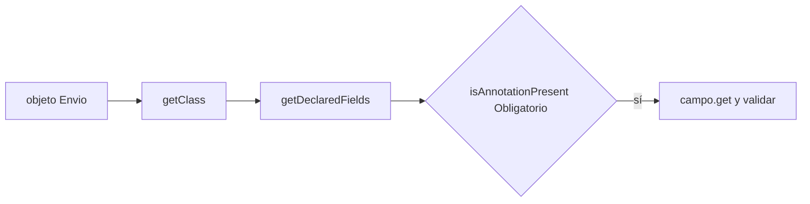
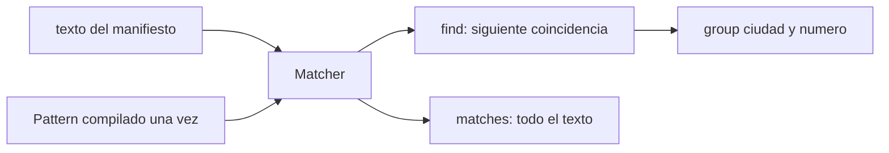
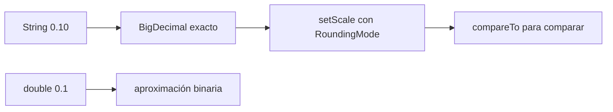
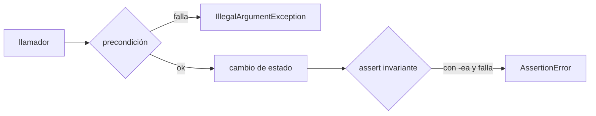
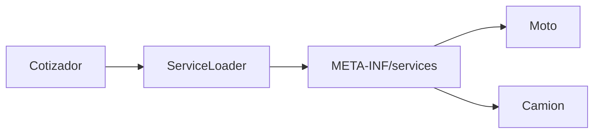
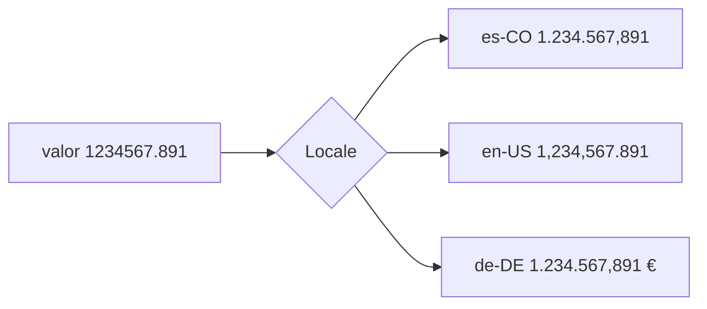
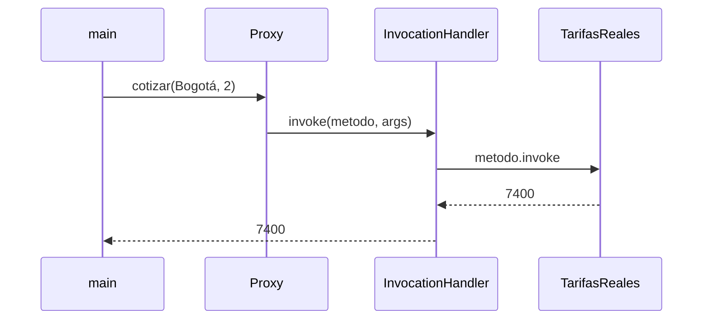
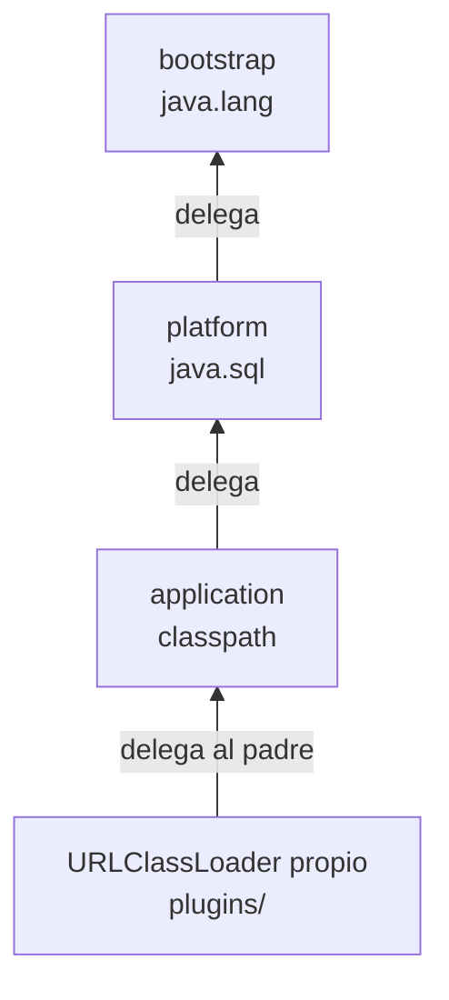
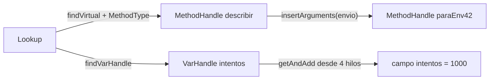

# Módulo 19: Java del día a día — reflexión, regex, dinero, contratos, plugins e i18n


## Aprende construyendo


### Tema 1: Reflexión y anotaciones en tiempo de ejecución · Intermedio · 40 min

<details open>
<summary><strong>Capa 1 — Lectura</strong></summary>

#### ► DE QUÉ TRATA
Al finalizar podrás inspeccionar clases, campos y métodos con la API de reflexión, leer anotaciones propias en tiempo de ejecución y explicar cómo la usan Spring, Jackson y JUnit. Prerrequisitos: Java M1 Tema 1 (clases y encapsulación) y Java M10 Tema 3 (opens).

#### ► LA IDEA EN UNA FRASE
**Al finalizar podrás inspeccionar clases, campos y métodos con la API de reflexión, leer anotaciones propias en tiempo de ejecución y explicar cómo la usan Spring, Jackson y JUnit.**

#### ► POR QUÉ EXISTE ESTO
Resuelve un problema real de diseño o implementación y evita decisiones a ciegas.

#### ► LA ANALOGÍA
Piensa en reflexión y anotaciones en tiempo de ejecución como una herramienta de taller: útil cuando conoces su propósito y sus límites.
**Dónde se rompe la analogía:** en software, los efectos dependen del contexto, la escala y los trade-offs.

#### ► CÓMO FUNCIONA


#### ► LO QUE PUEDE SALIR MAL
| Síntoma | Causa probable | Arreglo |
|---|---|---|
| Reflexión y anotaciones en tiempo de ejecución se aplica pero el resultado no mejora | Se usó sin medir el problema real | Mide antes y compara contra la alternativa simple |
| Aparece complejidad inesperada | Se adoptó la técnica sin comprender sus trade-offs | Vuelve a la sección de trade-offs y reduce el alcance |
| Falla en un caso límite | Se asumió un contexto que no se cumple | Prueba el caso límite y documenta cuándo NO usarlo |

#### ► TRADE-OFFS
| Opción | Cuándo usarla | Cuándo NO usarla |
|---|---|---|
| Usar Reflexión y anotaciones en tiempo de ejecución | Cuando el problema coincide con su propósito y el beneficio es observable | Cuando agrega complejidad sin resolver un problema real |
| Alternativa más simple | Cuando el contexto es pequeño, estable o fácil de razonar | Cuando ya demostró no escalar o no cumplir el requisito |
| Postergar la decisión | Cuando falta evidencia del problema | Cuando el costo de esperar es mayor que el costo de probar |

#### ► CUÁNDO NO USAR ESTO
No uses reflexión y anotaciones en tiempo de ejecución por defecto. Aplícalo cuando el problema lo justifique y puedas verificar el beneficio; si una alternativa más simple resuelve igual, prefiérela.

#### ► DE VUELTA A LA ANALOGÍA
Volviendo a la analogía: reflexión y anotaciones en tiempo de ejecución funciona como el modelo inicial, pero recuerda dónde se rompe: en producción importan la evidencia, la escala y el costo de equivocarte.

#### ► LO QUE DEBES RECORDAR
- Reflexión y anotaciones en tiempo de ejecución existe para resolver un problema específico.
- Mide antes de adoptar complejidad.
- Conoce el caso donde NO usarlo.
- Verifica con evidencia observable.

#### ► PREGUNTAS PARA PENSAR
1. ¿Qué problema concreto resuelve reflexión y anotaciones en tiempo de ejecución en tu contexto?
2. ¿Cómo sabrías que reflexión y anotaciones en tiempo de ejecución no está funcionando bien?
3. ¿Qué alternativa más simple considerarías antes de usar reflexión y anotaciones en tiempo de ejecución?

</details>

<details>
<summary><strong>Capa 2 — Construcción</strong></summary>

#### Código y verificación


```bash
mkdir java-dia-a-dia && cd java-dia-a-dia
```

```java
import java.lang.annotation.*;
import java.lang.reflect.*;
import java.util.*;

public class Reflexion {
    @Retention(RetentionPolicy.RUNTIME)          // sin RUNTIME la anotación no existe al ejecutar
    @Target(ElementType.FIELD)
    @interface Obligatorio {}

    static class Envio {
        @Obligatorio private String guia;
        @Obligatorio private String destino;
        private String nota;
        Envio(String guia, String destino, String nota) {
            this.guia = guia; this.destino = destino; this.nota = nota;
        }
    }

    // Un validador genérico: no conoce la clase Envio, la inspecciona en tiempo de ejecución
    static List<String> validar(Object objeto) throws IllegalAccessException {
        List<String> errores = new ArrayList<>();
        Class<?> clase = objeto.getClass();
        for (Field campo : clase.getDeclaredFields()) {
            if (campo.isAnnotationPresent(Obligatorio.class)) {
                campo.setAccessible(true);           // permite leer un campo privado
                Object valor = campo.get(objeto);
                if (valor == null || valor.toString().isBlank()) {
                    errores.add(clase.getSimpleName() + "." + campo.getName() + " es obligatorio");
                }
            }
        }
        return errores;
    }

    public static void main(String[] args) throws Exception {
        Class<?> clase = Envio.class;
        System.out.println("Campos de " + clase.getSimpleName() + ":");
        for (Field campo : clase.getDeclaredFields()) {
            System.out.printf("  %-8s %-7s obligatorio=%s%n", campo.getName(),
                campo.getType().getSimpleName(), campo.isAnnotationPresent(Obligatorio.class));
        }
        System.out.println(validar(new Envio("G-1", "Cali", null)));
        System.out.println(validar(new Envio("", null, "frágil")));

        Method metodo = String.class.getMethod("toUpperCase");   // invocar por nombre
        System.out.println(metodo.invoke("entregado"));
    }
}
```

```bash
java Reflexion.java
```

```text
Campos de Envio:
  guia     String  obligatorio=true
  destino  String  obligatorio=true
  nota     String  obligatorio=false
[]
[Envio.guia es obligatorio, Envio.destino es obligatorio]
ENTREGADO
```

```java
import java.lang.annotation.*;
import java.lang.reflect.Field;

public class RangoCheck {
    @Retention(RetentionPolicy.RUNTIME) @Target(ElementType.FIELD)
    @interface Rango { int min(); int max(); }
    static class Envio { @Rango(min=1, max=30) private int kilos = 35; }
    public static void main(String[] args) throws Exception {
        Field kilos = Envio.class.getDeclaredField("kilos");
        Rango regla = kilos.getAnnotation(Rango.class);
        int valor = kilos.getInt(new Envio());
        System.out.println("válido=" + (valor >= regla.min() && valor <= regla.max()));
    }
}
```

</details>

### Tema 2: Expresiones regulares con Pattern y Matcher · Intermedio · 35 min

<details open>
<summary><strong>Capa 1 — Lectura</strong></summary>

#### ► DE QUÉ TRATA
Al finalizar podrás escribir expresiones regulares con clases de caracteres, cuantificadores, límites de palabra y grupos con nombre, y usarlas para buscar, validar y reemplazar. Prerrequisito: Java M0 Tema 5 (String).

#### ► LA IDEA EN UNA FRASE
**Al finalizar podrás escribir expresiones regulares con clases de caracteres, cuantificadores, límites de palabra y grupos con nombre, y usarlas para buscar, validar y reemplazar.**

#### ► POR QUÉ EXISTE ESTO
Resuelve un problema real de diseño o implementación y evita decisiones a ciegas.

#### ► LA ANALOGÍA
Piensa en expresiones regulares con pattern y matcher como una herramienta de taller: útil cuando conoces su propósito y sus límites.
**Dónde se rompe la analogía:** en software, los efectos dependen del contexto, la escala y los trade-offs.

#### ► CÓMO FUNCIONA


#### ► LO QUE PUEDE SALIR MAL
| Síntoma | Causa probable | Arreglo |
|---|---|---|
| Expresiones regulares con Pattern y Matcher se aplica pero el resultado no mejora | Se usó sin medir el problema real | Mide antes y compara contra la alternativa simple |
| Aparece complejidad inesperada | Se adoptó la técnica sin comprender sus trade-offs | Vuelve a la sección de trade-offs y reduce el alcance |
| Falla en un caso límite | Se asumió un contexto que no se cumple | Prueba el caso límite y documenta cuándo NO usarlo |

#### ► TRADE-OFFS
| Opción | Cuándo usarla | Cuándo NO usarla |
|---|---|---|
| Usar Expresiones regulares con Pattern y Matcher | Cuando el problema coincide con su propósito y el beneficio es observable | Cuando agrega complejidad sin resolver un problema real |
| Alternativa más simple | Cuando el contexto es pequeño, estable o fácil de razonar | Cuando ya demostró no escalar o no cumplir el requisito |
| Postergar la decisión | Cuando falta evidencia del problema | Cuando el costo de esperar es mayor que el costo de probar |

#### ► CUÁNDO NO USAR ESTO
No uses expresiones regulares con pattern y matcher por defecto. Aplícalo cuando el problema lo justifique y puedas verificar el beneficio; si una alternativa más simple resuelve igual, prefiérela.

#### ► DE VUELTA A LA ANALOGÍA
Volviendo a la analogía: expresiones regulares con pattern y matcher funciona como el modelo inicial, pero recuerda dónde se rompe: en producción importan la evidencia, la escala y el costo de equivocarte.

#### ► LO QUE DEBES RECORDAR
- Expresiones regulares con Pattern y Matcher existe para resolver un problema específico.
- Mide antes de adoptar complejidad.
- Conoce el caso donde NO usarlo.
- Verifica con evidencia observable.

#### ► PREGUNTAS PARA PENSAR
1. ¿Qué problema concreto resuelve expresiones regulares con pattern y matcher en tu contexto?
2. ¿Cómo sabrías que expresiones regulares con pattern y matcher no está funcionando bien?
3. ¿Qué alternativa más simple considerarías antes de usar expresiones regulares con pattern y matcher?

</details>

<details>
<summary><strong>Capa 2 — Construcción</strong></summary>

#### Código y verificación


```bash
mkdir java-dia-a-dia && cd java-dia-a-dia
```

```java
import java.util.regex.*;
import java.util.*;

public class Regex {
    // Guía RutaFlow: dos letras, guion, 6 dígitos. Grupos con nombre para extraer partes.
    private static final Pattern GUIA = Pattern.compile("\\b(?<ciudad>[A-Z]{2})-(?<numero>\\d{6})\\b");
    private static final Pattern CORREO = Pattern.compile("^[\\w.+-]+@[\\w-]+(\\.[\\w-]+)+$");

    public static void main(String[] args) {
        String manifiesto = "Despacho 28/10: BO-004512 a Chapinero, CA-998001 a Cali, bo-1 inválida, ME-12345 corta.";
        Matcher m = GUIA.matcher(manifiesto);
        Map<String, Integer> porCiudad = new TreeMap<>();
        while (m.find()) {
            System.out.printf("guía %s -> ciudad=%s número=%s (posición %d)%n",
                m.group(), m.group("ciudad"), m.group("numero"), m.start());
            porCiudad.merge(m.group("ciudad"), 1, Integer::sum);
        }
        System.out.println("Por ciudad: " + porCiudad);

        for (String correo : List.of("ana@rutaflow.co", "beto@@rutaflow", "caro.ruiz+pedidos@mail.com")) {
            System.out.printf("%-28s válido=%s%n", correo, CORREO.matcher(correo).matches());
        }
        // replaceAll con referencia a grupos: enmascarar el número de guía
        System.out.println(GUIA.matcher(manifiesto).replaceAll("${ciudad}-******"));
    }
}
```

```bash
java Regex.java
```

```text
guía BO-004512 -> ciudad=BO número=004512 (posición 16)
guía CA-998001 -> ciudad=CA número=998001 (posición 39)
Por ciudad: {BO=1, CA=1}
ana@rutaflow.co              válido=true
beto@@rutaflow               válido=false
caro.ruiz+pedidos@mail.com   válido=true
Despacho 28/10: BO-****** a Chapinero, CA-****** a Cali, bo-1 inválida, ME-12345 corta.
```

```java
import java.util.regex.Pattern;

public class Telefono {
    public static void main(String[] args) {
        Pattern celular = Pattern.compile("\\b3\\d{9}\\b");
        for (String valor : new String[]{"3001234567", "30012345678", "2001234567"})
            System.out.println(valor + "=" + celular.matcher(valor).matches());
    }
}
```

</details>

### Tema 3: Dinero exacto con BigDecimal · Intermedio · 35 min

<details open>
<summary><strong>Capa 1 — Lectura</strong></summary>

#### ► DE QUÉ TRATA
Al finalizar podrás explicar por qué double no sirve para dinero, operar con BigDecimal creado desde texto, fijar escala y modo de redondeo, y comparar valores correctamente. Prerrequisitos: Java M0 Tema 4 (tipos) y Java M2 Tema 1 (colecciones para los ejemplos de cuotas).

#### ► LA IDEA EN UNA FRASE
**Al finalizar podrás explicar por qué double no sirve para dinero, operar con BigDecimal creado desde texto, fijar escala y modo de redondeo, y comparar valores correctamente.**

#### ► POR QUÉ EXISTE ESTO
Resuelve un problema real de diseño o implementación y evita decisiones a ciegas.

#### ► LA ANALOGÍA
Piensa en dinero exacto con bigdecimal como una herramienta de taller: útil cuando conoces su propósito y sus límites.
**Dónde se rompe la analogía:** en software, los efectos dependen del contexto, la escala y los trade-offs.

#### ► CÓMO FUNCIONA


#### ► LO QUE PUEDE SALIR MAL
| Síntoma | Causa probable | Arreglo |
|---|---|---|
| Dinero exacto con BigDecimal se aplica pero el resultado no mejora | Se usó sin medir el problema real | Mide antes y compara contra la alternativa simple |
| Aparece complejidad inesperada | Se adoptó la técnica sin comprender sus trade-offs | Vuelve a la sección de trade-offs y reduce el alcance |
| Falla en un caso límite | Se asumió un contexto que no se cumple | Prueba el caso límite y documenta cuándo NO usarlo |

#### ► TRADE-OFFS
| Opción | Cuándo usarla | Cuándo NO usarla |
|---|---|---|
| Usar Dinero exacto con BigDecimal | Cuando el problema coincide con su propósito y el beneficio es observable | Cuando agrega complejidad sin resolver un problema real |
| Alternativa más simple | Cuando el contexto es pequeño, estable o fácil de razonar | Cuando ya demostró no escalar o no cumplir el requisito |
| Postergar la decisión | Cuando falta evidencia del problema | Cuando el costo de esperar es mayor que el costo de probar |

#### ► CUÁNDO NO USAR ESTO
No uses dinero exacto con bigdecimal por defecto. Aplícalo cuando el problema lo justifique y puedas verificar el beneficio; si una alternativa más simple resuelve igual, prefiérela.

#### ► DE VUELTA A LA ANALOGÍA
Volviendo a la analogía: dinero exacto con bigdecimal funciona como el modelo inicial, pero recuerda dónde se rompe: en producción importan la evidencia, la escala y el costo de equivocarte.

#### ► LO QUE DEBES RECORDAR
- Dinero exacto con BigDecimal existe para resolver un problema específico.
- Mide antes de adoptar complejidad.
- Conoce el caso donde NO usarlo.
- Verifica con evidencia observable.

#### ► PREGUNTAS PARA PENSAR
1. ¿Qué problema concreto resuelve dinero exacto con bigdecimal en tu contexto?
2. ¿Cómo sabrías que dinero exacto con bigdecimal no está funcionando bien?
3. ¿Qué alternativa más simple considerarías antes de usar dinero exacto con bigdecimal?

</details>

<details>
<summary><strong>Capa 2 — Construcción</strong></summary>

#### Código y verificación


```bash
mkdir java-dia-a-dia && cd java-dia-a-dia
```

```java
import java.math.BigDecimal;
import java.math.RoundingMode;

public class Dinero {
    public static void main(String[] args) {
        double totalDouble = 0;
        BigDecimal totalExacto = BigDecimal.ZERO;
        for (int i = 0; i < 10; i++) {               // diez recargos de 0,10 USD
            totalDouble += 0.10;
            totalExacto = totalExacto.add(new BigDecimal("0.10"));
        }
        System.out.println("double:     " + totalDouble + "  ¿igual a 1.0? " + (totalDouble == 1.0));
        System.out.println("BigDecimal: " + totalExacto + "  ¿igual a 1.00? " + (totalExacto.compareTo(BigDecimal.ONE) == 0));

        BigDecimal tarifa = new BigDecimal("18750");    // pesos colombianos
        BigDecimal iva = new BigDecimal("0.19");
        BigDecimal impuesto = tarifa.multiply(iva).setScale(0, RoundingMode.HALF_UP);
        System.out.println("IVA de " + tarifa + " = " + impuesto + "  total = " + tarifa.add(impuesto));

        BigDecimal cuota = new BigDecimal("100000").divide(new BigDecimal("3"), 2, RoundingMode.HALF_EVEN);
        System.out.println("100000 / 3 con 2 decimales = " + cuota);
        System.out.println("new BigDecimal(0.1) = " + new BigDecimal(0.1));
        System.out.println("equals 2.0 vs 2.00: " + new BigDecimal("2.0").equals(new BigDecimal("2.00"))
            + "  compareTo: " + new BigDecimal("2.0").compareTo(new BigDecimal("2.00")));
    }
}
```

```bash
java Dinero.java
```

```text
double:     0.9999999999999999  ¿igual a 1.0? false
BigDecimal: 1.00  ¿igual a 1.00? true
IVA de 18750 = 3563  total = 22313
100000 / 3 con 2 decimales = 33333.33
new BigDecimal(0.1) = 0.1000000000000000055511151231257827021181583404541015625
equals 2.0 vs 2.00: false  compareTo: 0
```

```java
import java.math.BigDecimal;
import java.math.RoundingMode;

public class Cuotas {
    public static void main(String[] args) {
        BigDecimal total = new BigDecimal("100000.00");
        BigDecimal cuota = total.divide(new BigDecimal("3"), 2, RoundingMode.DOWN);
        BigDecimal ultima = total.subtract(cuota.multiply(new BigDecimal("2")));
        System.out.println(cuota + ", " + cuota + ", " + ultima);
        System.out.println(cuota.add(cuota).add(ultima));
    }
}
```

</details>

### Tema 4: Assertions y diseño por contrato · Intermedio · 40 min

<details open>
<summary><strong>Capa 1 — Lectura</strong></summary>

#### ► DE QUÉ TRATA
Al finalizar podrás distinguir precondiciones públicas (excepciones) de invariantes internas (assert), activar assertions con -ea y usarlas para detectar bugs propios. Prerrequisito: Java M3 Tema 1 (excepciones).

#### ► LA IDEA EN UNA FRASE
**Al finalizar podrás distinguir precondiciones públicas (excepciones) de invariantes internas (assert), activar assertions con -ea y usarlas para detectar bugs propios.**

#### ► POR QUÉ EXISTE ESTO
Resuelve un problema real de diseño o implementación y evita decisiones a ciegas.

#### ► LA ANALOGÍA
El **diseño por contrato** define **precondiciones** (lo que debe cumplir quien llama), **postcondiciones** (lo que garantiza el método) e **invariantes** (lo que siempre es cierto del objeto). Las precondiciones de métodos públicos se validan **siempre** con excepciones, porque las assertions vienen **desactivadas** por defecto. `assert condicion : mensaje` sirve para invariantes internas: si es falsa y la JVM corre con `-ea`, lanza `AssertionError`.

**Analogía:** la excepción es el guardia de la puerta, que siempre revisa a los visitantes; la assertion es la alarma interna que solo se enciende en los ensayos de evacuación.

**Diagrama:**



**Fuente oficial:** [Programming With Assertions (docs.oracle.com)](https://docs.oracle.com/javase/8/docs/technotes/guides/language/assert.html), [Exceptions (dev.java)](https://dev.java/learn/exceptions/).
**Conceptos clave:** precondición, postcondición, invariante, `assert`, `-ea`, `AssertionError`, excepción de argumento.
**Cuándo no usarlo:** nunca uses `assert` para validar datos del usuario o de otra API ni con efectos secundarios necesarios: en producción suelen estar desactivadas.

**Transferencia al proyecto integrador «Motor de asignación de entregas»:** protege con una invariante que un mensajero nunca tenga más entregas asignadas que su capacidad.
Como **siguiente** paso, aplica lo aprendido en el proyecto integrador del track y compara el resultado con lo que esperabas.
**Errores comunes:** validar una precondición pública (datos de quien llama) con `assert` en vez de una excepción, confiando en que siempre esté activa; en producción las assertions vienen desactivadas por defecto y ese control desaparece sin avisar. También: ejecutar la suite de pruebas sin `-ea`, dejando que una invariante rota pase en silencio.

**Dónde se rompe la analogía:** el modelo simplifica la realidad; en producción influyen escala, fallos, costo y contexto.

#### ► CÓMO FUNCIONA


#### ► LO QUE PUEDE SALIR MAL
| Síntoma | Causa probable | Arreglo |
|---|---|---|
| Assertions y diseño por contrato se aplica pero el resultado no mejora | Se usó sin medir el problema real | Mide antes y compara contra la alternativa simple |
| Aparece complejidad inesperada | Se adoptó la técnica sin comprender sus trade-offs | Vuelve a la sección de trade-offs y reduce el alcance |
| Falla en un caso límite | Se asumió un contexto que no se cumple | Prueba el caso límite y documenta cuándo NO usarlo |

#### ► TRADE-OFFS
| Opción | Cuándo usarla | Cuándo NO usarla |
|---|---|---|
| Usar Assertions y diseño por contrato | Cuando el problema coincide con su propósito y el beneficio es observable | Cuando agrega complejidad sin resolver un problema real |
| Alternativa más simple | Cuando el contexto es pequeño, estable o fácil de razonar | Cuando ya demostró no escalar o no cumplir el requisito |
| Postergar la decisión | Cuando falta evidencia del problema | Cuando el costo de esperar es mayor que el costo de probar |

#### ► CUÁNDO NO USAR ESTO
No uses assertions y diseño por contrato por defecto. Aplícalo cuando el problema lo justifique y puedas verificar el beneficio; si una alternativa más simple resuelve igual, prefiérela.

#### ► DE VUELTA A LA ANALOGÍA
Volviendo a la analogía: assertions y diseño por contrato funciona como el modelo inicial, pero recuerda dónde se rompe: en producción importan la evidencia, la escala y el costo de equivocarte.

#### ► LO QUE DEBES RECORDAR
- Assertions y diseño por contrato existe para resolver un problema específico.
- Mide antes de adoptar complejidad.
- Conoce el caso donde NO usarlo.
- Verifica con evidencia observable.

#### ► PREGUNTAS PARA PENSAR
1. ¿Qué problema concreto resuelve assertions y diseño por contrato en tu contexto?
2. ¿Cómo sabrías que assertions y diseño por contrato no está funcionando bien?
3. ¿Qué alternativa más simple considerarías antes de usar assertions y diseño por contrato?

</details>

<details>
<summary><strong>Capa 2 — Construcción</strong></summary>

#### Código y verificación


```bash
mkdir java-dia-a-dia && cd java-dia-a-dia
```

```java
import java.util.*;

public class Contratos {
    static final class Carga {
        private final List<Integer> pesos = new ArrayList<>();
        private int total;                          // invariante: total == suma(pesos)
        private final int capacidad;

        Carga(int capacidad) {
            if (capacidad <= 0) throw new IllegalArgumentException("capacidad debe ser positiva: " + capacidad);
            this.capacidad = capacidad;
        }

        void subir(int kilos) {
            // Precondición pública: se valida SIEMPRE con una excepción, nunca con assert
            if (kilos <= 0) throw new IllegalArgumentException("kilos debe ser positivo: " + kilos);
            if (total + kilos > capacidad) throw new IllegalStateException("excede la capacidad de " + capacidad + " kg");
            pesos.add(kilos);
            total += kilos;
            assert invarianteValida() : "total=" + total + " no coincide con " + pesos;   // chequeo interno
        }

        void bajarUltimo() {
            int kilos = pesos.remove(pesos.size() - 1);
            total -= kilos;
            assert invarianteValida() : "total=" + total + " no coincide con " + pesos;
        }

        private boolean invarianteValida() {
            return total == pesos.stream().mapToInt(Integer::intValue).sum();
        }
        int total() { return total; }
    }

    public static void main(String[] args) {
        boolean activas = false;
        assert activas = true;                      // truco: solo se ejecuta con -ea
        System.out.println("Assertions activas: " + activas);

        Carga carga = new Carga(30);
        carga.subir(12);
        carga.subir(10);
        carga.bajarUltimo();
        System.out.println("Total: " + carga.total() + " kg");
        try {
            carga.subir(25);
        } catch (IllegalStateException e) {
            System.out.println("Rechazado: " + e.getMessage());
        }
    }
}
```

```bash
java Contratos.java
java -ea Contratos.java
```

```text
Assertions activas: false
Total: 12 kg
Rechazado: excede la capacidad de 30 kg
Assertions activas: true
Total: 12 kg
Rechazado: excede la capacidad de 30 kg
```

```java
public class Postcondicion {
    static int agregar(int total, int kilos) {
        if (kilos <= 0) throw new IllegalArgumentException("kilos debe ser positivo");
        int antes = total;
        total += kilos;
        assert total == antes + kilos : "el total no aumentó como se pidió";
        return total;
    }
    public static void main(String[] args) {
        System.out.println(agregar(12, 5));
    }
}
```

</details>

### Tema 5: ServiceLoader: plugins sin acoplar implementaciones · Intermedio · 40 min

<details open>
<summary><strong>Capa 1 — Lectura</strong></summary>

#### ► DE QUÉ TRATA
Al finalizar podrás definir un servicio como interfaz, registrar implementaciones en META-INF/services y descubrirlas con ServiceLoader sin que el código principal las conozca. Prerrequisitos: Java M1 Tema 3 (interfaces) y Java M10 Tema 1 (módulos y classpath).

#### ► LA IDEA EN UNA FRASE
**Al finalizar podrás definir un servicio como interfaz, registrar implementaciones en META-INF/services y descubrirlas con ServiceLoader sin que el código principal las conozca.**

#### ► POR QUÉ EXISTE ESTO
Resuelve un problema real de diseño o implementación y evita decisiones a ciegas.

#### ► LA ANALOGÍA
Piensa en serviceloader: plugins sin acoplar implementaciones como una herramienta de taller: útil cuando conoces su propósito y sus límites.
**Dónde se rompe la analogía:** en software, los efectos dependen del contexto, la escala y los trade-offs.

#### ► CÓMO FUNCIONA


#### ► LO QUE PUEDE SALIR MAL
| Síntoma | Causa probable | Arreglo |
|---|---|---|
| ServiceLoader: plugins sin acoplar implementaciones se aplica pero el resultado no mejora | Se usó sin medir el problema real | Mide antes y compara contra la alternativa simple |
| Aparece complejidad inesperada | Se adoptó la técnica sin comprender sus trade-offs | Vuelve a la sección de trade-offs y reduce el alcance |
| Falla en un caso límite | Se asumió un contexto que no se cumple | Prueba el caso límite y documenta cuándo NO usarlo |

#### ► TRADE-OFFS
| Opción | Cuándo usarla | Cuándo NO usarla |
|---|---|---|
| Usar ServiceLoader: plugins sin acoplar implementaciones | Cuando el problema coincide con su propósito y el beneficio es observable | Cuando agrega complejidad sin resolver un problema real |
| Alternativa más simple | Cuando el contexto es pequeño, estable o fácil de razonar | Cuando ya demostró no escalar o no cumplir el requisito |
| Postergar la decisión | Cuando falta evidencia del problema | Cuando el costo de esperar es mayor que el costo de probar |

#### ► CUÁNDO NO USAR ESTO
No uses serviceloader: plugins sin acoplar implementaciones por defecto. Aplícalo cuando el problema lo justifique y puedas verificar el beneficio; si una alternativa más simple resuelve igual, prefiérela.

#### ► DE VUELTA A LA ANALOGÍA
Volviendo a la analogía: serviceloader: plugins sin acoplar implementaciones funciona como el modelo inicial, pero recuerda dónde se rompe: en producción importan la evidencia, la escala y el costo de equivocarte.

#### ► LO QUE DEBES RECORDAR
- ServiceLoader: plugins sin acoplar implementaciones existe para resolver un problema específico.
- Mide antes de adoptar complejidad.
- Conoce el caso donde NO usarlo.
- Verifica con evidencia observable.

#### ► PREGUNTAS PARA PENSAR
1. ¿Qué problema concreto resuelve serviceloader: plugins sin acoplar implementaciones en tu contexto?
2. ¿Cómo sabrías que serviceloader: plugins sin acoplar implementaciones no está funcionando bien?
3. ¿Qué alternativa más simple considerarías antes de usar serviceloader: plugins sin acoplar implementaciones?

</details>

<details>
<summary><strong>Capa 2 — Construcción</strong></summary>

#### Código y verificación


```bash
mkdir plugins && cd plugins && mkdir -p src/rutaflow src/META-INF/services
```

```java
package rutaflow;

public interface Transportadora {
    String nombre();
    boolean cubre(String ciudad);
    int cotizar(int kilos);
}
```

```java
package rutaflow;

public class Moto implements Transportadora {
    public String nombre() { return "Moto urbana"; }
    public boolean cubre(String ciudad) { return ciudad.equals("Bogotá"); }
    public int cotizar(int kilos) { return 6000 + kilos * 800; }
}
```

```java
package rutaflow;

public class Camion implements Transportadora {
    public String nombre() { return "Camión nacional"; }
    public boolean cubre(String ciudad) { return true; }
    public int cotizar(int kilos) { return 15000 + kilos * 500; }
}
```

```text
rutaflow.Moto
rutaflow.Camion
```

</details>

### Tema 6: Internacionalización: números, monedas, fechas y orden de texto · Intermedio · 40 min

<details open>
<summary><strong>Capa 1 — Lectura</strong></summary>

#### ► DE QUÉ TRATA
Al finalizar podrás formatear números, monedas y fechas según el Locale, ordenar texto en español con Collator y construir mensajes con plurales. Prerrequisito: Java M0 Tema 8 (java.time).

#### ► LA IDEA EN UNA FRASE
**Al finalizar podrás formatear números, monedas y fechas según el Locale, ordenar texto en español con Collator y construir mensajes con plurales.**

#### ► POR QUÉ EXISTE ESTO
Resuelve un problema real de diseño o implementación y evita decisiones a ciegas.

#### ► LA ANALOGÍA
Un `Locale` (`es-CO`, `en-US`) identifica idioma y región. `NumberFormat` y `DateTimeFormatter.ofLocalizedDate` aplican sus reglas de separadores, símbolo de moneda y nombres de meses. `String.compareTo` ordena por código Unicode, así que las tildes y la ñ quedan fuera de lugar; `Collator` ordena según las reglas del idioma. `MessageFormat` con `choice` resuelve plurales; en una aplicación real los textos van en archivos `ResourceBundle` por idioma.

**Analogía:** el `Locale` es el traductor y el notario local: el contenido es el mismo, pero cada país lo escribe con sus propias convenciones.

**Diagrama:**



**Fuente oficial:** [Internationalization (docs.oracle.com)](https://docs.oracle.com/javase/tutorial/i18n/), [Locale (docs.oracle.com)](https://docs.oracle.com/en/java/javase/21/docs/api/java.base/java/util/Locale.html).
**Conceptos clave:** `Locale`, `NumberFormat`, `DateTimeFormatter`, CLDR, `Collator`, `MessageFormat`, `ResourceBundle`.
**Cuándo no usarlo:** para datos que viajan entre sistemas (JSON, CSV, bases de datos) no uses formatos localizados: usa ISO 8601 y punto decimal. El `Locale` es solo para mostrar al usuario.

**Transferencia al proyecto integrador «Motor de asignación de entregas»:** muestra el resumen de asignaciones en el idioma y la moneda del cliente sin cambiar los datos internos.
Como **siguiente** paso, aplica lo aprendido en el proyecto integrador del track y compara el resultado con lo que esperabas.
**Errores comunes:** usar `new Locale("es-CO")` (constructor obsoleto) en vez de `Locale.forLanguageTag("es-CO")`, lo que produce un `Locale` indefinido (`und`) y formatos genéricos sin más aviso que un `warning: [deprecation]`, y ordenar texto en español con `String.compareTo`/`Collections.sort` en vez de `Collator`, dejando "Álamos" y "Ñuñoa" fuera de su posición alfabética real.

**Dónde se rompe la analogía:** el modelo simplifica la realidad; en producción influyen escala, fallos, costo y contexto.

#### ► CÓMO FUNCIONA


#### ► LO QUE PUEDE SALIR MAL
| Síntoma | Causa probable | Arreglo |
|---|---|---|
| Internacionalización: números, monedas, fechas y orden de texto se aplica pero el resultado no mejora | Se usó sin medir el problema real | Mide antes y compara contra la alternativa simple |
| Aparece complejidad inesperada | Se adoptó la técnica sin comprender sus trade-offs | Vuelve a la sección de trade-offs y reduce el alcance |
| Falla en un caso límite | Se asumió un contexto que no se cumple | Prueba el caso límite y documenta cuándo NO usarlo |

#### ► TRADE-OFFS
| Opción | Cuándo usarla | Cuándo NO usarla |
|---|---|---|
| Usar Internacionalización: números, monedas, fechas y orden de texto | Cuando el problema coincide con su propósito y el beneficio es observable | Cuando agrega complejidad sin resolver un problema real |
| Alternativa más simple | Cuando el contexto es pequeño, estable o fácil de razonar | Cuando ya demostró no escalar o no cumplir el requisito |
| Postergar la decisión | Cuando falta evidencia del problema | Cuando el costo de esperar es mayor que el costo de probar |

#### ► CUÁNDO NO USAR ESTO
No uses internacionalización: números, monedas, fechas y orden de texto por defecto. Aplícalo cuando el problema lo justifique y puedas verificar el beneficio; si una alternativa más simple resuelve igual, prefiérela.

#### ► DE VUELTA A LA ANALOGÍA
Volviendo a la analogía: internacionalización: números, monedas, fechas y orden de texto funciona como el modelo inicial, pero recuerda dónde se rompe: en producción importan la evidencia, la escala y el costo de equivocarte.

#### ► LO QUE DEBES RECORDAR
- Internacionalización: números, monedas, fechas y orden de texto existe para resolver un problema específico.
- Mide antes de adoptar complejidad.
- Conoce el caso donde NO usarlo.
- Verifica con evidencia observable.

#### ► PREGUNTAS PARA PENSAR
1. ¿Qué problema concreto resuelve internacionalización: números, monedas, fechas y orden de texto en tu contexto?
2. ¿Cómo sabrías que internacionalización: números, monedas, fechas y orden de texto no está funcionando bien?
3. ¿Qué alternativa más simple considerarías antes de usar internacionalización: números, monedas, fechas y orden de texto?

</details>

<details>
<summary><strong>Capa 2 — Construcción</strong></summary>

#### Código y verificación


```bash
mkdir java-dia-a-dia && cd java-dia-a-dia
```

```java
import java.text.*;
import java.time.*;
import java.time.format.*;
import java.util.*;

public class Formatos {
    public static void main(String[] args) {
        double monto = 1234567.891;
        LocalDate fecha = LocalDate.of(2026, 10, 28);
        for (Locale locale : List.of(Locale.forLanguageTag("es-CO"), Locale.forLanguageTag("en-US"), Locale.forLanguageTag("de-DE"))) {
            NumberFormat numero = NumberFormat.getNumberInstance(locale);
            NumberFormat moneda = NumberFormat.getCurrencyInstance(locale);
            DateTimeFormatter larga = DateTimeFormatter.ofLocalizedDate(FormatStyle.LONG).withLocale(locale);
            System.out.printf("%-6s número=%-15s moneda=%-18s fecha=%s%n",
                locale.toLanguageTag(), numero.format(monto), moneda.format(monto), fecha.format(larga));
        }

        // Ordenar texto en español: compareTo ordena por código Unicode, Collator por reglas del idioma
        List<String> barrios = new ArrayList<>(List.of("Usaquén", "Álamos", "Chapinero", "Ñuñoa", "Bosa", "Niza"));
        List<String> porCodigo = new ArrayList<>(barrios);
        Collections.sort(porCodigo);
        barrios.sort(Collator.getInstance(Locale.forLanguageTag("es-CO")));
        System.out.println("compareTo: " + porCodigo);
        System.out.println("Collator:  " + barrios);

        // Mensajes con plural y parámetros, como los de un ResourceBundle
        MessageFormat mensaje = new MessageFormat(
            "{0,choice,0#No hay entregas|1#Hay una entrega|1<Hay {0,number,integer} entregas} para {1}",
            Locale.forLanguageTag("es-CO"));
        for (int n : new int[]{0, 1, 1500}) System.out.println(mensaje.format(new Object[]{n, "Ana"}));
    }
}
```

```bash
java Formatos.java
```

```text
es-CO  número=1.234.567,891   moneda=$ 1.234.567,89     fecha=28 de octubre de 2026
en-US  número=1,234,567.891   moneda=$1,234,567.89      fecha=October 28, 2026
de-DE  número=1.234.567,891   moneda=1.234.567,89 €     fecha=28. Oktober 2026
compareTo: [Bosa, Chapinero, Niza, Usaquén, Álamos, Ñuñoa]
Collator:  [Álamos, Bosa, Chapinero, Niza, Ñuñoa, Usaquén]
No hay entregas para Ana
Hay una entrega para Ana
Hay 1.500 entregas para Ana
```

```java
import java.time.*;
import java.time.format.DateTimeFormatter;
import java.util.Locale;

public class HorasLocales {
    public static void main(String[] args) {
        Instant llegada = Instant.parse("2026-11-03T15:00:00Z");
        var formato = DateTimeFormatter.ofPattern("d MMM uuuu HH:mm z", Locale.forLanguageTag("es-CO"));
        System.out.println(llegada.atZone(ZoneId.of("America/Bogota")).format(formato));
        System.out.println(llegada.atZone(ZoneId.of("Europe/Berlin")).format(formato));
    }
}
```

</details>

### Tema 7: Proxies dinámicos: así funcionan @Transactional y los mocks · Avanzado · 45 min

<details open>
<summary><strong>Capa 1 — Lectura</strong></summary>

#### ► DE QUÉ TRATA
Al finalizar podrás crear un proxy dinámico con java.lang.reflect.Proxy que intercepte todas las llamadas de una interfaz, y explicar cómo los frameworks agregan transacciones, logs y mocks sin tocar tu código. Prerrequisito: Java M19 Tema 1 (reflexión y métodos).

#### ► LA IDEA EN UNA FRASE
**Al finalizar podrás crear un proxy dinámico con java.lang.reflect.Proxy que intercepte todas las llamadas de una interfaz, y explicar cómo los frameworks agregan transacciones, logs y mocks sin tocar tu código.**

#### ► POR QUÉ EXISTE ESTO
Resuelve un problema real de diseño o implementación y evita decisiones a ciegas.

#### ► LA ANALOGÍA
`Proxy.newProxyInstance` genera en tiempo de ejecución una clase que implementa las interfaces indicadas. Cada llamada llega a un `InvocationHandler` con el `Method` y los argumentos; el manejador decide qué hacer antes y después de delegar en el objeto real. Si el método real lanza una excepción, la reflexión la envuelve en `InvocationTargetException` y hay que relanzar la causa original. Solo funciona con **interfaces**; para clases, librerías como ByteBuddy generan subclases.

**Analogía:** es la recepcionista de una oficina: todas las llamadas pasan por ella, las anota y las transfiere a la persona correcta.

**Diagrama:**



**Fuente oficial:** [java.lang.reflect.Proxy (docs.oracle.com)](https://docs.oracle.com/en/java/javase/21/docs/api/java.base/java/lang/reflect/Proxy.html), [Spring: Understanding AOP Proxies](https://docs.spring.io/spring-framework/reference/core/aop/proxying.html).
**Conceptos clave:** proxy dinámico, `InvocationHandler`, `Method.invoke`, `InvocationTargetException`, `UndeclaredThrowableException`, auto-invocación.
**Cuándo no usarlo:** si solo necesitas envolver una clase concreta, el patrón Decorator escrito a mano es más claro y lo verifica el compilador.

**Transferencia al proyecto integrador «Motor de asignación de entregas»:** registra con un proxy cada decisión del motor de asignación sin modificar sus clases.
Como **siguiente** paso, aplica lo aprendido en el proyecto integrador del track y compara el resultado con lo que esperabas.
**Errores comunes:** relanzar `e` en vez de `e.getCause()` dentro del `catch (InvocationTargetException e)`, dejando que el llamador reciba un `UndeclaredThrowableException` en vez de la excepción original, y suponer que una llamada de un método a otro método propio de la misma clase pasa por el proxy (la auto-invocación nunca lo atraviesa).

**Dónde se rompe la analogía:** el modelo simplifica la realidad; en producción influyen escala, fallos, costo y contexto.

#### ► CÓMO FUNCIONA


#### ► LO QUE PUEDE SALIR MAL
| Síntoma | Causa probable | Arreglo |
|---|---|---|
| Proxies dinámicos: así funcionan @Transactional y los mocks se aplica pero el resultado no mejora | Se usó sin medir el problema real | Mide antes y compara contra la alternativa simple |
| Aparece complejidad inesperada | Se adoptó la técnica sin comprender sus trade-offs | Vuelve a la sección de trade-offs y reduce el alcance |
| Falla en un caso límite | Se asumió un contexto que no se cumple | Prueba el caso límite y documenta cuándo NO usarlo |

#### ► TRADE-OFFS
| Opción | Cuándo usarla | Cuándo NO usarla |
|---|---|---|
| Usar Proxies dinámicos: así funcionan @Transactional y los mocks | Cuando el problema coincide con su propósito y el beneficio es observable | Cuando agrega complejidad sin resolver un problema real |
| Alternativa más simple | Cuando el contexto es pequeño, estable o fácil de razonar | Cuando ya demostró no escalar o no cumplir el requisito |
| Postergar la decisión | Cuando falta evidencia del problema | Cuando el costo de esperar es mayor que el costo de probar |

#### ► CUÁNDO NO USAR ESTO
No uses proxies dinámicos: así funcionan @transactional y los mocks por defecto. Aplícalo cuando el problema lo justifique y puedas verificar el beneficio; si una alternativa más simple resuelve igual, prefiérela.

#### ► DE VUELTA A LA ANALOGÍA
Volviendo a la analogía: proxies dinámicos: así funcionan @transactional y los mocks funciona como el modelo inicial, pero recuerda dónde se rompe: en producción importan la evidencia, la escala y el costo de equivocarte.

#### ► LO QUE DEBES RECORDAR
- Proxies dinámicos: así funcionan @Transactional y los mocks existe para resolver un problema específico.
- Mide antes de adoptar complejidad.
- Conoce el caso donde NO usarlo.
- Verifica con evidencia observable.

#### ► PREGUNTAS PARA PENSAR
1. ¿Qué problema concreto resuelve proxies dinámicos: así funcionan @transactional y los mocks en tu contexto?
2. ¿Cómo sabrías que proxies dinámicos: así funcionan @transactional y los mocks no está funcionando bien?
3. ¿Qué alternativa más simple considerarías antes de usar proxies dinámicos: así funcionan @transactional y los mocks?

</details>

<details>
<summary><strong>Capa 2 — Construcción</strong></summary>

#### Código y verificación


```bash
mkdir java-dia-a-dia && cd java-dia-a-dia
```

```java
import java.lang.reflect.*;
import java.util.*;

public class Proxies {
    interface Tarifas {
        int cotizar(String ciudad, int kilos);
        String moneda();
    }

    static class TarifasReales implements Tarifas {
        public int cotizar(String ciudad, int kilos) {
            if (kilos > 30) throw new IllegalArgumentException("máximo 30 kg");
            return (ciudad.equals("Bogotá") ? 5000 : 9000) + kilos * 1200;
        }
        public String moneda() { return "COP"; }
    }

    // Un proxy dinámico: una clase generada en tiempo de ejecución que implementa la interfaz
    // y envía TODAS las llamadas a este manejador. Así funcionan @Transactional o los mocks.
    static <T> T conRegistro(Class<T> interfaz, T real) {
        InvocationHandler manejador = (proxy, metodo, argumentos) -> {
            long inicio = System.nanoTime();
            try {
                Object resultado = metodo.invoke(real, argumentos);
                System.out.printf("  [log] %s%s -> %s%n", metodo.getName(),
                    Arrays.toString(argumentos == null ? new Object[0] : argumentos), resultado);
                return resultado;
            } catch (InvocationTargetException e) {
                System.out.printf("  [log] %s falló: %s%n", metodo.getName(), e.getCause().getMessage());
                throw e.getCause();                 // relanza la excepción original, no el envoltorio
            } finally {
                long micros = (System.nanoTime() - inicio) / 1000;
                if (micros > 1_000_000) System.out.println("  [log] lento: " + micros + " µs");
            }
        };
        return interfaz.cast(Proxy.newProxyInstance(interfaz.getClassLoader(), new Class<?>[]{interfaz}, manejador));
    }

    public static void main(String[] args) {
        Tarifas tarifas = conRegistro(Tarifas.class, new TarifasReales());
        System.out.println("Clase real del objeto: " + (Proxy.isProxyClass(tarifas.getClass()) ? "proxy dinámico" : "normal"));
        System.out.println("Bogotá 2 kg = " + tarifas.cotizar("Bogotá", 2) + " " + tarifas.moneda());
        try {
            tarifas.cotizar("Cali", 40);
        } catch (IllegalArgumentException e) {
            System.out.println("El llamador recibe: " + e.getClass().getSimpleName() + ": " + e.getMessage());
        }
    }
}
```

```bash
java Proxies.java
```

```text
Clase real del objeto: proxy dinámico
  [log] cotizar[Bogotá, 2] -> 7400
  [log] moneda[] -> COP
Bogotá 2 kg = 7400 COP
  [log] cotizar falló: máximo 30 kg
El llamador recibe: IllegalArgumentException: máximo 30 kg
```

```java
import java.lang.reflect.*;
import java.util.*;

public class CacheProxy {
    interface Tarifas { int cotizar(String ciudad, int kilos); }
    static class Reales implements Tarifas {
        public int cotizar(String ciudad, int kilos) { return kilos * 1000; }
    }
    public static void main(String[] args) {
        Tarifas real = new Reales();
        Map<List<Object>, Object> cache = new HashMap<>();
        Tarifas proxy = (Tarifas) Proxy.newProxyInstance(Tarifas.class.getClassLoader(),
            new Class<?>[]{Tarifas.class}, (obj, metodo, valores) -> {
                var clave = Arrays.asList(valores);
                if (cache.containsKey(clave)) return cache.get(clave);
                Object resultado = metodo.invoke(real, valores);
                cache.put(clave, resultado);
                System.out.println("cálculo nuevo");
                return resultado;
            });
        System.out.println(proxy.cotizar("Cali", 4));
        System.out.println(proxy.cotizar("Cali", 4));
    }
}
```

</details>

### Tema 8: Carga de clases: cargadores, delegación y plugins con URLClassLoader · Avanzado · 45 min

<details open>
<summary><strong>Capa 1 — Lectura</strong></summary>

#### ► DE QUÉ TRATA
Usa JDK 17 o superior. Crea la carpeta academia-labs/java/cargadores con una subcarpeta plugins/. Compilarás un plugin aparte para que la aplicación no lo conozca al compilar.

#### ► LA IDEA EN UNA FRASE
**Usa JDK 17 o superior.**

#### ► POR QUÉ EXISTE ESTO
Resuelve un problema real de diseño o implementación y evita decisiones a ciegas.

#### ► LA ANALOGÍA
Piensa en carga de clases: cargadores, delegación y plugins con urlclassloader como una herramienta de taller: útil cuando conoces su propósito y sus límites.
**Dónde se rompe la analogía:** en software, los efectos dependen del contexto, la escala y los trade-offs.

#### ► CÓMO FUNCIONA


#### ► LO QUE PUEDE SALIR MAL
| Síntoma | Causa probable | Arreglo |
|---|---|---|
| Carga de clases: cargadores, delegación y plugins con URLClassLoader se aplica pero el resultado no mejora | Se usó sin medir el problema real | Mide antes y compara contra la alternativa simple |
| Aparece complejidad inesperada | Se adoptó la técnica sin comprender sus trade-offs | Vuelve a la sección de trade-offs y reduce el alcance |
| Falla en un caso límite | Se asumió un contexto que no se cumple | Prueba el caso límite y documenta cuándo NO usarlo |

#### ► TRADE-OFFS
| Opción | Cuándo usarla | Cuándo NO usarla |
|---|---|---|
| Usar Carga de clases: cargadores, delegación y plugins con URLClassLoader | Cuando el problema coincide con su propósito y el beneficio es observable | Cuando agrega complejidad sin resolver un problema real |
| Alternativa más simple | Cuando el contexto es pequeño, estable o fácil de razonar | Cuando ya demostró no escalar o no cumplir el requisito |
| Postergar la decisión | Cuando falta evidencia del problema | Cuando el costo de esperar es mayor que el costo de probar |

#### ► CUÁNDO NO USAR ESTO
No uses carga de clases: cargadores, delegación y plugins con urlclassloader por defecto. Aplícalo cuando el problema lo justifique y puedas verificar el beneficio; si una alternativa más simple resuelve igual, prefiérela.

#### ► DE VUELTA A LA ANALOGÍA
Volviendo a la analogía: carga de clases: cargadores, delegación y plugins con urlclassloader funciona como el modelo inicial, pero recuerda dónde se rompe: en producción importan la evidencia, la escala y el costo de equivocarte.

#### ► LO QUE DEBES RECORDAR
- Carga de clases: cargadores, delegación y plugins con URLClassLoader existe para resolver un problema específico.
- Mide antes de adoptar complejidad.
- Conoce el caso donde NO usarlo.
- Verifica con evidencia observable.

#### ► PREGUNTAS PARA PENSAR
1. ¿Qué problema concreto resuelve carga de clases: cargadores, delegación y plugins con urlclassloader en tu contexto?
2. ¿Cómo sabrías que carga de clases: cargadores, delegación y plugins con urlclassloader no está funcionando bien?
3. ¿Qué alternativa más simple considerarías antes de usar carga de clases: cargadores, delegación y plugins con urlclassloader?

</details>

<details>
<summary><strong>Capa 2 — Construcción</strong></summary>

#### Código y verificación


```java
public class TarifaPlugin {
    @Override
    public String toString() {
        return "tarifa plana de 5000";
    }
}
```

```java
import java.net.URL;
import java.net.URLClassLoader;
import java.nio.file.Path;

public class Cargadores {
    public static void main(String[] args) throws Exception {
        // 1) Cada clase recuerda qué cargador la cargó.
        System.out.println("String: " + nombre(String.class.getClassLoader()));
        System.out.println("java.sql.Date: " + nombre(java.sql.Date.class.getClassLoader()));
        System.out.println("Cargadores: " + nombre(Cargadores.class.getClassLoader()));

        // 2) Un cargador propio que lee clases de la carpeta plugins/.
        Path plugins = Path.of("plugins");
        try (var cargador = new URLClassLoader(new URL[]{plugins.toUri().toURL()}, Cargadores.class.getClassLoader())) {
            Class<?> tarifa = cargador.loadClass("TarifaPlugin");
            Object instancia = tarifa.getDeclaredConstructor().newInstance();
            System.out.println("Plugin cargado por: " + (tarifa.getClassLoader() == cargador ? "URLClassLoader propio" : "otro"));
            System.out.println("Resultado del plugin: " + instancia);

            // 3) Delegación: pedir java.lang.String al cargador propio devuelve la MISMA clase.
            System.out.println("String es la misma clase: " + (cargador.loadClass("java.lang.String") == String.class));
        }
    }

    static String nombre(ClassLoader cl) {
        return cl == null ? "bootstrap (null)" : cl.getName();
    }
}
```

```bash
cd academia-labs/java/cargadores
javac -d plugins plugins/TarifaPlugin.java
javac Cargadores.java
java -cp . Cargadores
```

```text
String: bootstrap (null)
java.sql.Date: platform
Cargadores: app
Plugin cargado por: URLClassLoader propio
Resultado del plugin: tarifa plana de 5000
String es la misma clase: true
```

</details>

### Tema 9: MethodHandles y VarHandles: invocar métodos y cambiar campos con acceso tipado · Experto · 45 min

<details open>
<summary><strong>Capa 1 — Lectura</strong></summary>

#### ► DE QUÉ TRATA
Usa JDK 21 o superior (el ejemplo usa try con un ExecutorService). Crea la carpeta academia-labs/java/manejadores.

#### ► LA IDEA EN UNA FRASE
**Usa JDK 21 o superior (el ejemplo usa try con un ExecutorService).**

#### ► POR QUÉ EXISTE ESTO
Resuelve un problema real de diseño o implementación y evita decisiones a ciegas.

#### ► LA ANALOGÍA
**Conceptos clave:** `MethodHandles.Lookup`, `MethodType`, `MethodHandle`, `invokeExact`, adaptación (`insertArguments`), `VarHandle`, operación atómica, CAS (*compare-and-set*).

Un **`MethodHandle`** es una referencia tipada a un método, constructor o campo. Se obtiene con un `Lookup`, que respeta las reglas de acceso del lugar donde lo creas, y un `MethodType` (tipo de retorno y de parámetros).

- `invokeExact` exige que los tipos coincidan exactamente, incluido el cast del resultado: así la JVM no convierte nada.
- Los manejadores se pueden **adaptar**: `insertArguments` fija argumentos, `filterReturnValue` transforma el resultado, etc.

Un **`VarHandle`** da acceso a un campo con distintos modos de memoria: normal, `volatile`, o atómico (`getAndAdd`, `compareAndSet`). `AtomicInteger` está construido con esta misma idea.

**Analogía:** la reflexión es preguntar por la dirección de una persona cada vez que le llevas un paquete; un `MethodHandle` es guardar la dirección exacta una vez y usarla siempre. La analogía falla en que, si los tipos no coinciden exactamente, el `MethodHandle` rechaza el paquete en lugar de adaptarlo.

**Límite de uso:** no los uses para llamadas ocasionales ni en código de negocio común: un método normal o una interfaz funcional son más claros. `invokeExact` falla con `WrongMethodTypeException` si olvidas el cast exacto.



**Dónde se rompe la analogía:** el modelo simplifica la realidad; en producción influyen escala, fallos, costo y contexto.

#### ► CÓMO FUNCIONA
```mermaid
flowchart LR
    L["Lookup"] -->|"findVirtual + MethodType"| M["MethodHandle describir"]
    M -->|"insertArguments(envio)"| P["MethodHandle paraEnv42"]
    L -->|"findVarHandle"| V["VarHandle intentos"]
    V -->|"getAndAdd desde 4 hilos"| C["campo intentos = 1000"]
```

#### ► LO QUE PUEDE SALIR MAL
| Síntoma | Causa probable | Arreglo |
|---|---|---|
| MethodHandles y VarHandles: invocar métodos y cambiar campos con acceso tipado se aplica pero el resultado no mejora | Se usó sin medir el problema real | Mide antes y compara contra la alternativa simple |
| Aparece complejidad inesperada | Se adoptó la técnica sin comprender sus trade-offs | Vuelve a la sección de trade-offs y reduce el alcance |
| Falla en un caso límite | Se asumió un contexto que no se cumple | Prueba el caso límite y documenta cuándo NO usarlo |

#### ► TRADE-OFFS
| Opción | Cuándo usarla | Cuándo NO usarla |
|---|---|---|
| Usar MethodHandles y VarHandles: invocar métodos y cambiar campos con acceso tipado | Cuando el problema coincide con su propósito y el beneficio es observable | Cuando agrega complejidad sin resolver un problema real |
| Alternativa más simple | Cuando el contexto es pequeño, estable o fácil de razonar | Cuando ya demostró no escalar o no cumplir el requisito |
| Postergar la decisión | Cuando falta evidencia del problema | Cuando el costo de esperar es mayor que el costo de probar |

#### ► CUÁNDO NO USAR ESTO
No uses methodhandles y varhandles: invocar métodos y cambiar campos con acceso tipado por defecto. Aplícalo cuando el problema lo justifique y puedas verificar el beneficio; si una alternativa más simple resuelve igual, prefiérela.

#### ► DE VUELTA A LA ANALOGÍA
Volviendo a la analogía: methodhandles y varhandles: invocar métodos y cambiar campos con acceso tipado funciona como el modelo inicial, pero recuerda dónde se rompe: en producción importan la evidencia, la escala y el costo de equivocarte.

#### ► LO QUE DEBES RECORDAR
- MethodHandles y VarHandles: invocar métodos y cambiar campos con acceso tipado existe para resolver un problema específico.
- Mide antes de adoptar complejidad.
- Conoce el caso donde NO usarlo.
- Verifica con evidencia observable.

#### ► PREGUNTAS PARA PENSAR
1. ¿Qué problema concreto resuelve methodhandles y varhandles: invocar métodos y cambiar campos con acceso tipado en tu contexto?
2. ¿Cómo sabrías que methodhandles y varhandles: invocar métodos y cambiar campos con acceso tipado no está funcionando bien?
3. ¿Qué alternativa más simple considerarías antes de usar methodhandles y varhandles: invocar métodos y cambiar campos con acceso tipado?

</details>

<details>
<summary><strong>Capa 2 — Construcción</strong></summary>

#### Código y verificación
```mermaid
flowchart LR
    L["Lookup"] -->|"findVirtual + MethodType"| M["MethodHandle describir"]
    M -->|"insertArguments(envio)"| P["MethodHandle paraEnv42"]
    L -->|"findVarHandle"| V["VarHandle intentos"]
    V -->|"getAndAdd desde 4 hilos"| C["campo intentos = 1000"]
```

```java
import java.lang.invoke.MethodHandle;
import java.lang.invoke.MethodHandles;
import java.lang.invoke.MethodType;
import java.lang.invoke.VarHandle;
import java.util.concurrent.Executors;

public class Manejadores {
    static class Envio {
        volatile int intentos; // lo modificará un VarHandle de forma atómica
        final String codigo;
        Envio(String codigo) { this.codigo = codigo; }
        String describir(String prefijo) { return prefijo + " " + codigo; }
    }

    public static void main(String[] args) throws Throwable {
        MethodHandles.Lookup lookup = MethodHandles.lookup();

        // 1) MethodHandle: una referencia tipada a un método, resuelta una sola vez.
        MethodHandle describir = lookup.findVirtual(Envio.class, "describir",
                MethodType.methodType(String.class, String.class));
        Envio envio = new Envio("ENV-42");
        System.out.println((String) describir.invokeExact(envio, "Envío"));

        // 2) Adaptar el manejador: fijar el primer argumento (como una función parcial).
        MethodHandle paraEnv42 = MethodHandles.insertArguments(describir, 0, envio);
        System.out.println((String) paraEnv42.invokeExact("Seguimiento de"));

        // 3) VarHandle: acceso atómico a un campo sin AtomicInteger.
        VarHandle intentos = lookup.findVarHandle(Envio.class, "intentos", int.class);
        try (var hilos = Executors.newFixedThreadPool(4)) {
            for (int i = 0; i < 1000; i++) hilos.submit(() -> intentos.getAndAdd(envio, 1));
        }
        System.out.println("Intentos registrados: " + envio.intentos);
        System.out.println("CAS 1000 -> 0: " + intentos.compareAndSet(envio, 1000, 0) + ", ahora " + envio.intentos);
    }
}
```

```bash
cd academia-labs/java/manejadores
java Manejadores.java
```

```text
Envío ENV-42
Seguimiento de ENV-42
Intentos registrados: 1000
CAS 1000 -> 0: true, ahora 0
```

</details>

### Proyecto 19: utilidades de producción para el motor de asignación

<details open>
<summary><strong>Capa 1 — Lectura</strong></summary>

#### ► DE QUÉ TRATA
Este tema te guía por proyecto 19: utilidades de producción para el motor de asignación con foco en comprensión antes de implementación.

#### ► LA IDEA EN UNA FRASE
**Entender proyecto 19: utilidades de producción para el motor de asignación te permite tomar mejores decisiones técnicas.**

#### ► POR QUÉ EXISTE ESTO
Resuelve un problema real de diseño o implementación y evita decisiones a ciegas.

#### ► LA ANALOGÍA
Piensa en proyecto 19: utilidades de producción para el motor de asignación como una herramienta de taller: útil cuando conoces su propósito y sus límites.
**Dónde se rompe la analogía:** en software, los efectos dependen del contexto, la escala y los trade-offs.

#### ► CÓMO FUNCIONA
1. Identifica el problema que proyecto 19: utilidades de producción para el motor de asignación resuelve.
2. Observa sus componentes y relaciones.
3. Aplica la opción más simple que funcione.
4. Verifica el resultado y los límites.

#### ► LO QUE PUEDE SALIR MAL
| Síntoma | Causa probable | Arreglo |
|---|---|---|
| Proyecto 19: utilidades de producción para el motor de asignación se aplica pero el resultado no mejora | Se usó sin medir el problema real | Mide antes y compara contra la alternativa simple |
| Aparece complejidad inesperada | Se adoptó la técnica sin comprender sus trade-offs | Vuelve a la sección de trade-offs y reduce el alcance |
| Falla en un caso límite | Se asumió un contexto que no se cumple | Prueba el caso límite y documenta cuándo NO usarlo |

#### ► TRADE-OFFS
| Opción | Cuándo usarla | Cuándo NO usarla |
|---|---|---|
| Usar Proyecto 19: utilidades de producción para el motor de asignación | Cuando el problema coincide con su propósito y el beneficio es observable | Cuando agrega complejidad sin resolver un problema real |
| Alternativa más simple | Cuando el contexto es pequeño, estable o fácil de razonar | Cuando ya demostró no escalar o no cumplir el requisito |
| Postergar la decisión | Cuando falta evidencia del problema | Cuando el costo de esperar es mayor que el costo de probar |

#### ► CUÁNDO NO USAR ESTO
No uses proyecto 19: utilidades de producción para el motor de asignación por defecto. Aplícalo cuando el problema lo justifique y puedas verificar el beneficio; si una alternativa más simple resuelve igual, prefiérela.

#### ► DE VUELTA A LA ANALOGÍA
Volviendo a la analogía: proyecto 19: utilidades de producción para el motor de asignación funciona como el modelo inicial, pero recuerda dónde se rompe: en producción importan la evidencia, la escala y el costo de equivocarte.

#### ► LO QUE DEBES RECORDAR
- Proyecto 19: utilidades de producción para el motor de asignación existe para resolver un problema específico.
- Mide antes de adoptar complejidad.
- Conoce el caso donde NO usarlo.
- Verifica con evidencia observable.

#### ► PREGUNTAS PARA PENSAR
1. ¿Qué problema concreto resuelve proyecto 19: utilidades de producción para el motor de asignación en tu contexto?
2. ¿Cómo sabrías que proyecto 19: utilidades de producción para el motor de asignación no está funcionando bien?
3. ¿Qué alternativa más simple considerarías antes de usar proyecto 19: utilidades de producción para el motor de asignación?

</details>

<details>
<summary><strong>Capa 2 — Construcción</strong></summary>

#### Nota de construcción
Este tema es principalmente conceptual en esta versión. La verificación se realiza con las preguntas de comprensión y el criterio de cuándo NO usar proyecto 19: utilidades de producción para el motor de asignación.

</details>
