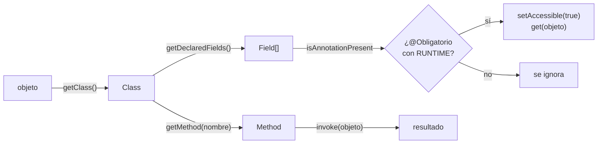
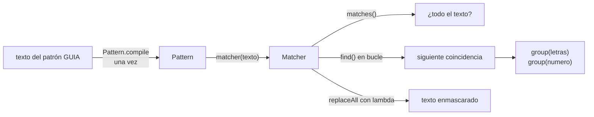
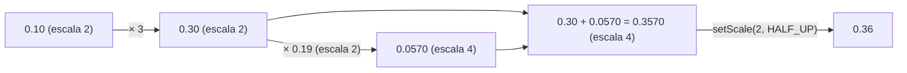
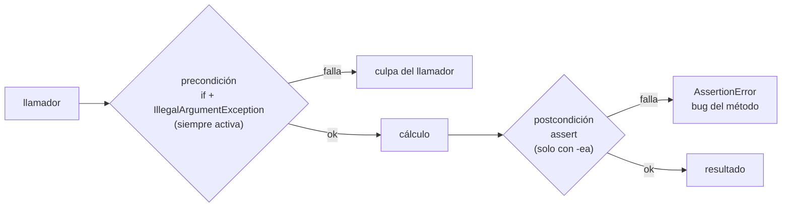
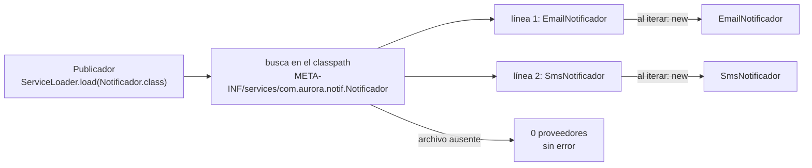
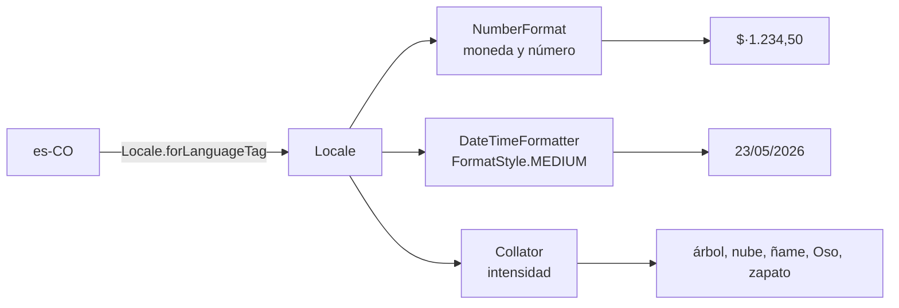
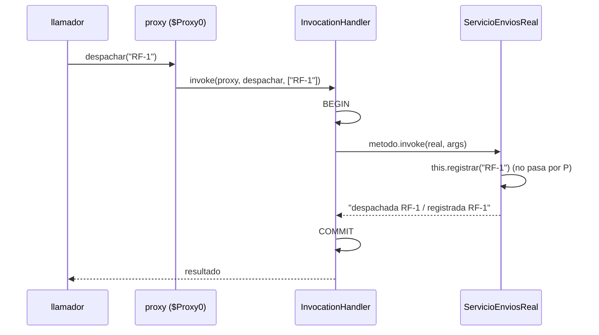
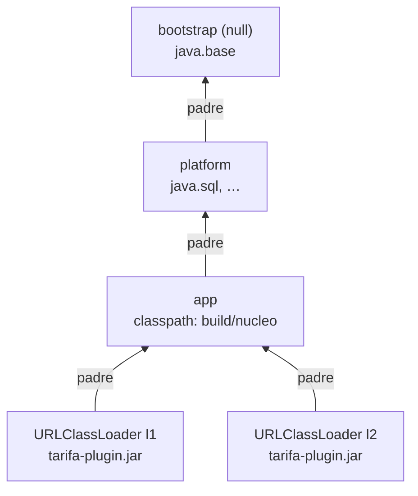
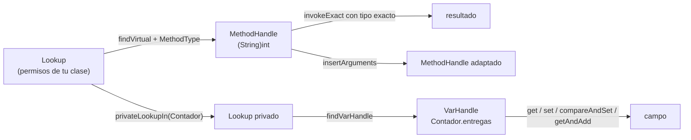

# Módulo 19: Java del día a día — reflexión, regex, dinero, contratos, plugins e i18n

El JDK incluye muchas APIs que resuelven problemas cotidianos: inspeccionar clases en runtime, validar texto con patrones, calcular dinero sin errores de centavos, expresar contratos, cargar plugins, formatear datos por región, interceptar llamadas y acceder a miembros con APIs modernas. El riesgo es usarlas por intuición. Una regex sin límites puede validar mal; `double` produce errores monetarios; una assertion deshabilitada no protege nada; un proxy dinámico parece magia hasta que necesitas depurar una excepción.

Vas a construir `tienda-aurora-java-m19`, un proyecto pequeño y verificable donde cada concepto se ve en código real. No es un cajón de utilidades sueltas: el hilo conductor es que todas son APIs estándar del JDK que exigen conocer su contrato.

## Apertura del módulo

Al terminar este módulo podrás:
- leer la estructura de una clase y sus anotaciones con reflexión, y validar objetos con una anotación propia;
- validar, buscar, extraer y enmascarar texto con `Pattern`, `Matcher` y grupos con nombre;
- calcular dinero exacto con `BigDecimal`, escala y un `RoundingMode` explícito;
- separar precondiciones (excepciones) de postcondiciones (`assert` con `-ea`);
- descubrir implementaciones con `ServiceLoader` y cargar un plugin desde un JAR con `URLClassLoader`;
- formatear y ordenar datos según el `Locale` del usuario;
- interceptar llamadas con un proxy dinámico y explicar el límite de la auto-invocación;
- invocar métodos y actualizar campos con `MethodHandle` y `VarHandle`.

**Esquema del módulo:** reflexión y anotaciones (Tema 1); expresiones regulares (Tema 2); `BigDecimal` (Tema 3);
assertions y contratos (Tema 4); `ServiceLoader` (Tema 5); internacionalización (Tema 6); proxies dinámicos (Tema 7);
cargadores de clases (Tema 8); `MethodHandle` y `VarHandle` (Tema 9). Cada tema trae programas de un solo archivo en la
Capa 1 y los archivos del proyecto `tienda-aurora-java-m19` en la Capa 2. `App.java`, las pruebas y la verificación
real van después del Tema 9.

**Qué necesitas saber antes:** clases, interfaces y `@Override` (Java, Módulo 1, Temas 1 a 3); `Locale`, *punto
flotante* y `DateTimeFormatter` (Java, Módulo 0, Temas 4, 5 y 8); excepciones checked y unchecked (Java, Módulo 3);
lambdas y referencias a métodos (Java, Módulo 4, Tema 1); concurrencia y operaciones atómicas (Java, Módulo 5, Temas 1 y
4); classpath y `.class` (Java, Módulo 0, Tema 1); `ServiceLoader`, `opens` y reflexión profunda (Java, Módulo 10,
Temas 1 y 3); patrón Proxy y escala de `BigDecimal` (Java, Módulo 12, Temas 2 y 4); Gradle (Java, Módulo 8).

**Entorno de las salidas.** Las salidas del proyecto se capturaron el 2026-11-23 en macOS arm64 con JDK 27.0.1.0.2,
toolchain Java 25 y Gradle 9.9.1 (sección «Verificación real»). Los programas de los temas se ejecutaron el 2026-11-24
con OpenJDK 25.0.5.1 en Linux x86_64 (`java Archivo.java`, o `javac` y `java` cuando hay varios archivos); con ese mismo
JDK se recompiló el proyecto y `App` reprodujo la misma salida. Los tiempos en milisegundos y los códigos hash
cambian en cada ejecución.


## Prerrequisitos y bootstrap

```bash
java -version
gradle --version
mkdir -p tienda-aurora-java-m19/src/main/java/com/aurora/stdlib
mkdir -p tienda-aurora-java-m19/src/main/resources/META-INF/services
mkdir -p tienda-aurora-java-m19/src/plugin/java/com/aurora/plugin
mkdir -p tienda-aurora-java-m19/src/test/java/com/aurora/stdlib
cd tienda-aurora-java-m19
gradle wrapper --gradle-version 9.9.1
```

Estructura:

```text
tienda-aurora-java-m19/
├── build.gradle.kts
├── settings.gradle.kts
└── src/
    ├── main/
    │   ├── java/com/aurora/stdlib/
    │   │   ├── App.java
    │   │   ├── AuditCampo.java
    │   │   ├── Auditor.java
    │   │   ├── CalculadoraPrecio.java
    │   │   ├── ClassLoaderDemo.java
    │   │   ├── Complemento.java
    │   │   ├── Contratos.java
    │   │   ├── EmailNotificador.java
    │   │   ├── FormateadorRegional.java
    │   │   ├── HandlesDemo.java
    │   │   ├── Notificador.java
    │   │   ├── Operacion.java
    │   │   ├── OperacionReal.java
    │   │   ├── Pedido.java
    │   │   ├── ProxyDemo.java
    │   │   ├── ServicioRegistro.java
    │   │   ├── ServicioRegistroImpl.java
    │   │   ├── SmsNotificador.java
    │   │   └── ValidadorCodigo.java
    │   └── resources/META-INF/services/
    │       └── com.aurora.stdlib.Notificador
    ├── plugin/java/com/aurora/plugin/
    │   └── ComplementoPlugin.java
    └── test/java/com/aurora/stdlib/
        └── StdlibTest.java
```

El plugin se compila en un JAR aparte (`build/plugin/complemento-plugin.jar`) con una tarea de Gradle y se carga con `URLClassLoader`; el JAR no se versiona en el proyecto, se genera durante el build.

## Build desde cero

#### `settings.gradle.kts`

```kotlin
rootProject.name = "tienda-aurora-java-m19"
```

#### `build.gradle.kts`

Se habilita `-ea` en tests porque el Tema 4 usa `assert` para invariantes internas. También se agrega `-parameters` por si se inspeccionan nombres de parámetros con reflexión; es buena práctica en proyectos modernos.

```kotlin
plugins { java; application }
group = "com.aurora"; version = "1.0.0"
java { toolchain { languageVersion = JavaLanguageVersion.of(25) } }
repositories { mavenCentral() }
dependencies {
    testImplementation(platform("org.junit:junit-bom:5.13.4"))
    testImplementation("org.junit.jupiter:junit-jupiter")
    testRuntimeOnly("org.junit.platform:junit-platform-launcher")
}
application { mainClass = "com.aurora.stdlib.App" }
tasks.test {
    useJUnitPlatform()
    jvmArgs("-ea") // habilita assertions para Tema 4
    testLogging { events("passed","skipped","failed") }
}
tasks.withType<JavaCompile>().configureEach {
    options.encoding = "UTF-8"
    options.compilerArgs.addAll(listOf("-Xlint:all", "-Xlint:-processing", "-parameters", "-Werror"))
}

// Plugin real en un JAR aparte: se compila contra el API del núcleo y se carga con URLClassLoader.
val pluginClases = layout.buildDirectory.dir("plugin/classes")
val pluginDirectorio = layout.buildDirectory.dir("plugin")
val pluginJarArchivo = pluginDirectorio.map { it.file("complemento-plugin.jar") }
val compilarPlugin by tasks.registering(JavaCompile::class) {
    source = fileTree("src/plugin/java")
    classpath = sourceSets["main"].output
    destinationDirectory.set(pluginClases)
    options.encoding = "UTF-8"
    options.release.set(25)
    options.compilerArgs.addAll(listOf("-Xlint:all", "-Xlint:-processing", "-Werror"))
}
val pluginJar by tasks.registering(Jar::class) {
    dependsOn(compilarPlugin)
    from(pluginClases)
    archiveFileName.set("complemento-plugin.jar")
    destinationDirectory.set(pluginDirectorio)
}
tasks.named("run") { dependsOn(pluginJar) }
tasks.named<Test>("test") {
    dependsOn(pluginJar)
    systemProperty("plugin.jar", pluginJarArchivo.get().asFile.absolutePath)
}
```

`options.release.set(25)` en la tarea del plugin evita que se compile contra la API del JDK 27 de la máquina y luego falle al cargarse en una JVM con toolchain Java 25: el error observado sin esta opción fue `UnsupportedClassVersionError: class file version 71.0 ... up to 69.0`.

## Visual del módulo

**Visual:** [Mapa de utilidades del día a día](/visuals/temas/java/modulo-19-dia-a-dia.html)

Lectura: cada mecanismo cubre un borde distinto; la herramienta correcta hace explícito el contrato y falla de forma comprobable.

### Tema 1: Reflexión y anotaciones en tiempo de ejecución · Intermedio · 45 min

<details open>
<summary><strong>Capa 1 — Lectura</strong></summary>

#### Objetivos
Al terminar este tema podrás:
- inspeccionar campos y métodos de una clase con `Class`, `Field` y `Method`;
- declarar una anotación propia con `@Retention` y `@Target` y leerla en tiempo de ejecución;
- validar campos obligatorios de cualquier objeto marcándolos con una anotación;
- leer `NoSuchFieldException` e `IllegalAccessException` y explicar por qué una anotación «desaparece».

**Conceptos clave:** reflexión, `Class`, `Field`, `Method`, anotación, `@Retention`, `@Target`, `setAccessible`

Ya los conoces y no se repiten: *reflexión profunda*, `opens` e `InaccessibleObjectException` (Java, Módulo 10, Tema 3);
`@Override` (Java, Módulo 1, Tema 2); `@Test` (Java, Módulo 9, Tema 1); `private` y encapsulación (Java, Módulo 1,
Tema 1); excepción checked (Java, Módulo 3, Tema 1).

#### El problema
Tienda Aurora tiene diez clases de formularios: envío, devolución, reclamo… Cada una tiene campos obligatorios.
Escribir un `if (campo == null)` por campo y por clase es repetitivo y se olvida al agregar uno nuevo. ¿Cómo escribes
un solo validador que funcione con clases que todavía no existen?

#### Glosario del tema

**reflexión**
- **Definición técnica:** API de `java.lang.reflect` que permite a un programa examinar y usar su propia estructura en tiempo de ejecución: clases, campos, métodos, constructores y anotaciones.
- **En palabras sencillas:** el programa se mira al espejo y pregunta «¿qué campos tengo?» en vez de saberlo de memoria.
- **Dónde se rompe la comparación:** el espejo no se equivoca; la reflexión sí falla en ejecución si pides un nombre que no existe.
- **Ejemplo:** `Envio.class.getDeclaredFields()` devuelve los tres campos de `Envio` sin escribir sus nombres.
- **Error típico:** usarla para lógica normal: un renombre no rompe la compilación y falla después en producción.

**`Class`**
- **Definición técnica:** objeto `java.lang.Class<T>` que representa un tipo cargado en la JVM; es la puerta de entrada a la reflexión (`Envio.class`, `obj.getClass()`).
- **En palabras sencillas:** la ficha técnica de un tipo: nombre, campos, métodos, padre.
- **Dónde se rompe la comparación:** hay una ficha por tipo y por cargador de clases, no una por objeto (Tema 8).
- **Ejemplo:** `tipo.getName()` imprime `Reflexion$Envio`: el `$` marca una clase anidada.
- **Error típico:** confundir `getName()` (`Reflexion$Envio`) con `getSimpleName()` (`Envio`) al comparar nombres.

**`Field`**
- **Definición técnica:** objeto de `java.lang.reflect` que representa un campo; da su nombre, tipo, anotaciones, y lee o escribe su valor con `get`/`set`.
- **En palabras sencillas:** un dedo que señala un campo concreto de la clase, listo para leerlo en cualquier objeto.
- **Dónde se rompe la comparación:** el dedo no basta si el campo es `private`: sin `setAccessible(true)` la lectura falla.
- **Ejemplo:** `f.getName() + " : " + f.getType().getSimpleName()` imprime `guia : String`.
- **Error típico:** usar `getFields()`: solo devuelve campos `public`, incluidos los heredados; los privados están en `getDeclaredFields()`.

**`Method`**
- **Definición técnica:** objeto de `java.lang.reflect` que representa un método; `invoke(objeto, args...)` lo ejecuta sobre un objeto concreto.
- **En palabras sencillas:** el botón de una acción, que puedes presionar sobre el objeto que elijas.
- **Dónde se rompe la comparación:** si la acción lanza una excepción, llega envuelta en `InvocationTargetException` (Tema 7).
- **Ejemplo:** `tipo.getMethod("resumen")` y luego `m.invoke(bueno)` devuelve `RF-1->Bogotá`.
- **Error típico:** pedir un nombre inexistente: `getMethod("resumenCorto")` lanza `NoSuchMethodException: Reflexion$Envio.resumenCorto()`.

**anotación**
- **Definición técnica:** metadato declarado con `@interface` y aplicado con `@Nombre` sobre clases, campos o métodos; no ejecuta nada por sí mismo, alguien debe leerlo.
- **En palabras sencillas:** un adhesivo de color pegado a un campo: «obligatorio». El adhesivo no hace nada; el revisor sí.
- **Dónde se rompe la comparación:** algunos adhesivos se despegan al compilar; depende de `@Retention`.
- **Ejemplo:** `@Obligatorio private final String guia;`.
- **Error típico:** esperar que la anotación valide sola: sin un código como `faltantes(...)`, `@Obligatorio` no hace nada.

**`@Retention`**
- **Definición técnica:** meta-anotación que fija hasta cuándo vive una anotación: `SOURCE` (solo compilador), `CLASS` (en el `.class`, invisible a la reflexión; es el valor por defecto) o `RUNTIME` (visible por reflexión).
- **En palabras sencillas:** la fecha de caducidad del adhesivo.
- **Dónde se rompe la comparación:** con `CLASS` el adhesivo sigue en el archivo `.class`, pero la reflexión no lo ve.
- **Ejemplo:** sin `@Retention(RetentionPolicy.RUNTIME)`, `SinRetencion.java` imprime `anotaciones visibles = 0`.
- **Error típico:** olvidarla: la anotación compila sin aviso y el validador nunca encuentra nada.

**`@Target`**
- **Definición técnica:** meta-anotación que limita dónde se puede aplicar una anotación (`FIELD`, `METHOD`, `TYPE`…); el compilador rechaza otros usos.
- **En palabras sencillas:** las instrucciones del adhesivo: «solo para campos».
- **Dónde se rompe la comparación:** aquí sí hay control: ponerla donde no corresponde es error de compilación, no un descuido silencioso.
- **Ejemplo:** `@Target(ElementType.FIELD)` en `Obligatorio`.
- **Error típico:** usar `@Obligatorio` sobre un método con `@Target(FIELD)`: el compilador responde `annotation interface not applicable to this kind of declaration`.

**`setAccessible`**
- **Definición técnica:** método de `AccessibleObject` que desactiva el control de acceso del lenguaje para ese `Field` o `Method`; puede fallar si el módulo dueño no abre el paquete.
- **En palabras sencillas:** pedir permiso especial para tocar algo marcado como privado.
- **Dónde se rompe la comparación:** el permiso no lo da la clase sino su módulo; con JPMS puede negarse (`opens`, Módulo 10).
- **Ejemplo:** `f.setAccessible(true)` antes de `f.get(obj)` en `faltantes`.
- **Error típico:** olvidarlo con campos `private`: `IllegalAccessException: ... with modifiers "private final"`.

#### ► CÓMO FUNCIONA

##### 1. La idea en lenguaje sencillo

Piensa en un revisor de bodega que no conoce los formularios de antemano. En cada formulario, las casillas
obligatorias llevan un adhesivo rojo. El revisor no necesita saber qué formulario tiene enfrente: recorre las
casillas, busca los adhesivos rojos y revisa que esas estén llenas.

Ese revisor es un programa que examina su propia estructura mientras corre. En Tienda Aurora hay formularios de
envío, devolución y reclamo. Con un `if` por campo, cada clase nueva exige código nuevo, y cualquier olvido pasa sin
aviso.

Con reflexión y anotaciones, escribes un solo validador. Lee las clases en tiempo de ejecución, encuentra los
campos marcados y comprueba sus valores, incluso en clases que todavía no existen.

##### 2. Definición formal y vocabulario

La **reflexión** es la API de `java.lang.reflect` con la que un programa examina y usa su estructura en tiempo de
ejecución. Su puerta de entrada es **`Class`**, el objeto que representa un tipo cargado. Desde él obtienes un
**`Field`** por campo y un **`Method`** por método.

Una **anotación** es un metadato declarado con `@interface`. No ejecuta nada: otro código debe leerla. Dos
meta-anotaciones la configuran. **`@Retention`** fija hasta cuándo vive: `SOURCE`, `CLASS` o `RUNTIME`.
**`@Target`** fija dónde se puede aplicar: campo, método, tipo y otros.

Para leer un campo `private`, la reflexión debe saltarse el control de acceso. **`setAccessible(true)`** lo pide,
y el sistema de módulos puede negarlo.

##### 3. Cómo funciona por dentro, paso a paso

El diagrama sigue el validador `faltantes` desde el objeto hasta cada valor:



1. Al compilar, `javac` lee `@Retention(RetentionPolicy.RUNTIME)` en `Obligatorio`. Por eso guarda la anotación en
   el `.class` como atributo visible para la JVM.
2. Al cargar `Envio`, la JVM crea su objeto `Class`. `obj.getClass()` lo devuelve desde cualquier instancia.
3. `getDeclaredFields()` crea un arreglo de `Field` con todos los campos declarados en esa clase, privados
   incluidos.
4. `isAnnotationPresent(Obligatorio.class)` consulta las anotaciones visibles del campo. Con `CLASS`, la anotación
   está en el archivo, pero la JVM no la entrega.
5. `setAccessible(true)` desactiva el control de acceso de ese `Field`. La JVM lo permite si la clase está en un
   paquete abierto a quien llama.
6. `f.get(obj)` devuelve el valor del campo en ese objeto. Un primitivo llega envuelto, por ejemplo como `Integer`.

Este es el núcleo del validador:

```java
for (Field f : obj.getClass().getDeclaredFields()) {
    if (!f.isAnnotationPresent(Obligatorio.class)) continue;
    f.setAccessible(true);
    Object valor = f.get(obj);
    if (valor == null || valor.toString().isBlank()) errores.add(f.getName());
}
```

Observa que el validador no menciona `Envio` en ningún lugar. Funciona con cualquier clase que marque sus campos.
Esa independencia es lo que aprovechan frameworks como JPA, JUnit o los serializadores JSON.

`Method` sigue el mismo patrón. `getMethod("resumen")` busca un método público por nombre y tipos de parámetro.
`m.invoke(bueno)` lo ejecuta sobre un objeto concreto y devuelve el resultado como `Object`.

##### 4. Reglas, variantes y casos límite

- Sin `@Retention`, la política es `CLASS`. La anotación compila sin aviso y la reflexión no la ve:
  `SinRetencion.java` imprime `anotaciones visibles = 0`.
- `@Target` sí se comprueba al compilar. Aplicar una anotación de campo sobre un método es un error de compilación.
- `getFields()` y `getMethods()` devuelven solo miembros públicos, heredados incluidos. `getDeclaredFields()` y
  `getDeclaredMethods()` devuelven los de esa clase, de cualquier visibilidad, sin los heredados.
- La documentación de `getDeclaredFields` no garantiza ningún orden. Que salgan en orden de declaración es un
  detalle de la JVM actual; no lo uses como contrato.
- Los métodos de búsqueda lanzan excepciones checked: `NoSuchFieldException`, `NoSuchMethodException` e
  `IllegalAccessException`. Si el método invocado lanza algo, llega envuelto en `InvocationTargetException`.
- Los elementos de una anotación solo admiten primitivos, `String`, `Class`, enumeraciones, otras anotaciones y
  arreglos de esos tipos.
- Desde Java 16 y 17 (JEP 396 y 403), el JDK encapsula fuertemente sus paquetes internos. `setAccessible` sobre
  ellos falla con `InaccessibleObjectException`, salvo con `opens` o `--add-opens`.
- Desde Java 18 (JEP 416), la reflexión del núcleo se implementa con *method handles*. Tu código no cambia.

La reflexión cuesta. Cada búsqueda por nombre es más lenta que una llamada directa, y un renombre no rompe la
compilación. Guarda los `Field` y `Method` que reutilices, y limita la reflexión a los bordes de infraestructura.

##### 5. Relación con lo que ya sabes y lo que viene

Ya leíste anotaciones sin saberlo: `@Override` (Java, Módulo 1, Tema 2) es `SOURCE` y solo la usa el compilador.
`@Test` (Java, Módulo 9, Tema 1) es `RUNTIME` y JUnit la busca por reflexión. La reflexión profunda y `opens` vienen
del Módulo 10 (Java, Módulo 10, Tema 3). El ORM de juguete de JPA usó esta misma técnica (Java, Módulo 16, Tema 1).

Compara reflexión con polimorfismo. Con una interfaz, el compilador garantiza que el método existe. Con reflexión,
lo descubres al ejecutar. Usa interfaces cuando conoces los tipos; usa reflexión cuando escribes herramientas para
tipos que no conoces.

El Tema 7 usa `Method` e `invoke` dentro de un proxy dinámico. El Tema 8 explica por qué hay un objeto `Class` por
tipo y por cargador. El Tema 9 presenta `MethodHandle`, una alternativa tipada y más rápida a `invoke`.

#### Problema resuelto 1.1
Escribe un validador que reciba cualquier objeto y devuelva los campos marcados con `@Obligatorio` que están vacíos.
Pruébalo con un envío completo y otro con destino en blanco.

**Razonamiento:**
1. La anotación necesita `RUNTIME` para que la reflexión la vea y `FIELD` porque marca campos.
2. El validador recorre `getDeclaredFields()`, salta los campos sin anotación y lee el valor con `setAccessible`.
3. Para ver la estructura, el `main` lista campos y método antes de validar, e invoca `resumen` por nombre.

```java
// Reflexion.java — inspeccionar una clase, leer anotaciones e invocar un método por nombre
import java.lang.annotation.ElementType;
import java.lang.annotation.Retention;
import java.lang.annotation.RetentionPolicy;
import java.lang.annotation.Target;
import java.lang.reflect.Field;
import java.lang.reflect.Method;
import java.util.ArrayList;
import java.util.List;

public class Reflexion {
    @Retention(RetentionPolicy.RUNTIME)
    @Target(ElementType.FIELD)
    @interface Obligatorio {}

    static class Envio {
        @Obligatorio private final String guia;
        @Obligatorio private final String destino;
        private final String nota;

        Envio(String guia, String destino, String nota) {
            this.guia = guia;
            this.destino = destino;
            this.nota = nota;
        }
        public String resumen() { return guia + "->" + destino; }
    }

    static List<String> faltantes(Object obj) throws IllegalAccessException {
        List<String> errores = new ArrayList<>();
        for (Field f : obj.getClass().getDeclaredFields()) {
            if (!f.isAnnotationPresent(Obligatorio.class)) continue;
            f.setAccessible(true);
            Object valor = f.get(obj);
            if (valor == null || valor.toString().isBlank()) errores.add(f.getName());
        }
        return errores;
    }

    public static void main(String[] args) throws Exception {
        Class<?> tipo = Envio.class;
        System.out.println("clase   = " + tipo.getName());
        for (Field f : tipo.getDeclaredFields()) {
            System.out.println("campo   = " + f.getName() + " : " + f.getType().getSimpleName()
                    + " obligatorio=" + f.isAnnotationPresent(Obligatorio.class));
        }
        Method m = tipo.getMethod("resumen");
        System.out.println("metodo  = " + m.getName() + " devuelve " + m.getReturnType().getSimpleName());

        Envio bueno = new Envio("RF-1", "Bogotá", null);
        Envio malo = new Envio("RF-2", " ", "frágil");
        System.out.println("invoke  = " + m.invoke(bueno));
        System.out.println("bueno   = faltan " + faltantes(bueno));
        System.out.println("malo    = faltan " + faltantes(malo));
    }
}
```

```text
$ java Reflexion.java
clase   = Reflexion$Envio
campo   = guia : String obligatorio=true
campo   = destino : String obligatorio=true
campo   = nota : String obligatorio=false
metodo  = resumen devuelve String
invoke  = RF-1->Bogotá
bueno   = faltan []
malo    = faltan [destino]
```

**Explicación por partes.**
- Líneas 12–14: `@Obligatorio` vive hasta la ejecución y solo se aplica a campos.
- Líneas 29–38: el validador no conoce `Envio`; funciona con cualquier clase que use la anotación.
- Línea 33: `setAccessible(true)` permite leer los campos `private final`.
- Líneas 43–46: los campos salen en el orden de declaración en esta JVM; la especificación no garantiza el orden.
- Líneas 47 y 52: el método se busca por nombre y se ejecuta sobre `bueno`.
- Última línea: `nota` es `null` en `bueno`, pero no es obligatoria; en `malo` falta `destino` porque `" "` está en blanco.

#### Problema resuelto 1.2
Comprueba qué ve la reflexión si la anotación no declara `@Retention`, y qué pasa si el nombre del campo está mal escrito.

**Razonamiento:**
1. Sin `@Retention`, la política es `CLASS`: queda en el `.class` pero la reflexión no la entrega.
2. `getDeclaredField` con un nombre que no existe lanza una excepción checked.

```java
// SinRetencion.java — una anotación sin @Retention(RUNTIME) no existe para la reflexión
import java.lang.annotation.ElementType;
import java.lang.annotation.Target;
import java.lang.reflect.Field;

public class SinRetencion {
    @Target(ElementType.FIELD)
    @interface Obligatorio {}          // falta @Retention(RetentionPolicy.RUNTIME)

    static class Envio {
        @Obligatorio String guia = "";
    }

    public static void main(String[] args) throws Exception {
        Field f = Envio.class.getDeclaredField("guia");
        System.out.println("anotaciones visibles = " + f.getAnnotations().length);
        System.out.println("obligatorio=" + f.isAnnotationPresent(Obligatorio.class));
        Envio.class.getDeclaredField("guía");
    }
}
```

```text
$ java SinRetencion.java
anotaciones visibles = 0
obligatorio=false
Exception in thread "main" java.lang.NoSuchFieldException: guía
	at java.base/java.lang.Class.getDeclaredField(Class.java:2382)
	at SinRetencion.main(SinRetencion.java:18)
```

**Explicación por partes.**
- Línea 8: la anotación no declara `@Retention`; no hay error de compilación.
- Líneas 16–17: el campo existe y tiene la anotación en el código, pero la reflexión ve 0 anotaciones.
- Línea 18: `guía` (con tilde) no es `guia`; la excepción nombra el campo que pediste.

> **Error común.** Leer un campo privado sin pedir acceso. El mensaje nombra la clase que intenta leer, la clase dueña
> y los modificadores:

```java
// SinAcceso.java — leer un campo privado de otra clase sin setAccessible
import java.lang.reflect.Field;

public class SinAcceso {
    public static void main(String[] args) throws Exception {
        Field f = Pedido.class.getDeclaredField("total");
        System.out.println(f.get(new Pedido()));
    }
}

class Pedido {
    private final String total = "10.00";
}
```

```text
$ java SinAcceso.java
Exception in thread "main" java.lang.IllegalAccessException: class SinAcceso cannot access a member of class Pedido with modifiers "private final"
```

> Llama `f.setAccessible(true)` antes de `get`. Si la clase está en un módulo que no abre su paquete, el error cambia a
> `InaccessibleObjectException` (Módulo 10, Tema 3): la solución es `opens`, no más reflexión.

> **Buena práctica.** Usa reflexión en el borde (validadores, serializadores, frameworks) y expón el resultado con
> tipos normales. El resto del código llama a `faltantes(obj)`, no a `getDeclaredFields`.

> **Prevenir errores.** Prueba cada anotación propia con un test que la lea por reflexión. Ese test falla en cuanto
> alguien borra `@Retention(RUNTIME)`.

#### Checkpoint 1.1
¿Qué imprime `faltantes(new Envio(null, null, null))`?

Respuesta: `[guia, destino]`. Los dos campos anotados son `null`; `nota` también, pero no está anotada.

</details>

<details>
<summary><strong>Capa 2 — Construcción</strong></summary>

#### Paso 1 · Crea la anotación `AuditCampo.java`
En `tienda-aurora-java-m19`, `@AuditCampo` marca qué campos deben entrar en una auditoría, y el auditor los lee dinámicamente.

```java
package com.aurora.stdlib;

import java.lang.annotation.ElementType;
import java.lang.annotation.Retention;
import java.lang.annotation.RetentionPolicy;
import java.lang.annotation.Target;

@Retention(RetentionPolicy.RUNTIME)
@Target(ElementType.FIELD)
public @interface AuditCampo {
    String nombre();
}
```

#### Paso 2 · Crea `Pedido.java`

```java
package com.aurora.stdlib;

import java.math.BigDecimal;

public class Pedido {
    @AuditCampo(nombre = "id")
    private final String id;
    @AuditCampo(nombre = "total")
    private final BigDecimal total;
    private final String notaInterna;

    public Pedido(String id, BigDecimal total, String notaInterna) {
        this.id = id;
        this.total = total;
        this.notaInterna = notaInterna;
    }
    public String id() { return id; }
    public BigDecimal total() { return total; }
    public String notaInterna() { return notaInterna; }
}
```

`notaInterna` no está anotada: el auditor no debe exponerla. Ese es el contrato explícito.

#### Paso 3 · Crea `Auditor.java`

```java
package com.aurora.stdlib;

import java.lang.reflect.Field;
import java.util.LinkedHashMap;
import java.util.Map;

public final class Auditor {
    private Auditor() {}

    public static Map<String, Object> auditar(Object obj) {
        Map<String, Object> out = new LinkedHashMap<>();
        for (Field f : obj.getClass().getDeclaredFields()) {
            AuditCampo ann = f.getAnnotation(AuditCampo.class);
            if (ann == null) continue;
            try {
                f.setAccessible(true);
                out.put(ann.nombre(), f.get(obj));
            } catch (IllegalAccessException e) {
                throw new IllegalStateException("no se pudo leer campo " + f.getName(), e);
            }
        }
        return out;
    }
}
```

Resultado verificado: `AUDIT={id=P1, total=10.00}`. La nota interna no aparece. El caso de borde importante es el
acceso: `setAccessible(true)` puede fallar con módulos JPMS que no abren el paquete. En código moderno, conviene preferir
handles (Tema 9) o exponer la información por diseño, pero hay que entender reflexión porque el ecosistema Java la usa ampliamente.

#### Paso 4 · Ejecuta el validador
En `~/labs/aurora-m19`, ejecuta `java Reflexion.java` y `java SinRetencion.java`. Compara `obligatorio=true` del
primero con `anotaciones visibles = 0` del segundo.

#### Resumen
- La **reflexión** examina clases en ejecución; los errores de nombre aparecen al ejecutar, no al compilar.
- **`Class`** es la entrada; **`Field`** y **`Method`** representan un campo y un método, y se usan con `get` e `invoke`.
- Una **anotación** es un metadato: solo actúa si un código la lee.
- **`@Retention(RUNTIME)`** la hace visible a la reflexión; sin ella, la anotación «desaparece» en silencio.
- **`@Target`** limita dónde se aplica, y el compilador lo hace cumplir.
- **`setAccessible(true)`** permite leer miembros privados, sujeto a lo que abra el módulo.

#### Ejercicio verificable 1
Básico. En `Reflexion.java`, quita `@Obligatorio` del campo `destino`. ¿Qué imprime la línea de `malo`?

Respuesta esperada: `malo    = faltan []`. Solo `guia` sigue siendo obligatoria, y en `malo` vale `RF-2`.

#### Ejercicio verificable 2
Intermedio. Cambia `getMethod("resumen")` por `getMethod("resumenCorto")`. ¿Compila? ¿Qué ves al ejecutar?

Respuesta esperada: compila. Al ejecutar: `Exception in thread "main" java.lang.NoSuchMethodException:
Reflexion$Envio.resumenCorto()`. El nombre es un texto; el compilador no lo revisa.

#### Ejercicio verificable 3
Reto. Agrega a `@Obligatorio` el atributo `String mensaje() default "es obligatorio"` y haz que `faltantes` devuelva
`campo: mensaje`. ¿Qué imprime la línea de `malo`?

Respuesta esperada: `malo    = faltan [destino: es obligatorio]`. El valor se lee con
`f.getAnnotation(Obligatorio.class).mensaje()`.

#### En el trabajo
Bean Validation (`@NotNull`, `@NotBlank`) funciona exactamente así: Hibernate Validator lee las anotaciones por
reflexión. Jackson, JPA y Spring también leen tus anotaciones al arrancar. Cuando una anotación «no hace nada», revisa
primero su `@Retention` y si el framework escanea ese paquete.

</details>

### Tema 2: Expresiones regulares con Pattern y Matcher · Intermedio · 40 min

<details open>
<summary><strong>Capa 1 — Lectura</strong></summary>

#### Objetivos
Al terminar este tema podrás:
- escribir un patrón con clases de caracteres, cuantificadores, anclas y grupos con nombre;
- elegir entre `matches()` y `find()` según si validas todo el texto o buscas dentro de él;
- extraer y enmascarar datos con grupos de captura sin depender de su posición;
- leer `PatternSyntaxException` e `IllegalStateException: No match found` y reconocer un patrón con retroceso costoso.

**Conceptos clave:** expresión regular, `Pattern`, `Matcher`, `matches` y `find`, ancla, clase de caracteres, cuantificador, grupo de captura, grupo con nombre, backtracking catastrófico

Ya los conoces y no se repiten: `String` e inmutabilidad (Java, Módulo 0, Tema 5); lambda (Java, Módulo 4, Tema 1);
*validación de entrada* (Seguridad, Módulo 0, Tema 4); allowlist de `id` en `ApiCliente` (Java, Módulo 18, Tema 1).

#### El problema
Los mensajes de soporte de Tienda Aurora traen guías con la forma `ABC-1234` mezcladas con texto libre. Hay que validar
una guía escrita en un formulario, encontrar todas las guías de un mensaje y ocultar sus números antes de guardar el
mensaje en los logs. Con `indexOf` y `substring` cada regla son diez líneas frágiles. ¿Cómo describes la forma una vez y la reutilizas?

#### Glosario del tema

**expresión regular**
- **Definición técnica:** texto en un lenguaje formal que describe un conjunto de cadenas; un motor la compara con una entrada para validar, buscar o reemplazar.
- **En palabras sencillas:** un molde de forma: «tres mayúsculas, un guion y cuatro dígitos».
- **Dónde se rompe la comparación:** un molde se ve; una regex densa es difícil de leer y necesita pruebas.
- **Ejemplo:** `(?<letras>[A-Z]{3})-(?<numero>\d{4})` describe `ABC-1234`.
- **Error típico:** olvidar que en Java la barra se escribe doble dentro del `String`: `"\\d"`, no `"\d"`.

**`Pattern`**
- **Definición técnica:** clase de `java.util.regex` que guarda una expresión regular compilada; es inmutable y segura para compartir entre hilos.
- **En palabras sencillas:** el molde ya fabricado, listo para usarse muchas veces.
- **Dónde se rompe la comparación:** fabricarlo cuesta; `String.matches(regex)` fabrica uno nuevo en cada llamada.
- **Ejemplo:** `private static final Pattern GUIA = Pattern.compile(...)` en `Regex.java`.
- **Error típico:** compilar el `Pattern` dentro de un bucle que procesa miles de líneas.

**`Matcher`**
- **Definición técnica:** objeto que aplica un `Pattern` a una entrada concreta y guarda el estado de la búsqueda (posición, grupos); no es seguro entre hilos.
- **En palabras sencillas:** la persona que pasa el molde por un texto y recuerda dónde se quedó.
- **Dónde se rompe la comparación:** la persona puede contarte lo que halló; el `Matcher` solo responde `group()` después de una coincidencia.
- **Ejemplo:** `Matcher m = GUIA.matcher(texto); while (m.find()) { ... }`.
- **Error típico:** llamar `m.group()` sin `find()` o `matches()` antes: `IllegalStateException: No match found`.

**`matches` y `find`**
- **Definición técnica:** `matches()` exige que **toda** la entrada cumpla el patrón; `find()` busca la siguiente subcadena que lo cumpla y avanza.
- **En palabras sencillas:** `matches` pregunta «¿todo esto es una guía?»; `find` pregunta «¿hay una guía aquí dentro?».
- **Dónde se rompe la comparación:** `find` recuerda la posición: llamarlo otra vez busca la siguiente, no la misma.
- **Ejemplo:** `ref ABC-1234` da `matches=false find=true`.
- **Error típico:** validar un formulario con `find()`: `ABC-12345` pasa porque contiene `ABC-1234`.

**ancla**
- **Definición técnica:** símbolo que no consume caracteres y exige una posición: `^` inicio, `$` fin, `\b` borde de palabra.
- **En palabras sencillas:** marcas de «aquí empieza» y «aquí termina» en el molde.
- **Dónde se rompe la comparación:** con `matches()` las anclas de inicio y fin son implícitas; con `find()` no.
- **Ejemplo:** con `^...$`, `find()` sobre `ref ABC-1234` devuelve `false`.
- **Error típico:** validar con `find()` y sin anclas: acepta basura antes y después.

**clase de caracteres**
- **Definición técnica:** conjunto entre corchetes que acepta un carácter de los listados (`[A-Z]`, `[0-9_-]`); hay atajos como `\d` (dígito) y `\s` (espacio).
- **En palabras sencillas:** una casilla del molde que admite varias letras posibles.
- **Dónde se rompe la comparación:** `[A-Z]` no incluye `Ñ` ni letras con tilde.
- **Ejemplo:** `[A-Z]{3}` rechaza `abc` porque son minúsculas.
- **Error típico:** escribir `[A-z]`: incluye `[`, `\`, `]`, `^`, `_` y la tilde invertida, que están entre `Z` y `a`.

**cuantificador**
- **Definición técnica:** indica cuántas veces se repite el elemento anterior: `?` (0 o 1), `*` (0 o más), `+` (1 o más), `{n}`, `{n,m}`.
- **En palabras sencillas:** cuántas casillas iguales seguidas tiene el molde.
- **Dónde se rompe la comparación:** `*` y `+` son «codiciosos»: toman todo lo posible y retroceden si hace falta.
- **Ejemplo:** `\d{4}` exige exactamente cuatro dígitos.
- **Error típico:** usar `\d+` donde el formato dice cuatro dígitos: acepta `ABC-1`.

**grupo de captura**
- **Definición técnica:** parte del patrón entre paréntesis cuyo texto coincidente se guarda y se lee con `group(n)`, numerado por su paréntesis de apertura.
- **En palabras sencillas:** una sección del molde que además guarda lo que encontró.
- **Dónde se rompe la comparación:** el número depende del orden de los paréntesis; si alguien agrega uno, todos se corren.
- **Ejemplo:** `m.group(2)` devuelve `1234` porque el segundo paréntesis captura los dígitos.
- **Error típico:** seguir usando `group(1)` después de que otra persona agrega un grupo al inicio.

**grupo con nombre**
- **Definición técnica:** grupo declarado como `(?<nombre>...)` y leído con `group("nombre")`; el nombre no cambia si se reordena el patrón.
- **En palabras sencillas:** la sección del molde lleva etiqueta, así no dependes de contar paréntesis.
- **Dónde se rompe la comparación:** el nombre solo admite letras y dígitos y empieza por letra: `(?<numero_guia>...)` no compila.
- **Ejemplo:** `r.group("letras") + "-****"` enmascara cada guía en `replaceAll`.
- **Error típico:** pedir un nombre que no existe: `group("num")` lanza `IllegalArgumentException`.

**backtracking catastrófico**
- **Definición técnica:** crecimiento exponencial del tiempo de búsqueda cuando un patrón ambiguo obliga al motor a probar muchas formas de repartir la entrada antes de fallar; es la base de los ataques ReDoS.
- **En palabras sencillas:** buscar una llave probando cada combinación de bolsillos, cuando la llave nunca estuvo ahí.
- **Dónde se rompe la comparación:** el motor del JDK ya optimiza los casos clásicos; los patrones con referencias hacia atrás (`\1`) siguen expuestos.
- **Ejemplo:** `(\w+)*\1z` tarda 9, 45 y 349 ms con 14, 18 y 22 letras en `Retroceso.java`.
- **Error típico:** aceptar regex escritas por usuarios o aplicar patrones ambiguos a textos largos sin límite de tamaño.

#### ► CÓMO FUNCIONA

##### 1. La idea en lenguaje sencillo

Piensa en un clasificador de paquetes que recibe una plantilla: «tres letras mayúsculas, un guion y cuatro
números». Con ella puede hacer tres trabajos. Revisar si una etiqueta entera cumple la forma. Encontrar etiquetas
válidas dentro de una nota escrita a mano. Y tachar los números de cada etiqueta antes de archivar la nota.

Una expresión regular es esa plantilla escrita en un lenguaje compacto. En Tienda Aurora, las guías tienen la forma
`ABC-1234` y aparecen en formularios y en mensajes de soporte. Sin regex, cada regla son varias líneas con
`indexOf` y `substring`, fáciles de romper.

Con un solo patrón describes la forma una vez. Después lo usas para validar, buscar, extraer y enmascarar.

##### 2. Definición formal y vocabulario

Una **expresión regular** es un texto que describe un conjunto de cadenas. En Java la compilas en un **`Pattern`**,
inmutable y seguro entre hilos. Para aplicarlo a una entrada concreta creas un **`Matcher`**, que guarda la
posición y los grupos de la búsqueda.

El `Matcher` ofrece dos preguntas distintas: **`matches` y `find`**. La primera exige que toda la entrada cumpla el
patrón; la segunda busca la siguiente subcadena que lo cumpla.

El patrón se arma con piezas. Una **ancla** exige una posición sin consumir caracteres. Una **clase de caracteres**
acepta uno de varios caracteres. Un **cuantificador** indica cuántas veces se repite algo. Un **grupo de captura**
guarda lo encontrado; un **grupo con nombre** lo guarda con etiqueta. Un patrón ambiguo puede sufrir
**backtracking catastrófico**.

##### 3. Cómo funciona por dentro, paso a paso

El diagrama muestra el ciclo de vida de un patrón, desde el texto hasta cada uso:



1. `Pattern.compile` analiza el texto del patrón y construye un árbol de nodos: literales, clases, repeticiones y
   grupos. Si hay un error de sintaxis, lanza `PatternSyntaxException` aquí.
2. `GUIA.matcher(texto)` crea un `Matcher` ligero que apunta al árbol y a la entrada.
3. `matches()` intenta que el árbol cubra desde la posición 0 hasta el final. Las anclas de inicio y fin son
   implícitas.
4. `find()` prueba el árbol desde la posición actual. Si falla, avanza un carácter y vuelve a probar. Si acierta,
   guarda inicio, fin y grupos, y deja la posición después de la coincidencia.
5. Cuando una repetición como `\d+` no permite completar el resto, el motor devuelve caracteres y prueba otro
   reparto. Ese retroceso es el **backtracking**.
6. `group("letras")`, `start()` y `end()` leen lo guardado en el paso 4. Sin coincidencia previa, no hay nada que
   leer.

Observa el patrón del tema y una búsqueda en bucle:

```java
private static final Pattern GUIA = Pattern.compile("(?<letras>[A-Z]{3})-(?<numero>\\d{4})");

Matcher m = GUIA.matcher(texto);
while (m.find()) {
    System.out.println(m.group("letras") + " " + m.group("numero"));
}
```

En Java, la barra invertida se escribe doble dentro del literal: `"\\d"` llega al motor como `\d`. Cada `find()`
continúa donde terminó el anterior; por eso el bucle recorre las tres guías del mensaje una sola vez.

El paso 5 explica `Retroceso.java`. En `(\w+)*\1z`, cada reparto de las letras entre repeticiones es una opción
distinta. Como la entrada nunca termina en `z`, el motor prueba muchísimas opciones antes de fallar.

##### 4. Reglas, variantes y casos límite

- `String.matches(regex)` compila un `Pattern` nuevo en cada llamada. Para uso repetido, guarda el `Pattern` en una
  constante.
- `Pattern` es seguro entre hilos; `Matcher` no. Crea un `Matcher` por entrada y por hilo.
- Por defecto, `\d` y `\w` solo cubren ASCII, y `[A-Z]` no incluye `Ñ`. La bandera `UNICODE_CHARACTER_CLASS`
  amplía las clases predefinidas a Unicode.
- Con la bandera `MULTILINE`, `^` y `$` marcan inicio y fin de cada línea, no de todo el texto.
- En el texto de reemplazo de `replaceAll(String)`, `$` y `\` son especiales. `Matcher.quoteReplacement` los
  escapa; `Pattern.quote` convierte un texto cualquiera en patrón literal.
- Los cuantificadores son codiciosos por defecto. Con `?` detrás (`+?`) son perezosos; con `+` detrás (`++`) son
  posesivos y no retroceden. Los posesivos y los grupos atómicos `(?>...)` reducen el riesgo de retroceso.
- El nombre de un grupo solo admite letras y dígitos y empieza por letra.

Las versiones del JDK fueron ampliando la API. Los grupos con nombre llegaron en Java 7. `replaceAll` con una
función sobre `MatchResult` llegó en Java 9. `Pattern.asMatchPredicate()`, que valida con `matches`, llegó en Java
11.

##### 5. Relación con lo que ya sabes y lo que viene

La inmutabilidad de `String` (Java, Módulo 0, Tema 5) explica por qué `replaceAll` devuelve un texto nuevo. La
función de enmascarado es una lambda (Java, Módulo 4, Tema 1). La validación de entrada viene de Seguridad
(Seguridad, Módulo 0, Tema 4).

Ya usaste una regex sin explicarla: la lista blanca `[A-Za-z0-9_-]{1,32}` de `ApiCliente` (Java, Módulo 18, Tema 1).
Allí `String.matches` validaba el id completo. Compara la regex con un analizador sintáctico: la regex sirve para
formatos planos y bien definidos; no sirve para HTML ni para JSON anidado.

El Tema 6 vuelve sobre el texto desde otro ángulo: cómo se escribe y se ordena según el idioma del usuario. Allí
verás por qué una clase como `[A-Z]` no basta para nombres en español.

#### Problema resuelto 2.1
Con un solo patrón, valida cuatro entradas, encuentra las tres guías de un mensaje con su posición, enmascara sus
números y parte una lista separada por punto y coma.

**Razonamiento:**
1. Patrón: tres mayúsculas (`[A-Z]{3}`), guion literal, cuatro dígitos (`\d{4}`). Cada parte en un grupo con nombre.
2. Para validar se usa `matches()`; para buscar dentro del mensaje, `find()` en un bucle.
3. Para enmascarar, `replaceAll` recibe una función que arma el reemplazo con el grupo `letras`.

```java
// Regex.java — validar, buscar, extraer con grupos y enmascarar guías con Pattern y Matcher
import java.util.regex.Matcher;
import java.util.regex.Pattern;

public class Regex {
    private static final Pattern GUIA = Pattern.compile("(?<letras>[A-Z]{3})-(?<numero>\\d{4})");

    public static void main(String[] args) {
        for (String entrada : new String[] {"ABC-1234", "abc-1234", "ABC-12345", "ref ABC-1234"}) {
            System.out.println(entrada + " matches=" + GUIA.matcher(entrada).matches()
                    + " find=" + GUIA.matcher(entrada).find());
        }

        String texto = "Entregadas ABC-1234 y XYZ-9876; pendiente QRS-0001.";
        Matcher m = GUIA.matcher(texto);
        while (m.find()) {
            System.out.println("encontrada " + m.group() + " en [" + m.start() + "," + m.end() + ")"
                    + " letras=" + m.group("letras") + " numero=" + m.group(2));
        }

        System.out.println(GUIA.matcher(texto).replaceAll(r -> r.group("letras") + "-****"));
        System.out.println(Pattern.compile("\\s*;\\s*").split("a ; b;c").length + " partes con split");
    }
}
```

```text
$ java Regex.java
ABC-1234 matches=true find=true
abc-1234 matches=false find=false
ABC-12345 matches=false find=true
ref ABC-1234 matches=false find=true
encontrada ABC-1234 en [11,19) letras=ABC numero=1234
encontrada XYZ-9876 en [22,30) letras=XYZ numero=9876
encontrada QRS-0001 en [42,50) letras=QRS numero=0001
Entregadas ABC-**** y XYZ-****; pendiente QRS-****.
3 partes con split
```

**Explicación por partes.**
- Línea 6: el `Pattern` se compila una vez y queda en una constante.
- Líneas 9–12: `ABC-12345` falla `matches()` por el quinto dígito, pero `find()` encuentra `ABC-1234` dentro.
- Líneas 16–19: cada `find()` avanza; `start()` y `end()` dan la posición, con `end` exclusivo.
- Línea 18: `group("letras")` y `group(2)` leen grupos por nombre y por número.
- Línea 21: `replaceAll` con lambda conserva las letras y oculta los dígitos de las tres guías.
- Línea 22: `Pattern.split` corta por `;` con espacios opcionales alrededor y produce 3 partes.

#### Problema resuelto 2.2
Mide cuánto tarda un patrón ambiguo en **fallar** sobre entradas de 14, 18 y 22 letras seguidas de `!`.

**Razonamiento:**
1. `(a+)+$` es el ejemplo clásico de patrón ambiguo; el motor del JDK lo optimiza.
2. `(\w+)*\1z` agrega una referencia hacia atrás, que desactiva esa optimización.
3. Ninguno coincide con la entrada, así que el motor prueba todos los repartos antes de rendirse.

```java
// Retroceso.java — backtracking: un patrón ambiguo clásico frente a uno con referencia hacia atrás
import java.util.regex.Pattern;

public class Retroceso {
    public static void main(String[] args) {
        Pattern clasico = Pattern.compile("(a+)+$");
        Pattern conReferencia = Pattern.compile("(\\w+)*\\1z");   // \1 repite lo que capturó el grupo 1
        for (int n = 14; n <= 22; n += 4) {
            String entrada = "a".repeat(n) + "!";                   // no coincide con ninguno de los dos
            System.out.println("n=" + n + " clasico " + medir(clasico, entrada) + " | con \\1 " + medir(conReferencia, entrada));
        }
    }

    static String medir(Pattern p, String entrada) {
        long t0 = System.nanoTime();
        boolean encontrado = p.matcher(entrada).find();
        return encontrado + " " + (System.nanoTime() - t0) / 1_000_000 + " ms";
    }
}
```

```text
$ java Retroceso.java
n=14 clasico false 0 ms | con \1 false 9 ms
n=18 clasico false 0 ms | con \1 false 45 ms
n=22 clasico false 0 ms | con \1 false 349 ms
```

**Explicación por partes.**
- Línea 6: el patrón clásico tarda 0 ms en todas las longitudes en el JDK 25.
- Línea 7: con `\1`, cada 4 letras más el tiempo se multiplica por 5 a 8. Con 26 letras pasó de 4 segundos en una prueba aparte.
- Los milisegundos dependen del equipo; la forma de la curva es lo que importa.

> **Error común.** Llamar `group()` sin haber encontrado nada, o compilar un patrón con un paréntesis sin cerrar.
> Los dos errores aparecen en ejecución:

```java
// RegexMalFormada.java — un paréntesis sin cerrar y un group() sin coincidencia
import java.util.regex.Matcher;
import java.util.regex.Pattern;

public class RegexMalFormada {
    public static void main(String[] args) {
        try {
            Pattern.compile("(?<numero>\\d{4}");
        } catch (Exception e) {
            System.out.println(e.getClass().getName() + ": " + e.getMessage());
        }
        Matcher m = Pattern.compile("\\d{4}").matcher("sin números");
        System.out.println(m.group());
    }
}
```

```text
$ java RegexMalFormada.java
java.util.regex.PatternSyntaxException: Unclosed group near index 15
(?<numero>\d{4}
Exception in thread "main" java.lang.IllegalStateException: No match found
```

> El índice `15` es la posición donde el motor esperaba el `)`. Para `No match found`, revisa que `find()` o
> `matches()` devolvieron `true` antes de pedir grupos.

> **Error común.** Usar `matches()` cuando querías `find()`, o al revés. `matches()` exige que toda la cadena cumpla el
> patrón; `find()` busca una subcadena que cumpla. Otro error es seguir usando `m.group(1)` en una regex que otra persona
> reordena: los grupos con nombre hacen explícito el contrato.

> **Buena práctica.** Guarda cada `Pattern` en una constante `static final` con un nombre de negocio (`GUIA`,
> `PLACA`) y acompáñalo de pruebas con casos válidos e inválidos.

> **Prevenir errores.** Ante texto no confiable, limita el tamaño de la entrada antes de aplicar la regex y evita
> referencias hacia atrás y cuantificadores anidados.

#### Checkpoint 2.1
¿Qué devuelven `matches()` y `find()` para `XYZ-0000 extra` con el patrón `GUIA`?

Respuesta: `matches=false find=true`. Sobra ` extra` para validar todo el texto, pero `XYZ-0000` está dentro.

</details>

<details>
<summary><strong>Capa 2 — Construcción</strong></summary>

#### Paso 1 · Crea `ValidadorCodigo.java`

```java
package com.aurora.stdlib;

import java.util.regex.Matcher;
import java.util.regex.Pattern;

public final class ValidadorCodigo {
    private static final Pattern CODIGO = Pattern.compile("^(?<letras>[A-Z]{3})-(?<numero>\\d{4})$");
    private static final Pattern EN_TEXTO = Pattern.compile("(?<guia>[A-Z]{3}-)(?<digitos>\\d{4})");

    private ValidadorCodigo() {}

    public static boolean esValido(String codigo) {
        if (codigo == null) return false;
        return CODIGO.matcher(codigo).matches();
    }

    public static String extraerPrimerCodigo(String texto) {
        Matcher m = EN_TEXTO.matcher(texto == null ? "" : texto);
        return m.find() ? m.group("guia") + m.group("digitos") : null;
    }

    /** Grupos con nombre: el número se enmascara sin reconstruir la regex a mano. */
    public static String grupoNumero(String codigo) {
        Matcher m = CODIGO.matcher(codigo == null ? "" : codigo);
        return m.matches() ? m.group("numero") : null;
    }

    public static String enmascararGuias(String texto) {
        Matcher m = EN_TEXTO.matcher(texto == null ? "" : texto);
        return m.replaceAll(resultado ->
                resultado.group("guia") + "*".repeat(resultado.group("digitos").length()));
    }
}
```

#### Paso 2 · Lee el contrato de cada método
`^` y `$` anclan el patrón completo: `ABC-1234` es válido, `abc-1234` no. `find()` busca una ocurrencia dentro de un texto mayor. Los grupos con nombre `(?<nombre>...)` permiten leer `m.group("numero")` o usar un `MatchResult` en `replaceAll` sin depender de índices posicionales: cambiar el orden de los grupos no cambia el código que los consume. Salidas verificadas: `CODIGO=true`, `EXTRA=ABC-1234`, `GRUPO=1234`, `ENMASC=ABC-**** y XYZ-****`.

#### Paso 3 · Ejecuta las pruebas de regex
La prueba `regexValidaYExtrae` de `StdlibTest` cubre válido, inválido, extracción, ausencia (`null`), grupo y
enmascarado. Ejecuta `./gradlew -q test`.

#### Resumen
- Una **expresión regular** describe una forma de texto; **`Pattern`** la compila una vez y **`Matcher`** la aplica.
- **`matches` y `find`**: el primero valida todo el texto; el segundo busca dentro y avanza.
- Las **anclas** (`^`, `$`, `\b`) fijan posiciones; la **clase de caracteres** y el **cuantificador** fijan qué y cuántos.
- Un **grupo de captura** guarda lo encontrado; un **grupo con nombre** no depende del orden de los paréntesis.
- El **backtracking catastrófico** dispara el tiempo en patrones ambiguos; limita la entrada y evita `\1`.

#### Ejercicio verificable 1
Básico. Agrega `"XYZ-0000 extra"` al arreglo de la línea 9. ¿Qué imprime su línea?

Respuesta esperada: `XYZ-0000 extra matches=false find=true`.

#### Ejercicio verificable 2
Intermedio. Agrega `^` al inicio y `$` al final del patrón `GUIA`. ¿Qué imprime `find` para `ABC-12345` y `ref ABC-1234`?

Respuesta esperada: `find=false` en los dos. Con anclas, `find()` también exige que la guía ocupe todo el texto.

#### Ejercicio verificable 3
Reto. Escribe un programa que cuente las placas `[A-Z]{3}\d{3}` en `"Vehículos: ABC123, XYZ9876, KLM456 y abc123."` sin
contar `XYZ9876`.

Respuesta esperada: imprime `ABC123`, `KLM456` y `2`. El patrón `\b[A-Z]{3}\d{3}\b` usa bordes de palabra para
rechazar el cuarto dígito de `XYZ9876`; `abc123` falla por las minúsculas.

#### En el trabajo
Las regex aparecen en validación de formularios (`@Pattern` de Bean Validation), en enmascarado de datos personales
en logs y en el ruteo de URL de los frameworks web. Las herramientas de análisis estático marcan los patrones
vulnerables a ReDoS, y los equipos de seguridad piden límites de tamaño en toda entrada que pase por una regex.

</details>

### Tema 3: Dinero exacto con BigDecimal · Básico · 40 min

<details open>
<summary><strong>Capa 1 — Lectura</strong></summary>

#### Objetivos
Al terminar este tema podrás:
- crear `BigDecimal` desde texto o con `valueOf`, y explicar por qué `new BigDecimal(0.1)` no da `0.1`;
- fijar la escala de un total con `setScale` y un `RoundingMode` explícito;
- comparar montos con `compareTo` y no con `equals`;
- dividir sin `ArithmeticException` y repartir un total en cuotas que sumen exacto.

**Conceptos clave:** `BigDecimal`, `BigDecimal.valueOf`, `RoundingMode`, `setScale`, `compareTo`, división no exacta

Ya los conoces y no se repiten: *punto flotante* (Java, Módulo 0, Tema 4); *escala de `BigDecimal`* (Java, Módulo 12,
Tema 2); *objeto inmutable* (Java, Módulo 2, Tema 3); `equals` (Java, Módulo 2, Tema 2).

#### El problema
Tienda Aurora vende un producto de 0.10 por unidad. Tres unidades con IVA del 19% deberían costar 0.36. Con `double`,
los totales del día no cuadran con el banco por centavos. ¿Con qué tipo haces cuentas de dinero que den exacto, y cómo
decides qué hacer con los decimales que sobran?

#### Glosario del tema

**`BigDecimal`**
- **Definición técnica:** clase inmutable de `java.math` que representa un decimal exacto como un entero sin límite más una escala (`2380` con escala `2` es `23.80`).
- **En palabras sencillas:** un número decimal escrito como en papel, con todos sus dígitos, sin aproximaciones binarias.
- **Dónde se rompe la comparación:** en papel `1/3` se escribe con puntos suspensivos; `BigDecimal` exige decidir dónde cortar.
- **Ejemplo:** `new BigDecimal("0.1").add(new BigDecimal("0.2"))` da `0.3`; con `double` da `0.30000000000000004`.
- **Error típico:** olvidar que es inmutable: `total.add(iva);` sin asignar el resultado no cambia `total`.

**`BigDecimal.valueOf`**
- **Definición técnica:** fábrica estática que convierte un `long` o un `double` usando su representación textual (`Double.toString`), no su valor binario exacto.
- **En palabras sencillas:** convierte el número tal como lo verías impreso.
- **Dónde se rompe la comparación:** si el `double` ya trae error de un cálculo previo, `valueOf` copia ese error.
- **Ejemplo:** `BigDecimal.valueOf(0.1)` da `0.1`; `new BigDecimal(0.1)` da `0.1000000000000000055511151231257827021181583404541015625`.
- **Error típico:** construir con `new BigDecimal(double)`: captura la aproximación binaria completa.

**`RoundingMode`**
- **Definición técnica:** enum de `java.math` que define cómo descartar dígitos: `HALF_UP` (5 sube), `HALF_EVEN` (5 va al par, «redondeo bancario»), `DOWN` (trunca), entre otros.
- **En palabras sencillas:** la regla escrita de qué hacer con el centavo que sobra.
- **Dónde se rompe la comparación:** la regla no la decide Java sino el negocio o la ley de cada país.
- **Ejemplo:** `0.125` con `HALF_EVEN` y escala 2 da `0.12`; `0.3570` con `HALF_UP` da `0.36` y con `DOWN` da `0.35`.
- **Error típico:** no elegir ninguno y dejar que el código de otra persona decida implícitamente.

**`setScale`**
- **Definición técnica:** devuelve un `BigDecimal` nuevo con la escala pedida; si hay que descartar dígitos, exige un `RoundingMode`.
- **En palabras sencillas:** reescribir el monto con exactamente dos decimales, aplicando la regla de redondeo.
- **Dónde se rompe la comparación:** sin modo de redondeo, `setScale(2)` sobre `0.3570` lanza `ArithmeticException: Rounding necessary`.
- **Ejemplo:** `total.setScale(2, RoundingMode.HALF_UP)` convierte `0.3570` en `0.36`.
- **Error típico:** redondear cada línea y también el total: la suma de redondeos puede no coincidir con el total redondeado.

**`compareTo`**
- **Definición técnica:** compara solo el valor numérico y devuelve negativo, cero o positivo; `equals` compara valor **y** escala.
- **En palabras sencillas:** `compareTo` pregunta «¿es la misma cantidad?»; `equals` pregunta «¿está escrito igual?».
- **Dónde se rompe la comparación:** en un `HashSet`, `1.0` y `1.00` son dos elementos distintos porque se usa `equals`.
- **Ejemplo:** `new BigDecimal("1.0").compareTo(new BigDecimal("1.00"))` da `0`; `equals` da `false`.
- **Error típico:** `if (pagado.equals(total))` falla cuando un monto viene con escala 2 y el otro con escala 4.

**división no exacta**
- **Definición técnica:** `divide(divisor)` sin escala ni redondeo lanza `ArithmeticException` si el resultado tiene infinitos decimales; `divide(divisor, escala, modo)` corta donde le indicas.
- **En palabras sencillas:** 100 entre 3 no termina nunca; tienes que decir cuántos decimales quieres.
- **Dónde se rompe la comparación:** cortar crea un sobrante: tres cuotas de `33.33` suman `99.99`.
- **Ejemplo:** `new BigDecimal("100.00").divide(BigDecimal.valueOf(3), 2, RoundingMode.HALF_UP)` da `33.33`.
- **Error típico:** `divide(divisor)` sin argumentos: `Non-terminating decimal expansion; no exact representable decimal result.`

#### ► CÓMO FUNCIONA

##### 1. La idea en lenguaje sencillo

Piensa en la caja de una oficina de envíos. El cajero suma tarifas en papel, con todos los decimales, y al final
redondea el total al peso según una regla escrita. Si su calculadora perdiera un poquito en cada suma, al cierre del
mes la caja no cuadraría con el banco.

`double` es esa calculadora imprecisa. Guarda los números en binario, y fracciones como `0.1` no tienen
representación binaria exacta. Para física o gráficos el error es tolerable; para dinero, cada centavo cuenta.

En Tienda Aurora, tres unidades de `0.10` con IVA del 19% deben costar `0.36`. Con `BigDecimal` haces la cuenta en
decimal, ves todos los dígitos y decides tú, con una regla explícita, dónde cortar.

##### 2. Definición formal y vocabulario

**`BigDecimal`** es una clase inmutable de `java.math`. Representa un número como un entero sin límite, el
**valor sin escala**, y una **escala**: cuántos dígitos van después del punto. `23.80` es el entero `2380` con
escala 2.

Hay dos formas seguras de crearlo: desde texto, `new BigDecimal("0.10")`, o con **`BigDecimal.valueOf`**, que usa
la forma impresa de un `double`. **`setScale`** fija los decimales de un resultado y exige un **`RoundingMode`**
cuando sobran dígitos.

Para comparar cantidades usas **`compareTo`**, que ignora la escala; `equals` no la ignora. Una **división no
exacta**, como 100 entre 3, exige indicar escala y modo de redondeo.

##### 3. Cómo funciona por dentro, paso a paso

El diagrama sigue el cálculo del problema, con la escala de cada resultado:



1. `new BigDecimal("0.10")` lee el texto: valor sin escala `10`, escala 2. Ningún paso binario interviene.
2. `multiply(BigDecimal.valueOf(3))` multiplica los valores sin escala (`10 × 3 = 30`) y suma las escalas
   (`2 + 0`). El subtotal es `0.30`.
3. `multiply(new BigDecimal("0.19"))` da `30 × 19 = 570` con escala `2 + 2 = 4`: el IVA es `0.0570`.
4. `add` alinea ambos operandos a la mayor escala y suma: `0.3000 + 0.0570 = 0.3570`.
5. `setScale(2, RoundingMode.HALF_UP)` descarta los dos últimos dígitos. Como el primero descartado es `7`, sube:
   `0.36`.

Cada operación devuelve un objeto nuevo. Este fragmento es la calculadora del proyecto:

```java
BigDecimal subtotal = precioUnitario.multiply(BigDecimal.valueOf(cantidad));
BigDecimal total = subtotal.add(subtotal.multiply(iva));
return total.setScale(2, RoundingMode.HALF_UP);
```

Observa que el redondeo ocurre una sola vez, al final. Si redondearas el IVA y luego el total, podrías acumular dos
errores de redondeo distintos.

El problema de `new BigDecimal(0.1)` está antes del paso 1. El literal `0.1` ya es un `double` aproximado, y ese
constructor copia su valor binario exacto. Por eso imprime `0.1000000000000000055511151231257827021181583404541015625`.
`BigDecimal.valueOf(0.1)` usa `Double.toString`, que devuelve `"0.1"`.

##### 4. Reglas, variantes y casos límite

- Las reglas de escala son fijas. Suma y resta: la mayor escala. Multiplicación: la suma de escalas. División
  exacta: se prefiere la escala del dividendo menos la del divisor.
- `setScale(2)` sin modo usa `RoundingMode.UNNECESSARY`. Si hay que descartar dígitos distintos de cero, lanza
  `ArithmeticException: Rounding necessary`.
- `divide(divisor)` sin escala lanza `ArithmeticException` cuando el resultado no termina. Pasa escala y modo, o un
  `MathContext` con la precisión total, como `MathContext.DECIMAL128`.
- `equals` y `hashCode` consideran la escala. En un `HashSet`, `1.0` y `1.00` son dos elementos. `stripTrailingZeros`
  normaliza la escala antes de guardar.
- `toString` puede usar notación científica: `new BigDecimal("0.0000001")` imprime `1E-7`. `toPlainString` siempre
  imprime los dígitos.
- `HALF_UP` sube el 5; `HALF_EVEN`, el redondeo bancario, lo lleva al dígito par; `DOWN` trunca hacia cero. La regla
  la fija el negocio o la ley, no Java.
- Las constantes enteras como `BigDecimal.ROUND_HALF_UP` están obsoletas desde Java 9. Usa el enum `RoundingMode`.

Repartir un monto exige una decisión más. Tres cuotas de `33.33` suman `99.99`: el centavo que falta debe ir a
alguna cuota, normalmente la última.

##### 5. Relación con lo que ya sabes y lo que viene

El problema del **punto flotante** viene del Módulo 0 (Java, Módulo 0, Tema 4); aquí ves su solución para dinero.
La escala apareció en el Módulo 12 (Java, Módulo 12, Tema 2). Como `String`, `BigDecimal` es un **objeto
inmutable** (Java, Módulo 2, Tema 3): `total.add(iva)` sin asignar no cambia nada.

Compara con guardar centavos en un `long`. Es rápido y exacto para sumar, pero los porcentajes y las divisiones
obligan a redondear a mano. `BigDecimal` hace visible cada decisión. La diferencia entre `equals` y `compareTo`
refina lo que viste sobre igualdad (Java, Módulo 2, Tema 2).

El Tema 4 protege `CalculadoraPrecio` con precondiciones y postcondiciones. El Tema 6 formatea estos montos según el
país del usuario. En JPA, el `monto` de `Pago` ya era un `BigDecimal` mapeado a `NUMERIC` (Java, Módulo 16, Tema 2).

#### Problema resuelto 3.1
Compara `double` y `BigDecimal`, calcula el total de 3 unidades de 0.10 con IVA del 19%, prueba tres modos de
redondeo, compara dos montos iguales con distinta escala y divide 100.00 entre 3.

**Razonamiento:**
1. Primero se muestra el problema: `0.1 + 0.2` en `double`, y las dos formas de convertir un `double`.
2. El total se calcula sin redondear y se observa cómo crece la escala.
3. Se redondea una sola vez, al final, con el modo explícito.
4. La división sin modo se deja para el final porque termina el programa.

```java
// Dinero.java — double frente a BigDecimal, escala, redondeo y comparación
import java.math.BigDecimal;
import java.math.RoundingMode;

public class Dinero {
    public static void main(String[] args) {
        System.out.println("double      0.1 + 0.2 = " + (0.1 + 0.2));
        System.out.println("BigDecimal  0.1 + 0.2 = " + new BigDecimal("0.1").add(new BigDecimal("0.2")));
        System.out.println("new BigDecimal(0.1)   = " + new BigDecimal(0.1));
        System.out.println("BigDecimal.valueOf(0.1) = " + BigDecimal.valueOf(0.1));

        BigDecimal precio = new BigDecimal("0.10");
        BigDecimal subtotal = precio.multiply(BigDecimal.valueOf(3));
        BigDecimal iva = subtotal.multiply(new BigDecimal("0.19"));
        BigDecimal total = subtotal.add(iva);
        System.out.println("subtotal=" + subtotal + " (escala " + subtotal.scale() + ")"
                + " iva=" + iva + " total=" + total + " (escala " + total.scale() + ")");
        System.out.println("HALF_UP=" + total.setScale(2, RoundingMode.HALF_UP)
                + " HALF_EVEN=" + new BigDecimal("0.125").setScale(2, RoundingMode.HALF_EVEN)
                + " DOWN=" + total.setScale(2, RoundingMode.DOWN));

        BigDecimal a = new BigDecimal("1.0");
        BigDecimal b = new BigDecimal("1.00");
        System.out.println("equals=" + a.equals(b) + " compareTo=" + a.compareTo(b));

        BigDecimal cuota = new BigDecimal("100.00").divide(BigDecimal.valueOf(3), 2, RoundingMode.HALF_UP);
        System.out.println("100.00 / 3 = " + cuota + " -> 3 cuotas suman " + cuota.multiply(BigDecimal.valueOf(3)));
        System.out.println(new BigDecimal("100.00").divide(BigDecimal.valueOf(3)));
    }
}
```

```text
$ java Dinero.java
double      0.1 + 0.2 = 0.30000000000000004
BigDecimal  0.1 + 0.2 = 0.3
new BigDecimal(0.1)   = 0.1000000000000000055511151231257827021181583404541015625
BigDecimal.valueOf(0.1) = 0.1
subtotal=0.30 (escala 2) iva=0.0570 total=0.3570 (escala 4)
HALF_UP=0.36 HALF_EVEN=0.12 DOWN=0.35
equals=false compareTo=0
100.00 / 3 = 33.33 -> 3 cuotas suman 99.99
Exception in thread "main" java.lang.ArithmeticException: Non-terminating decimal expansion; no exact representable decimal result.
	at java.base/java.math.BigDecimal.divide(BigDecimal.java:1810)
	at Dinero.main(Dinero.java:28)
```

**Explicación por partes.**
- Líneas 7–10: el `double` no representa `0.1`; `new BigDecimal(0.1)` lo deja ver, `valueOf` no.
- Líneas 12–17: `0.30 × 0.19` da escala 4, así que el total es `0.3570` antes de redondear.
- Líneas 18–20: el mismo total da `0.36` o `0.35` según el modo; `0.125` con `HALF_EVEN` va al par: `0.12`.
- Líneas 22–24: mismo valor, distinta escala: `equals=false`, `compareTo=0`.
- Líneas 26–27: dividir con escala 2 funciona, pero tres cuotas suman `99.99`: falta un centavo.
- Línea 28: sin escala ni modo, la división de 100 entre 3 termina en `ArithmeticException`.

> **Error común.** Comparar `BigDecimal` con `equals()` sin considerar escala (`new BigDecimal("1.0").equals(new
> BigDecimal("1.00"))` es `false`). Para valor numérico, usa `compareTo()`.

> **Error común.** Dividir sin indicar escala. El programa termina con
> `java.lang.ArithmeticException: Non-terminating decimal expansion; no exact representable decimal result.` Pasa
> siempre escala y `RoundingMode` a `divide`, o usa un `MathContext`.

> **Buena práctica.** Redondea una vez, al final, y documenta la regla (`HALF_UP` a 2 decimales para pesos). Para
> repartir, calcula todas las cuotas menos una y deja que la última absorba la diferencia.

#### Checkpoint 3.1
¿Qué escala tiene `new BigDecimal("2.50").add(new BigDecimal("1.5"))` y qué imprime?

Respuesta: escala 2; imprime `4.00`. La suma conserva la mayor escala de los dos operandos.

</details>

<details>
<summary><strong>Capa 2 — Construcción</strong></summary>

#### Paso 1 · Crea `CalculadoraPrecio.java`

```java
package com.aurora.stdlib;

import java.math.BigDecimal;
import java.math.RoundingMode;

public final class CalculadoraPrecio {
    private CalculadoraPrecio() {}

    public static BigDecimal total(BigDecimal precioUnitario, int cantidad, BigDecimal iva) {
        if (precioUnitario == null || iva == null) throw new IllegalArgumentException("valor nulo");
        if (cantidad <= 0) throw new IllegalArgumentException("cantidad inválida");
        if (precioUnitario.signum() < 0 || iva.signum() < 0) throw new IllegalArgumentException("negativo");
        BigDecimal subtotal = precioUnitario.multiply(BigDecimal.valueOf(cantidad));
        BigDecimal total = subtotal.add(subtotal.multiply(iva));
        return total.setScale(2, RoundingMode.HALF_UP);
    }
}
```

#### Paso 2 · Verifica el total
Salida verificada: `TOTAL=23.80` para `10.00 * 2 + IVA 19%`. El test también confirma `0.10 * 3 + IVA 19% = 0.36` con escala 2.

#### Paso 3 · Prueba los rechazos
`bigDecimalNoPierdeCentavos` espera `IllegalArgumentException` para cantidad `0`. La calculadora también rechaza
valores nulos y negativos antes de multiplicar.

#### Resumen
- **`BigDecimal`** guarda decimales exactos: crea los valores desde `String` o con **`BigDecimal.valueOf`**.
- Sumar conserva la mayor escala y multiplicar suma escalas; el resultado crece en decimales.
- **`setScale`** con un **`RoundingMode`** explícito fija los decimales finales.
- **`compareTo`** compara cantidades; `equals` también compara la escala.
- Una **división no exacta** exige escala y modo; repartir requiere ajustar la última cuota.

#### Ejercicio verificable 1
Básico. ¿Qué imprime `new BigDecimal("0.135").setScale(2, RoundingMode.HALF_EVEN)`?

Respuesta esperada: `0.14`. El dígito anterior al 5 es 3 (impar), así que `HALF_EVEN` sube al par 4.

#### Ejercicio verificable 2
Intermedio. En `Dinero.java`, cambia `RoundingMode.HALF_UP` por `RoundingMode.UP` en la línea 26. ¿Qué cuota sale y cuánto suman tres?

Respuesta esperada: `33.34` y suman `100.02`. `UP` aleja de cero cualquier sobrante, así que también falla la suma.

#### Ejercicio verificable 3
Reto. Reparte `100.00` en 3 cuotas que sumen exacto: las dos primeras truncadas a 2 decimales y la última con el resto.

Respuesta esperada: `33.33 33.33 33.34 suma=100.00`. Cuota con `divide(BigDecimal.valueOf(3), 2, RoundingMode.DOWN)`;
última con `total.subtract(cuota.multiply(BigDecimal.valueOf(2)))`.

#### En el trabajo
Los sistemas de pagos, facturación electrónica y contabilidad usan `BigDecimal` o enteros en centavos. En JPA se
mapea a `NUMERIC(precision, scale)`, y Jackson lo serializa sin perder dígitos. Las auditorías contables revisan
precisamente la regla de redondeo y dónde se aplica.

</details>

### Tema 4: Assertions y diseño por contrato · Intermedio · 35 min

<details open>
<summary><strong>Capa 1 — Lectura</strong></summary>

#### Objetivos
Al terminar este tema podrás:
- escribir una precondición con excepción y una postcondición con `assert`;
- activar y desactivar assertions con `-ea` y `-da` y comprobar su estado;
- leer un `AssertionError` y ubicar el invariante que se rompió;
- explicar por qué `assert` nunca valida entrada externa.

**Conceptos clave:** `assert`, `-ea`, `AssertionError`, precondición, postcondición, diseño por contrato

Ya los conoces y no se repiten: *invariante* (Java, Módulo 1, Tema 1, y Módulo 9, Tema 4); `IllegalArgumentException`
y excepción unchecked (Java, Módulo 3, Tema 1); `jvmArgs` en `build.gradle.kts` (Java, Módulo 8, Tema 2).

#### El problema
Tienda Aurora calcula el porcentaje de entregas a tiempo de cada repartidor. Un cambio en la fórmula produjo
porcentajes de 250% que llegaron al informe de gerencia. Nadie los detectó porque el código no decía qué debía ser
siempre cierto. ¿Cómo escribes esa expectativa dentro del código para que falle en las pruebas y no en el informe?

#### Glosario del tema

**`assert`**
- **Definición técnica:** sentencia `assert condición : mensaje;` que lanza `AssertionError` si la condición es falsa, solo cuando las assertions están activas para esa clase.
- **En palabras sencillas:** una alarma que instalas en el código y que solo suena en el taller, no en la calle.
- **Dónde se rompe la comparación:** apagada, la alarma tampoco evalúa la condición: cualquier efecto dentro de ella desaparece.
- **Ejemplo:** `assert r >= 0 && r <= 100 : "invariante roto: porcentaje=" + r;`.
- **Error típico:** poner trabajo dentro: `assert contador++ >= 0` cambia `contador` solo si las assertions están activas.

**`-ea`**
- **Definición técnica:** opción de la JVM (`-enableassertions`) que activa las assertions; `-ea:Clase` o `-ea:paquete...` las limita, y `-da` las desactiva.
- **En palabras sencillas:** el interruptor de las alarmas del taller.
- **Dónde se rompe la comparación:** el interruptor viene apagado por defecto, también en producción.
- **Ejemplo:** `java -ea Contrato.java` imprime `assertions activas = true`; sin la opción, `false`.
- **Error típico:** confiar en que «las pruebas lo cubren» sin poner `jvmArgs("-ea")` en la tarea `test` de Gradle.

**`AssertionError`**
- **Definición técnica:** subclase de `Error` (no de `Exception`) que lanza un `assert` fallido; su mensaje es la expresión después de `:`.
- **En palabras sencillas:** el aviso de «esto no debería pasar nunca: el programa tiene un bug».
- **Dónde se rompe la comparación:** no es un error del usuario; no se captura para seguir, se corrige el código.
- **Ejemplo:** `java.lang.AssertionError: invariante roto: porcentaje=250`.
- **Error típico:** capturarlo con `catch (Throwable t)` y continuar como si nada.

**precondición**
- **Definición técnica:** condición que el llamador debe cumplir antes de invocar un método; en métodos públicos se verifica con excepciones explícitas.
- **En palabras sencillas:** los requisitos para que te atiendan: «total mayor que cero».
- **Dónde se rompe la comparación:** un requisito se anuncia; en código, además se comprueba siempre, con o sin `-ea`.
- **Ejemplo:** `if (parte < 0 || parte > total) throw new IllegalArgumentException("parte fuera de rango");`.
- **Error típico:** validar la entrada del usuario con `assert`: en producción la validación no existe.

**postcondición**
- **Definición técnica:** condición que el método garantiza al terminar si se cumplieron las precondiciones; un fallo indica un bug del propio método.
- **En palabras sencillas:** la promesa de lo que entregas: «el porcentaje está entre 0 y 100».
- **Dónde se rompe la comparación:** si la promesa falla, la culpa es tuya, no de quien te llamó.
- **Ejemplo:** el `assert` de la línea 7 de `Contrato.java`.
- **Error típico:** no escribirla: el bug viaja hasta el informe en vez de detenerse en la prueba.

**diseño por contrato**
- **Definición técnica:** disciplina que especifica cada método con precondiciones, postcondiciones e invariantes, y reparte la responsabilidad entre llamador y llamado.
- **En palabras sencillas:** un contrato con letra clara: qué te pido, qué te prometo y qué es siempre cierto.
- **Dónde se rompe la comparación:** Java no tiene sintaxis nativa completa de contratos como Eiffel; se arma con excepciones, `assert`, tipos y pruebas.
- **Ejemplo:** `Contratos.porcentaje` rechaza entradas inválidas y asegura su resultado con `assert`.
- **Error típico:** documentar el contrato solo en un comentario que nadie comprueba.

#### ► CÓMO FUNCIONA

##### 1. La idea en lenguaje sencillo

Piensa en el contrato entre una tienda y una transportadora. La tienda promete entregar paquetes bien embalados y
con dirección. La transportadora promete entregarlos en 48 horas. Si llega un paquete sin dirección, la culpa es de
la tienda. Si un paquete bien embalado llega tarde, la culpa es de la transportadora.

Un método tiene el mismo tipo de contrato. Quien lo llama debe pasar datos válidos. El método, a cambio, promete un
resultado correcto. Cuando algo falla, el contrato dice quién se equivocó.

En Tienda Aurora, el porcentaje de entregas a tiempo debe estar entre 0 y 100. Un bug produjo 250% y nadie lo vio.
Este tema escribe esa promesa dentro del código, para que el error aparezca en las pruebas y no en el informe.

##### 2. Definición formal y vocabulario

El **diseño por contrato** especifica cada método con tres tipos de condiciones. Una **precondición** es lo que el
llamador debe cumplir antes de invocar. Una **postcondición** es lo que el método garantiza al terminar. Un
**invariante** es lo que siempre se cumple en un objeto válido.

Java ofrece la sentencia **`assert`**: `assert condición : mensaje;`. Si la condición es falsa, lanza
**`AssertionError`**, una subclase de `Error`. Pero solo se evalúa cuando las assertions están activas para esa
clase, y la JVM las activa con la opción **`-ea`**.

La regla del tema sale de esa última frase. Las precondiciones de métodos públicos se verifican con excepciones,
que siempre corren. Las postcondiciones internas, con `assert`.

##### 3. Cómo funciona por dentro, paso a paso

El diagrama reparte la responsabilidad entre llamador y método:



1. Al compilar una clase con `assert`, `javac` agrega un campo estático sintético, `$assertionsDisabled`. Cada
   `assert` se compila como un `if` que primero consulta ese campo.
2. Al inicializar la clase, la JVM calcula ese campo con `desiredAssertionStatus()`. El valor depende de `-ea`, `-da`
   y sus variantes en la línea de órdenes.
3. Con las assertions desactivadas, el `if` salta la condición entera. La condición no se evalúa y el mensaje
   tampoco.
4. Con las assertions activas, la JVM evalúa la condición. Si es `true`, sigue.
5. Si es `false`, evalúa la expresión del mensaje y lanza `AssertionError` con ese texto. El stack trace señala la
   línea del `assert`.

Fíjate en cómo se reparte el trabajo en `Contratos.porcentaje`:

```java
if (total <= 0) throw new IllegalArgumentException("total debe ser > 0"); // validación externa
if (parte < 0 || parte > total) throw new IllegalArgumentException("parte fuera de rango");
int r = (parte * 100) / total;
assert r >= 0 && r <= 100 : "invariante roto: porcentaje=" + r; // invariante interna
return r;
```

Las dos primeras líneas protegen al método de un llamador equivocado y corren siempre. El `assert` vigila la
fórmula. Si alguien cambia `100` por `1000`, las pruebas con `-ea` lo detectan con el valor exacto: `porcentaje=250`.

El paso 3 tiene una consecuencia peligrosa. Una condición con efectos, como `assert contador++ >= 0`, cambia el
estado solo cuando las assertions están activas. El programa se comporta distinto en pruebas y en producción.

##### 4. Reglas, variantes y casos límite

- Las assertions vienen desactivadas por defecto. `-ea` las activa en las clases de la aplicación; `-esa`, en las
  del sistema.
- `-ea:com.aurora...` las activa en un paquete y sus subpaquetes. `-ea:Contrato` las activa en una clase. `-da` con
  los mismos argumentos las desactiva, y la opción más específica gana.
- El estado se fija al inicializar la clase. Cambiarlo después con `ClassLoader.setClassAssertionStatus` no afecta a
  clases ya inicializadas.
- `AssertionError` extiende `Error`, no `Exception`. No se captura para continuar: indica un bug que se corrige.
- La guía oficial de Oracle sobre assertions desaconseja usarlas para comprobar argumentos de métodos públicos. Esa
  comprobación forma parte del contrato público y debe ocurrir siempre.
- `Objects.requireNonNull` (Java 7) y `Objects.checkIndex` (Java 9) son precondiciones listas para usar. Lanzan
  `NullPointerException` e `IndexOutOfBoundsException`.
- La sentencia `assert` existe desde Java 1.4. Antes, `assert` podía ser un nombre de variable; hoy es palabra
  reservada.

La tarea `test` del proyecto declara `jvmArgs("-ea")`. Sin esa línea, las pruebas pasarían aunque la postcondición
estuviera rota.

##### 5. Relación con lo que ya sabes y lo que viene

La idea de **invariante** ya apareció al diseñar clases (Java, Módulo 1, Tema 1). También en las pruebas basadas
en propiedades (Java, Módulo 9, Tema 4). `IllegalArgumentException` y las excepciones unchecked vienen del Módulo 3
(Java, Módulo 3, Tema 1). El `jvmArgs` de Gradle viene del Módulo 8.

Compara un `assert` con una prueba unitaria. La prueba revisa casos que tú eliges desde fuera. El `assert` revisa
cada ejecución real desde dentro, mientras esté activo. Se complementan: las pruebas activan los `assert` y los
`assert` hacen más estrictas las pruebas.

Los `record` con constructor compacto aplican precondiciones al crear objetos, como `Guia` en el Módulo 17 (Java,
Módulo 17, Tema 1). En este módulo, `CalculadoraPrecio` del Tema 3 aplica la misma disciplina con montos.

#### Problema resuelto 4.1
Escribe el cálculo de porcentaje con su contrato y una versión con un bug (`1000` en vez de `100`). Ejecuta el mismo
programa sin `-ea` y con `-ea`.

**Razonamiento:**
1. Las precondiciones dependen del llamador: van con `IllegalArgumentException`, que siempre se ejecuta.
2. La postcondición «resultado entre 0 y 100» depende de la fórmula: va con `assert`.
3. `desiredAssertionStatus()` imprime si la clase tiene las assertions activas.

```java
// Contrato.java — precondición con excepción, postcondición con assert
public class Contrato {
    static int porcentaje(int parte, int total) {
        if (total <= 0) throw new IllegalArgumentException("total debe ser > 0");          // precondición
        if (parte < 0 || parte > total) throw new IllegalArgumentException("parte fuera de rango");
        int r = (parte * 100) / total;
        assert r >= 0 && r <= 100 : "invariante roto: porcentaje=" + r;                   // postcondición
        return r;
    }

    static int porcentajeConBug(int parte, int total) {
        int r = (parte * 1000) / total;                       // bug: 1000 en vez de 100
        assert r >= 0 && r <= 100 : "invariante roto: porcentaje=" + r;
        return r;
    }

    public static void main(String[] args) {
        System.out.println("assertions activas = " + Contrato.class.desiredAssertionStatus());
        System.out.println("porcentaje(1, 4) = " + porcentaje(1, 4));
        try {
            porcentaje(5, 4);
        } catch (IllegalArgumentException e) {
            System.out.println("rechazado: " + e.getMessage());
        }
        System.out.println("con bug (1, 4) = " + porcentajeConBug(1, 4));
    }
}
```

```text
$ java Contrato.java
assertions activas = false
porcentaje(1, 4) = 25
rechazado: parte fuera de rango
con bug (1, 4) = 250
```

```text
$ java -ea Contrato.java
assertions activas = true
porcentaje(1, 4) = 25
rechazado: parte fuera de rango
Exception in thread "main" java.lang.AssertionError: invariante roto: porcentaje=250
	at Contrato.porcentajeConBug(Contrato.java:13)
	at Contrato.main(Contrato.java:25)
```

**Explicación por partes.**
- Líneas 4–5: las precondiciones rechazan `porcentaje(5, 4)` con y sin `-ea`.
- Línea 7: la postcondición nunca falla en la versión correcta.
- Líneas 12–13: la versión con bug devuelve `250`. Sin `-ea`, el valor sale como si nada.
- Con `-ea`, el mismo programa termina en la línea 13 con el mensaje del `assert` y el valor que rompió la regla.

> **Error común.** Creer que el `assert` protege en producción. Sin `-ea`, `con bug (1, 4) = 250` se imprime sin
> ningún aviso. Activa `-ea` en pruebas y desarrollo; en el código que valida datos externos usa excepciones.

> **Buena práctica.** Escribe el mensaje del `assert` con el valor que lo rompió (`"porcentaje=" + r`). El
> `AssertionError` te lleva directo al dato equivocado.

> **Prevenir errores.** Configura `tasks.test { jvmArgs("-ea") }` en Gradle, como en `build.gradle.kts` de este
> módulo. Así cada prueba ejecuta también las postcondiciones.

#### Checkpoint 4.1
Ejecutas `java -ea -da:Contrato Contrato.java`. ¿Qué imprime la última línea?

Respuesta: `con bug (1, 4) = 250`. `-ea` activa las assertions en general, pero `-da:Contrato` las desactiva para esa clase.

</details>

<details>
<summary><strong>Capa 2 — Construcción</strong></summary>

#### Paso 1 · Crea `Contratos.java`

```java
package com.aurora.stdlib;

public final class Contratos {
    private Contratos() {}

    public static int porcentaje(int parte, int total) {
        if (total <= 0) throw new IllegalArgumentException("total debe ser > 0"); // validación externa
        if (parte < 0 || parte > total) throw new IllegalArgumentException("parte fuera de rango");
        int r = (parte * 100) / total;
        assert r >= 0 && r <= 100 : "invariante roto: porcentaje=" + r; // invariante interna
        return r;
    }
}
```

La precondición se valida con excepción porque depende del llamador. La assertion cubre una invariante interna: dado el contrato de entrada, el resultado debe estar entre 0 y 100. En `build.gradle.kts` configuramos `jvmArgs("-ea")` en tests para que esta protección realmente se ejecute.

#### Paso 2 · Verifica con las pruebas
`contratoValidaEntrada` comprueba `25` para `(1, 4)` y la excepción para `(1, 0)` y `(5, 4)`. `./gradlew -q run`
imprime `PCT=25`.

#### Resumen
- **`assert`** expresa lo que debe ser cierto si el código está bien; si falla lanza **`AssertionError`**.
- Las assertions solo corren con **`-ea`**; vienen apagadas por defecto.
- Una **precondición** depende del llamador y se valida siempre con excepciones.
- Una **postcondición** depende del método y se comprueba con `assert` en pruebas y desarrollo.
- El **diseño por contrato** reparte responsabilidades: qué pides, qué prometes y qué es siempre cierto.

#### Ejercicio verificable 1
Básico. Sin `-ea`, ¿qué imprime `Contrato.java` en su última línea?

Respuesta esperada: `con bug (1, 4) = 250`.

#### Ejercicio verificable 2
Intermedio. Escribe `static int contador = 0;` y en `main` `assert contador++ >= 0 : "nunca";` seguido de
`System.out.println("contador=" + contador);`. ¿Qué imprime sin y con `-ea`?

Respuesta esperada: `contador=0` sin `-ea` y `contador=1` con `-ea`. Sin assertions, la condición no se evalúa y el
incremento no ocurre.

#### Ejercicio verificable 3
Reto. Llama `porcentaje(1, 0)` con `-ea`. ¿Se lanza `AssertionError`?

Respuesta esperada: no. Se lanza `IllegalArgumentException: total debe ser > 0` en la línea 4, antes del `assert`. La
precondición protege incluso la división entre cero.

#### En el trabajo
`Objects.requireNonNull`, `Preconditions.checkArgument` de Guava y las validaciones de Spring son precondiciones. Las
postcondiciones viven en `assert` durante el desarrollo y en pruebas basadas en propiedades (Módulo 9, Tema 4). Las
revisiones de código preguntan: ¿qué pasa si este dato llega mal, y quién es responsable de validarlo?

</details>

### Tema 5: ServiceLoader: plugins sin acoplar implementaciones · Avanzado · 45 min

<details open>
<summary><strong>Capa 1 — Lectura</strong></summary>

#### Objetivos
Al terminar este tema podrás:
- declarar una interfaz de servicio y registrar proveedores en `META-INF/services`;
- descubrir los proveedores con `ServiceLoader` sin escribir `new` de ninguna implementación;
- agregar un proveedor sin tocar el código que los recorre;
- leer `ServiceConfigurationError` y reconocer el fallo silencioso del archivo ausente.

**Conceptos clave:** interfaz de servicio, proveedor de servicio, archivo de configuración del proveedor, carga perezosa, `ServiceConfigurationError`

Ya los conoces y no se repiten: `ServiceLoader` en módulos con `uses` y `provides` (Java, Módulo 10, Tema 1); interfaz
(Java, Módulo 1, Tema 3); classpath (Java, Módulo 0, Tema 1); recurso del classpath (Java, Módulo 6, Tema 3); puerto
y raíz de composición (Java, Módulo 13, Tema 1).

#### El problema
Tienda Aurora avisa a los clientes por email y SMS. Mañana llegará WhatsApp, y después quizá push. Hoy el publicador
tiene `new EmailNotificador()` y `new SmsNotificador()` escritos a mano, así que cada canal nuevo obliga a editarlo y
recompilarlo. ¿Cómo descubre el publicador los canales disponibles sin conocerlos al compilar?

#### Glosario del tema

**interfaz de servicio**
- **Definición técnica:** interfaz (o clase abstracta) conocida por el núcleo que define el contrato que deben cumplir todas las implementaciones descubiertas.
- **En palabras sencillas:** el enchufe estándar: cualquier aparato que lo respete se puede conectar.
- **Dónde se rompe la comparación:** el enchufe no cambia; si la interfaz agrega un método abstracto, todos los proveedores dejan de compilar.
- **Ejemplo:** `Notificador` con `canal()` y `enviar(String)`.
- **Error típico:** ponerla en el mismo JAR que un proveedor opcional: el núcleo pasa a depender de ese JAR.

**proveedor de servicio**
- **Definición técnica:** clase concreta que implementa la interfaz de servicio y que `ServiceLoader` puede instanciar; en el classpath exige un constructor público sin argumentos.
- **En palabras sencillas:** cada aparato que se conecta al enchufe.
- **Dónde se rompe la comparación:** un aparato se enchufa a mano; el proveedor se instancia solo, así que no puede pedir parámetros.
- **Ejemplo:** `EmailNotificador` y `SmsNotificador`.
- **Error típico:** darle solo un constructor con parámetros: `Unable to get public no-arg constructor`.

**archivo de configuración del proveedor**
- **Definición técnica:** recurso `META-INF/services/<nombre completo de la interfaz>` con un nombre completo de clase proveedora por línea, en UTF-8.
- **En palabras sencillas:** la lista pegada en la pared que dice qué aparatos hay disponibles.
- **Dónde se rompe la comparación:** si la lista no está, `ServiceLoader` no reclama: simplemente encuentra cero proveedores.
- **Ejemplo:** `META-INF/services/com.aurora.notif.Notificador` con dos líneas.
- **Error típico:** nombrar el archivo con el nombre simple (`Notificador`) en vez del completo (`com.aurora.notif.Notificador`).

**carga perezosa**
- **Definición técnica:** `ServiceLoader` lee la configuración e instancia cada proveedor solo cuando el iterador llega a él; `stream()` entrega objetos `Provider` que permiten ver el tipo sin instanciar.
- **En palabras sencillas:** los aparatos se encienden uno a uno, a medida que los vas pidiendo.
- **Dónde se rompe la comparación:** si el segundo aparato está dañado, te enteras después de usar el primero.
- **Ejemplo:** con un nombre mal escrito en la segunda línea, la salida muestra primero `email -> ...` y luego el error.
- **Error típico:** asumir que «si arrancó, todos los proveedores están bien».

**`ServiceConfigurationError`**
- **Definición técnica:** `Error` que lanza `ServiceLoader` cuando la configuración es inválida: clase inexistente, que no implementa la interfaz o que no se puede instanciar.
- **En palabras sencillas:** el aviso de que la lista de la pared tiene un aparato que no existe o no encaja.
- **Dónde se rompe la comparación:** el aviso llega en ejecución, al iterar, no al compilar ni al arrancar.
- **Ejemplo:** `Provider com.aurora.notif.SmsNotificadr not found`.
- **Error típico:** capturar `Exception` para protegerse: `ServiceConfigurationError` es un `Error` y no entra en ese `catch`.

#### ► CÓMO FUNCIONA

##### 1. La idea en lenguaje sencillo

Piensa en un centro de despacho con una regleta de enchufes estándar. Cada mañana llegan equipos distintos:
básculas, impresoras de etiquetas, lectores. El jefe no reescribe el manual cada vez que llega uno nuevo. Basta con
que el equipo use el enchufe estándar y figure en la lista de la pared.

`ServiceLoader` funciona así. Tu núcleo define una interfaz, el enchufe. Cada implementación es un equipo, y un
archivo de texto es la lista de la pared. En tiempo de ejecución, el núcleo lee la lista y conecta lo que encuentre.

En Tienda Aurora, el publicador avisa por email y SMS. Mañana llegará WhatsApp. Con `ServiceLoader`, agregar un
canal es compilar una clase nueva y añadir una línea al archivo. El publicador no cambia.

##### 2. Definición formal y vocabulario

La **interfaz de servicio** es el contrato que conoce el núcleo: aquí, `Notificador`. Un **proveedor de servicio**
es una clase concreta que la implementa. En el classpath, cada proveedor necesita un constructor público sin
argumentos.

El **archivo de configuración del proveedor** es un recurso `META-INF/services/<nombre completo de la interfaz>`.
Contiene un nombre completo de clase por línea, codificado en UTF-8.

`ServiceLoader` aplica **carga perezosa**: instancia cada proveedor cuando el iterador llega a él. Si la
configuración es inválida, lanza **`ServiceConfigurationError`**, que es un `Error`, no una `Exception`.

##### 3. Cómo funciona por dentro, paso a paso

El diagrama sigue `Publicador` desde la llamada a `load` hasta cada proveedor:



1. `ServiceLoader.load(Notificador.class)` crea el cargador de servicios. No busca nada todavía. Usa el cargador de
   clases de contexto del hilo actual.
2. Al empezar a iterar, pide al cargador de clases todos los recursos llamados
   `META-INF/services/com.aurora.notif.Notificador`. Puede haber uno por cada JAR o carpeta del classpath.
3. Lee cada archivo línea por línea. Ignora espacios, líneas vacías y lo que siga a `#`.
4. Para el siguiente nombre, carga la clase y comprueba que implementa la interfaz. Si no existe, lanza
   `ServiceConfigurationError` con `Provider ... not found`.
5. Busca el constructor público sin argumentos y crea la instancia. Si falta, el error dice
   `Unable to get public no-arg constructor`.
6. Entrega el objeto al bucle y guarda la instancia en caché. Una segunda iteración del mismo `ServiceLoader` reusa
   las instancias ya creadas.

El código del publicador solo nombra la interfaz:

```java
ServiceLoader<Notificador> cargador = ServiceLoader.load(Notificador.class);
for (Notificador n : cargador) {                       // instancia cada proveedor al iterar
    System.out.println(n.canal() + " -> " + n.enviar("Guía RF-1 en reparto"));
}
System.out.println("tipos=" + cargador.stream().map(p -> p.type().getSimpleName()).toList());
```

Los pasos 4 y 5 ocurren dentro del bucle. Por eso, con un nombre mal escrito en la segunda línea, el email ya se
envió cuando aparece el error.

`stream()` cambia el paso 5. Entrega objetos `ServiceLoader.Provider`, cuyo `type()` devuelve la clase sin
instanciarla. Solo `get()` llama al constructor. Así puedes filtrar proveedores antes de crearlos.

##### 4. Reglas, variantes y casos límite

- Si no hay ningún archivo de configuración, no hay error: el bucle no itera y el resultado es `proveedores=0`.
- El nombre del archivo es el nombre completo de la interfaz, con su paquete. Con el nombre simple, no se encuentra.
- Un mismo proveedor listado dos veces se instancia una sola vez.
- El orden sigue el classpath y, dentro de cada archivo, el orden de las líneas. No lo uses como prioridad de
  negocio.
- `ServiceLoader` no es seguro entre hilos. Crea uno por uso o protégelo.
- `reload()` borra la caché y obliga a leer de nuevo la configuración.
- `load(Clase, ClassLoader)` usa un cargador explícito. `loadInstalled` usa el cargador de plataforma e ignora el
  classpath de la aplicación.

Java 9 cambió `ServiceLoader` en tres frentes. Agregó `stream()` y la interfaz `Provider`. Agregó las cláusulas
`uses` y `provides ... with` para módulos. Y permitió, en módulos, un método estático público `provider()` en lugar
del constructor sin argumentos.

`ServiceLoader` tampoco es un contenedor de dependencias. No inyecta parámetros, no gestiona ciclos de vida ni
resuelve dependencias entre proveedores. Para eso existen Spring o CDI.

##### 5. Relación con lo que ya sabes y lo que viene

En el Módulo 10 usaste `ServiceLoader` con módulos, mediante `uses` y `provides` (Java, Módulo 10, Tema 1). Aquí ves
el modelo del classpath, que sigue siendo el más común. El archivo de configuración es un recurso del classpath
(Java, Módulo 6, Tema 3). El patrón aplica la idea de puerto y raíz de composición (Java, Módulo 13, Tema 1).

Ya te beneficiaste de este mecanismo. JDBC descubre su driver con `META-INF/services/java.sql.Driver`, como viste
en el Módulo 17. Sin el JAR de H2 en el classpath, `SinDriver.java` encontraba cero drivers.

El Tema 8 da el siguiente paso: cargar un plugin desde un JAR que no estaba en el classpath al arrancar, con
`URLClassLoader`. Ambos temas comparten la idea central: el núcleo conoce la interfaz y descubre la implementación.

#### Problema resuelto 5.1
Publica un aviso por todos los canales disponibles sin nombrar ninguna implementación en el publicador. Compila y
ejecuta desde la terminal para ver dónde debe quedar el archivo de servicios.

**Razonamiento:**
1. El núcleo solo conoce la interfaz `Notificador`.
2. Cada canal es una clase con constructor público vacío.
3. El archivo de servicios debe terminar en `out/META-INF/services/`, junto a las clases compiladas.

Interfaz de servicio:

```java
package com.aurora.notif;

public interface Notificador {
    String canal();
    String enviar(String mensaje);
}
```

Proveedores:

```java
package com.aurora.notif;

public class EmailNotificador implements Notificador {
    @Override public String canal() { return "email"; }
    @Override public String enviar(String mensaje) { return "EMAIL:" + mensaje; }
}
```

```java
package com.aurora.notif;

public class SmsNotificador implements Notificador {
    @Override public String canal() { return "sms"; }
    @Override public String enviar(String mensaje) { return "SMS:" + mensaje; }
}
```

Publicador:

```java
package com.aurora.notif;

import java.util.ServiceLoader;

public class Publicador {
    public static void main(String[] args) {
        ServiceLoader<Notificador> cargador = ServiceLoader.load(Notificador.class);
        int total = 0;
        for (Notificador n : cargador) {                       // instancia cada proveedor al iterar
            System.out.println(n.canal() + " -> " + n.enviar("Guía RF-1 en reparto"));
            total++;
        }
        System.out.println("proveedores=" + total);
        System.out.println("tipos=" + cargador.stream().map(p -> p.type().getSimpleName()).toList());
    }
}
```

Compilación, archivo de servicios y ejecución:

```text
$ cat src/META-INF/services/com.aurora.notif.Notificador
com.aurora.notif.EmailNotificador
com.aurora.notif.SmsNotificador
$ javac -d out src/com/aurora/notif/*.java
$ cp -r src/META-INF out/
$ java -cp out com.aurora.notif.Publicador
email -> EMAIL:Guía RF-1 en reparto
sms -> SMS:Guía RF-1 en reparto
proveedores=2
tipos=[EmailNotificador, SmsNotificador]
```

**Explicación por partes.**
- `Publicador`, línea 7: el único tipo nombrado es la interfaz; no hay ningún `new` de proveedor.
- Líneas 9–12: el bucle instancia cada proveedor en el orden del archivo.
- Línea 14: `stream()` da objetos `Provider`; `type()` entrega la clase sin crear otra instancia.
- `cp -r src/META-INF out/`: sin este paso el archivo no está en el classpath y el resultado es `proveedores=0`.

> **Error común.** Escribir mal un nombre en el archivo. El error aparece al llegar a esa línea, después de que el
> primer proveedor ya trabajó:

```text
$ printf "com.aurora.notif.EmailNotificador\ncom.aurora.notif.SmsNotificadr\n" > out/META-INF/services/com.aurora.notif.Notificador
$ java -cp out com.aurora.notif.Publicador
email -> EMAIL:Guía RF-1 en reparto
Exception in thread "main" java.util.ServiceConfigurationError: com.aurora.notif.Notificador: Provider com.aurora.notif.SmsNotificadr not found
	at java.base/java.util.ServiceLoader.fail(ServiceLoader.java:559)
```

> Copia el nombre completo de la clase desde el código. Si el proveedor no tiene constructor público vacío, el
> mensaje es otro:

```text
$ javac -d out src/com/aurora/notif/*.java
$ printf "com.aurora.notif.PushNotificador\n" > out/META-INF/services/com.aurora.notif.Notificador
$ java -cp out com.aurora.notif.Publicador
Exception in thread "main" java.util.ServiceConfigurationError: com.aurora.notif.Notificador: com.aurora.notif.PushNotificador Unable to get public no-arg constructor
	at java.base/java.util.ServiceLoader.fail(ServiceLoader.java:552)
```

> **Error común.** Olvidar el archivo de servicios. No hay excepción: el programa sigue con cero canales.

```text
$ rm -r out/META-INF
$ java -cp out com.aurora.notif.Publicador
proveedores=0
tipos=[]
```

> **Prevenir errores.** Escribe una prueba que exija los canales esperados, como `serviceLoaderDescubreImplementaciones`.
> Es la única forma de detectar el archivo ausente.

> **Ingeniería de software.** `ServiceLoader` es un buen puerto para extensiones opcionales. Si necesitas inyectar
> dependencias en el proveedor, usa un contenedor como Spring y deja `ServiceLoader` para el descubrimiento.

#### Checkpoint 5.1
Agregas `com.aurora.notif.WhatsappNotificador` al archivo y compilas esa clase en `out`. ¿Qué cambias en `Publicador`?

Respuesta: nada. El bucle la encuentra al iterar e imprime `proveedores=3`.

</details>

<details>
<summary><strong>Capa 2 — Construcción</strong></summary>

#### Paso 1 · Crea la interfaz `Notificador.java`

```java
package com.aurora.stdlib;
public interface Notificador {
    String canal();
    String enviar(String mensaje);
}
```

#### Paso 2 · Crea `EmailNotificador.java` y `SmsNotificador.java`

```java
package com.aurora.stdlib;
public class EmailNotificador implements Notificador {
    @Override public String canal() { return "email"; }
    @Override public String enviar(String mensaje) { return "EMAIL:" + mensaje; }
}
```

```java
package com.aurora.stdlib;
public class SmsNotificador implements Notificador {
    @Override public String canal() { return "sms"; }
    @Override public String enviar(String mensaje) { return "SMS:" + mensaje; }
}
```

#### Paso 3 · Registra los proveedores
Archivo `src/main/resources/META-INF/services/com.aurora.stdlib.Notificador`. Gradle lo copia a
`build/resources/main`, que está en el classpath de `run` y `test`:

```text
com.aurora.stdlib.EmailNotificador
com.aurora.stdlib.SmsNotificador
```

Salida verificada: `CANALES=email,sms`. Si olvidas el archivo de servicio, `ServiceLoader` simplemente no encuentra implementaciones; es un error silencioso frecuente, por eso el test lo cubre.

#### Resumen
- La **interfaz de servicio** es el contrato; el núcleo solo depende de ella.
- Cada **proveedor de servicio** es una clase concreta con constructor público sin argumentos.
- El **archivo de configuración del proveedor** en `META-INF/services` lista los proveedores; sin él hay cero, sin error.
- La **carga perezosa** instancia proveedores al iterar, así que un fallo aparece a mitad del recorrido.
- **`ServiceConfigurationError`** señala nombres mal escritos o proveedores que no se pueden crear.

#### Ejercicio verificable 1
Básico. Borra la línea de `SmsNotificador` del archivo de servicios en `out`. ¿Qué imprimen las dos últimas líneas?

Respuesta esperada: `proveedores=1` y `tipos=[EmailNotificador]`.

#### Ejercicio verificable 2
Intermedio. ¿Por qué `catch (Exception e)` alrededor del bucle no atrapa el error del nombre mal escrito?

Respuesta esperada: porque `ServiceConfigurationError` extiende `Error`, no `Exception`. Habría que capturar
`ServiceConfigurationError` explícitamente.

#### Ejercicio verificable 3
Reto. Usa `cargador.stream()` para instanciar solo los proveedores cuyo nombre simple empiece por `Sms`.

Respuesta esperada: `cargador.stream().filter(p -> p.type().getSimpleName().startsWith("Sms")).map(ServiceLoader.Provider::get).toList()`
devuelve una lista con un solo `SmsNotificador`; `EmailNotificador` nunca se instancia porque `type()` no llama al constructor.

#### En el trabajo
JDBC descubre drivers así (`META-INF/services/java.sql.Driver`), igual que SLF4J sus backends y Jackson sus módulos.
Spring Boot usa la misma idea con su propio archivo de autoconfiguraciones. Cuando una librería «no se activa»,
revisa primero si su archivo de servicios llegó al JAR final.

</details>

### Tema 6: Internacionalización: números, monedas, fechas y orden de texto · Intermedio · 45 min

<details open>
<summary><strong>Capa 1 — Lectura</strong></summary>

#### Objetivos
Al terminar este tema podrás:
- crear un `Locale` desde una etiqueta de idioma y formatear con él montos, números y fechas;
- leer números escritos por personas de distintas regiones sin cambiar su valor en silencio;
- ordenar palabras con `Collator` y elegir su intensidad;
- reemplazar el constructor deprecado de `Locale`.

**Conceptos clave:** internacionalización, etiqueta de idioma, `NumberFormat`, `FormatStyle`, `Collator`, intensidad del Collator

Ya los conoces y no se repiten: `Locale` (Java, Módulo 0, Tema 5); `LocalDate` y `DateTimeFormatter` (Java, Módulo 0,
Tema 8); `Comparator` (Java, Módulo 2, Tema 5); `BigDecimal` (Tema 3 de este módulo).

#### El problema
Tienda Aurora abre ventas en Colombia, Estados Unidos y Alemania. El mismo monto `1234.5` debe verse como cada cliente
lo escribe, las fechas también, y el catálogo debe ordenarse como en un diccionario: «ñame» después de «nube» y
«árbol» al principio. Con `toString()` y `sort()` nada de eso pasa. ¿Qué parte del JDK sabe cómo escribe y ordena cada región?

#### Glosario del tema

**internacionalización**
- **Definición técnica:** diseño del programa para que formatos, textos y reglas dependan de un `Locale` y no estén escritos a mano; se abrevia i18n.
- **En palabras sencillas:** preparar la aplicación para hablar con cada cliente a su manera, sin reescribirla por país.
- **Dónde se rompe la comparación:** no es solo traducir; números, monedas, fechas y orden alfabético cambian aunque el idioma sea el mismo.
- **Ejemplo:** el mismo `1234.5` sale `$·1.234,50` en `es-CO` y `$1,234.50` en `en-US`.
- **Error típico:** concatenar `"$" + monto`: funciona en un país y queda mal en todos los demás.

**etiqueta de idioma**
- **Definición técnica:** identificador BCP 47 de idioma y región (`es-CO`, `en-US`, `de-DE`) que `Locale.forLanguageTag` convierte en `Locale`.
- **En palabras sencillas:** el código corto que dice «español de Colombia».
- **Dónde se rompe la comparación:** si la etiqueta está mal escrita, no hay error: obtienes un `Locale` vacío o parcial.
- **Ejemplo:** `Locale.forLanguageTag("es-CO")` y `Locale.of("es", "CO")` son iguales: `LocaleViejo.java` imprime `true es-CO`.
- **Error típico:** usar `new Locale("es", "CO")`, deprecado desde Java 19.

**`NumberFormat`**
- **Definición técnica:** clase de `java.text` que formatea y lee números, monedas y porcentajes según un `Locale`; no es segura entre hilos.
- **En palabras sencillas:** el traductor de números: sabe dónde va el punto, la coma y el símbolo de moneda.
- **Dónde se rompe la comparación:** al leer (`parse`) se detiene en el primer carácter que no entiende y no avisa.
- **Ejemplo:** en `es-CO`, `parse("1,234.5")` devuelve `1.234`.
- **Error típico:** leer montos de un formulario con el `Locale` equivocado: el valor cambia sin excepción.

**`FormatStyle`**
- **Definición técnica:** enum de `java.time.format` con cuatro largos de fecha localizada: `SHORT`, `MEDIUM`, `LONG`, `FULL`.
- **En palabras sencillas:** elegir entre «23/05/26» y «sábado, 23 de mayo de 2026» sin escribir el patrón.
- **Dónde se rompe la comparación:** el texto exacto lo deciden los datos CLDR del JDK y puede cambiar entre versiones.
- **Ejemplo:** `MEDIUM` da `23/05/2026` en `es-CO`, `May 23, 2026` en `en-US` y `23.05.2026` en `de-DE`.
- **Error típico:** comparar en una prueba el texto completo de una fecha localizada y romperla al actualizar el JDK.

**`Collator`**
- **Definición técnica:** `Comparator` de `java.text` que ordena texto con las reglas lingüísticas de un `Locale`, en vez del orden de los códigos Unicode.
- **En palabras sencillas:** el orden del diccionario, no el de la tabla de caracteres.
- **Dónde se rompe la comparación:** un diccionario impreso es fijo; el `Collator` cambia con el `Locale` y la intensidad.
- **Ejemplo:** `compareTo` deja `Oso` primero y `árbol` y `ñame` al final; `Collator` para `es-CO` da `[árbol, nube, ñame, Oso, zapato]`.
- **Error típico:** ordenar nombres de clientes con `sort(null)`: mayúsculas antes que minúsculas y tildes al final.

**intensidad del Collator**
- **Definición técnica:** nivel de diferencia que el `Collator` considera: `PRIMARY` (letra base), `SECONDARY` (+ tildes), `TERTIARY` (+ mayúsculas, el valor por defecto).
- **En palabras sencillas:** qué tan quisquilloso es al decir que dos palabras son iguales.
- **Dónde se rompe la comparación:** en español, `ñ` es letra propia: ni con `PRIMARY` se iguala a `n`.
- **Ejemplo:** con `PRIMARY`, `arbol` y `Árbol` son iguales (`true`); con `TERTIARY`, no.
- **Error típico:** buscar duplicados con `equals` en vez de un `Collator` `PRIMARY`: «Árbol» y «arbol» pasan como distintos.

#### ► CÓMO FUNCIONA

##### 1. La idea en lenguaje sencillo

Piensa en una guía de envío internacional. El mismo paquete pesa lo mismo y cuesta lo mismo en cualquier país, pero
cada oficina lo escribe distinto. Una pone la coma para los decimales; otra, el punto. Una escribe el día antes del
mes; otra, al revés. Y cada una ordena su lista de clientes según su alfabeto.

El valor no cambia; cambia su presentación. Un programa que escribe `"$" + monto` o que ordena nombres por códigos
de carácter acierta en un país y falla en los demás.

En Tienda Aurora, el monto `1234.5` debe verse distinto en Colombia, Estados Unidos y Alemania. El catálogo debe
poner «ñame» después de «nube». La internacionalización consiste en guardar datos neutros y delegar la presentación
a las reglas de cada región.

##### 2. Definición formal y vocabulario

La **internacionalización**, abreviada i18n, es el diseño que hace depender formatos, textos y reglas de un
`Locale`. Ese `Locale` se crea a partir de una **etiqueta de idioma** BCP 47, como `es-CO`.

Tres herramientas aplican el `Locale`. **`NumberFormat`** formatea y lee números, monedas y porcentajes.
`DateTimeFormatter` formatea fechas, y **`FormatStyle`** elige su largo sin escribir patrones: `SHORT`, `MEDIUM`,
`LONG` o `FULL`.

**`Collator`** es un `Comparator` que ordena texto con las reglas de un idioma. Su **intensidad** decide qué
diferencias cuentan: solo la letra base, también las tildes o también las mayúsculas.

##### 3. Cómo funciona por dentro, paso a paso

El diagrama sigue la etiqueta `es-CO` hasta cada salida del Problema resuelto 6.1:



1. `Locale.forLanguageTag("es-CO")` analiza la etiqueta y crea un `Locale` con idioma `es` y región `CO`. No consulta
   ningún dato todavía.
2. `NumberFormat.getCurrencyInstance(locale)` busca los datos de esa región. Desde Java 9, la fuente por defecto es
   CLDR, el repositorio de datos regionales de Unicode. De ahí salen el símbolo, los separadores y su posición.
3. `format(monto)` aplica esos datos al número. En `es-CO` resulta `$·1.234,50`, donde `·` marca un espacio duro.
4. `DateTimeFormatter.ofLocalizedDate(FormatStyle.MEDIUM).withLocale(locale)` toma de CLDR el patrón medio de fecha
   de esa región. Para Colombia, el resultado es `23/05/2026`.
5. `Collator.getInstance(locale)` crea un comparador con las reglas del español. Compara primero la letra base,
   luego las tildes y luego las mayúsculas, según la intensidad.
6. `palabras.sort(es)` usa ese comparador. La `ñ` queda como letra propia entre `n` y `o`.

Observa la diferencia entre ordenar por códigos y por idioma:

```java
List<String> unicode = new ArrayList<>(palabras);
unicode.sort(null);                       // orden natural: códigos Unicode
Collator es = Collator.getInstance(Locale.forLanguageTag("es-CO"));
palabras.sort(es);                        // orden del español
```

El orden natural de `String` compara códigos de carácter. `O` mayúscula (U+004F) va antes que `n` (U+006E), y
`á` (U+00E1) va después de `z`. Por eso `compareTo` da `[Oso, nube, zapato, árbol, ñame]`.

Leer es más delicado que escribir. `parse` avanza mientras entiende el texto y se detiene sin error en el primer
carácter que no encaja. En `es-CO`, `"1,234.5"` se lee como `1,234` y queda en `1.234`, mil veces menos.

##### 4. Reglas, variantes y casos límite

- `Locale.of` llegó en Java 19, y los constructores de `Locale` quedaron obsoletos en esa misma versión. Usa
  `Locale.of` o `Locale.forLanguageTag`.
- `forLanguageTag` no lanza excepción con etiquetas mal formadas: ignora lo que no entiende. Valida la etiqueta si
  viene del usuario.
- `NumberFormat` no es seguro entre hilos; su documentación recomienda una instancia por hilo. `DateTimeFormatter`
  es inmutable y sí se puede compartir.
- Desde Java 23, `NumberFormat.setStrict(true)` activa la lectura estricta. Con ella, `"1,234.5"` en `es-CO`
  lanza `ParseException: Unparseable number` en lugar de devolver `1.234`.
- `parse` devuelve un `Number`: un `Long` si el valor es entero y un `Double` si no. Para montos, conviértelo a
  `BigDecimal` con cuidado o usa `DecimalFormat.setParseBigDecimal(true)`.
- Los textos exactos vienen de CLDR y pueden cambiar entre versiones del JDK. En pruebas, compara partes estables.
- La intensidad por defecto del `Collator` es `TERTIARY`. Con `PRIMARY`, `arbol` y `Árbol` son iguales; la `ñ`
  sigue siendo distinta de la `n` en español.
- El `Locale` por defecto de la JVM depende del sistema operativo. No lo uses para formatear datos de un usuario
  remoto.

##### 5. Relación con lo que ya sabes y lo que viene

`Locale` apareció en el Módulo 0 (Java, Módulo 0, Tema 5), y `DateTimeFormatter` en el mismo módulo (Java, Módulo 0,
Tema 8). Aquí los combinas con formatos regionales completos. `Collator` es un `Comparator` (Java, Módulo 2, Tema 5),
así que encaja en `sort` y en las colecciones ordenadas.

La regla de oro une este tema con el Tema 3. Calcula con `BigDecimal` en formato neutro y formatea solo al mostrar.
Si guardas `"$ 1.234,50"` como texto, ya no puedes sumarlo ni compararlo.

Compara también con la regex del Tema 2. Una clase como `[A-Z]` trabaja con códigos de carácter y no conoce la
`ñ` ni las tildes. Cuando el idioma importa, necesitas herramientas que conozcan sus reglas, como `Collator`.

#### Problema resuelto 6.1
Formatea `1234.5` y el 23 de mayo de 2026 para `es-CO`, `en-US` y `de-DE`. Lee dos textos numéricos con el formato de
Colombia y ordena cinco palabras del catálogo.

**Razonamiento:**
1. Un bucle recorre tres etiquetas y crea el `Locale` con `forLanguageTag`.
2. Algunos formatos usan espacios especiales (U+00A0, U+202F); se reemplazan por `·` para verlos en la salida.
3. Para comparar órdenes, se ordena una copia con `compareTo` y otra con `Collator`.

```java
// Regional.java — el mismo dato formateado y ordenado según el Locale
import java.math.BigDecimal;
import java.text.Collator;
import java.text.NumberFormat;
import java.time.LocalDate;
import java.time.format.DateTimeFormatter;
import java.time.format.FormatStyle;
import java.util.ArrayList;
import java.util.List;
import java.util.Locale;

public class Regional {
    public static void main(String[] args) throws Exception {
        BigDecimal monto = new BigDecimal("1234.5");
        LocalDate fecha = LocalDate.of(2026, 5, 23);
        for (String etiqueta : new String[] {"es-CO", "en-US", "de-DE"}) {
            Locale locale = Locale.forLanguageTag(etiqueta);
            String dinero = NumberFormat.getCurrencyInstance(locale).format(monto);
            String numero = NumberFormat.getNumberInstance(locale).format(monto);
            String dia = DateTimeFormatter.ofLocalizedDate(FormatStyle.MEDIUM).withLocale(locale).format(fecha);
            System.out.println(etiqueta + " | " + visible(dinero) + " | " + numero + " | " + dia);
        }

        NumberFormat co = NumberFormat.getNumberInstance(Locale.forLanguageTag("es-CO"));
        System.out.println("parse es-CO \"1.234,5\" = " + co.parse("1.234,5"));
        System.out.println("parse es-CO \"1,234.5\" = " + co.parse("1,234.5"));

        List<String> palabras = new ArrayList<>(List.of("ñame", "nube", "Oso", "árbol", "zapato"));
        List<String> unicode = new ArrayList<>(palabras);
        unicode.sort(null);
        System.out.println("compareTo   = " + unicode);
        Collator es = Collator.getInstance(Locale.forLanguageTag("es-CO"));
        palabras.sort(es);
        System.out.println("Collator es = " + palabras);
        es.setStrength(Collator.PRIMARY);
        System.out.println("PRIMARY: arbol = Árbol? " + (es.compare("arbol", "Árbol") == 0));
    }

    // Muestra los espacios especiales que usan algunos formatos
    static String visible(String s) {
        return s.replace('\u00A0', '\u00B7').replace('\u202F', '\u00B7');
    }
}
```

```text
$ java Regional.java
es-CO | $·1.234,50 | 1.234,5 | 23/05/2026
en-US | $1,234.50 | 1,234.5 | May 23, 2026
de-DE | 1.234,50·€ | 1.234,5 | 23.05.2026
parse es-CO "1.234,5" = 1234.5
parse es-CO "1,234.5" = 1.234
compareTo   = [Oso, nube, zapato, árbol, ñame]
Collator es = [árbol, nube, ñame, Oso, zapato]
PRIMARY: arbol = Árbol? true
```

**Explicación por partes.**
- Líneas 16–22: cada región pone el símbolo, los separadores y el orden de la fecha a su manera. El `·` marca un espacio duro.
- Línea 25: `1.234,5` en formato colombiano se lee bien: `1234.5`.
- Línea 26: `1,234.5` se lee como `1,234` y se detiene en el punto: el valor queda en `1.234`, mil veces menor, sin error.
- Líneas 28–31: el orden Unicode pone las mayúsculas primero y las letras con tilde al final.
- Líneas 32–34: el `Collator` de `es-CO` ordena como un diccionario, con `ñame` después de `nube`.
- Líneas 35–36: con `PRIMARY` se ignoran tildes y mayúsculas.

> **Error común.** Construir `Locale` con el constructor `new Locale(String, String)`, que está deprecado desde Java 19.
> El compilador lo avisa con `-Xlint:deprecation`:

```java
// LocaleViejo.java — el constructor de Locale está deprecado desde Java 19
import java.util.Locale;

public class LocaleViejo {
    public static void main(String[] args) {
        Locale viejo = new Locale("es", "CO");
        Locale nuevo = Locale.of("es", "CO");
        System.out.println(viejo.equals(nuevo) + " " + nuevo.toLanguageTag());
    }
}
```

```text
$ javac -Xlint:deprecation LocaleViejo.java
LocaleViejo.java:6: warning: [deprecation] Locale(String,String) in Locale has been deprecated
        Locale viejo = new Locale("es", "CO");
                       ^
1 warning
$ java LocaleViejo
true es-CO
```

> Usa `Locale.of(...)` o `Locale.forLanguageTag(...)`; los dos dan el mismo `Locale` que el constructor viejo.

> **Error común.** Leer números con el `Locale` equivocado. `parse` no lanza excepción si se detiene antes: compara la
> posición final con `ParsePosition` o exige que se consuma todo el texto.

> **Buena práctica.** Guarda y calcula en formato neutro (`BigDecimal`, `LocalDate`) y formatea solo al mostrar. El
> `Locale` viaja con la petición del usuario, no se fija en el servidor.

> **Prevenir errores.** El símbolo y formato de moneda dependen del locale y de los datos CLDR del JDK; en las pruebas,
> compara partes estables (el año, el orden) en vez del texto completo.

#### Checkpoint 6.1
¿Qué imprime `NumberFormat.getNumberInstance(Locale.forLanguageTag("es-CO")).parse("2.500")`?

Respuesta: `2500`. En Colombia el punto separa miles, así que `2.500` son dos mil quinientos.

</details>

<details>
<summary><strong>Capa 2 — Construcción</strong></summary>

#### Paso 1 · Crea `FormateadorRegional.java`

```java
package com.aurora.stdlib;

import java.math.BigDecimal;
import java.text.Collator;
import java.text.NumberFormat;
import java.time.LocalDate;
import java.time.format.DateTimeFormatter;
import java.time.format.FormatStyle;
import java.util.ArrayList;
import java.util.List;
import java.util.Locale;

public final class FormateadorRegional {
    private FormateadorRegional() {}

    public static String moneda(BigDecimal monto, Locale locale) {
        NumberFormat nf = NumberFormat.getCurrencyInstance(locale);
        return nf.format(monto);
    }

    public static String fecha(LocalDate fecha, Locale locale) {
        return DateTimeFormatter.ofLocalizedDate(FormatStyle.MEDIUM).withLocale(locale).format(fecha);
    }

    public static List<String> ordenar(List<String> palabras, Locale locale) {
        Collator collator = Collator.getInstance(locale);
        collator.setStrength(Collator.PRIMARY); // ignora mayúsculas/acentos base según locale
        List<String> copia = new ArrayList<>(palabras);
        copia.sort(collator);
        return copia;
    }
}
```

#### Paso 2 · Verifica fechas y orden
Salida verificada: `FECHA_US=May 23, 2026`, `ORD=[n, ñ, o]` con `Locale.forLanguageTag("es-ES")`. La prueba
`i18nFormateaYOrdena` comprueba el año dentro de la fecha y que `ñ` quede entre `n` y `o`, sin depender del texto completo.

#### Resumen
- La **internacionalización** hace que formatos y reglas dependan del `Locale`, no de código escrito a mano.
- Una **etiqueta de idioma** BCP 47 (`es-CO`) crea el `Locale` con `forLanguageTag`; `new Locale(...)` está deprecado.
- **`NumberFormat`** formatea montos y números; al leer, se detiene en silencio donde no entiende.
- **`FormatStyle`** elige el largo de una fecha localizada sin escribir patrones.
- **`Collator`** ordena como un diccionario; su **intensidad** decide si importan tildes y mayúsculas.

#### Ejercicio verificable 1
Básico. Agrega `"fr-FR"` al arreglo de la línea 16. ¿Qué imprime su línea?

Respuesta esperada: `fr-FR | 1·234,50·€ | 1 234,5 | 23 mai 2026`. El separador de miles francés es un espacio fino
(U+202F); en la columna de número aparece sin marcar porque no pasa por `visible`.

#### Ejercicio verificable 2
Intermedio. Cambia `Collator.PRIMARY` por `Collator.TERTIARY` en la línea 35. ¿Qué imprime la última línea?

Respuesta esperada: `PRIMARY: arbol = Árbol? false`. El texto de la etiqueta no cambia, pero ahora tildes y mayúsculas cuentan.

#### Ejercicio verificable 3
Reto. ¿Por qué `NumberFormat` no debe guardarse en un campo `static` compartido por un servidor web?

Respuesta esperada: porque no es seguro entre hilos: guarda estado interno al formatear y leer. Crea uno por uso, uno
por hilo, o usa `DateTimeFormatter`, que sí es inmutable, para las fechas.

#### En el trabajo
Spring resuelve el `Locale` de cada petición desde la cabecera `Accept-Language` y lo usa en mensajes y formatos. Los
equipos de producto prueban cada pantalla en varios locales, y los sistemas contables guardan montos sin formato para
no depender de ninguno.

</details>

### Tema 7: Proxies dinámicos: así funcionan @Transactional y los mocks · Avanzado · 50 min

<details open>
<summary><strong>Capa 1 — Lectura</strong></summary>

#### Objetivos
Al terminar este tema podrás:
- crear un proxy dinámico con `Proxy.newProxyInstance` y un `InvocationHandler`;
- envolver cada llamada con «antes» y «después», como hace una transacción;
- desenvolver `InvocationTargetException` para que el llamador reciba la excepción original;
- explicar con una salida real por qué `@Transactional` no aplica en una auto-invocación.

**Conceptos clave:** proxy dinámico, `InvocationHandler`, `Proxy.newProxyInstance`, `InvocationTargetException`, `UndeclaredThrowableException`, auto-invocación

Ya los conoces y no se repiten: patrón *Proxy* (Java, Módulo 12, Tema 4); `Method` e `invoke` (Tema 1 de este módulo);
lambda e interfaz funcional (Java, Módulo 4, Tema 1); mock (Java, Módulo 9, Tema 2); excepción checked y encadenamiento
(Java, Módulo 3, Temas 1 y 3).

#### El problema
Tienda Aurora quiere que cada operación del servicio de envíos abra una transacción, la confirme si todo sale bien y
la deshaga si falla. Escribir ese código en cada método es repetirlo veinte veces, y el patrón Proxy del Módulo 12
exige una clase proxy por interfaz. ¿Cómo envuelves todos los métodos de cualquier interfaz con una sola pieza de código?

#### Glosario del tema

**proxy dinámico**
- **Definición técnica:** objeto de una clase generada por la JVM en ejecución que implementa las interfaces pedidas y envía cada llamada a un `InvocationHandler`.
- **En palabras sencillas:** un recepcionista que se hace pasar por el servicio y decide qué hacer con cada pedido.
- **Dónde se rompe la comparación:** el recepcionista solo existe para interfaces; `Proxy` no puede imitar una clase concreta.
- **Ejemplo:** `servicio.getClass().getSimpleName()` imprime `$Proxy0` y `Proxy.isProxyClass` da `true`.
- **Error típico:** pasar una clase en vez de una interfaz: `IllegalArgumentException: ... is not an interface`.

**`InvocationHandler`**
- **Definición técnica:** interfaz funcional con `invoke(Object proxy, Method metodo, Object[] args)`; recibe toda llamada al proxy, incluidas `toString`, `equals` y `hashCode`.
- **En palabras sencillas:** el manual del recepcionista: qué hacer antes, durante y después de cada pedido.
- **Dónde se rompe la comparación:** el manual también se aplica a preguntas triviales como «¿quién eres?» (`toString`).
- **Ejemplo:** el handler imprime `BEGIN`, llama al real y luego imprime `COMMIT` o `ROLLBACK`.
- **Error típico:** llamar a un método del parámetro `proxy` dentro del handler: entra otra vez al handler y se repite sin fin.

**`Proxy.newProxyInstance`**
- **Definición técnica:** método estático que recibe un cargador de clases, un arreglo de interfaces y un handler, y devuelve la instancia del proxy.
- **En palabras sencillas:** la agencia que contrata al recepcionista y le entrega el manual.
- **Dónde se rompe la comparación:** devuelve `Object`; el cast a la interfaz es tuyo.
- **Ejemplo:** `(ServicioEnvios) Proxy.newProxyInstance(loader, new Class<?>[] {ServicioEnvios.class}, handler)`.
- **Error típico:** usar el cargador de otra librería: la interfaz no es visible desde él y falla la creación.

**`InvocationTargetException`**
- **Definición técnica:** excepción checked con la que `Method.invoke` envuelve cualquier excepción lanzada por el método invocado; la original está en `getCause()`.
- **En palabras sencillas:** un sobre que trae dentro el error real.
- **Dónde se rompe la comparación:** si no abres el sobre, el llamador recibe el sobre y no el error.
- **Ejemplo:** `throw e.getCause();` en la línea 30 de `ProxyTransaccion.java` relanza `IllegalArgumentException`.
- **Error típico:** dejarla escapar del handler; el llamador recibe `UndeclaredThrowableException`.

**`UndeclaredThrowableException`**
- **Definición técnica:** excepción unchecked que el proxy lanza cuando el handler arroja una excepción checked que el método de la interfaz no declara.
- **En palabras sencillas:** el recepcionista no puede entregar un sobre que el contrato no permite, así que lo mete en otro sobre.
- **Dónde se rompe la comparación:** ahora son dos sobres: la causa es `InvocationTargetException` y dentro está el error real.
- **Ejemplo:** `ProxySinDesenvolver.java` imprime `llegó otra cosa: java.lang.reflect.UndeclaredThrowableException`.
- **Error típico:** capturar la excepción de negocio en el llamador y nunca entrar al `catch` por el doble envoltorio.

**auto-invocación**
- **Definición técnica:** llamada de un método del objeto real a otro método del mismo objeto mediante `this`; no pasa por el proxy, así que el handler no la ve.
- **En palabras sencillas:** una conversación dentro de la oficina que el recepcionista no escucha.
- **Dónde se rompe la comparación:** no es un descuido del proxy: el objeto real no sabe que existe un proxy.
- **Ejemplo:** `despachar` llama a `registrar` y la salida muestra un solo `BEGIN despachar`.
- **Error típico:** anotar con `@Transactional` un método que solo se llama desde la misma clase y esperar una transacción nueva.

#### ► CÓMO FUNCIONA

##### 1. La idea en lenguaje sencillo

Piensa en la recepción de una empresa de envíos. Los clientes no hablan con el despachador: hablan con la
recepcionista. Ella anota cada pedido en el libro, lo pasa al despachador y, al volver la respuesta, la sella. Si el
despachador falla, ella anula el registro. El cliente no nota la diferencia: cree que habló con el despachador.

Un proxy dinámico es esa recepcionista, creada por la JVM en tiempo de ejecución. Se hace pasar por tu servicio,
recibe cada llamada y decide qué hacer antes y después de pasarla al objeto real.

En Tienda Aurora, cada operación de envíos debe abrir una transacción, confirmarla o deshacerla. Con un proxy
escribes ese código una sola vez y lo aplicas a cualquier interfaz. Así funcionan `@Transactional` y los mocks.

##### 2. Definición formal y vocabulario

Un **proxy dinámico** es una instancia de una clase que la JVM genera en ejecución. Esa clase implementa las
interfaces que pidas y envía cada llamada a un **`InvocationHandler`**. Lo creas con
**`Proxy.newProxyInstance`**, que recibe un cargador de clases, las interfaces y el handler.

Dentro del handler, delegas al objeto real con `Method.invoke`. Si el método real lanza, `invoke` envuelve el
error en una **`InvocationTargetException`**. Si el handler deja escapar una excepción checked que la interfaz no
declara, el proxy la envuelve en una **`UndeclaredThrowableException`**.

La **auto-invocación** es una llamada del objeto real a sí mismo mediante `this`. No pasa por el proxy, y el
handler no la ve.

##### 3. Cómo funciona por dentro, paso a paso

El diagrama sigue `servicio.despachar("RF-1")` en `ProxyTransaccion.java`:



1. `Proxy.newProxyInstance` genera, la primera vez, una clase final que extiende `java.lang.reflect.Proxy` e
   implementa `ServicioEnvios`. La JVM la nombra `$Proxy0` y la reutiliza para las mismas interfaces.
2. Cada método de esa clase hace lo mismo: llama a `handler.invoke(this, metodo, args)` con el `Method`
   correspondiente.
3. El llamador ejecuta `servicio.despachar("RF-1")`. Para él es un `ServicioEnvios` normal.
4. El handler imprime `BEGIN`, delega con `metodo.invoke(real, args)` y espera.
5. Dentro del real, `despachar` llama a `registrar` con `this`. Ese `this` es el objeto real, no el proxy, así que
   el handler no se entera.
6. Al volver, el handler imprime `COMMIT` y devuelve el resultado, que el proxy entrega al llamador.

El handler completo cabe en pocas líneas:

```java
InvocationHandler handler = (Object proxy, Method metodo, Object[] args) -> {
    System.out.println("  BEGIN  " + metodo.getName());
    try {
        Object resultado = metodo.invoke(real, args);
        System.out.println("  COMMIT " + metodo.getName());
        return resultado;
    } catch (InvocationTargetException e) {
        System.out.println("  ROLLBACK " + metodo.getName() + " por " + e.getCause());
        throw e.getCause();
    }
};
```

El `catch` es esencial. Sin él, la `InvocationTargetException` escaparía del handler. Como es checked y
`despachar` no la declara, el proxy la envolvería otra vez, y el llamador recibiría
`UndeclaredThrowableException`, como en `ProxySinDesenvolver.java`.

##### 4. Reglas, variantes y casos límite

- `Proxy` solo acepta interfaces. Con una clase concreta lanza `IllegalArgumentException: ... is not an interface`.
- Las interfaces deben ser visibles desde el cargador que pasas. Normalmente usas el de la propia interfaz.
- El handler recibe los métodos de las interfaces y también `hashCode`, `equals` y `toString` de `Object`. Los
  demás métodos de `Object`, como `getClass`, no pasan por él.
- Si el método devuelve un primitivo y el handler devuelve `null`, el proxy lanza `NullPointerException`. Si devuelve
  un tipo incompatible, lanza `ClassCastException`.
- Llamar a un método del parámetro `proxy` dentro del handler vuelve a entrar al handler. Sin cuidado, es una
  recursión infinita.
- Desde Java 16, `InvocationHandler.invokeDefault` permite ejecutar el método `default` de una interfaz desde el
  handler.
- Para clases sin interfaz se usan generadores de bytecode, como ByteBuddy o CGLIB, que crean subclases. Mockito
  usa ByteBuddy.

En Spring, el mismo límite de la auto-invocación vale para `@Transactional`, `@Cacheable` y `@Async`. Spring
Framework usa proxies del JDK cuando el bean tiene interfaz. Spring Boot, por defecto, prefiere subclases CGLIB, y el
límite de `this` es idéntico.

##### 5. Relación con lo que ya sabes y lo que viene

El patrón **Proxy** del Módulo 12 (Java, Módulo 12, Tema 4) exigía escribir una clase proxy por interfaz. Aquí la
JVM la genera, y el handler concentra el comportamiento común. `Method` e `invoke` vienen del Tema 1. El handler es
una lambda porque `InvocationHandler` es una interfaz funcional (Java, Módulo 4, Tema 1).

Ya viste proxies en acción sin crearlos. Los mocks del Módulo 9 (Java, Módulo 9, Tema 2) son objetos de este tipo.
Los proxies `LAZY` de Hibernate (Java, Módulo 16, Tema 5) son subclases generadas con la misma idea. `NMasUno.java`
usó `Proxy.newProxyInstance` para contar sentencias JDBC.

El Tema 8 explica el primer argumento de `newProxyInstance`: el cargador de clases. El Tema 9 presenta
`MethodHandle`, una forma más rápida y tipada de hacer lo que aquí hace `Method.invoke`.

#### Problema resuelto 7.1
Envuelve un servicio de envíos con un proxy «transaccional». Llama a dos métodos, provoca un fallo y observa qué ve el
handler cuando `despachar` llama internamente a `registrar`.

**Razonamiento:**
1. El handler imprime `BEGIN`, delega con `metodo.invoke(real, args)` e imprime `COMMIT`.
2. Si el real lanza, `invoke` entrega una `InvocationTargetException`: el handler imprime `ROLLBACK` y relanza la causa.
3. `despachar` llama a `registrar` con `this`, así que esa llamada interna no debería verse en el handler.

```java
// ProxyTransaccion.java — un proxy dinámico que simula @Transactional y el límite de la auto-invocación
import java.lang.reflect.InvocationHandler;
import java.lang.reflect.InvocationTargetException;
import java.lang.reflect.Method;
import java.lang.reflect.Proxy;

public class ProxyTransaccion {
    interface ServicioEnvios {
        String despachar(String guia);
        String registrar(String guia);
    }

    static class ServicioEnviosReal implements ServicioEnvios {
        public String despachar(String guia) {
            if (guia.isBlank()) throw new IllegalArgumentException("guía vacía");
            return "despachada " + guia + " / " + registrar(guia);   // this.registrar(): no pasa por el proxy
        }
        public String registrar(String guia) { return "registrada " + guia; }
    }

    static ServicioEnvios transaccional(ServicioEnvios real) {
        InvocationHandler handler = (Object proxy, Method metodo, Object[] args) -> {
            System.out.println("  BEGIN  " + metodo.getName());
            try {
                Object resultado = metodo.invoke(real, args);
                System.out.println("  COMMIT " + metodo.getName());
                return resultado;
            } catch (InvocationTargetException e) {
                System.out.println("  ROLLBACK " + metodo.getName() + " por " + e.getCause());
                throw e.getCause();                                  // relanza la excepción original
            }
        };
        return (ServicioEnvios) Proxy.newProxyInstance(
                ServicioEnvios.class.getClassLoader(), new Class<?>[] {ServicioEnvios.class}, handler);
    }

    public static void main(String[] args) {
        ServicioEnvios servicio = transaccional(new ServicioEnviosReal());
        System.out.println("clase del proxy: " + servicio.getClass().getSimpleName()
                + " es proxy=" + Proxy.isProxyClass(servicio.getClass()));
        System.out.println(servicio.despachar("RF-1"));
        System.out.println(servicio.registrar("RF-2"));
        try {
            servicio.despachar(" ");
        } catch (IllegalArgumentException e) {
            System.out.println("el llamador recibe: " + e);
        }
    }
}
```

```text
$ java ProxyTransaccion.java
clase del proxy: $Proxy0 es proxy=true
  BEGIN  despachar
  COMMIT despachar
despachada RF-1 / registrada RF-1
  BEGIN  registrar
  COMMIT registrar
registrada RF-2
  BEGIN  despachar
  ROLLBACK despachar por java.lang.IllegalArgumentException: guía vacía
el llamador recibe: java.lang.IllegalArgumentException: guía vacía
```

**Explicación por partes.**
- Líneas 33–34: la JVM genera `$Proxy0`, que implementa `ServicioEnvios`.
- Línea 41 y salida: un solo `BEGIN despachar`. El `registrar` de la línea 16 se ejecutó sin pasar por el handler.
- Línea 42: la llamada externa a `registrar` sí entra al handler: `BEGIN registrar`.
- Líneas 28–30: el fallo produce `ROLLBACK` y el llamador recibe la `IllegalArgumentException` original.

> **Error común.** Intentar un proxy de una clase concreta. `Proxy` lo rechaza al crearlo:

```java
// ProxyDeClase.java — Proxy del JDK solo acepta interfaces
import java.lang.reflect.Proxy;

public class ProxyDeClase {
    static class Calculadora {
        int sumar(int a, int b) { return a + b; }
    }

    public static void main(String[] args) {
        Object p = Proxy.newProxyInstance(Calculadora.class.getClassLoader(),
                new Class<?>[] {Calculadora.class}, (proxy, metodo, a) -> null);
        System.out.println(p);
    }
}
```

```text
$ java ProxyDeClase.java
Exception in thread "main" java.lang.IllegalArgumentException: ProxyDeClase$Calculadora is not an interface
```

> Extrae una interfaz con los métodos que quieres interceptar. Si no puedes cambiar la clase, hace falta una
> herramienta de bytecode (ByteBuddy, CGLIB), no `Proxy`.

> **Error común.** Devolver `metodo.invoke(...)` sin capturar su excepción. El llamador espera
> `IllegalArgumentException` y recibe otra cosa:

```java
// ProxySinDesenvolver.java — el handler deja escapar la InvocationTargetException
import java.lang.reflect.Proxy;

public class ProxySinDesenvolver {
    interface Validador { void validar(String guia); }

    public static void main(String[] args) {
        Validador real = guia -> { throw new IllegalArgumentException("guía vacía"); };
        Validador proxy = (Validador) Proxy.newProxyInstance(Validador.class.getClassLoader(),
                new Class<?>[] {Validador.class}, (p, metodo, a) -> metodo.invoke(real, a));
        try {
            proxy.validar("");
        } catch (IllegalArgumentException e) {
            System.out.println("capturada como esperaba");
        } catch (RuntimeException e) {
            System.out.println("llegó otra cosa: " + e.getClass().getName());
            System.out.println("causa: " + e.getCause());
        }
    }
}
```

```text
$ java ProxySinDesenvolver.java
llegó otra cosa: java.lang.reflect.UndeclaredThrowableException
causa: java.lang.reflect.InvocationTargetException
```

> Captura `InvocationTargetException` en el handler y relanza `getCause()`, como en la línea 30 de `ProxyTransaccion.java`.

> **Ingeniería de software.** La auto-invocación es el límite que explica por qué `@Transactional` no aplica cuando un
> método llama a otro método de la misma instancia: el `this` del objeto real no es el proxy. Para que pase por el
> interceptor hace falta reestructurar el código (otro bean, `AspectJ` con weaving, o exponer el propio proxy), no “añadir una anotación”.

#### Checkpoint 7.1
Agregas `System.out.println("toString -> " + servicio);` al final de `main`. ¿Entra al handler?

Respuesta: sí. `toString` también se envía al handler: verás `BEGIN toString` y `COMMIT toString`, y luego el
`toString` del objeto real (`ProxyTransaccion$ServicioEnviosReal@` seguido de un código que cambia en cada ejecución).

</details>

<details>
<summary><strong>Capa 2 — Construcción</strong></summary>

#### Paso 1 · Crea la interfaz y el real de la operación

```java
package com.aurora.stdlib;
public interface Operacion {
    int aplicar(int a, int b);
}
```

```java
package com.aurora.stdlib;
public class OperacionReal implements Operacion {
    @Override public int aplicar(int a, int b) { return a + b; }
}
```

#### Paso 2 · Crea el servicio para la auto-invocación

```java
package com.aurora.stdlib;

/** Interfaz proxyeada para demostrar el límite de la auto-invocación. */
public interface ServicioRegistro {
    String procesar();
    String etiqueta();
}
```

```java
package com.aurora.stdlib;

public final class ServicioRegistroImpl implements ServicioRegistro {
    @Override
    public String procesar() {
        return etiqueta() + ":OK"; // this.etiqueta(): no pasa por el proxy
    }

    @Override
    public String etiqueta() { return "REG"; }
}
```

#### Paso 3 · Crea `ProxyDemo.java`

```java
package com.aurora.stdlib;

import java.lang.reflect.InvocationHandler;
import java.lang.reflect.Method;
import java.lang.reflect.Proxy;
import java.util.ArrayList;
import java.util.List;

public final class ProxyDemo {
    private ProxyDemo() {}

    public static class Resultado {
        public final int valor;
        public final List<String> log;
        public Resultado(int valor, List<String> log) { this.valor = valor; this.log = log; }
    }

    public static Resultado conLog(Operacion real) {
        List<String> log = new ArrayList<>();
        InvocationHandler h = (Object proxy, Method method, Object[] args) -> {
            log.add("before:" + method.getName());
            Object r = method.invoke(real, args);
            log.add("after:" + method.getName());
            return r;
        };
        Operacion proxy = (Operacion) Proxy.newProxyInstance(
                Operacion.class.getClassLoader(),
                new Class<?>[]{Operacion.class},
                h);
        int valor = proxy.aplicar(2, 3);
        return new Resultado(valor, log);
    }

    /** Una auto-invocación this.etiqueta() dentro del real NO vuelve a entrar al proxy. */
    public static String autoInvocacion() {
        List<String> log = new ArrayList<>();
        ServicioRegistro proxy = (ServicioRegistro) Proxy.newProxyInstance(
                ServicioRegistro.class.getClassLoader(),
                new Class<?>[]{ServicioRegistro.class},
                (Object p, Method m, Object[] args) -> {
                    log.add(m.getName());
                    return m.invoke(new ServicioRegistroImpl(), args);
                });
        proxy.procesar();
        String interna = String.join(",", log);
        log.clear();
        proxy.etiqueta();
        return "INTERNA=" + interna + ",EXTERNA=" + String.join(",", log);
    }
}
```

Salida verificada: `PROXY=5:2` y log `[before:aplicar, after:aplicar]`. El proxy no cambia el resultado; agrega comportamiento alrededor.

`ServicioRegistroImpl.procesar()` llama a `etiqueta()` directamente, así que el handler registra solo `procesar`. En cambio, una llamada externa `proxy.etiqueta()` sí entra al handler. Salida verificada: `AUTO=INTERNA=procesar,EXTERNA=etiqueta`.

#### Resumen
- Un **proxy dinámico** implementa interfaces en ejecución y envía cada llamada a un **`InvocationHandler`**.
- **`Proxy.newProxyInstance`** recibe cargador, interfaces y handler; solo acepta interfaces.
- `Method.invoke` envuelve los fallos en **`InvocationTargetException`**; el handler debe relanzar `getCause()`.
- Si no lo hace, el llamador recibe **`UndeclaredThrowableException`**.
- La **auto-invocación** con `this` no pasa por el proxy: por eso `@Transactional` no aplica entre métodos de la misma clase.

#### Ejercicio verificable 1
Básico. En `ProxyTransaccion.java`, ¿cuántas líneas `BEGIN` imprime `servicio.despachar("RF-1")`?

Respuesta esperada: una, `BEGIN  despachar`. La llamada interna a `registrar` usa `this`.

#### Ejercicio verificable 2
Intermedio. En `ProxySinDesenvolver.java`, cambia el handler para capturar `InvocationTargetException` y lanzar
`e.getCause()`. ¿Qué imprime?

Respuesta esperada: `capturada como esperaba`. Ahora el llamador recibe la `IllegalArgumentException` original.

#### Ejercicio verificable 3
Reto. ¿Cómo harías que `despachar` pase por el proxy al llamar a `registrar`, sin herramientas externas?

Respuesta esperada: dale al real una referencia a la interfaz (el proxy) y llama `self.registrar(guia)` en vez de
`this.registrar(guia)`. La salida mostraría `BEGIN despachar`, `BEGIN registrar`, `COMMIT registrar` y `COMMIT despachar`.
En Spring, la solución limpia es mover `registrar` a otro bean.

#### En el trabajo
Cuando un `@Transactional`, `@Cacheable` o `@Async` «no funciona», la primera pregunta en una revisión es: ¿la llamada
viene de fuera del bean? En las trazas de error verás nombres como `$Proxy` o `$$SpringCGLIB$$`: son estos
proxies. Los mocks de Mockito y los clientes declarativos como Feign usan la misma idea.

</details>

### Tema 8: Carga de clases: cargadores, delegación y plugins con URLClassLoader · Avanzado · 50 min

<details open>
<summary><strong>Capa 1 — Lectura</strong></summary>

#### Objetivos
Al terminar este tema podrás:
- identificar los cargadores bootstrap, de plataforma y de aplicación y su cadena de delegación;
- cargar una clase de un JAR externo con `URLClassLoader` y `Class.forName`;
- demostrar que la identidad de una clase es «nombre + cargador»;
- diagnosticar `ClassNotFoundException` y el `ClassCastException` entre clases con el mismo nombre.

**Conceptos clave:** class loader, delegación al padre, cargador bootstrap, cargador de plataforma, cargador de aplicación, `URLClassLoader`, `Class.forName`, identidad de clase

Ya los conoces y no se repiten: archivo `.class`, classpath y JVM (Java, Módulo 0, Tema 1); `Class` (Tema 1 de este
módulo); módulo JPMS (Java, Módulo 10, Tema 1); try-with-resources y `AutoCloseable` (Java, Módulo 3, Tema 2);
`UnsupportedClassVersionError` y versión de class file (Java, Módulo 0, Tema 1).

#### El problema
Tienda Aurora quiere que un socio entregue una regla de tarifas en un JAR y que la aplicación la cargue sin
recompilarse. El JAR no está en el classpath al arrancar. Además, al probar, un cast entre dos clases con el mismo
nombre falló con un mensaje desconcertante. ¿Quién decide de dónde sale cada clase y cuándo dos clases son «la misma»?

#### Glosario del tema

**class loader**
- **Definición técnica:** objeto `java.lang.ClassLoader` que encuentra los bytes de una clase (en disco, JAR o red) y los define como `Class` en la JVM.
- **En palabras sencillas:** el bibliotecario que busca el libro que pides y lo pone en la mesa.
- **Dónde se rompe la comparación:** dos bibliotecarios pueden entregar dos copias del mismo libro, y la JVM las trata como libros distintos.
- **Ejemplo:** `Cargadores.class.getClassLoader().getName()` imprime `app`.
- **Error típico:** suponer que hay un solo cargador en la JVM; los servidores de aplicaciones y los plugins usan muchos.

**delegación al padre**
- **Definición técnica:** regla por la que un cargador pide primero la clase a su padre y solo la busca él mismo si el padre no la encuentra.
- **En palabras sencillas:** el bibliotecario nuevo primero pregunta a su jefe; solo si el jefe no tiene el libro, lo busca él.
- **Dónde se rompe la comparación:** un cargador puede romper la regla a propósito (servidores web lo hacen para aislar aplicaciones).
- **Ejemplo:** `l1.loadClass("com.aurora.nucleo.Complemento") == Complemento.class` da `true`: `l1` delegó en `app`.
- **Error típico:** meter en el JAR del plugin una copia del contrato y crear el cargador sin delegar en la aplicación.

**cargador bootstrap**
- **Definición técnica:** cargador interno de la JVM, escrito en código nativo, que carga los módulos centrales como `java.base`; en Java se representa como `null`.
- **En palabras sencillas:** el archivo fundador de la biblioteca, que no tiene ficha propia.
- **Dónde se rompe la comparación:** no es un objeto Java: por eso `String.class.getClassLoader()` devuelve `null`.
- **Ejemplo:** `String     <- null` en la salida de `Cargadores`.
- **Error típico:** llamar `getClassLoader().getResource(...)` sobre una clase del JDK y recibir `NullPointerException`.

**cargador de plataforma**
- **Definición técnica:** cargador `platform` que carga módulos del JDK que no son centrales (`java.sql`, `java.xml.crypto`…); su padre es el bootstrap.
- **En palabras sencillas:** la sección de referencia de la biblioteca.
- **Dónde se rompe la comparación:** qué módulos van a cada cargador lo decide el JDK y puede cambiar entre versiones.
- **Ejemplo:** `java.sql   <- platform`.
- **Error típico:** usarlo como padre de un plugin que necesita clases de la aplicación: no las verá.

**cargador de aplicación**
- **Definición técnica:** cargador `app` (o «del sistema») que lee el classpath y el module path de tu aplicación; su padre es el de plataforma.
- **En palabras sencillas:** la sección de libros del proyecto.
- **Dónde se rompe la comparación:** no ve JARs agregados después del arranque; para eso hace falta otro cargador.
- **Ejemplo:** `Cargadores <- app padre=platform abuelo=null`.
- **Error típico:** esperar que `Class.forName` con el cargador `app` encuentre una clase de un JAR que no estaba en el classpath.

**`URLClassLoader`**
- **Definición técnica:** cargador que busca clases y recursos en una lista de URL (JARs o directorios) después de delegar en su padre; implementa `Closeable`.
- **En palabras sencillas:** un bibliotecario temporal que trae libros de una caja externa.
- **Dónde se rompe la comparación:** al cerrar la caja (`close()`), las clases ya cargadas siguen vivas mientras alguien las use.
- **Ejemplo:** `new URLClassLoader(new URL[] {jar}, app)` dentro de try-with-resources.
- **Error típico:** no cerrarlo: el JAR queda abierto y en Windows ni siquiera se puede borrar o reemplazar.

**`Class.forName`**
- **Definición técnica:** método que carga (y opcionalmente inicializa) una clase por su nombre completo usando el cargador indicado; si no la encuentra lanza `ClassNotFoundException`.
- **En palabras sencillas:** pedir un libro por su título exacto a un bibliotecario concreto.
- **Dónde se rompe la comparación:** el mismo título puede existir en un bibliotecario y no en otro.
- **Ejemplo:** `Class.forName("com.aurora.plugin.TarifaNocturna", true, l1)`.
- **Error típico:** usar la versión de un argumento: busca con el cargador de quien llama, que no ve el JAR del plugin.

**identidad de clase**
- **Definición técnica:** en la JVM, una clase se identifica por su nombre completo **y** el cargador que la definió; mismo nombre con distinto cargador es otra clase.
- **En palabras sencillas:** dos copias del mismo libro con sellos de bibliotecas distintas no se pueden intercambiar.
- **Dónde se rompe la comparación:** los libros se pueden comparar por contenido; la JVM ni lo intenta: compara cargadores.
- **Ejemplo:** `mismo nombre=true misma clase=false` para la clase cargada por `l1` y por `l2`.
- **Error típico:** el `ClassCastException` de «`X` cannot be cast to class `X`»: lee los cargadores entre paréntesis.

#### ► CÓMO FUNCIONA

##### 1. La idea en lenguaje sencillo

Piensa en un centro de distribución con tres niveles de bodega. La bodega central guarda los repuestos básicos; la
regional, los equipos comunes; la local, el material de cada proyecto. Cuando el operario local necesita una pieza,
primero pregunta a la regional, que primero pregunta a la central. Solo si nadie la tiene, la busca él.

La JVM organiza la carga de clases igual. Cada clase llega por un **cargador**, y los cargadores forman una cadena
que siempre consulta primero hacia arriba. Así nadie reemplaza por accidente una clase básica como `String`.

En Tienda Aurora, un socio entrega una regla de tarifas en un JAR que no estaba en el classpath al arrancar. Para
cargarlo necesitas un cargador nuevo, y debes entender una consecuencia sorprendente: la misma clase cargada dos
veces son dos clases distintas.

##### 2. Definición formal y vocabulario

Un **class loader** es un objeto `java.lang.ClassLoader` que encuentra los bytes de una clase y los define como
`Class` en la JVM. Los cargadores aplican **delegación al padre**: piden primero la clase a su padre.

La JVM trae tres cargadores encadenados. El **cargador bootstrap** es interno y carga `java.base`; en Java se ve
como `null`. El **cargador de plataforma** carga otros módulos del JDK. El **cargador de aplicación** lee tu
classpath y tu module path.

Para JARs que llegan después, usas **`URLClassLoader`**, que busca en una lista de URL. **`Class.forName`** con un
cargador explícito carga una clase por su nombre. Todo esto apoya una regla de la JVM: la **identidad de clase** es
su nombre completo más el cargador que la definió.

##### 3. Cómo funciona por dentro, paso a paso

El diagrama muestra la cadena de `Cargadores.java`, con sus dos cargadores de plugin:



1. `Class.forName("com.aurora.plugin.TarifaNocturna", true, l1)` llama a `l1.loadClass` con ese nombre.
2. `loadClass` revisa si `l1` ya cargó esa clase. Si no, pide la clase a su padre, `app`.
3. `app` pregunta a `platform`, y `platform` al bootstrap. Ninguno la tiene, así que la petición vuelve hacia abajo.
4. `l1` busca en su JAR el archivo `com/aurora/plugin/TarifaNocturna.class` y lee sus bytes.
5. `defineClass` convierte esos bytes en un objeto `Class`. La JVM verifica el bytecode y lo enlaza.
6. Al definirla, la JVM necesita su interfaz `Complemento`. `l1` la pide de nuevo hacia arriba, y `app` la
   encuentra en el núcleo. Por eso el contrato es el mismo para el núcleo y el plugin.
7. Con el tercer argumento en `true`, la clase se inicializa: se ejecutan sus bloques `static`.

Observa el núcleo de la carga en el programa del tema:

```java
URL jar = Path.of(args[0]).toUri().toURL();
try (URLClassLoader l1 = new URLClassLoader(new URL[] {jar}, app);
     URLClassLoader l2 = new URLClassLoader(new URL[] {jar}, app)) {
    Class<?> c1 = Class.forName("com.aurora.plugin.TarifaNocturna", true, l1);
    Class<?> c2 = Class.forName("com.aurora.plugin.TarifaNocturna", true, l2);
    Complemento plugin = (Complemento) c1.getDeclaredConstructor().newInstance();
}
```

`l1` y `l2` repiten los pasos 4 y 5 por separado. Hay dos objetos `Class` con el mismo nombre, y `c1 == c2` da
`false`. El cast a `Complemento` funciona porque, gracias al paso 6, solo existe un `Complemento`.

El `ClassCastException` de `CastFallido.java` es el caso contrario. Su cargador tiene como padre a `platform`, que no
ve el núcleo. El JAR trae su propia copia de `Complemento`, y ahora hay dos interfaces con el mismo nombre.

##### 4. Reglas, variantes y casos límite

- `Class.forName(nombre)`, con un solo argumento, usa el cargador de la clase que llama y la inicializa.
  `loadClass` carga sin inicializar.
- Un cargador propio normalmente sobrescribe `findClass`, no `loadClass`. Así conserva la delegación al padre.
- Algunos sistemas invierten la delegación a propósito. Los servidores web buscan primero en la aplicación para
  aislar sus librerías, pero nunca para clases de `java.*`.
- Una clase solo se descarga cuando su cargador y todas sus clases e instancias dejan de ser alcanzables. Cerrar un
  `URLClassLoader` libera los JAR abiertos, pero no descarga las clases en uso.
- `URLClassLoader.close` existe desde Java 7. Sin cerrarlo, el JAR queda abierto y en Windows no se puede reemplazar.
- El cargador de contexto del hilo es el que usan por defecto `ServiceLoader` y muchos frameworks. Si no lo
  cambias, no ve los JAR de tus plugins.
- El mensaje de `ClassCastException` nombra el cargador de cada clase entre paréntesis. Es la pista principal.

Java 9 cambió la jerarquía. El antiguo cargador de extensiones desapareció y lo reemplazó el de plataforma. El
cargador de aplicación dejó de ser un `URLClassLoader`, así que el viejo truco de convertirlo y agregarle URL ya no
funciona. También llegó `ClassLoader.getName()`, que imprime `app` y `platform`.

##### 5. Relación con lo que ya sabes y lo que viene

El archivo `.class`, el classpath y la JVM vienen del Módulo 0 (Java, Módulo 0, Tema 1). El objeto `Class` del
Tema 1 de este módulo es el resultado de cargar una clase. El try-with-resources (Java, Módulo 3, Tema 2) cierra
cada `URLClassLoader` como cualquier recurso.

Compara este tema con `ServiceLoader` (Tema 5). `ServiceLoader` descubre implementaciones en el classpath existente.
`URLClassLoader` agrega un lugar nuevo de donde cargar. Combinados, `ServiceLoader.load(Notificador.class, loader)`
descubre proveedores dentro de un plugin recién cargado.

El primer argumento de `Proxy.newProxyInstance` (Tema 7) era un cargador por esta razón: la clase del proxy debe
ver sus interfaces. El Tema 9 usa `MethodHandles.Lookup`, cuyo acceso también depende de qué clases ve quien busca.

#### Problema resuelto 8.1
Carga la clase `TarifaNocturna` de un JAR externo dos veces, con dos cargadores distintos. Muestra la cadena de
cargadores, usa el plugin a través del contrato del núcleo y comprueba qué ve el cargador de la aplicación.

**Razonamiento:**
1. El contrato `Complemento` vive en el núcleo; el JAR solo trae la implementación.
2. Los dos `URLClassLoader` tienen como padre a `app`, así que encuentran `Complemento` en el núcleo.
3. La misma clase cargada por `l1` y por `l2` debería ser distinta, aunque tenga el mismo nombre.

Contrato del núcleo:

```java
package com.aurora.nucleo;

/** Contrato que conoce el núcleo y que el plugin implementa. */
public interface Complemento {
    String etiqueta();
}
```

Plugin, en su propio directorio de fuentes:

```java
package com.aurora.plugin;

import com.aurora.nucleo.Complemento;

public final class TarifaNocturna implements Complemento {
    @Override public String etiqueta() { return "TARIFA_NOCTURNA:v1"; }
}
```

Programa del núcleo:

```java
package com.aurora.nucleo;

import java.net.URL;
import java.net.URLClassLoader;
import java.nio.file.Path;

public class Cargadores {
    public static void main(String[] args) throws Exception {
        ClassLoader app = Cargadores.class.getClassLoader();
        System.out.println("String     <- " + String.class.getClassLoader());
        System.out.println("java.sql   <- " + java.sql.Connection.class.getClassLoader().getName());
        System.out.println("Cargadores <- " + app.getName() + " padre=" + app.getParent().getName()
                + " abuelo=" + app.getParent().getParent());

        URL jar = Path.of(args[0]).toUri().toURL();
        try (URLClassLoader l1 = new URLClassLoader(new URL[] {jar}, app);
             URLClassLoader l2 = new URLClassLoader(new URL[] {jar}, app)) {
            Class<?> c1 = Class.forName("com.aurora.plugin.TarifaNocturna", true, l1);
            Class<?> c2 = Class.forName("com.aurora.plugin.TarifaNocturna", true, l2);
            Complemento plugin = (Complemento) c1.getDeclaredConstructor().newInstance();
            System.out.println("plugin     = " + plugin.etiqueta());
            System.out.println("mismo nombre=" + c1.getName().equals(c2.getName()) + " misma clase=" + (c1 == c2));
            System.out.println("Complemento visto por l1 es el del núcleo=" + (l1.loadClass("com.aurora.nucleo.Complemento") == Complemento.class));
            try {
                Class.forName("com.aurora.plugin.TarifaNocturna", true, app);
            } catch (ClassNotFoundException e) {
                System.out.println("desde app  -> " + e);
            }
        }
    }
}
```

Compilación, empaquetado y ejecución:

```text
$ javac -d build/nucleo nucleo/com/aurora/nucleo/*.java
$ javac -cp build/nucleo -d build/plugin plugin/com/aurora/plugin/TarifaNocturna.java
$ jar --create --file build/tarifa-plugin.jar -C build/plugin .
$ java -cp build/nucleo com.aurora.nucleo.Cargadores build/tarifa-plugin.jar
String     <- null
java.sql   <- platform
Cargadores <- app padre=platform abuelo=null
plugin     = TARIFA_NOCTURNA:v1
mismo nombre=true misma clase=false
Complemento visto por l1 es el del núcleo=true
desde app  -> java.lang.ClassNotFoundException: com.aurora.plugin.TarifaNocturna
```

**Explicación por partes.**
- Líneas 10–13: `String` viene del bootstrap (`null`), `java.sql` del de plataforma y el núcleo de `app`.
- Líneas 16–19: dos cargadores leen el mismo JAR; `c1` y `c2` tienen el mismo nombre y son clases distintas.
- Línea 20: el cast a `Complemento` funciona porque `l1` delegó en `app` para encontrar el contrato (línea 23).
- Líneas 24–28: el cargador `app` no ve el JAR: `ClassNotFoundException`.
- Los dos `URLClassLoader` se cierran al salir del `try`.

> **Error común.** Empaquetar el contrato también dentro del JAR del plugin y crear el cargador sin delegar en la
> aplicación. El mensaje dice que una clase no se puede convertir en otra, y entre paréntesis nombra los dos cargadores:

```java
package com.aurora.nucleo;

import java.net.URL;
import java.net.URLClassLoader;
import java.nio.file.Path;

/** El JAR trae su propia copia de Complemento y el loader no delega en la aplicación. */
public class CastFallido {
    public static void main(String[] args) throws Exception {
        URL jar = Path.of(args[0]).toUri().toURL();
        try (URLClassLoader aislado = new URLClassLoader(new URL[] {jar}, ClassLoader.getPlatformClassLoader())) {
            Object plugin = Class.forName("com.aurora.plugin.TarifaNocturna", true, aislado)
                    .getDeclaredConstructor().newInstance();
            Complemento c = (Complemento) plugin;
            System.out.println(c.etiqueta());
        }
    }
}
```

```text
$ javac -d build/nucleo nucleo/com/aurora/nucleo/*.java
$ jar --create --file build/plugin-con-contrato.jar -C build/plugin . -C build/nucleo com/aurora/nucleo/Complemento.class
$ java -cp build/nucleo com.aurora.nucleo.CastFallido build/plugin-con-contrato.jar
Exception in thread "main" java.lang.ClassCastException: class com.aurora.plugin.TarifaNocturna cannot be cast to class com.aurora.nucleo.Complemento (com.aurora.plugin.TarifaNocturna is in unnamed module of loader java.net.URLClassLoader @7e9e5f8a; com.aurora.nucleo.Complemento is in unnamed module of loader 'app')
	at com.aurora.nucleo.CastFallido.main(CastFallido.java:14)
```

> Hay dos `Complemento`: el del JAR (cargador `URLClassLoader @…`) y el del núcleo (`'app'`). El código hash cambia en
> cada ejecución. Mantén el contrato solo en el núcleo y usa como padre el cargador de la aplicación.

> **Buena práctica.** Abre cada `URLClassLoader` en try-with-resources o ciérralo al descargar el plugin, y compila el
> plugin con `--release` igual a la versión de la JVM que lo ejecuta.

> **Prevenir errores.** Ante un `ClassCastException` entre clases «iguales», imprime `getClassLoader()` de las dos.
> Si son distintos, el problema es de empaquetado, no de código.

#### Checkpoint 8.1
En `Cargadores.java` cambias el padre de `l2` por `l1`. ¿Qué imprime `misma clase`?

Respuesta: `true`. `l2` delega primero en `l1`, que ya definió `TarifaNocturna`; `l2` nunca la carga por su cuenta.

</details>

<details>
<summary><strong>Capa 2 — Construcción</strong></summary>

#### Paso 1 · Crea el contrato `Complemento.java`

```java
package com.aurora.stdlib;

/** Contrato mínimo que el plugin implementa y el núcleo conoce. */
public interface Complemento {
    String etiqueta();
}
```

#### Paso 2 · Crea el plugin `ComplementoPlugin.java`

```java
package com.aurora.plugin;

import com.aurora.stdlib.Complemento;

/** Implementación que vive en un JAR aparte, descubierto con URLClassLoader. */
public final class ComplementoPlugin implements Complemento {
    @Override
    public String etiqueta() { return "COMPLEMENTO:v2"; }
}
```

El plugin se compila en un JAR aparte (`build/plugin/complemento-plugin.jar`) con las tareas `compilarPlugin` y
`pluginJar` de `build.gradle.kts`; el JAR no se versiona en el proyecto, se genera durante el build.

#### Paso 3 · Crea `ClassLoaderDemo.java`

```java
package com.aurora.stdlib;

import java.net.URL;
import java.net.URLClassLoader;
import java.nio.file.Files;
import java.nio.file.Path;

public final class ClassLoaderDemo {
    private ClassLoaderDemo() {}

    public static String identidad() {
        ClassLoader app = ClassLoaderDemo.class.getClassLoader();
        ClassLoader platform = ClassLoader.getPlatformClassLoader();
        ClassLoader boot = platform.getParent(); // null en la JVM verificada
        return "app=" + (app != null) +
                ",platform=" + (platform != null) +
                ",bootNull=" + (boot == null);
    }

    /** Carga el plugin desde un JAR real con URLClassLoader y comprueba su loader. */
    public static String cargarPlugin(Path jar) throws Exception {
        if (jar == null || !Files.exists(jar)) return "PLUGIN=JAR_NO_ENCONTRADO";
        try (URLClassLoader loader = URLClassLoader.newInstance(
                new URL[]{jar.toUri().toURL()}, ClassLoaderDemo.class.getClassLoader())) {
            Class<?> tipo = Class.forName("com.aurora.plugin.ComplementoPlugin", true, loader);
            Complemento instancia = (Complemento) tipo.getDeclaredConstructor().newInstance();
            ClassLoader definidor = tipo.getClassLoader();
            return "PLUGIN=" + instancia.etiqueta()
                    + ":urlLoader=" + (definidor instanceof URLClassLoader)
                    + ":distinto=" + (definidor != ClassLoaderDemo.class.getClassLoader());
        }
    }
}
```

Salida verificada en JDK 27: `CL=app=true,platform=true,bootNull=true` y `PLUGIN=COMPLEMENTO:v2:urlLoader=true:distinto=true`. El valor `bootNull` puede variar según implementación; la prueba del plugin afirma la identidad del loader definidor, no solo la jerarquía.

El `URLClassLoader` se usa en `try-with-resources` porque implementa `Closeable`: cerrarlo libera los JARs abiertos. El contrato `Complemento` vive en el núcleo para que ambos loaders puedan ver el mismo tipo; si el contrato también estuviera dentro del JAR del plugin, el cast fallaría con `ClassCastException` pese a tener el mismo nombre. El contenido real del JAR generado se inspecciona en la sección de verificación.

#### Resumen
- Un **class loader** define clases; los de la JVM forman una cadena: **cargador de aplicación** → **cargador de plataforma** → **cargador bootstrap** (`null`).
- La **delegación al padre** hace que cada cargador pida primero la clase a su padre.
- **`URLClassLoader`** carga JARs externos y se cierra como cualquier recurso.
- **`Class.forName`** con un cargador explícito busca la clase donde tú indicas.
- La **identidad de clase** es nombre + cargador: dos cargadores, dos clases distintas.

#### Ejercicio verificable 1
Básico. ¿Qué imprime `Cargadores.class.getClassLoader().getParent().getParent()`?

Respuesta esperada: `null`. El abuelo de `app` es el cargador bootstrap, que no tiene objeto Java.

#### Ejercicio verificable 2
Intermedio. En `CastFallido.java`, cambia `ClassLoader.getPlatformClassLoader()` por `CastFallido.class.getClassLoader()`. ¿Qué imprime?

Respuesta esperada: `TARIFA_NOCTURNA:v1`. Ahora el cargador del plugin delega en `app`, que encuentra `Complemento`
antes que la copia del JAR; solo hay un `Complemento` en juego.

#### Ejercicio verificable 3
Reto. ¿Por qué `ServiceLoader.load(Notificador.class)` del Tema 5 no encuentra un proveedor que solo está en el JAR del plugin?

Respuesta esperada: porque usa el cargador de contexto del hilo (normalmente `app`), que no ve el JAR. Hay que usar
`ServiceLoader.load(Notificador.class, urlClassLoader)` y que el JAR traiga su archivo `META-INF/services`.

#### En el trabajo
Tomcat y otros servidores crean un cargador por aplicación desplegada; Spring Boot usa un cargador propio para leer
JARs anidados; IntelliJ, Jenkins y Elasticsearch cargan plugins así. Los errores de «clase duplicada» en producción
casi siempre son dos copias del mismo JAR en cargadores distintos.

</details>

### Tema 9: MethodHandles y VarHandles: invocar métodos y cambiar campos con acceso tipado · Avanzado · 45 min

<details open>
<summary><strong>Capa 1 — Lectura</strong></summary>

#### Objetivos
Al terminar este tema podrás:
- obtener un `MethodHandle` con un `Lookup` y un `MethodType`, e invocarlo con `invokeExact`;
- adaptar un handle fijando argumentos con `insertArguments`;
- leer, escribir y actualizar atómicamente un campo privado con `VarHandle`;
- leer `NoSuchMethodException` y `WrongMethodTypeException` y corregir el tipo.

**Conceptos clave:** `MethodHandle`, `MethodHandles.Lookup`, `MethodType`, `invokeExact`, `VarHandle`, `privateLookupIn`, `compareAndSet`

Ya los conoces y no se repiten: reflexión, `Method` y `setAccessible` (Tema 1 de este módulo); operación atómica,
`volatile` y `AtomicInteger` (Java, Módulo 5, Tema 4); `ExecutorService` (Java, Módulo 5, Tema 1); `opens` (Java,
Módulo 10, Tema 3).

#### El problema
El contador de entregas de Tienda Aurora lo actualizan varios hilos a la vez, y el campo es privado de otra clase.
Además, un componente de reglas necesita invocar métodos elegidos en ejecución miles de veces por segundo. La reflexión
del Tema 1 funciona, pero revisa permisos en cada llamada y no ofrece operaciones atómicas. ¿Qué API del JDK da acceso
dinámico con tipos comprobados y atomicidad?

#### Glosario del tema

**`MethodHandle`**
- **Definición técnica:** referencia tipada, inmutable y directamente ejecutable a un método, constructor o campo; la JVM puede optimizar su invocación como una llamada normal.
- **En palabras sencillas:** un atajo de teclado guardado a una acción concreta, con la forma exacta de lo que recibe y devuelve.
- **Dónde se rompe la comparación:** el atajo comprueba la forma al invocar; si no coincide, falla en vez de adaptarse en silencio.
- **Ejemplo:** el handle de `String.length` tiene tipo `(String)int` y devuelve `7` para `"RF-4471"`.
- **Error típico:** crearlo en cada llamada: buscarlo es lo caro; guárdalo en un campo `static final`.

**`MethodHandles.Lookup`**
- **Definición técnica:** fábrica de handles que lleva los permisos de acceso de la clase que la creó; `findVirtual`, `findStatic` y `findVarHandle` buscan miembros con esos permisos.
- **En palabras sencillas:** tu credencial de acceso: abre lo que tú podrías abrir desde tu código.
- **Dónde se rompe la comparación:** los permisos se revisan al buscar, no en cada llamada.
- **Ejemplo:** `MethodHandles.lookup().findVirtual(String.class, "length", MethodType.methodType(int.class))`.
- **Error típico:** pasar un `Lookup` con permisos amplios a código de terceros: hereda tu acceso.

**`MethodType`**
- **Definición técnica:** descripción inmutable del tipo de retorno y los parámetros de un handle, sin incluir el receptor en la búsqueda; el handle virtual sí lo incluye.
- **En palabras sencillas:** la ficha que dice «recibe esto y devuelve aquello».
- **Dónde se rompe la comparación:** al buscar `length` describes `()int`; el handle resultante tiene tipo `(String)int` porque agrega el receptor.
- **Ejemplo:** `MethodType.methodType(String.class, String.class)` describe `concat`.
- **Error típico:** describir `long` donde el método devuelve `int`: `NoSuchMethodException: no such method: java.lang.String.length()long/invokeVirtual`.

**`invokeExact`**
- **Definición técnica:** invocación de un handle que exige que el tipo en el punto de llamada (con casts y tipo de la variable receptora) coincida exactamente con `type()`; `invoke` sí adapta tipos.
- **En palabras sencillas:** la llave debe calzar perfecto; `invoke` es una llave que se ajusta un poco.
- **Dónde se rompe la comparación:** el cast `(int)` delante de `invokeExact` no es decoración: forma parte del tipo pedido.
- **Ejemplo:** `(int) length.invokeExact("RF-4471")`.
- **Error típico:** `(long) length.invokeExact("hola")`: `WrongMethodTypeException: handle's method type (String)int but found (String)long`.

**`VarHandle`**
- **Definición técnica:** referencia tipada a una variable (campo, elemento de arreglo) con modos de acceso: simple (`get`, `set`), volátil y atómicos (`compareAndSet`, `getAndAdd`).
- **En palabras sencillas:** una llave a una casilla concreta que además trae candados para que varios hilos no se pisen.
- **Dónde se rompe la comparación:** la llave no sabe de qué objeto es la casilla: se lo pasas en cada llamada.
- **Ejemplo:** `ENTREGAS.getAndAdd(c, 1)` desde 4 hilos suma exactamente 40000.
- **Error típico:** leer, sumar y escribir con `get` y `set` desde varios hilos: se pierden actualizaciones.

**`privateLookupIn`**
- **Definición técnica:** método que devuelve un `Lookup` con acceso privado sobre otra clase, si el módulo de esa clase lo permite (mismo módulo o paquete abierto con `opens`).
- **En palabras sencillas:** pedir prestada la credencial de otra clase para tocar sus campos privados.
- **Dónde se rompe la comparación:** el préstamo lo autoriza el módulo, no la clase; fuera de él, `opens` decide.
- **Ejemplo:** `MethodHandles.privateLookupIn(Contador.class, MethodHandles.lookup()).findVarHandle(Contador.class, "entregas", int.class)`.
- **Error típico:** usarlo sobre clases del JDK: sus paquetes no están abiertos y falla con `IllegalAccessException`.

**`compareAndSet`**
- **Definición técnica:** operación atómica que escribe el valor nuevo solo si el valor actual es igual al esperado, y devuelve si lo hizo.
- **En palabras sencillas:** «cambia el 10 por 11, pero solo si todavía dice 10».
- **Dónde se rompe la comparación:** si otro hilo cambió el valor y lo devolvió a 10, la operación igual tiene éxito (problema ABA).
- **Ejemplo:** `CAS 10->11 = true` y luego `CAS 10->12 = false` porque ya vale 11.
- **Error típico:** ignorar el `false` que devuelve: la actualización no ocurrió y nadie se entera.

#### ► CÓMO FUNCIONA

##### 1. La idea en lenguaje sencillo

Piensa en dos formas de pedir un paquete en una bodega. En la primera, cada vez llenas un formulario: buscas el
pasillo, el portero revisa tu credencial y alguien trae el paquete. En la segunda, el primer día te dan una llave de
un casillero concreto. Después abres directo, sin formulario ni revisión.

La reflexión del Tema 1 se parece al formulario: busca y comprueba en cada llamada. Un `MethodHandle` es la llave:
se busca y se autoriza una vez, y después se usa como una llamada directa. Un `VarHandle` es una llave a un campo,
con cerraduras especiales para cuando varios hilos lo tocan a la vez.

En Tienda Aurora, un componente de reglas invoca métodos elegidos en ejecución miles de veces por segundo. El
contador de entregas, además, lo actualizan varios hilos. Este tema resuelve ambas cosas con tipos comprobados.

##### 2. Definición formal y vocabulario

Un **`MethodHandle`** es una referencia tipada, inmutable y ejecutable a un método, constructor o campo. Lo obtienes
de un **`MethodHandles.Lookup`**, una fábrica que lleva los permisos de acceso de la clase que la creó.

Para buscar, describes la firma con un **`MethodType`**: tipo de retorno y parámetros. Para ejecutar, usas
**`invokeExact`**, que exige que el tipo en el punto de llamada coincida exactamente, o `invoke`, que adapta tipos.

Un **`VarHandle`** es una referencia tipada a una variable, como un campo o un elemento de arreglo. Ofrece modos de
acceso simples, volátiles y atómicos, como **`compareAndSet`**. Para campos privados de otra clase usas
**`privateLookupIn`**, si el sistema de módulos lo permite.

##### 3. Cómo funciona por dentro, paso a paso

El diagrama muestra las dos ramas del tema: invocar métodos y acceder a campos:



1. `MethodHandles.lookup()` crea un `Lookup` con los permisos de la clase que lo llama. No puede ver más de lo que
   esa clase vería en código normal.
2. `findVirtual(String.class, "length", MethodType.methodType(int.class))` busca el método. Aquí se comprueban los
   permisos, una sola vez. Si el tipo no coincide, lanza `NoSuchMethodException`.
3. El handle resultante agrega el receptor como primer parámetro. Su tipo es `(String)int`.
4. En `(int) length.invokeExact("RF-4471")`, el compilador no busca un método fijo. Registra el tipo exacto de la
   llamada, `(String)int`, construido con el argumento y el cast.
5. Al ejecutar, la JVM compara ese tipo con `length.type()`. Si coinciden, llama al método. Si no, lanza
   `WrongMethodTypeException`.
6. Si el handle está en un campo `static final`, el compilador JIT lo trata como constante y puede convertir la
   llamada en una llamada directa.

El acceso a campos sigue la misma idea:

```java
private static final VarHandle ENTREGAS;
static {
    try {
        ENTREGAS = MethodHandles.privateLookupIn(Contador.class, MethodHandles.lookup())
                .findVarHandle(Contador.class, "entregas", int.class);
    } catch (ReflectiveOperationException e) {
        throw new ExceptionInInitializerError(e);
    }
}
```

`privateLookupIn` devuelve un `Lookup` con acceso privado sobre `Contador`. `findVarHandle` busca el campo `entregas`
de tipo `int`. Después, `ENTREGAS.getAndAdd(c, 1)` suma de forma atómica sobre el objeto `c`.

El paso 4 explica el cast. `invokeExact` y los métodos de acceso de `VarHandle` son **polimórficos en la firma**: su
tipo real lo fija cada llamada. Por eso `(int)` delante de la llamada no es decoración, sino parte del tipo.

##### 4. Reglas, variantes y casos límite

- `invokeExact` no convierte nada. `(long) length.invokeExact("hola")` falla porque pide `(String)long`. `invoke`
  aplica conversiones como la ampliación de `int` a `long` o el empaquetado a `Object`.
- Al buscar, el `MethodType` describe el método sin el receptor. El handle virtual sí lo incluye en su `type()`.
- `MethodHandles.insertArguments` crea un handle nuevo con argumentos fijados. Hay otras combinaciones, como
  `dropArguments` y `filterReturnValue`.
- `VarHandle` ofrece modos de memoria de menor a mayor garantía: simple, opaco, adquisición y liberación, y volátil.
  `getAndAdd` y `compareAndSet` son atómicos.
- `compareAndSet` devuelve `false` si el valor cambió. Ignorar ese `false` pierde la actualización.
- `privateLookupIn` exige que el paquete de la clase destino esté abierto al módulo que llama. Sobre clases
  internas del JDK falla.
- Guarda los handles en campos `static final`. Buscarlos es la parte cara; usarlos es barato.

Las versiones importan aquí. `java.lang.invoke` llegó en Java 7 con `invokedynamic`. `VarHandle` (JEP 193) y
`privateLookupIn` llegaron en Java 9. Desde Java 18 (JEP 416), la propia reflexión del JDK usa method
handles por dentro.

##### 5. Relación con lo que ya sabes y lo que viene

Este tema completa el Tema 1. `Method.invoke` y `Field.get` buscan con nombres y comprueban acceso en cada llamada.
`MethodHandle` y `VarHandle` comprueban al buscar y después se comportan como código normal. La regla
`setAccessible` frente a `opens` (Java, Módulo 10, Tema 3) reaparece como `privateLookupIn`.

`getAndAdd` hace lo mismo que `AtomicInteger.incrementAndGet` (Java, Módulo 5, Tema 4). De hecho, clases del JDK
como `AtomicReference` usan `VarHandle` por dentro. Prefiere `AtomicInteger` para un contador propio; usa `VarHandle`
cuando el campo pertenece a otra clase o necesitas un modo de acceso concreto.

Ya usas method handles sin verlos. Cada lambda (Java, Módulo 4, Tema 1) se enlaza en ejecución con `invokedynamic`
y un method handle. Los frameworks que viste en este módulo, de validadores a proxies, usan estas APIs cuando
necesitan velocidad.

#### Problema resuelto 9.1
Invoca `length` y `concat` de `String` con handles, crea un handle con prefijo fijo y actualiza un contador privado
desde cuatro hilos sin perder ninguna suma.

**Razonamiento:**
1. Los handles se buscan una vez: el `VarHandle` en un bloque `static`, como se hace en el JDK.
2. `invokeExact` exige el cast al tipo de retorno exacto.
3. Para el contador, `getAndAdd` es atómico; se comprueba con 4 hilos de 10 000 sumas sobre un valor inicial de 11.

```java
// Handles.java — MethodHandle para invocar, VarHandle para leer, escribir y comparar-y-cambiar un campo
import java.lang.invoke.MethodHandle;
import java.lang.invoke.MethodHandles;
import java.lang.invoke.MethodType;
import java.lang.invoke.VarHandle;
import java.util.concurrent.Executors;
import java.util.concurrent.ExecutorService;

public class Handles {
    static class Contador {
        private volatile int entregas;
    }

    private static final VarHandle ENTREGAS;
    static {
        try {
            ENTREGAS = MethodHandles.privateLookupIn(Contador.class, MethodHandles.lookup())
                    .findVarHandle(Contador.class, "entregas", int.class);
        } catch (ReflectiveOperationException e) {
            throw new ExceptionInInitializerError(e);
        }
    }

    public static void main(String[] args) throws Throwable {
        MethodHandles.Lookup lookup = MethodHandles.lookup();
        MethodHandle length = lookup.findVirtual(String.class, "length", MethodType.methodType(int.class));
        MethodHandle concat = lookup.findVirtual(String.class, "concat", MethodType.methodType(String.class, String.class));
        System.out.println("tipo de length = " + length.type());
        System.out.println("length(\"RF-4471\") = " + (int) length.invokeExact("RF-4471"));
        System.out.println("concat = " + (String) concat.invokeExact("RF-", "4471"));

        MethodHandle conPrefijo = MethodHandles.insertArguments(concat, 0, "RF-");
        System.out.println("conPrefijo(\"9\") = " + (String) conPrefijo.invokeExact("9") + " tipo " + conPrefijo.type());

        Contador c = new Contador();
        ENTREGAS.set(c, 10);
        System.out.println("CAS 10->11 = " + ENTREGAS.compareAndSet(c, 10, 11) + ", CAS 10->12 = "
                + ENTREGAS.compareAndSet(c, 10, 12) + ", valor = " + (int) ENTREGAS.get(c));

        try (ExecutorService pool = Executors.newFixedThreadPool(4)) {
            for (int i = 0; i < 4; i++) {
                pool.submit(() -> { for (int j = 0; j < 10_000; j++) ENTREGAS.getAndAdd(c, 1); });
            }
        }
        System.out.println("tras 40000 getAndAdd = " + (int) ENTREGAS.get(c));
    }
}
```

```text
$ java Handles.java
tipo de length = (String)int
length("RF-4471") = 7
concat = RF-4471
conPrefijo("9") = RF-9 tipo (String)String
CAS 10->11 = true, CAS 10->12 = false, valor = 11
tras 40000 getAndAdd = 40011
```

**Explicación por partes.**
- Líneas 14–22: el `VarHandle` se obtiene una vez con `privateLookupIn` porque `entregas` es privado de `Contador`.
- Líneas 26–28: el tipo del handle incluye el receptor: `(String)int`.
- Líneas 29–30: `invokeExact` con el cast exacto al retorno.
- Líneas 32–33: `insertArguments` fija `"RF-"` como primer argumento; el handle resultante es `(String)String`.
- Líneas 37–38: el segundo `compareAndSet` falla porque el valor ya no es 10.
- Líneas 40–45: 40 000 sumas atómicas más el 11 inicial dan exactamente `40011`.

> **Error común.** Describir mal el tipo o invocar con otro tipo. Los dos errores nombran el tipo esperado y el encontrado:

```java
// HandleTipoMal.java — buscar con un MethodType que no existe e invocar con un tipo distinto
import java.lang.invoke.MethodHandle;
import java.lang.invoke.MethodHandles;
import java.lang.invoke.MethodType;

public class HandleTipoMal {
    public static void main(String[] args) throws Throwable {
        MethodHandles.Lookup lookup = MethodHandles.lookup();
        try {
            lookup.findVirtual(String.class, "length", MethodType.methodType(long.class));
        } catch (NoSuchMethodException e) {
            System.out.println(e);
        }
        MethodHandle length = lookup.findVirtual(String.class, "length", MethodType.methodType(int.class));
        System.out.println("invoke     = " + length.invoke("hola"));     // adapta el tipo de retorno a Object
        long n = (long) length.invokeExact("hola");                    // exige (String)int exacto
        System.out.println(n);
    }
}
```

```text
$ java HandleTipoMal.java
java.lang.NoSuchMethodException: no such method: java.lang.String.length()long/invokeVirtual
invoke     = 4
Exception in thread "main" java.lang.invoke.WrongMethodTypeException: handle's method type (String)int but found (String)long
```

> Copia el tipo de la firma real del método. Usa `invokeExact` con el cast exacto; usa `invoke` si necesitas que el
> handle adapte tipos (como en la línea 15, que devuelve `Object`).

> **Rendimiento.** Un `MethodHandle` guardado en un campo `static final` puede optimizarse como una llamada directa. La
> reflexión revisa permisos y empaqueta argumentos en cada `invoke`.

> **Buena práctica.** Prefiere `AtomicInteger` para un contador propio. Usa `VarHandle` cuando el campo pertenece a una
> clase que no puedes cambiar o cuando necesitas modos de acceso específicos sobre arreglos o campos.

#### Checkpoint 9.1
¿Qué tipo imprime `concat.type()` en `Handles.java`?

Respuesta: `(String,String)String`: el receptor más el argumento, y el retorno.

</details>

<details>
<summary><strong>Capa 2 — Construcción</strong></summary>

#### Paso 1 · Crea `HandlesDemo.java`

```java
package com.aurora.stdlib;

import java.lang.invoke.MethodHandle;
import java.lang.invoke.MethodHandles;
import java.lang.invoke.MethodType;
import java.lang.invoke.VarHandle;

public final class HandlesDemo {
    private HandlesDemo() {}

    public static class Caja { private int valor = 10; }

    public static int invocarLength(String s) throws Throwable {
        MethodHandles.Lookup lookup = MethodHandles.lookup();
        MethodHandle mh = lookup.findVirtual(String.class, "length", MethodType.methodType(int.class));
        return (int) mh.invoke(s);
    }

    public static int leerYEscribir() throws Throwable {
        Caja c = new Caja();
        MethodHandles.Lookup lookup = MethodHandles.privateLookupIn(Caja.class, MethodHandles.lookup());
        VarHandle vh = lookup.findVarHandle(Caja.class, "valor", int.class);
        int antes = (int) vh.get(c);
        vh.set(c, 42);
        return antes + (int) vh.get(c);
    }
}
```

Salida verificada: `MH=4`, `VH=52` (10 + 42). `invoke` puede lanzar `Throwable`; en APIs reales hay que decidir si envolverlo o declararlo.

#### Paso 2 · Ejecuta el módulo completo
Copia `App.java` y `StdlibTest.java` de las secciones siguientes, ejecuta `./gradlew -q test` y `./gradlew -q run`, y
compara con «Verificación real».

#### Resumen
- Un **`MethodHandle`** es una referencia tipada y ejecutable a un método; se busca con un **`MethodHandles.Lookup`**.
- El **`MethodType`** describe retorno y parámetros; el handle virtual agrega el receptor.
- **`invokeExact`** exige el tipo exacto en el punto de llamada; `invoke` adapta.
- Un **`VarHandle`** accede a un campo con modos simples, volátiles y atómicos; **`privateLookupIn`** da acceso privado si el módulo lo permite.
- **`compareAndSet`** y `getAndAdd` actualizan sin perder escrituras entre hilos.

#### Ejercicio verificable 1
Básico. ¿Qué imprime `System.out.println(concat.type())` en `Handles.java`?

Respuesta esperada: `(String,String)String`.

#### Ejercicio verificable 2
Intermedio. Cambia `ENTREGAS.getAndAdd(c, 1)` por `ENTREGAS.set(c, (int) ENTREGAS.get(c) + 1)`. ¿Qué imprime la última línea?

Respuesta esperada: un número menor que `40011` que cambia en cada ejecución (en dos pruebas salió `11961` y `18510`).
Leer y luego escribir no es atómico: dos hilos leen el mismo valor y una suma se pierde.

#### Ejercicio verificable 3
Reto. Obtén un handle para `String.toUpperCase()` e invócalo con `invokeExact` sobre `"rf-1"`. Imprime su tipo y el resultado.

Respuesta esperada: `(String)String RF-1`. Se busca con `MethodType.methodType(String.class)` y se invoca con
`(String) up.invokeExact("rf-1")`.

#### En el trabajo
Las lambdas y la concatenación de `String` del propio JDK se implementan con method handles (`invokedynamic`).
Módulos como Blackbird de Jackson los usan para acceder a propiedades más rápido que con reflexión, y clases
concurrentes del JDK como `CompletableFuture` y `FutureTask` usan `VarHandle` por dentro.

</details>

## Borde ejecutable: `App.java`

```java
package com.aurora.stdlib;

import java.math.BigDecimal;
import java.nio.file.Path;
import java.time.LocalDate;
import java.util.List;
import java.util.Locale;
import java.util.ServiceLoader;

public final class App {
    public static void main(String[] args) throws Throwable {
        Pedido p = new Pedido("P1", new BigDecimal("10.00"), "interna");
        System.out.println("AUDIT=" + Auditor.auditar(p));
        System.out.println("CODIGO=" + ValidadorCodigo.esValido("ABC-1234"));
        System.out.println("EXTRA=" + ValidadorCodigo.extraerPrimerCodigo("id ABC-1234 ok"));
        System.out.println("GRUPO=" + ValidadorCodigo.grupoNumero("ABC-1234"));
        System.out.println("ENMASC=" + ValidadorCodigo.enmascararGuias("ABC-1234 y XYZ-9876"));
        System.out.println("TOTAL=" + CalculadoraPrecio.total(new BigDecimal("10.00"), 2, new BigDecimal("0.19")));
        System.out.println("PCT=" + Contratos.porcentaje(1, 4));

        StringBuilder canales = new StringBuilder();
        for (Notificador n : ServiceLoader.load(Notificador.class)) {
            if (canales.length() > 0) canales.append(",");
            canales.append(n.canal());
        }
        System.out.println("CANALES=" + canales);

        System.out.println("FECHA_US=" + FormateadorRegional.fecha(LocalDate.of(2026, 5, 23), Locale.US));
        System.out.println("ORD=" + FormateadorRegional.ordenar(List.of("ñ", "o", "n"), Locale.forLanguageTag("es-ES")));

        ProxyDemo.Resultado r = ProxyDemo.conLog(new OperacionReal());
        System.out.println("PROXY=" + r.valor + ":" + r.log.size());
        System.out.println("AUTO=" + ProxyDemo.autoInvocacion());

        System.out.println("MH=" + HandlesDemo.invocarLength("hola"));
        System.out.println("VH=" + HandlesDemo.leerYEscribir());
        System.out.println("CL=" + ClassLoaderDemo.identidad());
        System.out.println(ClassLoaderDemo.cargarPlugin(Path.of("build/plugin/complemento-plugin.jar")));
    }
}
```

## Pruebas: `StdlibTest.java`

El test cubre los 9 temas con aserciones concretas. `-ea` está activo por configuración de Gradle y el JAR del plugin se genera antes de ejecutar la suite.

```java
package com.aurora.stdlib;

import org.junit.jupiter.api.Test;

import java.math.BigDecimal;
import java.nio.file.Path;
import java.time.LocalDate;
import java.util.List;
import java.util.Locale;
import java.util.Map;
import java.util.ServiceLoader;
import java.util.stream.Collectors;
import java.util.stream.StreamSupport;

import static org.junit.jupiter.api.Assertions.*;

class StdlibTest {

    @Test
    void reflexionLeeSoloCamposAuditados() {
        Pedido p = new Pedido("P1", new BigDecimal("10.00"), "secreto");
        Map<String, Object> audit = Auditor.auditar(p);
        assertEquals(2, audit.size());
        assertEquals("P1", audit.get("id"));
        assertFalse(audit.containsKey("notaInterna"));
    }

    @Test
    void regexValidaYExtrae() {
        assertTrue(ValidadorCodigo.esValido("ABC-1234"));
        assertFalse(ValidadorCodigo.esValido("abc-1234"));
        assertEquals("ABC-1234", ValidadorCodigo.extraerPrimerCodigo("xx ABC-1234 yy"));
        assertNull(ValidadorCodigo.extraerPrimerCodigo("sin codigo"));
        assertEquals("1234", ValidadorCodigo.grupoNumero("ABC-1234"));
        assertEquals("ABC-**** y XYZ-****", ValidadorCodigo.enmascararGuias("ABC-1234 y XYZ-9876"));
    }

    @Test
    void bigDecimalNoPierdeCentavos() {
        BigDecimal total = CalculadoraPrecio.total(new BigDecimal("0.10"), 3, new BigDecimal("0.19"));
        assertEquals(new BigDecimal("0.36"), total);
        assertThrows(IllegalArgumentException.class,
                () -> CalculadoraPrecio.total(new BigDecimal("1.00"), 0, new BigDecimal("0.19")));
    }

    @Test
    void contratoValidaEntrada() {
        assertEquals(25, Contratos.porcentaje(1, 4));
        assertThrows(IllegalArgumentException.class, () -> Contratos.porcentaje(1, 0));
        assertThrows(IllegalArgumentException.class, () -> Contratos.porcentaje(5, 4));
    }

    @Test
    void serviceLoaderDescubreImplementaciones() {
        List<String> canales = StreamSupport.stream(ServiceLoader.load(Notificador.class).spliterator(), false)
                .map(Notificador::canal)
                .sorted()
                .collect(Collectors.toList());
        assertEquals(List.of("email", "sms"), canales);
    }

    @Test
    void i18nFormateaYOrdena() {
        String fecha = FormateadorRegional.fecha(LocalDate.of(2026, 5, 23), Locale.US);
        assertTrue(fecha.contains("2026"));
        List<String> ord = FormateadorRegional.ordenar(List.of("ñ", "o", "n"), Locale.forLanguageTag("es-ES"));
        assertEquals("n", ord.get(0));
        assertEquals("ñ", ord.get(1));
    }

    @Test
    void proxyIntercepta() {
        ProxyDemo.Resultado r = ProxyDemo.conLog(new OperacionReal());
        assertEquals(5, r.valor);
        assertEquals(List.of("before:aplicar", "after:aplicar"), r.log);
        assertEquals("INTERNA=procesar,EXTERNA=etiqueta", ProxyDemo.autoInvocacion());
    }

    @Test
    void methodHandleYVarHandle() throws Throwable {
        assertEquals(4, HandlesDemo.invocarLength("hola"));
        assertEquals(52, HandlesDemo.leerYEscribir()); // 10 + 42
    }

    @Test
    void classLoadersVisibles() {
        String id = ClassLoaderDemo.identidad();
        assertTrue(id.contains("app=true"));
        assertTrue(id.contains("platform=true"));
    }

    @Test
    void urlClassLoaderCargaPluginDesdeJar() throws Exception {
        String salida = ClassLoaderDemo.cargarPlugin(Path.of(System.getProperty("plugin.jar")));
        assertEquals("PLUGIN=COMPLEMENTO:v2:urlLoader=true:distinto=true", salida);
    }
}
```

## Verificación real

Ejecutado el 2026-11-23 en `~/labs/aurora-m19` (macOS arm64, JDK 27.0.1.0.2, Gradle 9.9.1, toolchain Java 25):

```bash
./gradlew -q test
./gradlew -q run
unzip -l build/plugin/complemento-plugin.jar
```

`./gradlew -q test`: **10 tests, 0 fallas** (`build/test-results/test/TEST-com.aurora.stdlib.StdlibTest.xml`).

Salida real de `./gradlew -q run`:

```text
AUDIT={id=P1, total=10.00}
CODIGO=true
EXTRA=ABC-1234
GRUPO=1234
ENMASC=ABC-**** y XYZ-****
TOTAL=23.80
PCT=25
CANALES=email,sms
FECHA_US=May 23, 2026
ORD=[n, ñ, o]
PROXY=5:2
AUTO=INTERNA=procesar,EXTERNA=etiqueta
MH=4
VH=52
CL=app=true,platform=true,bootNull=true
PLUGIN=COMPLEMENTO:v2:urlLoader=true:distinto=true
```

Salida real de `unzip -l build/plugin/complemento-plugin.jar`:

```text
Archive:  ~/labs/aurora-m19/build/plugin/complemento-plugin.jar
  Length      Date    Time    Name
---------  ---------- -----   ----
        0  02-01-1980 00:00   META-INF/
       25  02-01-1980 00:00   META-INF/MANIFEST.MF
        0  02-01-1980 00:00   com/
        0  02-01-1980 00:00   com/aurora/
        0  02-01-1980 00:00   com/aurora/plugin/
      462  02-01-1980 00:00   com/aurora/plugin/ComplementoPlugin.class
---------                     -------
      487                     6 files
```

El JAR contiene solo la clase del plugin; el contrato `Complemento` se resuelve desde el classloader de la aplicación, que es padre del `URLClassLoader`.

## Errores comunes y diagnóstico

| Síntoma | Causa probable | Diagnóstico | Corrección |
|---|---|---|---|
| `ServiceLoader` no encuentra implementaciones | Falta `META-INF/services/<interfaz>` o nombre mal escrito | Revisar ruta y contenido exacto | Archivo con FQN de interfaz y FQNs de implementaciones |
| Error de centavos | `double` para dinero | Comparar cálculos con decimales | `BigDecimal` desde String, escala y `RoundingMode` explícitos |
| Assertion no salta | JVM sin `-ea` | Revisar flags de ejecución | Habilitar `-ea` en tests/dev; no usar assert para input externo |
| Regex valida de más/menos | Falta ancla o patrón ambiguo | Probar casos límite | Usar `^$` para match completo, tests de casos inválidos |
| `m.group(1)` apunta a otro dato | Se reordenaron grupos posicionales | Imprimir los grupos de la regex | Usar grupos con nombre `(?<numero>...)` y `group("numero")` |
| `@Transactional` no se aplica | Auto-invocación `this.metodo()` dentro del bean | Registrar qué métodos entra el handler | Llamar desde otro bean o usar weaving; no basta con anotar |
| `UnsupportedClassVersionError` al cargar plugin | Plugin compilado con JDK distinto al runtime | `javap -verbose` / versión de class file | Compilar plugin con `options.release.set(25)` |
| `ClassCastException` entre clases “iguales” | Cargadas por ClassLoaders distintos, o contrato duplicado en el JAR | Inspeccionar `getClassLoader()` | Mantener la interfaz en el núcleo; aislar solo la implementación |
| `ServiceLoader` no encuentra el plugin de URLClassLoader | Confundir los dos mecanismos | Revisar `META-INF/services` frente a `Class.forName` | `ServiceLoader` usa el descriptor; `URLClassLoader` carga una clase concreta por nombre |
| Proxy no intercepta clase concreta | `Proxy` JDK solo soporta interfaces | Revisar tipo proxyeado | Usar interfaz o herramienta de bytecode si realmente hace falta |

## Checklist de cierre

- [ ] Sé cuándo usar reflexión y cuál es su costo.
- [ ] Compilo/uso regex con intención (`matches` vs `find`) y casos límite, con grupos con nombre cuando el dato importa.
- [ ] Uso `BigDecimal` correctamente para dinero.
- [ ] Distingo validación externa de invariante interna con assertions.
- [ ] Diferencio `ServiceLoader` de `URLClassLoader` y mantengo el contrato fuera del JAR del plugin.
- [ ] Sé que la auto-invocación limita la interceptación de proxies y cómo verificarlo.
- [ ] Puedo explicar ServiceLoader, proxies, class loaders y MethodHandles/VarHandles a nivel de contrato.

Siguiente paso natural: **Módulo 20 — Java funcional: interfaces que componen comportamiento**, donde la composición de funciones y la demanda en `Flow API` pasan a ser el eje del proyecto.
