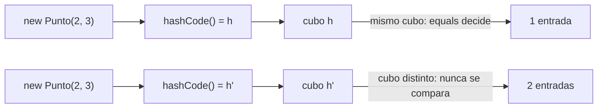
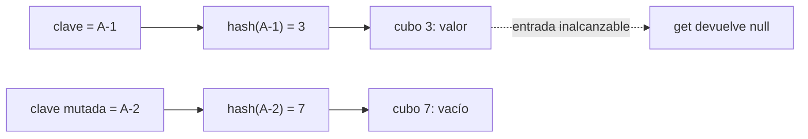

# Módulo 2: Colecciones y genéricos


## Aprende construyendo

### Tema 1: List, Set, Map y sus implementaciones · Intermedio · 35 min

**Duración estimada:** 35 min.
**¿Por qué es importante?** Una colección organiza datos según cómo los vas a consultar: por posición, sin duplicados o mediante una clave.
**Prerrequisitos:** M0 T7 (arreglos y wrappers), M1 T1 (objetos). Proyecto continuo: guardar guías, evitar duplicados y buscar cada guía por su código.

**Mapa de subtemas críticos:** `List` e índices válidos (núcleo y diagnóstico, 1.1); igualdad de códigos y orden de inserción en `Set` (núcleo y límite, 1.2); reemplazo por clave, ausencia y valor `null` en `Map` (núcleo y diagnóstico, 1.3). La comparación de objetos de dominio mediante `equals/hashCode` se profundiza en el Tema 2; el orden de `TreeSet` se enseña en el Tema 5.

#### Subtema 1.1: Conserva el orden con una List · 10 min

**1. Contexto**
Una lista de entregas mantiene el orden recibido y permite consultar una guía por su posición.

**2. Hazlo tú**
Crea java-motor-colecciones/src/ColeccionesDemo.java:

```java
import java.util.ArrayList;
import java.util.LinkedList;
import java.util.List;

public class ColeccionesDemo {
    public static void main(String[] args) {
        List<String> guias = new ArrayList<>();
        guias.add("RF-101");
        guias.add("RF-102");
        guias.add(1, "RF-105");
        System.out.println(guias);
        System.out.println("primera=" + guias.get(0));

        List<String> cola = new LinkedList<>(List.of("RF-101", "RF-102"));
        cola.add(0, "RF-105");
        System.out.println("cola=" + cola);
    }
}
```

Desde java-motor-colecciones/, ejecuta:

```bash
mkdir -p out
javac -d out src/ColeccionesDemo.java
java -cp out ColeccionesDemo
```

**Resultado esperado:** [RF-101, RF-105, RF-102], primera=RF-101 y cola=[RF-105, RF-101, RF-102].

**Fallo deliberado:** cambia guias.get(0) por guias.get(3). **Error esperado:** IndexOutOfBoundsException. **Diagnóstico:** los índices empiezan en cero y esta lista tiene posiciones 0, 1 y 2.

**3. Entiende**
List conserva elementos repetidos y su orden. ArrayList suele ser una buena opción general para acceder por índice o agregar al final; insertar al principio desplaza los elementos siguientes. LinkedList puede enlazar un nodo al principio sin desplazar los demás, pero encontrar una posición arbitraria todavía exige recorrer la lista.

**4. Cierra**
Anota qué posición tiene RF-105 después de insertarla y qué pasaría si la agregas al final.

#### Subtema 1.2: Evita duplicados con un Set · 10 min

**1. Contexto**
Al importar un lote pueden llegar guías repetidas. Aquí los códigos son `String`, cuya igualdad por contenido permite detectar un duplicado aunque llegue en otra instancia.

**2. Hazlo tú**
Reemplaza java-motor-colecciones/src/ColeccionesDemo.java:

```java
import java.util.LinkedHashSet;
import java.util.Set;

public class ColeccionesDemo {
    public static void main(String[] args) {
        Set<String> ingreso = new LinkedHashSet<>();
        ingreso.add("RF-102");
        ingreso.add("RF-101");
        ingreso.add("RF-102");

        System.out.println("ingreso=" + ingreso);
        System.out.println("duplicada=" + ingreso.add(new String("RF-101")));
        System.out.println("cantidad=" + ingreso.size());
    }
}
```

Compila y ejecuta con los comandos del subtema 1.1.

**Resultado esperado:** ingreso=[RF-102, RF-101], duplicada=false y cantidad=2.

**Fallo deliberado:** sustituye solo la declaración por `java.util.List<String> ingreso = new java.util.ArrayList<>();` y ejecuta el mismo archivo. **Resultado erróneo esperado:** `ingreso=[RF-102, RF-101, RF-102]`, `duplicada=true` y `cantidad=4`. **Diagnóstico:** `List` conserva ambos códigos repetidos; usa `Set` cuando cada código de guía deba aparecer una sola vez.

**3. Entiende**
`LinkedHashSet` conserva el primer código y su posición de inserción; `add` devuelve `false` cuando un código ya existe. Para `String`, el contenido se compara mediante `equals` y `hashCode`, por eso `new String("RF-101")` no crea una tercera entrada. `HashSet` también descarta duplicados, pero no garantiza un orden de iteración. Un conjunto ordenado usa además una regla de comparación; verás su contrato en el Tema 5.

**4. Cierra**
Agrega `RF-103` dos veces y predice el booleano de cada `add`, el tamaño y la posición del código. Explica por qué `HashSet` no sirve si debes conservar el orden del archivo importado.

#### Subtema 1.3: Busca una guía por su clave con Map · 15 min

**1. Contexto**
Un operador necesita buscar rápidamente el estado de una guía por su identificador sin recorrer toda la lista.

**2. Hazlo tú**
Reemplaza java-motor-colecciones/src/ColeccionesDemo.java:

```java
import java.util.LinkedHashMap;
import java.util.Map;

public class ColeccionesDemo {
    public static void main(String[] args) {
        Map<String, String> estados = new LinkedHashMap<>();
        estados.put("RF-101", "EN_RUTA");
        estados.put("RF-102", "ENTREGADA");
        estados.put("RF-101", "EN_REPARTO");

        System.out.println(estados.get("RF-101"));
        System.out.println(estados.getOrDefault("RF-999", "DESCONOCIDA"));
        System.out.println("guias=" + estados.size());
        estados.put("RF-103", null);
        System.out.println("registrada=" + estados.containsKey("RF-103"));
        System.out.println("valor=" + estados.getOrDefault("RF-103", "DESCONOCIDA"));
    }
}
```

Desde java-motor-colecciones/, compila y ejecuta:

```bash
javac -d out src/ColeccionesDemo.java
java -cp out ColeccionesDemo
```

**Resultado esperado:** EN_REPARTO, DESCONOCIDA, guias=2, registrada=true y valor=null, en ese orden.

**Fallo deliberado:** cambia la segunda búsqueda por estados.get("RF-999").toUpperCase(). **Error esperado:** NullPointerException. **Diagnóstico:** get devuelve null si la clave no existe; comprueba el resultado o usa getOrDefault.

**3. Entiende**
`Map` relaciona una clave única con su valor. Al insertar otra vez RF-101, se reemplazó su estado y no se añadió una tercera entrada. `get` devuelve `null` tanto para una clave ausente como para una clave asociada explícitamente a `null` en este `LinkedHashMap`; `containsKey` distingue ambos casos. `getOrDefault` solo usa el valor alternativo cuando falta la clave: si existe con valor `null`, devuelve `null`. Evita guardar `null` como estado de negocio si necesitas distinguirlo de «no registrada» sin esa comprobación adicional. `LinkedHashMap` conserva el orden de inserción; `HashMap` no lo garantiza.

**4. Cierra**
Agrega la guía RF-999 con estado `EN_RUTA`, observa qué devuelve `getOrDefault` antes y después, y usa `containsKey` para explicar la diferencia con RF-103.

**Hito del tema:**

- [ ] Usé List para conservar posiciones y repetir valores.
- [ ] Eliminé duplicados y conservé el orden de inserción.
- [ ] Consulté y actualicé un estado con una clave de Map.
- [ ] Distinguí una clave ausente de una clave asociada a `null`.

**Fuentes oficiales:** [Collections Framework en dev.java](https://dev.java/learn/api/collections-framework/), [LinkedHashSet](https://docs.oracle.com/en/java/javase/25/docs/api/java.base/java/util/LinkedHashSet.html) y [contrato de Map.getOrDefault](https://docs.oracle.com/en/java/javase/25/docs/api/java.base/java/util/Map.html).

**Transferencia al proyecto integrador:** almacena guías en una lista ordenada, usa un Set para rechazar importaciones duplicadas y conserva el estado actual en un Map por código. **Límite:** usa `ArrayList` cuando el orden de llegada importa y habrá lecturas frecuentes por índice; usa `HashSet` solo para descartar duplicados sin importar el orden; si necesitas orden de inserción y descarte de duplicados a la vez, usa `LinkedHashSet` en vez de combinar las dos estructuras a mano. **Práctica:** modifica `ColeccionesDemo.java` para usar `getOrDefault("RF-999", "SIN_REGISTRO")` en vez de `get`, y confirma que ya no se produce `NullPointerException`.

### Tema 2: El contrato de equals y hashCode · Intermedio · 35 min

**Prerrequisito:** Tema 1 de este módulo (`HashSet` y `HashMap`) y Módulo 1 (sobreescritura y `record`).
**Al terminar podrás:** implementar `equals` y `hashCode` que cumplan las cinco reglas del contrato, demostrar con un `HashSet` real qué ocurre cuando ambos métodos usan campos incompatibles, y decidir cuándo un `record` resuelve el problema sin escribirlos.

#### Aprende

**¿Por qué es importante?** `HashSet`, `HashMap`, `ConcurrentHashMap` y casi toda biblioteca de colecciones localizan un objeto en dos pasos: primero calculan su `hashCode` para elegir un cubo, después usan `equals` para distinguirlo de otros objetos del mismo cubo. Si dos objetos son iguales pero declaran códigos distintos, pueden caer en cubos distintos y la colección no los compara. El resultado no es necesariamente una excepción: es una deduplicación silenciosa que no deduplica y un `get` que devuelve `null` sobre una entrada que existe.

**Mapa de subtemas críticos**

| Subtema | Papel | Evidencia |
|---|---|---|
| Las cinco reglas del contrato de `equals` | Prerrequisito | La tabla del reto exige un contraejemplo ejecutado por cada regla; `instanceof Punto p` ancla la simetría y el chequeo de `null`. |
| Regla de coherencia `equals`/`hashCode` sobre los mismos campos | Núcleo | `Punto` usa `x`, `y` en ambos métodos y `bien size = 1`. |
| Localización en dos pasos (cubo por hash, luego `equals`) | Núcleo | `roto size = 2` y `roto contains = false` muestran búsqueda en cubos distintos. |
| `getClass()` frente a `instanceof` en jerarquías | Variante | El ejercicio 2 rompe la simetría con `Punto3D extends PuntoBase` y la arregla con `getClass()`. |
| Hash con campo ajeno a `equals` | Error frecuente | `RotoPunto` incluye `y` solo en `hashCode`: `roto equals = true` con `roto hash iguales = false`. |
| Identidad JPA frente a igualdad por valor | Límite | La sección de decisión advierte que comparar entidades por todos sus campos rompe cuando la fila cambia. |
| `record` como generador de `equals`/`hashCode` | Decisión | El cierre del tema y el reto de `CodigoGuia` usan `record` para no olvidar ninguno de los dos métodos. |

Cada fila tiene su explicación individual a continuación.

**Las cinco reglas del contrato de `equals` (prerrequisito).** Reflexividad, simetría, transitividad, consistencia y respuesta `false` ante `null` son la base sobre la que descansan `hashCode` y toda colección de hash. El demo las hace tangibles: el patrón `otro instanceof Punto p` devuelve `false` ante `null` y permite el acceso tipado solo cuando el tipo coincide. Sin estas reglas, ni siquiera tiene sentido discutir `hashCode`.

**Regla de coherencia `equals`/`hashCode` sobre los mismos campos (núcleo).** El contrato de `hashCode` obliga a que dos objetos iguales devuelvan el mismo hash; la única forma fiable de garantizarlo es alimentar ambos métodos con los mismos campos. `Punto` usa `x` e `y` en los dos, por eso dos instancias `(2, 3)` comparten cubo y el `HashSet` conserva una sola (`bien size = 1`). Es el mecanismo central del tema.

**Localización en dos pasos (núcleo).** Las colecciones de hash buscan primero el cubo con `hashCode` y solo dentro de él comparan con `equals`; si el hash manda a cubos distintos, los objetos nunca se comparan. El demo lo prueba con `roto size = 2`: `(2, 3)` y `(2, 4)` caen en cubos diferentes y conviven aunque `equals` los declare iguales, y `roto contains = false` confirma que la búsqueda ni siquiera llega a comparar.

**`getClass()` frente a `instanceof` en jerarquías (variante).** `instanceof` permite que una subclase se compare con la base, pero rompe la simetría si la subclase añade estado y decide ser igual solo consigo misma; `getClass()` lo impide a costa de prohibir esa comparación. El ejercicio 2 construye `PuntoBase`/`Punto3D` para observar la asimetría y cómo `getClass()` la corta. En una clase `final` como `Punto` la elección es indiferente.

**Hash con campo ajeno a `equals` (error frecuente).** Incluir en `hashCode` un campo que `equals` ignora produce objetos iguales con hashes distintos, la violación más silenciosa del contrato. `RotoPunto` lo hace a propósito: `equals` compara solo `x` pero `hashCode` usa `Objects.hash(x, y)`, de ahí `roto equals = true` junto a `roto hash iguales = false`. El efecto observable es la deduplicación que no deduplica.

**Identidad JPA frente a igualdad por valor (límite).** No todo objeto debe ser igual por valor: una entidad persistente toma su identidad de la base de datos, y compararla por todos sus campos falla cuando una fila cambia o cuando dos entidades transitorias coinciden. El tema marca este borde en su sección de decisión, separando los objetos de valor —códigos, importes, coordenadas— de las entidades con identidad propia. Confundir ambos casos es una fuente real de bugs.

**`record` como generador de `equals`/`hashCode` (decisión).** Un `record` deriva `equals`, `hashCode` y `toString` de sus componentes, de modo que es imposible olvidar uno de los dos métodos —el fallo más común del tema—. Por eso el reto de `CodigoGuia` lo adopta para un objeto de valor que debe deduplicar y servir de clave. La decisión profesional es usar `record` para valores y reservar las clases con `equals` manual para identidades que lo justifiquen.

**Conceptos clave:** identidad, igualdad lógica, contrato de `Object`, cubo de hash, consistencia, `record`.

El contrato de `Object.equals` exige cinco propiedades: reflexividad (`x.equals(x)`), simetría (`x.equals(y)` si y solo si `y.equals(x)`), transitividad, consistencia mientras el estado no cambie y `false` frente a `null`. El contrato de `hashCode` añade una más: si `x.equals(y)`, entonces `x.hashCode() == y.hashCode()`. La recíproca no se exige —dos objetos distintos pueden compartir hash—, pero declarar hashes distintos para objetos iguales rompe todas las colecciones basadas en hash.

Hay dos detalles que separan una implementación correcta de una que falla en producción. El primero es la comparación de campos: `Objects.equals(a, b)` evita el `NullPointerException` que produce `a.equals(b)` cuando `a` es `null`. El segundo es la elección entre `getClass()` e `instanceof`: `instanceof` permite comparar con subclases, lo que puede romper la simetría si la subclase añade estado y decide ser igual solo consigo misma; `getClass()` es simétrico pero impide esa comparación. En una clase `final`, la discusión desaparece.

Un `record` genera `equals`, `hashCode` y `toString` a partir de sus componentes, así que dos instancias con los mismos valores son iguales y comparten hash. Usar `record` para un objeto de valor no es un atajo cosmético: elimina la posibilidad de olvidar uno de los dos métodos, que es el fallo más común de este tema.

**Analogía:** un archivo de carpetas ordenadas por la primera letra del apellido. Si dos copias del mismo documento se archivan en carpetas distintas porque cada copia calcula una letra diferente, quien busque en la carpeta correcta encontrará una y no sabrá que existe la otra. El archivo no está roto; la regla de clasificación sí.

**Diagrama:**



#### Practica

**Demo paso a paso.** Desde una carpeta vacía, crea el proyecto y la clase que implementa solo la mitad del contrato:

```bash
mkdir pedidos-core && cd pedidos-core
mkdir -p src/io/academia/modelo
```

```java
// src/io/academia/modelo/RotoPunto.java
package io.academia.modelo;

import java.util.Objects;

public final class RotoPunto {
    private final int x;
    private final int y;

    public RotoPunto(int x, int y) {
        this.x = x;
        this.y = y;
    }

    @Override
    public boolean equals(Object otro) {
        if (this == otro) {
            return true;
        }
        if (!(otro instanceof RotoPunto p)) {
            return false;
        }
        return x == p.x;
    }

    @Override
    public int hashCode() {
        // El fallo deliberado: y participa en el hash, pero no en equals.
        return Objects.hash(x, y);
    }

    @Override
    public String toString() {
        return "RotoPunto[x=" + x + ", y=" + y + "]";
    }
}
```

```java
// src/io/academia/modelo/Punto.java
package io.academia.modelo;

import java.util.Objects;

public final class Punto {
    private final int x;
    private final int y;

    public Punto(int x, int y) {
        this.x = x;
        this.y = y;
    }

    @Override
    public boolean equals(Object otro) {
        if (this == otro) {
            return true;
        }
        if (!(otro instanceof Punto p)) {
            return false;
        }
        return x == p.x && y == p.y;
    }

    @Override
    public int hashCode() {
        return Objects.hash(x, y);
    }

    @Override
    public String toString() {
        return "Punto[x=" + x + ", y=" + y + "]";
    }
}
```

```java
// src/Demo.java
import io.academia.modelo.Punto;
import io.academia.modelo.RotoPunto;

import java.util.HashSet;
import java.util.Set;

public class Demo {
    public static void main(String[] args) {
        RotoPunto a = new RotoPunto(2, 3);
        RotoPunto b = new RotoPunto(2, 4);
        System.out.println("roto equals = " + a.equals(b));
        System.out.println("roto hash iguales = " + (a.hashCode() == b.hashCode()));

        Set<RotoPunto> rotos = new HashSet<>();
        rotos.add(a);
        rotos.add(b);
        System.out.println("roto contains = " + rotos.contains(new RotoPunto(2, 5)));
        System.out.println("roto size = " + rotos.size());

        Set<Punto> puntos = new HashSet<>();
        puntos.add(new Punto(2, 3));
        puntos.add(new Punto(2, 3));
        System.out.println("bien contains = " + puntos.contains(new Punto(2, 3)));
        System.out.println("bien size = " + puntos.size());
    }
}
```

```bash
javac -d out $(find src -name '*.java')
java -cp out Demo
```

**Resultado esperado:** `RotoPunto` declara iguales dos valores con la misma coordenada `x`, pero produce hashes distintos porque incluye `y`. El `HashSet` los guarda dos veces; en cambio, `Punto` usa los mismos campos en ambos métodos:

```text
roto equals = true
roto hash iguales = false
roto contains = false
roto size = 2
bien contains = true
bien size = 1
```

**Explicación línea por línea:** `RotoPunto.equals` ignora `y`, pero `hashCode` sí la incluye. Por eso `(2, 3)` y `(2, 4)` son iguales según `equals` y tienen hashes distintos, una violación reproducible del contrato. `HashSet.add` busca cada valor en un cubo diferente y no compara los dos objetos; `contains(new RotoPunto(2, 5))` también busca otro hash y devuelve `false`, aunque según `equals` ese punto es igual a los anteriores. `Punto`, con `Objects.hash(x, y)`, usa los mismos campos en ambos métodos: las dos instancias iguales comparten cubo y la segunda no se inserta.

**Fallo deliberado:** `RotoPunto` ya contiene la inconsistencia. Cambia `equals` para comparar también `y` y cambia la consulta a `new RotoPunto(2, 3)`. Recompila y ejecuta: el par `(2, 3)` se encuentra, mientras `(2, 4)` sigue siendo distinto. Restaura el ejemplo para observar el contrato violado. En una aplicación real, no infieras un hash incorrecto solo porque una búsqueda falló: primero comprueba qué campos usa cada método.

**Ejercicios.**

1. Añade un campo `z` a `Punto` y actualiza `equals` y `hashCode`. Comprueba con un `HashSet` que dos puntos que solo difieren en `z` siguen siendo distintos.
2. Crea una clase base no `final` `PuntoBase` con `equals` por `instanceof` y una `Punto3D extends PuntoBase` con un campo extra que añada igualdad solo consigo misma; explica con una ejecución por qué la simetría se rompe y cómo `getClass()` lo impide.
3. Escribe un verificador que compruebe las cinco reglas del contrato para mil puntos generados al azar y falle con un mensaje concreto cuando alguna no se cumpla.

**Pista:** `Objects.hash` es una conveniencia, no una obligación. Un `hashCode` escrito a mano con números primos es más rápido y perfectamente válido; lo único que no puede hacer es depender de campos mutables o de la identidad.

**Completa el código:** rellena el espacio con la llamada que genera un hash coherente con los dos campos:

```java
@Override
public int hashCode() {
    return ______;
}
```

**Reto de memoria:** cierra este documento y escribe, solo de memoria, una clase de valor con dos campos, su `equals` con `instanceof` y patrón, su `hashCode` y un `main` que demuestre la deduplicación en un `HashSet`. Compara después con el patrón del demo.

#### Aplica

**Reto abierto.** Convierte `pedidos-core` en un modelo con un objeto de valor `CodigoGuia` que encapsule el código de una guía y garantice que nunca sea nulo ni vacío. Debe ser igual por valor, funcionar como clave de `HashMap` y demostrar con una ejecución que mil guías con códigos repetidos colapsan en una sola entrada.

**Checklist de salida.**

- [ ] `equals` y `hashCode` usan exactamente los mismos campos.
- [ ] La clase es `final` o el contrato se cumple también para subclases.
- [ ] La comparación de campos es nula-segura con `Objects.equals`.
- [ ] Un `HashSet` con dos instancias iguales conserva una sola entrada.
- [ ] La tabla de las cinco reglas está escrita con un contraejemplo ejecutado para cada una.

**Si falla.** Si `contains` devuelve `false` pero el objeto aparece al iterar, falta `hashCode` o usa campos distintos a `equals`. Si dos objetos iguales producen hashes distintos, alguno de los métodos incluye un campo que el otro ignora. Si `equals` lanza `NullPointerException` con un argumento nulo, se está llamando `campo.equals(otro.campo)` sin comprobar el nulo: usa `Objects.equals`.

**Siguiente paso:** el objeto ya sabe compararse consigo mismo; el siguiente tema lo pone como clave de un `HashMap` y lo modifica después de insertarlo.

**Errores comunes:** sobrescribir `equals` y olvidar `hashCode`; usar `==` para comparar `String` o referencias; comparar con `instanceof` en una jerarquía donde la subclase añade igualdad; incluir en el hash un campo que cambia con el tiempo; confundir el hash con un identificador único.

**Límites y decisión de uso:** en una entidad JPA la identidad la define la base de datos, no los campos de negocio: comparar entidades por todos sus campos rompe cuando una fila cambia o cuando dos entidades transitorias son iguales. Para objetos de valor —códigos, importes, coordenadas— la igualdad por valor es la correcta. `record` cubre el caso de valor sin escribir nada; una clase con identidad propia debe documentar qué significa ser igual.

**Fuente oficial revisada el 2026-11-01:** [Java SE 27 API — java.lang.Object](https://docs.oracle.com/en/java/javase/27/docs/api/java.base/java/lang/Object.html).

**Transferencia al proyecto integrador:** el `CodigoGuia` de este tema es el tipo que el proyecto integrador del Módulo 13 usará como clave de sus cachés y de sus conjuntos de deduplicación, en lugar de comparar cadenas sueltas.

### Tema 3: Claves mutables y el mapa que pierde entradas · Intermedio · 40 min

**Prerrequisito:** Tema 2 de este módulo.
**Al terminar podrás:** reproducir la pérdida de una entrada de `HashMap` causada por mutar la clave, explicar por qué la entrada sigue visible al iterar, y elegir entre clave inmutable, copia al insertar y rediseño del modelo.

#### Aprende

**¿Por qué es importante?** `HashMap` calcula el cubo de una clave en el momento de insertarla; si después la clave cambia en un campo que participa en el hash, la entrada se queda donde estaba pero todas las búsquedas futuras calculan otro cubo. El mapa no está corrupto de forma visible: `size()` sigue contando la entrada, `containsValue` la encuentra y la iteración la muestra, pero `get` con la misma referencia devuelve `null`. Ese comportamiento produce fugas de memoria —entradas que ya nadie puede alcanzar ni eliminar— y resultados que dependen del orden de las operaciones.

**Mapa de subtemas críticos**

| Subtema | Papel | Evidencia |
|---|---|---|
| El cubo se fija en el `put` y no se recalcula | Prerrequisito | `get tras mutar = null` tras `setCodigo("A-2")` sobre una clave insertada como `A-1`. |
| Entrada visible pero inalcanzable | Núcleo | `tamano = 1`, `valor sigue dentro = true` y `entradas = [ClaveMutable[A-2]=valor]` coexisten con el `get` nulo. |
| Clave con setter que participa en el hash | Error frecuente | `ClaveMutable` expone `setCodigo` y lo usa en `hashCode`; mutarla descoloca la entrada. |
| `record` como clave inmutable | Decisión | `ClaveInmutable` es un `record` sin setters: `record get = valor` con una instancia nueva pero igual. |
| `remove` no limpia la entrada descolocada | Diagnóstico | El ejercicio 1 confirma que `remove(clave)` devuelve `false` y `size()` sigue en uno. |
| `record` con componente mutable no es inmutable | Límite | La sección «Si falla» advierte que un `record` con un `List` sin copia no es inmutable. |
| `TreeMap` con `Comparator` como alternativa | Variante | El ejercicio 3 contrasta el fallo del `TreeMap` al mutar la clave con el del `HashMap`. |

Cada fila tiene su explicación individual a continuación.

**El cubo se fija en el `put` y no se recalcula (prerrequisito).** `HashMap` calcula el cubo en el momento de insertar y no vuelve a hacerlo por su cuenta; si la clave cambia un campo del hash, la entrada se queda archivada bajo el hash viejo. El demo lo prueba: `put` guarda bajo `hash("A-1")`, `setCodigo("A-2")` cambia el objeto, y `get(clave)` calcula `hash("A-2")`, busca en otro cubo y devuelve `null`. Entender este instante es la base de todo el tema.

**Entrada visible pero inalcanzable (núcleo).** El desajuste no borra la entrada: `size()` recorre cubos sin recalcular y sigue contando uno, `containsValue` compara valores nodo a nodo y la encuentra, y la iteración la muestra con su estado actual. Por eso conviven `tamano = 1`, `valor sigue dentro = true` y `entradas = [ClaveMutable[A-2]=valor]` con un `get` que devuelve `null`. Esa contradicción visible es el síntoma que el tema enseña a reconocer.

**Clave con setter que participa en el hash (error frecuente).** Cualquier clase con setter cuyo campo alimente `hashCode` es inservible como clave de un mapa de hash, porque su hash deja de ser estable. `ClaveMutable` lo encarna: `setCodigo` modifica el campo que `hashCode` usa, y tras la mutación la entrada queda descolocada. No hay configuración de `HashMap` que lo arregle; el problema es el contrato de la clave.

**`record` como clave inmutable (decisión).** La solución no es vigilar la clave sino hacerla imposible de mutar: un `record` tiene componentes `final` y ningún setter, así que su hash nunca cambia tras insertarla. El demo lo demuestra con `ClaveInmutable`, donde `seguro.get(new ClaveInmutable("A-1"))` devuelve `valor` usando una instancia distinta pero igual. Esa es la decisión profesional por defecto para claves de mapa.

**`remove` no limpia la entrada descolocada (diagnóstico).** Una vez descolocada la entrada, tampoco `remove(clave)` la alcanza, porque calcula el hash actual y busca en el cubo equivocado. El ejercicio 1 lo comprueba: `remove(clave)` devuelve `false` y `size()` sigue en uno, de modo que la única forma de limpiar es reconstruir o vaciar el mapa. Es la señal diagnóstica de una fuga por clave mutada.

**`record` con componente mutable no es inmutable (límite).** Que una clave sea un `record` no basta: si un componente es un `List` mutable sin copia, el estado interno puede cambiar y arrastrar al hash. La sección «Si falla» lo marca explícitamente: un `record` solo es inmutable si todos sus componentes lo son. Ignorar este borde reintroduce el mismo fallo bajo apariencia de inmutabilidad.

**`TreeMap` con `Comparator` como alternativa (variante).** Un `TreeMap` no usa hash sino un orden definido por `Comparator` o `Comparable`, así que mutar la clave produce un fallo distinto —búsqueda por orden inconsistente— en lugar del cubo descolocado del `HashMap`. El ejercicio 3 pide reproducir y explicar esa diferencia. La variante muestra que el problema de las claves mutables cambia de forma, no de causa, al cambiar de estructura.

**Conceptos clave:** clave mutable, cubo, `hashCode` inestable, copia defensiva de clave, objeto de valor inmutable.

La documentación de `Map` lo dice sin rodeos: hay que tener mucho cuidado si se usan objetos mutables como claves, porque el mapa deja de comportarse como un mapa si la clave cambia de forma que afecte a `equals` o `hashCode`. La solución no es memorizar la advertencia, sino hacerla imposible de incumplir: la clave se construye inmutable, o se copia al insertar y se prohíbe modificarla desde fuera.

Un `record` es inmutable por construcción: sus componentes son `final` y no hay setters. Eso lo convierte en la clave natural para un mapa. Cuando la clave debe envolver un valor que sí cambia, se separa el estado mutable del estado de identidad: el mapa indexa por el código estable y el resto del objeto se actualiza por otra vía.

**Analogía:** un hotel asigna la habitación según la inicial del apellido. Si el huésped cambia su apellido en recepción pero su equipaje sigue en la habitación anterior, la nueva búsqueda por apellido no encuentra nada. El equipaje no desapareció: está en una habitación que ya nadie sabe asociar a él.

**Diagrama:**



#### Practica

**Demo paso a paso.** Añade una clave con setter y compárala con un `record` que ocupa su lugar:

```java
// src/io/academia/modelo/ClaveMutable.java
package io.academia.modelo;

import java.util.Objects;

public final class ClaveMutable {
    private String codigo;

    public ClaveMutable(String codigo) {
        this.codigo = codigo;
    }

    public void setCodigo(String codigo) {
        this.codigo = codigo;
    }

    @Override
    public boolean equals(Object otro) {
        return otro instanceof ClaveMutable c && Objects.equals(codigo, c.codigo);
    }

    @Override
    public int hashCode() {
        return Objects.hash(codigo);
    }

    @Override
    public String toString() {
        return "ClaveMutable[" + codigo + "]";
    }
}
```

```java
// src/io/academia/modelo/ClaveInmutable.java
package io.academia.modelo;

public record ClaveInmutable(String codigo) {
}
```

```java
// src/Demo.java
import io.academia.modelo.ClaveInmutable;
import io.academia.modelo.ClaveMutable;

import java.util.HashMap;
import java.util.Map;

public class Demo {
    public static void main(String[] args) {
        Map<ClaveMutable, String> mapa = new HashMap<>();
        ClaveMutable clave = new ClaveMutable("A-1");
        mapa.put(clave, "valor");
        clave.setCodigo("A-2");

        System.out.println("get tras mutar = " + mapa.get(clave));
        System.out.println("tamano = " + mapa.size());
        System.out.println("valor sigue dentro = " + mapa.containsValue("valor"));
        System.out.println("entradas = " + mapa.entrySet());

        Map<ClaveInmutable, String> seguro = new HashMap<>();
        ClaveInmutable k = new ClaveInmutable("A-1");
        seguro.put(k, "valor");
        System.out.println("record get = " + seguro.get(new ClaveInmutable("A-1")));
    }
}
```

```bash
javac -d out $(find src -name '*.java')
java -cp out Demo
```

**Resultado esperado:** la entrada sigue dentro del mapa y a la vez es inalcanzable por búsqueda:

```text
get tras mutar = null
tamano = 1
valor sigue dentro = true
entradas = [ClaveMutable[A-2]=valor]
record get = valor
```

**Explicación línea por línea:** `put` calcula `hash("A-1")` y guarda el nodo en ese cubo. `setCodigo("A-2")` cambia el estado del objeto, pero no toca el mapa. `get(clave)` calcula ahora `hash("A-2")`, busca en otro cubo y devuelve `null`. `size()` recorre la tabla de cubos, no recalcula hashes, y sigue contando uno. `containsValue` recorre los nodos y compara valores, por eso encuentra `"valor"`. `entrySet` imprime la clave en su estado actual —`A-2`— aunque esté archivada bajo el hash de `A-1`; ese es el desajuste que el `toString` hace visible. El `record` no tiene setters, así que el hash de una clave nunca cambia después de insertarla.

**Fallo deliberado:** elimina la línea `clave.setCodigo("A-2")` y el `get` devuelve `valor`. El fallo no está en `HashMap` ni en `equals`: está en permitir que una clave cambie. Cualquier `remove(clave)` posterior tampoco encontrará la entrada, y la única forma de limpiarla es reconstruir el mapa o vaciarlo.

**Ejercicios.**

1. Añade una llamada a `mapa.remove(clave)` después de mutar y comprueba que devuelve `false` y que `size()` sigue en uno.
2. Corrige el mapa sin cambiar la clase `ClaveMutable`: copia la clave al insertar y prohíbe mutarla desde fuera. Explica por qué esa copia solo funciona si la clave también es inmutable.
3. Cambia el mapa por un `TreeMap` con un `Comparator` por código y explica qué error aparece al mutar la clave y por qué es distinto del `HashMap`.

**Pista:** si una clase tiene setters y participa en un `hashCode`, no puede ser clave de un mapa basado en hash. No hay una configuración de `HashMap` que lo arregle; el problema es el contrato, no la implementación.

**Completa el código:** rellena el espacio con el método que devuelve la entrada almacenada bajo el hash original:

```java
System.out.println("get tras mutar = " + mapa.______(clave));
```

**Reto de memoria:** cierra este documento y escribe, solo de memoria, un mapa con una clave mutable, la mutación posterior y las cuatro salidas del demo. Añade la corrección con `record` y explica en una frase por qué funciona.

#### Aplica

**Reto abierto.** Audita una caché real de `pedidos-core`: una `Map<String, Pedido>` donde la cadena es el código de guía. Sustituye la cadena por un objeto de valor inmutable, demuestra que dos códigos iguales con distinto formato —espacios, mayúsculas— colapsan en una entrada, y documenta qué ocurre si alguien intenta mutar la clave.

**Checklist de salida.**

- [ ] La clave es inmutable o se copia de forma profunda al insertar.
- [ ] `get`, `containsKey` y `remove` funcionan con una instancia nueva pero igual.
- [ ] La mutación de la clave es imposible por API, no solo por convención.
- [ ] La reproducción del fallo con clave mutable está ejecutada y registrada.
- [ ] El modelo distingue identidad estable de estado mutable.

**Si falla.** Si `get` funciona después de mutar, el campo mutado no participa en el hash: comprueba qué campos usa `hashCode`. Si `remove` devuelve `false`, el cubo ya cambió y la entrada quedó inalcanzable. Si el `record` no compila como clave, revisa que no tenga componentes mutables como `List` sin copia: `record` solo es inmutable si sus componentes lo son.

**Siguiente paso:** el objeto ya no cambia mientras vive en una colección; el siguiente tema aborda qué significa copiarlo cuando sí debe cambiar.

**Errores comunes:** usar una entidad JPA como clave mientras su `id` se asigna al guardar; mutar una fecha o una lista dentro de una clave; confiar en que `HashMap` «recalcula» al vuelo; usar `StringBuilder` como clave; creer que `record` con una lista mutable es inmutable.

**Límites y decisión de uso:** hay estructuras que sí toleran claves mutables, como una lista ordenada por un comparador estable, pero cambian las garantías. Si la clave debe cambiar con frecuencia, el mapa es la estructura equivocada: conviene indexar por un identificador estable y guardar el estado mutable en el valor.

**Fuente oficial revisada el 2026-11-01:** [Java SE 27 API — java.util.Map](https://docs.oracle.com/en/java/javase/27/docs/api/java.base/java/util/Map.html).

**Transferencia al proyecto integrador:** la caché de guías del proyecto integrador del Módulo 13 usará una clave inmutable; este tema es la justificación escrita de esa decisión.

### Tema 4: Genéricos, wildcards y type erasure · Avanzado · 40 min

**Duración estimada:** 40 min.
**¿Por qué es importante?** Los genéricos hacen que el compilador detecte mezclas de tipos antes de ejecutar; los wildcards dejan aceptar familias de tipos sin perder esa seguridad.
**Prerrequisitos:** M2 T1. Proyecto continuo: construir herramientas reutilizables para almacenar y procesar guías de distintos tipos.

**Mapa de subtemas críticos:** parámetro de tipo e inferencia del diamante (núcleo, 2.1); invariancia y lectura mediante `? extends` (prerrequisito y núcleo, 2.2); escritura mediante `? super` y límite de lectura (variante, 2.3); borrado de tipos, prueba con `instanceof` y riesgo de tipos raw (límite y diagnóstico, 2.4). Cada mecanismo tiene un resultado compilado o un error reproducible y una práctica de transferencia.

#### Subtema 4.1: Crea una clase genérica segura · 10 min

**1. Contexto**
El motor puede guardar una guía o su peso temporalmente sin copiar una clase contenedora para cada tipo.

**2. Hazlo tú**
Crea java-motor-colecciones/src/GenericosDemo.java:

```java
final class Caja<T> {
    private final T contenido;

    Caja(T contenido) { this.contenido = contenido; }

    T obtener() { return contenido; }
}

public class GenericosDemo {
    public static void main(String[] args) {
        Caja<String> guia = new Caja<>("RF-401");
        Caja<Integer> peso = new Caja<>(12);
        System.out.println(guia.obtener());
        System.out.println(peso.obtener() + " kg");
    }
}
```

Desde java-motor-colecciones/, compila y ejecuta:

```bash
mkdir -p out
javac -d out src/GenericosDemo.java
java -cp out GenericosDemo
```

**Resultado esperado:** RF-401 y 12 kg.

**Fallo deliberado:** cambia el argumento new Caja<>("RF-401") por new Caja<>(12) y deja la variable como Caja<String>. **Error esperado:** incompatible types o inference variable T has incompatible bounds. **Diagnóstico:** una Caja<String> solo puede contener texto; conserva el tipo de la variable y el del valor alineados.

**3. Entiende**
`T` es un parámetro de tipo. Al escribir `Caja<String>`, el compilador comprueba que obtienes y guardas texto sin casts. El diamante `<>` de `new Caja<>(...)` infiere aquí `String` desde el tipo declarado de `guia`; no crea una clase nueva llamada `Caja<String>` en ejecución. Por eso `new Caja<>(12)` no puede satisfacer una variable `Caja<String>`.

**4. Cierra**
Agrega una Caja<Double> para una tarifa y explica qué verifica el compilador.

#### Subtema 4.2: Lee una familia de tipos con extends · 10 min

**1. Contexto**
Un reporte de peso acepta valores enteros o decimales; el método no necesita conocer qué tipo exacto de Number recibe.

**2. Hazlo tú**
Reemplaza java-motor-colecciones/src/GenericosDemo.java:

```java
import java.util.List;

public class GenericosDemo {
    static double sumarPesos(List<? extends Number> pesos) {
        double total = 0;
        for (Number peso : pesos) {
            total += peso.doubleValue();
        }
        return total;
    }

    public static void main(String[] args) {
        System.out.println(sumarPesos(List.of(2, 3, 4)));
        System.out.println(sumarPesos(List.of(1.5, 2.5)));
    }
}
```

Compila y ejecuta con los comandos del subtema 4.1.

**Resultado esperado:** 9.0 y 4.0.

**Fallo deliberado:** dentro del ciclo, intenta pesos.add(5). **Error esperado:** el compilador rechaza el argumento porque no conoce el subtipo concreto de la lista. **Diagnóstico:** ? extends Number permite leer elementos como Number; no agregar valores arbitrarios.

**3. Entiende**
Una `List<Integer>` no es una `List<Number>`: si esa asignación se permitiera, otra parte del programa podría agregar un `Double` a la lista de enteros. Compruébalo en una copia del archivo: declara `List<Integer> enteros = List.of(2, 3);` y luego `List<Number> numeros = enteros;`; `javac` rechaza la segunda línea por tipos incompatibles. El comodín `? extends Number` permite recibir la lista sin prometer que se le puedan agregar números de cualquier subtipo. Como `sumarPesos` solo lee, puede tratar cada valor como `Number`. El límite no convierte los enteros en otro tipo ni copia la lista.

**4. Cierra**
Prueba una lista de `Long` y explica por qué el método no requiere una nueva sobrecarga. Predice además si `List<Number> numeros = List.of(1, 2);` y `List<Number> numeros = enteros;` tienen la misma validez; compila ambos casos para comprobarlo.

#### Subtema 4.3: Escribe con super y conserva seguridad · 10 min

**1. Contexto**
El motor genera códigos enteros para agregarlos a una colección que puede guardar Integer o alguno de sus tipos base.

**2. Hazlo tú**
Reemplaza java-motor-colecciones/src/GenericosDemo.java:

```java
import java.util.ArrayList;
import java.util.List;

public class GenericosDemo {
    static void agregarCodigos(List<? super Integer> destino) {
        destino.add(401);
        destino.add(402);
    }

    public static void main(String[] args) {
        List<Integer> codigos = new ArrayList<>();
        List<Number> numeros = new ArrayList<>();
        agregarCodigos(codigos);
        agregarCodigos(numeros);
        System.out.println(codigos);
        System.out.println(numeros);
    }
}
```

Compila y ejecuta con los comandos del subtema 4.1.

**Resultado esperado:** [401, 402] en ambas líneas.

**Fallo deliberado:** deja la firma intacta y añade en `main` `List<Double> decimales = new ArrayList<>(); agregarCodigos(decimales);`. **Error esperado:** `List<Double>` no se puede convertir a `List<? super Integer>`. **Diagnóstico:** el límite acepta `Integer` o un supertipo suyo, como `Number` u `Object`; `Double` es otro subtipo de `Number`, no un supertipo de `Integer`.

**3. Entiende**
`? super Integer` permite agregar `Integer` con seguridad. Dentro de `agregarCodigos`, una lectura de `destino.get(0)` solo se puede asignar a `Object`: la lista real podría ser `List<Integer>`, `List<Number>` o `List<Object>`, y el compilador no sabe cuál. Este límite sirve cuando el método produce enteros para un destino; no convierte una `List<Double>` en una lista de enteros.

**4. Cierra**
Escribe qué tipo de lista es válido para el parámetro y por qué no acepta List<Double>.

#### Subtema 4.4: Observa qué conserva type erasure · 10 min

**1. Contexto**
En ejecución, las variantes parametrizadas de Caja comparten la misma clase. Reconoce esta limitación antes de diseñar lógica que dependa de inspeccionar el tipo T.

**2. Hazlo tú**
Reemplaza java-motor-colecciones/src/GenericosDemo.java:

```java
final class Caja<T> {
    private final T contenido;
    Caja(T contenido) { this.contenido = contenido; }
    T obtener() { return contenido; }
}

public class GenericosDemo {
    public static void main(String[] args) {
        Caja<String> texto = new Caja<>("RF-401");
        Caja<Integer> numero = new Caja<>(401);
        System.out.println(texto.getClass() == numero.getClass());
        System.out.println(texto.obtener().getClass().getSimpleName());
        System.out.println(numero.obtener().getClass().getSimpleName());
    }
}
```

Compila y ejecuta con los comandos del subtema 4.1.

**Resultado esperado:** true, String y Integer.

**Fallo deliberado:** declara `Object desconocido = texto;` e intenta `System.out.println(desconocido instanceof Caja<String>);`. **Error esperado:** el compilador rechaza la prueba de un tipo parametrizado no reificable. **Diagnóstico:** desde una referencia `Object` no se puede comprobar en ejecución si la caja era `Caja<String>`; usa `desconocido instanceof Caja<?>` y valida el contenido por separado si hace falta. La expresión `texto instanceof Caja<String>` sí puede compilar porque el tipo estático de `texto` ya es `Caja<String>`; no demuestra que la JVM haya conservado `String`.

**3. Entiende**
El borrado de tipos hace que Caja<String> y Caja<Integer> compartan la clase Caja en ejecución. Java mantiene cierta información genérica en firmas declaradas para herramientas de reflexión, pero no puedes inspeccionar el parámetro de tipo de un objeto común como si fuera una clase distinta.

Para observar el riesgo profesional del borrado, agrega antes del cierre de `main` estas tres líneas, sin quitar las salidas anteriores:

```java
Caja sinTipo = numero;
Caja<String> contaminada = sinTipo;
System.out.println(contaminada.obtener().length());
```

Compila desde `java-motor-colecciones/` con `javac -Xlint:unchecked -d out src/GenericosDemo.java` y ejecuta `java -cp out GenericosDemo`. **Resultado observable:** el compilador avisa de una conversión `unchecked` en la asignación a `Caja<String>`; tras las tres salidas iniciales, la llamada a `length()` falla con `ClassCastException` porque el contenido era un `Integer`. Un tipo raw evita la comprobación genérica en el límite y desplaza el fallo a quien lee. **Límite:** `@SuppressWarnings` ocultaría el aviso, no volvería segura la conversión. Restaura el archivo original después del diagnóstico.

**4. Cierra**
Entrega las tres líneas de salida y explica qué dato sí conserva el objeto, y qué parámetro genérico no se puede probar con `instanceof`. Después de reproducir el fallo raw, cambia `Caja sinTipo` por `Caja<?> sinTipo` y predice qué asignación dejará de compilar; compruébalo antes de restaurar el archivo.

**Hito del tema:**

- [ ] Construí Caja<T> y el compilador rechazó un valor de tipo equivocado.
- [ ] Leí números de List<? extends Number>.
- [ ] Agregué enteros a List<? super Integer> sin perder seguridad de tipos.
- [ ] Comprobé que dos variantes de Caja comparten la clase en runtime.
- [ ] Reproduje una advertencia `unchecked` y su `ClassCastException` posterior al mezclar un tipo raw con uno parametrizado.

**Fuentes oficiales:** [genéricos en dev.java](https://dev.java/learn/generics/), [wildcards](https://dev.java/learn/generics/wildcards/), [tipos raw y advertencias unchecked](https://docs.oracle.com/javase/tutorial/java/generics/rawTypes.html) y [borrado de tipos en la especificación Java](https://docs.oracle.com/javase/specs/jls/se25/html/jls-4.html#jls-4.6).

**Transferencia al proyecto integrador:** implementa un repositorio genérico que use tipos concretos seguros y consulta con wildcards cuando el consumidor solo necesite leer o agregar datos. **Práctica:** agrega un segundo tipo de parámetro a `Caja<T>` (por ejemplo una etiqueta `Caja<T, E>`) y confirma con `instanceof Caja<?, ?>` que ambos parámetros siguen borrados en tiempo de ejecución.

### Tema 5: Comparable vs Comparator, e iteración · Avanzado · 35 min

**Duración estimada:** 35 min.
**¿Por qué es importante?** El orden natural sirve cuando una clase tiene un criterio principal; un Comparator permite cambiarlo para una vista concreta. La iteración permite procesar colecciones sin depender de su implementación.
**Prerrequisitos:** M2 T1 (colecciones) y M1 T3 (interfaces). Proyecto continuo: ordenar guías por código o destino y retirar entregas completadas con seguridad.

**Mapa de subtemas críticos:** `Comparable` y el criterio de equivalencia por código (núcleo, subtema 5.1); `Comparator` externo, desempate y estabilidad del resultado (variante y límite, subtema 5.2); recorrido de `entrySet`, contrato de `Iterator.remove` y modificación estructural indebida (núcleo y diagnóstico, subtema 5.3). Cada bloque muestra una salida, un fallo comprobable y una transferencia distinta.

#### Subtema 5.1: Define el orden natural con Comparable · 10 min

**1. Contexto**
Cuando el motor muestre sus guías, el orden estable por código ayuda a localizar una entrada repetidamente.

**2. Hazlo tú**
Crea java-motor-colecciones/src/OrdenDemo.java:

```java
import java.util.ArrayList;
import java.util.Collections;
import java.util.List;
import java.util.TreeSet;

class Guia implements Comparable<Guia> {
    private final String codigo;

    Guia(String codigo) { this.codigo = codigo; }
    String codigo() { return codigo; }

    @Override
    public int compareTo(Guia otra) {
        return codigo.compareTo(otra.codigo);
    }

    @Override
    public String toString() { return codigo; }
}

public class OrdenDemo {
    public static void main(String[] args) {
        List<Guia> guias = new ArrayList<>(List.of(
            new Guia("RF-103"), new Guia("RF-101"), new Guia("RF-102")));
        Collections.sort(guias);
        System.out.println(guias);
        TreeSet<Guia> unicasPorCodigo = new TreeSet<>(guias);
        System.out.println("agrega mismo codigo=" + unicasPorCodigo.add(new Guia("RF-101")));
        System.out.println("codigos distintos=" + unicasPorCodigo.size());
    }
}
```

Desde java-motor-colecciones/, compila y ejecuta:

```bash
mkdir -p out
javac -d out src/OrdenDemo.java
java -cp out OrdenDemo
```

**Resultado esperado:** [RF-101, RF-102, RF-103], agrega mismo codigo=false y codigos distintos=3.

**Fallo deliberado:** elimina implements Comparable<Guia> y la anotación @Override de compareTo; luego ejecuta Collections.sort(guias). **Error esperado:** el compilador no puede inferir un orden para Guia. **Diagnóstico:** el orden natural requiere que Guia implemente Comparable o que la llamada reciba un Comparator.

**3. Entiende**
`compareTo` devuelve un valor negativo, cero o positivo para indicar menor, igual o mayor. Debe ser coherente al invertir los operandos y transitivo: si `RF-101 < RF-102` y `RF-102 < RF-103`, también `RF-101 < RF-103`. Comparar `String` directamente da ese orden y evita el desbordamiento de restar enteros. En `TreeSet`, `compareTo` igual a cero significa que el segundo objeto ocupa la misma posición lógica y no se agrega, aunque sea otra instancia. Aquí dos guías con código `RF-101` cuentan como una. Esta clase didáctica aún hereda `equals` por identidad: un `HashSet` trataría esas dos instancias como distintas. No uses esta clase tal cual como modelo de dominio; antes de combinar conjuntos ordenados y conjuntos basados en hash, alinea `compareTo`, `equals` y `hashCode` con la misma identidad de guía. El contrato completo de igualdad está en el Tema 2 de este módulo.

**4. Cierra**
Cambia los valores de entrada y confirma que el orden natural sigue comparando por código. Comprueba con tres instancias las relaciones `RF-101 < RF-102`, `RF-102 < RF-103` y `RF-101 < RF-103`; luego agrega una segunda instancia con código `RF-102` al `TreeSet` y predice el valor de `add` y el tamaño final antes de ejecutar.

#### Subtema 5.2: Cambia el criterio con Comparator · 10 min

**1. Contexto**
Una pantalla de despacho puede necesitar ordenar por destino sin reemplazar el orden natural de la clase.

**2. Hazlo tú**
Reemplaza java-motor-colecciones/src/OrdenDemo.java por este archivo completo:

```java
import java.util.ArrayList;
import java.util.Comparator;
import java.util.List;

class Guia {
    private final String codigo;
    private final String destino;

    Guia(String codigo, String destino) {
        this.codigo = codigo;
        this.destino = destino;
    }

    String codigo() { return codigo; }
    String destino() { return destino; }

    @Override
    public String toString() {
        return "Guia[codigo=" + codigo + ", destino=" + destino + "]";
    }
}

class PorDestinoYCodigo implements Comparator<Guia> {
    @Override
    public int compare(Guia primera, Guia segunda) {
        int destino = primera.destino().compareTo(segunda.destino());
        if (destino != 0) return destino;
        return primera.codigo().compareTo(segunda.codigo());
    }
}

public class OrdenDemo {
    public static void main(String[] args) {
        List<Guia> guias = new ArrayList<>(List.of(
            new Guia("RF-103", "Cali"),
            new Guia("RF-101", "Bogota"),
            new Guia("RF-102", "Bogota")));

        guias.sort(new PorDestinoYCodigo());
        for (Guia guia : guias) {
            System.out.println(guia);
        }
    }
}
```

Compila y ejecuta con los comandos del subtema 5.1.

**Resultado esperado:** Guia[codigo=RF-101, destino=Bogota], Guia[codigo=RF-102, destino=Bogota] y Guia[codigo=RF-103, destino=Cali].

**Fallo deliberado:** elimina las dos líneas que comparan `codigo` y devuelve `0` cuando los destinos coinciden; coloca `RF-102` antes de `RF-101` en la entrada. **Resultado observado:** ambas guías de Bogota conservan ese orden de entrada en esta ordenación estable, en vez de ordenarse por código. **Diagnóstico:** el comparador ya no distingue los códigos de un mismo destino; restaura el segundo criterio. Si usas ese comparador en un `TreeSet`, los dos códigos pasarían a considerarse equivalentes y solo se conservaría uno.

**3. Entiende**
`Comparator<Guia>` define un criterio externo al objeto. Su método `compare` recibe dos guías: primero compara destinos; solo si son iguales compara códigos. Así obtiene un orden total para este ejemplo sin cambiar la clase `Guia` ni depender de lambdas o referencias a métodos, que se estudian más adelante. Un resultado `0` debe reservarse para guías que este criterio considere equivalentes. `List.sort` conserva el orden previo de elementos que el comparador considera iguales, pero `TreeSet` conservaría solo uno de ellos. Los campos usados para ordenar deben conservar su valor mientras el objeto permanezca en una colección ordenada. Si `destino` es `null`, `String.compareTo` lanza `NullPointerException`: valida ese dato en el constructor antes de ordenar guías reales.

**4. Cierra**
Cambia solo la comparación del destino a `segunda.destino().compareTo(primera.destino())`; predice qué ciudad aparecerá primero y comprueba que los códigos dentro de Bogota siguen ascendentes. Explica por qué no conviene restar números para implementar `compare`.

#### Subtema 5.3: Recorre entradas y elimina con Iterator · 15 min

**1. Contexto**
El proceso de cierre debe recorrer estados de guías y quitar las entregas ya completadas sin modificar una colección a escondidas durante un for-each.

**2. Hazlo tú**
Reemplaza java-motor-colecciones/src/OrdenDemo.java:

```java
import java.util.Iterator;
import java.util.LinkedHashMap;
import java.util.Map;

public class OrdenDemo {
    public static void main(String[] args) {
        Map<String, String> estados = new LinkedHashMap<>();
        estados.put("RF-101", new String("ENTREGADA"));
        estados.put("RF-102", "EN_RUTA");

        Iterator<Map.Entry<String, String>> iterador =
            estados.entrySet().iterator();
        while (iterador.hasNext()) {
            Map.Entry<String, String> entrada = iterador.next();
            if (entrada.getValue().equals("ENTREGADA")) {
                iterador.remove();
            }
        }

        for (Map.Entry<String, String> entrada : estados.entrySet()) {
            System.out.println(entrada.getKey() + "=" + entrada.getValue());
        }
    }
}
```

Desde java-motor-colecciones/, compila y ejecuta:

```bash
javac -d out src/OrdenDemo.java
java -cp out OrdenDemo
```

**Resultado esperado:** RF-102=EN_RUTA.

**Fallo deliberado:** reemplaza `iterador.remove()` por `estados.remove(entrada.getKey())` y deja el resto del ciclo intacto. **Error esperado en este `LinkedHashMap`:** al pedir el siguiente elemento aparece `ConcurrentModificationException`. **Diagnóstico:** se modificó estructuralmente el mapa fuera del iterador que lo recorre; restaura `iterador.remove()`. La detección de modificaciones concurrentes es un mecanismo de diagnóstico de mejor esfuerzo, no una estrategia para controlar concurrencia.

**3. Entiende**
`entrySet` entrega pares clave-valor para recorrer el `Map`. `hasNext` consulta si queda una entrada y `next` avanza a ella; `remove` quita exactamente la última entrada entregada por `next`, y no se puede llamar dos veces seguidas sin otro `next`. No llames `estados.remove` desde el mismo recorrido. La comparación del estado usa `equals` para leer contenido: el `new String("ENTREGADA")` del ejemplo impide que una comparación accidental con `==` parezca funcionar por compartir una instancia.

**4. Cierra**
Guarda el mapa antes y después, e identifica la entrada que quitó el iterador. Añade una segunda guía entregada, predice cuáles permanecen y compruébalo; luego intenta llamar `iterador.remove()` dos veces consecutivas e identifica la excepción.

**Hito del tema:**

- [ ] Ordené Guia por su criterio natural con Comparable.
- [ ] Creé un orden alternativo por destino y un desempate con Comparator.
- [ ] Recorrí pares de un Map mediante entrySet.
- [ ] Eliminé la entrada actual con `Iterator.remove` y reproduje el fallo al modificar el mapa directamente durante el recorrido.

**Fuentes oficiales:** [Collections Framework en dev.java](https://dev.java/learn/api/collections-framework/), [ordenación estable de listas](https://docs.oracle.com/en/java/javase/25/docs/api/java.base/java/util/List.html), [contrato Comparable](https://docs.oracle.com/en/java/javase/25/docs/api/java.base/java/lang/Comparable.html), [contrato de Iterator.remove](https://docs.oracle.com/en/java/javase/25/docs/api/java.base/java/util/Iterator.html#remove() y [límites de fail-fast en LinkedHashMap](https://docs.oracle.com/en/java/javase/25/docs/api/java.base/java/util/LinkedHashMap.html).

**Transferencia al proyecto integrador:** ordena las guías por el criterio natural acordado, agrega vistas alternativas con Comparator y elimina del registro entradas completadas durante su recorrido seguro. **Límite:** implementa `Comparable` solo cuando la clase tiene un único orden natural y obvio (por ejemplo el código de guía); si necesitas varios criterios de orden distintos según la pantalla o el reporte, usa `Comparator` externos en vez de forzar varios "órdenes naturales" en la misma clase.

### Tema 6: Colas y pilas: `Queue`, `Deque`, `ArrayDeque` y `PriorityQueue` · Avanzado · 35 min

**Duración estimada:** 35 min.
**¿Por qué es importante?** Muchas reglas del motor de entregas dependen del **orden de salida**, no de la posición: las paradas se visitan en el orden en que llegan, el último cambio es el primero que se deshace y un envío urgente pasa delante de uno normal. `List` puede imitar esas reglas, pero `Queue` y `Deque` las expresan en el tipo y evitan errores de índice. El examen 1Z0-830 incluye «Lists, Sets, Maps, and Deques».
**Prerrequisitos:** Tema 1 de este módulo (`List`, `Set`, `Map`), Tema 5 (`Comparator`) y `record` (M1 T5). Usa JDK 25.

**Mapa de subtemas críticos:** cola FIFO y la diferencia entre métodos que devuelven `null` y métodos que lanzan excepción (núcleo y diagnóstico, 6.1); pila LIFO con `Deque` y el rechazo de `null` (núcleo y límite, 6.2); prioridad con `Comparator` y la vista interna que no está ordenada (núcleo y error frecuente, 6.3). Las colas concurrentes (`BlockingQueue`) se usan en el Módulo 5.

#### Subtema 6.1: Visita paradas en orden de llegada con una `Queue` · 10 min

**1. Contexto**

El conductor recibe paradas a lo largo del día y debe visitarlas en el orden en que se asignaron: primero en entrar, primero en salir (FIFO).

**2. Hazlo tú**

Crea `java-motor/src/ColaDeParadas.java`:

```java
import java.util.ArrayDeque;
import java.util.Queue;

public class ColaDeParadas {
    public static void main(String[] args) {
        Queue<String> paradas = new ArrayDeque<>();
        paradas.offer("Bodega");
        paradas.offer("Laureles");
        paradas.offer("Envigado");

        System.out.println("Siguiente: " + paradas.peek());
        while (!paradas.isEmpty()) {
            System.out.println("Visitando " + paradas.poll());
        }
        System.out.println("poll en cola vacia: " + paradas.poll());
        System.out.println("remove en cola vacia:");
        paradas.remove();
    }
}
```

Desde `java-motor`, ejecuta `java src/ColaDeParadas.java`.

**Resultado esperado:**

```text
Siguiente: Bodega
Visitando Bodega
Visitando Laureles
Visitando Envigado
poll en cola vacia: null
remove en cola vacia:
Exception in thread "main" java.util.NoSuchElementException
```

**Fallo deliberado:** la última línea ya es el fallo: `remove()` sobre una cola vacía. **Diagnóstico:** `poll()` y `remove()` hacen lo mismo cuando hay elementos; cuando no hay, `poll()` devuelve `null` y `remove()` lanza `NoSuchElementException`. Elige según si "cola vacía" es un caso normal o un error. Borra la llamada a `remove()` antes de seguir.

**3. Entiende**

`Queue` tiene tres pares de métodos: `offer`/`add` (insertar), `poll`/`remove` (sacar la cabeza) y `peek`/`element` (mirar la cabeza sin sacarla). El primero de cada par devuelve un valor especial (`false` o `null`); el segundo lanza excepción. Declarar la variable como `Queue` impide que alguien lea `paradas.get(2)`: el tipo comunica la regla.

**4. Cierra**

Copia la tabla de los tres pares en tus notas y marca cuál usarías en el motor y por qué.

#### Subtema 6.2: Deshaz cambios con una pila `Deque` · 10 min

**1. Contexto**

El panel del despachador permite deshacer el último cambio de una ruta: último en entrar, primero en salir (LIFO). La clase `Stack` existe desde Java 1.0, pero está sincronizada y hereda de `Vector`; la documentación recomienda `Deque`.

**2. Hazlo tú**

Crea `java-motor/src/PilaDeCambios.java`:

```java
import java.util.ArrayDeque;
import java.util.Deque;

public class PilaDeCambios {
    public static void main(String[] args) {
        Deque<String> cambios = new ArrayDeque<>();
        cambios.push("asignar conductor");
        cambios.push("cambiar destino");
        cambios.push("marcar urgente");

        System.out.println("Ultimo cambio: " + cambios.peek());
        System.out.println("Deshacer: " + cambios.pop());
        System.out.println("Deshacer: " + cambios.pop());
        System.out.println("Quedan: " + cambios);

        cambios.offerLast("auditar al final");
        System.out.println("Primero: " + cambios.peekFirst() + " | Ultimo: " + cambios.peekLast());
    }
}
```

Ejecuta `java src/PilaDeCambios.java`.

**Resultado esperado:**

```text
Ultimo cambio: marcar urgente
Deshacer: marcar urgente
Deshacer: cambiar destino
Quedan: [asignar conductor]
Primero: asignar conductor | Ultimo: auditar al final
```

**Fallo deliberado:** añade al final `cambios.push(null);`. **Error esperado:** `java.lang.NullPointerException` en `ArrayDeque.addFirst`. **Diagnóstico:** `ArrayDeque` rechaza `null` porque `poll()` y `peek()` usan `null` para decir "vacía"; si aceptara `null`, no podrías distinguir los dos casos. Quita la línea.

**3. Entiende**

`Deque` (*double ended queue*) permite insertar y sacar por los dos extremos. `push`/`pop`/`peek` operan sobre la cabeza (uso como pila); `offerLast`/`pollFirst` la usan como cola. `ArrayDeque` es la implementación habitual: más rápida que `LinkedList` para ambos usos y sin el costo de sincronización de `Stack`.

**4. Cierra**

Explica con tus palabras por qué `Deque<String> cambios` comunica mejor la intención que `List<String> cambios` con `remove(size() - 1)`.

#### Subtema 6.3: Atiende primero lo urgente con `PriorityQueue` · 12 min

**1. Contexto**

Los envíos con prioridad 1 deben salir antes que los de prioridad 3, sin importar cuándo llegaron. Ordenar la lista entera cada vez que llega uno es innecesario.

**2. Hazlo tú**

Crea `java-motor/src/PrioridadDeEnvios.java`:

```java
import java.util.Comparator;
import java.util.PriorityQueue;

public class PrioridadDeEnvios {
    record Envio(String guia, int prioridad) {}

    public static void main(String[] args) {
        PriorityQueue<Envio> porAtender = new PriorityQueue<>(
                Comparator.comparingInt(Envio::prioridad).thenComparing(Envio::guia));
        porAtender.add(new Envio("RF-3", 2));
        porAtender.add(new Envio("RF-1", 1));
        porAtender.add(new Envio("RF-9", 3));
        porAtender.add(new Envio("RF-2", 1));

        System.out.println("Vista interna: " + porAtender);
        while (!porAtender.isEmpty()) {
            System.out.println("Atender " + porAtender.poll());
        }
    }
}
```

Ejecuta `java src/PrioridadDeEnvios.java`.

**Resultado esperado:**

```text
Vista interna: [Envio[guia=RF-1, prioridad=1], Envio[guia=RF-2, prioridad=1], Envio[guia=RF-9, prioridad=3], Envio[guia=RF-3, prioridad=2]]
Atender Envio[guia=RF-1, prioridad=1]
Atender Envio[guia=RF-2, prioridad=1]
Atender Envio[guia=RF-3, prioridad=2]
Atender Envio[guia=RF-9, prioridad=3]
```

Fíjate en la primera línea: `RF-9` aparece **antes** que `RF-3`. La vista interna no está ordenada; solo `poll()` saca en orden.

**Fallo deliberado:** crea la cola sin comparador: `new PriorityQueue<>()`. **Error esperado:** `java.lang.ClassCastException: class PrioridadDeEnvios$Envio cannot be cast to class java.lang.Comparable`. **Diagnóstico:** sin `Comparator`, `PriorityQueue` usa el orden natural, y `Envio` no implementa `Comparable` (Tema 5). Restaura el comparador.

**3. Entiende**

`PriorityQueue` es un *montículo* (*heap*): garantiza que la cabeza es la menor según el comparador, y cada `add`/`poll` cuesta O(log n). Recorrerla con `for` o imprimirla no respeta la prioridad. El desempate `thenComparing(Envio::guia)` hace el orden determinista cuando dos envíos tienen la misma prioridad.

**4. Cierra**

Guarda la salida y señala la línea que demuestra que la vista interna no está ordenada.

**Ejercicio:** el despachador necesita ver los **tres** envíos más urgentes sin sacarlos de la cola original. Escribe un método `List<Envio> primeros(PriorityQueue<Envio> cola, int n)` y predice qué pasaría si usaras `cola.stream().limit(n)`.

<details>
<summary>Solución</summary>

```java
static List<Envio> primeros(PriorityQueue<Envio> cola, int n) {
    PriorityQueue<Envio> copia = new PriorityQueue<>(cola);
    List<Envio> resultado = new ArrayList<>();
    while (resultado.size() < n && !copia.isEmpty()) {
        resultado.add(copia.poll());
    }
    return resultado;
}
```

`new PriorityQueue<>(cola)` copia elementos y comparador, así que la original no cambia. `cola.stream().limit(n)` recorre la vista interna, que **no** está ordenada: devolvería los tres primeros del arreglo del montículo, no los tres más urgentes. Importa `java.util.ArrayList` y `java.util.List`.

</details>

**Hito del tema:**

- [ ] Recorrí una cola FIFO y provoqué `NoSuchElementException` con `remove()` en una cola vacía.
- [ ] Usé `Deque` como pila y expliqué por qué `ArrayDeque` rechaza `null`.
- [ ] Atendí envíos por prioridad y demostré que la vista interna de `PriorityQueue` no está ordenada.
- [ ] Elegí entre `Queue`, `Deque` y `PriorityQueue` para tres reglas del motor.

**Fuentes oficiales:** [API de `Queue`](https://docs.oracle.com/en/java/javase/25/docs/api/java.base/java/util/Queue.html), [API de `Deque`](https://docs.oracle.com/en/java/javase/25/docs/api/java.base/java/util/Deque.html) y [API de `PriorityQueue`](https://docs.oracle.com/en/java/javase/25/docs/api/java.base/java/util/PriorityQueue.html).

**Proyecto integrador:** el motor guarda las paradas pendientes de cada conductor en una `Queue` y los envíos sin asignar en una `PriorityQueue`. **Límite:** ninguna de estas clases es segura entre hilos; cuando varios hilos produzcan y consuman, usa `BlockingQueue` (Módulo 5).

## Construcción guiada del capítulo

**Objetivo del laboratorio:** organizar guías por posición, eliminar duplicados, buscar por clave, ordenar entregas y conservar seguridad de tipos.

**Requisitos previos:** Módulo 1 completado.

| Paso | Acción | Código | Explicación |
|---|---|---|---|
| 1 | Organizar guías con `List`, `Set` y `Map` | Ver Tema 1 | Conserva orden, deduplica y consulta estados |
| 2 | Crear `Caja<T>` y procesar wildcards | Ver Tema 2 | Verifica tipos, límites `extends` y `super` |
| 3 | Ordenar por código y destino | Ver Tema 3 | Compara orden natural y criterio alternativo |
| 4 | Recorrer entradas y eliminar con `Iterator` | Ver Tema 3 | Evita modificar el mapa fuera del iterador |

**Verificación:** el laboratorio se considera exitoso si las colecciones producen las salidas esperadas, el compilador rechaza un tipo incorrecto y el orden alternativo conserva la clase sin cambios.

### Incremento del proyecto: preparar guías asignables

Conserva `java-motor-poo/src/modelo/Guia.java` del M1 T4.3: el proyecto ya tiene una clase `Guia` con constructor público y método `numero()`. Los archivos `java-motor-colecciones/` de este módulo son experimentos aislados; ahora aplica sus decisiones al motor que empezaste en M1. Crea `java-motor-poo/src/MotorAsignacion.java` con este contenido completo:

```java
import java.util.ArrayList;
import java.util.Comparator;
import java.util.Iterator;
import java.util.LinkedHashMap;
import java.util.LinkedHashSet;
import java.util.List;
import java.util.Map;
import java.util.Set;
import modelo.Guia;

public class MotorAsignacion {
    static class PorNumero implements Comparator<Guia> {
        @Override
        public int compare(Guia primera, Guia segunda) {
            return primera.numero().compareTo(segunda.numero());
        }
    }

    public static void main(String[] args) {
        List<Guia> recibidas = List.of(
            new Guia("RF-103"), new Guia("RF-101"),
            new Guia("RF-102"), new Guia("RF-101"));
        Map<String, Guia> unicas = new LinkedHashMap<>();
        Set<String> duplicadas = new LinkedHashSet<>();

        for (Guia guia : recibidas) {
            if (unicas.containsKey(guia.numero())) {
                duplicadas.add(guia.numero());
            } else {
                unicas.put(guia.numero(), guia);
            }
        }

        Iterator<Map.Entry<String, Guia>> iterador =
            unicas.entrySet().iterator();
        while (iterador.hasNext()) {
            if (iterador.next().getKey().equals("RF-103")) {
                iterador.remove(); // cancelación conocida antes de asignar
            }
        }

        List<Guia> asignables = new ArrayList<>(unicas.values());
        asignables.sort(new PorNumero());
        System.out.println("duplicadas=" + duplicadas);
        for (Guia guia : asignables) {
            System.out.println("asignable=" + guia.numero());
        }
    }
}
```

Desde `java-motor-poo/` ejecuta:

```bash
mkdir -p out
javac -d out src/modelo/Guia.java src/MotorAsignacion.java
java -cp out MotorAsignacion
```

**Resultado esperado:** `duplicadas=[RF-101]`, `asignable=RF-101` y `asignable=RF-102`, en tres líneas. La clave `String` evita depender del `equals` aún no definido para objetos `Guia`; `LinkedHashMap` conserva la primera instancia de cada código y `PorNumero` ordena la vista asignable. La lista `recibidas` no se modifica. **Fallo diagnosticado:** reemplaza `iterador.remove()` por `unicas.remove("RF-103")`; en esta ejecución, el siguiente avance del iterador lanza `ConcurrentModificationException`. Restaura la eliminación mediante el iterador. **Práctica de transferencia:** agrega `RF-104` dos veces y cambia el código cancelado a `RF-102`; predice la lista de duplicadas y el orden asignable, ejecuta y explica por qué el resultado no depende de la identidad de cada objeto `Guia`.

**Errores comunes y soluciones**

- **Elegir `LinkedList` solo porque “insertar es rápido”.** Insertar cerca del inicio o de un iterador puede evitar desplazamientos; encontrar una posición arbitraria todavía requiere recorrer la lista.
- **Asumir orden en un `HashSet`.** Usa `TreeSet` o `LinkedHashSet` si el orden importa.
- **Confundir cuándo usar `Comparable` frente a `Comparator`.** Usa `Comparable` para el único orden natural de la clase; `Comparator` para órdenes alternativos externos.

---
