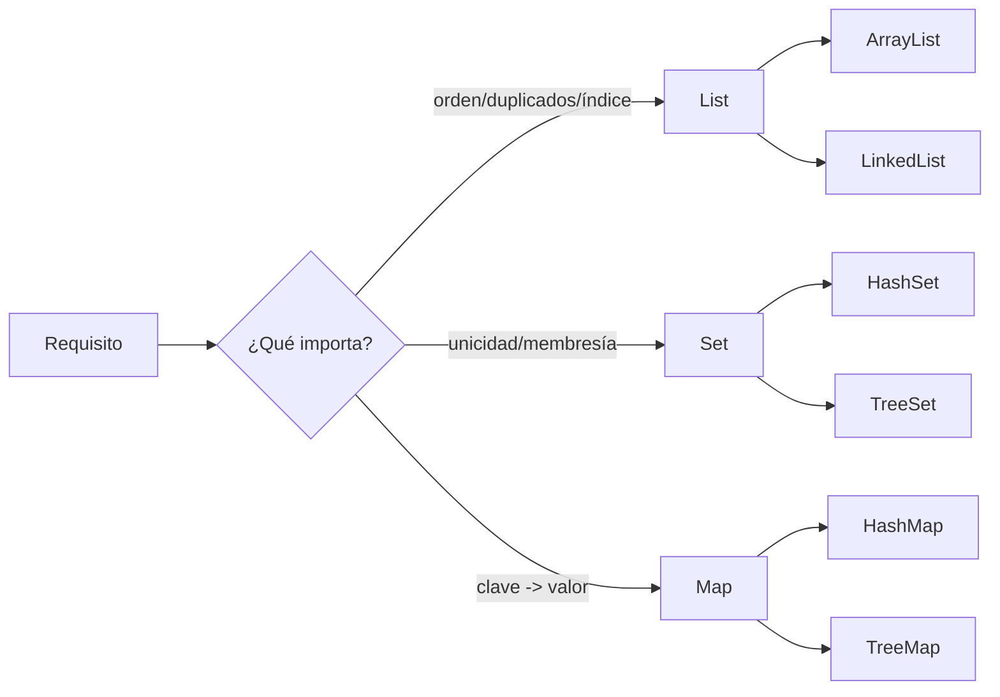
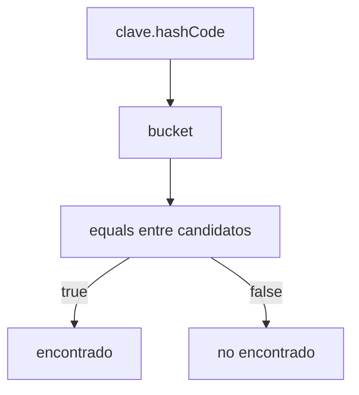
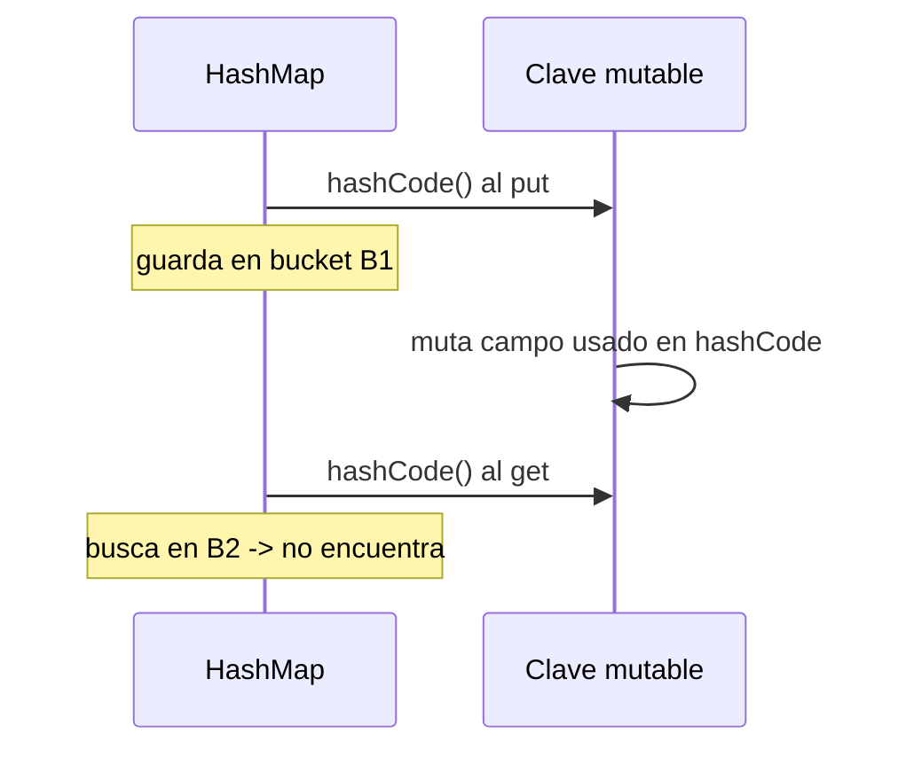

# Módulo 2: Colecciones y genéricos

Un arreglo resuelve almacenamiento contiguo, pero falla cuando el dominio pide duplicados permitidos, unicidad, búsqueda por clave, ordenamiento o tipos seguros. Las colecciones y genéricos de Java son la base de casi todo código de negocio: repositorios en memoria, caches, índices, agrupaciones, DTOs tipados y APIs que no degradan a `Object`. Elegir mal la estructura genera bugs sutiles (duplicados, pérdida de entradas, orden no determinista) o costos innecesarios.

**Entorno de referencia verificado (2026-05-22):** JDK 27.0.1.0.2, `javac 27.0.1.0.2`.

## Aprende construyendo

### Tema 1: List, Set, Map y sus implementaciones · Intermedio · 40 min

Caso guía: registro de envíos. Necesitas preservar orden de llegada, evitar IDs duplicados y consultar estado por código. Una sola estructura no expresa las tres intenciones con la misma claridad.



#### List

**Definición formal.** `List<E>` es una colección ordenada que permite duplicados y acceso posicional por índice.

**Contrato/reglas.** Mantiene orden de inserción (salvo operaciones explícitas). `get(i)` es O(1) en `ArrayList`, O(n) en `LinkedList`. `contains` es O(n).

**Cuándo usar / cuándo no.** Usa `List` para secuencias, historial, filas. No la uses para membresía masiva o búsqueda por clave natural.

**Ejemplo mínimo enfocado (ejecutable).**

```bash
mkdir -p /tmp/j2-list && cd /tmp/j2-list
```

Crea el archivo `DemoList.java`:

```java
import java.util.*;
public class DemoList {
  public static void main(String[] args) {
    List<String> llegada = new ArrayList<>();
    llegada.add("A"); llegada.add("B"); llegada.add("A");
    System.out.println(llegada);
    System.out.println(llegada.get(0));
  }
}
```

**Caso real.** Historial de eventos de pedido.

**Error común.** Usar `list.contains` para deduplicar en hot path. Síntoma: lentitud. Corrección: `Set`/`Map`.

**Verificación (JDK 27, 2026-05-22).** `[A, B, A]`, `A`.

#### Set

**Definición formal.** `Set<E>` modela una colección sin duplicados; la unicidad depende de `equals/hashCode` (`HashSet`) o comparación (`TreeSet`).

**Contrato/reglas.** `HashSet`: O(1) promedio, sin orden. `LinkedHashSet`: conserva inserción. `TreeSet`: ordenado, O(log n), requiere elementos comparables/comparator.

**Ejemplo mínimo enfocado (ejecutable).**

```bash
mkdir -p /tmp/j2-set && cd /tmp/j2-set
```

Crea el archivo `DemoSet.java`:

```java
import java.util.*;
public class DemoSet {
  public static void main(String[] args) {
    Set<String> ids = new HashSet<>(List.of("A","A","B"));
    System.out.println(ids.size());
    System.out.println(ids.contains("A"));
  }
}
```

**Error común.** Asumir orden en `HashSet`. Corrección: `LinkedHashSet` o `TreeSet`.

**Verificación (JDK 27, 2026-05-22).** `2`, `true`.

#### Map

**Definición formal.** `Map<K,V>` asocia claves únicas a valores; no es `Collection`.

**Contrato/reglas.** `put` sobre clave existente reemplaza valor. `HashMap`: O(1) promedio. `LinkedHashMap`: orden de inserción/acceso. `TreeMap`: ordenado por clave.

**Ejemplo mínimo enfocado (ejecutable).**

```bash
mkdir -p /tmp/j2-map && cd /tmp/j2-map
```

Crea el archivo `DemoMap.java`:

```java
import java.util.*;
public class DemoMap {
  public static void main(String[] args) {
    Map<String,String> estado = new HashMap<>();
    estado.put("ENV-1", "PENDIENTE");
    estado.put("ENV-1", "ENTREGADO");
    System.out.println(estado.get("ENV-1"));
    System.out.println(new TreeMap<>(Map.of("b",2,"a",1)).firstKey());
  }
}
```

**Error común.** Usar clave mutable o asumir orden en `HashMap`. Corrección: claves inmutables; `LinkedHashMap`/`TreeMap` si el orden importa.

**Verificación (JDK 27, 2026-05-22).** `ENTREGADO`, `a`.

#### Ejemplo integrado

```bash
mkdir -p /tmp/j2-t1 && cd /tmp/j2-t1
```

Crea el archivo `ColeccionesBasicas.java`:

```java
import java.util.*;
public class ColeccionesBasicas {
  public static void main(String[] args) {
    List<String> llegada = new ArrayList<>(List.of("ENV-003","ENV-001","ENV-003"));
    Set<String> ids = new HashSet<>(llegada);
    Map<String,String> estado = new HashMap<>();
    estado.put("ENV-001","PENDIENTE");
    estado.put("ENV-001","ENTREGADO");
    estado.put("ENV-003","EN_RUTA");
    System.out.println(llegada);
    System.out.println(ids.size());
    System.out.println(estado.get("ENV-001"));
  }
}
```

**Verificación (JDK 27, 2026-05-22).** `[ENV-003, ENV-001, ENV-003]`, `2`, `ENTREGADO`.

### Tema 2: El contrato de equals y hashCode · Intermedio · 45 min

Caso guía: usas `Guia` como clave en `HashMap` o elemento en `HashSet`. Si `equals/hashCode` están mal, el mapa "pierde" datos o el set acepta duplicados lógicos.



#### `equals`

**Definición formal.** `equals` define igualdad lógica entre objetos. Debe ser reflexiva, simétrica, transitiva, consistente y devolver false frente a null (salvo casos especiales).

**Cuándo usar.** Cuando dos objetos distintos representan la misma entidad lógica.

**Ejemplo mínimo enfocado (ejecutable).**

```bash
mkdir -p /tmp/j2-eq && cd /tmp/j2-eq
```

Crea el archivo `DemoEq.java`:

```java
import java.util.Objects;
class Guia { final String codigo; Guia(String c){codigo=c;} @Override public boolean equals(Object o){ return o instanceof Guia g && Objects.equals(codigo,g.codigo);} }
public class DemoEq { public static void main(String[] args){ System.out.println(new Guia("A").equals(new Guia("A"))); } }
```

**Error común.** Usar `==` para igualdad lógica. Corrección: `equals` con contrato correcto.

**Verificación (JDK 27, 2026-05-22).** `true`.

#### `hashCode`

**Definición formal.** `hashCode` devuelve un entero usado por estructuras hash para ubicar buckets.

**Contrato.** Si `a.equals(b)` es true, `a.hashCode() == b.hashCode()` debe ser true. Lo inverso no es obligatorio.

**Ejemplo mínimo enfocado (ejecutable).**

```bash
mkdir -p /tmp/j2-hash && cd /tmp/j2-hash
```

Crea el archivo `DemoHash.java`:

```java
import java.util.*; import java.util.Objects;
class Guia { final String codigo; Guia(String c){codigo=c;} @Override public boolean equals(Object o){ return o instanceof Guia g && Objects.equals(codigo,g.codigo);} @Override public int hashCode(){ return Objects.hash(codigo);} }
public class DemoHash { public static void main(String[] args){ Set<Guia> s=new HashSet<>(); s.add(new Guia("A")); s.add(new Guia("A")); System.out.println(s.size()); } }
```

**Error común.** Sobrescribir `equals` sin `hashCode`. Síntoma: `HashSet/HashMap` comportamientos inconsistentes. Corrección: implementar ambos con los mismos campos.

**Verificación (JDK 27, 2026-05-22).** `1`.

#### Claves mutables y el mapa que pierde entradas

**Definición formal.** Una clave mutable es un objeto cuya identidad lógica/campos usados por `equals/hashCode` cambian después de insertarse en una estructura hash.

**Cómo falla.** El bucket se calculó con el hash viejo; tras mutar, `containsKey/get` buscan en otro bucket y "no encuentran" la entrada.



**Ejemplo mínimo enfocado (ejecutable).**

```bash
mkdir -p /tmp/j2-mut && cd /tmp/j2-mut
```

Crea el archivo `DemoMut.java`:

```java
import java.util.*; import java.util.Objects;
class K { String id; K(String id){this.id=id;} @Override public boolean equals(Object o){ return o instanceof K k && Objects.equals(id,k.id);} @Override public int hashCode(){ return Objects.hash(id);} }
public class DemoMut {
  public static void main(String[] args) {
    Map<K,String> m=new HashMap<>();
    K k=new K("A"); m.put(k,"ok");
    k.id="B";
    System.out.println(m.get(k));
    System.out.println(m.size());
  }
}
```

**Error común.** Usar entidad mutable como clave. Corrección: claves inmutables (String, record, id inmutable).

**Verificación (JDK 27, 2026-05-22).** `null`, `1` (entrada "perdida" lógicamente).

### Tema 3: Genéricos, wildcards y type erasure · Intermedio · 45 min

Caso guía: quieres una caja/repo reutilizable sin perder seguridad de tipos y sin caer en `List<Object>`.

#### Genéricos

**Definición formal.** Los genéricos parametrizan tipos (`class Box<T>`, `List<String>`) permitiendo reutilización con comprobación en compilación.

**Ejemplo mínimo enfocado (ejecutable).**

```bash
mkdir -p /tmp/j2-gen && cd /tmp/j2-gen
```

Crea el archivo `DemoGen.java`:

```java
class Box<T> { private final T v; Box(T v){this.v=v;} T get(){return v;} }
public class DemoGen { public static void main(String[] args){ Box<String> b=new Box<>("hola"); System.out.println(b.get().toUpperCase()); } }
```

**Error común.** Usar raw types. Síntoma: warnings y `ClassCastException` runtime. Corrección: parametrizar siempre.

**Verificación (JDK 27, 2026-05-22).** `HOLA`.

#### Wildcards

**Definición formal.** `? extends T` (covariante para lectura), `? super T` (contravariante para escritura), `?` (desconocido). Regla PECS: Producer Extends, Consumer Super.

**Ejemplo mínimo enfocado (ejecutable).**

```bash
mkdir -p /tmp/j2-wc && cd /tmp/j2-wc
```

Crea el archivo `DemoWc.java`:

```java
import java.util.*;
public class DemoWc {
  static double sum(List<? extends Number> nums){ double s=0; for(Number n:nums) s+=n.doubleValue(); return s; }
  public static void main(String[] args){ System.out.println(sum(List.of(1,2,3))); }
}
```

**Error común.** Intentar agregar a `List<? extends Number>`. Corrección: usar `extends` para leer, `super` para escribir.

**Verificación (JDK 27, 2026-05-22).** `6.0`.

#### Type erasure

**Definición formal.** En Java, los genéricos se borran en compilación (erasure): en runtime `List<String>` y `List<Integer>` son `List`.

**Implicación.** No puedes hacer `new T()`, `instanceof List<String>`, ni crear arreglos genéricos directamente.

**Ejemplo mínimo enfocado (ejecutable).**

```bash
mkdir -p /tmp/j2-er && cd /tmp/j2-er
```

Crea el archivo `DemoEr.java`:

```java
import java.util.*;
public class DemoEr { public static void main(String[] args){ System.out.println(new ArrayList<String>().getClass()==new ArrayList<Integer>().getClass()); } }
```

**Error común.** Esperar info de tipo genérico en runtime. Corrección: pasar `Class<T>` o usar diseño que no dependa de reified generics.

**Verificación (JDK 27, 2026-05-22).** `true`.

### Tema 4: Comparable vs Comparator, e iteración · Intermedio · 40 min

Caso guía: mostrar guías por prioridad natural o por fecha/vista alternativa sin tocar la clase.

#### Comparable

**Definición formal.** `Comparable<T>` define el orden natural del tipo con `compareTo`.

**Ejemplo mínimo enfocado (ejecutable).**

```bash
mkdir -p /tmp/j2-cmp && cd /tmp/j2-cmp
```

Crea el archivo `DemoCmp.java`:

```java
import java.util.*;
record Guia(String codigo) implements Comparable<Guia> { public int compareTo(Guia o){ return codigo.compareTo(o.codigo); } }
public class DemoCmp { public static void main(String[] args){ var l=new ArrayList<>(List.of(new Guia("B"),new Guia("A"))); Collections.sort(l); System.out.println(l); } }
```

**Verificación (JDK 27, 2026-05-22).** `[Guia[codigo=A], Guia[codigo=B]]`.

#### Comparator

**Definición formal.** `Comparator<T>` define un orden externo/alternativo sin modificar la clase.

**Ejemplo mínimo enfocado (ejecutable).**

```bash
mkdir -p /tmp/j2-cmpr && cd /tmp/j2-cmpr
```

Crea el archivo `DemoCmpr.java`:

```java
import java.util.*;
record Guia(String codigo, int prioridad) {}
public class DemoCmpr { public static void main(String[] args){ var l=new ArrayList<>(List.of(new Guia("B",2),new Guia("A",1))); l.sort(Comparator.comparingInt(Guia::prioridad).reversed()); System.out.println(l.get(0).codigo()); } }
```

**Verificación (JDK 27, 2026-05-22).** `B`.

#### Iteración e Iterator

**Definición formal.** `Iterator` permite recorrer y eliminar de forma segura durante la iteración; for-each usa `Iterator/Iterable` por debajo.

**Ejemplo mínimo enfocado (ejecutable).**

```bash
mkdir -p /tmp/j2-it && cd /tmp/j2-it
```

Crea el archivo `DemoIt.java`:

```java
import java.util.*;
public class DemoIt {
  public static void main(String[] args) {
    List<String> l = new ArrayList<>(List.of("A","B","C"));
    Iterator<String> it = l.iterator();
    while (it.hasNext()) if (it.next().equals("B")) it.remove();
    System.out.println(l);
  }
}
```

**Error común.** `ConcurrentModificationException` al modificar lista dentro de for-each. Corrección: usar `Iterator.remove()` o `removeIf`.

**Verificación (JDK 27, 2026-05-22).** `[A, C]`.

## Cierre

Colecciones expresan intención; genéricos preservan tipos; equals/hashCode sostienen estructuras hash; Comparable/Comparator definen orden. La elección correcta reduce bugs y costo de mantenimiento.

## Checklist

- Elijo List/Set/Map por intención, no por costumbre.
- Implemento `equals` y `hashCode` juntos para claves/elementos hash.
- No uso claves mutables en HashMap/HashSet.
- Aplico genéricos y PECS; evito raw types.
- Uso `Iterator.remove`/`removeIf` al modificar durante iteración.
