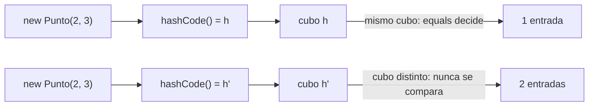
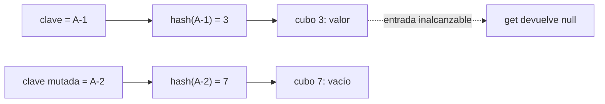

# Módulo 2: Colecciones y genéricos


## Aprende construyendo


### Tema 1: List, Set, Map y sus implementaciones · Intermedio · 35 min

<details open>
<summary><strong>Capa 1 — Lectura</strong></summary>

#### ► DE QUÉ TRATA
Este tema te guía por list, set, map y sus implementaciones con foco en comprensión antes de implementación.

#### ► LA IDEA EN UNA FRASE
**Entender list, set, map y sus implementaciones te permite tomar mejores decisiones técnicas.**

#### ► POR QUÉ EXISTE ESTO
Resuelve un problema real de diseño o implementación y evita decisiones a ciegas.

#### ► LA ANALOGÍA
Piensa en list, set, map y sus implementaciones como una herramienta de taller: útil cuando conoces su propósito y sus límites.
**Dónde se rompe la analogía:** en software, los efectos dependen del contexto, la escala y los trade-offs.

#### ► CÓMO FUNCIONA
1. Identifica el problema que list, set, map y sus implementaciones resuelve.
2. Observa sus componentes y relaciones.
3. Aplica la opción más simple que funcione.
4. Verifica el resultado y los límites.

#### ► LO QUE PUEDE SALIR MAL
| Síntoma | Causa probable | Arreglo |
|---|---|---|
| List, Set, Map y sus implementaciones se aplica pero el resultado no mejora | Se usó sin medir el problema real | Mide antes y compara contra la alternativa simple |
| Aparece complejidad inesperada | Se adoptó la técnica sin comprender sus trade-offs | Vuelve a la sección de trade-offs y reduce el alcance |
| Falla en un caso límite | Se asumió un contexto que no se cumple | Prueba el caso límite y documenta cuándo NO usarlo |

#### ► TRADE-OFFS
| Opción | Cuándo usarla | Cuándo NO usarla |
|---|---|---|
| Usar List, Set, Map y sus implementaciones | Cuando el problema coincide con su propósito y el beneficio es observable | Cuando agrega complejidad sin resolver un problema real |
| Alternativa más simple | Cuando el contexto es pequeño, estable o fácil de razonar | Cuando ya demostró no escalar o no cumplir el requisito |
| Postergar la decisión | Cuando falta evidencia del problema | Cuando el costo de esperar es mayor que el costo de probar |

#### ► CUÁNDO NO USAR ESTO
No uses list, set, map y sus implementaciones por defecto. Aplícalo cuando el problema lo justifique y puedas verificar el beneficio; si una alternativa más simple resuelve igual, prefiérela.

#### ► DE VUELTA A LA ANALOGÍA
Volviendo a la analogía: list, set, map y sus implementaciones funciona como el modelo inicial, pero recuerda dónde se rompe: en producción importan la evidencia, la escala y el costo de equivocarte.

#### ► LO QUE DEBES RECORDAR
- List, Set, Map y sus implementaciones existe para resolver un problema específico.
- Mide antes de adoptar complejidad.
- Conoce el caso donde NO usarlo.
- Verifica con evidencia observable.

#### ► PREGUNTAS PARA PENSAR
1. ¿Qué problema concreto resuelve list, set, map y sus implementaciones en tu contexto?
2. ¿Cómo sabrías que list, set, map y sus implementaciones no está funcionando bien?
3. ¿Qué alternativa más simple considerarías antes de usar list, set, map y sus implementaciones?

</details>

<details>
<summary><strong>Capa 2 — Construcción</strong></summary>

#### Código y verificación
```java
import java.util.ArrayList;
import java.util.LinkedList;
import java.util.List;

public class ColeccionesDemo {
    public static void main(String[] args) {
        List<String> guias = new ArrayList<>();
        guias.add("RF-101");
        guias.add("RF-102");
        guias.add(1, "RF-105");
        System.out.println(guias);
        System.out.println("primera=" + guias.get(0));

        List<String> cola = new LinkedList<>(List.of("RF-101", "RF-102"));
        cola.add(0, "RF-105");
        System.out.println("cola=" + cola);
    }
}
```

```bash
mkdir -p out
javac -d out src/ColeccionesDemo.java
java -cp out ColeccionesDemo
```

```java
import java.util.LinkedHashSet;
import java.util.Set;

public class ColeccionesDemo {
    public static void main(String[] args) {
        Set<String> ingreso = new LinkedHashSet<>();
        ingreso.add("RF-102");
        ingreso.add("RF-101");
        ingreso.add("RF-102");

        System.out.println("ingreso=" + ingreso);
        System.out.println("duplicada=" + ingreso.add(new String("RF-101")));
        System.out.println("cantidad=" + ingreso.size());
    }
}
```

```java
import java.util.LinkedHashMap;
import java.util.Map;

public class ColeccionesDemo {
    public static void main(String[] args) {
        Map<String, String> estados = new LinkedHashMap<>();
        estados.put("RF-101", "EN_RUTA");
        estados.put("RF-102", "ENTREGADA");
        estados.put("RF-101", "EN_REPARTO");

        System.out.println(estados.get("RF-101"));
        System.out.println(estados.getOrDefault("RF-999", "DESCONOCIDA"));
        System.out.println("guias=" + estados.size());
        estados.put("RF-103", null);
        System.out.println("registrada=" + estados.containsKey("RF-103"));
        System.out.println("valor=" + estados.getOrDefault("RF-103", "DESCONOCIDA"));
    }
}
```

```bash
javac -d out src/ColeccionesDemo.java
java -cp out ColeccionesDemo
```

</details>

### Tema 2: El contrato de equals y hashCode · Intermedio · 35 min

<details open>
<summary><strong>Capa 1 — Lectura</strong></summary>

#### ► DE QUÉ TRATA
Este tema te guía por el contrato de equals y hashcode con foco en comprensión antes de implementación.

#### ► LA IDEA EN UNA FRASE
**Entender el contrato de equals y hashcode te permite tomar mejores decisiones técnicas.**

#### ► POR QUÉ EXISTE ESTO
Resuelve un problema real de diseño o implementación y evita decisiones a ciegas.

#### ► LA ANALOGÍA
Piensa en el contrato de equals y hashcode como una herramienta de taller: útil cuando conoces su propósito y sus límites.
**Dónde se rompe la analogía:** en software, los efectos dependen del contexto, la escala y los trade-offs.

#### ► CÓMO FUNCIONA


#### ► LO QUE PUEDE SALIR MAL
| Síntoma | Causa probable | Arreglo |
|---|---|---|
| El contrato de equals y hashCode se aplica pero el resultado no mejora | Se usó sin medir el problema real | Mide antes y compara contra la alternativa simple |
| Aparece complejidad inesperada | Se adoptó la técnica sin comprender sus trade-offs | Vuelve a la sección de trade-offs y reduce el alcance |
| Falla en un caso límite | Se asumió un contexto que no se cumple | Prueba el caso límite y documenta cuándo NO usarlo |

#### ► TRADE-OFFS
| Opción | Cuándo usarla | Cuándo NO usarla |
|---|---|---|
| Usar El contrato de equals y hashCode | Cuando el problema coincide con su propósito y el beneficio es observable | Cuando agrega complejidad sin resolver un problema real |
| Alternativa más simple | Cuando el contexto es pequeño, estable o fácil de razonar | Cuando ya demostró no escalar o no cumplir el requisito |
| Postergar la decisión | Cuando falta evidencia del problema | Cuando el costo de esperar es mayor que el costo de probar |

#### ► CUÁNDO NO USAR ESTO
No uses el contrato de equals y hashcode por defecto. Aplícalo cuando el problema lo justifique y puedas verificar el beneficio; si una alternativa más simple resuelve igual, prefiérela.

#### ► DE VUELTA A LA ANALOGÍA
Volviendo a la analogía: el contrato de equals y hashcode funciona como el modelo inicial, pero recuerda dónde se rompe: en producción importan la evidencia, la escala y el costo de equivocarte.

#### ► LO QUE DEBES RECORDAR
- El contrato de equals y hashCode existe para resolver un problema específico.
- Mide antes de adoptar complejidad.
- Conoce el caso donde NO usarlo.
- Verifica con evidencia observable.

#### ► PREGUNTAS PARA PENSAR
1. ¿Qué problema concreto resuelve el contrato de equals y hashcode en tu contexto?
2. ¿Cómo sabrías que el contrato de equals y hashcode no está funcionando bien?
3. ¿Qué alternativa más simple considerarías antes de usar el contrato de equals y hashcode?

</details>

<details>
<summary><strong>Capa 2 — Construcción</strong></summary>

#### Código y verificación


```bash
mkdir pedidos-core && cd pedidos-core
mkdir -p src/io/academia/modelo
```

```java
// src/io/academia/modelo/RotoPunto.java
package io.academia.modelo;

import java.util.Objects;

public final class RotoPunto {
    private final int x;
    private final int y;

    public RotoPunto(int x, int y) {
        this.x = x;
        this.y = y;
    }

    @Override
    public boolean equals(Object otro) {
        if (this == otro) {
            return true;
        }
        if (!(otro instanceof RotoPunto p)) {
            return false;
        }
        return x == p.x;
    }

    @Override
    public int hashCode() {
        // El fallo deliberado: y participa en el hash, pero no en equals.
        return Objects.hash(x, y);
    }

    @Override
    public String toString() {
        return "RotoPunto[x=" + x + ", y=" + y + "]";
    }
}
```

```java
// src/io/academia/modelo/Punto.java
package io.academia.modelo;

import java.util.Objects;

public final class Punto {
    private final int x;
    private final int y;

    public Punto(int x, int y) {
        this.x = x;
        this.y = y;
    }

    @Override
    public boolean equals(Object otro) {
        if (this == otro) {
            return true;
        }
        if (!(otro instanceof Punto p)) {
            return false;
        }
        return x == p.x && y == p.y;
    }

    @Override
    public int hashCode() {
        return Objects.hash(x, y);
    }

    @Override
    public String toString() {
        return "Punto[x=" + x + ", y=" + y + "]";
    }
}
```

```java
// src/Demo.java
import io.academia.modelo.Punto;
import io.academia.modelo.RotoPunto;

import java.util.HashSet;
import java.util.Set;

public class Demo {
    public static void main(String[] args) {
        RotoPunto a = new RotoPunto(2, 3);
        RotoPunto b = new RotoPunto(2, 4);
        System.out.println("roto equals = " + a.equals(b));
        System.out.println("roto hash iguales = " + (a.hashCode() == b.hashCode()));

        Set<RotoPunto> rotos = new HashSet<>();
        rotos.add(a);
        rotos.add(b);
        System.out.println("roto contains = " + rotos.contains(new RotoPunto(2, 5)));
        System.out.println("roto size = " + rotos.size());

        Set<Punto> puntos = new HashSet<>();
        puntos.add(new Punto(2, 3));
        puntos.add(new Punto(2, 3));
        System.out.println("bien contains = " + puntos.contains(new Punto(2, 3)));
        System.out.println("bien size = " + puntos.size());
    }
}
```

```bash
javac -d out $(find src -name '*.java')
java -cp out Demo
```

</details>

### Tema 3: Claves mutables y el mapa que pierde entradas · Intermedio · 40 min

<details open>
<summary><strong>Capa 1 — Lectura</strong></summary>

#### ► DE QUÉ TRATA
Este tema te guía por claves mutables y el mapa que pierde entradas con foco en comprensión antes de implementación.

#### ► LA IDEA EN UNA FRASE
**Entender claves mutables y el mapa que pierde entradas te permite tomar mejores decisiones técnicas.**

#### ► POR QUÉ EXISTE ESTO
Resuelve un problema real de diseño o implementación y evita decisiones a ciegas.

#### ► LA ANALOGÍA
Piensa en claves mutables y el mapa que pierde entradas como una herramienta de taller: útil cuando conoces su propósito y sus límites.
**Dónde se rompe la analogía:** en software, los efectos dependen del contexto, la escala y los trade-offs.

#### ► CÓMO FUNCIONA


#### ► LO QUE PUEDE SALIR MAL
| Síntoma | Causa probable | Arreglo |
|---|---|---|
| Claves mutables y el mapa que pierde entradas se aplica pero el resultado no mejora | Se usó sin medir el problema real | Mide antes y compara contra la alternativa simple |
| Aparece complejidad inesperada | Se adoptó la técnica sin comprender sus trade-offs | Vuelve a la sección de trade-offs y reduce el alcance |
| Falla en un caso límite | Se asumió un contexto que no se cumple | Prueba el caso límite y documenta cuándo NO usarlo |

#### ► TRADE-OFFS
| Opción | Cuándo usarla | Cuándo NO usarla |
|---|---|---|
| Usar Claves mutables y el mapa que pierde entradas | Cuando el problema coincide con su propósito y el beneficio es observable | Cuando agrega complejidad sin resolver un problema real |
| Alternativa más simple | Cuando el contexto es pequeño, estable o fácil de razonar | Cuando ya demostró no escalar o no cumplir el requisito |
| Postergar la decisión | Cuando falta evidencia del problema | Cuando el costo de esperar es mayor que el costo de probar |

#### ► CUÁNDO NO USAR ESTO
No uses claves mutables y el mapa que pierde entradas por defecto. Aplícalo cuando el problema lo justifique y puedas verificar el beneficio; si una alternativa más simple resuelve igual, prefiérela.

#### ► DE VUELTA A LA ANALOGÍA
Volviendo a la analogía: claves mutables y el mapa que pierde entradas funciona como el modelo inicial, pero recuerda dónde se rompe: en producción importan la evidencia, la escala y el costo de equivocarte.

#### ► LO QUE DEBES RECORDAR
- Claves mutables y el mapa que pierde entradas existe para resolver un problema específico.
- Mide antes de adoptar complejidad.
- Conoce el caso donde NO usarlo.
- Verifica con evidencia observable.

#### ► PREGUNTAS PARA PENSAR
1. ¿Qué problema concreto resuelve claves mutables y el mapa que pierde entradas en tu contexto?
2. ¿Cómo sabrías que claves mutables y el mapa que pierde entradas no está funcionando bien?
3. ¿Qué alternativa más simple considerarías antes de usar claves mutables y el mapa que pierde entradas?

</details>

<details>
<summary><strong>Capa 2 — Construcción</strong></summary>

#### Código y verificación


```java
// src/io/academia/modelo/ClaveMutable.java
package io.academia.modelo;

import java.util.Objects;

public final class ClaveMutable {
    private String codigo;

    public ClaveMutable(String codigo) {
        this.codigo = codigo;
    }

    public void setCodigo(String codigo) {
        this.codigo = codigo;
    }

    @Override
    public boolean equals(Object otro) {
        return otro instanceof ClaveMutable c && Objects.equals(codigo, c.codigo);
    }

    @Override
    public int hashCode() {
        return Objects.hash(codigo);
    }

    @Override
    public String toString() {
        return "ClaveMutable[" + codigo + "]";
    }
}
```

```java
// src/io/academia/modelo/ClaveInmutable.java
package io.academia.modelo;

public record ClaveInmutable(String codigo) {
}
```

```java
// src/Demo.java
import io.academia.modelo.ClaveInmutable;
import io.academia.modelo.ClaveMutable;

import java.util.HashMap;
import java.util.Map;

public class Demo {
    public static void main(String[] args) {
        Map<ClaveMutable, String> mapa = new HashMap<>();
        ClaveMutable clave = new ClaveMutable("A-1");
        mapa.put(clave, "valor");
        clave.setCodigo("A-2");

        System.out.println("get tras mutar = " + mapa.get(clave));
        System.out.println("tamano = " + mapa.size());
        System.out.println("valor sigue dentro = " + mapa.containsValue("valor"));
        System.out.println("entradas = " + mapa.entrySet());

        Map<ClaveInmutable, String> seguro = new HashMap<>();
        ClaveInmutable k = new ClaveInmutable("A-1");
        seguro.put(k, "valor");
        System.out.println("record get = " + seguro.get(new ClaveInmutable("A-1")));
    }
}
```

```bash
javac -d out $(find src -name '*.java')
java -cp out Demo
```

```text
get tras mutar = null
tamano = 1
valor sigue dentro = true
entradas = [ClaveMutable[A-2]=valor]
record get = valor
```

</details>

### Tema 4: Genéricos, wildcards y type erasure · Avanzado · 40 min

<details open>
<summary><strong>Capa 1 — Lectura</strong></summary>

#### ► DE QUÉ TRATA
Este tema te guía por genéricos, wildcards y type erasure con foco en comprensión antes de implementación.

#### ► LA IDEA EN UNA FRASE
**Entender genéricos, wildcards y type erasure te permite tomar mejores decisiones técnicas.**

#### ► POR QUÉ EXISTE ESTO
Resuelve un problema real de diseño o implementación y evita decisiones a ciegas.

#### ► LA ANALOGÍA
Piensa en genéricos, wildcards y type erasure como una herramienta de taller: útil cuando conoces su propósito y sus límites.
**Dónde se rompe la analogía:** en software, los efectos dependen del contexto, la escala y los trade-offs.

#### ► CÓMO FUNCIONA
1. Identifica el problema que genéricos, wildcards y type erasure resuelve.
2. Observa sus componentes y relaciones.
3. Aplica la opción más simple que funcione.
4. Verifica el resultado y los límites.

#### ► LO QUE PUEDE SALIR MAL
| Síntoma | Causa probable | Arreglo |
|---|---|---|
| Genéricos, wildcards y type erasure se aplica pero el resultado no mejora | Se usó sin medir el problema real | Mide antes y compara contra la alternativa simple |
| Aparece complejidad inesperada | Se adoptó la técnica sin comprender sus trade-offs | Vuelve a la sección de trade-offs y reduce el alcance |
| Falla en un caso límite | Se asumió un contexto que no se cumple | Prueba el caso límite y documenta cuándo NO usarlo |

#### ► TRADE-OFFS
| Opción | Cuándo usarla | Cuándo NO usarla |
|---|---|---|
| Usar Genéricos, wildcards y type erasure | Cuando el problema coincide con su propósito y el beneficio es observable | Cuando agrega complejidad sin resolver un problema real |
| Alternativa más simple | Cuando el contexto es pequeño, estable o fácil de razonar | Cuando ya demostró no escalar o no cumplir el requisito |
| Postergar la decisión | Cuando falta evidencia del problema | Cuando el costo de esperar es mayor que el costo de probar |

#### ► CUÁNDO NO USAR ESTO
No uses genéricos, wildcards y type erasure por defecto. Aplícalo cuando el problema lo justifique y puedas verificar el beneficio; si una alternativa más simple resuelve igual, prefiérela.

#### ► DE VUELTA A LA ANALOGÍA
Volviendo a la analogía: genéricos, wildcards y type erasure funciona como el modelo inicial, pero recuerda dónde se rompe: en producción importan la evidencia, la escala y el costo de equivocarte.

#### ► LO QUE DEBES RECORDAR
- Genéricos, wildcards y type erasure existe para resolver un problema específico.
- Mide antes de adoptar complejidad.
- Conoce el caso donde NO usarlo.
- Verifica con evidencia observable.

#### ► PREGUNTAS PARA PENSAR
1. ¿Qué problema concreto resuelve genéricos, wildcards y type erasure en tu contexto?
2. ¿Cómo sabrías que genéricos, wildcards y type erasure no está funcionando bien?
3. ¿Qué alternativa más simple considerarías antes de usar genéricos, wildcards y type erasure?

</details>

<details>
<summary><strong>Capa 2 — Construcción</strong></summary>

#### Código y verificación
```java
final class Caja<T> {
    private final T contenido;

    Caja(T contenido) { this.contenido = contenido; }

    T obtener() { return contenido; }
}

public class GenericosDemo {
    public static void main(String[] args) {
        Caja<String> guia = new Caja<>("RF-401");
        Caja<Integer> peso = new Caja<>(12);
        System.out.println(guia.obtener());
        System.out.println(peso.obtener() + " kg");
    }
}
```

```bash
mkdir -p out
javac -d out src/GenericosDemo.java
java -cp out GenericosDemo
```

```java
import java.util.List;

public class GenericosDemo {
    static double sumarPesos(List<? extends Number> pesos) {
        double total = 0;
        for (Number peso : pesos) {
            total += peso.doubleValue();
        }
        return total;
    }

    public static void main(String[] args) {
        System.out.println(sumarPesos(List.of(2, 3, 4)));
        System.out.println(sumarPesos(List.of(1.5, 2.5)));
    }
}
```

```java
import java.util.ArrayList;
import java.util.List;

public class GenericosDemo {
    static void agregarCodigos(List<? super Integer> destino) {
        destino.add(401);
        destino.add(402);
    }

    public static void main(String[] args) {
        List<Integer> codigos = new ArrayList<>();
        List<Number> numeros = new ArrayList<>();
        agregarCodigos(codigos);
        agregarCodigos(numeros);
        System.out.println(codigos);
        System.out.println(numeros);
    }
}
```

```java
final class Caja<T> {
    private final T contenido;
    Caja(T contenido) { this.contenido = contenido; }
    T obtener() { return contenido; }
}

public class GenericosDemo {
    public static void main(String[] args) {
        Caja<String> texto = new Caja<>("RF-401");
        Caja<Integer> numero = new Caja<>(401);
        System.out.println(texto.getClass() == numero.getClass());
        System.out.println(texto.obtener().getClass().getSimpleName());
        System.out.println(numero.obtener().getClass().getSimpleName());
    }
}
```

```java
Caja sinTipo = numero;
Caja<String> contaminada = sinTipo;
System.out.println(contaminada.obtener().length());
```

</details>

### Tema 5: Comparable vs Comparator, e iteración · Avanzado · 35 min

<details open>
<summary><strong>Capa 1 — Lectura</strong></summary>

#### ► DE QUÉ TRATA
Este tema te guía por comparable vs comparator, e iteración con foco en comprensión antes de implementación.

#### ► LA IDEA EN UNA FRASE
**Entender comparable vs comparator, e iteración te permite tomar mejores decisiones técnicas.**

#### ► POR QUÉ EXISTE ESTO
Resuelve un problema real de diseño o implementación y evita decisiones a ciegas.

#### ► LA ANALOGÍA
Piensa en comparable vs comparator, e iteración como una herramienta de taller: útil cuando conoces su propósito y sus límites.
**Dónde se rompe la analogía:** en software, los efectos dependen del contexto, la escala y los trade-offs.

#### ► CÓMO FUNCIONA
1. Identifica el problema que comparable vs comparator, e iteración resuelve.
2. Observa sus componentes y relaciones.
3. Aplica la opción más simple que funcione.
4. Verifica el resultado y los límites.

#### ► LO QUE PUEDE SALIR MAL
| Síntoma | Causa probable | Arreglo |
|---|---|---|
| Comparable vs Comparator, e iteración se aplica pero el resultado no mejora | Se usó sin medir el problema real | Mide antes y compara contra la alternativa simple |
| Aparece complejidad inesperada | Se adoptó la técnica sin comprender sus trade-offs | Vuelve a la sección de trade-offs y reduce el alcance |
| Falla en un caso límite | Se asumió un contexto que no se cumple | Prueba el caso límite y documenta cuándo NO usarlo |

#### ► TRADE-OFFS
| Opción | Cuándo usarla | Cuándo NO usarla |
|---|---|---|
| Usar Comparable vs Comparator, e iteración | Cuando el problema coincide con su propósito y el beneficio es observable | Cuando agrega complejidad sin resolver un problema real |
| Alternativa más simple | Cuando el contexto es pequeño, estable o fácil de razonar | Cuando ya demostró no escalar o no cumplir el requisito |
| Postergar la decisión | Cuando falta evidencia del problema | Cuando el costo de esperar es mayor que el costo de probar |

#### ► CUÁNDO NO USAR ESTO
No uses comparable vs comparator, e iteración por defecto. Aplícalo cuando el problema lo justifique y puedas verificar el beneficio; si una alternativa más simple resuelve igual, prefiérela.

#### ► DE VUELTA A LA ANALOGÍA
Volviendo a la analogía: comparable vs comparator, e iteración funciona como el modelo inicial, pero recuerda dónde se rompe: en producción importan la evidencia, la escala y el costo de equivocarte.

#### ► LO QUE DEBES RECORDAR
- Comparable vs Comparator, e iteración existe para resolver un problema específico.
- Mide antes de adoptar complejidad.
- Conoce el caso donde NO usarlo.
- Verifica con evidencia observable.

#### ► PREGUNTAS PARA PENSAR
1. ¿Qué problema concreto resuelve comparable vs comparator, e iteración en tu contexto?
2. ¿Cómo sabrías que comparable vs comparator, e iteración no está funcionando bien?
3. ¿Qué alternativa más simple considerarías antes de usar comparable vs comparator, e iteración?

</details>

<details>
<summary><strong>Capa 2 — Construcción</strong></summary>

#### Código y verificación
```java
import java.util.ArrayList;
import java.util.Collections;
import java.util.List;
import java.util.TreeSet;

class Guia implements Comparable<Guia> {
    private final String codigo;

    Guia(String codigo) { this.codigo = codigo; }
    String codigo() { return codigo; }

    @Override
    public int compareTo(Guia otra) {
        return codigo.compareTo(otra.codigo);
    }

    @Override
    public String toString() { return codigo; }
}

public class OrdenDemo {
    public static void main(String[] args) {
        List<Guia> guias = new ArrayList<>(List.of(
            new Guia("RF-103"), new Guia("RF-101"), new Guia("RF-102")));
        Collections.sort(guias);
        System.out.println(guias);
        TreeSet<Guia> unicasPorCodigo = new TreeSet<>(guias);
        System.out.println("agrega mismo codigo=" + unicasPorCodigo.add(new Guia("RF-101")));
        System.out.println("codigos distintos=" + unicasPorCodigo.size());
    }
}
```

```bash
mkdir -p out
javac -d out src/OrdenDemo.java
java -cp out OrdenDemo
```

```java
import java.util.ArrayList;
import java.util.Comparator;
import java.util.List;

class Guia {
    private final String codigo;
    private final String destino;

    Guia(String codigo, String destino) {
        this.codigo = codigo;
        this.destino = destino;
    }

    String codigo() { return codigo; }
    String destino() { return destino; }

    @Override
    public String toString() {
        return "Guia[codigo=" + codigo + ", destino=" + destino + "]";
    }
}

class PorDestinoYCodigo implements Comparator<Guia> {
    @Override
    public int compare(Guia primera, Guia segunda) {
        int destino = primera.destino().compareTo(segunda.destino());
        if (destino != 0) return destino;
        return primera.codigo().compareTo(segunda.codigo());
    }
}

public class OrdenDemo {
    public static void main(String[] args) {
        List<Guia> guias = new ArrayList<>(List.of(
            new Guia("RF-103", "Cali"),
            new Guia("RF-101", "Bogota"),
            new Guia("RF-102", "Bogota")));

        guias.sort(new PorDestinoYCodigo());
        for (Guia guia : guias) {
            System.out.println(guia);
        }
    }
}
```

```java
import java.util.Iterator;
import java.util.LinkedHashMap;
import java.util.Map;

public class OrdenDemo {
    public static void main(String[] args) {
        Map<String, String> estados = new LinkedHashMap<>();
        estados.put("RF-101", new String("ENTREGADA"));
        estados.put("RF-102", "EN_RUTA");

        Iterator<Map.Entry<String, String>> iterador =
            estados.entrySet().iterator();
        while (iterador.hasNext()) {
            Map.Entry<String, String> entrada = iterador.next();
            if (entrada.getValue().equals("ENTREGADA")) {
                iterador.remove();
            }
        }

        for (Map.Entry<String, String> entrada : estados.entrySet()) {
            System.out.println(entrada.getKey() + "=" + entrada.getValue());
        }
    }
}
```

```bash
javac -d out src/OrdenDemo.java
java -cp out OrdenDemo
```

</details>

### Tema 6: Colas y pilas: `Queue`, `Deque`, `ArrayDeque` y `PriorityQueue` · Avanzado · 35 min

<details open>
<summary><strong>Capa 1 — Lectura</strong></summary>

#### ► DE QUÉ TRATA
Este tema te guía por colas y pilas: `queue`, `deque`, `arraydeque` y `priorityqueue` con foco en comprensión antes de implementación.

#### ► LA IDEA EN UNA FRASE
**Entender colas y pilas: `queue`, `deque`, `arraydeque` y `priorityqueue` te permite tomar mejores decisiones técnicas.**

#### ► POR QUÉ EXISTE ESTO
Resuelve un problema real de diseño o implementación y evita decisiones a ciegas.

#### ► LA ANALOGÍA
Piensa en colas y pilas: `queue`, `deque`, `arraydeque` y `priorityqueue` como una herramienta de taller: útil cuando conoces su propósito y sus límites.
**Dónde se rompe la analogía:** en software, los efectos dependen del contexto, la escala y los trade-offs.

#### ► CÓMO FUNCIONA
1. Identifica el problema que colas y pilas: `queue`, `deque`, `arraydeque` y `priorityqueue` resuelve.
2. Observa sus componentes y relaciones.
3. Aplica la opción más simple que funcione.
4. Verifica el resultado y los límites.

#### ► LO QUE PUEDE SALIR MAL
| Síntoma | Causa probable | Arreglo |
|---|---|---|
| Colas y pilas: `Queue`, `Deque`, `ArrayDeque` y `PriorityQueue` se aplica pero el resultado no mejora | Se usó sin medir el problema real | Mide antes y compara contra la alternativa simple |
| Aparece complejidad inesperada | Se adoptó la técnica sin comprender sus trade-offs | Vuelve a la sección de trade-offs y reduce el alcance |
| Falla en un caso límite | Se asumió un contexto que no se cumple | Prueba el caso límite y documenta cuándo NO usarlo |

#### ► TRADE-OFFS
| Opción | Cuándo usarla | Cuándo NO usarla |
|---|---|---|
| Usar Colas y pilas: `Queue`, `Deque`, `ArrayDeque` y `PriorityQueue` | Cuando el problema coincide con su propósito y el beneficio es observable | Cuando agrega complejidad sin resolver un problema real |
| Alternativa más simple | Cuando el contexto es pequeño, estable o fácil de razonar | Cuando ya demostró no escalar o no cumplir el requisito |
| Postergar la decisión | Cuando falta evidencia del problema | Cuando el costo de esperar es mayor que el costo de probar |

#### ► CUÁNDO NO USAR ESTO
No uses colas y pilas: `queue`, `deque`, `arraydeque` y `priorityqueue` por defecto. Aplícalo cuando el problema lo justifique y puedas verificar el beneficio; si una alternativa más simple resuelve igual, prefiérela.

#### ► DE VUELTA A LA ANALOGÍA
Volviendo a la analogía: colas y pilas: `queue`, `deque`, `arraydeque` y `priorityqueue` funciona como el modelo inicial, pero recuerda dónde se rompe: en producción importan la evidencia, la escala y el costo de equivocarte.

#### ► LO QUE DEBES RECORDAR
- Colas y pilas: `Queue`, `Deque`, `ArrayDeque` y `PriorityQueue` existe para resolver un problema específico.
- Mide antes de adoptar complejidad.
- Conoce el caso donde NO usarlo.
- Verifica con evidencia observable.

#### ► PREGUNTAS PARA PENSAR
1. ¿Qué problema concreto resuelve colas y pilas: `queue`, `deque`, `arraydeque` y `priorityqueue` en tu contexto?
2. ¿Cómo sabrías que colas y pilas: `queue`, `deque`, `arraydeque` y `priorityqueue` no está funcionando bien?
3. ¿Qué alternativa más simple considerarías antes de usar colas y pilas: `queue`, `deque`, `arraydeque` y `priorityqueue`?

</details>

<details>
<summary><strong>Capa 2 — Construcción</strong></summary>

#### Código y verificación
```java
import java.util.ArrayDeque;
import java.util.Queue;

public class ColaDeParadas {
    public static void main(String[] args) {
        Queue<String> paradas = new ArrayDeque<>();
        paradas.offer("Bodega");
        paradas.offer("Laureles");
        paradas.offer("Envigado");

        System.out.println("Siguiente: " + paradas.peek());
        while (!paradas.isEmpty()) {
            System.out.println("Visitando " + paradas.poll());
        }
        System.out.println("poll en cola vacia: " + paradas.poll());
        System.out.println("remove en cola vacia:");
        paradas.remove();
    }
}
```

```text
Siguiente: Bodega
Visitando Bodega
Visitando Laureles
Visitando Envigado
poll en cola vacia: null
remove en cola vacia:
Exception in thread "main" java.util.NoSuchElementException
```

```java
import java.util.ArrayDeque;
import java.util.Deque;

public class PilaDeCambios {
    public static void main(String[] args) {
        Deque<String> cambios = new ArrayDeque<>();
        cambios.push("asignar conductor");
        cambios.push("cambiar destino");
        cambios.push("marcar urgente");

        System.out.println("Ultimo cambio: " + cambios.peek());
        System.out.println("Deshacer: " + cambios.pop());
        System.out.println("Deshacer: " + cambios.pop());
        System.out.println("Quedan: " + cambios);

        cambios.offerLast("auditar al final");
        System.out.println("Primero: " + cambios.peekFirst() + " | Ultimo: " + cambios.peekLast());
    }
}
```

```text
Ultimo cambio: marcar urgente
Deshacer: marcar urgente
Deshacer: cambiar destino
Quedan: [asignar conductor]
Primero: asignar conductor | Ultimo: auditar al final
```

```java
import java.util.Comparator;
import java.util.PriorityQueue;

public class PrioridadDeEnvios {
    record Envio(String guia, int prioridad) {}

    public static void main(String[] args) {
        PriorityQueue<Envio> porAtender = new PriorityQueue<>(
                Comparator.comparingInt(Envio::prioridad).thenComparing(Envio::guia));
        porAtender.add(new Envio("RF-3", 2));
        porAtender.add(new Envio("RF-1", 1));
        porAtender.add(new Envio("RF-9", 3));
        porAtender.add(new Envio("RF-2", 1));

        System.out.println("Vista interna: " + porAtender);
        while (!porAtender.isEmpty()) {
            System.out.println("Atender " + porAtender.poll());
        }
    }
}
```

```text
Vista interna: [Envio[guia=RF-1, prioridad=1], Envio[guia=RF-2, prioridad=1], Envio[guia=RF-9, prioridad=3], Envio[guia=RF-3, prioridad=2]]
Atender Envio[guia=RF-1, prioridad=1]
Atender Envio[guia=RF-2, prioridad=1]
Atender Envio[guia=RF-3, prioridad=2]
Atender Envio[guia=RF-9, prioridad=3]
```

</details>

### Incremento del proyecto: preparar guías asignables

<details open>
<summary><strong>Capa 1 — Lectura</strong></summary>

#### ► DE QUÉ TRATA
Este tema te guía por incremento del proyecto: preparar guías asignables con foco en comprensión antes de implementación.

#### ► LA IDEA EN UNA FRASE
**Entender incremento del proyecto: preparar guías asignables te permite tomar mejores decisiones técnicas.**

#### ► POR QUÉ EXISTE ESTO
Resuelve un problema real de diseño o implementación y evita decisiones a ciegas.

#### ► LA ANALOGÍA
Piensa en incremento del proyecto: preparar guías asignables como una herramienta de taller: útil cuando conoces su propósito y sus límites.
**Dónde se rompe la analogía:** en software, los efectos dependen del contexto, la escala y los trade-offs.

#### ► CÓMO FUNCIONA
1. Identifica el problema que incremento del proyecto: preparar guías asignables resuelve.
2. Observa sus componentes y relaciones.
3. Aplica la opción más simple que funcione.
4. Verifica el resultado y los límites.

#### ► LO QUE PUEDE SALIR MAL
| Síntoma | Causa probable | Arreglo |
|---|---|---|
| Incremento del proyecto: preparar guías asignables se aplica pero el resultado no mejora | Se usó sin medir el problema real | Mide antes y compara contra la alternativa simple |
| Aparece complejidad inesperada | Se adoptó la técnica sin comprender sus trade-offs | Vuelve a la sección de trade-offs y reduce el alcance |
| Falla en un caso límite | Se asumió un contexto que no se cumple | Prueba el caso límite y documenta cuándo NO usarlo |

#### ► TRADE-OFFS
| Opción | Cuándo usarla | Cuándo NO usarla |
|---|---|---|
| Usar Incremento del proyecto: preparar guías asignables | Cuando el problema coincide con su propósito y el beneficio es observable | Cuando agrega complejidad sin resolver un problema real |
| Alternativa más simple | Cuando el contexto es pequeño, estable o fácil de razonar | Cuando ya demostró no escalar o no cumplir el requisito |
| Postergar la decisión | Cuando falta evidencia del problema | Cuando el costo de esperar es mayor que el costo de probar |

#### ► CUÁNDO NO USAR ESTO
No uses incremento del proyecto: preparar guías asignables por defecto. Aplícalo cuando el problema lo justifique y puedas verificar el beneficio; si una alternativa más simple resuelve igual, prefiérela.

#### ► DE VUELTA A LA ANALOGÍA
Volviendo a la analogía: incremento del proyecto: preparar guías asignables funciona como el modelo inicial, pero recuerda dónde se rompe: en producción importan la evidencia, la escala y el costo de equivocarte.

#### ► LO QUE DEBES RECORDAR
- Incremento del proyecto: preparar guías asignables existe para resolver un problema específico.
- Mide antes de adoptar complejidad.
- Conoce el caso donde NO usarlo.
- Verifica con evidencia observable.

#### ► PREGUNTAS PARA PENSAR
1. ¿Qué problema concreto resuelve incremento del proyecto: preparar guías asignables en tu contexto?
2. ¿Cómo sabrías que incremento del proyecto: preparar guías asignables no está funcionando bien?
3. ¿Qué alternativa más simple considerarías antes de usar incremento del proyecto: preparar guías asignables?

</details>

<details>
<summary><strong>Capa 2 — Construcción</strong></summary>

#### Código y verificación
```java
import java.util.ArrayList;
import java.util.Comparator;
import java.util.Iterator;
import java.util.LinkedHashMap;
import java.util.LinkedHashSet;
import java.util.List;
import java.util.Map;
import java.util.Set;
import modelo.Guia;

public class MotorAsignacion {
    static class PorNumero implements Comparator<Guia> {
        @Override
        public int compare(Guia primera, Guia segunda) {
            return primera.numero().compareTo(segunda.numero());
        }
    }

    public static void main(String[] args) {
        List<Guia> recibidas = List.of(
            new Guia("RF-103"), new Guia("RF-101"),
            new Guia("RF-102"), new Guia("RF-101"));
        Map<String, Guia> unicas = new LinkedHashMap<>();
        Set<String> duplicadas = new LinkedHashSet<>();

        for (Guia guia : recibidas) {
            if (unicas.containsKey(guia.numero())) {
                duplicadas.add(guia.numero());
            } else {
                unicas.put(guia.numero(), guia);
            }
        }

        Iterator<Map.Entry<String, Guia>> iterador =
            unicas.entrySet().iterator();
        while (iterador.hasNext()) {
            if (iterador.next().getKey().equals("RF-103")) {
                iterador.remove(); // cancelación conocida antes de asignar
            }
        }

        List<Guia> asignables = new ArrayList<>(unicas.values());
        asignables.sort(new PorNumero());
        System.out.println("duplicadas=" + duplicadas);
        for (Guia guia : asignables) {
            System.out.println("asignable=" + guia.numero());
        }
    }
}
```

```bash
mkdir -p out
javac -d out src/modelo/Guia.java src/MotorAsignacion.java
java -cp out MotorAsignacion
```

</details>
