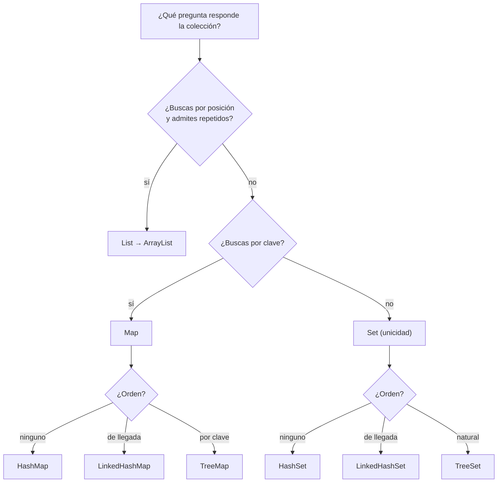
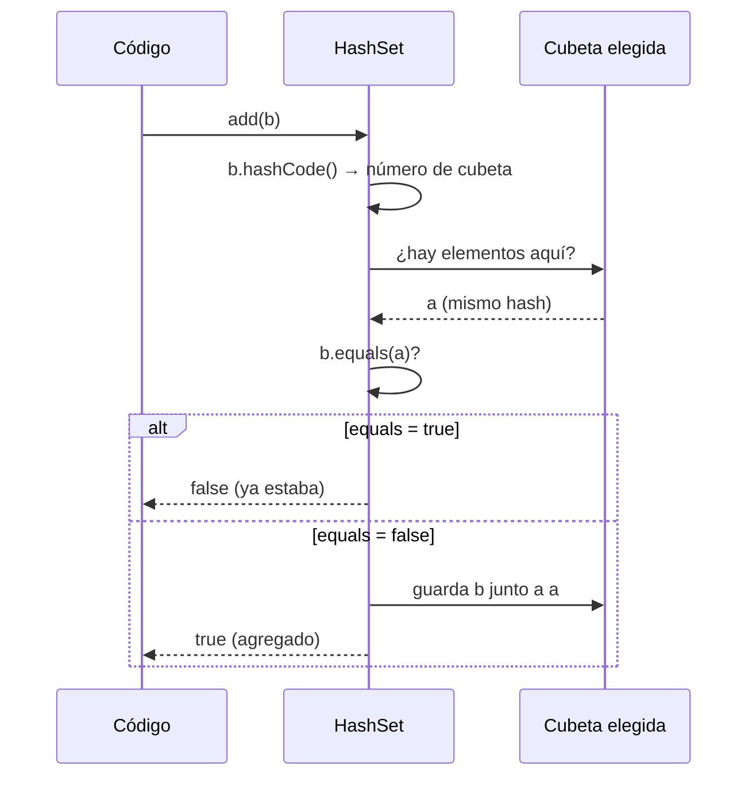
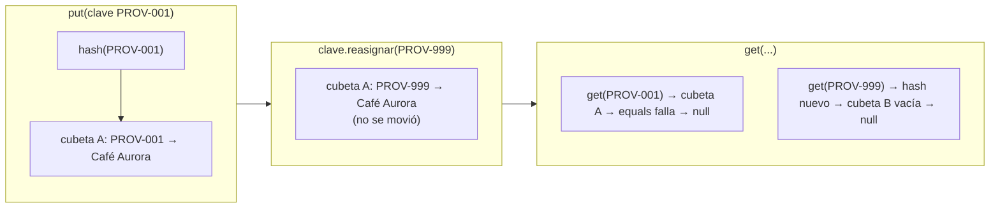
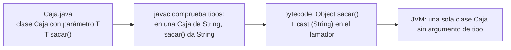
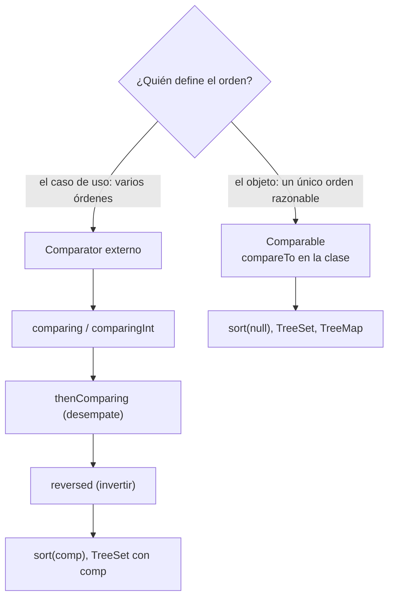
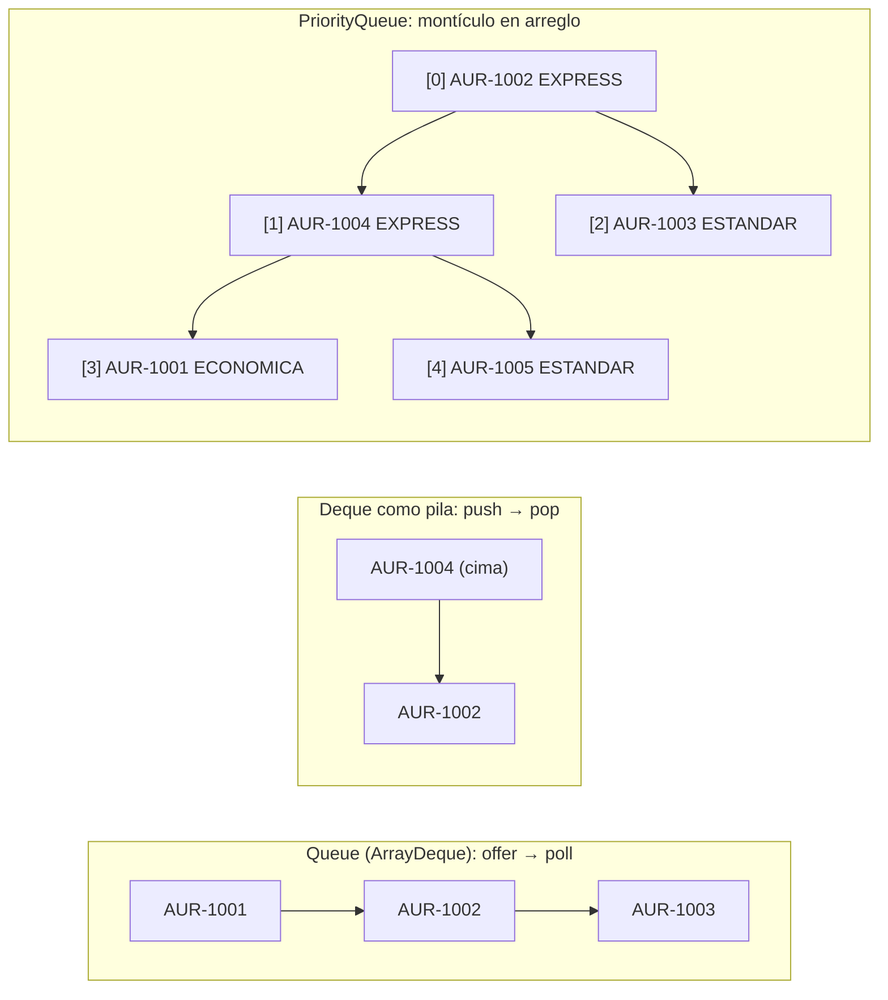

# Módulo 2: Colecciones y genéricos


## Visual del módulo

**Visual:** [Mapa de colecciones: List, Set, Map, Queue/Deque, contratos y genéricos](/visuals/temas/java/modulo-2-colecciones.html)

Lectura: La estructura correcta expresa el contrato: orden, unicidad, clave o espera.


En el módulo anterior Tienda Aurora ya tenía productos, descuentos y pagos modelados como objetos. El siguiente problema aparece en cuanto la tienda crece: hay que guardar productos en orden de alta, evitar SKUs duplicados, consultar por etiqueta, atender pedidos por prioridad, paginar resultados y deshacer la última atención. Un arreglo no expresa ninguna de esas intenciones. Una `ArrayList` usada para todo tampoco: funciona al principio y después empiezan los bugs sutiles —duplicados silenciosos, búsquedas lineales por todas partes, claves que “desaparecen” de un mapa, comparaciones que no dicen qué orden significan.

Las colecciones de Java son estructuras de datos con contratos. Elegir una colección es elegir un comportamiento: ¿importa el orden? ¿se permiten duplicados? ¿se busca por posición o por clave? ¿la unicidad depende de `equals`? ¿el orden lo define la inserción, un orden natural o un comparador? Los genéricos completan la imagen: permiten que ese contrato se exprese con tipos reales (`Map<Sku, Producto>`) en lugar de `Object`, y dejan que el compilador detecte errores antes de ejecutar.

En este módulo construimos `tienda-aurora-colecciones`, una extensión de la tienda con catálogo indexado, cola de pedidos por prioridad, paginación genérica y una auditoría ejecutable que demuestra los contratos que más fallos causan en producción: `equals`/`hashCode`, claves mutables, borrado de tipos, comparadores y colas/pilas.

**Entorno de referencia verificado (2026-11-23):** JDK 27.0.1.0.2 (`javac 27.0.1.0.2`), Gradle 9.9.1, macOS arm64. El proyecto se compiló con `--release 25` y se ejecutó; las salidas son transcripciones reales de `./gradlew -q run --args="..."`. La inspección de bytecode se hizo con `javap -private -s` del JDK 27 y el error de borrado de tipos se capturó con `javac` sobre un archivo de demostración aislado.

**Entorno de las salidas nuevas de los Temas 1–6 (2026-11-24):** OpenJDK 21.0.13.1 en Ubuntu 24.04 (Linux x86_64). Cada programa de un solo archivo se compiló con `javac -Xlint:all` y se ejecutó con `java`; no usa paquetes externos ni funciones posteriores a Java 21, así que se comporta igual con el JDK 25 del curso. Las trazas de pila muestran números de línea internos del JDK 21 (por ejemplo, `ImmutableCollections.java:159`); con otro JDK esos números pueden cambiar, pero no el tipo de excepción, el mensaje ni la línea de tu archivo. Los milisegundos del Problema resuelto 1.2 cambian en cada corrida. Las salidas del proyecto `tienda-aurora-colecciones` son las capturadas en el entorno de referencia de arriba.

## Apertura del módulo

#### Objetivos del módulo
Al terminar este módulo podrás:
- elegir entre `List`, `Set`, `Map`, `Queue` y `Deque`, y su implementación, según la pregunta que responde el código;
- escribir `equals` y `hashCode` coherentes y diseñar claves inmutables;
- proteger el estado interno de un objeto con copias defensivas;
- escribir clases y métodos genéricos y aplicar PECS con `? extends` y `? super`;
- explicar el borrado de tipos y leer los errores de compilación que provoca;
- ordenar con `Comparable` y `Comparator`, y borrar durante un recorrido sin `ConcurrentModificationException`;
- atender por prioridad con `PriorityQueue` y deshacer con una pila `ArrayDeque`.

#### Esquema del módulo
1. List, Set, Map y sus implementaciones.
2. El contrato de equals y hashCode.
3. Claves mutables y el mapa que pierde entradas.
4. Genéricos, wildcards y type erasure.
5. Comparable vs Comparator, e iteración.
6. Colas y pilas: Queue, Deque, ArrayDeque y PriorityQueue.
7. Laboratorio integrador: `tienda-aurora-colecciones`.

#### Qué necesitas saber antes
- Java, Módulo 0: tipos primitivos frente a referencias y `==` (Tema 4), arreglos y *wrappers* como `Integer` (Tema 7).
- Java, Módulo 1: clases y encapsulación (Tema 1), herencia y `@Override` (Tema 2), interfaces (Tema 3) y `record` (Tema 5).
- Fundamentos, Módulo 2: lista, diccionario y conjunto (Tema 1), pila y cola (Tema 2), complejidad y notación O grande (Tema 4), árboles (Tema 5) y tablas hash (Tema 6). Este módulo cita esas definiciones y explica solo lo propio de Java.

## Aprende construyendo

### Tema 1: List, Set, Map y sus implementaciones · Intermedio · 70 min

<details open>
<summary><strong>Capa 1 — Lectura</strong></summary>

#### Objetivos
Al terminar este tema podrás:
- elegir entre `List`, `Set` y `Map` a partir de la pregunta que el código debe responder;
- distinguir `ArrayList` de `LinkedList`, `HashSet` de `LinkedHashSet` y `TreeSet`, y `HashMap` de `LinkedHashMap` y `TreeMap`;
- predecir el orden en que cada implementación devuelve sus elementos;
- leer el `UnsupportedOperationException` de una colección inmodificable y corregirlo.

**Conceptos clave:** Collection, List, ArrayList, LinkedList, Set, HashSet, LinkedHashSet, TreeSet, Map, HashMap, LinkedHashMap, TreeMap, colección inmodificable

#### El problema
Una colección es una estructura que guarda elementos bajo un contrato. El contrato responde tres preguntas antes de escribir código: si importa el orden, si se permiten duplicados y cómo se va a buscar. Si la respuesta es “por posición y puede haber repetidos”, la estructura es una `List`. Si la respuesta es “no quiero duplicados y me importa pertenencia”, es un `Set`. Si la respuesta es “quiero encontrar un valor por una clave”, es un `Map`.

En Tienda Aurora esas tres preguntas aparecen el mismo día. El lector de códigos registra cada escaneo, aunque se repita. El inventario necesita las etiquetas sin duplicados. El mostrador pide el stock de un SKU concreto. Con un arreglo (Java, Módulo 0, Tema 7) tendrías que recorrerlo todo cada vez. ¿Qué estructura de Java responde cada pregunta sin trabajo extra?

#### Glosario del tema
Las estructuras abstractas ya están definidas en Fundamentos, Módulo 2: **lista**, **diccionario** y **conjunto** (Tema 1), **complejidad** y notación O grande (Tema 4), **árbol binario de búsqueda** (Tema 5) y **tabla hash** (Tema 6). Aquí solo ves cómo las nombra y las implementa Java.

**`Collection`**
- **Definición técnica:** interfaz raíz de `java.util` para grupos de elementos; declara `add`, `remove`, `contains`, `size` e `iterator`. `List`, `Set` y `Queue` la extienden.
- **En palabras sencillas:** el contrato mínimo de cualquier «bolsa de cosas»: meter, sacar, preguntar si está y contar.
- **Dónde se rompe la comparación:** `Map` no es una `Collection`, aunque guarda datos; sus vistas `keySet()` y `values()` sí lo son.
- **Ejemplo:** `hash.size()` devuelve `2` en el Problema resuelto 1.1 porque `HashSet` implementa `Collection`.
- **Error típico:** declarar `Collection<String> c` y luego necesitar `c.get(0)`: no compila, porque `get` es de `List`.

**`List`**
- **Definición técnica:** interfaz `List<E>`: secuencia ordenada por posición que admite repetidos y acceso por índice con `get(int)`.
- **En palabras sencillas:** una fila numerada; cada elemento tiene su puesto, empezando en 0.
- **Dónde se rompe la comparación:** en una fila real no hay dos personas idénticas; en una `List` el mismo valor puede aparecer varias veces.
- **Ejemplo:** `escaneos` imprime `[CAF-0001, TAZ-0002, CAF-0001]` y `get(1)=TAZ-0002`.
- **Error típico:** pedir un índice que no existe: `escaneos.get(3)` lanza `IndexOutOfBoundsException`.

**`ArrayList`**
- **Definición técnica:** implementación de `List` respaldada por un arreglo que crece; `get(i)` es O(1) e insertar al inicio es O(n) porque desplaza todo.
- **En palabras sencillas:** una estantería con casillas numeradas: llegas directo a la casilla 500, pero meter algo en la primera obliga a correr todas las demás.
- **Dónde se rompe la comparación:** la estantería no crece sola; `ArrayList` copia su arreglo a uno más grande cuando se llena.
- **Ejemplo:** en el Problema resuelto 1.2, 100 000 inserciones al inicio tardan cientos de milisegundos.
- **Error típico:** usarla para buscar por SKU recorriéndola entera; esa pregunta la responde un `Map`.

**`LinkedList`**
- **Definición técnica:** implementación de `List` y `Deque` como lista doblemente enlazada; insertar en los extremos es O(1) y `get(i)` es O(n).
- **En palabras sencillas:** una cadena de vagones: enganchar uno al frente es fácil, pero para llegar al vagón 500 recorres los anteriores.
- **Dónde se rompe la comparación:** cada vagón (nodo) es un objeto aparte en memoria; eso cuesta más memoria que un arreglo.
- **Ejemplo:** `enlazada.addFirst("MOL-0003")` produce `[MOL-0003, CAF-0001, TAZ-0002, CAF-0001]`.
- **Error típico:** elegirla «porque inserta rápido» y luego recorrerla con `get(i)` en un `for`: cada `get` vuelve a caminar desde un extremo.

**`Set`**
- **Definición técnica:** interfaz `Set<E>`: colección sin elementos repetidos según `equals`; `add` devuelve `false` si el elemento ya estaba.
- **En palabras sencillas:** una lista de invitados: cada nombre aparece una sola vez.
- **Dónde se rompe la comparación:** «el mismo» lo decide `equals`, no tus ojos; lo verás en el Tema 2.
- **Ejemplo:** de tres escaneos con un repetido, `HashSet` queda con `tamaño=2`.
- **Error típico:** esperar que `Set` recuerde cuántas veces llegó un valor; para contar usa un `Map<String, Integer>`.

**`HashSet`**
- **Definición técnica:** `Set` respaldado por una tabla hash (un `HashMap` interno); `add`, `contains` y `remove` son O(1) en promedio y no garantiza orden.
- **En palabras sencillas:** un casillero con muchas cajas: el código del elemento dice en qué caja mirar.
- **Dónde se rompe la comparación:** el orden en que ves los elementos depende del hash y de la capacidad, no del momento en que llegaron.
- **Ejemplo:** `hash.contains("CAF-0001")` imprime `true`.
- **Error típico:** imprimir un `HashSet` y copiar ese orden en un test; el orden puede cambiar al crecer la tabla.

**`LinkedHashSet`**
- **Definición técnica:** `HashSet` que además mantiene una lista enlazada interna con el orden de inserción.
- **En palabras sencillas:** la lista de invitados sin repetidos, en el orden en que confirmaron.
- **Dónde se rompe la comparación:** reinsertar un elemento que ya estaba no lo mueve al final.
- **Ejemplo:** a partir de los escaneos imprime `[CAF-0001, TAZ-0002]`.
- **Error típico:** usarlo para tener orden alfabético; para eso es `TreeSet`.

**`TreeSet`**
- **Definición técnica:** `Set` ordenado implementado con un árbol rojo-negro; `add` y `contains` son O(log n) y recorre de menor a mayor según `compareTo` o un `Comparator`.
- **En palabras sencillas:** una lista de invitados que se ordena sola cada vez que alguien llega.
- **Dónde se rompe la comparación:** decide «repetido» con la comparación, no con `equals`; lo verás en el Tema 5.
- **Ejemplo:** `new TreeSet<>(List.of("taza", "cafe", "molino", "cafe"))` imprime `[cafe, molino, taza]`.
- **Error típico:** guardar objetos que no saben compararse; falla con `ClassCastException` (Tema 5).

**`Map`**
- **Definición técnica:** interfaz `Map<K, V>` que asocia cada clave única a un valor; `put` sobre una clave existente reemplaza el valor y devuelve el anterior.
- **En palabras sencillas:** un directorio: buscas por nombre (clave) y obtienes el teléfono (valor).
- **Dónde se rompe la comparación:** `get` de una clave inexistente no avisa con un error: devuelve `null`.
- **Ejemplo:** `stock.put("CAF-0001", 38)` devuelve `40`, el valor que había antes.
- **Error típico:** usar el resultado de `get` sin comprobar `null`; con `int` produce `NullPointerException` al desempaquetar.

**`HashMap`**
- **Definición técnica:** `Map` sobre una tabla hash; `get` y `put` son O(1) en promedio y no garantiza orden de recorrido.
- **En palabras sencillas:** el directorio con índice por letra que salta directo a la página correcta.
- **Dónde se rompe la comparación:** su velocidad depende de que `hashCode` de la clave esté bien escrito (Tema 2).
- **Ejemplo:** `stock.get("XXX-0000")` imprime `null`.
- **Error típico:** asumir que recorre en el orden de `put`; eso lo garantiza `LinkedHashMap`.

**`LinkedHashMap`**
- **Definición técnica:** `HashMap` que conserva el orden de inserción de las claves (o el de acceso, si se construye así).
- **En palabras sencillas:** el directorio que además recuerda en qué orden anotaste a cada persona.
- **Dónde se rompe la comparación:** actualizar el valor de una clave existente no cambia su posición.
- **Ejemplo:** imprime `{MOL-0003=5, CAF-0001=38, TAZ-0002=12}`, el mismo orden de los `put`.
- **Error típico:** pagar su memoria extra cuando nadie recorre el mapa en orden.

**`TreeMap`**
- **Definición técnica:** `Map` ordenado por clave con un árbol rojo-negro; `get` y `put` son O(log n).
- **En palabras sencillas:** el directorio impreso en orden alfabético.
- **Dónde se rompe la comparación:** el orden es el de `compareTo` de la clave: `"Z"` va antes que `"a"`.
- **Ejemplo:** `new TreeMap<>(alta)` imprime `{CAF-0001=38, MOL-0003=5, TAZ-0002=12}`.
- **Error típico:** elegirlo solo para buscar por clave; si no necesitas orden, `HashMap` es más rápido.

**colección inmodificable**
- **Definición técnica:** colección cuyas operaciones de escritura lanzan `UnsupportedOperationException`; la crean `List.of`, `Set.of`, `Map.of` y `List.copyOf`.
- **En palabras sencillas:** una lista impresa y plastificada: la lees, pero no le escribes.
- **Dónde se rompe la comparación:** el error no aparece al compilar; aparece cuando el programa intenta escribir.
- **Ejemplo:** `List.of("cafe", "equipo")` imprime `[cafe, equipo] tamaño=2`.
- **Error típico:** `List.of(...).add("regalo")` termina con `java.lang.UnsupportedOperationException`.

#### ► CÓMO FUNCIONA
`List<E>` modela una secuencia. Mantiene un orden y permite acceder por índice. `ArrayList` está respaldada por un arreglo que crece; leer por índice es barato, insertar en el medio cuesta desplazar elementos porque el arreglo tiene que hacer hueco. `LinkedList` es una lista doblemente enlazada; insertar o quitar en extremos es barato, pero acceder por índice implica recorrer nodos desde un extremo. En la práctica de negocio, `ArrayList` es la opción por defecto y `LinkedList` solo se justifica con un motivo medido. Cuando dudes entre ambas, piensa en la operación dominante: si vas a leer por posición o recorrer en orden, `ArrayList` suele ganar; si vas a hacer muchas inserciones y eliminaciones en el medio con un iterador ya posicionado, la lista enlazada tiene sentido, pero ese caso es menos común de lo que parece.

`Set<E>` modela unicidad. `HashSet` usa una tabla hash: no garantiza orden, pero `add`, `contains` y `remove` son O(1) en promedio siempre que `hashCode` distribuya bien. `LinkedHashSet` conserva el orden de inserción. `TreeSet` mantiene los elementos ordenados por su orden natural o por un `Comparator`, con operaciones O(log n). La unicidad en `HashSet` no es magia: depende de `equals` y `hashCode`. La unicidad en `TreeSet` depende del comparador; si el comparador dice que dos elementos son equivalentes, el set solo guarda uno.

`Map<K, V>` asocia claves con valores. No es una `Collection`, aunque se relaciona con ellas: `keySet()` devuelve un `Set`, `values()` una colección y `entrySet()` un conjunto de pares. `HashMap` es la implementación general: rápida, sin orden. `LinkedHashMap` conserva orden de inserción o de acceso. `TreeMap` ordena por clave. `put` sobre una clave existente reemplaza el valor; por eso el catálogo usa `putIfAbsent` cuando quiere rechazar duplicados.

La tabla resume la decisión. La columna «costo» usa la notación O grande de Fundamentos, Módulo 2, Tema 4.

| Pregunta del código | Interfaz | Implementación por defecto | Si además necesitas… |
|---|---|---|---|
| ¿Qué hay en la posición *i*? | `List` | `ArrayList` (`get` O(1)) | insertar mucho en extremos: `ArrayDeque` (Tema 6) |
| ¿Ya está este valor? | `Set` | `HashSet` (`contains` O(1) promedio) | orden de llegada: `LinkedHashSet`; orden alfabético: `TreeSet` |
| ¿Qué valor tiene esta clave? | `Map` | `HashMap` (`get` O(1) promedio) | orden de llegada: `LinkedHashMap`; orden por clave: `TreeMap` |



Declara la variable con la interfaz y crea el objeto con la implementación: `List<String> escaneos = new ArrayList<>();`. Así puedes cambiar la implementación en una sola línea sin tocar el resto del código. Las interfaces ya las viste en Java, Módulo 1, Tema 3. Los `<String>` y `<>` son genéricos: aquí basta leerlos como «lista de textos»; el Tema 4 los explica a fondo.

En Tienda Aurora el catálogo usa varias a la vez porque cada pregunta tiene una forma natural. `LinkedHashMap<Sku, Producto>` responde “dame el producto por SKU” y además conserva el orden de alta, que es el que ve el operador en `catalogo`. `TreeMap<String, Set<Sku>>` responde “dame las etiquetas ordenadas alfabéticamente”. `TreeSet<Sku>` responde “dame los SKUs de esta etiqueta sin duplicados y en orden”.

La salida de `catalogo` muestra el orden de alta tal cual se insertó en el `LinkedHashMap`:

```text
Catálogo en orden de alta (5 productos)
  CAF-0001  Café Aurora          $12.50  [bebida, cafe, destacado]
  MOL-0003  Molino manual        $34.90  [cafe, equipo]
  TAZ-0002  Taza Aurora           $8.00  [equipo, regalo]
  FIL-0004  Filtros x100          $4.75  [cafe, consumible]
  CUR-0100  Curso de barismo     $49.00  [digital, formacion]
```

Y la salida de `etiquetas` muestra el `TreeMap` ordenado y el `TreeSet` de SKUs dentro de `cafe`:

```text
Conteo por etiqueta
  bebida       1
  cafe         3
  consumible   1
  destacado    1
  digital      1
  equipo       2
  formacion    1
  regalo       1

Productos con la etiqueta 'cafe'
  CAF-0001  Café Aurora
  FIL-0004  Filtros x100
  MOL-0003  Molino manual
```

#### Problema resuelto 1.1
Tienda Aurora recibe tres escaneos (`CAF-0001`, `TAZ-0002`, `CAF-0001`). Guárdalos tal cual, obtén los SKUs sin repetir, lleva el stock por SKU y muestra cómo ordena cada implementación.

**Razonamiento:**
1. Los escaneos conservan posición y repetidos: `List`.
2. «Sin repetir» es unicidad: `Set`. Pruebas las tres implementaciones para ver su orden.
3. «Stock por SKU» es búsqueda por clave: `Map`. Un segundo `put` sobre la misma clave reemplaza.
4. Para recorrer un mapa en orden de clave, copias a un `TreeMap` y recorres `entrySet()`.

```java
import java.util.*;

public class Colecciones {
    public static void main(String[] args) {
        // List: secuencia con posición; admite repetidos
        List<String> escaneos = new ArrayList<>();
        escaneos.add("CAF-0001");
        escaneos.add("TAZ-0002");
        escaneos.add("CAF-0001");
        System.out.println("List          " + escaneos + " get(1)=" + escaneos.get(1));

        LinkedList<String> enlazada = new LinkedList<>(escaneos);
        enlazada.addFirst("MOL-0003");
        System.out.println("LinkedList    " + enlazada);

        // Set: unicidad; cada implementación decide el orden
        Set<String> hash = new HashSet<>(escaneos);
        Set<String> enOrdenDeLlegada = new LinkedHashSet<>(escaneos);
        Set<String> ordenado = new TreeSet<>(List.of("taza", "cafe", "molino", "cafe"));
        System.out.println("HashSet       tamaño=" + hash.size() + " contiene CAF-0001=" + hash.contains("CAF-0001"));
        System.out.println("LinkedHashSet " + enOrdenDeLlegada);
        System.out.println("TreeSet       " + ordenado);

        // Map: clave -> valor; put sobre una clave existente reemplaza
        Map<String, Integer> stock = new HashMap<>();
        stock.put("CAF-0001", 40);
        stock.put("TAZ-0002", 12);
        Integer anterior = stock.put("CAF-0001", 38);
        System.out.println("HashMap       CAF-0001=" + stock.get("CAF-0001") + " (antes " + anterior + ")");
        System.out.println("              sin clave -> " + stock.get("XXX-0000"));

        Map<String, Integer> alta = new LinkedHashMap<>();
        alta.put("MOL-0003", 5);
        alta.put("CAF-0001", 38);
        alta.put("TAZ-0002", 12);
        Map<String, Integer> porClave = new TreeMap<>(alta);
        System.out.println("LinkedHashMap " + alta);
        System.out.println("TreeMap       " + porClave);
        for (Map.Entry<String, Integer> entrada : porClave.entrySet()) {
            System.out.println("  " + entrada.getKey() + " -> " + entrada.getValue() + " uds");
        }

        // Colección inmodificable
        List<String> fija = List.of("cafe", "equipo");
        System.out.println("List.of       " + fija + " tamaño=" + fija.size());
    }
}
```

```text
$ javac -Xlint:all Colecciones.java
$ java Colecciones
List          [CAF-0001, TAZ-0002, CAF-0001] get(1)=TAZ-0002
LinkedList    [MOL-0003, CAF-0001, TAZ-0002, CAF-0001]
HashSet       tamaño=2 contiene CAF-0001=true
LinkedHashSet [CAF-0001, TAZ-0002]
TreeSet       [cafe, molino, taza]
HashMap       CAF-0001=38 (antes 40)
              sin clave -> null
LinkedHashMap {MOL-0003=5, CAF-0001=38, TAZ-0002=12}
TreeMap       {CAF-0001=38, MOL-0003=5, TAZ-0002=12}
  CAF-0001 -> 38 uds
  MOL-0003 -> 5 uds
  TAZ-0002 -> 12 uds
List.of       [cafe, equipo] tamaño=2
```

**Explicación por partes.**
- Líneas 6–10: la variable se declara como `List` y el objeto es un `ArrayList`. El segundo `CAF-0001` se guarda: las listas admiten repetidos.
- Líneas 12–14: `LinkedList` copia la lista y `addFirst` engancha `MOL-0003` al frente sin desplazar nada.
- Líneas 17–22: los tres conjuntos reciben los mismos datos. Todos descartan el repetido; cambia el orden en que los devuelven.
- Líneas 25–30: `put` devuelve el valor anterior (`40`). `get` de una clave inexistente devuelve `null` y no lanza error.
- Líneas 32–38: `LinkedHashMap` respeta el orden de los `put`; `TreeMap` reordena por clave.
- Líneas 39–41: `entrySet()` entrega pares clave-valor; `getKey()` y `getValue()` leen cada mitad.
- Líneas 44–45: `List.of` crea una colección inmodificable.

#### Problema resuelto 1.2
Comprueba con una medición la diferencia entre `ArrayList` y `LinkedList` al insertar 100 000 elementos siempre en la posición 0.

**Razonamiento:**
1. En `ArrayList`, insertar en 0 desplaza todos los elementos: la inserción *k* mueve *k* elementos, O(n²) en total.
2. En `LinkedList`, insertar en 0 solo enlaza un nodo nuevo: O(1) por inserción.
3. `System.nanoTime()` mide el tiempo transcurrido; se divide entre 1 000 000 para obtener milisegundos.

```java
import java.util.ArrayList;
import java.util.LinkedList;
import java.util.List;

public class MedirInsercion {
    static final int N = 100_000;

    static long insertarAlInicio(List<Integer> lista) {
        long inicio = System.nanoTime();
        for (int i = 0; i < N; i++) {
            lista.add(0, i);              // siempre en la posición 0
        }
        return (System.nanoTime() - inicio) / 1_000_000;
    }

    public static void main(String[] args) {
        long arreglo = insertarAlInicio(new ArrayList<>());
        long enlazada = insertarAlInicio(new LinkedList<>());
        System.out.println("Insertar " + N + " elementos al inicio");
        System.out.println("  ArrayList  " + arreglo + " ms");
        System.out.println("  LinkedList " + enlazada + " ms");
    }
}
```

```text
$ java MedirInsercion
Insertar 100000 elementos al inicio
  ArrayList  1253 ms
  LinkedList 5 ms
```

**Explicación por partes.**
- Línea 8: el método recibe `List<Integer>`, así que sirve para las dos implementaciones.
- Línea 11: `add(0, i)` es la operación que se mide; es igual para ambas listas.
- Líneas 17–18: el mismo método se llama con cada implementación.

Los milisegundos cambian en cada corrida y en cada máquina. En siete corridas en el entorno de esta edición, `ArrayList` tardó entre 425 y 1253 ms y `LinkedList` entre 4 y 20 ms. Lo estable es la proporción, no el número.

> **Rendimiento.** `LinkedList` gana solo en este caso extremo. Para leer por posición o recorrer en orden, `ArrayList` suele ganar porque sus datos están contiguos en memoria. Mide antes de cambiar.

> **Error común.** Intentar modificar una colección creada con `List.of`. El programa compila, pero al ejecutar `etiquetas.add("regalo")` termina así:
>
> ```java
> import java.util.List;
> 
> public class FijaError {
>     public static void main(String[] args) {
>         List<String> etiquetas = List.of("cafe", "equipo");
>         etiquetas.add("regalo");
>     }
> }
> ```
>
> ```text
> $ java FijaError
> Exception in thread "main" java.lang.UnsupportedOperationException
> 	at java.base/java.util.ImmutableCollections.uoe(ImmutableCollections.java:159)
> 	at java.base/java.util.ImmutableCollections$AbstractImmutableCollection.add(ImmutableCollections.java:164)
> 	at FijaError.main(FijaError.java:6)
> ```
>
> La última línea dice dónde: `FijaError.java:6`. Si necesitas modificarla, crea una copia mutable: `new ArrayList<>(List.of(...))`.

> **Error común.** Declarar una colección de un tipo primitivo. Las colecciones guardan objetos, así que `List<int>` no compila:
>
> ```java
> import java.util.ArrayList;
> import java.util.List;
> 
> public class PrimitivoError {
>     public static void main(String[] args) {
>         List<int> unidades = new ArrayList<>();
>     }
> }
> ```
>
> ```text
> $ javac -Xlint:all PrimitivoError.java
> PrimitivoError.java:6: error: unexpected type
>         List<int> unidades = new ArrayList<>();
>              ^
>   required: reference
>   found:    int
> 1 error
> ```
>
> «required: reference» pide un tipo referencia. Usa el *wrapper* `List<Integer>` (Java, Módulo 0, Tema 7).

> **Buena práctica.** La decisión práctica no es memorizar una tabla de complejidades, aunque ayuda. La decisión es declarar la intención en el tipo y en la implementación. Si usas `List` para búsquedas por clave, el código funciona con diez elementos y se degrada con diez mil. Si usas `HashSet` y asumes orden, el código funciona hoy y falla mañana con otra versión de JVM o con otro patrón de inserciones. El tipo correcto hace que el comportamiento sea parte del contrato.

#### Checkpoint 1.1
Tienda Aurora quiere listar las etiquetas sin repetir y en orden alfabético. ¿Qué colección usas y qué imprime para `cafe, equipo, cafe, regalo`?

Respuesta: un `TreeSet<String>`. Descarta el `cafe` repetido y ordena: `[cafe, equipo, regalo]`.

</details>

<details>
<summary><strong>Capa 2 — Construcción</strong></summary>

#### Paso 1 · Prepara la carpeta
Crea `~/labs/java-m2/tema1` y entra con `cd ~/labs/java-m2/tema1`. Comprueba tu JDK con `javac -version`.

#### Paso 2 · Escribe y ejecuta Colecciones.java
Copia el programa del Problema resuelto 1.1. Compila con `javac -Xlint:all Colecciones.java` y ejecuta con `java Colecciones`. La salida debe coincidir línea por línea, porque ninguna colección del ejemplo depende del azar.

#### Paso 3 · Cambia la implementación, no el código
En la línea 17 cambia `new HashSet<>` por `new TreeSet<>`. Vuelve a compilar: solo cambia esa línea porque la variable es de tipo `Set`.

#### Paso 4 · Mide
Copia `MedirInsercion.java`, ejecútalo tres veces y anota los milisegundos. Después cambia `add(0, i)` por `add(i)` (insertar al final) y repite.

#### Paso 5 · Provoca el error
Copia `FijaError.java`, ejecútalo y localiza en la traza la línea de tu archivo.

#### Resumen
- Toda colección de `java.util` implementa **`Collection`**, excepto **`Map`**, que asocia claves a valores.
- **`List`** guarda por posición y admite repetidos; **`ArrayList`** es la implementación por defecto y **`LinkedList`** solo se justifica con una medición.
- **`Set`** garantiza unicidad: **`HashSet`** sin orden, **`LinkedHashSet`** en orden de llegada, **`TreeSet`** ordenado.
- **`HashMap`**, **`LinkedHashMap`** y **`TreeMap`** siguen la misma regla de orden que sus conjuntos hermanos.
- `put` reemplaza y devuelve el valor anterior; `get` de una clave ausente devuelve `null`.
- Una **colección inmodificable** (`List.of`) lanza `UnsupportedOperationException` al escribir.
- Declara con la interfaz y crea con la implementación.

#### Ejercicio verificable 1
Básico. Con la lista `List.of("cafe", "equipo", "cafe", "regalo", "equipo")`, crea un `HashSet` y un `TreeSet`. Imprime el tamaño del primero y el contenido del segundo.

Respuesta esperada: tamaño `3` y `[cafe, equipo, regalo]`.

#### Ejercicio verificable 2
Intermedio. Crea un `TreeMap<String, Integer>` con `CAF-0001=38`, `TAZ-0002=12` y `MOL-0003=5`. Recórrelo con `for (Map.Entry<String, Integer> e : stock.entrySet())` y suma las unidades.

Respuesta esperada: `55`. El recorrido visita `CAF-0001`, `MOL-0003` y `TAZ-0002`, en ese orden.

#### Ejercicio verificable 3
Reto. Adapta `MedirInsercion` para medir 50 000 llamadas a `get(i)` recorriendo cada lista con un `for` de índice.

Respuesta esperada: ahora `ArrayList` gana por mucho. Cada `get(i)` en `LinkedList` camina desde un extremo, O(n) por llamada; en `ArrayList` es O(1). Los milisegundos exactos varían.

#### En el trabajo
En un backend, la elección aparece en cada servicio: un `Map<String, Cliente>` en caché por identificador, un `Set<String>` de permisos de un usuario, una `List<LineaPedido>` que se serializa en orden a JSON. Las revisiones de código detectan a menudo un `List` recorrido con `contains` dentro de un bucle: con miles de elementos, cambiarlo por un `Set` baja una operación de minutos a milisegundos.

</details>

### Tema 2: El contrato de equals y hashCode · Intermedio · 55 min

<details open>
<summary><strong>Capa 1 — Lectura</strong></summary>

#### Objetivos
Al terminar este tema podrás:
- distinguir identidad (`==`) de igualdad lógica (`equals`) en objetos que van a colecciones;
- escribir `equals` y `hashCode` coherentes con `Objects.hash`;
- explicar por qué un `HashSet` guarda duplicados lógicos cuando falta `hashCode`;
- reconocer el aviso `[overrides]` de `javac` y el error de `@Override` en una sobrecarga.

**Conceptos clave:** identidad frente a igualdad, equals, hashCode, contrato de igualdad, Objects.hash

#### El problema
El inventario de Tienda Aurora guarda SKUs en un `HashSet` para no contar dos veces el mismo producto. Un día el reporte dice que hay dos `CAF-0001`. Nadie ve una excepción: el conjunto simplemente aceptó el segundo. ¿Cómo decide un `HashSet` que dos objetos son «el mismo» y por qué puede equivocarse?

#### Glosario del tema
La **tabla hash**, la **cubeta** (*bucket*), la **función hash** y la **colisión** están definidas en Fundamentos, Módulo 2, Tema 6. `HashSet` y `HashMap` vienen del Tema 1 de este módulo.

**identidad frente a igualdad**
- **Definición técnica:** `a == b` compara referencias (¿es el mismo objeto en memoria?); `a.equals(b)` compara el valor lógico según lo que defina la clase.
- **En palabras sencillas:** dos billetes de 10 000 son iguales en valor, pero no son el mismo billete.
- **Dónde se rompe la comparación:** si la clase no redefine `equals`, hereda el de `Object`, que usa `==`; entonces «igual» vuelve a significar «el mismo objeto».
- **Ejemplo:** con dos `new Sku("CAF-0001")`, el Problema resuelto 2.1 imprime `a == b -> false` y `a.equals(b) -> true`.
- **Error típico:** comparar textos con `==`; la diferencia ya la viste en Java, Módulo 0, Tema 4.

**`equals`**
- **Definición técnica:** método `public boolean equals(Object otro)` de `Object`; las colecciones lo usan para decidir pertenencia y duplicados. Debe ser reflexivo, simétrico, transitivo, consistente y devolver `false` ante `null`.
- **En palabras sencillas:** la regla que dice cuándo dos objetos cuentan como el mismo dato.
- **Dónde se rompe la comparación:** en una colección hash, `equals` solo se consulta dentro de la cubeta elegida por `hashCode`.
- **Ejemplo:** `otro instanceof Sku s && valor.equals(s.valor)` compara SKUs por su texto.
- **Error típico:** escribir `equals(Sku otro)` en lugar de `equals(Object otro)`: eso sobrecarga, no sobrescribe, y con `@Override` no compila.

**`hashCode`**
- **Definición técnica:** método `public int hashCode()` de `Object`; las colecciones hash lo usan para elegir la cubeta donde guardan o buscan el objeto.
- **En palabras sencillas:** el número de casillero donde se guarda el objeto.
- **Dónde se rompe la comparación:** dos objetos distintos pueden compartir número (colisión) y no pasa nada; dos objetos iguales con números distintos sí rompen la colección.
- **Ejemplo:** `new Sku("CAF-0001").hashCode()` imprime `409449253` en las dos instancias.
- **Error típico:** redefinir `equals` y olvidar `hashCode`; `javac -Xlint:all` avisa con `[overrides]`.

**contrato de igualdad**
- **Definición técnica:** regla de `Object`: si `a.equals(b)` es `true`, entonces `a.hashCode() == b.hashCode()`; lo contrario no es obligatorio.
- **En palabras sencillas:** si dos cosas son iguales, deben ir al mismo casillero; compartir casillero no las hace iguales.
- **Dónde se rompe la comparación:** el compilador no comprueba el contrato; si lo incumples, el error aparece como datos duplicados o búsquedas fallidas.
- **Ejemplo:** `SkuSinHash` incumple el contrato y el `HashSet` queda con `tamaño -> 2`.
- **Error típico:** incluir en `hashCode` un campo que `equals` no compara, como el stock: dos objetos iguales caen en cubetas distintas.

**`Objects.hash`**
- **Definición técnica:** método estático `java.util.Objects.hash(Object... valores)` que combina los hash de sus argumentos con la fórmula `31 * resultado + hash`.
- **En palabras sencillas:** una calculadora que mezcla los campos importantes en un solo número.
- **Dónde se rompe la comparación:** crea un arreglo en cada llamada; en código muy caliente se escribe la fórmula a mano.
- **Ejemplo:** `Objects.hash(valor)` en la línea 30 del Problema resuelto 2.1.
- **Error típico:** pasarle campos distintos de los que usa `equals`; usa siempre los mismos.

#### ► CÓMO FUNCIONA
Las colecciones hash no buscan comparando un elemento con todos los demás. Primero calculan el `hashCode()` de la clave, lo convierten en un índice de bucket y solo después usan `equals()` dentro de ese bucket para distinguir colisiones. Ese atajo es la razón de su velocidad y también la razón de su fragilidad: si `equals` y `hashCode` no están de acuerdo, la estructura se comporta de forma incorrecta sin lanzar una excepción.

El contrato es preciso. Si dos objetos son iguales según `equals`, deben devolver el mismo `hashCode`. Si dos objetos tienen el mismo `hashCode`, no tienen que ser iguales: eso es una colisión y `equals` la resuelve. `equals` debe ser reflexivo (`x.equals(x)`), simétrico, transitivo, consistente y devolver `false` ante `null`. `hashCode` debe ser consistente mientras no cambien los campos usados por `equals`.



Observa el orden: primero `hashCode`, después `equals`. Si `hashCode` manda el objeto a otra cubeta, `equals` nunca se consulta.

#### Problema resuelto 2.1
Escribe dos versiones de `Sku`: una que redefine solo `equals` y otra que redefine `equals` y `hashCode`. Mete dos instancias con el mismo texto en un `HashSet` y compara.

**Razonamiento:**
1. Dos `new` crean dos objetos: `==` dará `false` en ambas versiones.
2. Las dos versiones redefinen `equals`, así que `equals` dará `true`.
3. Sin `hashCode` propio, cada objeto usa el hash de identidad de `Object`: lo esperable es que caigan en cubetas distintas.
4. Con `Objects.hash(valor)`, el hash depende del texto: misma cubeta, `equals` decide y el conjunto guarda uno.

```java
import java.util.HashSet;
import java.util.Objects;
import java.util.Set;

public class IgualdadSku {

    // Versión rota: redefine equals, pero no hashCode
    static final class SkuSinHash {
        private final String valor;
        SkuSinHash(String valor) { this.valor = valor; }

        @Override
        public boolean equals(Object otro) {
            return otro instanceof SkuSinHash s && valor.equals(s.valor);
        }
    }

    // Versión correcta: equals y hashCode usan el mismo campo
    static final class Sku {
        private final String valor;
        Sku(String valor) { this.valor = valor; }

        @Override
        public boolean equals(Object otro) {
            return otro instanceof Sku s && valor.equals(s.valor);
        }

        @Override
        public int hashCode() {
            return Objects.hash(valor);
        }
    }

    public static void main(String[] args) {
        SkuSinHash r1 = new SkuSinHash("CAF-0001");
        SkuSinHash r2 = new SkuSinHash("CAF-0001");
        Set<SkuSinHash> rotos = new HashSet<>();
        rotos.add(r1);
        rotos.add(r2);
        System.out.println("Sin hashCode");
        System.out.println("  r1 == r2       -> " + (r1 == r2));
        System.out.println("  r1.equals(r2)  -> " + r1.equals(r2));
        System.out.println("  hash iguales   -> " + (r1.hashCode() == r2.hashCode()));
        System.out.println("  HashSet tamaño -> " + rotos.size());
        System.out.println("  contains copia -> " + rotos.contains(new SkuSinHash("CAF-0001")));

        Sku a = new Sku("CAF-0001");
        Sku b = new Sku("CAF-0001");
        Set<Sku> correctos = new HashSet<>();
        correctos.add(a);
        correctos.add(b);
        System.out.println("Con equals y hashCode");
        System.out.println("  a == b         -> " + (a == b));
        System.out.println("  a.equals(b)    -> " + a.equals(b));
        System.out.println("  a.hashCode()   -> " + a.hashCode());
        System.out.println("  b.hashCode()   -> " + b.hashCode());
        System.out.println("  HashSet tamaño -> " + correctos.size());
        System.out.println("  contains copia -> " + correctos.contains(new Sku("CAF-0001")));
    }
}
```

```text
$ javac -Xlint:all IgualdadSku.java
IgualdadSku.java:8: warning: [overrides] Class SkuSinHash overrides equals, but neither it nor any superclass overrides hashCode method
    static final class SkuSinHash {
                 ^
1 warning
$ java IgualdadSku
Sin hashCode
  r1 == r2       -> false
  r1.equals(r2)  -> true
  hash iguales   -> false
  HashSet tamaño -> 2
  contains copia -> false
Con equals y hashCode
  a == b         -> false
  a.equals(b)    -> true
  a.hashCode()   -> 409449253
  b.hashCode()   -> 409449253
  HashSet tamaño -> 1
  contains copia -> true
```

**Explicación por partes.**
- Líneas 8–16: `SkuSinHash` redefine `equals` pero hereda `hashCode` de `Object`. El aviso `[overrides]` de `javac` apunta a la línea 8.
- Líneas 19–32: `Sku` usa el campo `valor` en `equals` (línea 25) y en `hashCode` (línea 30).
- Líneas 43–45: los hash de identidad salen distintos, el conjunto guarda dos «iguales» y `contains` con una copia falla.
- Líneas 55–58: el hash es el mismo número para las dos instancias, el conjunto guarda uno y `contains` encuentra la copia.

El valor `409449253` es estable porque depende solo del texto `"CAF-0001"`. En cambio, que los hash de identidad salgan distintos es lo habitual, no una garantía: por eso el fallo es silencioso e intermitente.

Si `Sku` tuviera `equals` correcto pero `hashCode` mal implementado —por ejemplo, devolviendo `System.identityHashCode(this)`— los dos objetos iguales podrían caer en buckets distintos y el `HashSet` guardaría dos elementos. El bug no se ve como una excepción; se ve como un duplicado lógico que rompe inventario, facturación o reportes.

#### Problema resuelto 2.2
Comprueba que el `Sku` real de Tienda Aurora (un `record` con constructor compacto) cumple el contrato aunque el texto llegue escrito de dos formas.

**Razonamiento:**
1. Un `record` genera `equals` y `hashCode` con sus componentes (Java, Módulo 1, Tema 5).
2. El constructor compacto normaliza antes de asignar, así que `" CAF_0001 "` y `"caf-0001"` guardan el mismo `valor`.
3. Mismo `valor` implica mismo `equals` y mismo `hashCode`.

En Tienda Aurora, `Sku` se usa como clave. Dos SKUs escritos distinto pero equivalentes tras normalizar deben comportarse como el mismo valor. El record genera `equals` y `hashCode` a partir de `valor`, y el constructor compacto normaliza antes de asignar. Por eso `"caf-0001"` y `" CAF_0001 "` terminan en el mismo objeto lógico.

La auditoría lo demuestra con un `HashSet`:

```text
1. Contrato de equals y hashCode
  a           -> CAF-0001
  b           -> CAF-0001
  a.equals(b) -> true
  hash igual  -> true
  HashSet     -> 1 elemento(s)
```

El código completo de `Sku` y de `AuditoriaColecciones` está en el laboratorio integrador; la salida es la de `./gradlew -q run --args="auditoria"`.

> **Error común.** Escribir `equals` con el tipo de tu clase en vez de `Object`. Con `@Override`, `javac` lo rechaza:
>
> ```java
> public class SobrecargaError {
>     static final class Sku {
>         private final String valor;
>         Sku(String valor) { this.valor = valor; }
> 
>         @Override
>         public boolean equals(Sku otro) {
>             return valor.equals(otro.valor);
>         }
>     }
> 
>     public static void main(String[] args) {
>         System.out.println(new Sku("CAF-0001").equals(new Sku("CAF-0001")));
>     }
> }
> ```
>
> ```text
> $ javac -Xlint:all SobrecargaError.java
> SobrecargaError.java:6: error: method does not override or implement a method from a supertype
>         @Override
>         ^
> 1 error
> ```
>
> El mensaje dice que tu método no sobrescribe nada: `equals(Sku)` es un método nuevo. Las colecciones llaman a `equals(Object)`, que seguiría siendo el de `Object`.

> **Prevenir errores.** Compila con `-Xlint:all`. El aviso `warning: [overrides] Class SkuSinHash overrides equals, but neither it nor any superclass overrides hashCode method` detecta el error antes de ejecutar. El proyecto del módulo usa además `-Werror` para que ese aviso detenga el build.

> **Buena práctica.** La regla de implementación es conservadora: usa los mismos campos en `equals` y en `hashCode`. Para records, el compilador ya lo hace. Para clases manuales, `Objects.equals` y `Objects.hash` reducen errores. No incluyas campos mutables ni campos que no participen de la identidad lógica. Y si sobrescribes uno, sobrescribe el otro: es un contrato de pareja, no dos métodos independientes.

#### Checkpoint 2.1
Una clase redefine `hashCode` para devolver siempre `1` y tiene un `equals` correcto. ¿El `HashSet` guarda duplicados?

Respuesta: no. El contrato se cumple: objetos iguales tienen el mismo hash. Pero todos caen en la misma cubeta y cada búsqueda compara con todos: el conjunto funciona, aunque deja de ser O(1).

</details>

<details>
<summary><strong>Capa 2 — Construcción</strong></summary>

#### Paso 1 · Prepara la carpeta
Crea `~/labs/java-m2/tema2` y entra en ella.

#### Paso 2 · Reproduce el duplicado
Copia `IgualdadSku.java`, compílalo con `javac -Xlint:all` y confirma el aviso `[overrides]` y la salida `HashSet tamaño -> 2`.

#### Paso 3 · Corrige la versión rota
Agrega a `SkuSinHash` un `hashCode` con `Objects.hash(valor)`. Compila de nuevo: el aviso desaparece y la primera sección imprime `HashSet tamaño -> 1`.

#### Paso 4 · Provoca el error de sobrecarga
Cambia el parámetro de `equals` de `Sku` a `Sku otro` y compila. Lee el error de `@Override` y deshaz el cambio.

#### Resumen
- **Identidad frente a igualdad**: `==` pregunta si es el mismo objeto; **`equals`** pregunta si representa el mismo valor.
- Las colecciones hash usan **`hashCode`** para elegir la cubeta y `equals` para decidir dentro de ella.
- El **contrato de igualdad**: objetos iguales deben tener el mismo hash; un hash compartido no obliga a ser iguales.
- Incumplirlo no lanza excepciones: produce duplicados lógicos y búsquedas que fallan.
- **`Objects.hash`** combina los mismos campos que compara `equals`.
- Un `record` genera ambos métodos de forma coherente.
- `javac -Xlint:all` avisa con `[overrides]` cuando falta `hashCode`.

#### Ejercicio verificable 1
Básico. Sin ejecutar, predice qué imprime `rotos.contains(r1)` en el Problema resuelto 2.1.

Respuesta esperada: `true`. `r1` es el mismo objeto que se guardó: mismo hash de identidad, misma cubeta y `equals` da `true`.

#### Ejercicio verificable 2
Intermedio. Escribe una clase `Cliente` con un campo `email` cuya igualdad ignore mayúsculas: `"Ana@Aurora.co"` y `"ana@aurora.co"` deben ser el mismo cliente.

Respuesta esperada: normaliza en el constructor (`email.strip().toLowerCase(Locale.ROOT)`) y usa ese campo en `equals` y en `Objects.hash`. Si comparas con `equalsIgnoreCase` pero calculas el hash del texto original, incumples el contrato.

#### Ejercicio verificable 3
Reto. Escribe `ProductoMal` con campos `sku` y `stock`: `equals` compara solo `sku`, pero `hashCode` usa `Objects.hash(sku, stock)`. Agrega `("CAF-0001", 40)` y `("CAF-0001", 38)` a un `HashSet`.

Respuesta esperada: el tamaño es `2`. Los dos objetos son iguales según `equals`, pero sus hash difieren y caen en cubetas distintas.

#### En el trabajo
Las entidades que llegan de una base de datos se guardan en conjuntos y mapas a cada rato: cachés, deduplicación de eventos, agrupación de pedidos. Un `equals` sin `hashCode` produce reportes con totales inflados que nadie relaciona con una clase de dominio. Por eso los equipos usan `record` para valores, activan `-Xlint:all -Werror` en el build y escriben un test que compara dos instancias equivalentes.

</details>

### Tema 3: Claves mutables y el mapa que pierde entradas · Intermedio · 45 min

<details open>
<summary><strong>Capa 1 — Lectura</strong></summary>

#### Objetivos
Al terminar este tema podrás:
- explicar por qué mutar una clave deja su entrada inalcanzable dentro de un `HashMap`;
- diseñar claves inmutables con `record` y campos `final`;
- proteger el estado interno con una copia defensiva (`List.copyOf`);
- reconocer el `UnsupportedOperationException` de una copia inmodificable como comportamiento esperado.

**Conceptos clave:** clave mutable, objeto inmutable, copia defensiva

#### El problema
La integración con el proveedor antiguo de Tienda Aurora usa un `CodigoLegado` como clave de un `HashMap`. Un proceso nocturno reasigna el código `PROV-001` a `PROV-999`. A la mañana siguiente, `get` devuelve `null` para los dos códigos, pero el mapa dice que tiene una entrada. ¿Dónde quedó el producto?

#### Glosario del tema
`equals`, `hashCode` y el contrato de igualdad se definieron en el Tema 2 de este módulo; la colección inmodificable, en el Tema 1.

**clave mutable**
- **Definición técnica:** objeto usado como clave de un `HashMap` o elemento de un `HashSet` cuyo estado, usado por `equals` y `hashCode`, puede cambiar después de insertarlo.
- **En palabras sencillas:** un casillero rotulado con lápiz: si borras el rótulo, nadie vuelve a encontrar lo que guardaste.
- **Dónde se rompe la comparación:** la entrada no se borra; sigue en el mapa y aparece al recorrerlo, pero `get` ya no llega a ella.
- **Ejemplo:** tras `clave.reasignar("PROV-999")`, `indice.get(clave)` imprime `null` y `indice.size()` imprime `1`.
- **Error típico:** usar como clave una entidad con *setters*, o un `record` que contiene una `ArrayList` que alguien modifica después.

**objeto inmutable**
- **Definición técnica:** objeto cuyo estado no cambia después del constructor: campos `private final`, sin métodos que los modifiquen y sin exponer referencias a partes mutables.
- **En palabras sencillas:** una placa grabada en metal: se lee igual siempre.
- **Dónde se rompe la comparación:** `final` congela la referencia, no el objeto apuntado; un campo `final List` puede seguir cambiando por dentro.
- **Ejemplo:** `record Sku(String valor)` como clave: `seguro.get(new Sku("PROV-001"))` imprime `Café Aurora`.
- **Error típico:** creer que un `record` con un componente `List` es inmutable; en `RecordConLista`, al modificar la lista, `contains` pasa a `false`.

**copia defensiva**
- **Definición técnica:** copia de una colección recibida o entregada por un objeto para que el llamador no comparta su estado interno; `List.copyOf` y `Set.copyOf` crean copias inmodificables.
- **En palabras sencillas:** fotocopiar un documento antes de archivarlo, para que nadie cambie tu original rayando el suyo.
- **Dónde se rompe la comparación:** la copia es superficial: copia las referencias, no los objetos; si los elementos son mutables, siguen compartidos.
- **Ejemplo:** después de `lineas.add("TAZ-0002 x1")`, la copia sigue imprimiendo `[CAF-0001 x2]`.
- **Error típico:** asignar `this.lineas = lineas;` sin copiar: cualquier cambio externo altera el pedido.

#### ► CÓMO FUNCIONA
El contrato de `equals`/`hashCode` tiene una consecuencia que muchos bugs de producción ignoran: el hash se calcula cuando la clave entra a la estructura. Si después mutas un campo que participa en `equals`/`hashCode`, el objeto sigue guardado en el bucket viejo, pero la próxima búsqueda calcula un hash nuevo y mira en otro bucket. El mapa no perdió la entrada por corrupción de memoria; la perdió porque la clave dejó de ser la misma clave.



Las dos búsquedas fallan por razones distintas. Con el texto viejo, Java llega a la cubeta correcta, pero `equals` compara contra el valor nuevo y falla. Con el texto nuevo, Java calcula otro hash y mira otra cubeta.

Tienda Aurora conserva `CodigoLegado` para mostrar este caso. Es una clase mutable con `equals`/`hashCode` basados en `valor`. La auditoría inserta la clave, la muta y luego la busca:

```text
2. Clave mutable en un HashMap
  antes de mutar  -> Café Aurora
  después de mutar -> null
  tamaño del mapa -> 1
  la entrada sigue al recorrer -> [Café Aurora]
  con Sku inmutable -> Café Aurora
```

Hay tres observaciones importantes en esa salida. `get` devuelve `null` aunque el mapa sigue teniendo tamaño 1. La entrada no desapareció: está en el bucket equivocado. Y al recorrer los valores, aparece `Café Aurora`, porque la iteración no depende de buscar por hash de la clave mutada. Ese comportamiento es especialmente dañino porque el sistema parece “medio funcionar”.

#### Problema resuelto 3.1
Reproduce la pérdida con una clave mutable, comprueba que un `record` no tiene el problema y protege una lista con una copia defensiva.

**Razonamiento:**
1. Insertas con `PROV-001`, mutas a `PROV-999` y buscas con el valor viejo, con el nuevo y con la misma referencia.
2. Imprimes `size()` y el mapa completo para ver que la entrada sigue ahí.
3. Repites con un `record`: no hay método para mutarlo, así que la búsqueda funciona.
4. Para la copia defensiva comparas una referencia compartida con `List.copyOf` tras modificar la original.

```java
import java.util.ArrayList;
import java.util.HashMap;
import java.util.List;
import java.util.Map;
import java.util.Objects;

public class ClaveMutable {

    // Clave mutable: su hashCode depende de un campo que se puede cambiar
    static final class CodigoLegado {
        private String valor;
        CodigoLegado(String valor) { this.valor = valor; }
        void reasignar(String nuevo) { this.valor = nuevo; }

        @Override
        public boolean equals(Object otro) {
            return otro instanceof CodigoLegado c && valor.equals(c.valor);
        }

        @Override
        public int hashCode() { return Objects.hash(valor); }

        @Override
        public String toString() { return valor; }
    }

    // Clave inmutable: un record no tiene métodos para cambiar su componente
    record Sku(String valor) { }

    public static void main(String[] args) {
        Map<CodigoLegado, String> indice = new HashMap<>();
        CodigoLegado clave = new CodigoLegado("PROV-001");
        indice.put(clave, "Café Aurora");
        System.out.println("antes de mutar   -> " + indice.get(new CodigoLegado("PROV-001")));

        clave.reasignar("PROV-999");
        System.out.println("buscar PROV-001  -> " + indice.get(new CodigoLegado("PROV-001")));
        System.out.println("buscar PROV-999  -> " + indice.get(new CodigoLegado("PROV-999")));
        System.out.println("buscar la misma  -> " + indice.get(clave));
        System.out.println("tamaño           -> " + indice.size());
        System.out.println("al recorrer      -> " + indice);

        Map<Sku, String> seguro = new HashMap<>();
        seguro.put(new Sku("PROV-001"), "Café Aurora");
        System.out.println("con record       -> " + seguro.get(new Sku("PROV-001")));

        // Copia defensiva: el pedido no debe cambiar si el llamador cambia su lista
        List<String> lineas = new ArrayList<>(List.of("CAF-0001 x2"));
        List<String> compartida = lineas;
        List<String> copia = List.copyOf(lineas);
        lineas.add("TAZ-0002 x1");
        System.out.println("lista compartida -> " + compartida);
        System.out.println("copia defensiva  -> " + copia);
    }
}
```

```text
$ javac -Xlint:all ClaveMutable.java
$ java ClaveMutable
antes de mutar   -> Café Aurora
buscar PROV-001  -> null
buscar PROV-999  -> null
buscar la misma  -> null
tamaño           -> 1
al recorrer      -> {PROV-999=Café Aurora}
con record       -> Café Aurora
lista compartida -> [CAF-0001 x2, TAZ-0002 x1]
copia defensiva  -> [CAF-0001 x2]
```

**Explicación por partes.**
- Líneas 10–25: `CodigoLegado` cumple el contrato del Tema 2, pero `reasignar` (línea 13) cambia el campo que usan `equals` y `hashCode`.
- Línea 36: la mutación ocurre con la clave ya dentro del mapa.
- Líneas 37–39: las tres búsquedas devuelven `null`, incluso con la misma referencia: su hash actual ya no apunta a la cubeta donde quedó.
- Líneas 40–41: el mapa tiene tamaño 1 y, al recorrerlo, muestra la entrada con su rótulo nuevo.
- Líneas 43–45: con un `record` como clave no hay forma de mutarla.
- Líneas 48–53: `compartida` es otro nombre para la misma lista y ve el cambio; `copia` no.

> **Error común.** Intentar modificar la lista que devuelve un objeto con copia defensiva. El `Pedido` de este ejemplo copia con `List.copyOf` en su constructor compacto, y `pedido.lineas().clear()` termina así:
>
> ```java
> import java.util.List;
> 
> public class CopiaError {
>     record Pedido(String numero, List<String> lineas) {
>         Pedido {
>             lineas = List.copyOf(lineas);
>         }
>     }
> 
>     public static void main(String[] args) {
>         Pedido pedido = new Pedido("AUR-1001", List.of("CAF-0001 x2"));
>         pedido.lineas().clear();
>     }
> }
> ```
>
> ```text
> $ java CopiaError
> Exception in thread "main" java.lang.UnsupportedOperationException
> 	at java.base/java.util.ImmutableCollections.uoe(ImmutableCollections.java:159)
> 	at java.base/java.util.ImmutableCollections$AbstractImmutableCollection.clear(ImmutableCollections.java:166)
> 	at CopiaError.main(CopiaError.java:12)
> ```
>
> No es un fallo del pedido: es la protección funcionando. Si necesitas otra lista, crea una nueva con `new ArrayList<>(pedido.lineas())`.

> **Error común.** Usar como clave un `record` con una `List` mutable. `RecordConLista` guarda `new Combo(skus)` en un `HashSet` y después hace `skus.add("TAZ-0002")`:
>
> ```java
> import java.util.ArrayList;
> import java.util.HashSet;
> import java.util.List;
> import java.util.Set;
> 
> public class RecordConLista {
>     record Combo(List<String> skus) { }
> 
>     public static void main(String[] args) {
>         List<String> skus = new ArrayList<>(List.of("CAF-0001"));
>         Combo combo = new Combo(skus);
>         Set<Combo> combos = new HashSet<>();
>         combos.add(combo);
>         skus.add("TAZ-0002");
>         System.out.println("contains -> " + combos.contains(combo));
>         System.out.println("tamaño   -> " + combos.size());
>     }
> }
> ```
>
> ```text
> $ java RecordConLista
> contains -> false
> tamaño   -> 1
> ```
>
> El hash del `record` incluye el de la lista, y la lista cambió. Copia con `List.copyOf` en el constructor compacto.

> **Buena práctica.** La corrección no es “tener cuidado al mutar”. La corrección es hacer que la clave no pueda mutar. `Sku` es un record con un componente final; una vez normalizado, no hay API para cambiarlo. Si un dominio necesita una clave con estado cambiante, usa un identificador inmutable como clave y guarda el estado mutable como valor. Para entidades JPA o modelos persistidos, la clave del mapa suele ser el ID, no la entidad completa.

> **Prevenir errores.** También conviene evitar usar arreglos o colecciones mutables como componentes de claves hash. Un record con un `List` mutable puede ser técnicamente “modificable” a través de la lista. `List.copyOf` y `Collections.unmodifiableSet`, como usa `Pedido` y `Producto`, cierran esa puerta.

#### Checkpoint 3.1
Después de mutar la clave, ¿qué devuelve `indice.containsValue("Café Aurora")`?

Respuesta: `true`. `containsValue` recorre todas las entradas sin calcular el hash de ninguna clave, igual que el recorrido de la línea 41.

</details>

<details>
<summary><strong>Capa 2 — Construcción</strong></summary>

#### Paso 1 · Prepara la carpeta
Crea `~/labs/java-m2/tema3` y entra en ella.

#### Paso 2 · Reproduce la pérdida
Copia `ClaveMutable.java`, compílalo y ejecútalo. Confirma las tres líneas con `null` y `tamaño -> 1`.

#### Paso 3 · Haz la clave inmutable
En `CodigoLegado`, marca el campo `final` y borra `reasignar`. Compila: ahora `javac` rechaza la llamada a `reasignar` dentro de `main`, porque ya no existe forma de mutar la clave.

#### Paso 4 · Rompe y protege un record
Copia `RecordConLista.java` y ejecútalo (`contains -> false`). Agrega un constructor compacto `Combo { skus = List.copyOf(skus); }` y vuelve a ejecutar: `contains -> true`.

#### Resumen
- Una **clave mutable** cambia de hash después de insertarse; su entrada queda en la cubeta vieja.
- El mapa no pierde el dato: `size()` y el recorrido lo muestran, pero `get` no lo alcanza.
- La corrección es de diseño: claves que sean **objetos inmutables**, como un `record` de componentes inmutables.
- `final` congela la referencia, no el contenido de una colección.
- La **copia defensiva** con `List.copyOf` impide que el llamador cambie el estado interno.
- El `UnsupportedOperationException` al modificar esa copia es la protección funcionando.

#### Ejercicio verificable 1
Básico. Sin ejecutar: si en `ClaveMutable` llamas `clave.reasignar("PROV-001")` justo después de la línea 41, ¿qué devuelve `indice.get(new CodigoLegado("PROV-001"))`?

Respuesta esperada: `Café Aurora`. La clave vuelve al valor con el que se insertó: su hash vuelve a apuntar a la cubeta donde está la entrada y `equals` coincide.

#### Ejercicio verificable 2
Intermedio. Escribe la forma correcta de «renombrar» una clave en un mapa sin mutarla.

Respuesta esperada: `String valor = indice.remove(claveVieja); indice.put(claveNueva, valor);`. Se quita con la clave original y se inserta una clave nueva.

#### Ejercicio verificable 3
Reto. Tras la mutación, crea `Map<CodigoLegado, String> reconstruido = new HashMap<>(indice);` y busca `new CodigoLegado("PROV-999")` en los dos mapas.

Respuesta esperada: `null` en `indice` y `Café Aurora` en `reconstruido`. Copiar el mapa recalcula el hash de cada clave con su valor actual, así que la entrada se recoloca. Es un parche de diagnóstico; la solución sigue siendo una clave inmutable.

#### En el trabajo
El caso típico en un backend es una caché `Map<Entidad, Datos>` donde la entidad tiene *setters* y la usa otro hilo o un ORM. Los síntomas son memoria que crece y aciertos de caché que caen sin explicación. La práctica profesional es usar el identificador (`Long`, `UUID` o un `record` de valor) como clave y dejar el objeto mutable como valor.

</details>

### Tema 4: Genéricos, wildcards y type erasure · Intermedio · 75 min

<details open>
<summary><strong>Capa 1 — Lectura</strong></summary>

#### Objetivos
Al terminar este tema podrás:
- escribir una clase genérica `Caja<T>` y un método genérico `<E> E primero(List<E>)`;
- explicar por qué `List<Integer>` no es un `List<Number>` y resolverlo con wildcards;
- aplicar PECS para decidir entre `? extends` y `? super`;
- explicar con `javap` qué borra el compilador y leer los errores que provoca ese borrado.

**Conceptos clave:** tipo genérico, parámetro de tipo, argumento de tipo, operador diamante, método genérico, tipo crudo, invariancia, wildcard, PECS, type erasure

#### El problema
Tienda Aurora necesita un repositorio para productos, otro para pedidos y otro para clientes. Si escribes uno por entidad, repites el mismo código tres veces. Si escribes uno solo que guarde `Object`, cada lectura necesita un *cast* y un error de tipo aparece en producción como `ClassCastException`. ¿Cómo escribes el código una vez y dejas que el compilador vigile los tipos?

#### Glosario del tema
Las colecciones `List`, `ArrayList` y `Map` vienen del Tema 1 de este módulo. Los *wrappers* (`Integer`, `Long`) y el desempaquetado vienen de Java, Módulo 0, Tema 7; la herencia, de Java, Módulo 1, Tema 2.

**tipo genérico**
- **Definición técnica:** clase o interfaz declarada con uno o más parámetros de tipo entre `< >`, como `class Caja<T>` o `interface Map<K, V>`.
- **En palabras sencillas:** un molde con un hueco: el mismo molde sirve para cajas de textos o de números.
- **Dónde se rompe la comparación:** el molde no se copia por cada tipo; en ejecución existe una sola clase `Caja`.
- **Ejemplo:** `Caja<String> etiqueta = new Caja<>("CAF-0001")` y `etiqueta.sacar()` devuelve `CAF-0001` sin *cast*.
- **Error típico:** usar un primitivo como argumento: `Caja<int>` no compila; usa `Caja<Integer>`.

**parámetro de tipo**
- **Definición técnica:** variable de tipo declarada en la clase o el método (`T`, `E`, `K`, `V`); puede llevar un límite superior, como `<T extends Comparable<T>>`.
- **En palabras sencillas:** el nombre del hueco del molde.
- **Dónde se rompe la comparación:** dentro del código no sabes qué tipo será; solo puedes usar los métodos de su límite (`Object` si no lo declaras).
- **Ejemplo:** en `public class Caja<T>`, `T` es el parámetro de tipo y `sacar()` devuelve `T`.
- **Error típico:** `new T()` no compila: `error: unexpected type`, `required: class`, `found: type parameter T`.

**argumento de tipo**
- **Definición técnica:** tipo concreto que reemplaza al parámetro al usar el genérico: en `Caja<Integer>`, `Integer` es el argumento.
- **En palabras sencillas:** lo que pones en el hueco del molde cuando lo usas.
- **Dónde se rompe la comparación:** el argumento se comprueba al compilar y se borra al ejecutar.
- **Ejemplo:** con `Caja<Integer> unidades = new Caja<>(40)`, `unidades.sacar() + 2` imprime `total=42`.
- **Error típico:** poner argumentos distintos a cada lado: `Caja<String> c = new Caja<Integer>(40)` no compila.

**operador diamante**
- **Definición técnica:** `<>` vacío en un `new`; el compilador infiere el argumento de tipo a partir de la declaración o de los argumentos.
- **En palabras sencillas:** «ya te dije el tipo a la izquierda; no lo repito».
- **Dónde se rompe la comparación:** sin los `<>` no es diamante: `new ArrayList()` crea un tipo crudo.
- **Ejemplo:** `List<String> escaneos = new ArrayList<>();` en el Tema 1.
- **Error típico:** olvidar los `<>`; `javac -Xlint:all` avisa con `[rawtypes] found raw type: ArrayList`.

**método genérico**
- **Definición técnica:** método que declara sus propios parámetros de tipo antes del tipo de retorno: `static <E> E primero(List<E> lista)`.
- **En palabras sencillas:** una función con hueco propio, independiente de la clase donde vive.
- **Dónde se rompe la comparación:** el tipo se infiere en cada llamada; no lo fijas al crear un objeto.
- **Ejemplo:** `primero(List.of(1250, 800))` devuelve un `Integer` y la salida muestra `1250`.
- **Error típico:** escribir `static E primero(...)` sin declarar `<E>`: `javac` responde `cannot find symbol`.

**tipo crudo (raw type)**
- **Definición técnica:** uso de un tipo genérico sin argumentos de tipo, como `List`; existe por compatibilidad con código anterior a Java 5 y desactiva las comprobaciones.
- **En palabras sencillas:** quitarle la etiqueta al frasco: cabe cualquier cosa y nadie avisa.
- **Dónde se rompe la comparación:** el fallo no aparece donde metes el dato equivocado, sino donde lo lees.
- **Ejemplo:** `List crudo = new ArrayList()` acepta `"CAF-0001"` y `40`; leer el `40` como `String` lanza `ClassCastException`.
- **Error típico:** ignorar la nota `uses unchecked or unsafe operations` de `javac`.

**invariancia**
- **Definición técnica:** regla de los genéricos de Java: `G<A>` y `G<B>` no tienen relación de subtipo aunque `A` sea subtipo de `B`.
- **En palabras sencillas:** una caja de manzanas no es una caja de frutas, porque en una caja de frutas alguien podría meter una pera.
- **Dónde se rompe la comparación:** los arreglos sí se comportan así (`Integer[]` es un `Number[]`) y fallan en ejecución con `ArrayStoreException`.
- **Ejemplo:** `List<Number> numeros = unidades;` con `unidades` de tipo `List<Integer>` no compila.
- **Error típico:** declarar un parámetro `List<Number>` y querer pasarle un `List<Integer>`; usa `List<? extends Number>`.

**wildcard (`?`)**
- **Definición técnica:** argumento de tipo desconocido; `? extends X` acepta X o sus subtipos y `? super X` acepta X o sus supertipos.
- **En palabras sencillas:** «una caja de algo que es un número, no sé cuál» o «una caja donde caben enteros».
- **Dónde se rompe la comparación:** con `? extends` no puedes agregar (salvo `null`); con `? super` al leer solo obtienes `Object`.
- **Ejemplo:** `sumar(List<? extends Number>)` acepta `List<Integer>` y `List<Long>`: imprime `52` y `2050`.
- **Error típico:** `valores.add(5)` sobre `List<? extends Number>` produce `incompatible types: int cannot be converted to CAP#1`.

**PECS**
- **Definición técnica:** regla *Producer Extends, Consumer Super*: un parámetro del que solo lees es productor y usa `extends`; uno en el que solo escribes es consumidor y usa `super`.
- **En palabras sencillas:** si la colección te da datos, `extends`; si tú le das datos, `super`.
- **Dónde se rompe la comparación:** si lees y escribes en la misma colección, no uses wildcard: usa el tipo exacto `List<T>`.
- **Ejemplo:** `agregarUnidades(List<? super Integer>)` acepta `List<Integer>`, `List<Number>` y `List<Object>`.
- **Error típico:** poner `extends` en un parámetro donde vas a escribir; el error es el mismo `CAP#1` de la ficha anterior.

**type erasure (borrado de tipos)**
- **Definición técnica:** el compilador comprueba los genéricos y luego reemplaza cada parámetro de tipo por su límite (`Object` si no hay) en el bytecode, insertando *casts* donde hace falta.
- **En palabras sencillas:** las etiquetas de tipo se revisan en la puerta y se quitan antes de entrar.
- **Dónde se rompe la comparación:** las firmas de clases y métodos conservan los genéricos como metadatos (`javap` los muestra); lo que se pierde es el argumento de cada instancia.
- **Ejemplo:** `textos.getClass() == enteros.getClass()` imprime `true` y la clase real es `java.util.ArrayList`.
- **Error típico:** sobrecargar `procesar(List<String>)` y `procesar(List<Integer>)`: `name clash ... have the same erasure`.

#### ► CÓMO FUNCIONA
Los genéricos permiten parametrizar tipos. `Repositorio<T, ID>` no sabe qué es `T`; sabe que `guardar` recibe un `ID` y un `T`, y que `buscar` devuelve un `Optional<T>`. El llamador concreta el contrato: `Repositorio<Producto, Sku>`. El compilador comprueba que no guardes un `Pedido` donde se esperan productos y que no trates el resultado como si fuera otra cosa. Sin genéricos, el mismo repositorio devolvería `Object` y los errores aparecerían como `ClassCastException` en runtime.

Los wildcards expresan flexibilidad controlada. `? extends Producto` significa “algún subtipo desconocido de `Producto`”. Puedes leer elementos como `Producto`, pero no puedes agregar un `Producto` cualquiera porque el tipo real podría ser una lista de `ProductoFisico`. `? super Producto` significa “algún supertipo desconocido de `Producto`”. Puedes escribir un `Producto`, pero al leer solo obtienes `Object`. La regla práctica se conoce como PECS: *Producer Extends, Consumer Super*. Si el parámetro produce valores que vas a leer, usa `extends`. Si consume valores que vas a escribir, usa `super`.

En el proyecto, `Catalogo.valorDe(List<? extends Producto> productos)` usa `extends` porque solo lee productos para sumar precios. Eso permite pasar una `List<Producto>` sin problemas, y también permitiría pasar una lista de un subtipo. `Pagina.map` usa `Function<? super T, ? extends R>` por el mismo motivo: acepta funciones más flexibles que la firma mínima.



El borrado de tipos (*type erasure*) es la contrapartida. El compilador usa los genéricos para verificar tipos, pero en bytecode la mayoría de esa información parametrizada se borra. `List<String>` y `List<Integer>` son dos tipos distintos para el compilador; en runtime, ambos son `ArrayList`. La auditoría lo muestra:

```text
3. Borrado de tipos
  List<String> y List<Integer> comparten clase -> true
  clase en ejecución -> ArrayList
  valor con List<Producto> -> $109.15
  valor con List<? extends Producto> -> $109.15
```

`javap` muestra el borrado en la clase `Caja` del Problema resuelto 4.1. La firma conserva `T` como metadato, pero el descriptor que ejecuta la JVM dice `Object`:

```text
$ javap -p -s Caja.class
Compiled from "Caja.java"
public class Caja<T> {
  private final T contenido;
    descriptor: Ljava/lang/Object;
  public Caja(T);
    descriptor: (Ljava/lang/Object;)V

  public T sacar();
    descriptor: ()Ljava/lang/Object;

  public static <E> E primero(java.util.List<E>);
    descriptor: (Ljava/util/List;)Ljava/lang/Object;

  public static void main(java.lang.String[]);
    descriptor: ([Ljava/lang/String;)V
}
```

El borrado no significa que los genéricos “no existan”. Existen en compilación, existen en firmas y metadatos de reflexión (`Signature` en `javap`), y existen para que el compilador inserte casts seguros. Significa que el runtime no conoce el argumento de tipo de una instancia concreta de `ArrayList`. Diseñar con esa realidad evita trucos frágiles.

#### Problema resuelto 4.1
Escribe una `Caja<T>` que guarde un valor de cualquier tipo, un método genérico `primero` y compáralo con una lista cruda.

**Razonamiento:**
1. La clase declara `T` una vez; el campo, el constructor y `sacar` lo usan.
2. `primero` declara su propio `<E>` porque es `static` y no depende de una caja.
3. Con genéricos, `sacar()` devuelve el tipo correcto sin *cast*.
4. Con un tipo crudo, el compilador solo deja una nota y el error salta al leer.

```java
import java.util.ArrayList;
import java.util.List;

public class Caja<T> {
    private final T contenido;

    public Caja(T contenido) {
        this.contenido = contenido;
    }

    public T sacar() {
        return contenido;
    }

    // Método genérico: declara su propio parámetro de tipo <E>
    public static <E> E primero(List<E> lista) {
        return lista.get(0);
    }

    public static void main(String[] args) {
        Caja<String> etiqueta = new Caja<>("CAF-0001");   // diamante: el compilador deduce String
        Caja<Integer> unidades = new Caja<>(40);
        String sku = etiqueta.sacar();                    // sin cast
        int total = unidades.sacar() + 2;                 // Integer se desempaqueta a int
        System.out.println("sku=" + sku + " total=" + total);

        String nombre = primero(List.of("Café Aurora", "Taza Aurora"));
        Integer precio = primero(List.of(1250, 800));
        System.out.println("primero: " + nombre + " / " + precio);

        // Tipo crudo (raw type): el compilador deja de comprobar
        List crudo = new ArrayList();
        crudo.add("CAF-0001");
        crudo.add(40);
        List<String> textos = crudo;
        System.out.println("tamaño de la lista cruda: " + textos.size());
        String segundo = textos.get(1);
        System.out.println(segundo);
    }
}
```

```text
$ javac Caja.java
Note: Caja.java uses unchecked or unsafe operations.
Note: Recompile with -Xlint:unchecked for details.
$ java Caja
sku=CAF-0001 total=42
primero: Café Aurora / 1250
tamaño de la lista cruda: 2
Exception in thread "main" java.lang.ClassCastException: class java.lang.Integer cannot be cast to class java.lang.String (java.lang.Integer and java.lang.String are in module java.base of loader 'bootstrap')
	at Caja.main(Caja.java:37)
```

**Explicación por partes.**
- Línea 4: `<T>` declara el parámetro de tipo de la clase.
- Líneas 16–18: `<E>` antes de `E` declara un método genérico.
- Líneas 21–22: el diamante deja que el compilador deduzca `String` e `Integer`.
- Líneas 23–24: `sacar()` ya devuelve `String` o `Integer`; en la 24 el `Integer` se desempaqueta para sumar.
- Líneas 32–35: la lista cruda acepta un texto y un número, y la conversión a `List<String>` solo produce una nota.
- Línea 37: el *cast* invisible que insertó el compilador falla al leer el `Integer`. La traza señala `Caja.java:37`, lejos de la línea 34 que causó el problema.

> **Prevenir errores.** Compila con `-Xlint:all` para que la nota se convierta en avisos concretos. El primero de los cinco avisos que produce `Caja.java` es:
>
> ```text
> Caja.java:32: warning: [rawtypes] found raw type: List
>         List crudo = new ArrayList();
>         ^
>   missing type arguments for generic class List<E>
> ```
>
> Con `-Werror`, como en el proyecto del módulo, el build se detiene ahí.

#### Problema resuelto 4.2
Escribe `sumar`, que lea cualquier lista de números, y `agregarUnidades`, que escriba enteros en cualquier lista capaz de guardarlos. Comprueba el borrado en ejecución.

**Razonamiento:**
1. `sumar` solo lee: la lista es productora, así que `? extends Number`.
2. `agregarUnidades` solo escribe `Integer`: la lista es consumidora, así que `? super Integer`.
3. `getClass()` en ejecución no puede distinguir `List<String>` de `List<Integer>`.

```java
import java.util.ArrayList;
import java.util.List;

public class Comodines {

    // Productor: solo LEE números -> ? extends Number
    static long sumar(List<? extends Number> valores) {
        long total = 0;
        for (Number n : valores) {
            total += n.longValue();
        }
        return total;
    }

    // Consumidor: solo ESCRIBE enteros -> ? super Integer
    static void agregarUnidades(List<? super Integer> destino) {
        destino.add(2);
        destino.add(3);
    }

    public static void main(String[] args) {
        List<Integer> unidades = new ArrayList<>(List.of(40, 12));
        List<Long> centavos = List.of(1250L, 800L);
        System.out.println("suma Integer -> " + sumar(unidades));
        System.out.println("suma Long    -> " + sumar(centavos));

        List<Number> numeros = new ArrayList<>();
        List<Object> objetos = new ArrayList<>();
        agregarUnidades(unidades);
        agregarUnidades(numeros);
        agregarUnidades(objetos);
        System.out.println("unidades -> " + unidades + " numeros -> " + numeros + " objetos -> " + objetos);

        // Borrado de tipos: en ejecución solo existe ArrayList
        List<String> textos = new ArrayList<>();
        List<Integer> enteros = new ArrayList<>();
        System.out.println("misma clase  -> " + (textos.getClass() == enteros.getClass()));
        System.out.println("clase real   -> " + textos.getClass().getName());
    }
}
```

```text
$ javac -Xlint:all Comodines.java
$ java Comodines
suma Integer -> 52
suma Long    -> 2050
unidades -> [40, 12, 2, 3] numeros -> [2, 3] objetos -> [2, 3]
misma clase  -> true
clase real   -> java.util.ArrayList
```

**Explicación por partes.**
- Líneas 7–13: cada elemento se lee como `Number`, el límite del wildcard; `longValue()` existe en todos los números.
- Líneas 16–19: `add(2)` compila porque cualquier supertipo de `Integer` acepta un `Integer`.
- Líneas 24–25: la misma `sumar` acepta `List<Integer>` y `List<Long>`.
- Líneas 29–31: la misma `agregarUnidades` acepta tres listas distintas.
- Líneas 37–38: las dos listas comparten clase en ejecución.

> **Error común.** Pasar un `List<Integer>` donde se pide un `List<Number>`. `javac` lo rechaza por invariancia:
>
> ```java
> import java.util.ArrayList;
> import java.util.List;
> 
> public class Invariancia {
>     public static void main(String[] args) {
>         List<Integer> unidades = new ArrayList<>();
>         List<Number> numeros = unidades;
>     }
> }
> ```
>
> ```text
> $ javac -Xlint:all Invariancia.java
> Invariancia.java:7: error: incompatible types: List<Integer> cannot be converted to List<Number>
>         List<Number> numeros = unidades;
>                                ^
> 1 error
> ```
>
> Cambia el tipo del destino a `List<? extends Number>` si solo vas a leer.

> **Error común.** Escribir en una lista declarada con `? extends`:
>
> ```java
> import java.util.ArrayList;
> import java.util.List;
> 
> public class ExtendsError {
>     static void agregar(List<? extends Number> valores) {
>         valores.add(5);
>     }
> 
>     public static void main(String[] args) {
>         agregar(new ArrayList<Integer>());
>     }
> }
> ```
>
> ```text
> $ javac -Xlint:all ExtendsError.java
> ExtendsError.java:6: error: incompatible types: int cannot be converted to CAP#1
>         valores.add(5);
>                     ^
>   where CAP#1 is a fresh type-variable:
>     CAP#1 extends Number from capture of ? extends Number
> Note: Some messages have been simplified; recompile with -Xdiags:verbose to get full output
> 1 error
> ```
>
> `CAP#1` es el nombre que el compilador da al tipo desconocido. Como podría ser `Long`, no acepta un `int`. Si el método escribe, usa `? super Integer`.

El borrado explica varias restricciones. No puedes hacer `new T()` porque en runtime `T` no existe. No puedes hacer `instanceof List<String>` por la misma razón. No puedes crear `new List<String>[10]`. Y no puedes sobrecargar dos métodos que solo difieran en el parámetro genérico, porque después del borrado tendrían la misma firma. El error real capturado con `javac` es:

**Archivo:** `ErasureInvalido.java`

```java
import java.util.List;
class ErasureInvalido {
    void procesar(List<String> valores) { }
    void procesar(List<Integer> valores) {
    }
}
```

```text
ErasureInvalido.java:4: error: name clash: procesar(List<Integer>) and procesar(List<String>) have the same erasure
    void procesar(List<Integer> valores) {
         ^
1 error
```

> **Buena práctica.** Nombra los parámetros de tipo con una letra mayúscula según la convención del JDK: `T` (tipo), `E` (elemento), `K` y `V` (clave y valor), `R` (resultado). Nunca dejes un tipo crudo en código nuevo.

#### Checkpoint 4.1
¿Compila `List<Object> objetos = new ArrayList<String>();`? ¿Y `List<?> cualquiera = new ArrayList<String>();`?

Respuesta: la primera no, por invariancia: una lista de textos no es una lista de objetos. La segunda sí: `List<?>` significa «lista de algún tipo desconocido» y acepta cualquier `List`, aunque solo permite leer `Object`.

</details>

<details>
<summary><strong>Capa 2 — Construcción</strong></summary>

#### Paso 1 · Prepara la carpeta
Crea `~/labs/java-m2/tema4` y entra en ella.

#### Paso 2 · Construye la caja
Copia `Caja.java`. Compila sin opciones y lee la nota; compila con `-Xlint:all` y cuenta los cinco avisos. Ejecuta y localiza la línea 37 en la traza.

#### Paso 3 · Mira el borrado
Ejecuta `javap -p -s Caja.class` y compara la firma `public T sacar();` con su descriptor `()Ljava/lang/Object;`.

#### Paso 4 · Prueba PECS
Copia `Comodines.java` y ejecútalo. Después cambia `? super Integer` por `? extends Integer` en la línea 16 y lee el error de compilación.

#### Paso 5 · Provoca el choque de borrado
Copia `ErasureInvalido.java` y compílalo. Renombra el segundo método a `procesarEnteros` y comprueba que compila.

#### Resumen
- Un **tipo genérico** declara **parámetros de tipo**; quien lo usa aporta **argumentos de tipo**.
- El **operador diamante** `<>` deja que el compilador infiera el argumento.
- Un **método genérico** declara su propio `<E>` antes del tipo de retorno.
- Un **tipo crudo** desactiva las comprobaciones y traslada el error a la lectura (`ClassCastException`).
- Por **invariancia**, `List<Integer>` no es un `List<Number>`; los **wildcards** dan flexibilidad controlada.
- **PECS**: lees de un productor con `extends`; escribes en un consumidor con `super`.
- Por **type erasure**, en ejecución solo existe `ArrayList`: no hay `new T()`, ni `instanceof List<String>`, ni sobrecargas que solo difieran en el argumento de tipo.

#### Ejercicio verificable 1
Básico. Crea una `Caja<List<String>>` con `List.of("cafe", "equipo")` e imprime el tamaño de lo que sacas.

Respuesta esperada: `2`. El argumento de tipo puede ser otro genérico; `sacar()` devuelve un `List<String>` sin *cast*.

#### Ejercicio verificable 2
Intermedio. Escribe `static <T extends Comparable<T>> T maximo(List<T> lista)` y pruébalo con `List.of(3, 9, 4)` y con `List.of("cafe", "taza", "molino")`.

Respuesta esperada: `9` y `taza`. El límite `extends Comparable<T>` permite llamar `compareTo` dentro del método.

#### Ejercicio verificable 3
Reto. Escribe `static <T> void copiar(List<? super T> destino, List<? extends T> origen)` y copia `List.of(1, 2)` y `List.of(2.5)` a un `List<Number>`.

Respuesta esperada: `[1, 2, 2.5]`. El origen produce (`extends`) y el destino consume (`super`): es la misma firma que usa `Collections.copy` del JDK.

#### En el trabajo
Spring Data declara `interface CrudRepository<T, ID>` con la misma idea que el `Repositorio<T, ID>` de Tienda Aurora. Las firmas del JDK aplican PECS en todas partes: `Collections.sort(List<T>, Comparator<? super T>)` o `addAll(Collection<? extends E>)`. Entender el borrado explica por qué Jackson o Spring piden un `TypeReference<List<Pedido>>` para deserializar listas: en ejecución, `List` no recuerda su argumento.

</details>

### Tema 5: Comparable vs Comparator, e iteración · Intermedio · 65 min

<details open>
<summary><strong>Capa 1 — Lectura</strong></summary>

#### Objetivos
Al terminar este tema podrás:
- implementar `Comparable` para el orden natural de una clase y escribir `Comparator` para otros órdenes;
- encadenar criterios con `thenComparing` e invertirlos con `reversed`;
- recorrer y borrar con `Iterator` o `removeIf` sin provocar `ConcurrentModificationException`;
- explicar por qué un `TreeSet` descarta elementos que su comparador considera empatados.

**Conceptos clave:** Comparable, orden natural, Comparator, expresión lambda, referencia a método, Iterator, ConcurrentModificationException, removeIf

#### El problema
Ordenar una colección requiere responder una pregunta: ¿quién define el orden? Si el orden es natural al objeto, va en el objeto. Si el orden depende del caso de uso, va fuera.

En Tienda Aurora el catálogo se ve por SKU en el inventario, por precio en la tienda en línea y por nombre en el mostrador. Además, antes de facturar hay que quitar del carrito los productos agotados. ¿Dónde vive cada orden y cómo borras mientras recorres?

#### Glosario del tema
`List`, `TreeSet` y `TreeMap` vienen del Tema 1 de este módulo, y `equals` del Tema 2. Las interfaces y `@Override` vienen de Java, Módulo 1, Temas 2 y 3.

**`Comparable`**
- **Definición técnica:** interfaz `Comparable<T>` con el método `int compareTo(T otro)`: negativo si `this` va antes, cero si empatan y positivo si va después.
- **En palabras sencillas:** el objeto sabe responder «¿voy antes o después que tú?».
- **Dónde se rompe la comparación:** solo existe un `compareTo` por clase; si necesitas otro orden, no puedes escribir un segundo.
- **Ejemplo:** `Producto` compara por SKU y `catalogo.sort(null)` imprime `[CAF-0001, FIL-0004, MOL-0003, TAZ-0002]`.
- **Error típico:** restar enteros (`return a - b;`): con valores grandes se desborda; usa `Integer.compare(a, b)`.

**orden natural**
- **Definición técnica:** el orden que define `compareTo` de una clase; lo usan `TreeSet`, `TreeMap`, `Collections.sort` y `List.sort(null)` cuando no reciben comparador.
- **En palabras sencillas:** el orden «de fábrica»: los números de menor a mayor y los textos como en el diccionario.
- **Dónde se rompe la comparación:** para `String` es el orden de los códigos Unicode: las mayúsculas van antes que las minúsculas y `"Z"` antes que `"a"`.
- **Ejemplo:** el `TreeSet` del Tema 1 imprime `[cafe, molino, taza]` por el orden natural de `String`.
- **Error típico:** meter en un `TreeSet` objetos sin orden natural ni comparador: `ClassCastException`.

**`Comparator`**
- **Definición técnica:** interfaz funcional `Comparator<T>` con `int compare(T a, T b)`; define un orden externo a la clase y se combina con `comparing`, `thenComparing` y `reversed`.
- **En palabras sencillas:** un juez externo que decide el orden sin tocar los objetos.
- **Dónde se rompe la comparación:** un `TreeSet` con comparador usa ese juez también para decidir duplicados.
- **Ejemplo:** `Comparator.comparingInt(Producto::precio)` imprime `[FIL-0004, TAZ-0002, CAF-0001, MOL-0003]`.
- **Error típico:** ordenar solo por precio en un `TreeSet`: dos productos de 800 empatan y uno desaparece (`guarda 3 de 4`).

**expresión lambda**
- **Definición técnica:** función anónima con la forma `(parámetros) -> expresión` que implementa el único método abstracto de una interfaz funcional, como `Comparator` o `Predicate`.
- **En palabras sencillas:** una regla escrita en una línea, sin crear una clase con nombre.
- **Dónde se rompe la comparación:** no es un objeto con estado propio; solo puede leer variables locales que no cambian (*effectively final*).
- **Ejemplo:** `(a, b) -> a.nombre().compareToIgnoreCase(b.nombre())` ordena por nombre sin importar mayúsculas.
- **Error típico:** modificar dentro de la lambda una variable local de afuera: `javac` lo rechaza.

**referencia a método**
- **Definición técnica:** forma abreviada de lambda, `Clase::metodo`, que invoca un método existente; `Producto::precio` equivale a `p -> p.precio()`.
- **En palabras sencillas:** en vez de escribir la regla, señalas el método que ya la cumple.
- **Dónde se rompe la comparación:** solo sirve si la firma encaja con la interfaz funcional esperada.
- **Ejemplo:** `porPrecio.thenComparing(Producto::sku)` desempata por SKU.
- **Error típico:** poner paréntesis: `Producto::precio()` no compila.

**`Iterator`**
- **Definición técnica:** interfaz `Iterator<E>` con `hasNext()`, `next()` y `remove()`; toda colección que implementa `Iterable` entrega uno, y el `for-each` lo usa por dentro.
- **En palabras sencillas:** un dedo que señala el elemento actual y avanza uno por uno.
- **Dónde se rompe la comparación:** el dedo lleva la cuenta de los cambios; si la colección cambia sin avisarle, deja de ser fiable.
- **Ejemplo:** `it.remove()` quita los `AGO-0000` y deja `[CAF-0001, TAZ-0002]`.
- **Error típico:** llamar `remove()` dos veces seguidas o antes de `next()`: `IllegalStateException`.

**`ConcurrentModificationException`**
- **Definición técnica:** excepción que lanzan los iteradores *fail-fast* de `java.util` cuando detectan que la colección cambió estructuralmente por otra vía durante el recorrido.
- **En palabras sencillas:** la alarma que suena cuando alguien mueve la fila mientras la estás contando.
- **Dónde se rompe la comparación:** pese al nombre, no requiere hilos: basta un solo hilo con `for-each` y `list.remove`.
- **Ejemplo:** `roto.remove(sku)` dentro del `for-each` termina con `java.util.ConcurrentModificationException` en la línea 26.
- **Error típico:** «arreglarlo» con un `for` de índice que se salta el elemento siguiente a cada borrado.

**`removeIf`**
- **Definición técnica:** método por defecto de `Collection` que recibe un `Predicate` y borra los elementos que lo cumplen; devuelve `true` si borró alguno.
- **En palabras sencillas:** «quita todo lo que cumpla esta regla» en una sola llamada.
- **Dónde se rompe la comparación:** en una colección inmodificable lanza `UnsupportedOperationException` aunque no haya nada que borrar.
- **Ejemplo:** `otro.removeIf(sku -> sku.startsWith("AGO"))` imprime `[CAF-0001, TAZ-0002] cambió=true`.
- **Error típico:** usarlo sobre `List.of(...)`; copia antes con `new ArrayList<>(...)`.

#### ► CÓMO FUNCIONA
`Comparable<T>` define el orden natural. `Sku implements Comparable<Sku>` dice que un SKU sabe compararse con otro SKU. `Producto implements Comparable<Producto>` delega en el SKU. `Dinero implements Comparable<Dinero>` compara centavos. El contrato de `compareTo` devuelve un negativo si `this` va antes, cero si son equivalentes en ese orden y un positivo si va después. Debe ser consistente con `equals` siempre que sea posible: si `compareTo` devuelve 0 pero `equals` devuelve `false`, estructuras ordenadas como `TreeSet` pueden considerar dos objetos equivalentes y descartar uno.

`Comparator<T>` define un orden externo. `Comparadores.POR_PRECIO` ordena por precio y desempata por SKU. `POR_NOMBRE` usa `String.CASE_INSENSITIVE_ORDER` y desempata por SKU. `POR_PRIORIDAD` ordena por la prioridad del enum y después por número de pedido. Ninguno de estos órdenes es “el” orden natural de producto o pedido; son vistas.



`List.sort` es estable: si dos elementos empatan, conservan el orden que tenían. Por eso, al ordenar por precio, `FIL-0004` sigue antes que `TAZ-0002`: así estaban tras ordenar por SKU.

La iteración es la otra mitad del problema. Recorrer una colección mientras la modificas con la API equivocada produce `ConcurrentModificationException` o comportamiento inesperado. La regla simple es: para eliminar durante el recorrido, usa `Iterator.remove()`, `removeIf(...)` o construye una nueva colección. No hagas `lista.remove(...)` dentro de un `for-each` sobre la misma lista. En el código de este módulo, la paginación y los reportes recorren colecciones sin modificarlas, y cuando `ColaPedidos` necesita exponer pendientes ordenados crea una copia antes de ordenar.

#### Problema resuelto 5.1
Ordena el catálogo por SKU (orden natural), por precio, por precio descendente con desempate y por nombre sin distinguir mayúsculas. Luego mete los productos en dos `TreeSet` con comparadores distintos.

**Razonamiento:**
1. El SKU identifica al producto: es su orden natural, así que va en `compareTo`.
2. Precio y nombre dependen de la pantalla: son `Comparator` externos.
3. Dos productos cuestan 800: el orden «solo por precio» los deja empatados; `thenComparing` desempata.
4. Un `TreeSet` decide duplicados con su comparador: el empate debería costar un elemento.

```java
import java.util.ArrayList;
import java.util.Comparator;
import java.util.List;
import java.util.Set;
import java.util.TreeSet;

public class Ordenes {

    record Producto(String sku, String nombre, int precio) implements Comparable<Producto> {
        @Override
        public int compareTo(Producto otro) {          // orden natural: por SKU
            return sku.compareTo(otro.sku);
        }
    }

    public static void main(String[] args) {
        List<Producto> catalogo = new ArrayList<>(List.of(
                new Producto("TAZ-0002", "Taza Aurora", 800),
                new Producto("CAF-0001", "café Aurora", 1250),
                new Producto("MOL-0003", "Molino manual", 3490),
                new Producto("FIL-0004", "Filtros x100", 800)));

        catalogo.sort(null);                           // null = usa compareTo
        System.out.println("natural (SKU) -> " + skus(catalogo));

        Comparator<Producto> porPrecio = Comparator.comparingInt(Producto::precio);
        catalogo.sort(porPrecio);
        System.out.println("por precio    -> " + skus(catalogo));

        Comparator<Producto> porPrecioYSku = porPrecio.thenComparing(Producto::sku);
        catalogo.sort(porPrecioYSku.reversed());
        System.out.println("precio desc   -> " + skus(catalogo));

        Comparator<Producto> porNombre = (a, b) -> a.nombre().compareToIgnoreCase(b.nombre());
        catalogo.sort(porNombre);
        System.out.println("por nombre    -> " + skus(catalogo));

        // Un TreeSet usa el comparador para decidir duplicados
        Set<Producto> soloPrecio = new TreeSet<>(porPrecio);
        soloPrecio.addAll(catalogo);
        System.out.println("TreeSet(porPrecio) guarda " + soloPrecio.size() + " de " + catalogo.size());

        Set<Producto> completo = new TreeSet<>(porPrecioYSku);
        completo.addAll(catalogo);
        System.out.println("TreeSet(porPrecioYSku) guarda " + completo.size() + " de " + catalogo.size());
    }

    static List<String> skus(List<Producto> productos) {
        List<String> resultado = new ArrayList<>();
        for (Producto p : productos) {
            resultado.add(p.sku());
        }
        return resultado;
    }
}
```

```text
$ javac -Xlint:all Ordenes.java
$ java Ordenes
natural (SKU) -> [CAF-0001, FIL-0004, MOL-0003, TAZ-0002]
por precio    -> [FIL-0004, TAZ-0002, CAF-0001, MOL-0003]
precio desc   -> [MOL-0003, CAF-0001, TAZ-0002, FIL-0004]
por nombre    -> [CAF-0001, FIL-0004, MOL-0003, TAZ-0002]
TreeSet(porPrecio) guarda 3 de 4
TreeSet(porPrecioYSku) guarda 4 de 4
```

**Explicación por partes.**
- Líneas 9–14: `Producto` implementa `Comparable<Producto>`; `compareTo` delega en el `compareTo` de `String`.
- Línea 23: `sort(null)` usa el orden natural.
- Línea 26: `comparingInt` con una referencia a método crea el comparador por precio.
- Líneas 30–31: `thenComparing` desempata por SKU y `reversed` invierte el comparador completo.
- Línea 34: una lambda compara nombres sin distinguir mayúsculas; por eso `café Aurora`, en minúscula, queda primero.
- Líneas 39–45: el primer `TreeSet` descarta un producto de 800; el segundo, con desempate, guarda los cuatro.

La salida de la auditoría muestra los dos comparadores sobre el mismo catálogo:

```text
4. Comparable y Comparator
  orden por precio:
    FIL-0004  Filtros x100       $4.75
    TAZ-0002  Taza Aurora        $8.00
    CAF-0001  Café Aurora        $12.50
    MOL-0003  Molino manual      $34.90
    CUR-0100  Curso de barismo   $49.00
  orden por nombre:
    Café Aurora        $12.50
    Curso de barismo   $49.00
    Filtros x100       $4.75
    Molino manual      $34.90
    Taza Aurora        $8.00
```

#### Problema resuelto 5.2
Quita del carrito los productos agotados (prefijo `AGO`) de tres formas y observa cuál falla.

**Razonamiento:**
1. El `Iterator` puede borrar el elemento que acaba de entregar sin perder la cuenta.
2. `removeIf` hace lo mismo por dentro, con una lambda como regla.
3. `list.remove` dentro de un `for-each` cambia la lista a espaldas del iterador.

```java
import java.util.ArrayList;
import java.util.Iterator;
import java.util.List;

public class Recorridos {
    public static void main(String[] args) {
        List<String> carrito = new ArrayList<>(List.of("CAF-0001", "AGO-0000", "TAZ-0002", "AGO-0000"));

        // 1. Iterator explícito: el iterador sabe borrar sin perder la cuenta
        Iterator<String> it = carrito.iterator();
        while (it.hasNext()) {
            String sku = it.next();
            if (sku.startsWith("AGO")) {
                it.remove();
            }
        }
        System.out.println("con Iterator.remove -> " + carrito);

        // 2. removeIf: la misma idea en una línea
        List<String> otro = new ArrayList<>(List.of("CAF-0001", "AGO-0000", "TAZ-0002"));
        boolean cambio = otro.removeIf(sku -> sku.startsWith("AGO"));
        System.out.println("con removeIf        -> " + otro + " cambió=" + cambio);

        // 3. for-each + list.remove: rompe el contrato del iterador
        List<String> roto = new ArrayList<>(List.of("CAF-0001", "AGO-0000", "TAZ-0002", "MOL-0003"));
        for (String sku : roto) {
            if (sku.startsWith("AGO")) {
                roto.remove(sku);
            }
        }
        System.out.println("no llega aquí");
    }
}
```

```text
$ javac -Xlint:all Recorridos.java
$ java Recorridos
con Iterator.remove -> [CAF-0001, TAZ-0002]
con removeIf        -> [CAF-0001, TAZ-0002] cambió=true
Exception in thread "main" java.util.ConcurrentModificationException
	at java.base/java.util.ArrayList$Itr.checkForComodification(ArrayList.java:1096)
	at java.base/java.util.ArrayList$Itr.next(ArrayList.java:1050)
	at Recorridos.main(Recorridos.java:26)
```

**Explicación por partes.**
- Líneas 10–16: `it.remove()` borra el último elemento que entregó `next()` y actualiza la cuenta del iterador.
- Línea 21: `removeIf` recibe la regla como lambda y devuelve `true` porque borró algo.
- Líneas 26–30: `roto.remove(sku)` borra `AGO-0000`; en la siguiente vuelta, `next()` detecta el cambio. La traza señala la línea 26, la del `for`, no la del `remove`.

> **Error común.** Usar un `TreeSet` con objetos que no implementan `Comparable` y sin comparador. El programa compila y falla al primer `add`:
>
> ```java
> import java.util.Set;
> import java.util.TreeSet;
> 
> public class SinComparable {
>     record Cliente(String nombre) { }
> 
>     public static void main(String[] args) {
>         Set<Cliente> clientes = new TreeSet<>();
>         clientes.add(new Cliente("Marta"));
>     }
> }
> ```
>
> ```text
> $ java SinComparable
> Exception in thread "main" java.lang.ClassCastException: class SinComparable$Cliente cannot be cast to class java.lang.Comparable (SinComparable$Cliente is in unnamed module of loader 'app'; java.lang.Comparable is in module java.base of loader 'bootstrap')
> 	at java.base/java.util.TreeMap.compare(TreeMap.java:1605)
> 	at java.base/java.util.TreeMap.addEntryToEmptyMap(TreeMap.java:810)
> 	at java.base/java.util.TreeMap.put(TreeMap.java:819)
> 	at java.base/java.util.TreeMap.put(TreeMap.java:568)
> 	at java.base/java.util.TreeSet.add(TreeSet.java:261)
> 	at SinComparable.main(SinComparable.java:9)
> ```
>
> Lee la primera línea: `Cliente` no se puede convertir a `Comparable`. Implementa `Comparable<Cliente>` o pasa un comparador: `new TreeSet<>(Comparator.comparing(Cliente::nombre))`.

> **Error común.** Borrar con `list.remove` dentro de un `for-each`. La salida del Problema resuelto 5.2 termina con `java.util.ConcurrentModificationException` en `Recorridos.java:26`. Usa `Iterator.remove()` o `removeIf`.

> **Buena práctica.** Regla práctica: si el objeto solo tiene un orden razonable (como un SKU), impleméntalo con `Comparable`; en cuanto necesites más de un orden para el mismo tipo (por precio, por nombre, por prioridad), sácalo del objeto y defínelo como `Comparator` externo.

#### Checkpoint 5.1
Si la lista del `for-each` es `[CAF-0001, AGO-0000, TAZ-0002]` (el agotado es el penúltimo), ¿se lanza `ConcurrentModificationException`?

Respuesta: no, y es peor. Al borrar, la lista queda con 2 elementos y `hasNext()` cree que terminó. Si agregas un contador de vueltas al bucle, imprime `2` y la lista final `[CAF-0001, TAZ-0002]`: el bucle nunca revisó `TAZ-0002`. Por eso no basta con «que no falle».

</details>

<details>
<summary><strong>Capa 2 — Construcción</strong></summary>

#### Paso 1 · Prepara la carpeta
Crea `~/labs/java-m2/tema5` y entra en ella.

#### Paso 2 · Ordena el catálogo
Copia `Ordenes.java`, compílalo y ejecútalo. En la línea 34 cambia `compareToIgnoreCase` por `compareTo` y observa dónde queda `CAF-0001`.

#### Paso 3 · Recorre y borra
Copia `Recorridos.java` y ejecútalo. Reemplaza el bloque de las líneas 26–30 por `roto.removeIf(sku -> sku.startsWith("AGO"));` y confirma que llega a imprimir `no llega aquí`.

#### Paso 4 · Provoca la excepción de orden
Copia `SinComparable.java` (un `record Cliente(String nombre)` en un `TreeSet<Cliente>` vacío) y ejecútalo. Después pasa un comparador al constructor del `TreeSet` y vuelve a ejecutar.

#### Resumen
- **`Comparable`** define el **orden natural** dentro de la clase con `compareTo`.
- **`Comparator`** define órdenes externos; se combina con `comparing`, `thenComparing` y `reversed`.
- Las **expresiones lambda** y las **referencias a método** escriben comparadores y reglas en una línea.
- Un `TreeSet` o `TreeMap` trata como duplicados los elementos que su comparador empata.
- `List.sort` es estable: los empates conservan su orden previo.
- Para borrar durante un recorrido usa **`Iterator`**`.remove()` o **`removeIf`**; `list.remove` en un `for-each` produce **`ConcurrentModificationException`** o, peor, se salta elementos.

#### Ejercicio verificable 1
Básico. Crea `record Persona(String nombre, int edad) implements Comparable<Persona>` con orden natural por edad. Ordena Luis (41), Ana (29) y Marta (35) con `Collections.sort` y luego con `Comparator.comparing(Persona::nombre)`.

Respuesta esperada: por edad, `Ana, Marta, Luis`; por nombre, `Ana, Luis, Marta`. Usa `Integer.compare(edad, otro.edad)` en `compareTo`.

#### Ejercicio verificable 2
Intermedio. Con la lista de `Ordenes`, elimina con `removeIf` los productos de menos de 1000 y muestra los SKUs que quedan.

Respuesta esperada: `catalogo.removeIf(p -> p.precio() < 1000)` deja `CAF-0001` y `MOL-0003` y devuelve `true`.

#### Ejercicio verificable 3
Reto. Escribe un comparador de productos por precio descendente y, a igual precio, por SKU ascendente.

Respuesta esperada: `Comparator.comparingInt(Producto::precio).reversed().thenComparing(Producto::sku)`. El orden es `MOL-0003, CAF-0001, FIL-0004, TAZ-0002`. Fíjate en que `reversed()` va antes de `thenComparing`; si va al final, también invierte el desempate.

#### En el trabajo
Las API de listados (productos, pedidos, movimientos) reciben un parámetro `sort=precio,desc` que el backend traduce a un `Comparator` o a un `ORDER BY`. Los fallos de producción típicos son paginaciones que repiten o pierden filas porque el orden no tiene desempate único. Por eso los equipos terminan siempre el comparador con el identificador.

</details>

### Tema 6: Colas y pilas: Queue, Deque, ArrayDeque y PriorityQueue · Intermedio · 55 min

<details open>
<summary><strong>Capa 1 — Lectura</strong></summary>

#### Objetivos
Al terminar este tema podrás:
- usar `Queue` para atender en orden de llegada y `Deque` como pila para deshacer;
- elegir `ArrayDeque` frente a `Stack` y `LinkedList`;
- atender por urgencia con `PriorityQueue` y un `Comparator`;
- explicar por qué recorrer una `PriorityQueue` no respeta la prioridad y distinguir `poll` de `remove` ante una cola vacía.

**Conceptos clave:** Queue, Deque, ArrayDeque, PriorityQueue, montículo binario

#### El problema
La mesa de preparación de Tienda Aurora recibe pedidos EXPRESS, ESTÁNDAR y ECONÓMICOS mezclados. Los EXPRESS deben salir primero aunque lleguen después. El operador necesita deshacer la última atención, y el mostrador debe recibir los avisos en el orden en que se generaron. ¿Qué colección modela cada una de esas tres esperas?

#### Glosario del tema
La **pila** (LIFO) y la **cola** (FIFO) como ideas abstractas están en Fundamentos, Módulo 2, Tema 2; el **árbol** binario, en el Tema 5. `Comparator`, las lambdas y las referencias a método vienen del Tema 5 de este módulo; `LinkedList`, del Tema 1. El `enum` lo usas aquí como lista fija de constantes cuyo orden de declaración es su orden natural.

**`Queue`**
- **Definición técnica:** interfaz `Queue<E>` para elementos en espera; `offer`/`add` encolan, `poll`/`remove` sacan la cabeza y `peek`/`element` la miran sin sacarla.
- **En palabras sencillas:** la fila del banco: entras por atrás y te atienden por delante.
- **Dónde se rompe la comparación:** la interfaz no obliga a FIFO; una `PriorityQueue` también es una `Queue` y atiende por urgencia.
- **Ejemplo:** tras tres `offer`, `peek` imprime `Recibido AUR-1001 (tamaño 3)` y `poll` lo saca: `(tamaño 2)`.
- **Error típico:** usar `remove()` o `element()` con la cola vacía: lanzan `NoSuchElementException`; `poll()` y `peek()` devuelven `null`.

**`Deque`**
- **Definición técnica:** interfaz `Deque<E>` (*double-ended queue*) que extiende `Queue` con operaciones en ambos extremos: `addFirst`, `addLast`, `pollFirst`, `pollLast`, y los métodos de pila `push`, `pop` y `peek`.
- **En palabras sencillas:** una fila con dos puertas: puedes entrar y salir por cualquiera.
- **Dónde se rompe la comparación:** el contrato que aplicas (cola o pila) depende de los métodos que eliges, no de la clase.
- **Ejemplo:** tras `push` de `AUR-1002` y `AUR-1004`, la pila imprime `[atendido AUR-1004, atendido AUR-1002]` y `pop` saca `AUR-1004`.
- **Error típico:** mezclar `push` con `addLast` en la misma estructura y perder el orden que creías tener.

**`ArrayDeque`**
- **Definición técnica:** implementación de `Deque` sobre un arreglo circular redimensionable; las operaciones en los extremos son O(1) amortizado y no admite `null`.
- **En palabras sencillas:** una mesa redonda donde cualquiera de los dos extremos está siempre a mano.
- **Dónde se rompe la comparación:** no es segura para varios hilos ni permite acceso por índice.
- **Ejemplo:** la misma clase sirve de cola (`avisos`) y de pila (`historial`) en el Problema resuelto 6.1.
- **Error típico:** `avisos.offer(null)` lanza `java.lang.NullPointerException`.

**`PriorityQueue`**
- **Definición técnica:** `Queue` no FIFO respaldada por un montículo binario; `poll` saca siempre el menor según el orden natural o el `Comparator`; `offer` y `poll` son O(log n) y `peek` es O(1).
- **En palabras sencillas:** la sala de urgencias: no pasa quien llegó primero, pasa el más grave.
- **Dónde se rompe la comparación:** el «más grave» es el **menor** según el comparador; para sacar el mayor necesitas `Comparator.reverseOrder()`.
- **Ejemplo:** cinco pedidos salen con `poll` como `[AUR-1002, AUR-1004, AUR-1003, AUR-1005, AUR-1001]`.
- **Error típico:** recorrerla con `for-each` esperando ese orden: el recorrido imprime `[AUR-1002, AUR-1004, AUR-1003, AUR-1001, AUR-1005]`.

**montículo binario**
- **Definición técnica:** árbol binario completo guardado en un arreglo, donde cada padre es menor o igual que sus hijos; los hijos de la posición *i* están en *2i+1* y *2i+2*.
- **En palabras sencillas:** un organigrama donde cada jefe es más urgente que sus subordinados, pero los compañeros del mismo nivel no están ordenados entre sí.
- **Dónde se rompe la comparación:** solo garantiza quién está arriba (la cabeza); el resto del arreglo no está ordenado.
- **Ejemplo:** el arreglo interno de la cola es el orden de recorrido: `AUR-1002` en la raíz y `AUR-1004` y `AUR-1003` como sus hijos.
- **Error típico:** usar `toString()` o un recorrido para «ver la cola en orden»; copia y ordena, o saca con `poll`.

#### ► CÓMO FUNCIONA
Una cola modela espera. Una pila modela deshacer. La interfaz `Queue<E>` define operaciones de cola: `offer`/`add` para encolar, `poll`/`remove` para desencolar, `peek`/`element` para mirar el frente. La interfaz `Deque<E>` es una cola de doble extremo: permite insertar y quitar por ambos lados, así que puede comportarse como cola FIFO o como pila LIFO.

`ArrayDeque` es la implementación moderna de uso general para pilas y colas en memoria. Es más eficiente que la vieja clase `Stack`, que hereda de `Vector` y sincroniza métodos. También suele ser mejor opción que `LinkedList` como cola pura, porque no crea nodos por elemento. Para usarla como pila, usa `push` y `pop` (o `addFirst`/`removeFirst`). Para usarla como cola, usa `addLast`/`offerLast` y `pollFirst`/`removeFirst`.

`PriorityQueue` es otra cosa: no entrega por orden de llegada, sino por prioridad. Internamente es un heap. El elemento que sale con `poll()` es el menor según el `Comparator` o el orden natural. Eso es perfecto para “atiende primero lo más urgente”, pero tiene una trampa: iterar la `PriorityQueue` no recorre en orden ordenado. Si necesitas mostrar los pendientes en orden, crea una copia y ordénala, como hace `ColaPedidos.pendientes()`.



El montículo del diagrama es el arreglo real de la `PriorityQueue` del Problema resuelto 6.1: su recorrido lo imprime en ese orden. Cada `poll` saca la raíz, sube el último elemento a la raíz y lo hunde hasta que el padre vuelve a ser el menor.

| Operación | Lanza excepción si no puede | Devuelve un valor especial |
|---|---|---|
| Encolar | `add(e)` | `offer(e)` → `false` |
| Sacar la cabeza | `remove()` | `poll()` → `null` |
| Mirar la cabeza | `element()` | `peek()` → `null` |

#### Problema resuelto 6.1
Modela las tres esperas de la mesa de preparación: avisos FIFO, historial LIFO y pedidos por prioridad.

**Razonamiento:**
1. Los avisos salen en orden de llegada: `Queue` con `offer` y `poll`.
2. Deshacer devuelve lo último que se hizo: `Deque` como pila con `push` y `pop`.
3. Los pedidos salen por urgencia: `PriorityQueue` con un comparador por `Prioridad` (orden del `enum`) y número de pedido.
4. Para ver la diferencia entre el arreglo interno y el orden de atención, primero recorres y luego vacías con `poll`.

```java
import java.util.ArrayDeque;
import java.util.ArrayList;
import java.util.Comparator;
import java.util.Deque;
import java.util.List;
import java.util.PriorityQueue;
import java.util.Queue;

public class ColasYPilas {

    enum Prioridad { EXPRESS, ESTANDAR, ECONOMICA }

    record Pedido(String numero, Prioridad prioridad) { }

    public static void main(String[] args) {
        // Queue FIFO: avisos al mostrador en orden de llegada
        Queue<String> avisos = new ArrayDeque<>();
        avisos.offer("Recibido AUR-1001");
        avisos.offer("Recibido AUR-1002");
        avisos.offer("Recibido AUR-1003");
        System.out.println("peek -> " + avisos.peek() + " (tamaño " + avisos.size() + ")");
        System.out.println("poll -> " + avisos.poll() + " (tamaño " + avisos.size() + ")");

        // Deque como pila LIFO: historial para deshacer
        Deque<String> historial = new ArrayDeque<>();
        historial.push("atendido AUR-1002");
        historial.push("atendido AUR-1004");
        System.out.println("pila -> " + historial);
        System.out.println("pop  -> " + historial.pop());

        // PriorityQueue: sale primero el menor según el comparador
        Comparator<Pedido> urgencia = Comparator.comparing(Pedido::prioridad)
                .thenComparing(Pedido::numero);
        Queue<Pedido> pendientes = new PriorityQueue<>(urgencia);
        pendientes.add(new Pedido("AUR-1001", Prioridad.ECONOMICA));
        pendientes.add(new Pedido("AUR-1002", Prioridad.EXPRESS));
        pendientes.add(new Pedido("AUR-1003", Prioridad.ESTANDAR));
        pendientes.add(new Pedido("AUR-1004", Prioridad.EXPRESS));
        pendientes.add(new Pedido("AUR-1005", Prioridad.ESTANDAR));

        List<String> alRecorrer = new ArrayList<>();
        for (Pedido p : pendientes) {
            alRecorrer.add(p.numero());
        }
        System.out.println("recorrer -> " + alRecorrer);

        List<String> alAtender = new ArrayList<>();
        while (!pendientes.isEmpty()) {
            alAtender.add(pendientes.poll().numero());
        }
        System.out.println("poll     -> " + alAtender);
        System.out.println("vacía: poll=" + pendientes.poll() + " peek=" + pendientes.peek());
    }
}
```

```text
$ javac -Xlint:all ColasYPilas.java
$ java ColasYPilas
peek -> Recibido AUR-1001 (tamaño 3)
poll -> Recibido AUR-1001 (tamaño 2)
pila -> [atendido AUR-1004, atendido AUR-1002]
pop  -> atendido AUR-1004
recorrer -> [AUR-1002, AUR-1004, AUR-1003, AUR-1001, AUR-1005]
poll     -> [AUR-1002, AUR-1004, AUR-1003, AUR-1005, AUR-1001]
vacía: poll=null peek=null
```

**Explicación por partes.**
- Línea 11: el orden de declaración del `enum` es su orden natural: `EXPRESS` va primero.
- Líneas 17–22: la variable es `Queue`, la implementación `ArrayDeque`. `peek` mira y `poll` saca.
- Líneas 25–29: `push` apila al frente; `pop` saca lo último que entró.
- Líneas 32–34: el comparador ordena por prioridad y desempata por número.
- Líneas 41–45: el `for-each` recorre el arreglo del montículo, que no está ordenado.
- Líneas 47–50: `poll` sí respeta la prioridad: los dos EXPRESS, luego los ESTÁNDAR y al final el ECONÓMICO.
- Línea 52: con la cola vacía, `poll` y `peek` devuelven `null` sin lanzar nada.

En Tienda Aurora, la mesa de preparación recibe cinco pedidos con prioridades mezcladas. La prioridad se define en `Comparadores.POR_PRIORIDAD`: primero el enum `Prioridad` (EXPRESS, ESTANDAR, ECONOMICA) y después el número de pedido. El resultado visible es que EXPRESS sale antes aunque haya llegado después:

```text
Espera ordenada por prioridad:
  AUR-1002  EXPRESS   Luis     $34.90
  AUR-1004  EXPRESS   Pablo    $49.00
  AUR-1003  ESTANDAR  Ana      $32.00
  AUR-1005  ESTANDAR  Elena    $37.50
  AUR-1001  ECONOMICA Marta    $29.75
```

El deshacer usa una pila. Cuando se atiende un pedido, se saca de la `PriorityQueue` y se hace `push` al historial. Cuando se deshace, se hace `poll` del historial y se vuelve a insertar en la cola de prioridad. La salida lo confirma: se atiende hasta vaciar, se deshace `AUR-1001` y vuelve a quedar en espera.

Los avisos usan la misma clase `ArrayDeque`, pero con disciplina FIFO. `addLast` encola un aviso nuevo; `pollFirst` entrega el más antiguo. En la salida, `deshacer` antepone `Reabierto AUR-1001`, así que ese es el primer aviso consumido; después quedan 10 avisos pendientes. Esta es una lección útil: la estructura de datos ofrece capacidades; el nombre del método que eliges documenta el contrato que estás aplicando.

> **Error común.** Sacar de una pila vacía con `pop`. `PilaVacia` llama primero `poll` (que devuelve `null`) y después `pop`:
>
> ```java
> import java.util.ArrayDeque;
> import java.util.Deque;
> 
> public class PilaVacia {
>     public static void main(String[] args) {
>         Deque<String> historial = new ArrayDeque<>();
>         System.out.println("poll -> " + historial.poll());
>         historial.pop();
>     }
> }
> ```
>
> ```text
> $ java PilaVacia
> poll -> null
> Exception in thread "main" java.util.NoSuchElementException
> 	at java.base/java.util.ArrayDeque.removeFirst(ArrayDeque.java:360)
> 	at java.base/java.util.ArrayDeque.pop(ArrayDeque.java:591)
> 	at PilaVacia.main(PilaVacia.java:8)
> ```
>
> `pop` equivale a `removeFirst`, que exige un elemento. Usa `poll` o comprueba `isEmpty()` antes.

> **Error común.** Guardar `null` en un `ArrayDeque`. `NuloEnCola` llama `avisos.offer(null)`:
>
> ```java
> import java.util.ArrayDeque;
> import java.util.Queue;
> 
> public class NuloEnCola {
>     public static void main(String[] args) {
>         Queue<String> avisos = new ArrayDeque<>();
>         avisos.offer(null);
>     }
> }
> ```
>
> ```text
> $ java NuloEnCola
> Exception in thread "main" java.lang.NullPointerException
> 	at java.base/java.util.ArrayDeque.addLast(ArrayDeque.java:301)
> 	at java.base/java.util.ArrayDeque.offerLast(ArrayDeque.java:350)
> 	at java.base/java.util.ArrayDeque.offer(ArrayDeque.java:506)
> 	at NuloEnCola.main(NuloEnCola.java:7)
> ```
>
> `ArrayDeque` reserva `null` para indicar «vacía» en `poll` y `peek`; por eso lo rechaza.

> **Buena práctica.** No uses la clase `Stack` en código nuevo: hereda de `Vector`, sincroniza cada método y permite acceso por índice, lo que rompe la idea de pila. Declara `Deque<T> pila = new ArrayDeque<>()`.

#### Checkpoint 6.1
¿Qué imprime una `PriorityQueue<Integer>` creada con `Comparator.reverseOrder()` tras agregar 5, 1 y 9 y hacer tres `poll`?

Respuesta: `9 5 1`. El comparador invertido hace que el «menor» sea el número más grande.

</details>

<details>
<summary><strong>Capa 2 — Construcción</strong></summary>

#### Paso 1 · Prepara la carpeta
Crea `~/labs/java-m2/tema6` y entra en ella.

#### Paso 2 · Ejecuta las tres esperas
Copia `ColasYPilas.java`, compílalo y ejecútalo. Compara las líneas `recorrer` y `poll`.

#### Paso 3 · Cambia el criterio
Agrega `.reversed()` al final de la línea 33, antes del punto y coma. Predice el nuevo orden de `poll` antes de ejecutar.

#### Paso 4 · Provoca los dos errores
Copia `PilaVacia.java` y `NuloEnCola.java`, ejecútalos y localiza en cada traza la línea de tu archivo.

#### Resumen
- **`Queue`** modela espera; `offer`, `poll` y `peek` no lanzan excepción, mientras `add`, `remove` y `element` sí.
- **`Deque`** opera por ambos extremos: es cola con `addLast`/`pollFirst` y pila con `push`/`pop`.
- **`ArrayDeque`** es la implementación por defecto para pilas y colas en memoria; no admite `null`.
- **`PriorityQueue`** saca siempre el menor según su comparador, en O(log n).
- Por dentro es un **montículo binario**: solo la cabeza está garantizada; recorrerla no da el orden de prioridad.
- `Stack` es una clase heredada; usa `Deque` en su lugar.

#### Ejercicio verificable 1
Básico. Usa un `ArrayDeque` como pila para invertir `List.of("a", "b", "c")`.

Respuesta esperada: `push` de cada elemento y `pop` mientras no esté vacía produce `[c, b, a]`.

#### Ejercicio verificable 2
Intermedio. En `ColasYPilas`, después de la línea 45, ¿qué imprime `pendientes.peek().numero()`? ¿Cambia el tamaño de la cola?

Respuesta esperada: `AUR-1002`, la raíz del montículo. `peek` no saca nada: el tamaño sigue en 5.

#### Ejercicio verificable 3
Reto. Implementa tu propia `ColaPrioridad<T>` genérica sobre un `ArrayList<T>` con un `Comparator<? super T>`, con `agregar` (sube el elemento) y `sacar` (baja la raíz). Pruébala con 5, 1, 9, 3 y 7 y con la cola vacía.

Respuesta esperada: `sacar` repetido devuelve `1 3 5 7 9`, y sobre la cola vacía lanza `NoSuchElementException` con tu mensaje. Al subir, compara con el padre en `(i - 1) / 2`; al bajar, con los hijos en `2i + 1` y `2i + 2`. Fíjate en el `? super T` del comparador: es PECS (Tema 4), porque el comparador consume elementos.

#### En el trabajo
Las colas de prioridad ordenan trabajos en planificadores, reintentos con espera creciente y temporizadores (`ScheduledThreadPoolExecutor` usa un montículo). Las pilas implementan deshacer en editores y el recorrido de árboles sin recursión. Cuando la cola debe compartirse entre hilos o sobrevivir a un reinicio, se pasa a `BlockingQueue` o a un broker como RabbitMQ o Kafka; la idea FIFO es la misma.

</details>

## Laboratorio integrador: tienda-aurora-colecciones

El laboratorio une los seis temas en un proyecto Gradle. Cada comando aplica una decisión de colección que ya estudiaste.

El proyecto tiene cinco comandos, cada uno asociado a una decisión de colección:

- `catalogo`: muestra productos en orden de alta con `LinkedHashMap` y los ordena por precio con `Comparator`.
- `etiquetas`: cuenta etiquetas con `TreeMap`/`TreeSet` y busca productos por una etiqueta normalizada.
- `pedidos`: atiende pedidos con `PriorityQueue`, deshace con `ArrayDeque` usado como pila y emite avisos con `ArrayDeque` usado como cola FIFO.
- `paginas`: pagina un repositorio genérico con `Pagina<T>` y transforma el resultado con `map(Function<? super T, ? extends R>)`.
- `auditoria`: ejecuta comprobaciones reales de `equals`/`hashCode`, claves mutables, borrado de tipos, comparadores y colas/pilas.

La regla de diseño es simple: el tipo de colección se elige por el comportamiento que el dominio necesita, no por costumbre.

## Prerrequisitos

Necesitas un JDK 25 o superior y Gradle 9.

```bash
java -version
javac -version
gradle --version
```

En el entorno de referencia:

```text
openjdk version "27.0.1.0.2" 2026-10-21
OpenJDK Runtime Environment Temurin-27.0.1.0.2+1 (build 27.0.1.0.2+1)
OpenJDK 64-Bit Server VM Temurin-27.0.1.0.2+1 (build 27.0.1.0.2+1, mixed mode, sharing)
javac 27.0.1.0.2

------------------------------------------------------------
Gradle 9.9.1
------------------------------------------------------------
```

## Bootstrap

```bash
mkdir -p tienda-aurora-colecciones/src/main/java/com/aurora/colecciones/{dominio,comun,catalogo,pedidos,legado,auditoria}
cd tienda-aurora-colecciones
gradle wrapper --gradle-version 9.9.1
```

## Estructura del proyecto

```text
tienda-aurora-colecciones/
├── build.gradle.kts
├── settings.gradle.kts
└── src/
    └── main/
        └── java/
            └── com/aurora/colecciones/
                ├── TiendaAuroraColeccionesApp.java
                ├── Muestras.java
                ├── auditoria/
                │   └── AuditoriaColecciones.java
                ├── catalogo/
                │   └── Catalogo.java
                ├── comun/
                │   ├── Pagina.java
                │   ├── Repositorio.java
                │   └── RepositorioEnMemoria.java
                ├── dominio/
                │   ├── Dinero.java
                │   ├── LineaPedido.java
                │   ├── Pedido.java
                │   ├── Prioridad.java
                │   ├── Producto.java
                │   └── Sku.java
                ├── legado/
                │   └── CodigoLegado.java
                └── pedidos/
                    ├── ColaPedidos.java
                    └── Comparadores.java
```

La versión verificada añade `auditoria/BenchmarkInsercion.java`, con su comando `benchmark`, y `src/test/java/com/aurora/colecciones/ColeccionesTest.java`. El test se documenta completo más adelante. El código del benchmark no se reproduce en esta lección; el Problema resuelto 1.2 contiene una medición equivalente en un solo archivo.

## build.gradle.kts

```kotlin
plugins {
    java
    application
}

group = "com.aurora"
version = "1.0.0"

java {
    toolchain {
        languageVersion = JavaLanguageVersion.of(25)
    }
}

application {
    mainClass = "com.aurora.colecciones.TiendaAuroraColeccionesApp"
}

repositories {
    mavenCentral()
}

tasks.withType<JavaCompile>().configureEach {
    options.encoding = "UTF-8"
    options.compilerArgs.addAll(listOf("-Xlint:all", "-Werror"))
}

dependencies {
    testImplementation(platform("org.junit:junit-bom:5.13.4"))
    testImplementation("org.junit.jupiter:junit-jupiter")
    testRuntimeOnly("org.junit.platform:junit-platform-launcher")
}

tasks.test { useJUnitPlatform() }
```

El build es deliberadamente pequeño: la única dependencia externa es JUnit 5, y solo para `src/test`. El código de producción usa únicamente colecciones del JDK. El toolchain fija Java 25 y `-Werror` evita que advertencias de tipos crudos o APIs obsoletas pasen desapercibidas.

## settings.gradle.kts

```kotlin
rootProject.name = "tienda-aurora-colecciones"
```

## Código completo

Los archivos están organizados por responsabilidad. `dominio` define los valores que entran en colecciones: dinero, SKU, producto, línea y pedido. `comun` contiene piezas genéricas reutilizables (`Repositorio`, `RepositorioEnMemoria`, `Pagina`). `catalogo` y `pedidos` aplican colecciones concretas al problema de negocio. `legado` conserva una clave mutable a propósito para demostrar el fallo. `auditoria` ejecuta las comprobaciones. `Muestras` centraliza datos de prueba para que la app y la auditoría hablen del mismo catálogo.

Puedes copiar los archivos respetando la ruta. El orden de lectura recomendado es: dominio, común, catálogo/pedidos, muestras, auditoría y finalmente la app.

#### Dominio: valores que pueden vivir en colecciones

`Dinero` es un value object inmutable en centavos. Implementa `Comparable<Dinero>` porque el precio necesita un orden natural. `equals` y `hashCode` se basan en el valor, no en la identidad del objeto.

**Archivo:** `src/main/java/com/aurora/colecciones/dominio/Dinero.java`

```java
package com.aurora.colecciones.dominio;

import java.math.BigDecimal;
import java.util.Locale;

/**
 * Importe monetario inmutable en centavos.
 */
public final class Dinero implements Comparable<Dinero> {

    public static final Dinero CERO = new Dinero(0L);

    private final long centavos;

    private Dinero(long centavos) {
        this.centavos = centavos;
    }

    public static Dinero de(String texto) {
        BigDecimal valor = new BigDecimal(texto);
        return new Dinero(valor.movePointRight(2).longValueExact());
    }

    public static Dinero deCentavos(long centavos) {
        return new Dinero(centavos);
    }

    public Dinero mas(Dinero otro) {
        return new Dinero(Math.addExact(this.centavos, otro.centavos));
    }

    public Dinero por(int cantidad) {
        if (cantidad < 0) {
            throw new IllegalArgumentException("cantidad negativa: " + cantidad);
        }
        return new Dinero(Math.multiplyExact(this.centavos, cantidad));
    }

    public long enCentavos() {
        return centavos;
    }

    @Override
    public int compareTo(Dinero otro) {
        return Long.compare(this.centavos, otro.centavos);
    }

    @Override
    public boolean equals(Object otro) {
        return otro instanceof Dinero dinero && this.centavos == dinero.centavos;
    }

    @Override
    public int hashCode() {
        return Long.hashCode(centavos);
    }

    @Override
    public String toString() {
        long absoluto = Math.abs(centavos);
        return String.format(Locale.ROOT, "%s$%d.%02d",
                centavos < 0 ? "-" : "", absoluto / 100, absoluto % 100);
    }
}
```

`Sku` es la clave natural del catálogo. Es un `record`, así que el compilador genera `equals`, `hashCode`, `toString` y accesores a partir del componente `valor`. El constructor compacto normaliza y valida antes de asignar. Implementar `Comparable<Sku>` le da un orden natural alfabético, útil cuando un `TreeSet` o un `sort` necesitan decidir empates.

**Archivo:** `src/main/java/com/aurora/colecciones/dominio/Sku.java`

```java
package com.aurora.colecciones.dominio;

import java.util.Locale;
import java.util.Objects;
import java.util.regex.Pattern;

/**
 * Código de producto inmutable.
 *
 * Es un record porque se usa como clave de mapa: su igualdad y su hashCode se
 * calculan sobre el valor normalizado y no cambian nunca. Esa inmutabilidad es
 * la que evita que una entrada se pierda dentro de un HashMap.
 */
public record Sku(String valor) implements Comparable<Sku> {

    private static final Pattern FORMATO = Pattern.compile("[A-Z]{3}-\\d{4}");

    public Sku {
        Objects.requireNonNull(valor, "valor");
        String limpio = valor.strip()
                .toUpperCase(Locale.ROOT)
                .replace(" ", "")
                .replace("_", "-");
        if (!FORMATO.matcher(limpio).matches()) {
            throw new IllegalArgumentException("SKU inválido: '" + valor + "' (formato AAA-0000)");
        }
        valor = limpio;
    }

    public static Sku de(String crudo) {
        return new Sku(crudo);
    }

    @Override
    public int compareTo(Sku otro) {
        return valor.compareTo(otro.valor);
    }

    @Override
    public String toString() {
        return valor;
    }
}
```

`Producto` también es un record. Su componente `etiquetas` merece atención: recibe un `Set<String>` desde fuera, lo normaliza, lo guarda en un `TreeSet` para tener orden y sin duplicados, y lo expone como conjunto inmodificable. Esa copia defensiva evita que el llamador mutile el estado interno del producto después de construirlo.

**Archivo:** `src/main/java/com/aurora/colecciones/dominio/Producto.java`

```java
package com.aurora.colecciones.dominio;

import java.util.Collections;
import java.util.Locale;
import java.util.Objects;
import java.util.Set;
import java.util.TreeSet;

/**
 * Producto del catálogo. Sus etiquetas se normalizan y se guardan en un
 * conjunto ordenado e inmutable, de modo que dos productos con las mismas
 * etiquetas se comparan igual sin importar el orden de entrada.
 */
public record Producto(Sku sku, String nombre, Dinero precio, Set<String> etiquetas)
        implements Comparable<Producto> {

    public Producto {
        Objects.requireNonNull(sku, "sku");
        Objects.requireNonNull(precio, "precio");
        nombre = nombre == null ? "" : nombre.strip();
        if (nombre.isBlank()) {
            throw new IllegalArgumentException("el nombre es obligatorio");
        }
        if (precio.compareTo(Dinero.CERO) <= 0) {
            throw new IllegalArgumentException("el precio debe ser positivo");
        }
        TreeSet<String> limpias = new TreeSet<>();
        if (etiquetas != null) {
            for (String etiqueta : etiquetas) {
                if (etiqueta != null && !etiqueta.isBlank()) {
                    limpias.add(etiqueta.strip().toLowerCase(Locale.ROOT));
                }
            }
        }
        etiquetas = Collections.unmodifiableSet(limpias);
    }

    public boolean tieneEtiqueta(String etiqueta) {
        return etiqueta != null && etiquetas.contains(etiqueta.strip().toLowerCase(Locale.ROOT));
    }

    public Dinero valorInventario(int unidades) {
        return precio.por(unidades);
    }

    @Override
    public int compareTo(Producto otro) {
        return sku.compareTo(otro.sku);
    }
}
```

`LineaPedido` es un valor simple: producto y cantidad. Su subtotal es derivado. `Prioridad` es un `enum`; el orden de declaración importa porque `Enum.compareTo` usa ese orden, y la cola de pedidos lo aprovecha.

**Archivo:** `src/main/java/com/aurora/colecciones/dominio/LineaPedido.java`

```java
package com.aurora.colecciones.dominio;

/**
 * Línea de pedido. El subtotal se deriva del producto y la cantidad.
 */
public record LineaPedido(Producto producto, int cantidad) {

    public LineaPedido {
        if (producto == null) {
            throw new IllegalArgumentException("la línea necesita un producto");
        }
        if (cantidad <= 0) {
            throw new IllegalArgumentException("la cantidad debe ser mayor que cero");
        }
    }

    public Dinero subtotal() {
        return producto.precio().por(cantidad);
    }
}
```

**Archivo:** `src/main/java/com/aurora/colecciones/dominio/Prioridad.java`

```java
package com.aurora.colecciones.dominio;

/**
 * Prioridad de preparación. El orden del enum es el orden de atención: los
 * valores declarados primero se atienden antes.
 */
public enum Prioridad {
    EXPRESS,
    ESTANDAR,
    ECONOMICA
}
```

`Pedido` copia su lista de líneas con `List.copyOf`. Eso crea una vista inmodificable; si el código que construyó el pedido modifica su lista original después, el pedido no cambia. Es una defensa pequeña pero importante: las colecciones compartidas son una fuente común de bugs.

**Archivo:** `src/main/java/com/aurora/colecciones/dominio/Pedido.java`

```java
package com.aurora.colecciones.dominio;

import java.util.List;
import java.util.Objects;

/**
 * Pedido inmutable. Copia la lista de líneas para que nadie pueda modificarla
 * después de crear el pedido.
 */
public record Pedido(String numero, String cliente, Prioridad prioridad, List<LineaPedido> lineas) {

    public Pedido {
        if (numero == null || numero.isBlank()) {
            throw new IllegalArgumentException("el número de pedido es obligatorio");
        }
        if (cliente == null || cliente.isBlank()) {
            throw new IllegalArgumentException("el cliente es obligatorio");
        }
        Objects.requireNonNull(prioridad, "prioridad");
        if (lineas == null || lineas.isEmpty()) {
            throw new IllegalArgumentException("el pedido no tiene líneas");
        }
        numero = numero.strip();
        cliente = cliente.strip();
        lineas = List.copyOf(lineas);
    }

    public Dinero total() {
        Dinero total = Dinero.CERO;
        for (LineaPedido linea : lineas) {
            total = total.mas(linea.subtotal());
        }
        return total;
    }

    public int unidades() {
        int total = 0;
        for (LineaPedido linea : lineas) {
            total += linea.cantidad();
        }
        return total;
    }
}
```

#### Infraestructura genérica: repositorio y página

`Repositorio<T, ID>` es una interfaz con dos parámetros de tipo. `T` es la entidad almacenada; `ID` es el tipo de su identificador. El contrato no sabe si guarda productos, pedidos o clientes. Ese es el valor práctico de los genéricos: el mismo diseño se reutiliza sin perder tipo.

**Archivo:** `src/main/java/com/aurora/colecciones/comun/Repositorio.java`

```java
package com.aurora.colecciones.comun;

import java.util.List;
import java.util.Optional;

/**
 * Contrato mínimo de persistencia en memoria. El tipo de la entidad y el de su
 * identificador son parámetros: el mismo contrato sirve para productos, pedidos
 * o cualquier otra entidad.
 */
public interface Repositorio<T, ID> {

    void guardar(ID id, T valor);

    Optional<T> buscar(ID id);

    List<T> todos();

    int tamano();
}
```

`RepositorioEnMemoria` usa `LinkedHashMap`. Elige ese mapa porque el catálogo necesita responder por clave y, además, conservar el orden de alta al listar. Devuelve `List.copyOf(datos.values())` para no exponer su estructura interna.

**Archivo:** `src/main/java/com/aurora/colecciones/comun/RepositorioEnMemoria.java`

```java
package com.aurora.colecciones.comun;

import java.util.LinkedHashMap;
import java.util.List;
import java.util.Map;
import java.util.Objects;
import java.util.Optional;

/**
 * Implementación genérica sobre un LinkedHashMap. El mapa conserva el orden de
 * alta y devuelve las entradas en ese mismo orden.
 */
public final class RepositorioEnMemoria<T, ID> implements Repositorio<T, ID> {

    private final Map<ID, T> datos = new LinkedHashMap<>();

    @Override
    public void guardar(ID id, T valor) {
        datos.put(Objects.requireNonNull(id, "id"), Objects.requireNonNull(valor, "valor"));
    }

    @Override
    public Optional<T> buscar(ID id) {
        return Optional.ofNullable(datos.get(id));
    }

    @Override
    public List<T> todos() {
        return List.copyOf(datos.values());
    }

    @Override
    public int tamano() {
        return datos.size();
    }
}
```

`Pagina<T>` es un record genérico. Su método `map` declara `Function<? super T, ? extends R>`. Esa firma es PECS aplicado a una transformación: la función puede consumir `T` o un supertipo de `T`, y puede producir `R` o un subtipo de `R`. El llamador gana flexibilidad sin perder seguridad de tipos.

**Archivo:** `src/main/java/com/aurora/colecciones/comun/Pagina.java`

```java
package com.aurora.colecciones.comun;

import java.util.ArrayList;
import java.util.List;
import java.util.function.Function;

/**
 * Página de resultados genérica.
 *
 * map acepta Function<? super T, ? extends R>: puede consumir T o cualquiera de
 * sus supertipos y producir R o cualquiera de sus subtipos. Es la forma
 * habitual de escribir transformaciones que no atan el llamador a un tipo
 * concreto.
 */
public record Pagina<T>(List<T> items, int numero, int tamanoPagina, int tamanoTotal) {

    public Pagina {
        items = List.copyOf(items);
    }

    public static <T> Pagina<T> de(List<T> todos, int numero, int tamano) {
        if (numero < 1) {
            throw new IllegalArgumentException("la página empieza en 1: " + numero);
        }
        if (tamano < 1) {
            throw new IllegalArgumentException("el tamaño debe ser positivo: " + tamano);
        }
        int desde = (numero - 1) * tamano;
        if (desde >= todos.size()) {
            return new Pagina<>(List.of(), numero, tamano, todos.size());
        }
        int hasta = Math.min(desde + tamano, todos.size());
        return new Pagina<>(todos.subList(desde, hasta), numero, tamano, todos.size());
    }

    public int totalPaginas() {
        return (tamanoTotal + tamanoPagina - 1) / tamanoPagina;
    }

    public boolean haySiguiente() {
        return numero < totalPaginas();
    }

    public <R> Pagina<R> map(Function<? super T, ? extends R> funcion) {
        List<R> mapeados = new ArrayList<>(items.size());
        for (T item : items) {
            mapeados.add(funcion.apply(item));
        }
        return new Pagina<>(mapeados, numero, tamanoPagina, tamanoTotal);
    }
}
```

#### Catálogo indexado

`Catalogo` combina varias colecciones porque responde preguntas distintas. `LinkedHashMap<Sku, Producto>` conserva el orden de alta y da búsqueda por SKU. `TreeMap<String, Set<Sku>>` ordena las etiquetas alfabéticamente. Cada etiqueta apunta a un `TreeSet<Sku>` para mantener SKUs únicos y ordenados. La estructura interna no se expone: los métodos devuelven copias o vistas inmodificables.

**Archivo:** `src/main/java/com/aurora/colecciones/catalogo/Catalogo.java`

```java
package com.aurora.colecciones.catalogo;

import com.aurora.colecciones.dominio.Dinero;
import com.aurora.colecciones.dominio.Producto;
import com.aurora.colecciones.dominio.Sku;

import java.util.ArrayList;
import java.util.Collections;
import java.util.Comparator;
import java.util.LinkedHashMap;
import java.util.List;
import java.util.Locale;
import java.util.Map;
import java.util.Optional;
import java.util.Set;
import java.util.TreeMap;
import java.util.TreeSet;

/**
 * Catálogo indexado por SKU y por etiqueta.
 *
 * LinkedHashMap conserva el orden de inserción, TreeMap ordena las etiquetas y
 * TreeSet mantiene los SKU de cada etiqueta en orden. Cada accesor devuelve una
 * vista inmutable o una copia: el índice interno no se entrega nunca.
 */
public final class Catalogo {

    private final Map<Sku, Producto> porSku = new LinkedHashMap<>();
    private final Map<String, Set<Sku>> porEtiqueta = new TreeMap<>();

    public Catalogo(List<Producto> productos) {
        for (Producto producto : productos) {
            agregar(producto);
        }
    }

    public void agregar(Producto producto) {
        Producto anterior = porSku.putIfAbsent(producto.sku(), producto);
        if (anterior != null) {
            throw new IllegalStateException("SKU duplicado: " + producto.sku());
        }
        for (String etiqueta : producto.etiquetas()) {
            porEtiqueta.computeIfAbsent(etiqueta, clave -> new TreeSet<>()).add(producto.sku());
        }
    }

    public Optional<Producto> buscar(Sku sku) {
        return Optional.ofNullable(porSku.get(sku));
    }

    public List<Producto> todos() {
        return List.copyOf(porSku.values());
    }

    public List<Producto> ordenados(Comparator<Producto> orden) {
        List<Producto> copia = new ArrayList<>(porSku.values());
        copia.sort(orden);
        return List.copyOf(copia);
    }

    public List<Producto> conEtiqueta(String etiqueta) {
        Set<Sku> skus = porEtiqueta.getOrDefault(etiqueta.toLowerCase(Locale.ROOT), Set.of());
        List<Producto> resultado = new ArrayList<>(skus.size());
        for (Sku sku : skus) {
            resultado.add(porSku.get(sku));
        }
        return List.copyOf(resultado);
    }

    public Set<String> etiquetas() {
        return Collections.unmodifiableSet(porEtiqueta.keySet());
    }

    public Map<String, Integer> conteoPorEtiqueta() {
        Map<String, Integer> conteo = new TreeMap<>();
        for (Map.Entry<String, Set<Sku>> entrada : porEtiqueta.entrySet()) {
            conteo.put(entrada.getKey(), entrada.getValue().size());
        }
        return Collections.unmodifiableMap(conteo);
    }

    public int tamano() {
        return porSku.size();
    }

    /** Acepta cualquier lista de subtipos de producto: PECS en lectura. */
    public static Dinero valorDe(List<? extends Producto> productos) {
        Dinero total = Dinero.CERO;
        for (Producto producto : productos) {
            total = total.mas(producto.precio());
        }
        return total;
    }
}
```

#### Pedidos, prioridad y deshacer

`Comparadores` centraliza los criterios de orden. Tenerlos en un solo lugar evita que cada pantalla invente su propia comparación y que dos órdenes “por precio” se comporten distinto ante empates.

**Archivo:** `src/main/java/com/aurora/colecciones/pedidos/Comparadores.java`

```java
package com.aurora.colecciones.pedidos;

import com.aurora.colecciones.dominio.Pedido;
import com.aurora.colecciones.dominio.Producto;

import java.util.Comparator;

/**
 * Comparadores reutilizables. Cada uno es una función pura: no modifica la
 * lista que recibe, solo define un orden.
 */
public final class Comparadores {

    public static final Comparator<Producto> POR_PRECIO =
            Comparator.comparing(Producto::precio).thenComparing(Producto::sku);

    public static final Comparator<Producto> POR_NOMBRE =
            Comparator.comparing(Producto::nombre, String.CASE_INSENSITIVE_ORDER)
                    .thenComparing(Producto::sku);

    public static final Comparator<Pedido> POR_PRIORIDAD =
            Comparator.comparing(Pedido::prioridad).thenComparing(Pedido::numero);

    private Comparadores() {
    }
}
```

`ColaPedidos` usa tres estructuras con roles distintos. `PriorityQueue` mantiene los pendientes y entrega primero el de mayor prioridad según el comparador. `ArrayDeque` como pila (`push`/`poll`) guarda el historial de atenciones para poder deshacer. Otro `ArrayDeque` como cola (`addLast`/`pollFirst`) guarda avisos para el mostrador. La misma clase `ArrayDeque` sirve para dos contratos porque permite operar por ambos extremos; lo que cambia es la disciplina de uso.

**Archivo:** `src/main/java/com/aurora/colecciones/pedidos/ColaPedidos.java`

```java
package com.aurora.colecciones.pedidos;

import com.aurora.colecciones.dominio.Pedido;

import java.util.ArrayDeque;
import java.util.ArrayList;
import java.util.Comparator;
import java.util.Deque;
import java.util.List;
import java.util.Optional;
import java.util.PriorityQueue;
import java.util.Queue;

/**
 * Mesa de preparación de pedidos.
 *
 * Los pedidos esperan en una PriorityQueue: se atiende primero el EXPRESS y,
 * dentro de la misma prioridad, el número más bajo. El historial es un Deque
 * usado como pila para deshacer la última atención, y los avisos son otro Deque
 * usado como cola FIFO hacia el mostrador.
 */
public final class ColaPedidos {

    private final Queue<Pedido> pendientes;
    private final Deque<Pedido> historial = new ArrayDeque<>();
    private final Deque<String> avisos = new ArrayDeque<>();

    public ColaPedidos() {
        this(Comparadores.POR_PRIORIDAD);
    }

    public ColaPedidos(Comparator<Pedido> orden) {
        this.pendientes = new PriorityQueue<>(orden);
    }

    public void recibir(Pedido pedido) {
        pendientes.add(pedido);
        avisos.addLast("Recibido " + pedido.numero() + " (" + pedido.prioridad() + ")");
    }

    public Optional<Pedido> atender() {
        Pedido pedido = pendientes.poll();
        if (pedido == null) {
            return Optional.empty();
        }
        historial.push(pedido);
        avisos.addLast("Atendido " + pedido.numero() + " de " + pedido.cliente());
        return Optional.of(pedido);
    }

    public Optional<Pedido> deshacer() {
        Pedido pedido = historial.poll();
        if (pedido == null) {
            return Optional.empty();
        }
        pendientes.add(pedido);
        avisos.addFirst("Reabierto " + pedido.numero());
        return Optional.of(pedido);
    }

    public List<Pedido> pendientes() {
        List<Pedido> copia = new ArrayList<>(pendientes);
        copia.sort(Comparadores.POR_PRIORIDAD);
        return List.copyOf(copia);
    }

    public Optional<String> siguienteAviso() {
        return Optional.ofNullable(avisos.pollFirst());
    }

    public List<String> avisosPendientes() {
        return List.copyOf(avisos);
    }

    public int enEspera() {
        return pendientes.size();
    }
}
```

#### Auditoría, legado y datos de muestra

`CodigoLegado` es una clase deliberadamente peligrosa: su `hashCode` depende de un campo mutable. Sirve para demostrar, con un caso realista, por qué una clave mutable rompe un `HashMap`. No es un patrón a copiar; es un anti-patrón controlado.

**Archivo:** `src/main/java/com/aurora/colecciones/legado/CodigoLegado.java`

```java
package com.aurora.colecciones.legado;

/**
 * Código heredado de la integración con el proveedor antiguo.
 *
 * Es mutable y su hashCode depende del valor actual: usarlo como clave de un
 * HashMap funciona hasta que alguien lo reasigna. La auditoría del catálogo lo
 * conserva justamente para documentar el fallo y justificar la migración a Sku.
 */
public final class CodigoLegado {

    private String valor;

    public CodigoLegado(String valor) {
        this.valor = valor;
    }

    public String valor() {
        return valor;
    }

    public void reasignar(String valor) {
        this.valor = valor;
    }

    @Override
    public boolean equals(Object otro) {
        return otro instanceof CodigoLegado codigo && valor.equals(codigo.valor);
    }

    @Override
    public int hashCode() {
        return valor.hashCode();
    }

    @Override
    public String toString() {
        return valor;
    }
}
```

`Muestras` centraliza los datos que usan la app y la auditoría. Así la salida documentada en el módulo corresponde al mismo catálogo y a los mismos pedidos.

**Archivo:** `src/main/java/com/aurora/colecciones/Muestras.java`

```java
package com.aurora.colecciones;

import com.aurora.colecciones.catalogo.Catalogo;
import com.aurora.colecciones.dominio.Dinero;
import com.aurora.colecciones.dominio.LineaPedido;
import com.aurora.colecciones.dominio.Pedido;
import com.aurora.colecciones.dominio.Prioridad;
import com.aurora.colecciones.dominio.Producto;
import com.aurora.colecciones.dominio.Sku;

import java.util.List;
import java.util.Set;

/**
 * Datos de la tienda que comparten la aplicación y la auditoría.
 */
public final class Muestras {

    private Muestras() {
    }

    public static List<Producto> productos() {
        return List.of(
                new Producto(Sku.de("caf-0001"), "Café Aurora", Dinero.de("12.50"),
                        Set.of("cafe", "bebida", "destacado")),
                new Producto(Sku.de("mol-0003"), "Molino manual", Dinero.de("34.90"),
                        Set.of("equipo", "cafe")),
                new Producto(Sku.de("taz-0002"), "Taza Aurora", Dinero.de("8.00"),
                        Set.of("equipo", "regalo")),
                new Producto(Sku.de("fil-0004"), "Filtros x100", Dinero.de("4.75"),
                        Set.of("consumible", "cafe")),
                new Producto(Sku.de("cur-0100"), "Curso de barismo", Dinero.de("49.00"),
                        Set.of("digital", "formacion")));
    }

    public static Catalogo catalogo() {
        return new Catalogo(productos());
    }

    public static List<Pedido> pedidos() {
        Catalogo catalogo = catalogo();
        return List.of(
                new Pedido("AUR-1001", "Marta", Prioridad.ECONOMICA, List.of(
                        linea(catalogo, "CAF-0001", 2),
                        linea(catalogo, "FIL-0004", 1))),
                new Pedido("AUR-1002", "Luis", Prioridad.EXPRESS, List.of(
                        linea(catalogo, "MOL-0003", 1))),
                new Pedido("AUR-1003", "Ana", Prioridad.ESTANDAR, List.of(
                        linea(catalogo, "TAZ-0002", 4))),
                new Pedido("AUR-1004", "Pablo", Prioridad.EXPRESS, List.of(
                        linea(catalogo, "CUR-0100", 1))),
                new Pedido("AUR-1005", "Elena", Prioridad.ESTANDAR, List.of(
                        linea(catalogo, "CAF-0001", 3))));
    }

    private static LineaPedido linea(Catalogo catalogo, String sku, int cantidad) {
        Producto producto = catalogo.buscar(Sku.de(sku))
                .orElseThrow(() -> new IllegalArgumentException("no existe " + sku));
        return new LineaPedido(producto, cantidad);
    }
}
```

`AuditoriaColecciones` es código ejecutable, no una lista de afirmaciones. Cada método imprime una observación que puedes reproducir. La auditoría no reemplaza los tests formales, pero en un módulo didáctico hace visible el contrato: ves el resultado del `HashSet`, ves el `null` después de mutar la clave y ves que `List<String>` y `List<Integer>` comparten clase en runtime.

**Archivo:** `src/main/java/com/aurora/colecciones/auditoria/AuditoriaColecciones.java`

```java
package com.aurora.colecciones.auditoria;

import com.aurora.colecciones.Muestras;
import com.aurora.colecciones.catalogo.Catalogo;
import com.aurora.colecciones.dominio.Pedido;
import com.aurora.colecciones.dominio.Producto;
import com.aurora.colecciones.dominio.Sku;
import com.aurora.colecciones.legado.CodigoLegado;
import com.aurora.colecciones.pedidos.ColaPedidos;
import com.aurora.colecciones.pedidos.Comparadores;

import java.util.ArrayList;
import java.util.HashMap;
import java.util.HashSet;
import java.util.LinkedHashSet;
import java.util.List;
import java.util.Map;
import java.util.Set;

/**
 * Comprobaciones que la tienda ejecuta para documentar el comportamiento de
 * las colecciones que sostienen el catálogo.
 */
public final class AuditoriaColecciones {

    public void ejecutar() {
        equalsYHashCode();
        claveMutable();
        borradoDeTipos();
        comparadores();
        colasYPilas();
    }

    private void equalsYHashCode() {
        seccion("1. Contrato de equals y hashCode");
        Sku a = Sku.de("caf-0001");
        Sku b = Sku.de(" CAF_0001 ");
        Set<Sku> conjunto = new HashSet<>();
        conjunto.add(a);
        conjunto.add(b);

        System.out.println("  a           -> " + a);
        System.out.println("  b           -> " + b);
        System.out.println("  a.equals(b) -> " + a.equals(b));
        System.out.println("  hash igual  -> " + (a.hashCode() == b.hashCode()));
        System.out.println("  HashSet     -> " + conjunto.size() + " elemento(s)");
    }

    private void claveMutable() {
        seccion("2. Clave mutable en un HashMap");
        Map<CodigoLegado, String> indice = new HashMap<>();
        CodigoLegado clave = new CodigoLegado("PROV-001");
        indice.put(clave, "Café Aurora");

        System.out.println("  antes de mutar  -> " + indice.get(new CodigoLegado("PROV-001")));
        clave.reasignar("PROV-999");
        System.out.println("  después de mutar -> " + indice.get(new CodigoLegado("PROV-001")));
        System.out.println("  tamaño del mapa -> " + indice.size());
        System.out.println("  la entrada sigue al recorrer -> " + indice.values());

        Map<Sku, String> seguro = new HashMap<>();
        Sku sku = Sku.de("CAF-0001");
        seguro.put(sku, "Café Aurora");
        System.out.println("  con Sku inmutable -> " + seguro.get(Sku.de("caf-0001")));
    }

    private void borradoDeTipos() {
        seccion("3. Borrado de tipos");
        List<String> nombres = new ArrayList<>(List.of("Café"));
        List<Integer> numeros = new ArrayList<>(List.of(1));
        System.out.println("  List<String> y List<Integer> comparten clase -> "
                + (nombres.getClass() == numeros.getClass()));
        System.out.println("  clase en ejecución -> " + nombres.getClass().getSimpleName());

        List<Producto> productos = Muestras.productos();
        List<? extends Producto> vista = productos;
        System.out.println("  valor con List<Producto> -> " + Catalogo.valorDe(productos));
        System.out.println("  valor con List<? extends Producto> -> " + Catalogo.valorDe(vista));
    }

    private void comparadores() {
        seccion("4. Comparable y Comparator");
        Catalogo catalogo = Muestras.catalogo();
        System.out.println("  orden por precio:");
        for (Producto producto : catalogo.ordenados(Comparadores.POR_PRECIO)) {
            System.out.printf("    %-9s %-18s %s%n", producto.sku(), producto.nombre(), producto.precio());
        }
        System.out.println("  orden por nombre:");
        for (Producto producto : catalogo.ordenados(Comparadores.POR_NOMBRE)) {
            System.out.printf("    %-18s %s%n", producto.nombre(), producto.precio());
        }
    }

    private void colasYPilas() {
        seccion("5. Queue, Deque y PriorityQueue");
        ColaPedidos cola = new ColaPedidos();
        for (Pedido pedido : Muestras.pedidos()) {
            cola.recibir(pedido);
        }
        System.out.println("  en espera -> " + cola.enEspera());
        System.out.println("  primer aviso -> " + cola.siguienteAviso().orElse("-"));
        System.out.println("  siguiente a atender -> " + cola.pendientes().get(0).numero());
        System.out.println("  se atiende -> " + cola.atender().orElseThrow().numero());
        System.out.println("  se deshace -> " + cola.deshacer().orElseThrow().numero());
        System.out.println("  vuelve a la cabeza -> " + cola.pendientes().get(0).numero());

        Set<String> sinDuplicados = new LinkedHashSet<>(List.of("cafe", "equipo", "cafe", "digital"));
        System.out.println("  LinkedHashSet -> " + sinDuplicados);
    }

    private void seccion(String titulo) {
        System.out.println();
        System.out.println(titulo);
    }
}
```

#### Aplicación de consola

`TiendaAuroraColeccionesApp` solo conecta comandos con casos de uso. No implementa reglas de colección; las delega en `Catalogo`, `ColaPedidos`, `RepositorioEnMemoria`, `Pagina` y `AuditoriaColecciones`. Ese reparto es importante: la CLI es una interfaz, no el lugar donde vive el conocimiento del dominio.

**Archivo:** `src/main/java/com/aurora/colecciones/TiendaAuroraColeccionesApp.java`

```java
package com.aurora.colecciones;

import com.aurora.colecciones.auditoria.AuditoriaColecciones;
import com.aurora.colecciones.catalogo.Catalogo;
import com.aurora.colecciones.comun.Pagina;
import com.aurora.colecciones.comun.Repositorio;
import com.aurora.colecciones.comun.RepositorioEnMemoria;
import com.aurora.colecciones.dominio.Pedido;
import com.aurora.colecciones.dominio.Producto;
import com.aurora.colecciones.dominio.Sku;
import com.aurora.colecciones.pedidos.ColaPedidos;
import com.aurora.colecciones.pedidos.Comparadores;

import java.util.Locale;
import java.util.Map;

/**
 * Aplicación de consola de Tienda Aurora para el módulo de colecciones.
 */
public final class TiendaAuroraColeccionesApp {

    public static void main(String[] args) {
        Locale.setDefault(Locale.ROOT);
        if (args.length == 0) {
            ayuda();
            return;
        }
        switch (args[0]) {
            case "catalogo" -> catalogo();
            case "etiquetas" -> etiquetas();
            case "pedidos" -> pedidos();
            case "paginas" -> paginas();
            case "auditoria" -> new AuditoriaColecciones().ejecutar();
            default -> {
                System.err.println("Comando desconocido: " + args[0]);
                ayuda();
                System.exit(2);
            }
        }
    }

    private static void ayuda() {
        System.out.println("""
                Tienda Aurora - colecciones y genéricos

                Uso:
                  catalogo
                  etiquetas
                  pedidos
                  paginas
                  auditoria
                """);
    }

    private static void catalogo() {
        Catalogo catalogo = Muestras.catalogo();
        System.out.println("Catálogo en orden de alta (" + catalogo.tamano() + " productos)");
        for (Producto producto : catalogo.todos()) {
            System.out.printf(Locale.ROOT, "  %-9s %-18s %7s  %s%n",
                    producto.sku(), producto.nombre(), producto.precio(), producto.etiquetas());
        }
        System.out.println();
        System.out.println("Por precio ascendente");
        for (Producto producto : catalogo.ordenados(Comparadores.POR_PRECIO)) {
            System.out.printf(Locale.ROOT, "  %7s  %s%n", producto.precio(), producto.nombre());
        }
    }

    private static void etiquetas() {
        Catalogo catalogo = Muestras.catalogo();
        System.out.println("Conteo por etiqueta");
        for (Map.Entry<String, Integer> entrada : catalogo.conteoPorEtiqueta().entrySet()) {
            System.out.printf(Locale.ROOT, "  %-12s %d%n", entrada.getKey(), entrada.getValue());
        }
        System.out.println();
        System.out.println("Productos con la etiqueta 'cafe'");
        for (Producto producto : catalogo.conEtiqueta("CAFE")) {
            System.out.printf(Locale.ROOT, "  %-9s %s%n", producto.sku(), producto.nombre());
        }
    }

    private static void pedidos() {
        ColaPedidos cola = new ColaPedidos();
        for (Pedido pedido : Muestras.pedidos()) {
            cola.recibir(pedido);
        }

        System.out.println("Espera ordenada por prioridad:");
        for (Pedido pedido : cola.pendientes()) {
            System.out.printf(Locale.ROOT, "  %-9s %-9s %-7s %7s%n",
                    pedido.numero(), pedido.prioridad(), pedido.cliente(), pedido.total());
        }
        System.out.println();
        System.out.println("Atención:");
        while (!cola.pendientes().isEmpty()) {
            Pedido pedido = cola.atender().orElseThrow();
            System.out.printf(Locale.ROOT, "  atendido %-9s %-9s %7s%n",
                    pedido.numero(), pedido.prioridad(), pedido.total());
        }
        System.out.println();
        System.out.println("Deshacer la última atención:");
        Pedido reabierto = cola.deshacer().orElseThrow();
        System.out.println("  reabierto " + reabierto.numero() + " -> en espera " + cola.enEspera());

        System.out.println();
        System.out.println("Avisos al mostrador:");
        cola.siguienteAviso().ifPresent(aviso -> System.out.println("  " + aviso));
        System.out.println("  quedan " + cola.avisosPendientes().size() + " avisos en cola");
    }

    private static void paginas() {
        Repositorio<Producto, Sku> repositorio = new RepositorioEnMemoria<>();
        for (Producto producto : Muestras.productos()) {
            repositorio.guardar(producto.sku(), producto);
        }
        System.out.println("Repositorio con " + repositorio.tamano() + " productos");

        Pagina<Producto> primera = Pagina.de(repositorio.todos(), 1, 2);
        Pagina<String> nombres = primera.map(producto -> producto.sku() + " " + producto.nombre());
        System.out.println("Página 1 de " + primera.totalPaginas()
                + " (siguiente: " + primera.haySiguiente() + ")");
        nombres.items().forEach(linea -> System.out.println("  " + linea));

        Pagina<Producto> segunda = Pagina.de(repositorio.todos(), 2, 2);
        System.out.println("Página 2 de " + segunda.totalPaginas());
        segunda.items().forEach(producto ->
                System.out.println("  " + producto.sku() + " " + producto.nombre()));

        Pagina<Producto> fuera = Pagina.de(repositorio.todos(), 9, 2);
        System.out.println("Página 9 -> " + fuera.items().size() + " elementos");
    }
}
```

## Ejecutar

Genera el wrapper y compila:

```bash
gradle wrapper --gradle-version 9.9.1
./gradlew -q build
```

La versión verificada tiene **17 archivos Java en `src/main/java`** (16 originales más `BenchmarkInsercion.java`) y 1 archivo de test en `src/test/java`. `./gradlew -q build` termina con código 0 y sin salida: con `-q` Gradle no imprime `BUILD SUCCESSFUL`, pero `-Xlint:all -Werror` sigue aplicando a la compilación de producción y de test.

El catálogo muestra el orden de alta y después un orden por precio. Son la misma colección de productos vista con dos criterios distintos:

```bash
./gradlew -q run --args="catalogo"
```

```text
Catálogo en orden de alta (5 productos)
  CAF-0001  Café Aurora          $12.50  [bebida, cafe, destacado]
  MOL-0003  Molino manual        $34.90  [cafe, equipo]
  TAZ-0002  Taza Aurora           $8.00  [equipo, regalo]
  FIL-0004  Filtros x100          $4.75  [cafe, consumible]
  CUR-0100  Curso de barismo     $49.00  [digital, formacion]

Por precio ascendente
    $4.75  Filtros x100
    $8.00  Taza Aurora
   $12.50  Café Aurora
   $34.90  Molino manual
   $49.00  Curso de barismo
```

Las etiquetas muestran el índice ordenado por nombre de etiqueta y la búsqueda normalizada:

```bash
./gradlew -q run --args="etiquetas"
```

```text
Conteo por etiqueta
  bebida       1
  cafe         3
  consumible   1
  destacado    1
  digital      1
  equipo       2
  formacion    1
  regalo       1

Productos con la etiqueta 'cafe'
  CAF-0001  Café Aurora
  FIL-0004  Filtros x100
  MOL-0003  Molino manual
```

La cola de pedidos muestra prioridad, atención, deshacer y avisos:

```bash
./gradlew -q run --args="pedidos"
```

```text
Espera ordenada por prioridad:
  AUR-1002  EXPRESS   Luis     $34.90
  AUR-1004  EXPRESS   Pablo    $49.00
  AUR-1003  ESTANDAR  Ana      $32.00
  AUR-1005  ESTANDAR  Elena    $37.50
  AUR-1001  ECONOMICA Marta    $29.75

Atención:
  atendido AUR-1002  EXPRESS    $34.90
  atendido AUR-1004  EXPRESS    $49.00
  atendido AUR-1003  ESTANDAR   $32.00
  atendido AUR-1005  ESTANDAR   $37.50
  atendido AUR-1001  ECONOMICA  $29.75

Deshacer la última atención:
  reabierto AUR-1001 -> en espera 1

Avisos al mostrador:
  Reabierto AUR-1001
  quedan 10 avisos en cola
```

La paginación usa el repositorio genérico y transforma la página a otro tipo con `map`:

```bash
./gradlew -q run --args="paginas"
```

```text
Repositorio con 5 productos
Página 1 de 3 (siguiente: true)
  CAF-0001 Café Aurora
  MOL-0003 Molino manual
Página 2 de 3
  TAZ-0002 Taza Aurora
  FIL-0004 Filtros x100
Página 9 -> 0 elementos
```

La auditoría concentra las comprobaciones de contrato:

```bash
./gradlew -q run --args="auditoria"
```

```text
1. Contrato de equals y hashCode
  a           -> CAF-0001
  b           -> CAF-0001
  a.equals(b) -> true
  hash igual  -> true
  HashSet     -> 1 elemento(s)

2. Clave mutable en un HashMap
  antes de mutar  -> Café Aurora
  después de mutar -> null
  tamaño del mapa -> 1
  la entrada sigue al recorrer -> [Café Aurora]
  con Sku inmutable -> Café Aurora

3. Borrado de tipos
  List<String> y List<Integer> comparten clase -> true
  clase en ejecución -> ArrayList
  valor con List<Producto> -> $109.15
  valor con List<? extends Producto> -> $109.15

4. Comparable y Comparator
  orden por precio:
    FIL-0004  Filtros x100       $4.75
    TAZ-0002  Taza Aurora        $8.00
    CAF-0001  Café Aurora        $12.50
    MOL-0003  Molino manual      $34.90
    CUR-0100  Curso de barismo   $49.00
  orden por nombre:
    Café Aurora        $12.50
    Curso de barismo   $49.00
    Filtros x100       $4.75
    Molino manual      $34.90
    Taza Aurora        $8.00

5. Queue, Deque y PriorityQueue
  en espera -> 5
  primer aviso -> Recibido AUR-1001 (ECONOMICA)
  siguiente a atender -> AUR-1002
  se atiende -> AUR-1002
  se deshace -> AUR-1002
  vuelve a la cabeza -> AUR-1002
  LinkedHashSet -> [cafe, equipo, digital]
```

El benchmark del ejercicio se ejecuta con su propio comando:

```bash
./gradlew -q run --args="benchmark"
```

Salida observada en la corrida limpia del 2026-11-23:

```text
Inserciones al inicio de 100000 elementos (System.nanoTime)
  ArrayList      291 ms (291642292 ns) tamano=100000
  LinkedList       1 ms (1996709 ns) tamano=100000
```

Los tiempos son ilustrativos de **esa** ejecución: correr dos veces seguidas dio 291/292 ms para `ArrayList` y 1/2 ms para `LinkedList`. Lo estable es la complejidad —desplazar 100.000 elementos en un arreglo es O(n²) acumulado, mientras que enlazar por delante es O(1) por inserción—, no el número exacto de milisegundos.

#### Test

**Archivo:** `src/test/java/com/aurora/colecciones/ColeccionesTest.java` (ruta real en `~/labs/aurora-m2`). Dependencias JUnit 5 en `build.gradle.kts` (`junit-bom:5.13.4`, `junit-jupiter` y `junit-platform-launcher`) y `tasks.test { useJUnitPlatform() }`. Siete casos sobre el dominio real del módulo.

```java
package com.aurora.colecciones;

import com.aurora.colecciones.catalogo.Catalogo;
import com.aurora.colecciones.comun.Pagina;
import com.aurora.colecciones.comun.Repositorio;
import com.aurora.colecciones.comun.RepositorioEnMemoria;
import com.aurora.colecciones.dominio.Dinero;
import com.aurora.colecciones.dominio.Pedido;
import com.aurora.colecciones.dominio.Producto;
import com.aurora.colecciones.dominio.Sku;
import com.aurora.colecciones.legado.CodigoLegado;
import com.aurora.colecciones.pedidos.ColaPedidos;
import com.aurora.colecciones.pedidos.Comparadores;
import org.junit.jupiter.api.Test;

import java.util.HashMap;
import java.util.List;
import java.util.Map;
import java.util.Set;

import static org.junit.jupiter.api.Assertions.assertAll;
import static org.junit.jupiter.api.Assertions.assertEquals;
import static org.junit.jupiter.api.Assertions.assertFalse;
import static org.junit.jupiter.api.Assertions.assertNull;
import static org.junit.jupiter.api.Assertions.assertThrows;
import static org.junit.jupiter.api.Assertions.assertTrue;

class ColeccionesTest {

    @Test
    void skuEsClaveInmutableNormalizada() {
        Map<Sku, String> indice = new HashMap<>();
        indice.put(Sku.de(" caf_0001 "), "Café Aurora");

        assertAll(
                () -> assertEquals("Café Aurora", indice.get(Sku.de("CAF-0001"))),
                () -> assertEquals(1, indice.size()),
                () -> assertEquals(Sku.de("CAF-0001"), Sku.de("caf-0001")),
                () -> assertThrows(IllegalArgumentException.class, () -> Sku.de("cafe"))
        );
    }

    @Test
    void catalogoIndexaPorSkuYEtiquetaSinDuplicados() {
        Catalogo catalogo = Muestras.catalogo();
        assertAll(
                () -> assertEquals(5, catalogo.tamano()),
                () -> assertTrue(catalogo.buscar(Sku.de("CAF-0001")).isPresent()),
                () -> assertTrue(catalogo.buscar(Sku.de("NOE-0001")).isEmpty()),
                () -> assertEquals(3, catalogo.conteoPorEtiqueta().get("cafe")),
                () -> assertEquals(List.of("CAF-0001", "FIL-0004", "MOL-0003"),
                        catalogo.conEtiqueta("CAFE").stream().map(p -> p.sku().toString()).toList()),
                () -> assertTrue(catalogo.conEtiqueta("inexistente").isEmpty()),
                () -> assertThrows(IllegalStateException.class,
                        () -> catalogo.agregar(Muestras.productos().getFirst()))
        );
    }

    @Test
    void comparadoresYWildcardsFuncionanSobreElMismoDominio() {
        List<Producto> productos = Muestras.productos();
        assertAll(
                () -> assertEquals(Sku.de("FIL-0004"),
                        productos.stream().sorted(Comparadores.POR_PRECIO).findFirst().orElseThrow().sku()),
                () -> assertEquals("Café Aurora",
                        productos.stream().sorted(Comparadores.POR_NOMBRE).findFirst().orElseThrow().nombre()),
                () -> assertEquals(Dinero.de("109.15"), Catalogo.valorDe(productos)),
                () -> assertEquals(Dinero.de("12.50"),
                        Catalogo.valorDe(List.of(new Producto(Sku.de("CAF-0001"), "Café Aurora",
                                Dinero.de("12.50"), Set.of("cafe")))))
        );
    }

    @Test
    void paginacionYRepositorioSonGenericos() {
        Repositorio<Producto, Sku> repositorio = new RepositorioEnMemoria<>();
        Muestras.productos().forEach(p -> repositorio.guardar(p.sku(), p));
        Pagina<Producto> primera = Pagina.de(repositorio.todos(), 1, 2);
        Pagina<String> nombres = primera.map(p -> p.sku() + " " + p.nombre());

        assertAll(
                () -> assertEquals(5, repositorio.tamano()),
                () -> assertEquals(3, primera.totalPaginas()),
                () -> assertTrue(primera.haySiguiente()),
                () -> assertEquals(2, primera.items().size()),
                () -> assertEquals("CAF-0001 Café Aurora", nombres.items().getFirst()),
                () -> assertTrue(Pagina.de(repositorio.todos(), 9, 2).items().isEmpty()),
                () -> assertThrows(IllegalArgumentException.class,
                        () -> Pagina.de(repositorio.todos(), 0, 2))
        );
    }

    @Test
    void colaDePedidosAtiendePorPrioridadYDeshace() {
        ColaPedidos cola = new ColaPedidos();
        Muestras.pedidos().forEach(cola::recibir);
        assertEquals(5, cola.enEspera());

        Pedido primero = cola.atender().orElseThrow();
        Pedido deshecho = cola.deshacer().orElseThrow();

        assertAll(
                () -> assertEquals(5, cola.enEspera()),
                () -> assertEquals("AUR-1002", primero.numero()),
                () -> assertEquals("AUR-1002", deshecho.numero()),
                () -> assertEquals("AUR-1002", cola.pendientes().getFirst().numero()),
                () -> assertEquals("Reabierto AUR-1002", cola.siguienteAviso().orElseThrow()),
                () -> assertEquals(6, cola.avisosPendientes().size())
        );
    }

    @Test
    void claveMutableLegadaPierdeLaEntradaDelHashMap() {
        Map<CodigoLegado, String> indice = new HashMap<>();
        CodigoLegado clave = new CodigoLegado("PROV-001");
        indice.put(clave, "Café Aurora");
        clave.reasignar("PROV-999");

        assertAll(
                () -> assertNull(indice.get(new CodigoLegado("PROV-001"))),
                () -> assertEquals(1, indice.size()),
                () -> assertEquals(List.of("Café Aurora"), List.copyOf(indice.values()))
        );
    }

    @Test
    void productoYPedidoRecordCopianYC_normalizanSusColecciones() {
        Producto a = new Producto(Sku.de("CAF-0001"), " Café Aurora ", Dinero.de("12.50"),
                Set.of("CAFE", "bebida"));
        Producto b = new Producto(Sku.de("caf-0001"), "Café Aurora", Dinero.de("12.50"),
                Set.of("bebida", "cafe"));
        Pedido pedido = Muestras.pedidos().getFirst();

        assertAll(
                () -> assertEquals(a, b),
                () -> assertEquals(Set.of("cafe", "bebida"), a.etiquetas()),
                () -> assertTrue(a.tieneEtiqueta(" CAFE ")),
                () -> assertFalse(a.tieneEtiqueta("regalo")),
                () -> assertEquals(Dinero.de("29.75"), pedido.total()),
                () -> assertThrows(UnsupportedOperationException.class,
                        () -> pedido.lineas().clear())
        );
    }
}
```

Salida observada: `./gradlew -q clean test` termina con código de salida 0 y no escribe nada en stdout; el resumen XML que Gradle deja en `build/test-results/test/` confirma los siete casos:

```text
<testsuite name="com.aurora.colecciones.ColeccionesTest" tests="7" skipped="0" failures="0" errors="0" timestamp="2026-11-23T08:27:24.100Z" hostname="MacBook-Pro-de-Nicolas.local" time="0.025">
```

El XML mostrado corresponde a la última corrida limpia.

## Verificación real

Re-verificado el 2026-11-23 en `~/labs/aurora-m2` (macOS arm64, JDK 27.0.1.0.2, Gradle 9.9.1, toolchain Java 25).

```bash
./gradlew -q clean test
./gradlew -q run --args="benchmark"
./gradlew -q run --args="catalogo"
./gradlew -q run --args="etiquetas"
./gradlew -q run --args="pedidos"
./gradlew -q run --args="paginas"
./gradlew -q run --args="auditoria"
```

Resultados observados: `./gradlew -q clean test` termina con código 0 y sin salida; el resumen real de la última corrida limpia es:

```text
<testsuite name="com.aurora.colecciones.ColeccionesTest" tests="7" skipped="0" failures="0" errors="0" timestamp="2026-11-23T08:27:24.100Z" hostname="MacBook-Pro-de-Nicolas.local" time="0.025">
```

Los siete casos cubren claves inmutables, índices del catálogo, comparadores y wildcards, paginación genérica, cola de prioridad con deshacer, clave mutable legada e igualdad de records. `benchmark` produjo la salida transcrita en `## Ejecutar`.

- `catalogo`: muestra productos en orden de alta y por precio ascendente.
- `catalogo`, `etiquetas`, `pedidos`, `paginas` y `auditoria`: todas ejecutadas el 2026-11-23; confirman contrato `equals/hashCode`, problema de clave mutable en `HashMap`, borrado de tipos, orden con `Comparable/Comparator`, paginación y comportamiento de `Queue/Deque/PriorityQueue/LinkedHashSet`.

## Errores comunes y diagnóstico

| Síntoma | Causa probable | Diagnóstico | Corrección |
|---|---|---|---|
| `ConcurrentModificationException` | Modificar colección mientras iteras | Falla en `for-each` | Usar iterador.remove, copia o colección concurrente |
| Elemento no encontrado en `HashMap/HashSet` | `equals/hashCode` mal o clave mutable | `get` retorna null | Claves inmutables y contrato correcto |
| `ClassCastException` con genéricos raw | Uso de raw types | Warning/Runtime | Parametrizar tipos, no usar raw |
| `NoSuchElementException` | `Queue/Iterator` vacío | Llamar `remove/next` sin comprobar | Usar `poll/isEmpty/hasNext` |
| Orden inesperado | Colección no garantiza orden | Iteración variable | Usar `List`, `LinkedHashMap`, `TreeMap` según necesidad |

## Cierre del módulo

Las colecciones no son contenedores intercambiables. Una `List` expresa secuencia, un `Set` expresa unicidad, un `Map` expresa acceso por clave, una `PriorityQueue` expresa urgencia y un `Deque` puede expresar fila o pila según cómo lo uses. Los genéricos hacen que esos contratos sean comprobables por el compilador, y `equals`/`hashCode` hacen que las colecciones hash sean confiables.

El criterio de diseño que conviene llevarse de este módulo es concreto: antes de crear una colección, escribe en una frase qué pregunta debe responder. Esa frase te dice qué interfaz usar. Después elige la implementación por orden, costo y semántica de unicidad. Si la clave puede mutar, no es una clave. Si el orden importa, decláralo. Si el tipo se borra en runtime, no diseñes como si estuviera ahí.

#### Resumen por tema
- **Tema 1.** `List` guarda por posición, `Set` garantiza unicidad y `Map` busca por clave. `ArrayList`, `HashSet` y `HashMap` son las implementaciones por defecto; las variantes `Linked*` conservan el orden de llegada y las `Tree*` ordenan.
- **Tema 2.** Las colecciones hash usan `hashCode` para elegir la cubeta y `equals` para decidir. Objetos iguales deben tener el mismo hash: si no, aparecen duplicados lógicos sin ninguna excepción.
- **Tema 3.** Una **clave mutable** deja su entrada inalcanzable. Las claves deben ser objetos inmutables, y las colecciones internas se protegen con **copias defensivas**.
- **Tema 4.** Los **genéricos** mueven los errores de tipo a la compilación. Por **invariancia** se necesitan **wildcards** y **PECS**; el **borrado de tipos** explica lo que no se puede hacer en ejecución.
- **Tema 5.** **`Comparable`** define el orden natural y **`Comparator`** los demás. Para borrar mientras recorres se usa **`Iterator`**`.remove()` o **`removeIf`**.
- **Tema 6.** **`ArrayDeque`** sirve como cola o como pila; **`PriorityQueue`** atiende por urgencia con un **montículo binario** cuyo recorrido no está ordenado.

#### Autoevaluación
1. ¿Cuándo elegirías un `LinkedList` sobre un `ArrayList`?
   Respuesta: casi nunca. Solo cuando una medición muestre que la operación dominante es insertar o borrar en los extremos o con un iterador ya posicionado. Para una cola, `ArrayDeque` suele ser mejor.
2. ¿Qué diferencia hay entre implementar `Comparable` y pasar un `Comparator`?
   Respuesta: `Comparable` pone un único orden natural dentro de la clase; `Comparator` define órdenes externos, tantos como casos de uso, sin modificar la clase.
3. ¿Qué reglas debe cumplir `hashCode` respecto a `equals` y qué pasa si se incumplen?
   Respuesta: objetos iguales según `equals` deben devolver el mismo `hashCode`, y el valor debe ser estable mientras no cambien los campos de `equals`. Si se incumple, `HashSet` y `HashMap` guardan duplicados o no encuentran elementos, sin lanzar excepciones.
4. ¿Por qué una clave mutable en `HashMap` deja la entrada inalcanzable sin eliminarla?
   Respuesta: la entrada quedó en la cubeta del hash viejo. Al buscar, el hash nuevo apunta a otra cubeta, o el `equals` contra el valor nuevo falla. `size()` y el recorrido siguen mostrándola.
5. ¿Por qué recorrer una `PriorityQueue` no respeta la prioridad?
   Respuesta: el recorrido visita el arreglo del montículo, que solo garantiza que la cabeza es la menor. El orden de prioridad aparece al sacar con `poll` repetidamente.

#### Ejercicios graduados
- **Básico.** Elimina duplicados de una lista con `HashSet` y mantenla ordenada con `TreeSet` (Tema 1, Ejercicio verificable 1). Recorre un `Map<String, Integer>` con `entrySet()` (Tema 1, Ejercicio verificable 2).
- **Intermedio.** Crea `Caja<T>` (Tema 4, Problema resuelto 4.1). Implementa `Comparable` en `Persona` por edad y ordénala por nombre con un `Comparator` (Tema 5, Ejercicio verificable 1). Escribe `equals` y `hashCode` coherentes y reproduce la clave mutable perdida (Temas 2 y 3).
- **Reto.** Compara `ArrayList` y `LinkedList` insertando 100 000 elementos al inicio (Tema 1, Problema resuelto 1.2). Atiende envíos por prioridad con `PriorityQueue` y deshaz con una pila `Deque` (Tema 6). Entregable del módulo: tu `ColaPrioridad<T>` genérica (Tema 6, Ejercicio verificable 3) con pruebas JUnit que cubran el orden de salida y la cola vacía.

#### En el trabajo
Casi todo el código de un backend Java mueve colecciones: resultados de consultas en `List`, cachés en `Map`, permisos en `Set`, trabajos pendientes en colas. Los fallos más caros de este módulo no lanzan excepciones: duplicados por un `hashCode` olvidado, entradas perdidas por claves mutables, órdenes sin desempate que repiten filas en una paginación. Por eso los equipos los previenen con `record` para valores, `-Xlint:all -Werror` en el build y pruebas que comparan instancias equivalentes.

## Checklist

- Elegí `List`, `Set`, `Map`, `Queue` o `Deque` según la pregunta que el código necesita responder.
- Implementé `equals` y `hashCode` con los mismos campos y mantuve inmutables las claves usadas en estructuras hash.
- No expuse colecciones internas mutables; devolví copias o vistas inmodificables.
- Usé genéricos y wildcards para expresar contratos reutilizables sin caer en `raw types`.
- Distinguí `Comparable` (orden natural) de `Comparator` (orden contextual).
- Usé `ArrayDeque` para pila/cola en memoria y `PriorityQueue` cuando la prioridad importa más que el orden de llegada.
- Pude explicar el efecto del borrado de tipos y por qué no se pueden sobrecargar métodos que solo difieren en genéricos.
- Medí 100.000 inserciones al inicio con `System.nanoTime()` y leí el resultado como una corrida ilustrativa, no como una verdad universal.
- Ejecuté `./gradlew -q clean test` y verifiqué las siete pruebas en el XML de Gradle.
