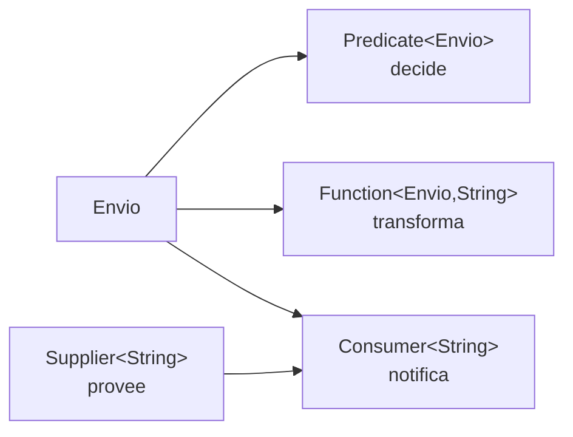
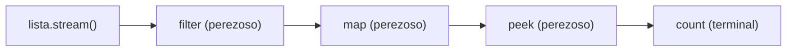

# Módulo 20: Lambdas y Java funcional — comportamiento con tipo

## Aprende construyendo

Cada tema parte de una carpeta vacía y se compila con `javac` para observar el comportamiento y los errores reales. Crearás manualmente todos los archivos, sin depender de proyectos prefabricados ni código de otros temas.

### Tema 1: Lambdas a fondo — tipo objetivo, captura y referencias a métodos · Intermedio · 120 min

#### Aprende

**Prerrequisitos:** métodos, interfaces y clases anónimas; JDK 27 y `javac`/`java` en el `PATH`. Comprueba `java -version` y `javac -version`.

**Al terminar podrás:** crear una interfaz funcional propia, explicar de dónde obtiene tipo una lambda, usar las cuatro clases de referencias a métodos, diagnosticar captura no efectivamente final y sobrecargas ambiguas, adaptar una excepción checked y elegir una especialización primitiva cuando el boxing sea relevante.

**Por qué importa:** `valor -> valor + 1` no tiene tipo por sí sola. Su significado depende del contrato que la recibe. Sin comprender ese contrato, una persona puede copiar lambdas en Streams, callbacks o concurrencia, pero no puede explicar errores de compilación, efectos capturados ni por qué una sobrecarga deja de resolverse.

**Mapa de subtemas críticos**

| Subtema | Tipo | Evidencia propia |
|---|---|---|
| Interfaz funcional y método SAM | Núcleo | `@FunctionalInterface` acepta un solo método abstracto y rechaza un segundo |
| Sintaxis de parámetros y cuerpo | Variante | convertir expresión ↔ bloque con `return` y conservar resultado |
| Tipo objetivo e inferencia | Núcleo | la misma forma se asigna a contratos compatibles distintos |
| Captura y variable efectivamente final | Diagnóstico | mutar la variable capturada produce error de compilación |
| Alcance de `this` | Límite | comparar lambda con clase anónima |
| Referencias estática, ligada, no ligada y constructor | Variante | ejecutar las cuatro y explicar sus argumentos implícitos |
| Sobrecarga ambigua | Diagnóstico | reproducir ambigüedad y resolverla con tipo o cast explícito |
| Excepciones checked | Límite | adaptar `IOException` sin ocultar la causa |
| Especializaciones primitivas | Decisión | usar `IntUnaryOperator` para evitar `Integer` en una ruta numérica |
| Identidad y serialización | Límite | no usar `==`, monitor ni serialización como contrato de una lambda |

Una **interfaz funcional** tiene un único método abstracto, llamado SAM (*single abstract method*). Puede tener métodos `default`, `static` y métodos heredados de `Object` sin dejar de ser funcional. `@FunctionalInterface` no crea esa propiedad: hace que el compilador la verifique y evita agregar accidentalmente un segundo método abstracto.

Una lambda implementa el SAM del **tipo objetivo**. El compilador obtiene ese tipo de una asignación, un argumento, un retorno o un cast. Por eso `texto -> texto.isBlank()` puede representar `Predicate<String>` o `Function<String, Boolean>` según el contexto; la lambda aislada no es una función sin tipo ni puede asignarse a `var` sin contexto objetivo.

La sintaxis cambia según la cantidad de parámetros y el cuerpo:

```java
() -> "turno"                         // cero parámetros, expresión
texto -> texto.trim()                  // un parámetro inferido
(String a, String b) -> a + b          // tipos explícitos en todos los parámetros
(a, b) -> {                            // bloque: return obligatorio si el SAM devuelve valor
    String unidos = a + b;
    return unidos.toUpperCase();
}
```

No mezcles parámetros inferidos y explícitos en la misma lista. `var` puede usarse para anotar parámetros, pero debe aparecer en todos: `(var a, var b) -> a + b`.

La **captura** permite leer variables locales externas sólo si son `final` o efectivamente finales: se asignan una vez y después no se modifican. Los campos del objeto sí pueden cambiar, porque la lambda captura `this`, no una copia inmutable de cada campo. En una lambda, `this` conserva el significado del contexto exterior; en una clase anónima, `this` es la instancia anónima.

Las referencias a métodos son lambdas cuya única operación ya tiene nombre:

| Forma | Referencia | Lambda equivalente |
|---|---|---|
| Estática | `Texto::normalizar` | `s -> Texto.normalizar(s)` |
| Instancia ligada | `prefijo::concat` | `s -> prefijo.concat(s)` |
| Instancia no ligada | `String::length` | `s -> s.length()` |
| Constructor | `ArrayList::new` | `() -> new ArrayList<>()` |

La referencia no “guarda un método sin tipo”: el tipo objetivo decide qué sobrecarga y constructor corresponden. Si dos sobrecargas aceptan interfaces funcionales compatibles, la llamada puede ser ambigua y necesita una variable tipada o un cast.

Las interfaces estándar como `Function<T,R>` no declaran excepciones checked. Si el cuerpo llama una API que lanza `IOException`, debes manejarla, propagarla mediante una interfaz propia que declare `throws`, o convertirla conscientemente conservando la causa, por ejemplo con `UncheckedIOException`. No la captures con un `catch` vacío.

Para rutas numéricas intensivas existen `IntPredicate`, `IntFunction`, `IntUnaryOperator`, `ToIntFunction` y otras especializaciones. Evitan convertir repetidamente entre `int` e `Integer`; no hacen que toda lambda genérica sea lenta, así que mide antes de optimizar.

Finalmente, la especificación no garantiza identidad estable para una lambda. No dependas de `lambda1 == lambda2`, no la uses como monitor y no la serialices como contrato persistente. Guarda datos y reconstruye el comportamiento desde código versionado.

**Analogía con límite:** el tipo objetivo es el enchufe que determina qué aparato puede conectarse: la forma externa de dos conectores puede parecer similar, pero sus contactos —parámetros, retorno y excepciones— deben coincidir. La analogía no explica resolución de sobrecargas ni captura; esas reglas las decide el compilador mediante el SAM y el contexto.

#### Practica

**Desde cero:** crea un laboratorio independiente.

```bash
mkdir java-lambdas-fundamentos
cd java-lambdas-fundamentos
mkdir src
```

Crea `src/LambdasFundamentos.java`:

```java
import java.io.IOException;
import java.io.UncheckedIOException;
import java.nio.file.Files;
import java.nio.file.Path;
import java.util.ArrayList;
import java.util.List;
import java.util.function.Function;
import java.util.function.IntUnaryOperator;
import java.util.function.Predicate;
import java.util.function.Supplier;

public final class LambdasFundamentos {
    @FunctionalInterface
    interface Regla<T, R> {
        R aplicar(T valor); // SAM

        default String nombre() {
            return "regla";
        }
    }

    private final String prefijo = "ENV-";

    static String normalizar(String texto) {
        return texto.trim().toUpperCase();
    }

    String etiquetar(String numero) {
        return prefijo + numero;
    }

    void ejecutar() {
        int incremento = 2; // efectivamente final
        Regla<Integer, Integer> sumar = valor -> valor + incremento;

        Predicate<String> noVacio = texto -> !texto.isBlank();
        Function<String, Boolean> noVacioComoFuncion = texto -> !texto.isBlank();

        Function<String, String> estatica = LambdasFundamentos::normalizar;
        Function<String, String> ligada = this::etiquetar;
        Function<String, Integer> noLigada = String::length;
        Supplier<List<String>> constructor = ArrayList::new;
        IntUnaryOperator duplicar = valor -> valor * 2;

        Runnable lambda = () -> System.out.println("lambda this=" + this.getClass().getSimpleName());
        Runnable anonima = new Runnable() {
            @Override public void run() {
                System.out.println("anonima this=" + this.getClass().getName());
            }
        };

        Function<Path, String> leer = ruta -> {
            try {
                return Files.readString(ruta);
            } catch (IOException error) {
                throw new UncheckedIOException("No se pudo leer " + ruta, error);
            }
        };

        System.out.println("sumar=" + sumar.aplicar(5));
        System.out.println("objetivos=" + noVacio.test("ok") + "/" + noVacioComoFuncion.apply("ok"));
        System.out.println("referencias=" + estatica.apply("  ab ") + "/" + ligada.apply("7") + "/" + noLigada.apply("ruta"));
        System.out.println("constructor vacío=" + constructor.get().isEmpty());
        System.out.println("primitiva=" + duplicar.applyAsInt(4));
        lambda.run();
        anonima.run();

        try {
            leer.apply(Path.of("no-existe.txt"));
        } catch (UncheckedIOException error) {
            System.out.println("causa=" + error.getCause().getClass().getSimpleName());
        }
    }

    public static void main(String[] args) {
        new LambdasFundamentos().ejecutar();
    }
}
```

Compila y ejecuta desde `java-lambdas-fundamentos/`:

```bash
javac -d out src/LambdasFundamentos.java
java -cp out LambdasFundamentos
```

**Resultado esperado:**

```text
sumar=7
objetivos=true/true
referencias=AB/ENV-7/4
constructor vacío=true
primitiva=8
lambda this=LambdasFundamentos
anonima this=LambdasFundamentos$1
causa=NoSuchFileException
```

**Explicación por subtema:** `Regla` demuestra el SAM y que un método `default` no rompe el contrato. Las dos variables `noVacio` demuestran que el contexto decide el tipo objetivo. Las cuatro referencias muestran qué receptor o constructor queda implícito. `incremento` demuestra captura por valor efectivamente final. Las dos implementaciones de `Runnable` muestran el alcance distinto de `this`. `leer` conserva `IOException` como causa de `UncheckedIOException`. `IntUnaryOperator` evita el contrato genérico `Function<Integer,Integer>` en el cálculo primitivo.

**Fallo deliberado 1 — captura:** después de declarar `sumar`, agrega `incremento++;` y recompila.

```text
local variables referenced from a lambda expression must be final or effectively final
```

No se corrige envolviendo el entero en un arreglo mutable sólo para engañar al compilador. Decide si el valor debe fijarse antes de crear la regla o si el estado mutable pertenece a un objeto con nombre y sincronización explícita.

**Fallo deliberado 2 — segundo método abstracto:** agrega `boolean activa();` a `Regla`. `@FunctionalInterface` provoca `Unexpected @FunctionalInterface annotation` porque ya existen dos métodos abstractos. Elimina el segundo método o modela otro contrato.

**Fallo deliberado 3 — sobrecarga ambigua:** crea `src/Ambigua.java`:

```java
import java.util.function.Function;
import java.util.function.Predicate;

final class Ambigua {
    static void elegir(Predicate<String> regla) {}
    static void elegir(Function<String, Boolean> regla) {}

    public static void main(String[] args) {
        elegir(texto -> !texto.isBlank());
    }
}
```

`javac -d out src/Ambigua.java` informa que la referencia a `elegir` es ambigua. Resuélvela declarando primero `Predicate<String> noVacio = texto -> !texto.isBlank();` y llamando `elegir(noVacio)`, o usando un cast explícito cuando el contrato sea inequívoco.

**Práctica guiada:** reemplaza cada referencia a método por su lambda equivalente y predice la salida antes de ejecutar. Después vuelve a las referencias sólo cuando la lambda se limite a delegar. Cambia `IntUnaryOperator` por `Function<Integer,Integer>` y explica dónde aparecen boxing y unboxing, sin afirmar una mejora de rendimiento que no hayas medido.

**Pista:** en `String::length`, el `String` que recibe `Function<String,Integer>` se convierte en el receptor del método; no es un argumento escrito dentro de los paréntesis de `length()`.

#### Aplica

**Ejercicio independiente:** crea `src/PoliticaTarifa.java` con:

- una interfaz funcional propia `Tarifa` que reciba peso y devuelva centavos;
- una captura efectivamente final para el recargo configurado al inicio;
- una referencia estática para normalizar una zona;
- una referencia de constructor para crear el resultado;
- un `IntUnaryOperator` para aplicar un porcentaje entero;
- una lectura de archivo que conserve la causa cuando falle;
- dos políticas con el mismo cuerpo lambda pero tipos objetivos distintos, explicando por qué no son intercambiables automáticamente.

Ejecuta tres casos: tarifa normal, recargo y archivo ausente. Provoca después un error de captura y una sobrecarga ambigua diferentes de los ejemplos guiados.

```bash
javac -d out src/PoliticaTarifa.java
java -cp out PoliticaTarifa
```

**Criterio de éxito:** entregas el archivo, salida de tres casos, mensajes de los dos errores, correcciones y una explicación propia que conecte cada resultado con SAM, tipo objetivo y captura.

**Checklist de salida**

- [ ] El programa compila y muestra los tres casos pedidos.
- [ ] Cada lambda tiene un tipo objetivo identificable y justificas por qué ese contrato es funcional.
- [ ] La captura permanece efectivamente final y explicas el error provocado.
- [ ] Las referencias a métodos se comparan con su lambda equivalente.
- [ ] La excepción conserva su causa y la sobrecarga ambigua queda diagnosticada y corregida.

**Cuándo no usar lambdas:** usa una clase con nombre cuando el comportamiento tenga estado mutable, varias operaciones públicas, ciclo de vida, configuración extensa, identidad de dominio o necesite documentación y pruebas que una expresión anónima volvería opacas.

**Errores comunes:** creer que una lambda tiene tipo independiente; agregar `@FunctionalInterface` pensando que convierte cualquier interfaz; mutar contenedores capturados para eludir `effectively final`; confundir `this` con la instancia lambda; escoger una referencia a método menos legible; envolver checked exceptions perdiendo la causa; usar lambdas como claves por identidad o como formato serializado.

**Fuentes oficiales revisadas el 2026-11-01:** [Dev.java — Lambda Expressions](https://dev.java/learn/language/fp/lambdas/), [Dev.java — Method References](https://dev.java/learn/language/fp/lambdas/method-references/), [JLS 27 — Lambda Expressions](https://docs.oracle.com/javase/specs/jls/se27/html/jls-15.html#jls-15.27), [JLS 27 — Functional Interfaces](https://docs.oracle.com/javase/specs/jls/se27/html/jls-9.html#jls-9.8) y [Java SE 27 — java.util.function](https://docs.oracle.com/en/java/javase/27/docs/api/java.base/java/util/function/package-summary.html).

**Registro de ejecución (2026-11-01, Java 27.0.1):** el ejemplo principal compiló y produjo las ocho líneas esperadas. Se reprodujeron por separado los errores de variable no efectivamente final, interfaz con dos métodos abstractos y sobrecarga ambigua. El ejercicio independiente permanece como evidencia que debe producir el estudiante; no se contabiliza como ejecutado por esta revisión.

### Tema 2: Las cuatro formas: Predicate, Function, Consumer y Supplier · Básico · 75 min

#### Aprende

**Prerrequisitos:** JDK 27 o superior, lambdas básicas y `javac`/`java` en el `PATH`. Comprueba `java -version` y `javac -version`.

**Al terminar podrás:** elegir la interfaz funcional adecuada para decidir, transformar, notificar o proveer; compilar un programa con las cuatro y corregir una lambda cuya aridad no coincide con su interfaz.

**Por qué importa:** RutaFlow aplica reglas por cliente: decidir si un envío requiere revisión, transformar una guía, registrar una decisión y proveer el turno. La forma correcta convierte cada regla en un valor que se pasa y se prueba por separado, en lugar de acumular condicionales sin nombres.

**Mapa de subtemas críticos**

| Subtema | Papel | Evidencia |
|---|---|---|
| `Predicate<T>`: decidir un `boolean` | Núcleo | `requiereRevision.test(envio)` filtra el envío de 32 kg |
| `Function<T,R>`: transformar | Núcleo | `etiqueta.apply(envio)` produce `ENV-2 -> Medellín` |
| `Consumer<T>`: efecto sin retorno | Núcleo | `registrar.accept(...)` imprime `[log] ...` |
| `Supplier<T>`: proveer sin argumentos | Núcleo | `turno.get()` devuelve `Turno AM` |
| Métodos SAM (`test`/`apply`/`accept`/`get`) | Prerrequisito | Cada interfaz se invoca por su método abstracto |
| Aridad de la lambda vs la interfaz | Diagnóstico | Dos parámetros en `Function` → `incompatible parameter types` |
| Clase con nombre cuando hay estado/dominio | Decisión | Interfaz funcional no reemplaza el modelo de dominio |

Cada fila tiene su explicación individual a continuación.

**`Predicate<T>`: decidir un `boolean` (núcleo).** `Predicate<T>` encapsula una decisión sí/no con el método `test(T)`. Convierte una condición (`pesoKg > 20`) en un valor que se pasa, se nombra y se prueba aisladamente. En el laboratorio, solo el envío de 32 kg supera el predicado y llega al registro.

**`Function<T,R>`: transformar (núcleo).** `Function<T,R>` recibe un valor y devuelve otro con `apply(T)`. Aquí transforma un `Envio` en su etiqueta de texto (`ENV-2 -> Medellín`). Separa la transformación de la decisión y del efecto, de modo que cada paso se prueba por su cuenta.

**`Consumer<T>`: efecto sin retorno (núcleo).** `Consumer<T>` recibe un valor y produce un efecto (imprimir, registrar) sin devolver nada, con `accept(T)`. Es el lugar correcto para los efectos secundarios: `registrar.accept(...)` emite la línea `[log] ...`. Mantener los efectos en el `Consumer` evita esconderlos dentro de una transformación.

**`Supplier<T>`: proveer sin argumentos (núcleo).** `Supplier<T>` no recibe nada y provee un valor con `get()`. Difiere la obtención del valor hasta que se necesita (`turno.get()`), útil para valores perezosos o por defecto. Es la forma inversa del `Consumer`: uno entrega, el otro recibe.

**Métodos SAM (prerrequisito).** Cada interfaz funcional tiene un único método abstracto (SAM): `test`, `apply`, `accept`, `get`. Una lambda implementa ese método; por eso la lambda debe coincidir en número y tipo de parámetros con la firma del SAM. Conocer el método de cada interfaz es condición para usarlas.

**Aridad de la lambda vs la interfaz (diagnóstico).** Si la lambda declara dos parámetros pero la interfaz espera uno (`Function` es unaria), `javac` falla con `incompatible parameter types in lambda expression`. El diagnóstico es contar los parámetros del SAM: para dos entradas se usa `BiFunction`, no `Function`.

**Clase con nombre cuando hay estado/dominio (decisión).** Una interfaz funcional describe comportamiento, no reemplaza el modelo de dominio. Si una regla necesita estado propio, más parámetros de los que expresa el SAM o vocabulario de negocio, una clase con nombre comunica mejor que una lambda anónima. La función es para comportamiento ligero y componible.

`java.util.function` define cuatro formas base:

- `Predicate<T>` recibe un valor y decide un `boolean`.
- `Function<T, R>` recibe un valor y devuelve otro.
- `Consumer<T>` recibe un valor y produce un efecto sin devolver resultado.
- `Supplier<T>` no recibe argumentos y provee un valor.

**Analogía:** en una bodega, el portero decide si entra un paquete, el traductor lo reetiqueta, el notificador avisa y el proveedor entrega el turno. La interfaz describe comportamiento, no reemplaza el modelo de dominio.



Desde una carpeta vacía:

```bash
mkdir java-funcional-formas
cd java-funcional-formas
mkdir src
```

Crea manualmente `src/Formas.java`:

```java
import java.util.List;
import java.util.function.Consumer;
import java.util.function.Function;
import java.util.function.Predicate;
import java.util.function.Supplier;

public final class Formas {
    record Envio(String guia, String destino, double pesoKg) {}

    public static void main(String[] args) {
        Predicate<Envio> requiereRevision = envio -> envio.pesoKg() > 20;
        Function<Envio, String> etiqueta = envio -> envio.guia() + " -> " + envio.destino();
        Consumer<String> registrar = linea -> System.out.println("[log] " + linea);
        Supplier<String> turno = () -> "Turno AM";

        List<Envio> envios = List.of(
            new Envio("ENV-1", "Bogotá", 5.5),
            new Envio("ENV-2", "Medellín", 32.0)
        );

        for (Envio envio : envios) {
            if (requiereRevision.test(envio)) {
                registrar.accept(turno.get() + " | " + etiqueta.apply(envio));
            }
        }
    }
}
```

Compila y ejecuta:

```bash
javac -d out src/Formas.java
java -cp out Formas
```

**Resultado esperado:**

```text
[log] Turno AM | ENV-2 -> Medellín
```

El envío de 5,5 kg no supera el predicado.

**Fallo deliberado y corrección:** sustituye la función de etiqueta por:

```java
Function<Envio, String> etiqueta = (guia, destino) -> guia;
```

`javac` informa `incompatible types: incompatible parameter types in lambda expression`. `Function` declara un parámetro y la lambda tiene dos. Restaura `envio -> envio.guia() + " -> " + envio.destino()`, recompila y verifica la línea esperada.

#### Practica

**Práctica guiada:** crea `src/ReglasBasicas.java` con un `Predicate<String>` que valide un correo normalizado, una `Function<String, String>` que haga `trim().toLowerCase()`, un `Consumer<String>` que registre y un `Supplier<LocalDate>` que provea la fecha. Aplica primero la función y después el predicado.

```bash
javac -d out src/ReglasBasicas.java
java -cp out ReglasBasicas
```

**Resultado esperado:** `  ANA@ACADEMIA.COM  ` se normaliza, se acepta y se registra una sola vez junto a la fecha ISO; una entrada sin `@` se rechaza sin registro.

**Ejercicio independiente:** crea `src/ReglasEnvio.java` con un `Predicate<Envio>` para peso, una `Function<Envio, String>` para etiqueta, un `Consumer<String>` para auditoría y un `Supplier<String>` para turno. Procesa tres envíos y encapsula las cuatro reglas en un `record PoliticaEnvio` con componentes funcionales.

```bash
javac -d out src/ReglasEnvio.java
java -cp out ReglasEnvio
```

**Resultado esperado:** solo los envíos que cumplen el predicado generan etiqueta y auditoría; puedes cambiar el umbral sustituyendo el `Predicate` sin modificar el recorrido.

#### Aplica

Construye las reglas de revisión del **[Proyecto integrador: motor funcional de asignación](#proyecto-20-motor-de-reglas-funcional)** con las cuatro interfaces, de modo que cada comportamiento pueda ejecutarse de forma aislada.

**Checklist de salida**

- [ ] Creaste manualmente el proyecto en una carpeta vacía.
- [ ] Cada interfaz se eligió por intención y no solo por tipo de retorno.
- [ ] `test`, `apply`, `accept` y `get` aparecen en una ejecución correcta.
- [ ] Una lambda de aridad incorrecta se diagnosticó y corrigió.
- [ ] Los efectos están en `Consumer`, no escondidos en transformaciones.
- [ ] Puedes explicar cuándo una clase con nombre es mejor que una función anónima.

**Límites y decisión de uso:** si una regla necesita estado propio, más parámetros de los que expresa la interfaz o vocabulario de dominio, una clase comunica mejor.

**Fuentes oficiales revisadas el 2026-11-02:** [java.util.function (API Java SE 27)](https://docs.oracle.com/en/java/javase/27/docs/api/java.base/java/util/function/package-summary.html) y [Lambda Expressions (dev.java)](https://dev.java/learn/lambdas/).

### Tema 3: Componer sin anidar: andThen, compose, negate y reglas encadenadas · Intermedio · 75 min

#### Aprende

**Prerrequisitos:** lambdas y las cuatro interfaces funcionales básicas. El proyecto es independiente y no reutiliza archivos del tema anterior.

**Al terminar podrás:** encadenar reglas con `and`, `or`, `negate`, `andThen` y `compose`, y demostrar con una entrada concreta cómo cambiar el orden altera el resultado.

**Por qué importa:** si RutaFlow valida antes de normalizar, un correo correcto con espacios se rechaza. El orden de composición es parte de la regla de negocio y debe quedar visible.

**Mapa de subtemas críticos**

| Subtema | Papel | Evidencia |
|---|---|---|
| `Predicate.and`/`or`/`negate` | Núcleo | `noVacio.and(conArroba).negate()` → `sospechoso` |
| `Function.andThen` (f luego g) | Núcleo | `normalizar.andThen(correo::test)` → `true` |
| `Function.compose` (g sobre f) | Variante | `conMinusculas.compose(sinEspacios)` → `ana@academia.com` |
| El orden de composición es la regla | Diagnóstico | Validar antes de normalizar rechaza un correo válido |
| Referencias a método en la cadena | Prerrequisito | `correo::test`, `String::toLowerCase` como pasos |
| Motivos de rechazo vs un solo `boolean` | Decisión | `Function<Envio,List<String>>` conserva todos los motivos |
| Cadena legible vs tipo `Resultado` | Límite | Reglas dependientes piden un tipo, no una cadena |

Cada fila tiene su explicación individual a continuación.

**`Predicate.and`/`or`/`negate` (núcleo).** Un `Predicate` se combina con otros sin escribir `if` anidados: `and` exige ambos, `or` cualquiera, `negate` invierte. En el laboratorio, `noVacio.and(conArroba).negate()` define "sospechoso" como "no es (no vacío y con arroba)", y se prueba con entradas límite (texto normal vs `"   "`).

**`Function.andThen` (núcleo).** `f.andThen(g)` aplica primero `f` y luego `g` sobre su resultado. `normalizar.andThen(correo::test)` normaliza el texto y después valida, de modo que `  ANA@ACADEMIA.COM  ` pasa a `true`. Se lee de izquierda a derecha en el orden de ejecución.

**`Function.compose` (variante).** `g.compose(f)` aplica primero `f` y luego `g` — el orden inverso de lectura a `andThen`. `conMinusculas.compose(sinEspacios)` recorta espacios y después pasa a minúsculas, devolviendo `ana@academia.com`. Ambas expresan el mismo orden lógico pero se leen en direcciones distintas; elegir una es cuestión de legibilidad.

**El orden de composición es la regla (diagnóstico).** El fallo deliberado muestra que validar el correo crudo (sin normalizar) devuelve `false` aunque el correo sea válido: los espacios lo rechazan. El orden normalizar→validar no es un detalle técnico, es parte de la regla de negocio y debe quedar explícito en la composición.

**Referencias a método en la cadena (prerrequisito).** Las referencias a método (`correo::test`, `String::toLowerCase`, `String::trim`) encajan como pasos de la cadena porque cumplen el SAM de la interfaz. Permiten componer sin escribir lambdas triviales, haciendo la cadena más legible.

**Motivos de rechazo vs un solo `boolean` (decisión).** Cuando el usuario necesita entender *por qué* se rechazó algo, una `Function<Envio, List<String>>` que devuelve todos los motivos comunica más que un `Predicate` que solo dice sí/no. El ejercicio independiente lo exige: un envío con tres fallos muestra los tres, sin detenerse en el primero.

**Cadena legible vs tipo `Resultado` (límite).** Componer funciona bien con reglas independientes. Si las reglas dependen unas de otras o el resultado debe explicarse, una cadena de predicados se vuelve opaca; un tipo `Resultado` explícito (éxito/errores) comunica mejor que encadenar `and`/`or` sin nombres.

`Predicate` ofrece `and`, `or` y `negate`; `Function` ofrece `andThen` y `compose`. `f.andThen(g)` aplica `f` y luego `g`; `g.compose(f)` aplica primero `f` y después `g`. Ambas composiciones pueden expresar el mismo orden, pero se leen en direcciones distintas.

**Analogía:** es una cadena de montaje. `andThen` añade una estación al final; `compose` declara qué estación va antes. La cadena compila aunque el orden elegido sea semánticamente incorrecto.

Desde una carpeta vacía:

```bash
mkdir java-funcional-composicion
cd java-funcional-composicion
mkdir src
```

Crea manualmente `src/Composicion.java`:

```java
import java.util.function.Function;
import java.util.function.Predicate;

public final class Composicion {
    static final Predicate<String> correo = texto ->
        texto.contains("@") && texto.indexOf('@') > 0
            && texto.indexOf('@') < texto.length() - 1;

    public static void main(String[] args) {
        Function<String, String> normalizar = texto -> texto.trim().toLowerCase();
        Function<String, Boolean> validar = normalizar.andThen(correo::test);

        String entrada = "  ANA@ACADEMIA.COM  ";
        System.out.println("normalizado: " + validar.apply(entrada));

        Predicate<String> noVacio = texto -> !texto.isBlank();
        Predicate<String> conArroba = texto -> texto.contains("@");
        Predicate<String> sospechoso = noVacio.and(conArroba).negate();

        System.out.println("sospechoso: " + sospechoso.test(entrada));
        System.out.println("sospechoso vacío: " + sospechoso.test("   "));

        Function<String, String> conMinusculas = String::toLowerCase;
        Function<String, String> sinEspacios = String::trim;
        System.out.println("compose: " + conMinusculas.compose(sinEspacios).apply(entrada));
    }
}
```

Compila y ejecuta:

```bash
javac -d out src/Composicion.java
java -cp out Composicion
```

**Resultado esperado:**

```text
normalizado: true
sospechoso: false
sospechoso vacío: true
compose: ana@academia.com
```

**Fallo deliberado y corrección:** añade `Function<String, Boolean> sinNormalizar = correo::test;` y evalúa `sinNormalizar.apply("  ANA@ACADEMIA.COM  ")`. Obtienes `false`: el predicado recibe texto crudo. Elimina esa variante y conserva `normalizar.andThen(correo::test)`; la ejecución vuelve a `normalizado: true`.

#### Practica

**Práctica guiada:** crea `src/Dominios.java` con un predicado `terminaEnCom` combinado mediante `correo.and(texto -> texto.endsWith(".com"))`. Añade una versión equivalente con `compose` para normalizar antes de validar y prueba `.com`, `.org`, espacios y mayúsculas.

```bash
javac -d out src/Dominios.java
java -cp out Dominios
```

**Resultado esperado:** ` ANA@ACADEMIA.COM ` pasa tras normalizar; `ana@academia.org` no pasa; puedes señalar qué predicado produjo cada rechazo.

**Ejercicio independiente:** crea `src/ReglasEnvio.java` con un `record Envio` y tres `Predicate<Envio>` para peso, destino y estado. Después crea una `Function<Envio, List<String>>` que devuelva todos los motivos de rechazo, no solo un `boolean`. Incluye un envío válido, uno con un fallo y otro con tres.

```bash
javac -d out src/ReglasEnvio.java
java -cp out ReglasEnvio
```

**Resultado esperado:** el válido produce una lista vacía; los demás muestran todos sus motivos en orden estable, sin detenerse en el primero.

#### Aplica

En el **[Proyecto integrador: validación ordenada de solicitudes](#proyecto-20-motor-de-reglas-funcional)**, normaliza antes de validar y usa motivos explícitos cuando el usuario necesite entender un rechazo.

**Checklist de salida**

- [ ] El ejemplo se escribió completo en un proyecto nuevo.
- [ ] `andThen` y `compose` producen el orden previsto.
- [ ] `and`, `or` y `negate` se prueban con entradas límite.
- [ ] El correo con espacios demuestra el fallo de validar antes de normalizar.
- [ ] Los motivos de rechazo no se pierden detrás de un único `boolean`.
- [ ] Evitas cadenas compuestas cuyas reglas no tengan nombres comprensibles.

**Límites y decisión de uso:** componer funciona bien con reglas independientes. Si dependen entre sí o deben explicar el resultado, un tipo `Resultado` comunica mejor que una cadena de predicados.

**Fuentes oficiales revisadas el 2026-11-02:** [Predicate (API Java SE 27)](https://docs.oracle.com/en/java/javase/27/docs/api/java.base/java/util/function/Predicate.html) y [Function (API Java SE 27)](https://docs.oracle.com/en/java/javase/27/docs/api/java.base/java/util/function/Function.html).

### Tema 4: Streams como composición: pereza, orden y efectos que se esconden · Intermedio · 90 min

#### Aprende

**Prerrequisitos:** colecciones, lambdas y composición básica de funciones; no necesitas archivos de otros temas.

**Al terminar podrás:** demostrar que un Stream no ejecuta su pipeline hasta una operación terminal, depurar con `peek`, diagnosticar el consumo doble y calcular agregados sin esconder efectos.

**Por qué importa:** un informe de miles de envíos puede duplicar registros o trabajo si se reutiliza un Stream o se mezclan efectos dentro de `map`. La pereza es útil solo cuando sabes dónde ocurre el trabajo.

**Mapa de subtemas críticos**

| Subtema | Papel | Evidencia |
|---|---|---|
| Stream describe trabajo, no es colección | Prerrequisito | Sin operación terminal, el pipeline no corre |
| Operaciones perezosas (`filter`/`map`/`peek`) | Núcleo | `peek` no imprime hasta que hay terminal |
| Operaciones terminales disparan el recorrido | Núcleo | `count`/`collect`/`forEach`/`reduce` ejecutan |
| Consumo único del Stream | Diagnóstico | Reutilizarlo lanza `IllegalStateException` |
| `peek` es para depurar, no para lógica | Error frecuente | Efectos de negocio no van en `peek` |
| Efectos escondidos en `map` | Error frecuente | `map` debe transformar, no producir efectos |
| Agregar con `reduce`/`collect` sin efectos | Decisión | Total calculado sin mutar estado externo |

Cada fila tiene su explicación individual a continuación.

**Stream describe trabajo, no es colección (prerrequisito).** Un Stream es una descripción de un pipeline, no un contenedor de datos. Declararlo (`lista.stream().filter(...).map(...)`) no ejecuta nada; solo arma el plan. Confundirlo con una colección lleva a esperar resultados que aún no se han calculado.

**Operaciones perezosas (núcleo).** `filter`, `map` y `peek` son perezosas: registran la intención pero no se ejecutan al declararse. Lo compruebas porque un `peek` con `println` no imprime hasta que llega una operación terminal. La pereza permite que la JVM fusione pasos y evite trabajo innecesario.

**Operaciones terminales disparan el recorrido (núcleo).** `count`, `collect`, `forEach` y `reduce` son terminales: recorren el pipeline y producen un resultado o efecto. Sin una terminal, ningún `map`/`filter` se ejecuta. La terminal es la que convierte el plan en trabajo real.

**Consumo único del Stream (diagnóstico).** Un Stream se consume una sola vez: tras una operación terminal, reutilizar la misma referencia lanza `IllegalStateException: stream has already been operated upon or closed`. El diagnóstico es crear un Stream nuevo desde la fuente, no reutilizar el anterior.

**`peek` es para depurar, no para lógica (error frecuente).** `peek` existe para observar los elementos que fluyen durante la depuración. Usarlo para implementar lógica de negocio (modificar estado, registrar de forma permanente) es frágil: su ejecución depende de la pereza y puede no correr si la terminal no consume todos los elementos.

**Efectos escondidos en `map` (error frecuente).** `map` debe transformar un valor en otro, sin efectos secundarios. Esconder un `println`, una escritura o un contador dentro de `map` hace el pipeline impredecible, sobre todo con streams paralelos. Los efectos van en `forEach` (terminal) o en un `Consumer` explícito.

**Agregar con `reduce`/`collect` sin efectos (decisión).** Para calcular un total o agrupar, `reduce` y `collect` producen el resultado sin mutar estado externo. Frente a acumular en una variable desde un `forEach`, la versión con `collect`/`reduce` es segura en paralelo y expresa la intención. Es la forma funcional de agregar.

Un Stream describe trabajo; no es una colección. `filter`, `map` y `peek` son perezosas. `count`, `collect`, `forEach` y `reduce` son terminales y disparan el recorrido. Un Stream se consume una sola vez. `peek` sirve para observar durante depuración, no para implementar lógica de negocio.

**Analogía:** es una receta escrita frente a una comida cocinada. Declarar la receta no cocina nada; servir el plato dispara el trabajo. A diferencia de la receta, un Stream consumido no puede cocinarse otra vez.



Desde una carpeta vacía:

```bash
mkdir java-streams-pereza
cd java-streams-pereza
mkdir src
```

Crea manualmente `src/Pereza.java`:

```java
import java.util.List;
import java.util.stream.Stream;

public final class Pereza {
    record Envio(String guia, double pesoKg) {}

    public static void main(String[] args) {
        List<Envio> envios = List.of(
            new Envio("ENV-1", 5.5),
            new Envio("ENV-2", 32.0),
            new Envio("ENV-3", 18.0)
        );

        Stream<Envio> pesados = envios.stream()
            .filter(envio -> envio.pesoKg() > 20)
            .peek(envio -> System.out.println("filtrado " + envio.guia()));

        System.out.println("antes de la operación terminal: no se ejecutó ningún filtro");
        long total = pesados.count();
        System.out.println("pesados=" + total);
    }
}
```

Compila y ejecuta:

```bash
javac -d out src/Pereza.java
java -cp out Pereza
```

**Resultado esperado:**

```text
antes de la operación terminal: no se ejecutó ningún filtro
filtrado ENV-2
pesados=1
```

La línea de `peek` aparece después del aviso porque el trabajo ocurre en `count`.

**Fallo deliberado y corrección:** sustituye el cálculo por:

```java
long primero = pesados.count();
long segundo = pesados.count();
```

La JVM lanza `IllegalStateException: stream has already been operated upon or closed`. La primera operación terminal consumió el Stream. Corrige conservando un único `long total = pesados.count();`; si necesitas otro recorrido, crea un Stream nuevo desde la lista o materializa una colección deliberadamente.

#### Practica

**Práctica guiada:** crea `src/PerezaGuia.java` con un pipeline que haga `filter`, luego `.map(Envio::guia)` y después `peek`. Termina con `toList()` e imprime la lista; observa que `peek` recibe `String`, no `Envio`.

```bash
javac -d out src/PerezaGuia.java
java -cp out PerezaGuia
```

**Resultado esperado:** la depuración muestra `ENV-2`, el resultado es `[ENV-2]` y ninguna línea de `peek` aparece antes de la operación terminal.

**Ejercicio independiente:** crea `src/Informe.java` que calcule en una sola pasada el peso total de todos los envíos y cuántos superan 20 kg. Usa `Collectors.teeing` con `summingDouble` y `filtering(..., counting())`, o un acumulador propio; no crees dos Streams para el mismo cálculo.

```bash
javac -d out src/Informe.java
java -cp out Informe
```

**Resultado esperado:** para 5,5, 32 y 18 kg imprime `pesoTotal=55.5` y `pesados=1`; el código contiene una sola operación de recorrido sobre la lista.

#### Aplica

Completa el informe del **[Proyecto integrador: agregación de envíos sin doble recorrido](#proyecto-20-motor-de-reglas-funcional)**. Usa Streams para transformar y agregar; conserva un `for` para efectos ordenados como notificaciones.

**Checklist de salida**

- [ ] El proyecto fue creado manualmente desde una carpeta vacía.
- [ ] La salida demuestra que el filtro se ejecuta en la terminal.
- [ ] `peek` se usa para observar y no para cambiar estado del negocio.
- [ ] El consumo doble se reconoce por `IllegalStateException` y se corrige.
- [ ] El informe calcula total y conteo con una sola pasada.
- [ ] Puedes justificar cuándo un `for` es más claro que un Stream.

**Límites y decisión de uso:** un `for` suele ser más claro con índices, `break`, `continue` o efectos ordenados. No uses `parallelStream` sin medir ni escondas efectos en `map`.

**Fuentes oficiales revisadas el 2026-11-02:** [Stream (API Java SE 27)](https://docs.oracle.com/en/java/javase/27/docs/api/java.base/java/util/stream/Stream.html) y [Streams (dev.java)](https://dev.java/learn/api/streams/).

## Laboratorio práctico

### Proyecto 20: motor de reglas funcional

Desde una carpeta vacía crea `motor-reglas-funcional/` y su directorio `src/`. Escribe manualmente `Formas.java`, `Composicion.java`, `Pereza.java` e `Informe.java` con las reglas del proyecto integrador; no copies fuentes de los temas ni de la academia.

**Entregable:** un motor compuesto con `Predicate`, `Function`, `Consumer` y `Supplier`, normalización previa a validación y un informe que calcule peso total y número de envíos pesados en una sola pasada.

**Criterio de aceptación observable:**

1. `javac -d out src/*.java` termina con código 0.
2. `java -cp out Formas` imprime exactamente `[log] Turno AM | ENV-2 -> Medellín`.
3. `java -cp out Pereza` imprime el aviso de pereza antes de `filtrado ENV-2`.
4. Un correo con espacios se acepta solo cuando se normaliza antes de validar.
5. El informe imprime `pesoTotal=55.5` y `pesados=1` sin crear dos Streams para el mismo cálculo.

Crea manualmente `verificar.sh` junto a `src/`:

```bash
#!/usr/bin/env bash
set -euo pipefail
javac -d out src/*.java
salida=$(java -cp out Formas)
[ "$salida" = "[log] Turno AM | ENV-2 -> Medellín" ] || {
  echo "FALLA: Formas imprimió: $salida"
  exit 1
}
salida_pereza=$(java -cp out Pereza)
primera=${salida_pereza%%$'\n'*}
[[ "$primera" == *"antes de la operación terminal"* ]] || {
  echo "FALLA: el pipeline no demuestra pereza"
  exit 1
}
salida_informe=$(java -cp out Informe)
[[ "$salida_informe" == *"pesoTotal=55.5"* && "$salida_informe" == *"pesados=1"* ]] || {
  echo "FALLA: informe incorrecto: $salida_informe"
  exit 1
}
echo "Checkpoint OK"
```

Ejecuta tu verificador:

```bash
bash verificar.sh
```

**Resultado esperado:** `Checkpoint OK`. Si falla, corrige el archivo propio señalado por el mensaje y vuelve a ejecutar; el cierre no depende de archivos ocultos ni de servicios externos.
