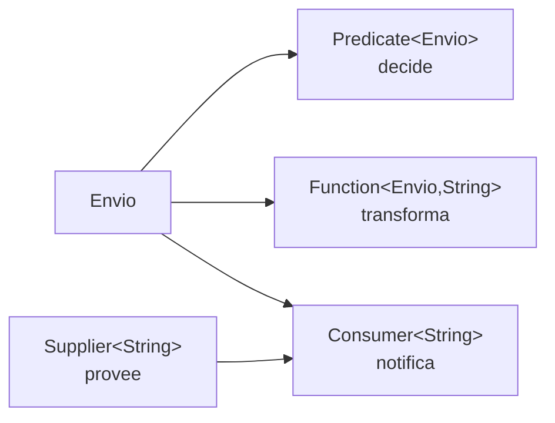
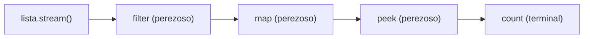

# Módulo 20: Lambdas y Java funcional — comportamiento con tipo

## Aprende construyendo

Cada tema parte de una carpeta vacía y se compila con `javac` para observar el comportamiento y los errores reales. Crearás manualmente todos los archivos, sin depender de proyectos prefabricados ni código de otros temas.

### Tema 1: Lambdas a fondo — tipo objetivo, captura y referencias a métodos · Intermedio · 120 min

#### Aprende

**Prerrequisitos:** métodos, interfaces y clases anónimas; JDK 27 y `javac`/`java` en el `PATH`. Comprueba `java -version` y `javac -version`.

**Al terminar podrás:** crear una interfaz funcional propia, explicar de dónde obtiene tipo una lambda, usar las cuatro clases de referencias a métodos, diagnosticar captura no efectivamente final y sobrecargas ambiguas, adaptar una excepción checked y elegir una especialización primitiva cuando el boxing sea relevante.

**Por qué importa:** `valor -> valor + 1` no tiene tipo por sí sola. Su significado depende del contrato que la recibe. Sin comprender ese contrato, una persona puede copiar lambdas en Streams, callbacks o concurrencia, pero no puede explicar errores de compilación, efectos capturados ni por qué una sobrecarga deja de resolverse.

**Mapa de subtemas críticos**

| Subtema | Tipo | Evidencia propia |
|---|---|---|
| Interfaz funcional y método SAM | Núcleo | `@FunctionalInterface` acepta un solo método abstracto y rechaza un segundo |
| Sintaxis de parámetros y cuerpo | Variante | convertir expresión ↔ bloque con `return` y conservar resultado |
| Tipo objetivo e inferencia | Núcleo | la misma forma se asigna a contratos compatibles distintos |
| Captura y variable efectivamente final | Diagnóstico | mutar la variable capturada produce error de compilación |
| Alcance de `this` | Límite | comparar lambda con clase anónima |
| Referencias estática, ligada, no ligada y constructor | Variante | ejecutar las cuatro y explicar sus argumentos implícitos |
| Sobrecarga ambigua | Diagnóstico | reproducir ambigüedad y resolverla con tipo o cast explícito |
| Excepciones checked | Límite | adaptar `IOException` sin ocultar la causa |
| Especializaciones primitivas | Decisión | usar `IntUnaryOperator` para evitar `Integer` en una ruta numérica |
| Identidad y serialización | Límite | no usar `==`, monitor ni serialización como contrato de una lambda |

Una **interfaz funcional** tiene un único método abstracto, llamado SAM (*single abstract method*). Puede tener métodos `default`, `static` y métodos heredados de `Object` sin dejar de ser funcional. `@FunctionalInterface` no crea esa propiedad: hace que el compilador la verifique y evita agregar accidentalmente un segundo método abstracto.

Una lambda implementa el SAM del **tipo objetivo**. El compilador obtiene ese tipo de una asignación, un argumento, un retorno o un cast. Por eso `texto -> texto.isBlank()` puede representar `Predicate<String>` o `Function<String, Boolean>` según el contexto; la lambda aislada no es una función sin tipo ni puede asignarse a `var` sin contexto objetivo.

La sintaxis cambia según la cantidad de parámetros y el cuerpo:

```java
() -> "turno"                         // cero parámetros, expresión
texto -> texto.trim()                  // un parámetro inferido
(String a, String b) -> a + b          // tipos explícitos en todos los parámetros
(a, b) -> {                            // bloque: return obligatorio si el SAM devuelve valor
    String unidos = a + b;
    return unidos.toUpperCase();
}
```

No mezcles parámetros inferidos y explícitos en la misma lista. `var` puede usarse para anotar parámetros, pero debe aparecer en todos: `(var a, var b) -> a + b`.

La **captura** permite leer variables locales externas sólo si son `final` o efectivamente finales: se asignan una vez y después no se modifican. Los campos del objeto sí pueden cambiar, porque la lambda captura `this`, no una copia inmutable de cada campo. En una lambda, `this` conserva el significado del contexto exterior; en una clase anónima, `this` es la instancia anónima.

Las referencias a métodos son lambdas cuya única operación ya tiene nombre:

| Forma | Referencia | Lambda equivalente |
|---|---|---|
| Estática | `Texto::normalizar` | `s -> Texto.normalizar(s)` |
| Instancia ligada | `prefijo::concat` | `s -> prefijo.concat(s)` |
| Instancia no ligada | `String::length` | `s -> s.length()` |
| Constructor | `ArrayList::new` | `() -> new ArrayList<>()` |

La referencia no “guarda un método sin tipo”: el tipo objetivo decide qué sobrecarga y constructor corresponden. Si dos sobrecargas aceptan interfaces funcionales compatibles, la llamada puede ser ambigua y necesita una variable tipada o un cast.

Las interfaces estándar como `Function<T,R>` no declaran excepciones checked. Si el cuerpo llama una API que lanza `IOException`, debes manejarla, propagarla mediante una interfaz propia que declare `throws`, o convertirla conscientemente conservando la causa, por ejemplo con `UncheckedIOException`. No la captures con un `catch` vacío.

Para rutas numéricas intensivas existen `IntPredicate`, `IntFunction`, `IntUnaryOperator`, `ToIntFunction` y otras especializaciones. Evitan convertir repetidamente entre `int` e `Integer`; no hacen que toda lambda genérica sea lenta, así que mide antes de optimizar.

Finalmente, la especificación no garantiza identidad estable para una lambda. No dependas de `lambda1 == lambda2`, no la uses como monitor y no la serialices como contrato persistente. Guarda datos y reconstruye el comportamiento desde código versionado.

**Analogía con límite:** el tipo objetivo es el enchufe que determina qué aparato puede conectarse: la forma externa de dos conectores puede parecer similar, pero sus contactos —parámetros, retorno y excepciones— deben coincidir. La analogía no explica resolución de sobrecargas ni captura; esas reglas las decide el compilador mediante el SAM y el contexto.

#### Practica

**Desde cero:** crea un laboratorio independiente.

```bash
mkdir java-lambdas-fundamentos
cd java-lambdas-fundamentos
mkdir src
```

Crea `src/LambdasFundamentos.java`:

```java
import java.io.IOException;
import java.io.UncheckedIOException;
import java.nio.file.Files;
import java.nio.file.Path;
import java.util.ArrayList;
import java.util.List;
import java.util.function.Function;
import java.util.function.IntUnaryOperator;
import java.util.function.Predicate;
import java.util.function.Supplier;

public final class LambdasFundamentos {
    @FunctionalInterface
    interface Regla<T, R> {
        R aplicar(T valor); // SAM

        default String nombre() {
            return "regla";
        }
    }

    private final String prefijo = "ENV-";

    static String normalizar(String texto) {
        return texto.trim().toUpperCase();
    }

    String etiquetar(String numero) {
        return prefijo + numero;
    }

    void ejecutar() {
        int incremento = 2; // efectivamente final
        Regla<Integer, Integer> sumar = valor -> valor + incremento;

        Predicate<String> noVacio = texto -> !texto.isBlank();
        Function<String, Boolean> noVacioComoFuncion = texto -> !texto.isBlank();

        Function<String, String> estatica = LambdasFundamentos::normalizar;
        Function<String, String> ligada = this::etiquetar;
        Function<String, Integer> noLigada = String::length;
        Supplier<List<String>> constructor = ArrayList::new;
        IntUnaryOperator duplicar = valor -> valor * 2;

        Runnable lambda = () -> System.out.println("lambda this=" + this.getClass().getSimpleName());
        Runnable anonima = new Runnable() {
            @Override public void run() {
                System.out.println("anonima this=" + this.getClass().getName());
            }
        };

        Function<Path, String> leer = ruta -> {
            try {
                return Files.readString(ruta);
            } catch (IOException error) {
                throw new UncheckedIOException("No se pudo leer " + ruta, error);
            }
        };

        System.out.println("sumar=" + sumar.aplicar(5));
        System.out.println("objetivos=" + noVacio.test("ok") + "/" + noVacioComoFuncion.apply("ok"));
        System.out.println("referencias=" + estatica.apply("  ab ") + "/" + ligada.apply("7") + "/" + noLigada.apply("ruta"));
        System.out.println("constructor vacío=" + constructor.get().isEmpty());
        System.out.println("primitiva=" + duplicar.applyAsInt(4));
        lambda.run();
        anonima.run();

        try {
            leer.apply(Path.of("no-existe.txt"));
        } catch (UncheckedIOException error) {
            System.out.println("causa=" + error.getCause().getClass().getSimpleName());
        }
    }

    public static void main(String[] args) {
        new LambdasFundamentos().ejecutar();
    }
}
```

Compila y ejecuta desde `java-lambdas-fundamentos/`:

```bash
javac -d out src/LambdasFundamentos.java
java -cp out LambdasFundamentos
```

**Resultado esperado:**

```text
sumar=7
objetivos=true/true
referencias=AB/ENV-7/4
constructor vacío=true
primitiva=8
lambda this=LambdasFundamentos
anonima this=LambdasFundamentos$1
causa=NoSuchFileException
```

**Explicación por subtema:** `Regla` demuestra el SAM y que un método `default` no rompe el contrato. Las dos variables `noVacio` demuestran que el contexto decide el tipo objetivo. Las cuatro referencias muestran qué receptor o constructor queda implícito. `incremento` demuestra captura por valor efectivamente final. Las dos implementaciones de `Runnable` muestran el alcance distinto de `this`. `leer` conserva `IOException` como causa de `UncheckedIOException`. `IntUnaryOperator` evita el contrato genérico `Function<Integer,Integer>` en el cálculo primitivo.

**Fallo deliberado 1 — captura:** después de declarar `sumar`, agrega `incremento++;` y recompila.

```text
local variables referenced from a lambda expression must be final or effectively final
```

No se corrige envolviendo el entero en un arreglo mutable sólo para engañar al compilador. Decide si el valor debe fijarse antes de crear la regla o si el estado mutable pertenece a un objeto con nombre y sincronización explícita.

**Fallo deliberado 2 — segundo método abstracto:** agrega `boolean activa();` a `Regla`. `@FunctionalInterface` provoca `Unexpected @FunctionalInterface annotation` porque ya existen dos métodos abstractos. Elimina el segundo método o modela otro contrato.

**Fallo deliberado 3 — sobrecarga ambigua:** crea `src/Ambigua.java`:

```java
import java.util.function.Function;
import java.util.function.Predicate;

final class Ambigua {
    static void elegir(Predicate<String> regla) {}
    static void elegir(Function<String, Boolean> regla) {}

    public static void main(String[] args) {
        elegir(texto -> !texto.isBlank());
    }
}
```

`javac -d out src/Ambigua.java` informa que la referencia a `elegir` es ambigua. Resuélvela declarando primero `Predicate<String> noVacio = texto -> !texto.isBlank();` y llamando `elegir(noVacio)`, o usando un cast explícito cuando el contrato sea inequívoco.

**Práctica guiada:** reemplaza cada referencia a método por su lambda equivalente y predice la salida antes de ejecutar. Después vuelve a las referencias sólo cuando la lambda se limite a delegar. Cambia `IntUnaryOperator` por `Function<Integer,Integer>` y explica dónde aparecen boxing y unboxing, sin afirmar una mejora de rendimiento que no hayas medido.

**Pista:** en `String::length`, el `String` que recibe `Function<String,Integer>` se convierte en el receptor del método; no es un argumento escrito dentro de los paréntesis de `length()`.

#### Aplica

**Ejercicio independiente:** crea `src/PoliticaTarifa.java` con:

- una interfaz funcional propia `Tarifa` que reciba peso y devuelva centavos;
- una captura efectivamente final para el recargo configurado al inicio;
- una referencia estática para normalizar una zona;
- una referencia de constructor para crear el resultado;
- un `IntUnaryOperator` para aplicar un porcentaje entero;
- una lectura de archivo que conserve la causa cuando falle;
- dos políticas con el mismo cuerpo lambda pero tipos objetivos distintos, explicando por qué no son intercambiables automáticamente.

Ejecuta tres casos: tarifa normal, recargo y archivo ausente. Provoca después un error de captura y una sobrecarga ambigua diferentes de los ejemplos guiados.

```bash
javac -d out src/PoliticaTarifa.java
java -cp out PoliticaTarifa
```

**Criterio de éxito:** entregas el archivo, salida de tres casos, mensajes de los dos errores, correcciones y una explicación propia que conecte cada resultado con SAM, tipo objetivo y captura.

**Checklist de salida**

- [ ] El programa compila y muestra los tres casos pedidos.
- [ ] Cada lambda tiene un tipo objetivo identificable y justificas por qué ese contrato es funcional.
- [ ] La captura permanece efectivamente final y explicas el error provocado.
- [ ] Las referencias a métodos se comparan con su lambda equivalente.
- [ ] La excepción conserva su causa y la sobrecarga ambigua queda diagnosticada y corregida.

**Cuándo no usar lambdas:** usa una clase con nombre cuando el comportamiento tenga estado mutable, varias operaciones públicas, ciclo de vida, configuración extensa, identidad de dominio o necesite documentación y pruebas que una expresión anónima volvería opacas.

**Errores comunes:** creer que una lambda tiene tipo independiente; agregar `@FunctionalInterface` pensando que convierte cualquier interfaz; mutar contenedores capturados para eludir `effectively final`; confundir `this` con la instancia lambda; escoger una referencia a método menos legible; envolver checked exceptions perdiendo la causa; usar lambdas como claves por identidad o como formato serializado.

**Fuentes oficiales revisadas el 2026-11-01:** [Dev.java — Lambda Expressions](https://dev.java/learn/language/fp/lambdas/), [Dev.java — Method References](https://dev.java/learn/language/fp/lambdas/method-references/), [JLS 27 — Lambda Expressions](https://docs.oracle.com/javase/specs/jls/se27/html/jls-15.html#jls-15.27), [JLS 27 — Functional Interfaces](https://docs.oracle.com/javase/specs/jls/se27/html/jls-9.html#jls-9.8) y [Java SE 27 — java.util.function](https://docs.oracle.com/en/java/javase/27/docs/api/java.base/java/util/function/package-summary.html).

**Registro de ejecución (2026-11-01, Java 27.0.1):** el ejemplo principal compiló y produjo las ocho líneas esperadas. Se reprodujeron por separado los errores de variable no efectivamente final, interfaz con dos métodos abstractos y sobrecarga ambigua. El ejercicio independiente permanece como evidencia que debe producir el estudiante; no se contabiliza como ejecutado por esta revisión.

### Tema 2: Las cuatro formas: Predicate, Function, Consumer y Supplier · Básico · 75 min

#### Aprende

**Prerrequisitos:** JDK 27 o superior, lambdas básicas y `javac`/`java` en el `PATH`. Comprueba `java -version` y `javac -version`.

**Al terminar podrás:** elegir la interfaz funcional adecuada para decidir, transformar, notificar o proveer; compilar un programa con las cuatro y corregir una lambda cuya aridad no coincide con su interfaz.

**Por qué importa:** RutaFlow aplica reglas por cliente: decidir si un envío requiere revisión, transformar una guía, registrar una decisión y proveer el turno. La forma correcta convierte cada regla en un valor que se pasa y se prueba por separado, en lugar de acumular condicionales sin nombres.

**Mapa de subtemas críticos**

| Subtema | Papel | Evidencia |
|---|---|---|
| `Predicate<T>`: decidir un `boolean` | Núcleo | `requiereRevision.test(envio)` filtra el envío de 32 kg |
| `Function<T,R>`: transformar | Núcleo | `etiqueta.apply(envio)` produce `ENV-2 -> Medellín` |
| `Consumer<T>`: efecto sin retorno | Núcleo | `registrar.accept(...)` imprime `[log] ...` |
| `Supplier<T>`: proveer sin argumentos | Núcleo | `turno.get()` devuelve `Turno AM` |
| Métodos SAM (`test`/`apply`/`accept`/`get`) | Prerrequisito | Cada interfaz se invoca por su método abstracto |
| Aridad de la lambda vs la interfaz | Diagnóstico | Dos parámetros en `Function` → `incompatible parameter types` |
| Clase con nombre cuando hay estado/dominio | Decisión | Interfaz funcional no reemplaza el modelo de dominio |

Cada fila tiene su explicación individual a continuación.

**`Predicate<T>`: decidir un `boolean` (núcleo).** `Predicate<T>` encapsula una decisión sí/no con el método `test(T)`. Convierte una condición (`pesoKg > 20`) en un valor que se pasa, se nombra y se prueba aisladamente. En el laboratorio, solo el envío de 32 kg supera el predicado y llega al registro.

**`Function<T,R>`: transformar (núcleo).** `Function<T,R>` recibe un valor y devuelve otro con `apply(T)`. Aquí transforma un `Envio` en su etiqueta de texto (`ENV-2 -> Medellín`). Separa la transformación de la decisión y del efecto, de modo que cada paso se prueba por su cuenta.

**`Consumer<T>`: efecto sin retorno (núcleo).** `Consumer<T>` recibe un valor y produce un efecto (imprimir, registrar) sin devolver nada, con `accept(T)`. Es el lugar correcto para los efectos secundarios: `registrar.accept(...)` emite la línea `[log] ...`. Mantener los efectos en el `Consumer` evita esconderlos dentro de una transformación.

**`Supplier<T>`: proveer sin argumentos (núcleo).** `Supplier<T>` no recibe nada y provee un valor con `get()`. Difiere la obtención del valor hasta que se necesita (`turno.get()`), útil para valores perezosos o por defecto. Es la forma inversa del `Consumer`: uno entrega, el otro recibe.

**Métodos SAM (prerrequisito).** Cada interfaz funcional tiene un único método abstracto (SAM): `test`, `apply`, `accept`, `get`. Una lambda implementa ese método; por eso la lambda debe coincidir en número y tipo de parámetros con la firma del SAM. Conocer el método de cada interfaz es condición para usarlas.

**Aridad de la lambda vs la interfaz (diagnóstico).** Si la lambda declara dos parámetros pero la interfaz espera uno (`Function` es unaria), `javac` falla con `incompatible parameter types in lambda expression`. El diagnóstico es contar los parámetros del SAM: para dos entradas se usa `BiFunction`, no `Function`.

**Clase con nombre cuando hay estado/dominio (decisión).** Una interfaz funcional describe comportamiento, no reemplaza el modelo de dominio. Si una regla necesita estado propio, más parámetros de los que expresa el SAM o vocabulario de negocio, una clase con nombre comunica mejor que una lambda anónima. La función es para comportamiento ligero y componible.

`java.util.function` define cuatro formas base:

- `Predicate<T>` recibe un valor y decide un `boolean`.
- `Function<T, R>` recibe un valor y devuelve otro.
- `Consumer<T>` recibe un valor y produce un efecto sin devolver resultado.
- `Supplier<T>` no recibe argumentos y provee un valor.

**Analogía:** en una bodega, el portero decide si entra un paquete, el traductor lo reetiqueta, el notificador avisa y el proveedor entrega el turno. La interfaz describe comportamiento, no reemplaza el modelo de dominio.



Desde una carpeta vacía:

```bash
mkdir java-funcional-formas
cd java-funcional-formas
mkdir src
```

Crea manualmente `src/Formas.java`:

```java
import java.util.List;
import java.util.function.Consumer;
import java.util.function.Function;
import java.util.function.Predicate;
import java.util.function.Supplier;

public final class Formas {
    record Envio(String guia, String destino, double pesoKg) {}

    public static void main(String[] args) {
        Predicate<Envio> requiereRevision = envio -> envio.pesoKg() > 20;
        Function<Envio, String> etiqueta = envio -> envio.guia() + " -> " + envio.destino();
        Consumer<String> registrar = linea -> System.out.println("[log] " + linea);
        Supplier<String> turno = () -> "Turno AM";

        List<Envio> envios = List.of(
            new Envio("ENV-1", "Bogotá", 5.5),
            new Envio("ENV-2", "Medellín", 32.0)
        );

        for (Envio envio : envios) {
            if (requiereRevision.test(envio)) {
                registrar.accept(turno.get() + " | " + etiqueta.apply(envio));
            }
        }
    }
}
```

Compila y ejecuta:

```bash
javac -d out src/Formas.java
java -cp out Formas
```

**Resultado esperado:**

```text
[log] Turno AM | ENV-2 -> Medellín
```

El envío de 5,5 kg no supera el predicado.

**Fallo deliberado y corrección:** sustituye la función de etiqueta por:

```java
Function<Envio, String> etiqueta = (guia, destino) -> guia;
```

`javac` informa `incompatible types: incompatible parameter types in lambda expression`. `Function` declara un parámetro y la lambda tiene dos. Restaura `envio -> envio.guia() + " -> " + envio.destino()`, recompila y verifica la línea esperada.

#### Practica

**Práctica guiada:** crea `src/ReglasBasicas.java` con un `Predicate<String>` que valide un correo normalizado, una `Function<String, String>` que haga `trim().toLowerCase()`, un `Consumer<String>` que registre y un `Supplier<LocalDate>` que provea la fecha. Aplica primero la función y después el predicado.

```bash
javac -d out src/ReglasBasicas.java
java -cp out ReglasBasicas
```

**Resultado esperado:** `  ANA@ACADEMIA.COM  ` se normaliza, se acepta y se registra una sola vez junto a la fecha ISO; una entrada sin `@` se rechaza sin registro.

**Ejercicio independiente:** crea `src/ReglasEnvio.java` con un `Predicate<Envio>` para peso, una `Function<Envio, String>` para etiqueta, un `Consumer<String>` para auditoría y un `Supplier<String>` para turno. Procesa tres envíos y encapsula las cuatro reglas en un `record PoliticaEnvio` con componentes funcionales.

```bash
javac -d out src/ReglasEnvio.java
java -cp out ReglasEnvio
```

**Resultado esperado:** solo los envíos que cumplen el predicado generan etiqueta y auditoría; puedes cambiar el umbral sustituyendo el `Predicate` sin modificar el recorrido.

#### Aplica

Construye las reglas de revisión del **[Proyecto integrador: motor funcional de asignación](#proyecto-20-motor-de-reglas-funcional)** con las cuatro interfaces, de modo que cada comportamiento pueda ejecutarse de forma aislada.

**Checklist de salida**

- [ ] Creaste manualmente el proyecto en una carpeta vacía.
- [ ] Cada interfaz se eligió por intención y no solo por tipo de retorno.
- [ ] `test`, `apply`, `accept` y `get` aparecen en una ejecución correcta.
- [ ] Una lambda de aridad incorrecta se diagnosticó y corrigió.
- [ ] Los efectos están en `Consumer`, no escondidos en transformaciones.
- [ ] Puedes explicar cuándo una clase con nombre es mejor que una función anónima.

**Límites y decisión de uso:** si una regla necesita estado propio, más parámetros de los que expresa la interfaz o vocabulario de dominio, una clase comunica mejor.

**Fuentes oficiales revisadas el 2026-11-02:** [java.util.function (API Java SE 27)](https://docs.oracle.com/en/java/javase/27/docs/api/java.base/java/util/function/package-summary.html) y [Lambda Expressions (dev.java)](https://dev.java/learn/lambdas/).

### Tema 3: Componer sin anidar: andThen, compose, negate y reglas encadenadas · Intermedio · 75 min

#### Aprende

**Prerrequisitos:** lambdas y las cuatro interfaces funcionales básicas. El proyecto es independiente y no reutiliza archivos del tema anterior.

**Al terminar podrás:** encadenar reglas con `and`, `or`, `negate`, `andThen` y `compose`, y demostrar con una entrada concreta cómo cambiar el orden altera el resultado.

**Por qué importa:** si RutaFlow valida antes de normalizar, un correo correcto con espacios se rechaza. El orden de composición es parte de la regla de negocio y debe quedar visible.

**Mapa de subtemas críticos**

| Subtema | Papel | Evidencia |
|---|---|---|
| `Predicate.and`/`or`/`negate` | Núcleo | `noVacio.and(conArroba).negate()` → `sospechoso` |
| `Function.andThen` (f luego g) | Núcleo | `normalizar.andThen(correo::test)` → `true` |
| `Function.compose` (g sobre f) | Variante | `conMinusculas.compose(sinEspacios)` → `ana@academia.com` |
| El orden de composición es la regla | Diagnóstico | Validar antes de normalizar rechaza un correo válido |
| Referencias a método en la cadena | Prerrequisito | `correo::test`, `String::toLowerCase` como pasos |
| Motivos de rechazo vs un solo `boolean` | Decisión | `Function<Envio,List<String>>` conserva todos los motivos |
| Cadena legible vs tipo `Resultado` | Límite | Reglas dependientes piden un tipo, no una cadena |

Cada fila tiene su explicación individual a continuación.

**`Predicate.and`/`or`/`negate` (núcleo).** Un `Predicate` se combina con otros sin escribir `if` anidados: `and` exige ambos, `or` cualquiera, `negate` invierte. En el laboratorio, `noVacio.and(conArroba).negate()` define "sospechoso" como "no es (no vacío y con arroba)", y se prueba con entradas límite (texto normal vs `"   "`).

**`Function.andThen` (núcleo).** `f.andThen(g)` aplica primero `f` y luego `g` sobre su resultado. `normalizar.andThen(correo::test)` normaliza el texto y después valida, de modo que `  ANA@ACADEMIA.COM  ` pasa a `true`. Se lee de izquierda a derecha en el orden de ejecución.

**`Function.compose` (variante).** `g.compose(f)` aplica primero `f` y luego `g` — el orden inverso de lectura a `andThen`. `conMinusculas.compose(sinEspacios)` recorta espacios y después pasa a minúsculas, devolviendo `ana@academia.com`. Ambas expresan el mismo orden lógico pero se leen en direcciones distintas; elegir una es cuestión de legibilidad.

**El orden de composición es la regla (diagnóstico).** El fallo deliberado muestra que validar el correo crudo (sin normalizar) devuelve `false` aunque el correo sea válido: los espacios lo rechazan. El orden normalizar→validar no es un detalle técnico, es parte de la regla de negocio y debe quedar explícito en la composición.

**Referencias a método en la cadena (prerrequisito).** Las referencias a método (`correo::test`, `String::toLowerCase`, `String::trim`) encajan como pasos de la cadena porque cumplen el SAM de la interfaz. Permiten componer sin escribir lambdas triviales, haciendo la cadena más legible.

**Motivos de rechazo vs un solo `boolean` (decisión).** Cuando el usuario necesita entender *por qué* se rechazó algo, una `Function<Envio, List<String>>` que devuelve todos los motivos comunica más que un `Predicate` que solo dice sí/no. El ejercicio independiente lo exige: un envío con tres fallos muestra los tres, sin detenerse en el primero.

**Cadena legible vs tipo `Resultado` (límite).** Componer funciona bien con reglas independientes. Si las reglas dependen unas de otras o el resultado debe explicarse, una cadena de predicados se vuelve opaca; un tipo `Resultado` explícito (éxito/errores) comunica mejor que encadenar `and`/`or` sin nombres.

`Predicate` ofrece `and`, `or` y `negate`; `Function` ofrece `andThen` y `compose`. `f.andThen(g)` aplica `f` y luego `g`; `g.compose(f)` aplica primero `f` y después `g`. Ambas composiciones pueden expresar el mismo orden, pero se leen en direcciones distintas.

**Analogía:** es una cadena de montaje. `andThen` añade una estación al final; `compose` declara qué estación va antes. La cadena compila aunque el orden elegido sea semánticamente incorrecto.

Desde una carpeta vacía:

```bash
mkdir java-funcional-composicion
cd java-funcional-composicion
mkdir src
```

Crea manualmente `src/Composicion.java`:

```java
import java.util.function.Function;
import java.util.function.Predicate;

public final class Composicion {
    static final Predicate<String> correo = texto ->
        texto.contains("@") && texto.indexOf('@') > 0
            && texto.indexOf('@') < texto.length() - 1;

    public static void main(String[] args) {
        Function<String, String> normalizar = texto -> texto.trim().toLowerCase();
        Function<String, Boolean> validar = normalizar.andThen(correo::test);

        String entrada = "  ANA@ACADEMIA.COM  ";
        System.out.println("normalizado: " + validar.apply(entrada));

        Predicate<String> noVacio = texto -> !texto.isBlank();
        Predicate<String> conArroba = texto -> texto.contains("@");
        Predicate<String> sospechoso = noVacio.and(conArroba).negate();

        System.out.println("sospechoso: " + sospechoso.test(entrada));
        System.out.println("sospechoso vacío: " + sospechoso.test("   "));

        Function<String, String> conMinusculas = String::toLowerCase;
        Function<String, String> sinEspacios = String::trim;
        System.out.println("compose: " + conMinusculas.compose(sinEspacios).apply(entrada));
    }
}
```

Compila y ejecuta:

```bash
javac -d out src/Composicion.java
java -cp out Composicion
```

**Resultado esperado:**

```text
normalizado: true
sospechoso: false
sospechoso vacío: true
compose: ana@academia.com
```

**Fallo deliberado y corrección:** añade `Function<String, Boolean> sinNormalizar = correo::test;` y evalúa `sinNormalizar.apply("  ANA@ACADEMIA.COM  ")`. Obtienes `false`: el predicado recibe texto crudo. Elimina esa variante y conserva `normalizar.andThen(correo::test)`; la ejecución vuelve a `normalizado: true`.

#### Practica

**Práctica guiada:** crea `src/Dominios.java` con un predicado `terminaEnCom` combinado mediante `correo.and(texto -> texto.endsWith(".com"))`. Añade una versión equivalente con `compose` para normalizar antes de validar y prueba `.com`, `.org`, espacios y mayúsculas.

```bash
javac -d out src/Dominios.java
java -cp out Dominios
```

**Resultado esperado:** ` ANA@ACADEMIA.COM ` pasa tras normalizar; `ana@academia.org` no pasa; puedes señalar qué predicado produjo cada rechazo.

**Ejercicio independiente:** crea `src/ReglasEnvio.java` con un `record Envio` y tres `Predicate<Envio>` para peso, destino y estado. Después crea una `Function<Envio, List<String>>` que devuelva todos los motivos de rechazo, no solo un `boolean`. Incluye un envío válido, uno con un fallo y otro con tres.

```bash
javac -d out src/ReglasEnvio.java
java -cp out ReglasEnvio
```

**Resultado esperado:** el válido produce una lista vacía; los demás muestran todos sus motivos en orden estable, sin detenerse en el primero.

#### Aplica

En el **[Proyecto integrador: validación ordenada de solicitudes](#proyecto-20-motor-de-reglas-funcional)**, normaliza antes de validar y usa motivos explícitos cuando el usuario necesite entender un rechazo.

**Checklist de salida**

- [ ] El ejemplo se escribió completo en un proyecto nuevo.
- [ ] `andThen` y `compose` producen el orden previsto.
- [ ] `and`, `or` y `negate` se prueban con entradas límite.
- [ ] El correo con espacios demuestra el fallo de validar antes de normalizar.
- [ ] Los motivos de rechazo no se pierden detrás de un único `boolean`.
- [ ] Evitas cadenas compuestas cuyas reglas no tengan nombres comprensibles.

**Límites y decisión de uso:** componer funciona bien con reglas independientes. Si dependen entre sí o deben explicar el resultado, un tipo `Resultado` comunica mejor que una cadena de predicados.

**Fuentes oficiales revisadas el 2026-11-02:** [Predicate (API Java SE 27)](https://docs.oracle.com/en/java/javase/27/docs/api/java.base/java/util/function/Predicate.html) y [Function (API Java SE 27)](https://docs.oracle.com/en/java/javase/27/docs/api/java.base/java/util/function/Function.html).

### Tema 4: Streams como composición: pereza, orden y efectos que se esconden · Intermedio · 90 min

#### Aprende

**Prerrequisitos:** colecciones, lambdas y composición básica de funciones; no necesitas archivos de otros temas.

**Al terminar podrás:** demostrar que un Stream no ejecuta su pipeline hasta una operación terminal, depurar con `peek`, diagnosticar el consumo doble y calcular agregados sin esconder efectos.

**Por qué importa:** un informe de miles de envíos puede duplicar registros o trabajo si se reutiliza un Stream o se mezclan efectos dentro de `map`. La pereza es útil solo cuando sabes dónde ocurre el trabajo.

**Mapa de subtemas críticos**

| Subtema | Papel | Evidencia |
|---|---|---|
| Stream describe trabajo, no es colección | Prerrequisito | Sin operación terminal, el pipeline no corre |
| Operaciones perezosas (`filter`/`map`/`peek`) | Núcleo | `peek` no imprime hasta que hay terminal |
| Operaciones terminales disparan el recorrido | Núcleo | `count`/`collect`/`forEach`/`reduce` ejecutan |
| Consumo único del Stream | Diagnóstico | Reutilizarlo lanza `IllegalStateException` |
| `peek` es para depurar, no para lógica | Error frecuente | Efectos de negocio no van en `peek` |
| Efectos escondidos en `map` | Error frecuente | `map` debe transformar, no producir efectos |
| Agregar con `reduce`/`collect` sin efectos | Decisión | Total calculado sin mutar estado externo |

Cada fila tiene su explicación individual a continuación.

**Stream describe trabajo, no es colección (prerrequisito).** Un Stream es una descripción de un pipeline, no un contenedor de datos. Declararlo (`lista.stream().filter(...).map(...)`) no ejecuta nada; solo arma el plan. Confundirlo con una colección lleva a esperar resultados que aún no se han calculado.

**Operaciones perezosas (núcleo).** `filter`, `map` y `peek` son perezosas: registran la intención pero no se ejecutan al declararse. Lo compruebas porque un `peek` con `println` no imprime hasta que llega una operación terminal. La pereza permite que la JVM fusione pasos y evite trabajo innecesario.

**Operaciones terminales disparan el recorrido (núcleo).** `count`, `collect`, `forEach` y `reduce` son terminales: recorren el pipeline y producen un resultado o efecto. Sin una terminal, ningún `map`/`filter` se ejecuta. La terminal es la que convierte el plan en trabajo real.

**Consumo único del Stream (diagnóstico).** Un Stream se consume una sola vez: tras una operación terminal, reutilizar la misma referencia lanza `IllegalStateException: stream has already been operated upon or closed`. El diagnóstico es crear un Stream nuevo desde la fuente, no reutilizar el anterior.

**`peek` es para depurar, no para lógica (error frecuente).** `peek` existe para observar los elementos que fluyen durante la depuración. Usarlo para implementar lógica de negocio (modificar estado, registrar de forma permanente) es frágil: su ejecución depende de la pereza y puede no correr si la terminal no consume todos los elementos.

**Efectos escondidos en `map` (error frecuente).** `map` debe transformar un valor en otro, sin efectos secundarios. Esconder un `println`, una escritura o un contador dentro de `map` hace el pipeline impredecible, sobre todo con streams paralelos. Los efectos van en `forEach` (terminal) o en un `Consumer` explícito.

**Agregar con `reduce`/`collect` sin efectos (decisión).** Para calcular un total o agrupar, `reduce` y `collect` producen el resultado sin mutar estado externo. Frente a acumular en una variable desde un `forEach`, la versión con `collect`/`reduce` es segura en paralelo y expresa la intención. Es la forma funcional de agregar.

Un Stream describe trabajo; no es una colección. `filter`, `map` y `peek` son perezosas. `count`, `collect`, `forEach` y `reduce` son terminales y disparan el recorrido. Un Stream se consume una sola vez. `peek` sirve para observar durante depuración, no para implementar lógica de negocio.

**Analogía:** es una receta escrita frente a una comida cocinada. Declarar la receta no cocina nada; servir el plato dispara el trabajo. A diferencia de la receta, un Stream consumido no puede cocinarse otra vez.



Desde una carpeta vacía:

```bash
mkdir java-streams-pereza
cd java-streams-pereza
mkdir src
```

Crea manualmente `src/Pereza.java`:

```java
import java.util.List;
import java.util.stream.Stream;

public final class Pereza {
    record Envio(String guia, double pesoKg) {}

    public static void main(String[] args) {
        List<Envio> envios = List.of(
            new Envio("ENV-1", 5.5),
            new Envio("ENV-2", 32.0),
            new Envio("ENV-3", 18.0)
        );

        Stream<Envio> pesados = envios.stream()
            .filter(envio -> envio.pesoKg() > 20)
            .peek(envio -> System.out.println("filtrado " + envio.guia()));

        System.out.println("antes de la operación terminal: no se ejecutó ningún filtro");
        long total = pesados.count();
        System.out.println("pesados=" + total);
    }
}
```

Compila y ejecuta:

```bash
javac -d out src/Pereza.java
java -cp out Pereza
```

**Resultado esperado:**

```text
antes de la operación terminal: no se ejecutó ningún filtro
filtrado ENV-2
pesados=1
```

La línea de `peek` aparece después del aviso porque el trabajo ocurre en `count`.

**Fallo deliberado y corrección:** sustituye el cálculo por:

```java
long primero = pesados.count();
long segundo = pesados.count();
```

La JVM lanza `IllegalStateException: stream has already been operated upon or closed`. La primera operación terminal consumió el Stream. Corrige conservando un único `long total = pesados.count();`; si necesitas otro recorrido, crea un Stream nuevo desde la lista o materializa una colección deliberadamente.

#### Practica

**Práctica guiada:** crea `src/PerezaGuia.java` con un pipeline que haga `filter`, luego `.map(Envio::guia)` y después `peek`. Termina con `toList()` e imprime la lista; observa que `peek` recibe `String`, no `Envio`.

```bash
javac -d out src/PerezaGuia.java
java -cp out PerezaGuia
```

**Resultado esperado:** la depuración muestra `ENV-2`, el resultado es `[ENV-2]` y ninguna línea de `peek` aparece antes de la operación terminal.

**Ejercicio independiente:** crea `src/Informe.java` que calcule en una sola pasada el peso total de todos los envíos y cuántos superan 20 kg. Usa `Collectors.teeing` con `summingDouble` y `filtering(..., counting())`, o un acumulador propio; no crees dos Streams para el mismo cálculo.

```bash
javac -d out src/Informe.java
java -cp out Informe
```

**Resultado esperado:** para 5,5, 32 y 18 kg imprime `pesoTotal=55.5` y `pesados=1`; el código contiene una sola operación de recorrido sobre la lista.

#### Aplica

Completa el informe del **[Proyecto integrador: agregación de envíos sin doble recorrido](#proyecto-20-motor-de-reglas-funcional)**. Usa Streams para transformar y agregar; conserva un `for` para efectos ordenados como notificaciones.

**Checklist de salida**

- [ ] El proyecto fue creado manualmente desde una carpeta vacía.
- [ ] La salida demuestra que el filtro se ejecuta en la terminal.
- [ ] `peek` se usa para observar y no para cambiar estado del negocio.
- [ ] El consumo doble se reconoce por `IllegalStateException` y se corrige.
- [ ] El informe calcula total y conteo con una sola pasada.
- [ ] Puedes justificar cuándo un `for` es más claro que un Stream.

**Límites y decisión de uso:** un `for` suele ser más claro con índices, `break`, `continue` o efectos ordenados. No uses `parallelStream` sin medir ni escondas efectos en `map`.

**Fuentes oficiales revisadas el 2026-11-02:** [Stream (API Java SE 27)](https://docs.oracle.com/en/java/javase/27/docs/api/java.base/java/util/stream/Stream.html) y [Streams (dev.java)](https://dev.java/learn/api/streams/).

### Tema 5: Function y BiFunction — transformar con una o dos entradas · Básico · 30 min

#### Aprende

**Prerrequisito:** M20 T2 (las cuatro formas funcionales). JDK 27 y `javac`/`java` en el `PATH`.

**Al terminar podrás:** transformar un valor con `Function<T,R>`, combinar dos entradas con `BiFunction<T,U,R>`, y encadenar una transformación con `andThen` sin anidar llamadas.

**Por qué importa:** una tarifa depende de la base y del peso: dos entradas, un resultado. Forzar eso en una `Function` unaria obliga a crear un objeto envoltorio o a capturar estado; `BiFunction` expresa la regla directamente y se compone con una `Function` de formato.

**Mapa de subtemas críticos**

| Subtema | Papel | Evidencia |
|---|---|---|
| `Function<T,R>`: una entrada, un resultado | Núcleo | `aMoneda.apply(8600.0)` → `$8600` |
| `BiFunction<T,U,R>`: dos entradas | Núcleo | `tarifa.apply(5000.0, 3.0)` → `8600.0` |
| `BiFunction.andThen` encadena un formato | Variante | `tarifa.andThen(aMoneda)` → `$8600` |
| `BiFunction` no tiene `compose` | Límite | Solo `andThen`; `compose` exige una entrada |
| Tres o más entradas: objeto o currying | Decisión | No existe `TriFunction` estándar |
| Boxing en genéricos de `Function` | Error frecuente | `Function<Double,…>` autoboxea `double` |

Cada fila tiene su explicación individual a continuación.

**`Function<T,R>`: una entrada, un resultado (núcleo).** `Function<T,R>` modela la transformación más simple: recibe un `T` y devuelve un `R` con `apply`. `aMoneda` convierte un `Double` en un `String` con formato de moneda. Es la pieza de transformación que se compone con las demás.

**`BiFunction<T,U,R>`: dos entradas (núcleo).** Cuando el resultado depende de dos valores, `BiFunction<T,U,R>` lo expresa sin envoltorios: `tarifa.apply(base, pesoKg)` calcula `5000 + 3·1200 = 8600`. Evita la trampa de capturar la segunda entrada en una variable externa, que rompería la pureza.

**`BiFunction.andThen` encadena un formato (variante).** Una `BiFunction` puede encadenar una `Function` posterior con `andThen`: `tarifa.andThen(aMoneda)` calcula la tarifa y luego la formatea a `$8600`. El resultado de la bi-función (un valor) alimenta la función unaria siguiente.

**`BiFunction` no tiene `compose` (límite).** `BiFunction` solo ofrece `andThen`, no `compose`, porque `compose` tendría que alimentar dos argumentos *antes* de la bi-función, lo que no encaja en una cadena lineal. Intentar `tarifa.compose(...)` no compila.

**Tres o más entradas (decisión).** No existe `TriFunction` en la biblioteca estándar. Para tres o más entradas, la decisión profesional es usar un `record` que agrupe los parámetros (y una `Function` sobre él) o aplicar currying; multiplicar interfaces a medida rara vez compensa.

**Boxing en genéricos de `Function` (error frecuente).** `Function<Double,Double>` trabaja con `Double` (objeto), así que cada `double` primitivo se autoboxea. En bucles calientes eso genera basura; para aritmética intensiva se usan las especializaciones primitivas (`DoubleUnaryOperator`, `ToDoubleBiFunction`) que evitan el boxing.

**Analogía:** `Function` es una máquina de una ranura de entrada; `BiFunction`, de dos ranuras. `andThen` conecta la salida de una máquina a la entrada de la siguiente en la línea.

#### Practica

**Demo.** Desde una carpeta vacía crea `src/BiFun.java`:

```java
import java.util.function.BiFunction;
import java.util.function.Function;

public final class BiFun {
    public static void main(String[] args) {
        BiFunction<Double, Double, Double> tarifa = (base, pesoKg) -> base + pesoKg * 1200;
        Function<Double, String> aMoneda = valor -> String.format("$%.0f", valor);
        System.out.println(tarifa.andThen(aMoneda).apply(5000.0, 3.0));
    }
}
```

```bash
javac -d out src/BiFun.java
java -cp out BiFun
```

**Resultado esperado (verificado con Temurin 27.0.1):** `$8600`.

**Fallo deliberado:** declara `tarifa` como `Function<Double,Double>` y pásale dos argumentos → **Error esperado:** `method apply in interface Function cannot be applied to given types` → **Diagnóstico:** `Function` es unaria; dos entradas requieren `BiFunction`. Restaura `BiFunction`.

**Práctica guiada.**
1. [Reproducción] Cambia la tarifa base a 7000 y predice la salida antes de ejecutar. **Pista:** 7000 + 3·1200.
2. [Variación] Añade un `BiFunction<String,Integer,String>` que repita una guía N veces. **Pista:** `"=".repeat(n)`.
3. [Diagnóstico] Quita `andThen` y asigna el resultado a `String`. **Pista:** el tipo de retorno de `tarifa` es `Double`.
4. [Integración] Compón `tarifa.andThen(aMoneda)` con un `Consumer<String>` que registre. **Pista:** `accept` no devuelve.
5. [Diseño] Expresa una tarifa con base, peso y recargo (tres entradas) usando un `record`.

#### Aplica

**Reto.** Modela el cálculo de tarifa del motor de reglas con `BiFunction` y un formateador `Function`, de modo que cambiar el formato (moneda, texto, JSON) no toque la fórmula.

**Checklist de salida.**

- [ ] `Function` transforma una entrada; `BiFunction` dos.
- [ ] `andThen` encadena la tarifa con el formato.
- [ ] Reprodujiste el error de aridad al usar `Function` con dos argumentos.
- [ ] Sabes por qué no hay `TriFunction` y qué usar en su lugar.
- [ ] Puedes explicar cuándo el boxing de `Double` importa.

**Fuentes oficiales revisadas el 2026-11-02:** [BiFunction (API Java SE 27)](https://docs.oracle.com/en/java/javase/27/docs/api/java.base/java/util/function/BiFunction.html) y [java.util.function (API Java SE 27)](https://docs.oracle.com/en/java/javase/27/docs/api/java.base/java/util/function/package-summary.html).

### Tema 6: UnaryOperator y BinaryOperator — cuando entrada y salida comparten tipo · Básico · 20 min

#### Aprende

**Prerrequisito:** M20 T5 (Function y BiFunction). JDK 27 y `javac`/`java` en el `PATH`.

**Al terminar podrás:** elegir `UnaryOperator<T>` cuando una transformación conserva el tipo y `BinaryOperator<T>` para combinar dos valores del mismo tipo, y reconocer que son casos especiales de `Function` y `BiFunction`.

**Por qué importa:** `List.replaceAll` espera un `UnaryOperator` y `Stream.reduce` un `BinaryOperator`. Usar la especialización correcta hace que el código encaje con la API estándar sin conversiones y comunica que el tipo no cambia.

**Mapa de subtemas críticos**

| Subtema | Papel | Evidencia |
|---|---|---|
| `UnaryOperator<T>` extiende `Function<T,T>` | Núcleo | `normalizar.apply("  env-1 ")` → `ENV-1` |
| `BinaryOperator<T>` extiende `BiFunction<T,T,T>` | Núcleo | `reduce(0, Integer::sum)` → `60` |
| Encaja con `List.replaceAll`/`Stream.reduce` | Variante | La API estándar pide estas especializaciones |
| `minBy`/`maxBy` como `BinaryOperator` | Variante | `BinaryOperator.minBy(comparator)` |
| El tipo se conserva (no transforma a otro) | Límite | Para cambiar de tipo se usa `Function` |
| Identidad correcta en `reduce` | Error frecuente | `0` para suma, `1` para producto |

Cada fila tiene su explicación individual a continuación.

**`UnaryOperator<T>` extiende `Function<T,T>` (núcleo).** `UnaryOperator<T>` es una `Function` cuyo tipo de entrada y salida coinciden. `normalizar` recibe un `String` y devuelve un `String` (`ENV-1`). Semánticamente dice "transformo sin cambiar de tipo", lo que documenta la intención mejor que `Function<String,String>`.

**`BinaryOperator<T>` extiende `BiFunction<T,T,T>` (núcleo).** `BinaryOperator<T>` combina dos valores del mismo tipo en uno de ese tipo. `Integer::sum` suma dos enteros; con `reduce(0, sumar)` agrega la lista a `60`. Es la forma natural de las operaciones de agregación asociativas.

**Encaja con `List.replaceAll`/`Stream.reduce` (variante).** La biblioteca estándar pide estas especializaciones: `List.replaceAll(UnaryOperator)` reemplaza cada elemento in situ, y `Stream.reduce(identidad, BinaryOperator)` agrega. Usar el tipo exacto evita adaptadores y deja el código idiomático.

**`minBy`/`maxBy` como `BinaryOperator` (variante).** `BinaryOperator.minBy(comparator)` y `maxBy` construyen operadores que eligen el menor o mayor de dos valores según un `Comparator`. Son útiles como función de reducción para encontrar extremos sin escribir el `if` a mano.

**El tipo se conserva (límite).** Estas interfaces solo sirven cuando entrada y salida son del mismo tipo. Si la transformación cambia de tipo (de `Envio` a `String`), se usa `Function`/`BiFunction`; forzar un `UnaryOperator` ahí no compila.

**Identidad correcta en `reduce` (error frecuente).** El valor identidad de `reduce` debe ser neutro para la operación: `0` para suma, `1` para producto, `""` para concatenación. Una identidad equivocada (p. ej. `1` para suma) corrompe el resultado sin lanzar error.

**Analogía:** un `UnaryOperator` es un filtro de fotos que devuelve otra foto; un `BinaryOperator` es la operación "fusionar dos capas en una". Ambos conservan el medio (foto), no lo convierten en otra cosa.

#### Practica

**Demo.** Crea `src/Operadores.java`:

```java
import java.util.List;
import java.util.function.BinaryOperator;
import java.util.function.UnaryOperator;

public final class Operadores {
    public static void main(String[] args) {
        UnaryOperator<String> normalizar = s -> s.trim().toUpperCase();
        BinaryOperator<Integer> sumar = Integer::sum;
        System.out.println(normalizar.apply("  env-1 "));
        System.out.println(List.of(10, 20, 30).stream().reduce(0, sumar));
    }
}
```

```bash
javac -d out src/Operadores.java
java -cp out Operadores
```

**Resultado esperado (verificado con Temurin 27.0.1):**

```text
ENV-1
60
```

**Fallo deliberado:** cambia la identidad de `reduce` de `0` a `1000` → **Error esperado:** ninguno en compilación; el resultado pasa a `1060` → **Diagnóstico:** la identidad se suma al total; para suma la identidad neutra es `0`. Restaura `0`.

**Práctica guiada.**
1. [Reproducción] Usa `List.of("a","b","c").replaceAll(...)` con el `UnaryOperator`. **Pista:** `replaceAll` muta la lista (usa `new ArrayList<>`).
2. [Variación] Cambia `sumar` por un producto con identidad `1`.
3. [Diagnóstico] Usa identidad `1` para suma y explica el error de valor.
4. [Integración] Combina `BinaryOperator.maxBy(...)` para hallar el envío más pesado.
5. [Diseño] Normaliza y deduplica una lista de ciudades con `UnaryOperator` + `distinct`.

#### Aplica

**Reto.** En el motor de reglas, normaliza todas las referencias con un `UnaryOperator` y calcula el peso total con `reduce` y un `BinaryOperator`, eligiendo la identidad correcta.

**Checklist de salida.**

- [ ] `UnaryOperator` donde entrada y salida son del mismo tipo.
- [ ] `BinaryOperator` en `reduce` con identidad neutra.
- [ ] Encajaste con `List.replaceAll` o `Stream.reduce` sin adaptadores.
- [ ] Reprodujiste el error de identidad incorrecta.
- [ ] Sabes cuándo volver a `Function`/`BiFunction`.

**Fuentes oficiales revisadas el 2026-11-02:** [UnaryOperator (API Java SE 27)](https://docs.oracle.com/en/java/javase/27/docs/api/java.base/java/util/function/UnaryOperator.html) y [BinaryOperator (API Java SE 27)](https://docs.oracle.com/en/java/javase/27/docs/api/java.base/java/util/function/BinaryOperator.html).

### Tema 7: Referencias a métodos — las cuatro formas · Básico · 25 min

#### Aprende

**Prerrequisito:** M20 T1 (lambdas) y T5 (Function). JDK 27 y `javac`/`java` en el `PATH`.

**Al terminar podrás:** sustituir una lambda trivial por la referencia a método equivalente en sus cuatro formas (estática, de instancia particular, de instancia arbitraria y de constructor) y reconocer cuándo una lambda es más clara.

**Por qué importa:** `s -> Integer.parseInt(s)` repite el nombre del parámetro sin aportar nada; `Integer::parseInt` dice lo mismo con menos ruido. Pero no toda lambda tiene referencia equivalente, y forzarla puede oscurecer el código.

**Mapa de subtemas críticos**

| Subtema | Papel | Evidencia |
|---|---|---|
| Referencia estática `Tipo::metodo` | Núcleo | `Integer::parseInt` como `Function<String,Integer>` |
| Instancia particular `objeto::metodo` | Núcleo | `e::mostrar` como `Supplier<String>` |
| Instancia arbitraria `Tipo::metodo` | Núcleo | `String::length` recibe el receptor como 1er arg |
| Constructor `Tipo::new` | Variante | `Envio::new` como `Function<String,Envio>` |
| Equivalencia con la lambda explícita | Diagnóstico | La referencia debe casar con el SAM |
| Cuándo la lambda es más clara | Decisión | Lógica extra no cabe en una referencia |

Cada fila tiene su explicación individual a continuación.

**Referencia estática (núcleo).** `Tipo::metodoEstatico` referencia un método de clase: `Integer::parseInt` equivale a `s -> Integer.parseInt(s)` y encaja como `Function<String,Integer>`. El parámetro de la función se pasa como argumento del método estático.

**Instancia particular (núcleo).** `objeto::metodo` fija el receptor en un objeto concreto: `e::mostrar` siempre llama `mostrar()` sobre ese `e`, y como no toma argumentos encaja como `Supplier<String>`. Captura ese objeto, igual que una lambda que lo usara.

**Instancia arbitraria (núcleo).** `Tipo::metodoDeInstancia` deja el receptor libre: `String::length` es `Function<String,Integer>` donde el `String` recibido *es* el receptor. Es la forma más sutil: el primer argumento del SAM se convierte en el objeto sobre el que se invoca.

**Constructor (variante).** `Tipo::new` referencia un constructor: `Envio::new` con un parámetro encaja como `Function<String,Envio>`. Según la aridad del constructor casa con `Supplier`, `Function`, `BiFunction`, etc.

**Equivalencia con la lambda (diagnóstico).** Una referencia solo compila si su firma casa con el método abstracto de la interfaz destino. Si no casa (parámetros o tipo de retorno distintos), el compilador la rechaza; el diagnóstico es volver a la lambda explícita y comparar firmas.

**Cuándo la lambda es más clara (decisión).** Si el paso necesita lógica extra (varios argumentos reordenados, una condición, un literal), no hay referencia equivalente y forzarla es imposible o confuso. La referencia es para el caso "llama a este método tal cual"; lo demás va en lambda.

**Analogía:** una referencia a método es señalar con el dedo "usa ese método"; una lambda es escribir una nota con instrucciones. Cuando basta señalar, la nota sobra; cuando hay matices, la nota es necesaria.

#### Practica

**Demo.** Crea `src/MethodRefs.java`:

```java
import java.util.function.Function;
import java.util.function.Supplier;

public final class MethodRefs {
    record Envio(String guia) { String mostrar() { return "E:" + guia; } }

    public static void main(String[] args) {
        Function<String, Integer> estatico = Integer::parseInt;       // 1 estático
        Envio e = new Envio("G1");
        Supplier<String> instancia = e::mostrar;                      // 2 instancia particular
        Function<String, Integer> arbitrario = String::length;        // 3 instancia arbitraria
        Function<String, Envio> constructor = Envio::new;             // 4 constructor
        System.out.println(estatico.apply("42") + " " + instancia.get() + " "
            + arbitrario.apply("hola") + " " + constructor.apply("G2"));
    }
}
```

```bash
javac -d out src/MethodRefs.java
java -cp out MethodRefs
```

**Resultado esperado (verificado con Temurin 27.0.1):** `42 E:G1 4 Envio[guia=G2]`.

**Fallo deliberado:** cambia `String::length` por `String::isEmpty` manteniendo el tipo `Function<String,Integer>` → **Error esperado:** `incompatible types: Boolean cannot be converted to Integer` → **Diagnóstico:** la referencia debe casar con el retorno del SAM; `isEmpty` devuelve `boolean`. Restaura `String::length`.

**Práctica guiada.**
1. [Reproducción] Sustituye `x -> x.toUpperCase()` por `String::toUpperCase`.
2. [Variación] Usa `System.out::println` como `Consumer<String>`.
3. [Diagnóstico] Intenta `Integer::parseInt` como `Supplier<Integer>` y explica por qué falla.
4. [Integración] Usa `Envio::new` en `stream().map(...)` para crear envíos desde guías.
5. [Diseño] Identifica una lambda de tu código que NO tenga referencia equivalente y explica por qué.

#### Aplica

**Reto.** Reemplaza en el motor de reglas todas las lambdas triviales por referencias a método, y deja en lambda solo las que contengan lógica real. Documenta una que no tenga referencia equivalente.

**Checklist de salida.**

- [ ] Usaste las cuatro formas de referencia al menos una vez.
- [ ] Reconociste la referencia de instancia arbitraria (`Tipo::metodo`).
- [ ] Reprodujiste un error de firma incompatible.
- [ ] Dejaste en lambda lo que no tiene referencia.
- [ ] Sabes cuándo una referencia oscurece en vez de aclarar.

**Fuentes oficiales revisadas el 2026-11-02:** [Method References (dev.java)](https://dev.java/learn/lambdas/method-references/) y [JLS §15.13 Method Reference Expressions](https://docs.oracle.com/javase/specs/jls/se27/html/jls-15.html#jls-15.13).

### Tema 8: Optional — ausencia explícita sin null · Intermedio · 30 min

#### Aprende

**Prerrequisito:** M20 T5 (Function). JDK 27 y `javac`/`java` en el `PATH`.

**Al terminar podrás:** devolver un `Optional<T>` para expresar "puede no haber valor", transformarlo con `map`/`flatMap`/`filter` y resolverlo con `orElse`/`orElseThrow`, evitando tanto `null` como el antipatrón `isPresent()`+`get()`.

**Por qué importa:** una búsqueda que devuelve `null` traslada al llamador la carga de recordar el chequeo; olvidarlo produce un `NullPointerException` lejos del origen. `Optional` hace la ausencia parte del tipo, visible en la firma.

**Mapa de subtemas críticos**

| Subtema | Papel | Evidencia |
|---|---|---|
| `Optional.of`/`empty`/`ofNullable` | Prerrequisito | `buscar("ok")` devuelve `Optional.of(...)` |
| `map` transforma si hay valor | Núcleo | `.map(String::toUpperCase)` → `ENVIO-OK` |
| `orElse`/`orElseThrow` resuelven | Núcleo | `orElse("SIN DATOS")` para el vacío |
| `flatMap` evita `Optional<Optional<T>>` | Variante | Encadenar búsquedas que devuelven Optional |
| Antipatrón `isPresent()`+`get()` | Error frecuente | Reintroduce el chequeo manual que `Optional` evita |
| `Optional` no es para campos ni parámetros | Límite | Se usa como tipo de retorno, no de estado |

Cada fila tiene su explicación individual a continuación.

**`Optional.of`/`empty`/`ofNullable` (prerrequisito).** `Optional.of(x)` envuelve un valor no nulo, `Optional.empty()` representa la ausencia y `Optional.ofNullable(x)` elige uno u otro según si `x` es nulo. `buscar` devuelve `of` cuando encuentra y `empty` cuando no, haciendo la ausencia explícita en la firma.

**`map` transforma si hay valor (núcleo).** `optional.map(f)` aplica `f` solo si hay valor y propaga el vacío si no. `.map(String::toUpperCase)` convierte `Envio-OK` en `ENVIO-OK` cuando existe, y no hace nada cuando está vacío, sin un `if` explícito.

**`orElse`/`orElseThrow` resuelven (núcleo).** Al final de la cadena, `orElse(valorPorDefecto)` devuelve el contenido o un respaldo, y `orElseThrow()` lanza si está vacío. El laboratorio usa `orElse("SIN DATOS")`: la ausencia se maneja en un único punto, no disperso.

**`flatMap` evita `Optional<Optional<T>>` (variante).** Si una transformación ya devuelve un `Optional`, usar `map` anida (`Optional<Optional<T>>`). `flatMap` aplana el resultado, lo que permite encadenar búsquedas que a su vez pueden no tener valor sin envolturas dobles.

**Antipatrón `isPresent()`+`get()` (error frecuente).** Escribir `if (o.isPresent()) return o.get();` reintroduce exactamente el chequeo manual que `Optional` quería eliminar, y `get()` sin comprobar lanza `NoSuchElementException`. La forma idiomática es `map`/`filter`/`orElse`, no interrogar y extraer.

**`Optional` no es para campos ni parámetros (límite).** `Optional` está pensado como tipo de *retorno* para expresar ausencia. Usarlo como campo de entidad o parámetro de método añade peso sin beneficio y complica la serialización; para un campo opcional se usa `null` controlado o un valor por defecto.

**Analogía:** `Optional` es un sobre que puede venir con carta o vacío. `map` escribe sobre la carta solo si existe; `orElse` saca una carta de respaldo si el sobre llegó vacío. Abrir el sobre a la fuerza (`get`) sin mirar si trae algo es el error.

#### Practica

**Demo.** Crea `src/Opt.java`:

```java
import java.util.Optional;

public final class Opt {
    static Optional<String> buscar(String id) {
        return id.equals("ok") ? Optional.of("Envio-OK") : Optional.empty();
    }

    public static void main(String[] args) {
        System.out.println(buscar("ok").map(String::toUpperCase).orElse("SIN DATOS"));
        System.out.println(buscar("x").map(String::toUpperCase).orElse("SIN DATOS"));
    }
}
```

```bash
javac -d out src/Opt.java
java -cp out Opt
```

**Resultado esperado (verificado con Temurin 27.0.1):**

```text
ENVIO-OK
SIN DATOS
```

**Fallo deliberado:** sustituye la cadena por `buscar("x").get()` → **Error esperado:** `java.util.NoSuchElementException: No value present` → **Diagnóstico:** `get()` sin valor lanza; usa `orElse`/`orElseThrow`. Restaura la cadena con `map`/`orElse`.

**Práctica guiada.**
1. [Reproducción] Cambia `"ok"` por otro id y predice la salida.
2. [Variación] Usa `orElseThrow(() -> new IllegalStateException("no existe"))`.
3. [Diagnóstico] Reemplaza `map`+`orElse` por `isPresent()`+`get()` y explica por qué es peor.
4. [Integración] Encadena dos `buscar` con `flatMap`.
5. [Diseño] Convierte un método que devuelve `null` a uno que devuelve `Optional`.

#### Aplica

**Reto.** En el motor de reglas, haz que la búsqueda de un cliente devuelva `Optional` y que el llamador resuelva la ausencia con `orElseThrow`, sin `null` ni `isPresent()`+`get()`.

**Checklist de salida.**

- [ ] La búsqueda devuelve `Optional`, no `null`.
- [ ] Transformas con `map`/`flatMap`, no con `get()`.
- [ ] Resuelves la ausencia con `orElse`/`orElseThrow`.
- [ ] Reprodujiste el `NoSuchElementException` del `get()` sin valor.
- [ ] No usaste `Optional` como campo ni parámetro.

**Fuentes oficiales revisadas el 2026-11-02:** [Optional (API Java SE 27)](https://docs.oracle.com/en/java/javase/27/docs/api/java.base/java/util/Optional.html) y [Optional (dev.java)](https://dev.java/learn/api/optional/).

### Tema 9: Streams intermedios — map, filter, flatMap y sorted · Intermedio · 35 min

#### Aprende

**Prerrequisito:** M20 T4 (Streams: pereza y orden). JDK 27 y `javac`/`java` en el `PATH`.

**Al terminar podrás:** encadenar operaciones intermedias (`filter`, `map`, `flatMap`, `sorted`) para construir un pipeline, y usar `flatMap` para aplanar una estructura anidada en un solo flujo.

**Por qué importa:** procesar una lista de pedidos, cada uno con varias líneas, exige aplanar antes de agregar. `flatMap` convierte un flujo de listas en un flujo de elementos; sin él, terminarías con bucles anidados que pierden la composición del pipeline.

**Mapa de subtemas críticos**

| Subtema | Papel | Evidencia |
|---|---|---|
| `filter` selecciona por predicado | Núcleo | `filter(n -> n%2==0)` deja los pares |
| `map` transforma cada elemento | Núcleo | `mapToInt(Integer::intValue)` para sumar |
| `flatMap` aplana flujos anidados | Núcleo | `flatMap(List::stream)` une sublistas |
| `sorted` ordena el flujo | Variante | `sorted()` → `[a, b, c]` |
| Son perezosas: no corren sin terminal | Prerrequisito | El pipeline espera la operación terminal |
| `flatMap` vs `map` con colecciones | Diagnóstico | `map` daría `Stream<Stream<T>>` |

Cada fila tiene su explicación individual a continuación.

**`filter` selecciona por predicado (núcleo).** `filter(Predicate)` deja pasar solo los elementos que cumplen la condición: `filter(n -> n%2==0)` conserva los pares. No transforma, solo decide quién sigue en el pipeline.

**`map` transforma cada elemento (núcleo).** `map(Function)` convierte cada elemento en otro. Su variante `mapToInt` produce un `IntStream` primitivo (sin boxing) para operaciones numéricas como `sum`. Transforma el tipo del flujo sin cambiar su cardinalidad.

**`flatMap` aplana flujos anidados (núcleo).** `flatMap(elemento -> stream)` reemplaza cada elemento por los elementos de un sub-flujo y los une en uno solo: `flatMap(List::stream)` convierte `[[a,b],[c]]` en `a,b,c`. Es la operación que evita bucles anidados al trabajar con estructuras de estructuras.

**`sorted` ordena el flujo (variante).** `sorted()` usa el orden natural y `sorted(Comparator)` uno explícito. Tras aplanar, `sorted()` entrega `[a, b, c]`. Es una operación con estado: necesita ver todos los elementos, lo que puede impedir optimizaciones de pereza.

**Son perezosas: no corren sin terminal (prerrequisito).** Todas estas operaciones son intermedias y perezosas: encadenarlas solo describe el plan. Nada se ejecuta hasta una operación terminal (`toList`, `sum`, `collect`), como se vio en el Tema 4.

**`flatMap` vs `map` con colecciones (diagnóstico).** Si usas `map(List::stream)` en vez de `flatMap`, obtienes un `Stream<Stream<T>>` anidado en lugar de un flujo plano. El síntoma es un tipo de retorno con `Stream` doble; la corrección es `flatMap`.

**Analogía:** `filter` es un portero que deja pasar a algunos; `map` es un disfraz que cambia a cada uno; `flatMap` es abrir cada caja y volcar su contenido en una sola cinta; `sorted` es ordenar la fila antes de seguir.

#### Practica

**Demo.** Crea `src/StreamsOps.java`:

```java
import java.util.List;

public final class StreamsOps {
    public static void main(String[] args) {
        var listas = List.of(List.of("a", "b"), List.of("c"));
        var planas = listas.stream().flatMap(List::stream).sorted().toList();
        System.out.println(planas);

        int suma = List.of(1, 2, 3, 4).stream()
            .filter(n -> n % 2 == 0)
            .mapToInt(Integer::intValue)
            .sum();
        System.out.println("suma pares=" + suma);
    }
}
```

```bash
javac -d out src/StreamsOps.java
java -cp out StreamsOps
```

**Resultado esperado (verificado con Temurin 27.0.1):**

```text
[a, b, c]
suma pares=6
```

**Fallo deliberado:** cambia `flatMap(List::stream)` por `map(List::stream)` y asigna a `List<String>` → **Error esperado:** `incompatible types: ... Stream<java.util.stream.Stream<String>>` → **Diagnóstico:** `map` anida flujos; `flatMap` los aplana. Restaura `flatMap`.

**Práctica guiada.**
1. [Reproducción] Cambia el predicado a impares y predice la suma.
2. [Variación] Ordena descendente con `sorted(Comparator.reverseOrder())`.
3. [Diagnóstico] Usa `map` donde toca `flatMap` y lee el tipo del error.
4. [Integración] Aplana pedidos→líneas y suma cantidades.
5. [Diseño] Convierte dos bucles anidados en un pipeline con `flatMap`.

#### Aplica

**Reto.** En el motor de reglas, aplana una lista de pedidos con sus líneas y calcula el total de unidades con un solo pipeline de operaciones intermedias + una terminal.

**Checklist de salida.**

- [ ] `filter` selecciona sin transformar.
- [ ] `map`/`mapToInt` transforma correctamente.
- [ ] `flatMap` aplana estructuras anidadas.
- [ ] Reconociste el `Stream<Stream<T>>` que produce `map` mal usado.
- [ ] El pipeline no ejecuta nada sin operación terminal.

**Fuentes oficiales revisadas el 2026-11-02:** [Stream (API Java SE 27)](https://docs.oracle.com/en/java/javase/27/docs/api/java.base/java/util/stream/Stream.html) y [Streams (dev.java)](https://dev.java/learn/api/streams/).

### Tema 10: Streams terminales — collect, reduce, forEach y find · Intermedio · 35 min

#### Aprende

**Prerrequisito:** M20 T9 (Streams intermedios). JDK 27 y `javac`/`java` en el `PATH`.

**Al terminar podrás:** elegir la operación terminal correcta para materializar (`collect`/`toList`), agregar (`reduce`), producir efectos (`forEach`) o buscar (`findFirst`/`anyMatch`), y reconocer que cada una cierra el Stream.

**Por qué importa:** la operación terminal define qué obtienes y si el trabajo ocurre. Confundir `reduce` (agregar a un valor) con `collect` (acumular en un contenedor) o usar `forEach` para construir una lista lleva a código inseguro en paralelo.

**Mapa de subtemas críticos**

| Subtema | Papel | Evidencia |
|---|---|---|
| `toList`/`collect` materializan | Núcleo | `.toList()` produce la lista resultante |
| `reduce` agrega a un valor | Núcleo | `reduce("", (a,b)->a+b)` → `xyz` |
| `forEach` para efectos, no para construir | Error frecuente | Construir listas va en `collect`, no en `forEach` |
| `findFirst`/`anyMatch` cortocircuitan | Variante | Paran al primer resultado |
| La terminal cierra el Stream | Prerrequisito | Tras ella no se puede reusar |
| `reduce` necesita operación asociativa | Diagnóstico | Orden no asociativo rompe en paralelo |

Cada fila tiene su explicación individual a continuación.

**`toList`/`collect` materializan (núcleo).** `toList()` (Java 16+) y `collect(Collectors.toList())` convierten el flujo en una lista. `collect` es más general: acepta cualquier `Collector` para producir mapas, conjuntos, strings unidos o agrupaciones. Es la terminal para "quiero una colección de vuelta".

**`reduce` agrega a un valor (núcleo).** `reduce(identidad, operador)` combina todos los elementos en uno: `reduce("", (a,b)->a+b)` concatena a `xyz`. Es para producir un único valor (suma, concatenación, máximo), no una colección.

**`forEach` para efectos, no para construir (error frecuente).** `forEach(Consumer)` ejecuta un efecto por elemento (imprimir, enviar). Usarlo para `lista.add(x)` es inseguro en paralelo y rompe la pureza; construir colecciones es trabajo de `collect`, no de `forEach`.

**`findFirst`/`anyMatch` cortocircuitan (variante).** `findFirst` devuelve el primer elemento (como `Optional`) y `anyMatch` para en cuanto uno cumple el predicado. Son terminales de cortocircuito: no recorren todo el flujo si encuentran la respuesta antes, lo que las hace eficientes para búsquedas.

**La terminal cierra el Stream (prerrequisito).** Toda operación terminal consume el Stream; tras ella, reutilizar la referencia lanza `IllegalStateException`. Por eso se encadena todo el pipeline y se termina una sola vez.

**`reduce` necesita operación asociativa (diagnóstico).** En paralelo, `reduce` divide el trabajo y combina resultados parciales; si la operación no es asociativa (p. ej. resta), el resultado depende del particionado y varía. El diagnóstico de un resultado inestable en paralelo suele ser una reducción no asociativa.

**Analogía:** las operaciones terminales son las distintas formas de "servir" el plato: emplatarlo en un recipiente (`collect`), reducirlo a una salsa concentrada (`reduce`), repartir raciones (`forEach`) o probar hasta encontrar el bocado buscado (`findFirst`).

#### Practica

**Demo.** Crea `src/Terminales.java`:

```java
import java.util.List;

public final class Terminales {
    public static void main(String[] args) {
        String unido = List.of("x", "y", "z").stream().reduce("", (a, b) -> a + b);
        System.out.println(unido);

        var mayus = List.of("a", "b").stream().map(String::toUpperCase).toList();
        System.out.println(mayus);

        boolean hayLargo = List.of("a", "bb", "ccc").stream().anyMatch(s -> s.length() > 2);
        System.out.println("hayLargo=" + hayLargo);
    }
}
```

```bash
javac -d out src/Terminales.java
java -cp out Terminales
```

**Resultado esperado (verificado con Temurin 27.0.1):**

```text
xyz
[A, B]
hayLargo=true
```

**Fallo deliberado:** reemplaza `reduce` por un `forEach` que hace `sb.append` sobre un `StringBuilder` compartido con `parallelStream()` → **Error esperado:** salida con caracteres desordenados o perdidos (no determinista) → **Diagnóstico:** `forEach` con estado compartido no es seguro en paralelo; usa `collect(Collectors.joining())` o `reduce`. Restaura `reduce`.

**Práctica guiada.**
1. [Reproducción] Cambia los elementos y predice la concatenación.
2. [Variación] Usa `findFirst()` y maneja el `Optional`.
3. [Diagnóstico] Construye una lista con `forEach`+`add` y explica el riesgo en paralelo.
4. [Integración] Agrega el peso total con `reduce` sobre envíos.
5. [Diseño] Elige entre `reduce` y `collect` para calcular un promedio.

#### Aplica

**Reto.** En el motor de reglas, produce tres salidas del mismo flujo con terminales distintas: la lista de guías (`toList`), el peso total (`reduce`) y si existe algún envío urgente (`anyMatch`), creando un Stream por cada una.

**Checklist de salida.**

- [ ] `collect`/`toList` para materializar colecciones.
- [ ] `reduce` para un valor con operación asociativa.
- [ ] `forEach` solo para efectos, no para construir.
- [ ] `findFirst`/`anyMatch` cortocircuitan.
- [ ] Reprodujiste el riesgo de `forEach` con estado compartido en paralelo.

**Fuentes oficiales revisadas el 2026-11-02:** [Stream (API Java SE 27)](https://docs.oracle.com/en/java/javase/27/docs/api/java.base/java/util/stream/Stream.html) y [Streams (dev.java)](https://dev.java/learn/api/streams/).

### Tema 11: Collectors — toList, toMap, groupingBy y joining · Intermedio · 35 min

#### Aprende

**Prerrequisito:** M20 T10 (Streams terminales). JDK 27 y `javac`/`java` en el `PATH`.

**Al terminar podrás:** acumular un flujo en una lista, un mapa, grupos o una cadena unida con `Collectors`, y combinar colectores (`groupingBy` con un colector posterior) para agregaciones en una sola pasada.

**Por qué importa:** un informe de envíos por ciudad con su peso total es `groupingBy` + `summingInt`, no dos bucles. Elegir y combinar colectores convierte agregaciones complejas en una expresión declarativa y correcta.

**Mapa de subtemas críticos**

| Subtema | Papel | Evidencia |
|---|---|---|
| `toList`/`toSet` | Prerrequisito | Materializan en colección básica |
| `toMap` con clave y valor | Núcleo | Clave duplicada lanza sin merge function |
| `groupingBy` agrupa por clasificador | Núcleo | `groupingBy(Envio::ciudad, ...)` |
| Colector posterior (`summingInt`) | Núcleo | `{Cali=8, Bogotá=8}` suma por grupo |
| `joining` une cadenas | Variante | `joining(", ")` → `Bogotá, Cali` |
| `toMap` sin merge ante duplicados | Error frecuente | `IllegalStateException: Duplicate key` |

Cada fila tiene su explicación individual a continuación.

**`toList`/`toSet` (prerrequisito).** `Collectors.toList()` y `toSet()` acumulan el flujo en una `List` o `Set`. Son el punto de partida de `collect`; `toSet` además elimina duplicados por `equals`/`hashCode`.

**`toMap` con clave y valor (núcleo).** `toMap(claveFn, valorFn)` construye un mapa aplicando dos funciones a cada elemento. Es directo cuando las claves son únicas; si no lo son, necesita una función de fusión (tercer argumento) o falla.

**`groupingBy` agrupa por clasificador (núcleo).** `groupingBy(clasificador)` reparte los elementos en un `Map<K, List<T>>` según la clave que devuelve el clasificador. `groupingBy(Envio::ciudad)` agrupa envíos por ciudad; es la base de casi todos los informes.

**Colector posterior (`summingInt`) (núcleo).** `groupingBy` acepta un segundo colector que procesa cada grupo: `groupingBy(Envio::ciudad, summingInt(Envio::kilos))` produce `{Cali=8, Bogotá=8}` (suma por ciudad) en una sola pasada. Combinar colectores es lo que da potencia a las agregaciones.

**`joining` une cadenas (variante).** `Collectors.joining(", ")` concatena los elementos (que deben ser `CharSequence`) con un separador: `Bogotá, Cali`. Admite prefijo y sufijo para construir, por ejemplo, listas entre corchetes.

**`toMap` sin merge ante duplicados (error frecuente).** Si dos elementos producen la misma clave y no das función de fusión, `toMap` lanza `IllegalStateException: Duplicate key`. El diagnóstico es añadir el tercer argumento `(a,b)->...` que decide cómo combinar valores en conflicto.

**Analogía:** un `Collector` es la instrucción de empaque al final de la cinta: "mételo en una caja" (`toList`), "archívalo por ciudad" (`groupingBy`), "pégalos en una tira" (`joining`). `groupingBy` con un colector posterior es "archiva por ciudad y pesa cada archivador".

#### Practica

**Demo.** Crea `src/Colectores.java`:

```java
import java.util.List;
import java.util.Map;
import java.util.stream.Collectors;

public final class Colectores {
    record Envio(String ciudad, int kilos) {}

    public static void main(String[] args) {
        var envios = List.of(
            new Envio("Bogotá", 5), new Envio("Cali", 8), new Envio("Bogotá", 3));
        Map<String, Integer> porCiudad = envios.stream()
            .collect(Collectors.groupingBy(Envio::ciudad, Collectors.summingInt(Envio::kilos)));
        String unidas = envios.stream()
            .map(Envio::ciudad).distinct().collect(Collectors.joining(", "));
        System.out.println(porCiudad);
        System.out.println(unidas);
    }
}
```

```bash
javac -d out src/Colectores.java
java -cp out Colectores
```

**Resultado esperado (verificado con Temurin 27.0.1):**

```text
{Cali=8, Bogotá=8}
Bogotá, Cali
```

El orden de las claves del mapa puede variar; los totales no.

**Fallo deliberado:** cambia a `toMap(Envio::ciudad, Envio::kilos)` sin función de fusión → **Error esperado:** `java.lang.IllegalStateException: Duplicate key Bogotá (attempted merging values 5 and 3)` → **Diagnóstico:** dos envíos de Bogotá colisionan; añade `(a,b)->a+b` como tercer argumento. Restaura `groupingBy`+`summingInt`.

**Práctica guiada.**
1. [Reproducción] Cambia los kilos y predice los totales por ciudad.
2. [Variación] Usa `counting()` en vez de `summingInt` para contar envíos por ciudad.
3. [Diagnóstico] Provoca el `Duplicate key` y corrígelo con merge function.
4. [Integración] Agrupa por ciudad y dentro por rango de peso (`groupingBy` anidado).
5. [Diseño] Construye un `Map<Ciudad, promedioPeso>` con `averagingInt`.

#### Aplica

**Reto.** Genera el informe del motor de reglas: envíos agrupados por ciudad con peso total y conteo, y una línea `joining` con las ciudades atendidas, todo con `Collectors` en una pasada.

**Checklist de salida.**

- [ ] `groupingBy` agrupa por el clasificador correcto.
- [ ] Un colector posterior agrega cada grupo en una pasada.
- [ ] `joining` une con separador (y prefijo/sufijo si aplica).
- [ ] Reprodujiste y corregiste el `Duplicate key` de `toMap`.
- [ ] Sabes cuándo `toMap` necesita función de fusión.

**Fuentes oficiales revisadas el 2026-11-02:** [Collectors (API Java SE 27)](https://docs.oracle.com/en/java/javase/27/docs/api/java.base/java/util/stream/Collectors.html) y [Streams (dev.java)](https://dev.java/learn/api/streams/).

### Tema 12: Streams paralelos — cuándo ayudan y cuándo engañan · Avanzado · 30 min

#### Aprende

**Prerrequisito:** M20 T10 (Streams terminales) y T4 (pereza). JDK 27 y `javac`/`java` en el `PATH`.

**Al terminar podrás:** ejecutar un pipeline en paralelo con `parallel()`, verificar que el resultado coincide con el secuencial cuando la operación es asociativa y sin estado, y decidir con criterio cuándo el paralelismo ayuda.

**Por qué importa:** `parallelStream()` parece "gratis más rápido", pero con poco trabajo por elemento, estado compartido o un `ForkJoinPool` saturado puede ser más lento o incorrecto. Saber cuándo NO paralelizar evita bugs sutiles y regresiones de rendimiento.

**Mapa de subtemas críticos**

| Subtema | Papel | Evidencia |
|---|---|---|
| `parallel()` divide el trabajo | Núcleo | Suma paralela = suma secuencial |
| Operación asociativa y sin estado | Núcleo | `sum` da el mismo total en ambos modos |
| Resultado correcto, no siempre más rápido | Límite | Poco trabajo por elemento no compensa |
| `ForkJoinPool.commonPool` compartido | Diagnóstico | Tareas bloqueantes contaminan el pool común |
| Estado compartido rompe en paralelo | Error frecuente | Acumular en variable externa corrompe |
| Medir antes de paralelizar | Decisión | No asumir ganancia sin benchmark |

Cada fila tiene su explicación individual a continuación.

**`parallel()` divide el trabajo (núcleo).** `stream.parallel()` (o `collection.parallelStream()`) reparte los elementos entre varios hilos del `ForkJoinPool` y combina los resultados. Para `IntStream.rangeClosed(1,1_000_000).sum()`, el total paralelo coincide con el secuencial (`500000500000`).

**Operación asociativa y sin estado (núcleo).** El paralelismo solo da el resultado correcto si la operación es asociativa (el agrupamiento no cambia el resultado) y sin estado. La suma lo es; por eso ambos modos coinciden. Una operación dependiente del orden daría resultados distintos.

**Resultado correcto, no siempre más rápido (límite).** Paralelizar tiene coste: dividir, programar y combinar. Con pocos elementos o poco trabajo por elemento, ese overhead supera la ganancia y el paralelo es *más lento*. La corrección no implica velocidad.

**`ForkJoinPool.commonPool` compartido (diagnóstico).** Todos los streams paralelos usan por defecto el mismo `ForkJoinPool.commonPool`. Una tarea bloqueante (I/O) dentro de un stream paralelo agota ese pool compartido y degrada otros streams de la aplicación. El diagnóstico de lentitud global puede ser un paralelo bloqueante.

**Estado compartido rompe en paralelo (error frecuente).** Acumular en una variable o colección externa desde un stream paralelo produce resultados corruptos o `ConcurrentModificationException`, porque varios hilos escriben a la vez. La agregación va con `reduce`/`collect`, que combinan parciales de forma segura.

**Medir antes de paralelizar (decisión).** La decisión profesional no es "paralelizar porque hay muchos datos", sino medir: tamaño, coste por elemento, tipo de fuente (arrays y rangos se dividen bien; listas enlazadas no). Sin benchmark, `parallel()` es una apuesta.

**Analogía:** paralelizar es contratar más cocineros. Ayuda si hay muchos platos complejos; estorba si solo hay que untar una tostada, porque coordinar a los cocineros cuesta más que el trabajo. Y si todos escriben en la misma libreta (estado compartido), se pisan.

#### Practica

**Demo.** Crea `src/Paralelo.java`:

```java
import java.util.stream.IntStream;

public final class Paralelo {
    public static void main(String[] args) {
        long secuencial = IntStream.rangeClosed(1, 1_000_000).asLongStream().sum();
        long paralelo = IntStream.rangeClosed(1, 1_000_000).parallel().asLongStream().sum();
        System.out.println("iguales=" + (secuencial == paralelo) + " total=" + paralelo);
    }
}
```

```bash
javac -d out src/Paralelo.java
java -cp out Paralelo
```

**Resultado esperado (verificado con Temurin 27.0.1):** `iguales=true total=500000500000`.

**Fallo deliberado:** suma acumulando en un `long[] acc = {0}` desde `parallel().forEach(n -> acc[0]+=n)` → **Error esperado:** `total` menor e inestable entre ejecuciones → **Diagnóstico:** `acc[0]+=n` no es atómico y varios hilos lo pisan; usa `sum()`/`reduce`. Restaura la versión con `sum()`.

**Práctica guiada.**
1. [Reproducción] Cambia el rango y confirma que ambos modos coinciden.
2. [Variación] Mide tiempos con `System.nanoTime()` para 100 y 10M elementos.
3. [Diagnóstico] Acumula en una `ArrayList` compartida en paralelo y observa el fallo.
4. [Integración] Paraleliza un `map` costoso y compara con el secuencial.
5. [Diseño] Decide, con una medición, si vale paralelizar un caso concreto.

#### Aplica

**Reto.** Toma una agregación del motor de reglas, ejecútala secuencial y paralela, verifica que coinciden y mide cuál conviene según el tamaño; documenta la decisión.

**Checklist de salida.**

- [ ] El resultado paralelo coincide con el secuencial (operación asociativa).
- [ ] No acumulas en estado compartido desde un stream paralelo.
- [ ] Mediste antes de concluir que el paralelo es más rápido.
- [ ] Sabes que todos comparten el `commonPool`.
- [ ] Reprodujiste la corrupción por estado compartido.

**Fuentes oficiales revisadas el 2026-11-02:** [Parallelism (dev.java)](https://dev.java/learn/api/streams/parallel-streams/) y [Stream (API Java SE 27)](https://docs.oracle.com/en/java/javase/27/docs/api/java.base/java/util/stream/Stream.html).

### Tema 13: Pureza y efectos secundarios — razonar sobre funciones · Intermedio · 30 min

#### Aprende

**Prerrequisito:** M20 T4 (efectos en streams) y T12 (estado compartido). JDK 27 y `javac`/`java` en el `PATH`.

**Al terminar podrás:** distinguir una función pura (mismo resultado para la misma entrada, sin efectos) de una impura, y aislar los efectos en los bordes para que el núcleo de reglas sea testeable y seguro en paralelo.

**Por qué importa:** una función pura se prueba sin montar nada, se cachea, se paraleliza y se razona leyendo su firma. Una impura esconde dependencias (reloj, I/O, estado mutable) que la hacen frágil y no determinista. El motor de reglas debe tener un núcleo puro.

**Mapa de subtemas críticos**

| Subtema | Papel | Evidencia |
|---|---|---|
| Función pura: determinista y sin efectos | Núcleo | Misma entrada → mismo resultado siempre |
| Efecto secundario: I/O, estado, reloj | Núcleo | `System.out`, mutar estado, `now()` |
| Transparencia referencial | Variante | La llamada puede sustituirse por su valor |
| Efectos en los bordes, núcleo puro | Decisión | Validar/calcular puro; registrar/guardar al borde |
| Impureza oculta rompe tests y paralelo | Error frecuente | `LocalDate.now()` dentro de la regla |
| Pureza no significa sin estado nunca | Límite | El estado vive fuera, se pasa como argumento |

Cada fila tiene su explicación individual a continuación.

**Función pura: determinista y sin efectos (núcleo).** Una función es pura si para la misma entrada devuelve siempre el mismo resultado y no observa ni modifica nada externo. `tarifa(base, peso)` es pura; se puede llamar un millón de veces sin consecuencias más allá de su valor de retorno.

**Efecto secundario: I/O, estado, reloj (núcleo).** Un efecto secundario es cualquier interacción con el mundo fuera del valor de retorno: imprimir, escribir en disco, mutar un campo, leer `System.currentTimeMillis()`. No son malos en sí; el problema es esconderlos en funciones que parecen puras.

**Transparencia referencial (variante).** Una expresión es referencialmente transparente si puede reemplazarse por su resultado sin cambiar el programa. `tarifa(5000,3)` puede sustituirse por `8600` en cualquier lugar. Esa propiedad es la que permite cachear, reordenar y paralelizar con seguridad.

**Efectos en los bordes, núcleo puro (decisión).** El diseño robusto concentra los efectos en los bordes (leer la petición, escribir la respuesta, registrar) y mantiene el núcleo de decisiones puro. Así las reglas se prueban con valores y los efectos se verifican por separado con dobles.

**Impureza oculta rompe tests y paralelo (error frecuente).** Si una regla llama `LocalDate.now()` internamente, su resultado depende del día y no es reproducible en un test; si muta estado compartido, falla en paralelo. La corrección es recibir la fecha (o el reloj) como argumento, no consultarla dentro.

**Pureza no significa sin estado nunca (límite).** Un programa útil tiene estado y efectos; la pureza no los prohíbe, los *ubica*. El estado vive fuera de las funciones de decisión y se les pasa como argumento; el resultado se aplica como efecto en el borde. Perseguir "cero estado" en todo el programa es irreal.

**Analogía:** una función pura es una calculadora: la misma cuenta da el mismo número y no cambia nada del mundo. Una impura es una calculadora que además anota en un cuaderno, mira la hora y a veces da distinto según el día: imposible de confiar sin ver qué hace por dentro.

#### Practica

**Demo.** Crea `src/Pureza.java`:

```java
import java.time.LocalDate;

public final class Pureza {
    // Pura: depende solo de sus argumentos.
    static int tarifa(int base, int pesoKg) {
        return base + pesoKg * 1200;
    }

    // Impura disfrazada: el resultado depende del día actual.
    static boolean vigenteImpura(LocalDate hasta) {
        return LocalDate.now().isBefore(hasta);   // efecto oculto: lee el reloj
    }

    // Pura: recibe la fecha de referencia, es reproducible.
    static boolean vigentePura(LocalDate hoy, LocalDate hasta) {
        return hoy.isBefore(hasta);
    }

    public static void main(String[] args) {
        System.out.println("tarifa=" + tarifa(5000, 3));
        LocalDate hoy = LocalDate.of(2026, 11, 2);
        System.out.println("vigentePura=" + vigentePura(hoy, LocalDate.of(2026, 12, 1)));
    }
}
```

```bash
javac -d out src/Pureza.java
java -cp out Pureza
```

**Resultado esperado (verificado con Temurin 27.0.1):**

```text
tarifa=8600
vigentePura=true
```

**Fallo deliberado:** escribe un test que afirme `vigenteImpura(fechaFija)` y déjalo correr otro día → **Error esperado:** el test pasa hoy y falla mañana (no determinista) → **Diagnóstico:** la función lee `now()` internamente; inyecta la fecha como en `vigentePura`. Mantén `vigentePura`.

**Práctica guiada.**
1. [Reproducción] Llama `tarifa` dos veces con los mismos argumentos y confirma el mismo valor.
2. [Variación] Convierte una función que imprime en una que devuelve el texto.
3. [Diagnóstico] Señala el efecto oculto en `vigenteImpura`.
4. [Integración] Separa "calcular" (puro) de "registrar" (efecto) en una regla.
5. [Diseño] Refactoriza una regla que lee `now()` para recibir un `Clock`.

#### Aplica

**Reto.** Haz que el núcleo de decisiones del motor de reglas sea puro (recibe todo lo que necesita, no consulta reloj ni I/O) y mueve registro y persistencia a un borde con `Consumer`, demostrando que el núcleo se prueba sin montar nada.

**Checklist de salida.**

- [ ] Las funciones de decisión son deterministas.
- [ ] Ningún cálculo lee reloj, I/O o estado global por dentro.
- [ ] Los efectos están aislados en los bordes.
- [ ] Reprodujiste un test no determinista por impureza oculta.
- [ ] Sabes que la pureza ubica el estado, no lo elimina.

**Fuentes oficiales revisadas el 2026-11-02:** [Streams y efectos (dev.java)](https://dev.java/learn/api/streams/) y [package java.util.function (API Java SE 27)](https://docs.oracle.com/en/java/javase/27/docs/api/java.base/java/util/function/package-summary.html).

### Tema 14: Flow API — reactive streams en la biblioteca estándar · Avanzado · 30 min

#### Aprende

**Prerrequisito:** M20 T13 (pureza) y nociones de concurrencia (Módulo 5). JDK 27 y `javac`/`java` en el `PATH`.

**Al terminar podrás:** publicar elementos a un suscriptor con `SubmissionPublisher` y `Flow.Subscriber`, gestionar la demanda con `Subscription.request`, y explicar qué problema de backpressure resuelve el contrato `Flow`.

**Por qué importa:** cuando un productor genera datos más rápido de lo que un consumidor los procesa, sin control de demanda se acumulan en memoria hasta agotarla. El contrato `Flow` (Reactive Streams en el JDK) deja que el consumidor pida cuántos elementos puede manejar: eso es backpressure.

**Mapa de subtemas críticos**

| Subtema | Papel | Evidencia |
|---|---|---|
| Las cuatro interfaces `Flow` | Prerrequisito | `Publisher`, `Subscriber`, `Subscription`, `Processor` |
| `SubmissionPublisher` como publicador | Núcleo | `pub.submit(item)` entrega a los suscriptores |
| `onSubscribe`/`onNext`/`onComplete` | Núcleo | `recibido=ENV-1`, `recibido=ENV-2`, `completo` |
| `Subscription.request(n)` = demanda | Núcleo | Sin `request`, no llega ningún `onNext` |
| Backpressure: el consumidor marca el ritmo | Decisión | `request` acota cuántos elementos se envían |
| `Flow` es el contrato, no una librería reactiva | Límite | Para operadores ricos: Reactor/RxJava |

Cada fila tiene su explicación individual a continuación.

**Las cuatro interfaces `Flow` (prerrequisito).** `java.util.concurrent.Flow` define el contrato Reactive Streams con cuatro interfaces: `Publisher` (emite), `Subscriber` (recibe), `Subscription` (vínculo que controla demanda y cancelación) y `Processor` (ambos a la vez). Son solo interfaces: el JDK estandariza el contrato, no una implementación rica.

**`SubmissionPublisher` como publicador (núcleo).** `SubmissionPublisher<T>` es la implementación de `Publisher` que trae el JDK para pruebas y casos simples. `pub.submit(item)` entrega el elemento a los suscriptores de forma asíncrona. Implementa `AutoCloseable`, por eso se usa en try-with-resources.

**`onSubscribe`/`onNext`/`onComplete` (núcleo).** El `Subscriber` recibe tres señales: `onSubscribe` (al conectarse, con la `Subscription`), `onNext` por cada elemento, y `onComplete` (o `onError`) al final. En el laboratorio imprimen `recibido=ENV-1`, `recibido=ENV-2` y `completo`.

**`Subscription.request(n)` = demanda (núcleo).** Un suscriptor no recibe nada hasta que pide con `subscription.request(n)`: declara cuántos elementos está listo para procesar. En el demo se pide `Long.MAX_VALUE` (sin límite) en `onSubscribe`; sin esa llamada, ningún `onNext` llegaría.

**Backpressure: el consumidor marca el ritmo (decisión).** El valor del contrato es que el consumidor controla el flujo con `request`: si solo puede con 10 a la vez, pide 10, y el publicador no lo inunda. Eso previene el agotamiento de memoria cuando el productor es más rápido que el consumidor.

**`Flow` es el contrato, no una librería reactiva (límite).** `Flow` estandariza las interfaces para que librerías interoperen, pero no ofrece operadores (`map`, `filter`, `retry`, timeouts). Para programación reactiva real con operadores ricos se usa Project Reactor o RxJava, que implementan este mismo contrato.

**Analogía:** es un restaurante con comandas. El cocinero (publicador) no saca platos sin parar; el mesero (suscriptor) pide "tráeme 3" (`request(3)`) según las mesas que puede atender. Así la cocina no inunda el pase. `Flow` define las reglas de ese ida y vuelta, no el menú.

#### Practica

**Demo.** Crea `src/FlowDemo.java`:

```java
import java.util.List;
import java.util.concurrent.CountDownLatch;
import java.util.concurrent.Flow;
import java.util.concurrent.SubmissionPublisher;

public final class FlowDemo {
    public static void main(String[] args) throws Exception {
        var latch = new CountDownLatch(1);
        try (var pub = new SubmissionPublisher<String>()) {
            pub.subscribe(new Flow.Subscriber<>() {
                Flow.Subscription s;
                public void onSubscribe(Flow.Subscription s) { this.s = s; s.request(Long.MAX_VALUE); }
                public void onNext(String item) { System.out.println("recibido=" + item); }
                public void onError(Throwable t) { t.printStackTrace(); }
                public void onComplete() { System.out.println("completo"); latch.countDown(); }
            });
            List.of("ENV-1", "ENV-2").forEach(pub::submit);
        }
        latch.await();
    }
}
```

```bash
javac -d out src/FlowDemo.java
java -cp out FlowDemo
```

**Resultado esperado (verificado con Temurin 27.0.1):**

```text
recibido=ENV-1
recibido=ENV-2
completo
```

**Fallo deliberado:** elimina `s.request(Long.MAX_VALUE)` de `onSubscribe` → **Error esperado:** no se imprime ningún `recibido=...` (el suscriptor nunca pidió) → **Diagnóstico:** sin demanda, el publicador no entrega; `request` es obligatorio. Restaura la llamada.

**Práctica guiada.**
1. [Reproducción] Añade un tercer elemento y confirma que llega.
2. [Variación] Pide de a uno (`request(1)` en cada `onNext`).
3. [Diagnóstico] Quita el `request` y explica por qué no llega nada.
4. [Integración] Suscribe dos consumidores al mismo publicador.
5. [Diseño] Esboza dónde pondrías un límite de demanda realista (p. ej. 100).

#### Aplica

**Reto.** Publica eventos del motor de reglas a un suscriptor que procese de a lotes con `request(n)`, y explica qué pasaría sin control de demanda si el productor fuera mucho más rápido.

**Checklist de salida.**

- [ ] Nombras las cuatro interfaces de `Flow`.
- [ ] `SubmissionPublisher.submit` entrega a los suscriptores.
- [ ] El suscriptor pide con `request` antes de recibir.
- [ ] Reprodujiste que sin `request` no llega nada.
- [ ] Explicas el backpressure y cuándo usar Reactor/RxJava.

**Fuentes oficiales revisadas el 2026-11-02:** [Flow (API Java SE 27)](https://docs.oracle.com/en/java/javase/27/docs/api/java.base/java/util/concurrent/Flow.html) y [SubmissionPublisher (API Java SE 27)](https://docs.oracle.com/en/java/javase/27/docs/api/java.base/java/util/concurrent/SubmissionPublisher.html).

## Laboratorio práctico

### Proyecto 20: motor de reglas funcional

Desde una carpeta vacía crea `motor-reglas-funcional/` y su directorio `src/`. Escribe manualmente `Formas.java`, `Composicion.java`, `Pereza.java` e `Informe.java` con las reglas del proyecto integrador; no copies fuentes de los temas ni de la academia.

**Entregable:** un motor compuesto con `Predicate`, `Function`, `Consumer` y `Supplier`, normalización previa a validación y un informe que calcule peso total y número de envíos pesados en una sola pasada.

**Criterio de aceptación observable:**

1. `javac -d out src/*.java` termina con código 0.
2. `java -cp out Formas` imprime exactamente `[log] Turno AM | ENV-2 -> Medellín`.
3. `java -cp out Pereza` imprime el aviso de pereza antes de `filtrado ENV-2`.
4. Un correo con espacios se acepta solo cuando se normaliza antes de validar.
5. El informe imprime `pesoTotal=55.5` y `pesados=1` sin crear dos Streams para el mismo cálculo.

Crea manualmente `verificar.sh` junto a `src/`:

```bash
#!/usr/bin/env bash
set -euo pipefail
javac -d out src/*.java
salida=$(java -cp out Formas)
[ "$salida" = "[log] Turno AM | ENV-2 -> Medellín" ] || {
  echo "FALLA: Formas imprimió: $salida"
  exit 1
}
salida_pereza=$(java -cp out Pereza)
primera=${salida_pereza%%$'\n'*}
[[ "$primera" == *"antes de la operación terminal"* ]] || {
  echo "FALLA: el pipeline no demuestra pereza"
  exit 1
}
salida_informe=$(java -cp out Informe)
[[ "$salida_informe" == *"pesoTotal=55.5"* && "$salida_informe" == *"pesados=1"* ]] || {
  echo "FALLA: informe incorrecto: $salida_informe"
  exit 1
}
echo "Checkpoint OK"
```

Ejecuta tu verificador:

```bash
bash verificar.sh
```

**Resultado esperado:** `Checkpoint OK`. Si falla, corrige el archivo propio señalado por el mensaje y vuelve a ejecutar; el cierre no depende de archivos ocultos ni de servicios externos.
