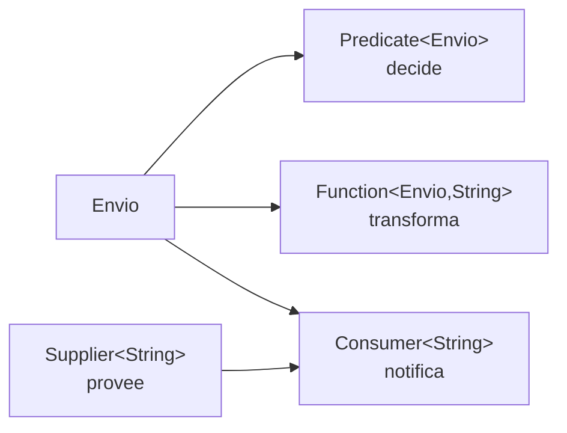
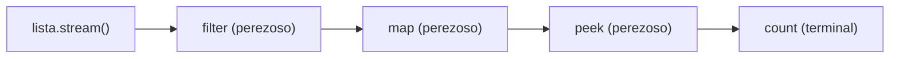

# Módulo 20: Java funcional — interfaces que componen comportamiento

## Aprende construyendo

Cada tema parte de una carpeta vacía y se compila con `javac` para observar el comportamiento y los errores reales. Crearás manualmente todos los archivos, sin depender de proyectos prefabricados ni código de otros temas.

### Tema 1: Las cuatro formas: Predicate, Function, Consumer y Supplier · Básico · 75 min

#### Aprende

**Prerrequisitos:** JDK 27 o superior, lambdas básicas y `javac`/`java` en el `PATH`. Comprueba `java -version` y `javac -version`.

**Al terminar podrás:** elegir la interfaz funcional adecuada para decidir, transformar, notificar o proveer; compilar un programa con las cuatro y corregir una lambda cuya aridad no coincide con su interfaz.

**Por qué importa:** RutaFlow aplica reglas por cliente: decidir si un envío requiere revisión, transformar una guía, registrar una decisión y proveer el turno. La forma correcta convierte cada regla en un valor que se pasa y se prueba por separado, en lugar de acumular condicionales sin nombres.

`java.util.function` define cuatro formas base:

- `Predicate<T>` recibe un valor y decide un `boolean`.
- `Function<T, R>` recibe un valor y devuelve otro.
- `Consumer<T>` recibe un valor y produce un efecto sin devolver resultado.
- `Supplier<T>` no recibe argumentos y provee un valor.

**Analogía:** en una bodega, el portero decide si entra un paquete, el traductor lo reetiqueta, el notificador avisa y el proveedor entrega el turno. La interfaz describe comportamiento, no reemplaza el modelo de dominio.



Desde una carpeta vacía:

```bash
mkdir java-funcional-formas
cd java-funcional-formas
mkdir src
```

Crea manualmente `src/Formas.java`:

```java
import java.util.List;
import java.util.function.Consumer;
import java.util.function.Function;
import java.util.function.Predicate;
import java.util.function.Supplier;

public final class Formas {
    record Envio(String guia, String destino, double pesoKg) {}

    public static void main(String[] args) {
        Predicate<Envio> requiereRevision = envio -> envio.pesoKg() > 20;
        Function<Envio, String> etiqueta = envio -> envio.guia() + " -> " + envio.destino();
        Consumer<String> registrar = linea -> System.out.println("[log] " + linea);
        Supplier<String> turno = () -> "Turno AM";

        List<Envio> envios = List.of(
            new Envio("ENV-1", "Bogotá", 5.5),
            new Envio("ENV-2", "Medellín", 32.0)
        );

        for (Envio envio : envios) {
            if (requiereRevision.test(envio)) {
                registrar.accept(turno.get() + " | " + etiqueta.apply(envio));
            }
        }
    }
}
```

Compila y ejecuta:

```bash
javac -d out src/Formas.java
java -cp out Formas
```

**Resultado esperado:**

```text
[log] Turno AM | ENV-2 -> Medellín
```

El envío de 5,5 kg no supera el predicado.

**Fallo deliberado y corrección:** sustituye la función de etiqueta por:

```java
Function<Envio, String> etiqueta = (guia, destino) -> guia;
```

`javac` informa `incompatible types: incompatible parameter types in lambda expression`. `Function` declara un parámetro y la lambda tiene dos. Restaura `envio -> envio.guia() + " -> " + envio.destino()`, recompila y verifica la línea esperada.

#### Practica

**Práctica guiada:** crea `src/ReglasBasicas.java` con un `Predicate<String>` que valide un correo normalizado, una `Function<String, String>` que haga `trim().toLowerCase()`, un `Consumer<String>` que registre y un `Supplier<LocalDate>` que provea la fecha. Aplica primero la función y después el predicado.

```bash
javac -d out src/ReglasBasicas.java
java -cp out ReglasBasicas
```

**Resultado esperado:** `  ANA@ACADEMIA.COM  ` se normaliza, se acepta y se registra una sola vez junto a la fecha ISO; una entrada sin `@` se rechaza sin registro.

**Ejercicio independiente:** crea `src/ReglasEnvio.java` con un `Predicate<Envio>` para peso, una `Function<Envio, String>` para etiqueta, un `Consumer<String>` para auditoría y un `Supplier<String>` para turno. Procesa tres envíos y encapsula las cuatro reglas en un `record PoliticaEnvio` con componentes funcionales.

```bash
javac -d out src/ReglasEnvio.java
java -cp out ReglasEnvio
```

**Resultado esperado:** solo los envíos que cumplen el predicado generan etiqueta y auditoría; puedes cambiar el umbral sustituyendo el `Predicate` sin modificar el recorrido.

#### Aplica

Construye las reglas de revisión del **[Proyecto integrador: motor funcional de asignación](#proyecto-20-motor-de-reglas-funcional)** con las cuatro interfaces, de modo que cada comportamiento pueda ejecutarse de forma aislada.

**Checklist de salida**

- [ ] Creaste manualmente el proyecto en una carpeta vacía.
- [ ] Cada interfaz se eligió por intención y no solo por tipo de retorno.
- [ ] `test`, `apply`, `accept` y `get` aparecen en una ejecución correcta.
- [ ] Una lambda de aridad incorrecta se diagnosticó y corrigió.
- [ ] Los efectos están en `Consumer`, no escondidos en transformaciones.
- [ ] Puedes explicar cuándo una clase con nombre es mejor que una función anónima.

**Límites y decisión de uso:** si una regla necesita estado propio, más parámetros de los que expresa la interfaz o vocabulario de dominio, una clase comunica mejor.

**Fuentes oficiales:** [java.util.function](https://docs.oracle.com/en/java/javase/21/docs/api/java.base/java/util/function/package-summary.html) y [lambdas en el tutorial de Java](https://docs.oracle.com/javase/tutorial/java/javaOO/lambdaexpressions.html).

### Tema 2: Componer sin anidar: andThen, compose, negate y reglas encadenadas · Intermedio · 75 min

#### Aprende

**Prerrequisitos:** lambdas y las cuatro interfaces funcionales básicas. El proyecto es independiente y no reutiliza archivos del tema anterior.

**Al terminar podrás:** encadenar reglas con `and`, `or`, `negate`, `andThen` y `compose`, y demostrar con una entrada concreta cómo cambiar el orden altera el resultado.

**Por qué importa:** si RutaFlow valida antes de normalizar, un correo correcto con espacios se rechaza. El orden de composición es parte de la regla de negocio y debe quedar visible.

`Predicate` ofrece `and`, `or` y `negate`; `Function` ofrece `andThen` y `compose`. `f.andThen(g)` aplica `f` y luego `g`; `g.compose(f)` aplica primero `f` y después `g`. Ambas composiciones pueden expresar el mismo orden, pero se leen en direcciones distintas.

**Analogía:** es una cadena de montaje. `andThen` añade una estación al final; `compose` declara qué estación va antes. La cadena compila aunque el orden elegido sea semánticamente incorrecto.

Desde una carpeta vacía:

```bash
mkdir java-funcional-composicion
cd java-funcional-composicion
mkdir src
```

Crea manualmente `src/Composicion.java`:

```java
import java.util.function.Function;
import java.util.function.Predicate;

public final class Composicion {
    static final Predicate<String> correo = texto ->
        texto.contains("@") && texto.indexOf('@') > 0
            && texto.indexOf('@') < texto.length() - 1;

    public static void main(String[] args) {
        Function<String, String> normalizar = texto -> texto.trim().toLowerCase();
        Function<String, Boolean> validar = normalizar.andThen(correo::test);

        String entrada = "  ANA@ACADEMIA.COM  ";
        System.out.println("normalizado: " + validar.apply(entrada));

        Predicate<String> noVacio = texto -> !texto.isBlank();
        Predicate<String> conArroba = texto -> texto.contains("@");
        Predicate<String> sospechoso = noVacio.and(conArroba).negate();

        System.out.println("sospechoso: " + sospechoso.test(entrada));
        System.out.println("sospechoso vacío: " + sospechoso.test("   "));

        Function<String, String> conMinusculas = String::toLowerCase;
        Function<String, String> sinEspacios = String::trim;
        System.out.println("compose: " + conMinusculas.compose(sinEspacios).apply(entrada));
    }
}
```

Compila y ejecuta:

```bash
javac -d out src/Composicion.java
java -cp out Composicion
```

**Resultado esperado:**

```text
normalizado: true
sospechoso: false
sospechoso vacío: true
compose: ana@academia.com
```

**Fallo deliberado y corrección:** añade `Function<String, Boolean> sinNormalizar = correo::test;` y evalúa `sinNormalizar.apply("  ANA@ACADEMIA.COM  ")`. Obtienes `false`: el predicado recibe texto crudo. Elimina esa variante y conserva `normalizar.andThen(correo::test)`; la ejecución vuelve a `normalizado: true`.

#### Practica

**Práctica guiada:** crea `src/Dominios.java` con un predicado `terminaEnCom` combinado mediante `correo.and(texto -> texto.endsWith(".com"))`. Añade una versión equivalente con `compose` para normalizar antes de validar y prueba `.com`, `.org`, espacios y mayúsculas.

```bash
javac -d out src/Dominios.java
java -cp out Dominios
```

**Resultado esperado:** ` ANA@ACADEMIA.COM ` pasa tras normalizar; `ana@academia.org` no pasa; puedes señalar qué predicado produjo cada rechazo.

**Ejercicio independiente:** crea `src/ReglasEnvio.java` con un `record Envio` y tres `Predicate<Envio>` para peso, destino y estado. Después crea una `Function<Envio, List<String>>` que devuelva todos los motivos de rechazo, no solo un `boolean`. Incluye un envío válido, uno con un fallo y otro con tres.

```bash
javac -d out src/ReglasEnvio.java
java -cp out ReglasEnvio
```

**Resultado esperado:** el válido produce una lista vacía; los demás muestran todos sus motivos en orden estable, sin detenerse en el primero.

#### Aplica

En el **[Proyecto integrador: validación ordenada de solicitudes](#proyecto-20-motor-de-reglas-funcional)**, normaliza antes de validar y usa motivos explícitos cuando el usuario necesite entender un rechazo.

**Checklist de salida**

- [ ] El ejemplo se escribió completo en un proyecto nuevo.
- [ ] `andThen` y `compose` producen el orden previsto.
- [ ] `and`, `or` y `negate` se prueban con entradas límite.
- [ ] El correo con espacios demuestra el fallo de validar antes de normalizar.
- [ ] Los motivos de rechazo no se pierden detrás de un único `boolean`.
- [ ] Evitas cadenas compuestas cuyas reglas no tengan nombres comprensibles.

**Límites y decisión de uso:** componer funciona bien con reglas independientes. Si dependen entre sí o deben explicar el resultado, un tipo `Resultado` comunica mejor que una cadena de predicados.

**Fuentes oficiales:** [Predicate](https://docs.oracle.com/en/java/javase/21/docs/api/java.base/java/util/function/Predicate.html) y [Function](https://docs.oracle.com/en/java/javase/21/docs/api/java.base/java/util/function/Function.html).

### Tema 3: Streams como composición: pereza, orden y efectos que se esconden · Intermedio · 90 min

#### Aprende

**Prerrequisitos:** colecciones, lambdas y composición básica de funciones; no necesitas archivos de otros temas.

**Al terminar podrás:** demostrar que un Stream no ejecuta su pipeline hasta una operación terminal, depurar con `peek`, diagnosticar el consumo doble y calcular agregados sin esconder efectos.

**Por qué importa:** un informe de miles de envíos puede duplicar registros o trabajo si se reutiliza un Stream o se mezclan efectos dentro de `map`. La pereza es útil solo cuando sabes dónde ocurre el trabajo.

Un Stream describe trabajo; no es una colección. `filter`, `map` y `peek` son perezosas. `count`, `collect`, `forEach` y `reduce` son terminales y disparan el recorrido. Un Stream se consume una sola vez. `peek` sirve para observar durante depuración, no para implementar lógica de negocio.

**Analogía:** es una receta escrita frente a una comida cocinada. Declarar la receta no cocina nada; servir el plato dispara el trabajo. A diferencia de la receta, un Stream consumido no puede cocinarse otra vez.



Desde una carpeta vacía:

```bash
mkdir java-streams-pereza
cd java-streams-pereza
mkdir src
```

Crea manualmente `src/Pereza.java`:

```java
import java.util.List;
import java.util.stream.Stream;

public final class Pereza {
    record Envio(String guia, double pesoKg) {}

    public static void main(String[] args) {
        List<Envio> envios = List.of(
            new Envio("ENV-1", 5.5),
            new Envio("ENV-2", 32.0),
            new Envio("ENV-3", 18.0)
        );

        Stream<Envio> pesados = envios.stream()
            .filter(envio -> envio.pesoKg() > 20)
            .peek(envio -> System.out.println("filtrado " + envio.guia()));

        System.out.println("antes de la operación terminal: no se ejecutó ningún filtro");
        long total = pesados.count();
        System.out.println("pesados=" + total);
    }
}
```

Compila y ejecuta:

```bash
javac -d out src/Pereza.java
java -cp out Pereza
```

**Resultado esperado:**

```text
antes de la operación terminal: no se ejecutó ningún filtro
filtrado ENV-2
pesados=1
```

La línea de `peek` aparece después del aviso porque el trabajo ocurre en `count`.

**Fallo deliberado y corrección:** sustituye el cálculo por:

```java
long primero = pesados.count();
long segundo = pesados.count();
```

La JVM lanza `IllegalStateException: stream has already been operated upon or closed`. La primera operación terminal consumió el Stream. Corrige conservando un único `long total = pesados.count();`; si necesitas otro recorrido, crea un Stream nuevo desde la lista o materializa una colección deliberadamente.

#### Practica

**Práctica guiada:** crea `src/PerezaGuia.java` con un pipeline que haga `filter`, luego `.map(Envio::guia)` y después `peek`. Termina con `toList()` e imprime la lista; observa que `peek` recibe `String`, no `Envio`.

```bash
javac -d out src/PerezaGuia.java
java -cp out PerezaGuia
```

**Resultado esperado:** la depuración muestra `ENV-2`, el resultado es `[ENV-2]` y ninguna línea de `peek` aparece antes de la operación terminal.

**Ejercicio independiente:** crea `src/Informe.java` que calcule en una sola pasada el peso total de todos los envíos y cuántos superan 20 kg. Usa `Collectors.teeing` con `summingDouble` y `filtering(..., counting())`, o un acumulador propio; no crees dos Streams para el mismo cálculo.

```bash
javac -d out src/Informe.java
java -cp out Informe
```

**Resultado esperado:** para 5,5, 32 y 18 kg imprime `pesoTotal=55.5` y `pesados=1`; el código contiene una sola operación de recorrido sobre la lista.

#### Aplica

Completa el informe del **[Proyecto integrador: agregación de envíos sin doble recorrido](#proyecto-20-motor-de-reglas-funcional)**. Usa Streams para transformar y agregar; conserva un `for` para efectos ordenados como notificaciones.

**Checklist de salida**

- [ ] El proyecto fue creado manualmente desde una carpeta vacía.
- [ ] La salida demuestra que el filtro se ejecuta en la terminal.
- [ ] `peek` se usa para observar y no para cambiar estado del negocio.
- [ ] El consumo doble se reconoce por `IllegalStateException` y se corrige.
- [ ] El informe calcula total y conteo con una sola pasada.
- [ ] Puedes justificar cuándo un `for` es más claro que un Stream.

**Límites y decisión de uso:** un `for` suele ser más claro con índices, `break`, `continue` o efectos ordenados. No uses `parallelStream` sin medir ni escondas efectos en `map`.

**Fuentes oficiales:** [Stream](https://docs.oracle.com/en/java/javase/21/docs/api/java.base/java/util/stream/Stream.html) y [procesamiento de datos con Streams](https://docs.oracle.com/javase/tutorial/collections/streams/index.html).

## Laboratorio práctico

### Proyecto 20: motor de reglas funcional

Desde una carpeta vacía crea `motor-reglas-funcional/` y su directorio `src/`. Escribe manualmente `Formas.java`, `Composicion.java`, `Pereza.java` e `Informe.java` con las reglas del proyecto integrador; no copies fuentes de los temas ni de la academia.

**Entregable:** un motor compuesto con `Predicate`, `Function`, `Consumer` y `Supplier`, normalización previa a validación y un informe que calcule peso total y número de envíos pesados en una sola pasada.

**Criterio de aceptación observable:**

1. `javac -d out src/*.java` termina con código 0.
2. `java -cp out Formas` imprime exactamente `[log] Turno AM | ENV-2 -> Medellín`.
3. `java -cp out Pereza` imprime el aviso de pereza antes de `filtrado ENV-2`.
4. Un correo con espacios se acepta solo cuando se normaliza antes de validar.
5. El informe imprime `pesoTotal=55.5` y `pesados=1` sin crear dos Streams para el mismo cálculo.

Crea manualmente `verificar.sh` junto a `src/`:

```bash
#!/usr/bin/env bash
set -euo pipefail
javac -d out src/*.java
salida=$(java -cp out Formas)
[ "$salida" = "[log] Turno AM | ENV-2 -> Medellín" ] || {
  echo "FALLA: Formas imprimió: $salida"
  exit 1
}
salida_pereza=$(java -cp out Pereza)
primera=${salida_pereza%%$'\n'*}
[[ "$primera" == *"antes de la operación terminal"* ]] || {
  echo "FALLA: el pipeline no demuestra pereza"
  exit 1
}
salida_informe=$(java -cp out Informe)
[[ "$salida_informe" == *"pesoTotal=55.5"* && "$salida_informe" == *"pesados=1"* ]] || {
  echo "FALLA: informe incorrecto: $salida_informe"
  exit 1
}
echo "Checkpoint OK"
```

Ejecuta tu verificador:

```bash
bash verificar.sh
```

**Resultado esperado:** `Checkpoint OK`. Si falla, corrige el archivo propio señalado por el mensaje y vuelve a ejecutar; el cierre no depende de archivos ocultos ni de servicios externos.
