# Módulo 20: Java funcional — interfaces que componen comportamiento

Cuando un flujo de envíos crece, el código imperativo suele mezclar tres cosas distintas: decidir si un envío es válido, transformar datos para un reporte y ejecutar efectos como imprimir, guardar o publicar eventos. El resultado funciona, pero es frágil: probar una regla exige levantar todo el flujo, cambiar un formato rompe una validación, y un `for` con banderas oculta la intención de negocio.

Java no te obliga a elegir entre objetos y funciones. La opción útil es combinar ambos: objetos para modelar el dominio y funciones para pasar comportamiento pequeño y comprobable. En este módulo vas a construir `tienda-aurora-java-m20`, un mini-módulo de envíos donde las reglas se componen, los cálculos se prueban sin I/O, y los efectos quedan en el borde.

**Entorno de referencia verificado (2026-11-23):** macOS arm64, JDK 27.0.1.0.2 con toolchain Java 25, Gradle 9.9.1.
Con él se capturaron las salidas del proyecto Gradle (sección «Verificación real»).

**Entorno de las salidas nuevas de los temas (2026-11-24):** Linux x86_64 con 2 núcleos, OpenJDK 25.0.5.1, sin
Gradle. Los programas de un solo archivo de los temas se ejecutan con `java Archivo.java` y sus transcripciones son
literales. Los mensajes de error del compilador se capturaron con `javac` 25.0.5.1. Los programas también se
ejecutaron con OpenJDK 21.0.13.1 y dieron la misma salida. Las pruebas JUnit no se ejecutaron en este entorno.

## Apertura del módulo

#### Objetivos del módulo
Al terminar este módulo podrás:
- elegir entre `Predicate`, `Function`, `BiFunction`, `Consumer`, `Supplier`, `UnaryOperator` y `BinaryOperator` por la forma de entrada y salida;
- componer funciones y reglas con `andThen`, `compose`, `and`, `or` y `negate` sin anidar llamadas;
- predecir cuándo y en qué orden se ejecuta un stream, y detectar efectos que nunca ocurren;
- encadenar `Optional` con `map`, `flatMap` y `filter` sin `Optional<Optional<…>>`;
- agrupar resultados con `groupingBy`, collectors *downstream* y mapas con orden explícito;
- separar cálculos puros de efectos y demostrar por qué el estado compartido rompe un stream paralelo;
- controlar la demanda de un `Flow.Subscriber` con `request(n)` y esperar su cierre sin temporizadores.

#### Esquema del módulo
1. Temas 1, 2 y 5 — las interfaces funcionales del JDK por su forma.
2. Tema 3 — composición de funciones y predicados.
3. Temas 4, 8, 9 y 10 — streams como composición: pereza, intermedias, terminales y collectors.
4. Temas 6 y 7 — referencias a métodos y `Optional` encadenado.
5. Temas 11 y 12 — paralelismo, pureza y efectos en el borde.
6. Tema 13 — Flow API y demanda explícita.
7. Proyecto `tienda-aurora-java-m20`, con su verificación real al final del módulo.

#### Qué necesitas saber antes
Estos términos ya tienen ficha y aquí se citan, no se redefinen: lambda, interfaz funcional, referencia a método,
`Stream`, operación intermedia y terminal, `filter`, `map`, `flatMap`, `reduce`, `collect` y Collectors (Java,
Módulo 4, Tema 1); `Optional`, `Optional.of`, `orElse`, `orElseThrow` y `Supplier` (Java, Módulo 4, Tema 2);
referencia a constructor, stream paralelo, ForkJoinPool común, operación asociativa y efecto secundario (Java,
Módulo 4, Tema 4); `record`, objeto de valor y copia defensiva (Java, Módulo 1, Tema 5); interfaz y método `default`
(Java, Módulo 1, Tema 3); `HashMap`, `LinkedHashMap`, `TreeMap` y `TreeSet` (Java, Módulo 2, Tema 1); `Comparator`
(Java, Módulo 2, Tema 5); `CompletableFuture` (Java, Módulo 5, Tema 2); estado mutable compartido y operación atómica
(Java, Módulo 5, Tema 4); condición de carrera (Fundamentos, Módulo 5, Tema 2); escala de `BigDecimal` y Strategy
(Java, Módulo 12, Tema 2).

## Visual del módulo

**Visual:** [Interfaces funcionales: rol de cada una y composición en Flow](/visuals/temas/java/modulo-20-interfaces-funcionales.html)

Lectura: Cada interfaz funcional expresa una forma de entrada/salida; el flujo compone reglas y efectos.

## Prerrequisitos y bootstrap

Necesitas JDK 25 y Gradle 9.x. Verifica:

```bash
java -version
gradle --version
```

Crea el proyecto desde cero:

```bash
mkdir -p tienda-aurora-java-m20/src/main/java/com/aurora/funcional
mkdir -p tienda-aurora-java-m20/src/test/java/com/aurora/funcional
cd tienda-aurora-java-m20
gradle wrapper --gradle-version 9.9.1
```

Estructura objetivo:

```text
tienda-aurora-java-m20/
├── build.gradle.kts
├── settings.gradle.kts
└── src/
    ├── main/java/com/aurora/funcional/
    │   ├── App.java
    │   ├── Envio.java
    │   ├── EstadoEnvio.java
    │   ├── EventosEnvio.java
    │   ├── EnvioRepository.java
    │   ├── ReglaEnvio.java
    │   ├── ReglasEnvio.java
    │   └── ReporteEnvios.java
    └── test/java/com/aurora/funcional/
        └── FuncionalTest.java
```

## Build desde cero

#### `settings.gradle.kts`

```kotlin
rootProject.name = "tienda-aurora-java-m20"
```

#### `build.gradle.kts`

Java 25 por toolchain, JUnit 5 para pruebas y `-Werror` para no ignorar warnings.

```kotlin
plugins {
    java
    application
}

group = "com.aurora"
version = "1.0.0"

java {
    toolchain {
        languageVersion = JavaLanguageVersion.of(25)
    }
}

repositories {
    mavenCentral()
}

dependencies {
    testImplementation(platform("org.junit:junit-bom:5.13.4"))
    testImplementation("org.junit.jupiter:junit-jupiter")
    testRuntimeOnly("org.junit.platform:junit-platform-launcher")
}

application {
    mainClass = "com.aurora.funcional.App"
}

tasks.test {
    useJUnitPlatform()
    testLogging {
        events("passed", "skipped", "failed")
        showStandardStreams = true
    }
}

tasks.withType<JavaCompile>().configureEach {
    options.encoding = "UTF-8"
    options.compilerArgs.addAll(listOf("-Xlint:all", "-Xlint:-processing", "-Werror"))
}
```

## Código completo del proyecto

Todos los archivos Java que se compilan y ejecutan están publicados aquí completos, con `package`, imports y cuerpo. Los temas posteriores se refieren a estos archivos; no hay fragmentos que debas pegar a mano.

#### `EstadoEnvio.java`

```java
package com.aurora.funcional;

public enum EstadoEnvio {
    PENDIENTE, EN_RUTA, ENTREGADO, FALLIDO
}
```

#### `Envio.java`

```java
package com.aurora.funcional;

import java.math.BigDecimal;
import java.util.List;
import java.util.Objects;

/** Value object inmutable: dato del dominio, sin I/O. */
public record Envio(
        String id,
        String destino,
        BigDecimal pesoKg,
        BigDecimal costo,
        EstadoEnvio estado,
        List<String> paradas
) {
    public Envio {
        Objects.requireNonNull(id, "id");
        Objects.requireNonNull(destino, "destino");
        Objects.requireNonNull(pesoKg, "pesoKg");
        Objects.requireNonNull(costo, "costo");
        Objects.requireNonNull(estado, "estado");
        paradas = List.copyOf(paradas);
        if (id.isBlank()) throw new IllegalArgumentException("id vacío");
        if (destino.isBlank()) throw new IllegalArgumentException("destino vacío");
        if (pesoKg.signum() <= 0) throw new IllegalArgumentException("pesoKg debe ser > 0");
        if (costo.signum() < 0) throw new IllegalArgumentException("costo no puede ser negativo");
    }
}
```

`List.copyOf` es una copia defensiva: quien construya el envío no puede mutar después la lista interna. Esa inmutabilidad hace que pasar `Envio` por streams y funciones sea predecible.

#### `EnvioRepository.java`

```java
package com.aurora.funcional;

import java.util.Map;
import java.util.Optional;

/** Puerto simple para demostrar Optional en borde de consulta. */
public class EnvioRepository {
    private final Map<String, Envio> porId;

    public EnvioRepository(Map<String, Envio> porId) {
        this.porId = Map.copyOf(porId);
    }

    public Optional<Envio> buscarPorId(String id) {
        return Optional.ofNullable(porId.get(id));
    }

    public Envio obtenerObligatorio(String id) {
        return buscarPorId(id)
                .orElseThrow(() -> new IllegalArgumentException("envío obligatorio no encontrado: " + id));
    }
}
```

#### `ReglaEnvio.java`

```java
package com.aurora.funcional;

import java.util.Objects;
import java.util.function.Predicate;

/**
 * Regla de negocio nombrada. Combina Predicate (test) con motivo legible.
 * No es @FunctionalInterface porque expone dos métodos abstractos; la factory `de`
 * crea instancias a partir de lambdas Predicate.
 */
public interface ReglaEnvio {
    boolean test(Envio envio);
    String motivo();

    default ReglaEnvio and(ReglaEnvio otra) {
        ReglaEnvio self = this;
        Objects.requireNonNull(otra, "otra");
        return new ReglaEnvio() {
            @Override
            public boolean test(Envio envio) {
                return self.test(envio) && otra.test(envio);
            }
            @Override
            public String motivo() {
                return self.motivo() + " Y " + otra.motivo();
            }
        };
    }

    default Predicate<Envio> asPredicate() {
        return this::test;
    }

    static ReglaEnvio de(String motivo, Predicate<Envio> predicate) {
        Objects.requireNonNull(motivo, "motivo");
        Objects.requireNonNull(predicate, "predicate");
        return new ReglaEnvio() {
            @Override public boolean test(Envio envio) { return predicate.test(envio); }
            @Override public String motivo() { return motivo; }
        };
    }
}
```

#### `ReglasEnvio.java`

```java
package com.aurora.funcional;

import java.math.BigDecimal;
import java.util.function.BiFunction;
import java.util.function.BinaryOperator;
import java.util.function.Consumer;
import java.util.function.Function;
import java.util.function.Predicate;
import java.util.function.Supplier;
import java.util.function.UnaryOperator;

/** Fábrica de reglas y funciones puras. Sin I/O: se puede probar sin mocks. */
public final class ReglasEnvio {
    private ReglasEnvio() {}

    // Predicate / regla propia
    public static ReglaEnvio pesoMaximo(BigDecimal maxKg) {
        return ReglaEnvio.de("peso <= " + maxKg, e -> e.pesoKg().compareTo(maxKg) <= 0);
    }

    public static ReglaEnvio destinoPermitido(String destino) {
        return ReglaEnvio.de("destino=" + destino, e -> e.destino().equalsIgnoreCase(destino));
    }

    public static ReglaEnvio noFallido() {
        return ReglaEnvio.de("no fallido", e -> e.estado() != EstadoEnvio.FALLIDO);
    }

    // Function<T,R> y BiFunction<T,U,R>
    public static Function<Envio, String> etiqueta() {
        return e -> e.id() + "@" + e.destino();
    }

    public static BiFunction<BigDecimal, BigDecimal, BigDecimal> tarifaConImpuesto() {
        return (base, impuesto) -> base.add(base.multiply(impuesto));
    }

    // UnaryOperator/BinaryOperator: mismo tipo entra y sale
    public static UnaryOperator<BigDecimal> aplicarDescuento(BigDecimal porcentaje) {
        BigDecimal factor = BigDecimal.ONE.subtract(porcentaje);
        return total -> total.multiply(factor);
    }

    public static BinaryOperator<BigDecimal> mayorCosto() {
        return (a, b) -> a.compareTo(b) >= 0 ? a : b;
    }

    // Supplier / Consumer: bordes. Consumer se inyecta, no se hardcodea System.out.
    public static Supplier<String> generadorId(String prefijo, int n) {
        return () -> prefijo + "-" + n;
    }

    public static Consumer<String> auditor(Consumer<String> salida) {
        return salida;
    }

    // Composición explícita
    public static Function<BigDecimal, BigDecimal> normalizarYRedondear() {
        UnaryOperator<BigDecimal> noNegativo = v -> v.signum() < 0 ? BigDecimal.ZERO : v;
        UnaryOperator<BigDecimal> dosDecimales = v -> v.setScale(2, java.math.RoundingMode.HALF_UP);
        return noNegativo.andThen(dosDecimales);
    }
}
```

#### `ReporteEnvios.java`

```java
package com.aurora.funcional;

import java.math.BigDecimal;
import java.math.RoundingMode;
import java.util.Comparator;
import java.util.LinkedHashMap;
import java.util.List;
import java.util.Map;
import java.util.Optional;
import java.util.Set;
import java.util.TreeSet;
import java.util.function.Function;
import java.util.function.Predicate;
import java.util.stream.Collectors;
import java.util.stream.Stream;

/** Cálculos puros sobre envíos. No imprime ni guarda: devuelve datos. */
public final class ReporteEnvios {
    private ReporteEnvios() {}

    public static List<String> etiquetasValidas(List<Envio> envios, Predicate<Envio> regla, Function<Envio, String> etiqueta) {
        return envios.stream()
                .filter(regla)
                .map(etiqueta)
                .toList();
    }

    public static List<String> paradasNormalizadas(List<Envio> envios) {
        return envios.stream()
                .flatMap(e -> e.paradas().stream())
                .map(String::trim)
                .filter(p -> !p.isBlank())
                .map(String::toUpperCase)
                .distinct()
                .sorted()
                .toList();
    }

    public static Optional<Envio> masCaro(List<Envio> envios) {
        return envios.stream().max(Comparator.comparing(Envio::costo));
    }

    public static long totalEntregados(List<Envio> envios) {
        return envios.stream().filter(e -> e.estado() == EstadoEnvio.ENTREGADO).count();
    }

    public static BigDecimal sumaCostos(List<Envio> envios) {
        return envios.stream()
                .map(Envio::costo)
                .reduce(BigDecimal.ZERO, BigDecimal::add);
    }

    public static Map<EstadoEnvio, List<Envio>> porEstado(List<Envio> envios) {
        return envios.stream().collect(Collectors.groupingBy(Envio::estado));
    }

    public static Map<String, BigDecimal> costoPorDestino(List<Envio> envios) {
        return envios.stream().collect(Collectors.groupingBy(
                Envio::destino,
                LinkedHashMap::new,
                Collectors.reducing(BigDecimal.ZERO, Envio::costo, BigDecimal::add)
        ));
    }

    public static String resumenIds(List<Envio> envios) {
        return envios.stream().map(Envio::id).collect(Collectors.joining(", ", "[", "]"));
    }

    public static Set<String> destinosOrdenados(List<Envio> envios) {
        return envios.stream()
                .map(Envio::destino)
                .collect(Collectors.toCollection(TreeSet::new));
    }

    // Demuestra orden: normalizar antes de validar evita rechazos falsos
    public static List<String> destinosValidosNormalizados(List<String> destinosCrudos) {
        Predicate<String> permitido = d -> Set.of("BOG", "MED", "CALI").contains(d);
        return destinosCrudos.stream()
                .map(String::trim)
                .map(String::toUpperCase)
                .filter(permitido)
                .toList();
    }

    // Pipeline perezoso: no ejecuta hasta terminal
    public static long contarConTraza(Stream<Integer> valores, List<String> traza) {
        return valores
                .filter(v -> {
                    traza.add("filter:" + v);
                    return v % 2 == 0;
                })
                .map(v -> {
                    traza.add("map:" + v);
                    return v * 10;
                })
                .count();
    }

    // Paralelo seguro: sin estado compartido mutable
    public static BigDecimal sumaParalelaSegura(List<BigDecimal> costos) {
        return costos.parallelStream().reduce(BigDecimal.ZERO, BigDecimal::add);
    }

    // Demuestra problema: suma con estado compartido (solo para test educativo)
    public static long sumaParalelaInsegura(List<Integer> valores) {
        final int[] caja = {0}; // mutable compartido: race condition
        valores.parallelStream().forEach(v -> caja[0] += v);
        return caja[0];
    }
}
```

`sumaParalelaInsegura` se conserva como contraejemplo: nunca debe usarse para calcular dinero. `sumaParalelaSegura` usa `reduce` con identidad y operación asociativa, sin estado compartido.

#### `EventosEnvio.java`

```java
package com.aurora.funcional;

import java.util.concurrent.CompletableFuture;
import java.util.concurrent.Flow;
import java.util.concurrent.SubmissionPublisher;
import java.util.concurrent.TimeUnit;

/** Flow API: publisher emite eventos; subscriber controla demanda con request(n). */
public final class EventosEnvio {
    private EventosEnvio() {}

    public static final class Evento {
        private final String id;
        private final String mensaje;
        public Evento(String id, String mensaje) { this.id = id; this.mensaje = mensaje; }
        public String id() { return id; }
        public String mensaje() { return mensaje; }
        @Override public String toString() { return id + ":" + mensaje; }
    }

    public static class SuscriptorAuditor implements Flow.Subscriber<Evento> {
        private final int lote;
        private final StringBuilder log;
        private final CompletableFuture<Void> terminado;
        private Flow.Subscription subscription;
        private int recibidos;

        public SuscriptorAuditor(int lote, StringBuilder log, CompletableFuture<Void> terminado) {
            this.lote = lote;
            this.log = log;
            this.terminado = terminado;
        }

        @Override
        public void onSubscribe(Flow.Subscription subscription) {
            this.subscription = subscription;
            subscription.request(lote); // backpressure: pide N
        }

        @Override
        public void onNext(Evento item) {
            recibidos++;
            log.append("NEXT:").append(item).append('\n');
            if (recibidos % lote == 0) {
                subscription.request(lote);
            }
        }

        @Override
        public void onError(Throwable throwable) {
            log.append("ERROR:").append(throwable.getMessage()).append('\n');
            terminado.completeExceptionally(throwable);
        }

        @Override
        public void onComplete() {
            log.append("DONE").append('\n');
            terminado.complete(null); // señala entrega completa: sin Thread.sleep
        }
    }

    public static String demo() throws Exception {
        StringBuilder log = new StringBuilder();
        CompletableFuture<Void> terminado = new CompletableFuture<>();
        try (SubmissionPublisher<Evento> publisher = new SubmissionPublisher<>()) {
            publisher.subscribe(new SuscriptorAuditor(2, log, terminado));
            publisher.submit(new Evento("E1", "creado"));
            publisher.submit(new Evento("E2", "validado"));
            publisher.submit(new Evento("E3", "enviado"));
        }
        terminado.get(2, TimeUnit.SECONDS); // espera al evento real, no a un temporizador
        return log.toString();
    }
}
```

La espera usa `terminado.get(2, TimeUnit.SECONDS)`, liberada por `onComplete()` o `onError()`. No hay `Thread.sleep(200)`: un temporizador podía devolver la log antes de que el suscriptor terminara y hacía la prueba no determinista. El test llama a `demo()` dos veces y espera exactamente la misma salida.

#### `App.java`

```java
package com.aurora.funcional;

import java.math.BigDecimal;
import java.util.ArrayList;
import java.util.List;
import java.util.Map;
import java.util.function.BiFunction;
import java.util.function.BinaryOperator;
import java.util.function.Consumer;
import java.util.function.Function;
import java.util.function.Predicate;
import java.util.function.Supplier;
import java.util.function.UnaryOperator;

public final class App {
    public static void main(String[] args) throws Exception {
        List<Envio> envios = datos();

        // 1-3: interfaces funcionales core + composición
        ReglaEnvio regla = ReglasEnvio.pesoMaximo(new BigDecimal("10")).and(ReglasEnvio.noFallido());
        Predicate<Envio> valido = regla.asPredicate();
        Function<Envio, String> etiqueta = ReglasEnvio.etiqueta();
        Consumer<String> auditor = ReglasEnvio.auditor(System.out::println);
        Supplier<String> idNuevo = ReglasEnvio.generadorId("TMP", 99);
        System.out.println("ID=" + idNuevo.get());
        ReporteEnvios.etiquetasValidas(envios, valido, etiqueta).forEach(auditor);
        System.out.println("REGLA=" + regla.motivo());

        // 2,5: BiFunction / operadores
        BiFunction<BigDecimal, BigDecimal, BigDecimal> tarifa = ReglasEnvio.tarifaConImpuesto();
        UnaryOperator<BigDecimal> descuento = ReglasEnvio.aplicarDescuento(new BigDecimal("0.10"));
        BinaryOperator<BigDecimal> mayor = ReglasEnvio.mayorCosto();
        BigDecimal total = descuento.apply(tarifa.apply(new BigDecimal("100"), new BigDecimal("0.19")));
        System.out.println("TOTAL=" + ReglasEnvio.normalizarYRedondear().apply(total));
        System.out.println("MAYOR=" + mayor.apply(new BigDecimal("10"), new BigDecimal("25")));

        // 4: laziness
        List<String> traza = new ArrayList<>();
        long cuenta = ReporteEnvios.contarConTraza(List.of(1, 2, 3, 4, 5).stream(), traza);
        System.out.println("CUENTA=" + cuenta);
        System.out.println("TRAZA=" + traza.size());

        // 6: method references
        List<String> destinos = envios.stream().map(Envio::destino).distinct().sorted().toList();
        System.out.println("DESTINOS=" + destinos);

        // 7: Optional
        EnvioRepository repo = new EnvioRepository(Map.of("A1", envios.get(0)));
        System.out.println("OPT=" + repo.buscarPorId("A1").map(Envio::id).orElse("NA"));
        System.out.println("MISS=" + repo.buscarPorId("ZZ").map(Envio::id).orElse("NA"));

        // 8-10: streams intermedios/terminales/collectors
        System.out.println("PARADAS=" + ReporteEnvios.paradasNormalizadas(envios));
        System.out.println("MAS_CARO=" + ReporteEnvios.masCaro(envios).map(Envio::id).orElse("NA"));
        System.out.println("ENTREGADOS=" + ReporteEnvios.totalEntregados(envios));
        System.out.println("SUMA=" + ReporteEnvios.sumaCostos(envios));
        System.out.println("POR_ESTADO=" + ReporteEnvios.porEstado(envios).keySet());
        System.out.println("COSTO_DESTINO=" + ReporteEnvios.costoPorDestino(envios));
        System.out.println("IDS=" + ReporteEnvios.resumenIds(envios));
        System.out.println("DEST_SET=" + ReporteEnvios.destinosOrdenados(envios));
        System.out.println("NORMALIZADOS=" + ReporteEnvios.destinosValidosNormalizados(List.of(" bog ", "med", "XX")));

        // 11: paralelo seguro
        System.out.println("PARALELA=" + ReporteEnvios.sumaParalelaSegura(envios.stream().map(Envio::costo).toList()));

        // 12: pureza - cálculo separado de efecto
        String reporte = "REPORTE:" + ReporteEnvios.resumenIds(envios);
        auditor.accept(reporte); // efecto en el borde

        // 13: Flow API
        System.out.print(EventosEnvio.demo());
    }

    static List<Envio> datos() {
        return List.of(
                new Envio("A1", "BOG", new BigDecimal("2.5"), new BigDecimal("10000"), EstadoEnvio.ENTREGADO, List.of("Bodega", "BOG")),
                new Envio("A2", "MED", new BigDecimal("12.0"), new BigDecimal("25000"), EstadoEnvio.PENDIENTE, List.of("Bodega", "MED", "med")),
                new Envio("A3", "BOG", new BigDecimal("1.0"), new BigDecimal("8000"), EstadoEnvio.FALLIDO, List.of("BOG")),
                new Envio("A4", "CALI", new BigDecimal("3.0"), new BigDecimal("12000"), EstadoEnvio.EN_RUTA, List.of("BOG", "CALI"))
        );
    }
}
```

#### `FuncionalTest.java`

```java
package com.aurora.funcional;

import org.junit.jupiter.api.Test;

import java.math.BigDecimal;
import java.util.ArrayList;
import java.util.List;
import java.util.Map;
import java.util.Optional;
import java.util.Set;
import java.util.function.Function;
import java.util.function.Predicate;
import java.util.stream.Stream;

import static org.junit.jupiter.api.Assertions.*;

class FuncionalTest {

    private List<Envio> datos() {
        return List.of(
                new Envio("A1", "BOG", new BigDecimal("2.5"), new BigDecimal("10000"), EstadoEnvio.ENTREGADO, List.of("Bodega", "BOG")),
                new Envio("A2", "MED", new BigDecimal("12.0"), new BigDecimal("25000"), EstadoEnvio.PENDIENTE, List.of("Bodega", "MED")),
                new Envio("A3", "BOG", new BigDecimal("1.0"), new BigDecimal("8000"), EstadoEnvio.FALLIDO, List.of("BOG"))
        );
    }

    @Test
    void componeReglasYTransforma() {
        ReglaEnvio regla = ReglasEnvio.pesoMaximo(new BigDecimal("10")).and(ReglasEnvio.noFallido());
        Function<Envio, String> etiqueta = ReglasEnvio.etiqueta();
        List<String> out = ReporteEnvios.etiquetasValidas(datos(), regla.asPredicate(), etiqueta);
        assertEquals("peso <= 10 Y no fallido", regla.motivo());
        assertEquals(List.of("A1@BOG"), out);
    }

    @Test
    void biFunctionYOperadores() {
        BigDecimal total = ReglasEnvio.tarifaConImpuesto().apply(new BigDecimal("100"), new BigDecimal("0.19"));
        assertEquals(new BigDecimal("119.00"), ReglasEnvio.normalizarYRedondear().apply(total));
        assertEquals(new BigDecimal("90.00"), ReglasEnvio.aplicarDescuento(new BigDecimal("0.10")).apply(new BigDecimal("100")));
        assertEquals(new BigDecimal("25"), ReglasEnvio.mayorCosto().apply(new BigDecimal("10"), new BigDecimal("25")));
    }

    @Test
    void optionalExplicito() {
        EnvioRepository repo = new EnvioRepository(Map.of("A1", datos().get(0)));
        assertEquals("A1", repo.buscarPorId("A1").map(Envio::id).orElse("NA"));
        assertEquals("NA", repo.buscarPorId("ZZ").map(Envio::id).orElse("NA"));
        assertThrows(IllegalArgumentException.class, () -> repo.obtenerObligatorio("ZZ"));
    }

    @Test
    void streamEsPerezosoYSeConsumeUnaVez() {
        List<String> traza = new ArrayList<>();
        long c = ReporteEnvios.contarConTraza(List.of(1, 2, 3, 4).stream(), traza);
        assertEquals(2, c);
        assertFalse(traza.isEmpty());
        Stream<Integer> s = Stream.of(1, 2);
        s.count();
        assertThrows(IllegalStateException.class, s::count);
    }

    @Test
    void collectorsYAplanado() {
        assertEquals(List.of("BODEGA", "BOG", "MED"), ReporteEnvios.paradasNormalizadas(datos()));
        assertEquals(Set.of("BOG", "MED"), ReporteEnvios.destinosOrdenados(datos()));
        assertEquals("[A1, A2, A3]", ReporteEnvios.resumenIds(datos()));
        assertEquals(new BigDecimal("43000"), ReporteEnvios.sumaCostos(datos()));
    }

    @Test
    void normalizaAntesDeValidar() {
        assertEquals(List.of("BOG", "MED"), ReporteEnvios.destinosValidosNormalizados(List.of(" bog ", "med", "xx")));
    }

    @Test
    void flowEntregaEventos() throws Exception {
        String esperado = "NEXT:E1:creado\nNEXT:E2:validado\nNEXT:E3:enviado\nDONE\n";
        assertEquals(esperado, EventosEnvio.demo());
        assertEquals(esperado, EventosEnvio.demo()); // determinista: sin sleeps
    }
}
```

## Los 13 temas aplicados al proyecto

### Tema 1: Las cuatro formas: Predicate, Function, Consumer y Supplier · Básico · 30 min

<details open>
<summary><strong>Capa 1 — Lectura</strong></summary>

#### Objetivos
Al terminar este tema podrás:
- elegir entre `Predicate`, `Function`, `Consumer` y `Supplier` mirando qué entra y qué sale;
- escribir una función de orden superior que reciba una regla y una transformación;
- cambiar el destino de un efecto (consola o lista) sin tocar el cálculo;
- leer los errores `Unexpected @FunctionalInterface annotation` y `bad return type in lambda expression`.

**Conceptos clave:** Predicate, Function, Consumer, función de orden superior, @FunctionalInterface

Ya los conoces y no se repiten: lambda, interfaz funcional y referencia a método (Java, Módulo 4, Tema 1);
`Supplier` (Java, Módulo 4, Tema 2); `record` (Java, Módulo 1, Tema 5); `enum` (Java, Módulo 0, Tema 6).

#### El problema
Tienda Aurora tiene cuatro envíos. Debe decidir cuáles son válidos, convertir cada válido en una etiqueta
`id@destino`, imprimir las etiquetas y generar un identificador temporal. Hoy todo vive en un `for` con `if` y
`System.out.println`. Para probar la regla tienes que leer la consola. ¿Cómo separas decidir, transformar, producir y
publicar?

#### Glosario del tema

**Predicate**
- **Definición técnica:** `java.util.function.Predicate<T>`, interfaz funcional con el método `boolean test(T t)`; trae los métodos `default` `and`, `or` y `negate`.
- **En palabras sencillas:** una pregunta de sí o no sobre un dato: «¿este envío es válido?».
- **Dónde se rompe la comparación:** la pregunta no explica por qué dijo «no»; para eso el proyecto usa `ReglaEnvio`, que agrega `motivo()`.
- **Ejemplo:** `Predicate<Envio> valido = e -> e.pesoKg() <= 10 && e.estado() != Estado.FALLIDO;` (línea 33 del Problema resuelto 1.1) da `A2 válido? false`.
- **Error típico:** devolver otra cosa que `boolean`: `Predicate<String> valido = id -> id.trim();` produce `incompatible types: bad return type in lambda expression`.

**Function**
- **Definición técnica:** `java.util.function.Function<T,R>`, interfaz funcional con el método `R apply(T t)`: recibe un valor de tipo `T` y devuelve uno de tipo `R`.
- **En palabras sencillas:** una máquina que recibe una pieza y entrega otra, quizá de otra clase.
- **Dónde se rompe la comparación:** una máquina puede guardar estado entre piezas; una buena `Function` no debería.
- **Ejemplo:** `Function<Envio, String> etiqueta = e -> e.id() + "@" + e.destino();` (línea 34) convierte `A1` en `A1@BOG`.
- **Error típico:** usar `Function<Envio, Void>` para «hacer algo» con el envío; si no devuelves nada, la forma correcta es `Consumer`.

**Consumer**
- **Definición técnica:** `java.util.function.Consumer<T>`, interfaz funcional con el método `void accept(T t)`: recibe un valor y no devuelve nada.
- **En palabras sencillas:** un buzón: recibe la carta y no responde; lo que importa es lo que hace con ella.
- **Dónde se rompe la comparación:** el buzón puede ser de mentira: en una prueba, el `Consumer` guarda en una lista en vez de imprimir.
- **Ejemplo:** `Consumer<String> consola = System.out::println;` (línea 36) imprime; `capturadas::add` (línea 43) guarda en memoria.
- **Error típico:** poner la lógica de negocio dentro del `Consumer`; así el cálculo vuelve a mezclarse con el efecto.

**función de orden superior**
- **Definición técnica:** método o función que recibe otra función como parámetro, la devuelve como resultado, o ambas cosas.
- **En palabras sencillas:** una receta que deja en blanco un paso («aquí va tu regla») y lo recibe al usarla.
- **Dónde se rompe la comparación:** en Java la «función» que recibes es un objeto de una interfaz funcional, no una función suelta.
- **Ejemplo:** `etiquetasValidas(List<Envio>, Predicate<Envio>, Function<Envio, String>)` (líneas 15–24) sirve para cualquier regla y cualquier etiqueta.
- **Error típico:** recibir un `boolean` ya calculado en lugar del `Predicate`; el método pierde la capacidad de evaluar cada envío.

**`@FunctionalInterface`**
- **Definición técnica:** anotación de `java.lang` que pide al compilador comprobar que la interfaz tiene exactamente un método abstracto.
- **En palabras sencillas:** un sello que dice «aquí cabe una lambda»; si alguien agrega otro método abstracto, el compilador protesta.
- **Dónde se rompe la comparación:** el sello no es obligatorio: una interfaz con un solo método abstracto ya acepta lambdas sin él.
- **Ejemplo:** el proyecto no la pone en `ReglaEnvio` porque tiene `test` y `motivo`; por eso crea las reglas con la fábrica `ReglaEnvio.de`.
- **Error típico:** ponerla en una interfaz con dos métodos abstractos: `error: Unexpected @FunctionalInterface annotation`.

#### ► CÓMO FUNCIONA

##### 1. La idea en lenguaje sencillo

En una oficina de envíos, cada empleado tiene un oficio distinto. El revisor mira un paquete y dice «pasa» o «no
pasa». El etiquetador recibe un paquete y entrega una etiqueta. El despachador recibe la etiqueta y la pega, sin
devolver nada. El que reparte números de turno no recibe nada y entrega un número nuevo.

Ninguno de esos oficios depende del paquete concreto. Lo que los distingue es la **forma** del trabajo: qué recibe
cada uno y qué entrega. Si sabes la forma, sabes a quién llamar, aunque todavía no sepas cómo hace su tarea.

Java convierte esa idea en cuatro tipos del JDK. Tienda Aurora los usa para separar cuatro preguntas que hoy viven
mezcladas en un `for`: ¿este envío es válido?, ¿qué etiqueta le toca?, ¿dónde publico la etiqueta? y ¿qué
identificador temporal genero? Cada pregunta pasa a ser un valor que puedes guardar, pasar y probar por separado.

##### 2. Definición formal y vocabulario

El paquete `java.util.function`, que llegó con Java 8, define interfaces funcionales de uso general. Una **interfaz
funcional** es una interfaz con un único método abstracto; por eso una lambda puede implementarla. Las cuatro formas
básicas son estas:

- **Predicate**: `Predicate<T>` declara `boolean test(T t)`. Evalúa una condición sobre un valor.
- **Function**: `Function<T,R>` declara `R apply(T t)`. Convierte un valor de tipo `T` en uno de tipo `R`.
- **Consumer**: `Consumer<T>` declara `void accept(T t)`. Recibe un valor y actúa sobre él, sin resultado.
- `Supplier<T>` declara `T get()`. Produce un valor sin recibir ninguno.

Una **función de orden superior** es un método que recibe una de estas interfaces como parámetro o la devuelve.
Dicho de forma sencilla: es un método con un hueco donde el que llama pone el comportamiento. `etiquetasValidas`
del Problema resuelto 1.1 tiene dos huecos: la regla y la etiqueta.

La anotación **`@FunctionalInterface`** declara la intención de que una interfaz sea funcional. No cambia cómo se
ejecuta nada; solo pide al compilador que verifique la regla del método abstracto único y que falle si se rompe.

##### 3. Cómo funciona por dentro, paso a paso

Para elegir la forma, haz dos preguntas: ¿recibe un dato? ¿devuelve algo? El diagrama recorre esas dos preguntas.

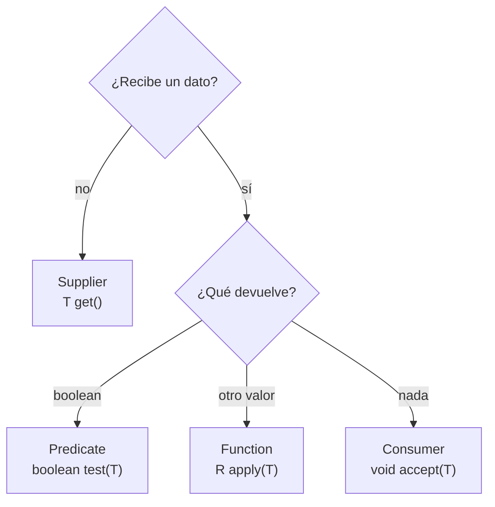

Cuando escribes `Predicate<Envio> valido = e -> e.pesoKg() <= 10 && ...;`, ocurre esto:

1. El compilador mira el lado izquierdo y encuentra el **tipo objetivo**: `Predicate<Envio>`. Una lambda sola no
   tiene tipo; lo recibe del lugar donde aparece.
2. Busca el único método abstracto de ese tipo, `test(Envio)`, y comprueba que la lambda encaja. El parámetro `e`
   pasa a ser un `Envio` y el cuerpo debe producir un `boolean`.
3. Si el cuerpo devuelve otra cosa, falla con `bad return type in lambda expression`, como muestra el recuadro de
   error del tema.
4. Al compilar, `javac` guarda el cuerpo en un método privado de la clase y deja en ese punto una instrucción
   `invokedynamic`. La primera vez que se ejecuta, la JVM fabrica un objeto que implementa `Predicate`.
5. Desde ese momento `valido` es un objeto como cualquier otro. Llamar a `valido.test(envio)` ejecuta el cuerpo de
   la lambda.

El mismo texto de lambda o de referencia a método sirve para formas distintas, porque manda el tipo objetivo:

```java
Predicate<String> vacio = String::isEmpty;
Function<String, Boolean> vacioEnCaja = String::isEmpty;
System.out.println(vacio.test("") + " " + vacioEnCaja.apply("A1"));
```

Imprime `true false`. La primera variable devuelve `boolean` primitivo; la segunda devuelve un `Boolean` envuelto en
objeto. Por eso, para preguntas de sí o no, la forma correcta es `Predicate` y no `Function<T, Boolean>`.

Dentro de `etiquetasValidas`, el método no sabe qué regla recibe. Solo sabe cuándo llamarla: llama a `regla.test(e)`
para cada envío y a `etiqueta.apply(e)` solo si la regla respondió `true`. Esa es la mecánica de una función de
orden superior.

##### 4. Reglas, variantes y casos límite

La Especificación del Lenguaje Java (JLS §9.8) cuenta los métodos abstractos con una excepción: no cuentan los que
repiten un método público de `Object`, como `equals`. Por eso `Comparator` declara `equals` y sigue siendo funcional.

Los métodos `default` y `static` tampoco cuentan. `Predicate` trae `and`, `or` y `negate`, y desde Java 11 el método
estático `Predicate.not`, útil con referencias: `Predicate.not(String::isBlank)`. `Function` trae `andThen`,
`compose` e `identity`. `Consumer` trae `andThen`, que ejecuta un consumidor y luego otro con el mismo valor.
`Supplier` no trae ninguno.

`@FunctionalInterface` es opcional. Una interfaz con un solo método abstracto ya acepta lambdas sin la anotación. Si
la pones en una interfaz con dos métodos abstractos, como `ReglaEnvio`, obtienes `Unexpected @FunctionalInterface
annotation`. Por eso el proyecto crea las reglas con la fábrica `ReglaEnvio.de`.

Existen variantes para tipos primitivos, que evitan envolver números en objetos: `IntPredicate`, `ToIntFunction`,
`IntConsumer`, `IntSupplier` y `BooleanSupplier`, entre otras. Son la elección habitual cuando procesas muchos
números en un bucle intenso.

Un caso límite frecuente: una lambda no puede modificar variables locales de fuera. Solo puede leer variables
**final** o efectivamente finales, es decir, que nunca se reasignan. El Ejercicio verificable 3 rodea esa regla
con un arreglo `int[]`, y ahí el `Supplier` deja de ser una función sin efectos.

##### 5. Relación con lo que ya sabes y lo que viene

Ya escribiste lambdas y referencias a métodos en Java, Módulo 4, Tema 1, y usaste `Supplier` con `orElseGet` en
Java, Módulo 4, Tema 2. Aquí cambia el enfoque: ya no usas la lambda como un atajo, sino que eliges la forma por el
contrato de entrada y salida.

Conviene distinguir estas interfaces de las que diseñas tú. `ReglaEnvio` parece un `Predicate`, pero agrega
`motivo()`, así que tiene dos métodos abstractos. Eso le da un texto legible para auditar, a cambio de no aceptar
una lambda directa.

El Tema 2 amplía `Function` a dos entradas con `BiFunction`. El Tema 3 usa los métodos `default` que viste aquí
para componer reglas sin anidar llamadas. El Tema 5 presenta `UnaryOperator` y `BinaryOperator`, casos particulares
de `Function` y `BiFunction`. Los streams de los Temas 4, 8, 9 y 10 reciben estas cuatro formas en cada operación.

#### Problema resuelto 1.1
Selecciona los envíos válidos de Tienda Aurora, conviértelos en etiquetas y publícalas dos veces: en consola y en una
lista que podrías revisar en una prueba.

**Razonamiento:**
1. «¿Es válido?» recibe un envío y devuelve sí o no: `Predicate<Envio>`.
2. «Dame la etiqueta» recibe un envío y devuelve texto: `Function<Envio, String>`.
3. «Dame un id nuevo» no recibe nada: `Supplier<String>`. «Publica» recibe texto y no devuelve: `Consumer<String>`.
4. El recorrido se escribe una vez, en un método que recibe la regla y la etiqueta.

```java
import java.util.ArrayList;
import java.util.List;
import java.util.function.Consumer;
import java.util.function.Function;
import java.util.function.Predicate;
import java.util.function.Supplier;

public class CuatroFormas {

    enum Estado { PENDIENTE, EN_RUTA, ENTREGADO, FALLIDO }

    record Envio(String id, String destino, double pesoKg, Estado estado) {}

    // Función de orden superior: recibe dos comportamientos y devuelve datos.
    static List<String> etiquetasValidas(List<Envio> envios, Predicate<Envio> regla,
                                         Function<Envio, String> etiqueta) {
        List<String> salida = new ArrayList<>();
        for (Envio e : envios) {
            if (regla.test(e)) {
                salida.add(etiqueta.apply(e));
            }
        }
        return salida;
    }

    public static void main(String[] args) {
        List<Envio> envios = List.of(
                new Envio("A1", "BOG", 2.5, Estado.ENTREGADO),
                new Envio("A2", "MED", 12.0, Estado.PENDIENTE),
                new Envio("A3", "BOG", 1.0, Estado.FALLIDO),
                new Envio("A4", "CALI", 3.0, Estado.EN_RUTA));

        Predicate<Envio> valido = e -> e.pesoKg() <= 10 && e.estado() != Estado.FALLIDO;
        Function<Envio, String> etiqueta = e -> e.id() + "@" + e.destino();
        Supplier<String> idNuevo = () -> "TMP-" + 99;
        Consumer<String> consola = System.out::println;

        System.out.println("ID=" + idNuevo.get());
        List<String> etiquetas = etiquetasValidas(envios, valido, etiqueta);
        etiquetas.forEach(consola);

        List<String> capturadas = new ArrayList<>();
        Consumer<String> enMemoria = capturadas::add;
        etiquetas.forEach(enMemoria);
        System.out.println("capturadas=" + capturadas);
        System.out.println("A2 válido? " + valido.test(envios.get(1)));
    }
}
```

```text
$ java CuatroFormas.java
ID=TMP-99
A1@BOG
A4@CALI
capturadas=[A1@BOG, A4@CALI]
A2 válido? false
```

**Explicación por partes.**
- Líneas 15–24: `etiquetasValidas` es la función de orden superior. Llama a `regla.test(e)` y a `etiqueta.apply(e)` sin saber qué hacen.
- Línea 33: el `Predicate` combina dos condiciones; `A2` pesa 12 kg y `A3` está fallido, así que solo pasan `A1` y `A4`.
- Líneas 34–35: la `Function` arma la etiqueta y el `Supplier` produce `TMP-99` cada vez que llamas a `get()`.
- Línea 36: `System.out::println` encaja en `Consumer<String>` porque recibe un texto y no devuelve nada.
- Líneas 42–45: otro `Consumer` guarda las mismas etiquetas en una lista; el cálculo de la línea 39 no cambió.

> **Error común.** Anotar con `@FunctionalInterface` una interfaz con dos métodos abstractos, como `ReglaEnvio`
> (`test` y `motivo`). `javac` responde `error: Unexpected @FunctionalInterface annotation` y explica
> `multiple non-overriding abstract methods found in interface ReglaEnvio`. Quita la anotación o deja un solo
> método abstracto.

> **Error común.** Elegir la forma equivocada. `Predicate<String> valido = id -> id.trim();` produce
> `error: incompatible types: bad return type in lambda expression` seguido de `String cannot be converted to boolean`.
> El mensaje dice que la lambda devuelve texto donde el contrato exige `boolean`.

> **Buena práctica.** Nombra los comportamientos por lo que significan para el negocio: `valido`, `etiqueta`,
> `consola`. Un nombre como `p1` obliga a leer la lambda para saber qué decide.

#### Checkpoint 1.1
¿Qué forma usarías para «calcular el costo de un envío» y para «guardar un envío en la base de datos»?

Respuesta: calcular el costo recibe un envío y devuelve un valor: `Function<Envio, BigDecimal>`. Guardar recibe un
envío y no devuelve nada útil: `Consumer<Envio>`.

</details>

<details>
<summary><strong>Capa 2 — Construcción</strong></summary>

#### Paso 1 · Ejecuta el programa de un solo archivo
Guarda el Problema resuelto 1.1 como `CuatroFormas.java` y ejecuta `java CuatroFormas.java`. Comprueba que la salida
coincide línea por línea, incluida `capturadas=[A1@BOG, A4@CALI]`.

#### Paso 2 · Localiza las cuatro formas en el proyecto
En `tienda-aurora-java-m20`, abre `ReglasEnvio.java` y `App.java`. Marca dónde aparecen `pesoMaximo` y `noFallido`
(reglas), `etiqueta()` (`Function`), `generadorId` (`Supplier`) y `auditor` (`Consumer`).

#### Paso 3 · Compón una regla y compruébala
`App` arma `ReglasEnvio.pesoMaximo(new BigDecimal("10")).and(ReglasEnvio.noFallido())`. Ejecuta `./gradlew -q run`
y busca `A1@BOG`, `A4@CALI` y `REGLA=peso <= 10 Y no fallido` en la salida de «Verificación real». El test
`componeReglasYTransforma` fija ese mismo resultado.

#### Paso 4 · Provoca el error de la anotación
Agrega `@FunctionalInterface` encima de `public interface ReglaEnvio` y compila. Lee el mensaje
`Unexpected @FunctionalInterface annotation` y quita la anotación.

#### Resumen
- **Predicate** responde sí o no (`test`); **Function** transforma (`apply`).
- **Consumer** recibe y no devuelve (`accept`); `Supplier` produce sin recibir (`get`).
- Una **función de orden superior** recibe comportamiento como parámetro y decide cuándo llamarlo.
- Cambiar el `Consumer` cambia el destino del efecto sin tocar el cálculo.
- **`@FunctionalInterface`** pide al compilador comprobar que hay un solo método abstracto.

#### Ejercicio verificable 1
Básico. En `CuatroFormas.java`, llama a `etiquetasValidas` con la regla `e -> e.destino().equals("BOG")` y la misma
etiqueta. ¿Qué lista obtienes?

Respuesta esperada: `[A1@BOG, A3@BOG]`. La regla nueva no mira el estado, así que `A3` (fallido) sí pasa.

#### Ejercicio verificable 2
Intermedio. Escribe una `Function<Envio, String>` que produzca `id (peso kg)` y úsala con la regla `valido`.

Respuesta esperada: `[A1 (2.5 kg), A4 (3.0 kg)]`. La lambda es `e -> e.id() + " (" + e.pesoKg() + " kg)"`.

#### Ejercicio verificable 3
Reto. Escribe un `Supplier<String>` que devuelva `TMP-1`, `TMP-2`, `TMP-3` en llamadas sucesivas. ¿Sigue siendo una
función sin efectos?

Respuesta esperada: imprime `TMP-1 TMP-2 TMP-3`. Necesita un contador fuera de la lambda (por ejemplo, `int[] n = {0}`
y `() -> "TMP-" + (++n[0])`). Ya no es una función sin efectos: cada llamada cambia el contador y devuelve algo distinto.

#### En el trabajo
En Spring, un `@Bean` de tipo `Predicate<Pedido>` o `Function<Evento, Comando>` se inyecta igual que un servicio.
Spring Cloud Function despliega `Function`, `Consumer` y `Supplier` como manejadores de mensajes o de HTTP. Elegir
bien la forma decide si la pieza se puede probar sin levantar infraestructura.

</details>

### Tema 2: Function y BiFunction: transformar uno o dos datos · Básico · 35 min

<details open>
<summary><strong>Capa 1 — Lectura</strong></summary>

#### Objetivos
Al terminar este tema podrás:
- calcular una tarifa con `BiFunction` y encadenar su resultado con `andThen`;
- convertir una función de dos entradas en una cadena de funciones de una entrada (currificación);
- fijar un argumento por adelantado (aplicación parcial) y reutilizar la función resultante en un stream;
- reconocer cuándo dos parámetros piden un tipo de dominio en vez de más argumentos.

**Conceptos clave:** BiFunction, aridad, currificación, aplicación parcial

Ya los conoces y no se repiten: `Function` (Tema 1 de este módulo); lambda e interfaz funcional (Java, Módulo 4,
Tema 1); escala de `BigDecimal` (Java, Módulo 12, Tema 2).

#### El problema
Tienda Aurora cobra una tarifa base más un impuesto. El cálculo necesita dos datos: la base y la tasa. Además, el
reporte aplica el mismo IVA a una lista de bases. Si escribes `tarifa(base, iva)` en cada lugar, repites el IVA en
todo el código. ¿Cómo modelas un cálculo de dos entradas y cómo fijas una de ellas una sola vez?

#### Glosario del tema

**BiFunction**
- **Definición técnica:** `java.util.function.BiFunction<T,U,R>`, interfaz funcional con `R apply(T t, U u)`; su método `default` `andThen(Function<? super R, ? extends V>)` encadena el resultado.
- **En palabras sencillas:** una máquina con dos ranuras de entrada y una de salida.
- **Dónde se rompe la comparación:** no hay `compose` en `BiFunction`; solo puedes encadenar después, no antes.
- **Ejemplo:** `tarifaConImpuesto.apply(base, iva)` (línea 19 del Problema resuelto 2.1) imprime `con impuesto: 119.00`.
- **Error típico:** llamarla con un solo argumento: `error: method apply in interface BiFunction<T,U,R> cannot be applied to given types;`.

**aridad**
- **Definición técnica:** número de parámetros que recibe una función: `Supplier` tiene aridad 0, `Function` 1 y `BiFunction` 2.
- **En palabras sencillas:** cuántas cosas tienes que darle a la función para que trabaje.
- **Dónde se rompe la comparación:** el JDK no trae `TriFunction`; con tres entradas creas tu interfaz o un tipo de dominio.
- **Ejemplo:** `redondear` (línea 14) tiene aridad 1; `tarifaConImpuesto` (líneas 17–18) tiene aridad 2.
- **Error típico:** seguir agregando parámetros cuando aparecen reglas nuevas; con tres o más, un `record` comunica mejor.

**currificación**
- **Definición técnica:** transformar una función de *n* argumentos en una cadena de *n* funciones de un argumento cada una.
- **En palabras sencillas:** en vez de pedir los dos datos a la vez, pides el primero y te devuelven una máquina que espera el segundo.
- **Dónde se rompe la comparación:** en Java el tipo se vuelve largo: `Function<BigDecimal, Function<BigDecimal, BigDecimal>>`.
- **Ejemplo:** `impuesto -> b -> b.add(b.multiply(impuesto))` (líneas 27–28) es la versión currificada de la tarifa.
- **Error típico:** leer la flecha doble como una sola lambda; son dos: la primera devuelve la segunda.

**aplicación parcial**
- **Definición técnica:** fijar algunos argumentos de una función y obtener una nueva función que espera los restantes.
- **En palabras sencillas:** dejar puesto el IVA y quedarte con una calculadora que solo pide la base.
- **Dónde se rompe la comparación:** el valor fijado se captura al crear la función; si cambias la tasa después, la función vieja no se entera.
- **Ejemplo:** `conImpuesto.apply(iva)` (línea 29) devuelve `conIva`, que el stream usa en la línea 32: `[119.00, 297.50, 47.60]`.
- **Error típico:** fijar un valor mutable y modificarlo después; usa valores inmutables como `BigDecimal`.

#### ► CÓMO FUNCIONA

##### 1. La idea en lenguaje sencillo

Una calculadora de propinas necesita dos datos: el valor de la cuenta y el porcentaje. Si siempre dejas el 10 %,
es cómodo tener una calculadora con ese porcentaje ya puesto: solo le das la cuenta. La operación es la misma; lo
que cambia es cuántos datos entregas en cada momento.

Tienda Aurora vive esa situación con la tarifa. El total depende de la base del envío y de la tasa de impuesto.
Durante un reporte, la tasa es la misma para todas las bases; solo cambia la base. Aquí modelas el cálculo de
dos entradas y fijas una de ellas una sola vez, sin repetir el IVA por todo el código.

##### 2. Definición formal y vocabulario

**BiFunction** es la interfaz `java.util.function.BiFunction<T,U,R>`. Declara un único método abstracto,
`R apply(T t, U u)`: recibe un valor de tipo `T`, otro de tipo `U` y devuelve uno de tipo `R`. Los tres tipos
pueden ser distintos o iguales.

La **aridad** es el número de parámetros de una función. Dicho de forma sencilla: cuántas cosas debes darle para
que trabaje. `Supplier` tiene aridad 0, `Function` aridad 1 y `BiFunction` aridad 2.

La **currificación** convierte una función de dos argumentos en una función de un argumento que devuelve otra
función de un argumento. En lenguaje sencillo: pides el primer dato y te entregan una máquina que espera el segundo.

La **aplicación parcial** fija uno o más argumentos y deja una función que espera los restantes. Currificar y
luego llamar con el primer argumento es una forma de aplicación parcial, pero no la única: también puedes envolver
la llamada en una lambda nueva.

##### 3. Cómo funciona por dentro, paso a paso

Sigue la llamada `tarifaConImpuesto.apply(base, iva)` del Problema resuelto 2.1:

1. El compilador toma el tipo objetivo `BiFunction<BigDecimal, BigDecimal, BigDecimal>` y deduce que `b` e
   `impuesto` son `BigDecimal`.
2. En ejecución, `apply` recibe `100` y `0.19`. `b.multiply(impuesto)` da `19.00`: la escala del producto es la
   suma de las escalas, 0 + 2.
3. `b.add(...)` suma `100` y `19.00`. La escala de la suma es la mayor de las dos, así que obtienes `119.00`.
4. Si encadenas `andThen(redondear)`, se crea una `BiFunction` nueva. Al llamarla, ejecuta la tarifa y pasa su
   resultado a `redondear.apply(...)`. Por eso `99.99` termina en `118.99`.

La versión currificada hace el trabajo en dos tiempos, como muestra el diagrama:

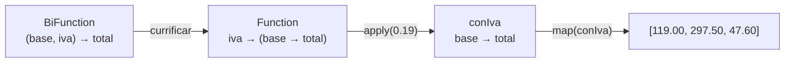

1. `conImpuesto.apply(iva)` ejecuta la lambda exterior `impuesto -> b -> ...`. Su cuerpo no calcula nada todavía:
   devuelve la lambda interior.
2. La lambda interior usa `impuesto`, una variable de la exterior. La JVM la **captura**: guarda una copia de la
   referencia dentro del objeto que crea para `conIva`.
3. Cada `conIva.apply(base)` posterior lee ese valor guardado. Por eso el stream da `[119.00, 297.50, 47.60]` sin
   volver a mencionar el IVA.

No necesitas currificar para aplicar parcialmente. Una lambda que llama a la `BiFunction` con un argumento fijo
logra lo mismo:

```java
BiFunction<String, String, String> etiqueta = (id, destino) -> id + "@" + destino;
Function<String, String> haciaBog = id -> etiqueta.apply(id, "BOG");
System.out.println(haciaBog.apply("A1"));   // A1@BOG
```

`haciaBog` captura `etiqueta` y deja el destino fijo. El resultado es una `Function` normal, apta para `map`.

##### 4. Reglas, variantes y casos límite

`BiFunction` solo trae un método `default`: `andThen(Function<? super R, ? extends V>)`. No trae `compose`, porque
no hay una forma única de preparar dos entradas a la vez. Si necesitas transformar las entradas, hazlo dentro de la
lambda o antes de llamarla.

El JDK no define `TriFunction`. Con tres entradas tienes dos caminos: declarar tu propia interfaz funcional o, mejor
en la mayoría de los casos, agrupar los datos en un `record`. El recuadro de ingeniería del tema propone
`ContextoTarifa` por esa razón.

Las demás formas de dos entradas siguen el mismo patrón: `BiPredicate<T,U>` devuelve `boolean` y `BiConsumer<T,U>`
no devuelve nada. Para resultados primitivos existen `ToIntBiFunction`, `ToLongBiFunction` y `ToDoubleBiFunction`.
Cuando las dos entradas y la salida son del mismo tipo, el JDK ofrece `BinaryOperator<T>`, que verás en el Tema 5.

Las variables que captura una lambda deben ser **final** o efectivamente finales: no puedes reasignarlas después.
Si capturas un objeto mutable, como una lista, la función verá sus cambios posteriores. Con `BigDecimal`, que es
inmutable, el IVA fijado no puede cambiar a escondidas.

Un caso límite con `BigDecimal`: `equals` compara valor y escala, así que `119.00` no es igual a `119.0`. La línea
`misma regla: true` funciona porque ambas versiones producen la misma escala.

##### 5. Relación con lo que ya sabes y lo que viene

En el Tema 1 viste `Function` como la forma «uno entra, uno sale». `BiFunction` es la misma idea con dos entradas,
y `andThen` funciona igual en ambas: el resultado pasa a la siguiente función.

La escala y el redondeo de `BigDecimal` vienen de Java, Módulo 12, Tema 2. Aquí los ves dentro de funciones: el
redondeo pasa a ser una pieza reutilizable que conectas con `andThen`.

Recuerda distinguir los dos resultados del módulo. `119.00` es la tarifa con impuesto que fija el test
`biFunctionYOperadores`. `TOTAL=107.10` es la salida de `App` después de aplicar además el descuento del 10 % y el
redondeo final. Son dos puntos distintos del mismo pipeline.

El Tema 3 generaliza `andThen` y presenta `compose`, el orden inverso. El Tema 5 muestra `BinaryOperator`, la
`BiFunction` cuyos tres tipos coinciden y que exige `reduce`. Los streams del Tema 8 usan funciones parcialmente
aplicadas, como `conIva`, dentro de `map`.

#### Problema resuelto 2.1
Calcula la tarifa con impuesto de tres formas: con `BiFunction`, con `BiFunction` seguida de un redondeo, y con una
versión currificada que fija el IVA para una lista de bases.

**Razonamiento:**
1. La tarifa depende de la base y del impuesto: dos entradas, una salida, `BiFunction`.
2. Redondear recibe un `BigDecimal` y devuelve otro: `Function`. `andThen` lo pone después de la tarifa.
3. Para aplicar el mismo IVA a muchas bases, fija el IVA primero: la función currificada devuelve otra función.
4. Comprueba que la versión currificada da lo mismo que la original.

```java
import java.math.BigDecimal;
import java.math.RoundingMode;
import java.util.List;
import java.util.function.BiFunction;
import java.util.function.Function;

public class Tarifas {

    public static void main(String[] args) {
        BigDecimal base = new BigDecimal("100");
        BigDecimal iva = new BigDecimal("0.19");

        // Function: una entrada, una salida.
        Function<BigDecimal, BigDecimal> redondear = v -> v.setScale(2, RoundingMode.HALF_UP);

        // BiFunction: dos entradas independientes, una salida.
        BiFunction<BigDecimal, BigDecimal, BigDecimal> tarifaConImpuesto =
                (b, impuesto) -> b.add(b.multiply(impuesto));
        System.out.println("con impuesto: " + tarifaConImpuesto.apply(base, iva));

        // BiFunction.andThen recibe una Function para el resultado.
        BiFunction<BigDecimal, BigDecimal, BigDecimal> tarifaRedondeada =
                tarifaConImpuesto.andThen(redondear);
        System.out.println("redondeada:   " + tarifaRedondeada.apply(new BigDecimal("99.99"), iva));

        // Currificación: primero el impuesto, después la base.
        Function<BigDecimal, Function<BigDecimal, BigDecimal>> conImpuesto =
                impuesto -> b -> b.add(b.multiply(impuesto));
        Function<BigDecimal, BigDecimal> conIva = conImpuesto.apply(iva);   // aplicación parcial

        List<BigDecimal> bases = List.of(new BigDecimal("100"), new BigDecimal("250"), new BigDecimal("40"));
        System.out.println("bases con IVA: " + bases.stream().map(conIva).toList());
        System.out.println("misma regla:  " + conIva.apply(base).equals(tarifaConImpuesto.apply(base, iva)));
    }
}
```

```text
$ java Tarifas.java
con impuesto: 119.00
redondeada:   118.99
bases con IVA: [119.00, 297.50, 47.60]
misma regla:  true
```

**Explicación por partes.**
- Línea 14: `redondear` fija dos decimales con `HALF_UP`.
- Líneas 17–19: la `BiFunction` suma la base y su impuesto. `100 × 0.19 = 19.00`, por eso el total ya trae dos decimales.
- Líneas 22–24: `andThen(redondear)` crea una `BiFunction` nueva. `99.99 × 1.19 = 118.9881`, que se redondea a `118.99`.
- Líneas 27–29: la versión currificada recibe el impuesto y devuelve otra función; `conIva` ya tiene el 0.19 fijado.
- Líneas 31–33: `map(conIva)` aplica la tarifa a cada base. La última línea confirma que ambas versiones coinciden.

> **Error común.** Llamar a una `BiFunction` con un argumento. `tarifa.apply(new BigDecimal("100"))` produce
> `error: method apply in interface BiFunction<T,U,R> cannot be applied to given types;` con `required:
> BigDecimal,BigDecimal` y `found: BigDecimal`. Si quieres pasar un solo dato, fija el otro con aplicación parcial.

> **Buena práctica.** Construye los `BigDecimal` desde `String` (`new BigDecimal("0.19")`). Desde `double`, el
> valor `0.19` ya llega con error binario y el total deja de ser exacto.

> **Ingeniería de software.** Si la tarifa empieza a depender de país, zona y tipo de producto, no crees una
> `BiFunction` con un `Map` como segundo argumento. Crea un `record ContextoTarifa` y una `Function<ContextoTarifa,
> BigDecimal>`: el tipo documenta qué datos hacen falta.

#### Checkpoint 2.1
¿De qué tipo es `conImpuesto.apply(iva)` y qué le falta para dar un número?

Respuesta: es `Function<BigDecimal, BigDecimal>`. Le falta la base; al llamar `apply(base)` devuelve el total.

</details>

<details>
<summary><strong>Capa 2 — Construcción</strong></summary>

#### Paso 1 · Ejecuta las tres versiones
Guarda el Problema resuelto 2.1 como `Tarifas.java` y ejecuta `java Tarifas.java`. Comprueba `con impuesto: 119.00`
y `misma regla:  true`.

#### Paso 2 · Encuentra la BiFunction en el proyecto
Abre `ReglasEnvio.java` y localiza `tarifaConImpuesto()`. Abre `App.java` y sigue el valor: tarifa, luego
`aplicarDescuento(0.10)`, luego `normalizarYRedondear()`.

#### Paso 3 · Confirma los dos puntos del pipeline
El test `biFunctionYOperadores` exige `119.00` para la tarifa normalizada. La salida de `./gradlew -q run` muestra
`TOTAL=107.10`: es la misma tarifa con el descuento del 10 %.

#### Resumen
- **BiFunction** recibe dos datos y devuelve uno; su `andThen` encadena una `Function` sobre el resultado.
- La **aridad** es el número de parámetros; el JDK trae formas hasta aridad 2.
- La **currificación** convierte una función de dos entradas en una cadena de funciones de una.
- La **aplicación parcial** fija un argumento y deja una función lista para `map`.
- `119.00` y `107.10` son dos puntos del mismo pipeline, no dos resultados en conflicto.

#### Ejercicio verificable 1
Básico. ¿Qué imprime `tarifaConImpuesto.apply(new BigDecimal("250"), iva)`?

Respuesta esperada: `297.50`. `250 × 0.19 = 47.50` y `250 + 47.50 = 297.50`.

#### Ejercicio verificable 2
Intermedio. Escribe una `BiFunction<BigDecimal, Integer, BigDecimal>` que multiplique una tarifa por kilo por un
número de paquetes. ¿Qué da con `4200` y `3`?

Respuesta esperada: `12600`. La lambda es `(tarifa, n) -> tarifa.multiply(BigDecimal.valueOf(n))`.

#### Ejercicio verificable 3
Reto. Currifica un cálculo de tres datos: impuesto, descuento y base. Aplica `0.19`, `0.10` y `100`. ¿Qué obtienes
antes y después de `setScale(2, RoundingMode.HALF_UP)`?

Respuesta esperada: `107.1000` y `107.10`. El tipo es `Function<BigDecimal, Function<BigDecimal, Function<BigDecimal,
BigDecimal>>>` y la lambda `imp -> desc -> b -> b.add(b.multiply(imp)).multiply(BigDecimal.ONE.subtract(desc))`.

#### En el trabajo
Los motores de precios separan reglas fijas (impuesto del país, moneda) de los datos de cada pedido. Fijar la
configuración al arrancar y dejar una función que solo pide el pedido es aplicación parcial, aunque el código la
llame «fábrica de calculadoras». Evita además leer la configuración en cada llamada.

</details>

### Tema 3: Componer sin anidar: andThen, compose, negate y reglas encadenadas · Intermedio · 40 min

<details open>
<summary><strong>Capa 1 — Lectura</strong></summary>

#### Objetivos
Al terminar este tema podrás:
- predecir el resultado de `andThen` y de `compose` sobre las mismas dos funciones;
- combinar predicados con `and`, `or`, `negate` y `Predicate.not`;
- componer una regla de negocio que conserve su motivo legible;
- corregir el error `lambda expression not expected here`.

**Conceptos clave:** composición de funciones, andThen, compose, and, or, negate, Predicate.not

Ya los conoces y no se repiten: `Function` y `Predicate` (Tema 1 de este módulo); método `default` (Java, Módulo 1,
Tema 3); `filter` y `map` (Java, Módulo 4, Tema 1).

#### El problema
La regla de envíos válidos de Tienda Aurora es «pesa 10 kg o menos y no está fallido». Mañana habrá otra: «revisar
los que pesan más de 10 kg o están fallidos». Si escribes cada regla como una lambda nueva, repites condiciones y
una corrección en la regla de peso no llega a todas. ¿Cómo armas reglas nuevas a partir de las que ya existen?

#### Glosario del tema

**composición de funciones**
- **Definición técnica:** operación que une dos funciones `f` y `g` en una nueva `h(x) = g(f(x))`: la salida de una es la entrada de la otra.
- **En palabras sencillas:** conectar dos máquinas con una cinta: lo que sale de la primera entra a la segunda.
- **Dónde se rompe la comparación:** el orden importa; en el Problema resuelto 3.1, `sumarUno` y `duplicar` dan `12` u `11` según cuál va primero.
- **Ejemplo:** `recortar.andThen(String::toUpperCase)` (línea 18) convierte `" bog "` en `BOG`.
- **Error típico:** componer funciones cuyo tipo no encaja: la salida de la primera debe ser aceptable para la segunda.

**`andThen`**
- **Definición técnica:** método `default` de `Function` (y de `BiFunction` y `Consumer`) que devuelve una función que aplica primero `this` y después el argumento.
- **En palabras sencillas:** «haz esto y luego aquello», en el orden en que se lee.
- **Dónde se rompe la comparación:** en `Consumer`, `andThen` no pasa un resultado: ejecuta los dos efectos con el mismo valor.
- **Ejemplo:** `sumarUno.andThen(duplicar).apply(5)` (línea 14) calcula `(5 + 1) × 2 = 12`.
- **Error típico:** esperar que conserve el tipo: en `UnaryOperator`, `andThen` devuelve `Function` (Tema 5).

**`compose`**
- **Definición técnica:** método `default` de `Function` que devuelve una función que aplica primero el argumento y después `this`.
- **En palabras sencillas:** «antes de hacer esto, haz aquello»: el orden de lectura queda al revés.
- **Dónde se rompe la comparación:** solo existe en `Function`; `BiFunction` y `Predicate` no lo tienen.
- **Ejemplo:** `sumarUno.compose(duplicar).apply(5)` (línea 15) calcula `5 × 2 + 1 = 11`.
- **Error típico:** usar `compose` cuando quieres el orden natural; `andThen` se lee de izquierda a derecha.

**`and`, `or` y `negate`**
- **Definición técnica:** métodos `default` de `Predicate` que devuelven un predicado nuevo: conjunción con cortocircuito, disyunción con cortocircuito y negación.
- **En palabras sencillas:** las palabras «y», «o» y «no» aplicadas a preguntas de sí o no.
- **Dónde se rompe la comparación:** con cortocircuito, `and` no evalúa la segunda condición si la primera ya es falsa.
- **Ejemplo:** `pesoMaximo.and(fallido.negate())` (línea 29) deja `válidos  = [A1, A4]`.
- **Error típico:** llamar a `negate()` directamente sobre una lambda: `error: lambda expression not expected here`.

**`Predicate.not`**
- **Definición técnica:** método estático `Predicate.not(Predicate<? super T>)` (Java 11+) que devuelve la negación del predicado recibido.
- **En palabras sencillas:** el «no» que puedes escribir delante de una lambda o de una referencia a método.
- **Dónde se rompe la comparación:** hace lo mismo que `negate()`, pero acepta una lambda sin variable intermedia.
- **Ejemplo:** `filter(Predicate.not(e -> e.destino().equals("BOG")))` (línea 35) imprime `no BOG   = [A2, A4]`.
- **Error típico:** escribir `filter(!esBog)`: `!` solo funciona con `boolean`, no con un `Predicate`.

#### ► CÓMO FUNCIONA

##### 1. La idea en lenguaje sencillo

En una lavandería, la ropa pasa por la lavadora y luego por la secadora. Nadie construye una máquina nueva que lave
y seque: conecta las dos que ya existen, en el orden correcto. Si cambias el orden, el resultado es otro.

Las reglas de Tienda Aurora funcionan igual. Ya tienes dos piezas probadas: «pesa 10 kg o menos» y «está
fallido». Con ellas puedes armar «válido» y «revisar» sin escribir condiciones nuevas. **Componer** es eso:
fabricar comportamiento nuevo uniendo piezas que ya existen, en vez de anidar llamadas como `f(g(h(x)))` o copiar
condiciones de una lambda a otra.

##### 2. Definición formal y vocabulario

La **composición de funciones** une dos funciones `f` y `g` en una nueva, `h(x) = g(f(x))`. En términos sencillos:
la salida de la primera entra como entrada a la segunda.

`Function<T,R>` ofrece dos métodos `default` para componer:

- **`andThen`**: `f.andThen(g)` devuelve una función que aplica `f` y después `g`. Se lee en el orden en que ocurre.
- **`compose`**: `f.compose(g)` devuelve una función que aplica `g` y después `f`. Se lee al revés.

`Predicate<T>` ofrece la lógica booleana como métodos **`and`, `or` y `negate`**, que devuelven un predicado nuevo.
Además, **`Predicate.not`** es un método estático que niega un predicado recibido como argumento. Los cuatro equivalen
a escribir `&&`, `||` y `!`, pero sobre preguntas guardadas como objetos, no sobre valores `boolean` ya calculados.

##### 3. Cómo funciona por dentro, paso a paso

Ningún método de composición ejecuta nada al llamarlo. Cada uno devuelve un objeto nuevo que recuerda las dos
piezas. El código del JDK para `compose` es casi literal: comprueba que el argumento no sea `null` y devuelve la
lambda `v -> apply(before.apply(v))`.

Sigue `sumarUno.andThen(duplicar).apply(5)` del Problema resuelto 3.1:

1. `andThen(duplicar)` crea una función nueva que guarda `sumarUno` y `duplicar`. Todavía no se suma nada.
2. `apply(5)` ejecuta primero `sumarUno.apply(5)` y obtiene `6`.
3. Pasa ese `6` a `duplicar.apply(6)` y devuelve `12`.

Con `sumarUno.compose(duplicar).apply(5)`, el orden se invierte: `duplicar` da `10` y `sumarUno` da `11`. El
diagrama pone los dos recorridos lado a lado.

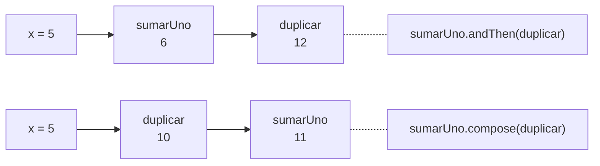

Con predicados ocurre lo mismo. `pesoMaximo.and(fallido.negate())` crea dos objetos: primero la negación de
`fallido` y luego la conjunción. Cuando el stream llama a `test(envio)`, la conjunción evalúa `pesoMaximo`. Si da
`false`, no evalúa la segunda parte: eso es **cortocircuito**, igual que `&&`.

```java
Predicate<String> traza = s -> { System.out.println("evalúa " + s); return true; };
Predicate<String> falso = s -> false;
System.out.println(falso.and(traza).test("A1"));   // false, sin "evalúa A1"
```

La salida es solo `false`. El mensaje de `traza` nunca aparece porque la primera condición ya decidió.

En el proyecto, `ReglaEnvio.and` imita esa mecánica a mano. Crea una clase anónima cuyo `test` llama a las dos reglas
con `&&` y cuyo `motivo()` une los dos textos con « Y ». Así obtienes `REGLA=peso <= 10 Y no fallido`.

##### 4. Reglas, variantes y casos límite

Los tipos deben encajar. `f.andThen(g)` exige que `g` acepte la salida de `f`; la firma es
`andThen(Function<? super R, ? extends V> after)`. Si no encajan, el error aparece al compilar, no en ejecución.

Pasar `null` a cualquier método de composición lanza `NullPointerException` en el momento de componer, no al
aplicar. El fallo aparece en la línea que armó la regla, que es donde está el defecto.

Los métodos no están en todas las interfaces. `Function` tiene `andThen`, `compose` e `identity`. `BiFunction` solo
tiene `andThen`. `Consumer.andThen` no pasa un resultado: ejecuta dos efectos con el mismo valor. `Predicate` no tiene
`andThen` ni `compose`. `Predicate.not` existe desde Java 11; en Java 8 debías usar `negate()` sobre una variable.

Una lambda no tiene métodos hasta que recibe un tipo. Según la especificación, solo puede aparecer en una asignación,
como argumento de un método o en un *cast*. Por eso `(e -> ...).negate()` produce `lambda expression not expected
here`. Funcionan tres arreglos: guardarla en una variable, envolverla en `Predicate.not(...)` o convertirla con un
*cast*, como `((Predicate<Envio>) e -> e.pesoKg() <= 10).negate()`.

Las leyes de De Morgan se cumplen con estos métodos. «No (peso y no fallido)» equivale a «no peso o fallido». Por
eso `revisar` da `[A2, A3]`, exactamente los envíos que `valido` descarta.

Un límite de diseño: una cadena muy larga oculta la intención. Si necesitas un comentario para entenderla, extrae
partes a métodos con nombre de negocio.

##### 5. Relación con lo que ya sabes y lo que viene

Los métodos `default` de Java, Módulo 1, Tema 3 son los que hacen posible este tema: `and`, `andThen` y `compose`
son métodos con cuerpo dentro de una interfaz. Sin ellos, cada lambda tendría que reimplementarlos.

En el Tema 1 elegiste la forma de cada pieza; aquí las conectas. En el Tema 2 ya usaste `andThen` sobre una
`BiFunction` para redondear la tarifa.

`ReglaEnvio.and` es la versión propia de `Predicate.and` con un dato extra, el motivo. El JDK no puede agregar ese
dato porque `Predicate` solo conoce `test`.

El Tema 5 muestra que `UnaryOperator.andThen` devuelve `Function`, no `UnaryOperator`, y cómo lo resuelve
`normalizarYRedondear()`. El Tema 4 trata un stream como una composición de etapas, y el Tema 12 usa reglas
compuestas como núcleo puro.

#### Problema resuelto 3.1
Compara `andThen` con `compose`, arma un normalizador de destinos y construye dos reglas de envíos a partir de dos
predicados base.

**Razonamiento:**
1. Con `x + 1` y `x * 2`, el orden cambia el resultado; así se ve la diferencia entre `andThen` y `compose`.
2. Normalizar es «recortar y luego pasar a mayúsculas»: `andThen`.
3. Las reglas se arman con dos piezas: «peso máximo» y «fallido». «Válido» es peso y no fallido; «revisar» es lo contrario.
4. `Predicate.not` permite negar una lambda sin guardarla antes en una variable.

```java
import java.util.List;
import java.util.function.Function;
import java.util.function.Predicate;

public class Componer {

    enum Estado { PENDIENTE, EN_RUTA, ENTREGADO, FALLIDO }

    record Envio(String id, String destino, double pesoKg, Estado estado) {}

    public static void main(String[] args) {
        Function<Integer, Integer> sumarUno = x -> x + 1;
        Function<Integer, Integer> duplicar = x -> x * 2;
        System.out.println("sumarUno.andThen(duplicar)(5) = " + sumarUno.andThen(duplicar).apply(5));
        System.out.println("sumarUno.compose(duplicar)(5) = " + sumarUno.compose(duplicar).apply(5));

        Function<String, String> recortar = String::trim;
        Function<String, String> normalizar = recortar.andThen(String::toUpperCase);
        System.out.println("normalizar(\" bog \") = [" + normalizar.apply(" bog ") + "]");

        List<Envio> envios = List.of(
                new Envio("A1", "BOG", 2.5, Estado.ENTREGADO),
                new Envio("A2", "MED", 12.0, Estado.PENDIENTE),
                new Envio("A3", "BOG", 1.0, Estado.FALLIDO),
                new Envio("A4", "CALI", 3.0, Estado.EN_RUTA));

        Predicate<Envio> pesoMaximo = e -> e.pesoKg() <= 10;
        Predicate<Envio> fallido = e -> e.estado() == Estado.FALLIDO;
        Predicate<Envio> valido = pesoMaximo.and(fallido.negate());
        Predicate<Envio> revisar = pesoMaximo.negate().or(fallido);

        System.out.println("válidos  = " + envios.stream().filter(valido).map(Envio::id).toList());
        System.out.println("revisar  = " + envios.stream().filter(revisar).map(Envio::id).toList());
        System.out.println("no BOG   = " + envios.stream()
                .filter(Predicate.not(e -> e.destino().equals("BOG")))
                .map(Envio::id).toList());
    }
}
```

```text
$ java Componer.java
sumarUno.andThen(duplicar)(5) = 12
sumarUno.compose(duplicar)(5) = 11
normalizar(" bog ") = [BOG]
válidos  = [A1, A4]
revisar  = [A2, A3]
no BOG   = [A2, A4]
```

**Explicación por partes.**
- Líneas 12–15: las mismas dos funciones dan `12` con `andThen` y `11` con `compose`.
- Líneas 17–18: la referencia `String::trim` se guarda primero en una variable con tipo; así `andThen` sabe qué recibe.
- Líneas 27–28: dos predicados base, cada uno con una sola condición.
- Líneas 29–30: `valido` y `revisar` salen de combinar los mismos dos predicados. `revisar` es exactamente la negación de `valido`.
- Línea 35: `Predicate.not` niega la lambda en el mismo lugar donde se usa.

> **Error común.** Llamar a un método sobre una lambda suelta: `(e -> e.pesoKg() <= 10).negate()` produce
> `error: lambda expression not expected here`. Una lambda necesita un tipo destino antes de tener métodos. Guárdala en
> un `Predicate<Envio>` o usa `Predicate.not(...)`.

> **Buena práctica.** Construye reglas grandes a partir de reglas pequeñas con nombre. Si la regla de peso cambia,
> la corriges en un solo lugar y `valido` y `revisar` la heredan.

> **Prevenir errores.** Escribe una prueba por regla compuesta con un caso que pase y otro que no. `revisar` debe
> dar exactamente los envíos que `valido` descarta: `[A2, A3]` frente a `[A1, A4]`.

#### Checkpoint 3.1
¿Qué devuelve `duplicar.andThen(sumarUno).apply(5)`?

Respuesta: `11`. Primero `duplicar` (10) y luego `sumarUno` (11). Es lo mismo que `sumarUno.compose(duplicar)`.

</details>

<details>
<summary><strong>Capa 2 — Construcción</strong></summary>

#### Paso 1 · Ejecuta la comparación
Guarda el Problema resuelto 3.1 como `Componer.java` y ejecuta `java Componer.java`. Comprueba que `válidos` y
`revisar` no comparten ningún envío.

#### Paso 2 · Lee la composición con motivo del proyecto
Abre `ReglaEnvio.java`. El método `and` devuelve una regla nueva cuyo `test` exige las dos condiciones y cuyo `motivo`
une los dos textos con `" Y "`. Por eso `App` imprime `REGLA=peso <= 10 Y no fallido`.

#### Paso 3 · Lee la composición de operadores
En `ReglasEnvio.normalizarYRedondear()`, `noNegativo.andThen(dosDecimales)` primero corrige negativos y después
redondea. El test `biFunctionYOperadores` comprueba `119.00`.

#### Resumen
- La **composición de funciones** conecta la salida de una con la entrada de otra.
- **`andThen`** aplica primero `this`; **`compose`** aplica primero el argumento.
- **`and`**, **`or`** y **`negate`** crean predicados nuevos sin ejecutar nada todavía.
- **`Predicate.not`** niega una lambda o referencia en el mismo lugar donde se usa.
- Una regla con motivo (`ReglaEnvio.and`) compone la condición y también el texto que la explica.

#### Ejercicio verificable 1
Básico. ¿Qué imprime `sumarUno.compose(duplicar).andThen(duplicar).apply(5)`?

Respuesta esperada: `22`. Orden: `duplicar` (10), `sumarUno` (11), `duplicar` (22).

#### Ejercicio verificable 2
Intermedio. Arma una regla «destino BOG o CALI, y no fallido» con `or`, `and` y `negate`. ¿Qué ids pasan?

Respuesta esperada: `[A1, A4]`. `A3` va a BOG pero está fallido; `A2` va a MED.

#### Ejercicio verificable 3
Reto. Crea `record Regla(String motivo, Predicate<Envio> prueba)` con un método `y(Regla otra)` que devuelva
`new Regla(motivo + " Y " + otra.motivo(), prueba.and(otra.prueba()))`. Compón «peso <= 10» con «no fallido».

Respuesta esperada: el motivo es `peso <= 10 Y no fallido` y pasan `[A1, A4]`, igual que `ReglaEnvio.and` del proyecto.

#### En el trabajo
Los motores de reglas de crédito, fraude o logística se construyen así: reglas pequeñas con nombre que se combinan
por configuración. El motivo compuesto es lo que ve el operador en el panel cuando un pedido queda retenido.

</details>

### Tema 4: Streams como composición: pereza, orden y efectos que se esconden · Intermedio · 40 min

<details open>
<summary><strong>Capa 1 — Lectura</strong></summary>

#### Objetivos
Al terminar este tema podrás:
- predecir el orden exacto en que un stream ejecuta `filter` y `map` para cada elemento;
- explicar por qué `sorted()` cambia ese orden y cuándo corta `limit`;
- usar `peek` para observar un pipeline sin confundirlo con lógica de negocio;
- detectar un efecto que nunca se ejecuta porque `count()` no lo necesita.

**Conceptos clave:** procesamiento vertical, peek, operación con estado

Ya los conoces y no se repiten: `Stream`, operación intermedia y operación terminal (Java, Módulo 4, Tema 1); efecto
secundario (Java, Módulo 4, Tema 4); composición de funciones (Tema 3 de este módulo).

#### El problema
Un analista de Tienda Aurora agregó trazas dentro de `filter` y `map` para auditar qué envíos se procesan. En un
reporte las trazas aparecen intercaladas; en otro, `map` no deja ninguna traza aunque el conteo es correcto. ¿En
qué orden ejecuta realmente un stream sus pasos, y cuándo se salta alguno?

#### Glosario del tema

**procesamiento vertical**
- **Definición técnica:** estrategia de ejecución de los streams: cada elemento recorre todas las operaciones sin estado antes de que empiece el siguiente, en una sola pasada.
- **En palabras sencillas:** una línea de ensamblaje donde cada pieza pasa por todas las estaciones antes de que entre la siguiente.
- **Dónde se rompe la comparación:** una estación que necesita ver todas las piezas (como `sorted`) detiene la línea hasta reunirlas.
- **Ejemplo:** la traza `[filter:1, filter:2, map:2, filter:3, ...]` del Problema resuelto 4.1 muestra que `map:2` ocurre antes de `filter:3`.
- **Error típico:** imaginar que primero se filtra toda la lista y después se mapea, como en dos bucles separados.

**`peek`**
- **Definición técnica:** operación intermedia `peek(Consumer<? super T>)` que ejecuta una acción sobre cada elemento que pasa y lo deja seguir sin cambios; existe sobre todo para depurar.
- **En palabras sencillas:** una ventana en la cinta para mirar qué pasa por ahí.
- **Dónde se rompe la comparación:** la ventana solo ve lo que el stream decide procesar; si la terminal no necesita un elemento, `peek` no lo ve.
- **Ejemplo:** `peek(v -> traza.add("antes:" + v))` (línea 24) registra los cuatro valores antes de `sorted()`.
- **Error típico:** usar `peek` para guardar o enviar datos; el JDK puede omitir esa llamada cuando el resultado no la necesita.

**operación con estado**
- **Definición técnica:** operación intermedia que necesita información de elementos anteriores, o de todos, para emitir el siguiente: `sorted`, `distinct`, `limit` y `skip`.
- **En palabras sencillas:** una estación con memoria: para ordenar, tiene que ver todas las piezas primero.
- **Dónde se rompe la comparación:** `limit` tiene memoria (cuenta), pero no espera a todos: corta en cuanto llega al número.
- **Ejemplo:** con `sorted()` (línea 25), las cuatro trazas `antes:` aparecen antes de cualquier `después:`.
- **Error típico:** poner `sorted()` antes de `limit` en un stream enorme pensando que solo ordena los primeros.

#### ► CÓMO FUNCIONA

##### 1. La idea en lenguaje sencillo

Piensa en una receta escrita en una tarjeta: «pela, corta, fríe». Escribirla no pela ninguna papa. El trabajo
empieza cuando alguien la cocina, y lo hace papa por papa: pela una, la corta y la fríe; luego sigue con la otra.

Un stream es esa tarjeta. Cuando escribes `filter(...).map(...)` solo describes los pasos. Nada se ejecuta hasta que
una **operación terminal** pide el resultado. Por eso el analista de Tienda Aurora ve trazas intercaladas: cada envío
recorre la receta completa antes de que entre el siguiente. Y por eso, a veces, un paso no deja traza: si el
resultado no lo necesita, el stream puede saltárselo.

##### 2. Definición formal y vocabulario

La documentación del paquete `java.util.stream` describe un stream como una secuencia de elementos que admite
operaciones agregadas. Un **pipeline** tiene tres partes: una fuente, cero o más operaciones intermedias y una
operación terminal.

Las operaciones intermedias son **perezosas**: devuelven un stream nuevo y no recorren nada. El recorrido empieza con
la terminal y, al terminar, el pipeline queda consumido.

El **procesamiento vertical** es la consecuencia: cada elemento atraviesa todas las etapas antes que el siguiente, en
una sola pasada. En términos sencillos: una línea de ensamblaje, no varias rondas sobre toda la lista.

La documentación separa las intermedias en dos grupos. Las **sin estado**, como `filter`, `map` y `peek`, procesan
cada elemento sin mirar los demás. Las de la **operación con estado**, como `sorted`, `distinct`, `limit` y `skip`,
necesitan recordar elementos anteriores o verlos todos.

**`peek`** es una intermedia sin estado que ejecuta un `Consumer` sobre cada elemento y lo deja pasar igual. Su
documentación dice que existe principalmente para depurar.

##### 3. Cómo funciona por dentro, paso a paso

Sigue el pipeline del Problema resuelto 4.1 con la fuente `Stream.of(1, 2, 3, 4, 5)`:

1. `filter(...)` y `map(...)` no tocan los datos. Cada llamada crea un objeto etapa que apunta a la anterior. Por eso
   la traza sigue vacía: `antes de la terminal: []`.
2. `count()` arranca. El JDK encadena las etapas en una cadena de receptores, uno por operación, de la última hacia
   la primera.
3. La fuente entrega el `1`. `filter` lo rechaza y la cadena pide el siguiente.
4. Llega el `2`. `filter` lo acepta y lo pasa a `map`, que produce `20` y lo entrega a la terminal.
5. El proceso se repite hasta agotar la fuente. Cinco `filter` y dos `map` dan `TRAZA=7`.

El diagrama muestra ese vaivén entre la terminal y las etapas:

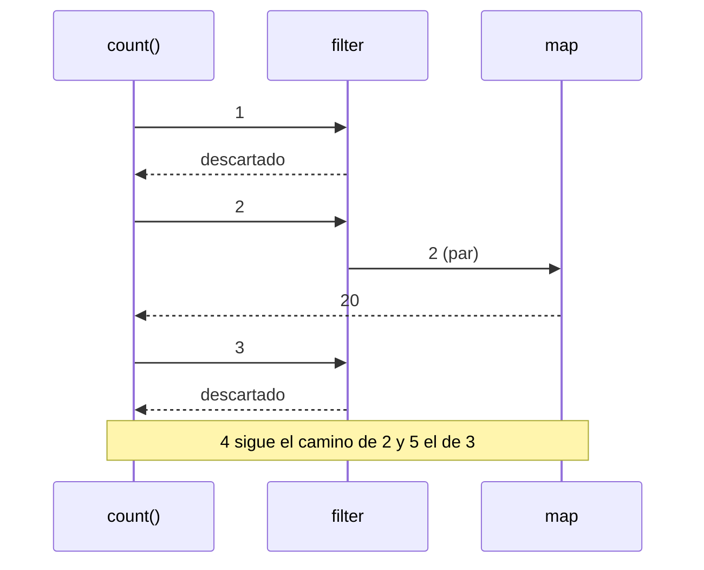

Una operación con estado rompe el vaivén. `sorted()` no puede emitir el menor hasta ver todos los elementos. Funciona
como una **barrera**: acumula lo que llega y, cuando la fuente se agota, ordena y suelta hacia abajo. Por eso las
cuatro trazas `antes:` aparecen antes de cualquier `después:`.

`limit(2)` es de **cortocircuito**: cuando ya dejó pasar dos elementos, avisa a la cadena que no quiere más. En el
caso 3, `4` y `5` nunca llegan a `después:`. Si `limit` estuviera antes de `sorted`, cortaría la fuente; después de
`sorted`, solo corta la salida.

El caso 4 muestra una optimización de la terminal. Sin `filter`, el tamaño de `List.of(1, 2, 3)` se conoce de
antemano y `map` no cambia cuántos elementos hay. `count()` responde `3` sin recorrer: `efectos en map=[]`.

##### 4. Reglas, variantes y casos límite

Un stream se usa una sola vez. Una segunda terminal, o una segunda intermedia sobre la misma variable, lanza
`IllegalStateException: stream has already been operated upon or closed`. El test `streamEsPerezosoYSeConsumeUnaVez`
fija ese comportamiento.

La optimización de `count()` existe desde Java 9. Su documentación dice que la implementación puede no ejecutar el
pipeline si puede calcular el número desde la fuente. Con un `filter` antes, ya no puede, y el recorrido ocurre.

La documentación de `peek` advierte algo parecido: en pipelines como ese, la acción puede no ejecutarse. Esa
libertad del JDK es la razón para no poner efectos de negocio en `peek` ni en `map`.

Los **efectos secundarios** dentro de las lambdas están desaconsejados en general. La documentación pide que las
funciones de las operaciones sean **sin interferencia**: no deben modificar la fuente durante el recorrido. Una
`ArrayList` modificada mientras se recorre suele lanzar `ConcurrentModificationException`.

El orden de encuentro importa. Una fuente como `List` tiene orden y las operaciones lo respetan. Un `HashSet` no lo
tiene, así que el orden de las trazas puede variar entre ejecuciones.

##### 5. Relación con lo que ya sabes y lo que viene

En Java, Módulo 4, Tema 1 usaste `filter`, `map` y `collect` como herramientas para obtener un resultado. Este tema
abre la caja: muestra cuándo y en qué orden corre cada lambda, que es lo que decide si una traza aparece.

En el Tema 3 viste que componer funciones no ejecuta nada hasta `apply`. Un pipeline es la misma idea a escala: una
composición de etapas que espera a la terminal.

Esto conecta con los efectos secundarios de Java, Módulo 4, Tema 4. Un efecto escondido en una lambda depende de
decisiones internas del JDK; un efecto en la terminal o fuera del stream no.

El Tema 8 recorre las intermedias una por una, con sus reglas de orden. El Tema 9 explica las terminales y el
cortocircuito de `findFirst` y `anyMatch`. El Tema 11 muestra qué pasa con este mismo procesamiento cuando el stream
se divide entre varios hilos.

#### Problema resuelto 4.1
Observa el orden real de ejecución de un pipeline en cuatro situaciones: antes de la terminal, con `count()`, con
`sorted()` y `limit`, y con un `map` cuyo efecto nadie necesita.

**Razonamiento:**
1. Registra cada paso en una lista `traza` para ver el orden, no solo el resultado.
2. Imprime la traza antes de la terminal: debe estar vacía.
3. Usa `peek` antes y después de `sorted()` para ver la barrera.
4. Repite un `map` con efecto, pero sin `filter`, y cuenta.

```java
import java.util.ArrayList;
import java.util.List;
import java.util.stream.Stream;

public class Pereza {

    public static void main(String[] args) {
        List<String> traza = new ArrayList<>();

        // 1. Declarar no ejecuta.
        Stream<Integer> pipeline = Stream.of(1, 2, 3, 4, 5)
                .filter(v -> { traza.add("filter:" + v); return v % 2 == 0; })
                .map(v -> { traza.add("map:" + v); return v * 10; });
        System.out.println("antes de la terminal: " + traza);

        // 2. La terminal arrastra cada elemento por todos los pasos.
        long cuenta = pipeline.count();
        System.out.println("CUENTA=" + cuenta + " TRAZA=" + traza.size());
        System.out.println(traza);

        // 3. sorted() es una barrera: ve todo antes de soltar el primero.
        traza.clear();
        List<Integer> primeros = Stream.of(5, 3, 1, 4)
                .peek(v -> traza.add("antes:" + v))
                .sorted()
                .peek(v -> traza.add("después:" + v))
                .limit(2)
                .toList();
        System.out.println(primeros + " " + traza);

        // 4. Un efecto en map puede no ejecutarse nunca.
        traza.clear();
        long n = List.of(1, 2, 3).stream()
                .map(v -> { traza.add("map:" + v); return v; })
                .count();
        System.out.println("n=" + n + " efectos en map=" + traza);
    }
}
```

```text
$ java Pereza.java
antes de la terminal: []
CUENTA=2 TRAZA=7
[filter:1, filter:2, map:2, filter:3, filter:4, map:4, filter:5]
[1, 3] [antes:5, antes:3, antes:1, antes:4, después:1, después:3]
n=3 efectos en map=[]
```

**Explicación por partes.**
- Líneas 11–14: el pipeline está declarado, pero la traza sigue vacía: `antes de la terminal: []`.
- Líneas 17–19: `count()` dispara el recorrido. Cinco `filter` y dos `map` dan `TRAZA=7`, intercalados elemento a elemento.
- Líneas 23–28: `sorted()` reúne los cuatro valores (`antes:5 … antes:4`) y después suelta `1` y `3`. `limit(2)` corta ahí: `4` y `5` nunca llegan a `después:`.
- Líneas 33–36: sin `filter`, `count()` conoce el tamaño de la lista y no ejecuta `map`. La traza queda vacía y `n=3`.

> **Error común.** Poner un efecto de negocio en `map` o en `peek` y confiar en que ocurrirá. La salida
> `n=3 efectos en map=[]` muestra que el JDK omitió las tres llamadas. Si necesitas el efecto, hazlo después con una
> terminal que lo exija (`toList()` y luego `forEach`) o fuera del stream.

> **Error común.** Reutilizar el stream: llamar dos veces a `pipeline.count()` termina con
> `java.lang.IllegalStateException: stream has already been operated upon or closed`. Crea un stream nuevo desde la colección.

> **Rendimiento.** `sorted()` necesita memoria para todos los elementos. Si solo quieres el mayor o el menor, `max`
> o `min` (Tema 9) recorren una vez sin ordenar.

#### Checkpoint 4.1
Si cambias el `count()` de la línea 35 por `toList()`, ¿qué imprime la traza?

Respuesta: `[map:1, map:2, map:3]`. `toList()` necesita cada valor transformado, así que ejecuta `map` tres veces.

</details>

<details>
<summary><strong>Capa 2 — Construcción</strong></summary>

#### Paso 1 · Ejecuta las cuatro situaciones
Guarda el Problema resuelto 4.1 como `Pereza.java` y ejecuta `java Pereza.java`. Compara cada línea con la
explicación por partes.

#### Paso 2 · Provoca el consumo doble
Después de la línea 18, agrega `System.out.println(pipeline.count());`. Ejecuta y lee el mensaje
`stream has already been operated upon or closed`. Quita la línea.

#### Paso 3 · Comprueba la pereza en el proyecto
En `ReporteEnvios.contarConTraza`, la traza se llena dentro de `filter` y `map`. La salida de `./gradlew -q run` muestra
`CUENTA=2` y `TRAZA=7`, igual que la línea 18 de `Pereza.java`.

#### Resumen
- Un stream no hace nada hasta la operación terminal.
- El **procesamiento vertical** lleva cada elemento por todos los pasos antes de pasar al siguiente.
- Una **operación con estado** como `sorted()` rompe ese ritmo: reúne todo antes de emitir.
- **`peek`** sirve para observar; no garantiza ejecutarse si la terminal no necesita el elemento.
- `count()` puede saltarse un `map` cuando el tamaño se conoce sin recorrer.
- Un stream se consume una vez; el segundo uso lanza `IllegalStateException`.

#### Ejercicio verificable 1
Básico. Cambia la terminal de las líneas 11–17 por `findFirst()`. ¿Qué devuelve y cuál es la traza?

Respuesta esperada: `Optional[20]` y la traza `[filter:1, filter:2, map:2]`. `findFirst` corta en el primer par.

#### Ejercicio verificable 2
Intermedio. En la situación 4, reemplaza `count()` por `toList()`. ¿Qué imprime la lista y qué la traza?

Respuesta esperada: `[1, 2, 3]` y `[map:1, map:2, map:3]`.

#### Ejercicio verificable 3
Reto. En la situación 3, quita `sorted()` y deja los dos `peek` y `limit(2)`. Predice la lista y la traza.

Respuesta esperada: `[5, 3]` y `[antes:5, después:5, antes:3, después:3]`. Sin la barrera, cada valor cruza ambos
`peek` antes del siguiente, y `limit` corta tras el segundo.

#### En el trabajo
En servicios que procesan eventos, un `peek(repositorio::guardar)` puede funcionar en desarrollo y dejar de guardar
cuando alguien cambia la terminal por `count()`. Las revisiones de código suelen marcar cualquier efecto dentro de
`map` o `peek` por esta razón.

</details>

### Tema 5: UnaryOperator y BinaryOperator: la salida conserva el tipo · Intermedio · 35 min

<details open>
<summary><strong>Capa 1 — Lectura</strong></summary>

#### Objetivos
Al terminar este tema podrás:
- elegir `UnaryOperator` o `BinaryOperator` cuando la entrada y la salida tienen el mismo tipo;
- reducir una lista con un `BinaryOperator` propio o con `BinaryOperator.minBy` y `maxBy`;
- usar `UnaryOperator.identity()` como paso neutro;
- corregir el error de tipos que aparece al componer dos `UnaryOperator` con `andThen`.

**Conceptos clave:** UnaryOperator, BinaryOperator, identity, minBy y maxBy

Ya los conoces y no se repiten: `Function` (Tema 1), `BiFunction` (Tema 2) y `andThen` (Tema 3) de este módulo;
`reduce` (Java, Módulo 4, Tema 1); `Comparator` (Java, Módulo 2, Tema 5).

#### El problema
El precio de un envío de Tienda Aurora pasa por varios ajustes: descuento, corrección de negativos y redondeo. Todos
reciben un `BigDecimal` y devuelven un `BigDecimal`. El reporte además necesita el costo mayor y el menor. Si
declaras todo como `Function<BigDecimal, BigDecimal>`, el tipo no dice que el valor conserva su clase. ¿Qué forma
comunica «mismo tipo de entrada y salida»?

#### Glosario del tema

**UnaryOperator**
- **Definición técnica:** `java.util.function.UnaryOperator<T>`, subinterfaz de `Function<T,T>`: recibe un `T` y devuelve un `T`.
- **En palabras sencillas:** un ajuste que recibe un precio y entrega un precio.
- **Dónde se rompe la comparación:** hereda `andThen` y `compose` de `Function`, y esos métodos devuelven `Function`, no `UnaryOperator`.
- **Ejemplo:** `aplicarDescuento(new BigDecimal("0.10"))` (línea 17 del Problema resuelto 5.1) imprime `descuento(100)  = 90.00`.
- **Error típico:** asignar `noNegativo.andThen(dosDecimales)` a un `UnaryOperator<BigDecimal>`: `error: incompatible types`.

**BinaryOperator**
- **Definición técnica:** `java.util.function.BinaryOperator<T>`, subinterfaz de `BiFunction<T,T,T>`: combina dos valores del mismo tipo en uno de ese tipo.
- **En palabras sencillas:** una regla para quedarte con uno de dos precios, o para juntarlos en uno.
- **Dónde se rompe la comparación:** es la forma que pide `reduce`; si no es asociativa, el resultado paralelo cambia (Tema 11).
- **Ejemplo:** `mayorCosto.apply(10, 25)` (línea 29) imprime `25`; `BigDecimal::add` (línea 33) suma `55000`.
- **Error típico:** usar `BiFunction<BigDecimal, BigDecimal, BigDecimal>` donde un método pide `BinaryOperator`: no son intercambiables sin adaptar.

**`identity`**
- **Definición técnica:** métodos estáticos `Function.identity()` y `UnaryOperator.identity()` que devuelven una función que retorna su argumento sin cambios.
- **En palabras sencillas:** un ajuste que no ajusta nada; deja el precio igual.
- **Dónde se rompe la comparación:** parece inútil, pero es el punto de partida natural al componer una lista de ajustes con `reduce`.
- **Ejemplo:** `UnaryOperator.identity()` (línea 25) imprime `identidad(42)   = 42`.
- **Error típico:** escribir `x -> x` en muchos lugares; `identity()` dice la intención con su nombre.

**`minBy` y `maxBy`**
- **Definición técnica:** métodos estáticos `BinaryOperator.minBy(Comparator)` y `BinaryOperator.maxBy(Comparator)` que devuelven un operador que conserva el menor o el mayor de dos valores.
- **En palabras sencillas:** un árbitro que, de dos precios, siempre se queda con el más bajo (o el más alto).
- **Dónde se rompe la comparación:** ante un empate, `minBy` y `maxBy` se quedan con el primer argumento.
- **Ejemplo:** `reduce(BinaryOperator.minBy(Comparator.naturalOrder()))` (líneas 34 y 37) imprime `mínimo          = 8000`.
- **Error típico:** olvidar que `reduce` sin identidad devuelve `Optional`; hay que cerrarlo con `orElseThrow()` u `orElse`.

#### ► CÓMO FUNCIONA

##### 1. La idea en lenguaje sencillo

Un sastre ajusta un pantalón: lo recorta, lo plancha y le cose el ruedo. En cada paso recibe un pantalón y entrega
un pantalón. Nunca recibe un pantalón y entrega una camisa. Cuando dos clientes discuten qué pantalón llevar, el
sastre elige uno de los dos, y lo que entrega sigue siendo un pantalón.

Los precios de Tienda Aurora pasan por el mismo tipo de ajustes. Descontar, quitar negativos y redondear reciben un
`BigDecimal` y devuelven un `BigDecimal`. Elegir el costo mayor recibe dos y devuelve uno. Java tiene formas propias
para esos casos, y su nombre le dice al lector que el tipo se conserva.

##### 2. Definición formal y vocabulario

**UnaryOperator** es `java.util.function.UnaryOperator<T>`. Extiende `Function<T,T>` y no agrega métodos abstractos:
su único método sigue siendo `apply`. Dicho de forma sencilla: una `Function` cuya entrada y salida son del mismo tipo.

**BinaryOperator** es `java.util.function.BinaryOperator<T>`. Extiende `BiFunction<T,T,T>`: dos entradas y una
salida, las tres del mismo tipo. Es la forma que exigen `reduce` y varios collectors para combinar valores.

Ambas interfaces suman métodos estáticos. **`identity`** existe en `Function` y en `UnaryOperator`: devuelve una
función que retorna su argumento sin cambios. **`minBy` y `maxBy`** son de `BinaryOperator`: reciben un `Comparator`
y devuelven un operador que se queda con el menor o el mayor de dos valores.

##### 3. Cómo funciona por dentro, paso a paso

La relación entre las cuatro interfaces es de herencia. El diagrama muestra quién extiende a quién y qué devuelve
cada operación:

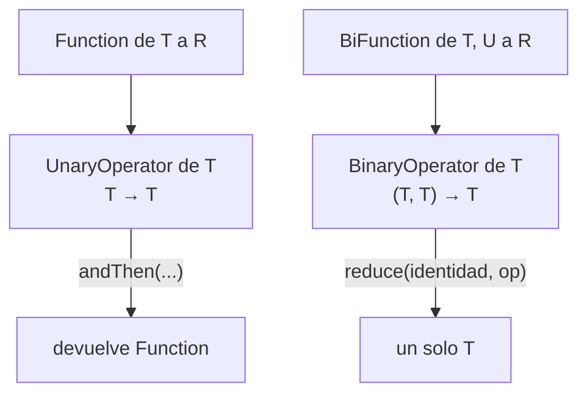

Sigue `descuento10.andThen(dosDecimales)` del Problema resuelto 5.1:

1. `descuento10` es un `UnaryOperator<BigDecimal>`. Como extiende `Function<BigDecimal, BigDecimal>`, hereda
   `andThen` tal como lo declara `Function`.
2. Esa declaración devuelve `Function<T, V>`. El compilador infiere `V = BigDecimal`, pero el tipo sigue siendo
   `Function`, no `UnaryOperator`.
3. Si asignas el resultado a un `UnaryOperator`, el compilador no puede convertirlo y falla con `incompatible
   types`. Por eso `precioFinal` y `normalizarYRedondear()` se declaran como `Function<BigDecimal, BigDecimal>`.
4. Al ejecutar, `119.00 × 0.90` da `107.1000` y el redondeo deja `107.10`, el mismo `TOTAL=107.10` de `App`.

Si necesitas de verdad un `UnaryOperator`, envuelve la composición en una lambda nueva. La lambda recibe su tipo del
lado izquierdo:

```java
UnaryOperator<BigDecimal> precio = v -> descuento10.andThen(dosDecimales).apply(v);
```

Ahora sigue `costos.stream().reduce(BigDecimal.ZERO, sumar)`:

1. El acumulador empieza en la identidad, `0`.
2. Para cada costo, `reduce` llama a `sumar.apply(acumulado, costo)` y guarda el resultado.
3. Al final devuelve el último acumulado: `55000`.

Sin identidad, `reduce(mayorCosto)` toma el primer elemento como punto de partida. Si la lista está vacía no hay
punto de partida, y por eso esa variante devuelve `Optional`.

`identity()` también sirve como punto de partida al componer una lista de ajustes:

```java
List<Function<BigDecimal, BigDecimal>> ajustes = List.of(descuento10, dosDecimales);
Function<BigDecimal, BigDecimal> todos = ajustes.stream()
        .reduce(Function.identity(), Function::andThen);
```

`todos.apply(new BigDecimal("119.00"))` da `107.10`. Con la lista vacía, `todos` sería la identidad y no cambiaría
nada, que es justo lo esperado.

##### 4. Reglas, variantes y casos límite

La documentación de `Stream.reduce` exige que el operador sea **asociativo**: `(a op b) op c` debe dar lo mismo que
`a op (b op c)`. También exige que la identidad sea neutra: `op(identidad, x)` debe devolver `x`. La suma de
`BigDecimal` cumple ambas condiciones; la resta no.

`minBy` y `maxBy` resuelven los empates a favor del primer argumento. `maxBy` con `comparing(String::length)` entre
`"BOG"` y `"MED"` devuelve `BOG`. Tu `mayorCosto` hace lo mismo porque usa `>= 0`.

`reduce` tiene tres sobrecargas. Con un operador devuelve `Optional<T>`. Con identidad y operador devuelve `T`. La
tercera recibe identidad, un `BiFunction` acumulador y un `BinaryOperator` combinador, y permite cambiar de tipo.

Para primitivos existen `IntUnaryOperator`, `IntBinaryOperator` y sus versiones `Long` y `Double`. `IntStream` las
usa en su propio `reduce`, sin envolver cada número en un objeto.

`BinaryOperator` y `BiFunction<T,T,T>` no son intercambiables. Un `BiFunction` guardado en una variable no se puede
pasar donde se pide `BinaryOperator`; sí puedes pasar una referencia como `biFuncion::apply`.

##### 5. Relación con lo que ya sabes y lo que viene

En el Tema 1 elegiste la forma por lo que entra y sale. Aquí la pregunta se afina: ¿el tipo se conserva? Si la
respuesta es sí, `UnaryOperator` o `BinaryOperator` lo dicen en la firma.

En el Tema 3 compusiste con `andThen` sin preocuparte por el tipo resultante. Este tema explica por qué la
composición de dos `UnaryOperator` vuelve a ser `Function`.

`reduce` viene de Java, Módulo 4, Tema 1, y `Comparator` de Java, Módulo 2, Tema 5. Aquí los dos se unen:
`minBy(Comparator.naturalOrder())` convierte un criterio de orden en una regla de combinación.

El Tema 9 trata `reduce`, `max` y `min` como terminales y explica cuándo conviene cada una. El Tema 10 usa
`Collectors.reducing`, que recibe el mismo `BinaryOperator`. El Tema 11 muestra por qué la asociatividad y la
identidad neutra deciden si un `reduce` paralelo da el resultado correcto.

#### Problema resuelto 5.1
Aplica un descuento, redondea, obtén la identidad, elige el mayor de dos costos y reduce la lista de costos a suma,
máximo y mínimo.

**Razonamiento:**
1. Descontar y redondear conservan el tipo: `UnaryOperator<BigDecimal>`.
2. Al encadenarlos con `andThen`, el resultado se declara como `Function`.
3. Elegir el mayor de dos y sumar dos conservan el tipo: `BinaryOperator<BigDecimal>`.
4. `reduce` con un `BinaryOperator` y sin identidad devuelve `Optional`, porque la lista podría estar vacía.

```java
import java.math.BigDecimal;
import java.math.RoundingMode;
import java.util.Comparator;
import java.util.List;
import java.util.function.BinaryOperator;
import java.util.function.Function;
import java.util.function.UnaryOperator;

public class Operadores {

    static UnaryOperator<BigDecimal> aplicarDescuento(BigDecimal porcentaje) {
        BigDecimal factor = BigDecimal.ONE.subtract(porcentaje);
        return total -> total.multiply(factor);
    }

    public static void main(String[] args) {
        UnaryOperator<BigDecimal> descuento10 = aplicarDescuento(new BigDecimal("0.10"));
        UnaryOperator<BigDecimal> dosDecimales = v -> v.setScale(2, RoundingMode.HALF_UP);
        System.out.println("descuento(100)  = " + descuento10.apply(new BigDecimal("100")));

        // andThen viene de Function: el resultado se declara como Function.
        Function<BigDecimal, BigDecimal> precioFinal = descuento10.andThen(dosDecimales);
        System.out.println("final(119.00)   = " + precioFinal.apply(new BigDecimal("119.00")));

        UnaryOperator<BigDecimal> sinCambio = UnaryOperator.identity();
        System.out.println("identidad(42)   = " + sinCambio.apply(new BigDecimal("42")));

        BinaryOperator<BigDecimal> mayorCosto = (a, b) -> a.compareTo(b) >= 0 ? a : b;
        System.out.println("mayor(10, 25)   = " + mayorCosto.apply(new BigDecimal("10"), new BigDecimal("25")));

        List<BigDecimal> costos = List.of(new BigDecimal("10000"), new BigDecimal("25000"),
                new BigDecimal("8000"), new BigDecimal("12000"));
        BinaryOperator<BigDecimal> sumar = BigDecimal::add;
        BinaryOperator<BigDecimal> menor = BinaryOperator.minBy(Comparator.naturalOrder());
        System.out.println("suma            = " + costos.stream().reduce(BigDecimal.ZERO, sumar));
        System.out.println("máximo          = " + costos.stream().reduce(mayorCosto).orElseThrow());
        System.out.println("mínimo          = " + costos.stream().reduce(menor).orElseThrow());
    }
}
```

```text
$ java Operadores.java
descuento(100)  = 90.00
final(119.00)   = 107.10
identidad(42)   = 42
mayor(10, 25)   = 25
suma            = 55000
máximo          = 25000
mínimo          = 8000
```

**Explicación por partes.**
- Líneas 11–14: `aplicarDescuento` calcula el factor una vez (`0.90`) y devuelve un `UnaryOperator` que lo captura.
- Líneas 22–23: `andThen` encadena descuento y redondeo. `119.00 × 0.90 = 107.1000`, redondeado a `107.10`: el mismo `TOTAL` de `App`.
- Línea 25: `identity()` devuelve `42` sin tocarlo.
- Línea 28: `mayorCosto` compara con `compareTo` y conserva el primero si empatan.
- Líneas 33–37: la misma lista se reduce de tres maneras: suma con identidad `ZERO`, máximo y mínimo con `Optional`.

> **Error común.** Declarar como `UnaryOperator` el resultado de `andThen`. `UnaryOperator<BigDecimal> normalizar =
> noNegativo.andThen(dosDecimales);` produce `error: incompatible types: no instance(s) of type variable(s) V exist so
> that Function<BigDecimal,V> conforms to UnaryOperator<BigDecimal>`. Declara la variable como `Function<BigDecimal,
> BigDecimal>`.

> **Buena práctica.** Si el tipo se conserva, usa la forma específica. `UnaryOperator<BigDecimal> descuento` dice más
> que `Function<BigDecimal, BigDecimal> descuento` y evita que alguien cambie el tipo de salida por error.

> **Prevenir errores.** Para dinero, el operador de suma debe ser `BigDecimal::add` y la identidad `BigDecimal.ZERO`.
> Una identidad distinta suma un valor extra por cada parte del cálculo (Tema 11).

#### Checkpoint 5.1
¿Qué tipo devuelve `costos.stream().reduce(mayorCosto)` y por qué no es directamente `BigDecimal`?

Respuesta: `Optional<BigDecimal>`. Sin identidad, una lista vacía no tendría resultado; `Optional` representa ese caso.

</details>

<details>
<summary><strong>Capa 2 — Construcción</strong></summary>

#### Paso 1 · Ejecuta los operadores
Guarda el Problema resuelto 5.1 como `Operadores.java` y ejecuta `java Operadores.java`. Comprueba
`final(119.00)   = 107.10`.

#### Paso 2 · Provoca el error de tipos
Cambia el tipo de la línea 22 a `UnaryOperator<BigDecimal>`. Compila y lee el mensaje. Devuelve el tipo a `Function`.

#### Paso 3 · Compara con el proyecto
En `ReglasEnvio`, `aplicarDescuento` devuelve `UnaryOperator` y `mayorCosto` devuelve `BinaryOperator`. El test
`biFunctionYOperadores` exige `90.00` y `25`; `App` imprime `MAYOR=25`.

#### Resumen
- **UnaryOperator** es una `Function` cuyo tipo de entrada y salida coinciden.
- **BinaryOperator** combina dos valores del mismo tipo; es la forma que pide `reduce`.
- `andThen` sobre un `UnaryOperator` devuelve `Function`; declara el resultado con ese tipo.
- **`identity`** es el ajuste neutro y el punto de partida para componer listas de ajustes.
- **`minBy` y `maxBy`** construyen operadores de mínimo y máximo a partir de un `Comparator`.

#### Ejercicio verificable 1
Básico. ¿Qué devuelve `aplicarDescuento(new BigDecimal("0.25")).apply(new BigDecimal("200"))`?

Respuesta esperada: `150.00`. El factor es `0.75`; `200 × 0.75 = 150.00`, con la escala de `0.75`.

#### Ejercicio verificable 2
Intermedio. Reemplaza `mayorCosto` en la línea 36 por `BinaryOperator.maxBy(Comparator.naturalOrder())`. ¿Cambia la salida?

Respuesta esperada: no. Imprime `25000`, igual que `mayorCosto`.

#### Ejercicio verificable 3
Reto. Pon `noNegativo`, el descuento del 10 % y `dosDecimales` en una `List<UnaryOperator<BigDecimal>>`. Compónlos con
`reduce(UnaryOperator.identity(), (f, g) -> x -> g.apply(f.apply(x)))` y aplica el resultado a `-5` y a `119.00`.

Respuesta esperada: `0.00` y `107.10`. La identidad es el punto de partida; cada paso envuelve al anterior.

#### En el trabajo
Los sistemas de precios aplican cadenas de ajustes configurables: promociones, impuestos, redondeo por moneda. Guardar
cada ajuste como `UnaryOperator<Precio>` y componerlos desde configuración permite activar o quitar uno sin tocar los demás.

</details>

### Tema 6: Referencias a métodos: escribir la operación sin repetirla · Intermedio · 40 min

<details open>
<summary><strong>Capa 1 — Lectura</strong></summary>

#### Objetivos
Al terminar este tema podrás:
- reemplazar lambdas del pipeline de envíos por referencias a métodos equivalentes;
- distinguir un receptor ligado de uno no ligado y predecir cuándo se evalúa cada uno;
- leer el error `reference to toString is ambiguous` y elegir una alternativa sin ambigüedad.

**Conceptos clave:** receptor no ligado, receptor ligado, referencia ambigua

Ya los conoces y no se repiten: referencia a método (Java, Módulo 4, Tema 1) y sus cuatro formas, incluida la
referencia a constructor (Java, Módulo 4, Tema 4); `Comparator` (Java, Módulo 2, Tema 5); `Consumer` (Tema 1 de este
módulo).

#### El problema
El reporte de Tienda Aurora tiene lambdas como `e -> e.destino()` y `(a, b) -> a.add(b)`. Un compañero las cambió
por referencias a métodos y, en otro lugar, cambió `id -> nuevaBitacora().add(id)` por `nuevaBitacora()::add`. El
primer cambio no alteró nada; el segundo hizo que todos los ids terminaran en una sola bitácora. ¿Qué cambió?

#### Glosario del tema

**receptor no ligado**
- **Definición técnica:** referencia de la forma `Tipo::metodoDeInstancia`; el objeto sobre el que se llama el método llega como primer argumento de la interfaz funcional en cada llamada.
- **En palabras sencillas:** «a cada envío que llegue, pregúntale su destino»; el envío cambia en cada llamada.
- **Dónde se rompe la comparación:** el mismo texto `Tipo::metodo` también puede ser un método estático; el compilador decide por las firmas.
- **Ejemplo:** `Function<Envio, String> destino = Envio::destino;` (línea 27 del Problema resuelto 6.1) produce `DESTINOS=[BOG, CALI, MED]`.
- **Error típico:** usarla donde la interfaz no recibe el objeto: `Supplier<String> s = Envio::destino;` no compila porque `Supplier` no recibe nada.

**receptor ligado**
- **Definición técnica:** referencia de la forma `expresion::metodo`; la expresión se evalúa una sola vez, al crear la referencia, y ese objeto recibe todas las llamadas.
- **En palabras sencillas:** eliges el cuaderno al principio; cada nota que llega se escribe en ese mismo cuaderno.
- **Dónde se rompe la comparación:** la lambda equivalente parece igual, pero evalúa la expresión en cada llamada.
- **Ejemplo:** `nuevaBitacora()::add` (línea 34) crea una sola bitácora: `bitácoras creadas: 1`; la lambda de la línea 40 crea `4`.
- **Error típico:** escribir `obtenerConexion()::enviar` creyendo que pedirá una conexión por mensaje; la pide una sola vez.

**referencia ambigua**
- **Definición técnica:** referencia a método que encaja con más de un método del tipo, por ejemplo un estático y uno de instancia con el mismo nombre; el compilador la rechaza.
- **En palabras sencillas:** dos personas responden al mismo nombre y el compilador no sabe a cuál llamar.
- **Dónde se rompe la comparación:** a una persona le preguntarías; el compilador no adivina: exige que escribas cuál.
- **Ejemplo:** `map(Integer::toString)` sobre `Stream<Integer>` encaja con `toString(int)` y con `toString()`.
- **Error típico:** insistir con la referencia; usa `Object::toString` o la lambda `i -> Integer.toString(i)`.

#### ► CÓMO FUNCIONA

##### 1. La idea en lenguaje sencillo

Si alguien te pregunta cómo llegar a la bodega, puedes describir el camino calle por calle. También puedes decir
«sigue la ruta del mapa». La segunda respuesta es más corta y dice lo mismo, porque la ruta ya existe y tiene nombre.

Una referencia a método es esa segunda respuesta. Cuando una lambda solo reenvía sus argumentos a un método que ya
existe, como `e -> e.destino()`, puedes nombrar el método directamente: `Envio::destino`.

Casi siempre el cambio es solo de estilo. El compañero de Tienda Aurora tropezó con la excepción: cuando delante de
`::` hay una expresión, como `nuevaBitacora()`, esa expresión se calcula una sola vez. Este tema explica cuándo
ocurre ese cálculo y por qué todos los ids terminaron en la misma bitácora.

##### 2. Definición formal y vocabulario

La Especificación del Lenguaje Java (JLS §15.13) define la **expresión de referencia a método**. Igual que una lambda,
no tiene tipo propio: lo recibe de la interfaz funcional que espera el contexto. Hay cuatro formas:

- `Tipo::metodoEstatico`, por ejemplo `Integer::parseInt`.
- `Tipo::metodoDeInstancia`, el **receptor no ligado**. El objeto que recibe la llamada llega como primer argumento.
  `Envio::destino` encaja en `Function<Envio, String>` porque el `Envio` es ese primer argumento.
- `expresion::metodo`, el **receptor ligado**. El objeto queda fijado al crear la referencia. `System.out::println`
  es el ejemplo más común.
- `Tipo::new`, la referencia a constructor, como `ArrayList::new` o `TreeSet::new`.

La palabra **receptor** nombra al objeto sobre el que se llama un método; en `a.add(b)`, el receptor es `a`. Una
**referencia ambigua** es una que encaja con más de un método del tipo; el compilador la rechaza en lugar de elegir.

##### 3. Cómo funciona por dentro, paso a paso

Cuando el compilador encuentra `Function<Envio, String> destino = Envio::destino;`, hace esto:

1. Toma el tipo objetivo y su método abstracto, `String apply(Envio)`.
2. Busca métodos llamados `destino` en `Envio`. Prueba dos lecturas: un estático que reciba un `Envio`, o uno de
   instancia sin parámetros llamado sobre el `Envio` recibido.
3. Encuentra solo la segunda: el accesor del `record`. La referencia queda resuelta como receptor no ligado.
4. Genera una instrucción `invokedynamic`, igual que con una lambda. En ejecución, la JVM crea un objeto que
   implementa `Function` y, en cada `apply(e)`, llama a `e.destino()`.

Con un receptor ligado, el orden cambia. La JLS §15.13.3 dice que la expresión de la izquierda se evalúa cuando se
evalúa la referencia, no cuando se llama al método:

1. Java ejecuta `nuevaBitacora()` una vez y obtiene una lista concreta.
2. Crea el objeto `Consumer` y guarda dentro esa lista.
3. Cada `accept(id)` posterior llama a `add` sobre la lista guardada. Resultado: `bitácoras creadas: 1`.

La lambda `id -> nuevaBitacora().add(id)` tiene la llamada dentro del cuerpo. Se ejecuta en cada `accept`, así que
crea cuatro listas. El diagrama compara los dos recorridos:

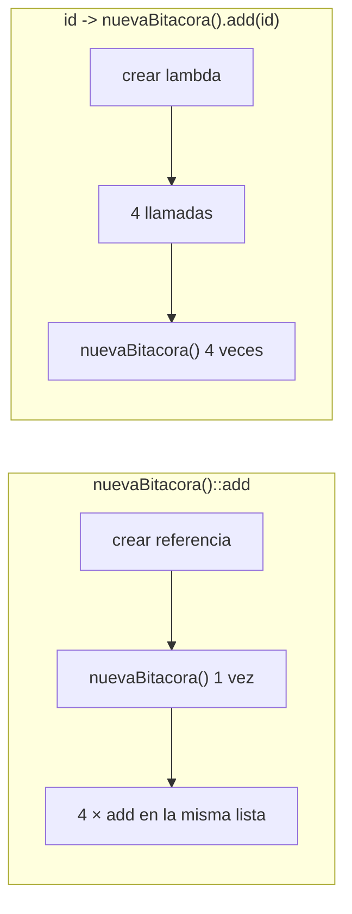

La evaluación temprana tiene otra consecuencia: si la expresión vale `null`, el error aparece al crear la referencia.

```java
List<String> bitacora = null;
Consumer<String> c = bitacora::add;        // NullPointerException aquí
Consumer<String> l = s -> bitacora.add(s); // aquí no; fallaría al llamar a accept
```

La lambda se crea sin problema y falla después, en el primer `accept`. La referencia falla antes de usarse.

##### 4. Reglas, variantes y casos límite

El número de parámetros decide la forma. `String::length` encaja en `Function<String, Integer>`: el texto es el
receptor. `String::equalsIgnoreCase` encaja en `BiFunction<String, String, Boolean>`: el primer texto es el receptor
y el segundo, el argumento. `BigDecimal::add` como `BinaryOperator` sigue la misma regla.

Si las dos lecturas del paso 2 encajan, la referencia es ambigua. `Integer::toString` sobre un `Stream<Integer>`
encaja con el estático `toString(int)` y con el de instancia `toString()`. El compilador responde `reference to
toString is ambiguous`. Usa `Object::toString` o una lambda explícita.

Las referencias también aceptan `this::metodo` y `super::metodo`, ambas con receptor ligado. Para arreglos existe
`int[]::new`, que encaja en `IntFunction<int[]>`.

Las referencias a constructor eligen la sobrecarga por el tipo objetivo. `Supplier<List<String>>` toma el constructor
sin argumentos de `ArrayList`; una `Function<Integer, List<String>>` tomaría el que recibe la capacidad inicial.

Una referencia no puede llevar argumentos fijos. Si necesitas fijar uno, como `etiqueta.apply(id, "BOG")`, escribe
una lambda.

##### 5. Relación con lo que ya sabes y lo que viene

En Java, Módulo 4, Tema 1 viste las referencias a métodos como atajo, y en Java, Módulo 4, Tema 4 usaste referencias
a constructor. Este tema agrega lo que no se ve en el texto: cuándo se evalúa el receptor.

En el Tema 1 escribiste `System.out::println` como `Consumer<String>`. Es un receptor ligado: captura el
`System.out` de ese instante. Si un programa redirige la salida con `System.setOut` después, esa referencia sigue
escribiendo en el destino anterior.

En el Tema 2 viste la captura de variables en lambdas. El receptor ligado es una captura: el objeto queda guardado en
la referencia, igual que el IVA quedó guardado en `conIva`.

El Tema 7 encadena `Optional` con `map(Envio::id)`. El Tema 10 usa `Envio::estado`, `LinkedHashMap::new` y
`TreeSet::new` como argumentos de los collectors. El Tema 12 inyecta `System.out::println` como el efecto del borde.

#### Problema resuelto 6.1
Reescribe el pipeline de destinos, costo mayor y suma con referencias a métodos. Después compara una referencia con
receptor ligado contra la lambda que parece equivalente.

**Razonamiento:**
1. `e -> e.destino()` solo llama a un método del parámetro: se reemplaza por `Envio::destino` (receptor no ligado).
2. `(a, b) -> a.add(b)` también: `BigDecimal::add`, con el primer argumento como receptor.
3. Para ver cuándo se evalúa un receptor ligado, cuenta cuántas veces se llama al método que lo produce.

```java
import java.math.BigDecimal;
import java.util.ArrayList;
import java.util.Comparator;
import java.util.List;
import java.util.function.Consumer;
import java.util.function.Function;

public class Receptores {

    record Envio(String id, String destino, BigDecimal costo) {}

    static int bitacorasCreadas = 0;

    static List<String> nuevaBitacora() {
        bitacorasCreadas++;
        return new ArrayList<>();
    }

    public static void main(String[] args) {
        List<Envio> envios = List.of(
                new Envio("A1", "BOG", new BigDecimal("10000")),
                new Envio("A2", "MED", new BigDecimal("25000")),
                new Envio("A3", "BOG", new BigDecimal("8000")),
                new Envio("A4", "CALI", new BigDecimal("12000")));

        // Receptor no ligado: el Envio llega como argumento en cada llamada.
        Function<Envio, String> destino = Envio::destino;
        System.out.println("DESTINOS=" + envios.stream().map(destino).distinct().sorted().toList());
        System.out.println("MAS_CARO=" + envios.stream()
                .max(Comparator.comparing(Envio::costo)).map(Envio::id).orElse("NA"));
        System.out.println("SUMA=" + envios.stream().map(Envio::costo).reduce(BigDecimal.ZERO, BigDecimal::add));

        // Receptor ligado: nuevaBitacora() se evalúa una vez, al crear la referencia.
        Consumer<String> ligada = nuevaBitacora()::add;
        envios.forEach(e -> ligada.accept(e.id()));
        System.out.println("referencia ligada -> bitácoras creadas: " + bitacorasCreadas);

        // Lambda: nuevaBitacora() se evalúa en cada llamada.
        bitacorasCreadas = 0;
        Consumer<String> lambda = id -> nuevaBitacora().add(id);
        envios.forEach(e -> lambda.accept(e.id()));
        System.out.println("lambda            -> bitácoras creadas: " + bitacorasCreadas);
    }
}
```

```text
$ java Receptores.java
DESTINOS=[BOG, CALI, MED]
MAS_CARO=A2
SUMA=55000
referencia ligada -> bitácoras creadas: 1
lambda            -> bitácoras creadas: 4
```

**Explicación por partes.**
- Líneas 27–28: `Envio::destino` recibe cada envío; `distinct` y `sorted` dejan `[BOG, CALI, MED]`, como en `App`.
- Líneas 29–31: `Comparator.comparing(Envio::costo)`, `Envio::id` y `BigDecimal::add` reemplazan tres lambdas sin cambiar el resultado.
- Líneas 34–36: `nuevaBitacora()` se ejecuta al crear `ligada`. Las cuatro llamadas usan la misma lista: `1`.
- Líneas 39–42: en la lambda, `nuevaBitacora()` está dentro del cuerpo y se ejecuta en cada llamada: `4`.

> **Error común.** Usar una referencia que encaja con dos métodos. `List.of(7, 42).stream().map(Integer::toString)`
> produce `error: incompatible types: cannot infer type-variable(s) R` con la explicación `reference to toString is
> ambiguous` y `both method toString(int) in Integer and method toString() in Integer match`. Usa `Object::toString`.

> **Buena práctica.** Usa la referencia cuando la lambda solo reenvía sus argumentos a un método. Si la lambda
> combina dos llamadas o agrega una condición, déjala como lambda: la referencia no aclara nada.

> **Prevenir errores.** Antes de convertir `x -> algo().metodo(x)` en `algo()::metodo`, pregúntate si `algo()` debe
> ejecutarse una vez o en cada llamada. Si es en cada llamada, deja la lambda.

#### Checkpoint 6.1
¿Qué forma de referencia es `System.out::println` y qué objeto queda fijado?

Respuesta: receptor ligado. Se fija el `PrintStream` que devuelve `System.out` al crear la referencia.

</details>

<details>
<summary><strong>Capa 2 — Construcción</strong></summary>

#### Paso 1 · Ejecuta la comparación
Guarda el Problema resuelto 6.1 como `Receptores.java` y ejecuta `java Receptores.java`. Comprueba `1` frente a `4`.

#### Paso 2 · Sustituye lambdas en el proyecto
En `App.java`, busca `envios.stream().map(Envio::destino)`. Escribe temporalmente `e -> e.destino()`, ejecuta
`./gradlew -q run` y comprueba que `DESTINOS=[BOG, CALI, MED]` no cambia. Vuelve a la referencia.

#### Paso 3 · Provoca la referencia ambigua
Escribe un programa con `List.of(7, 42).stream().map(Integer::toString).toList()` y compílalo. Lee el mensaje y
cámbialo por `Object::toString`.

#### Resumen
- Una referencia a método nombra una lambda que solo reenvía sus argumentos.
- Con **receptor no ligado** (`Tipo::metodo`), el objeto llega en cada llamada.
- Con **receptor ligado** (`expresion::metodo`), la expresión se evalúa una vez al crear la referencia.
- Una **referencia ambigua** encaja con dos métodos; el compilador la rechaza y debes elegir uno.
- La referencia cambia la claridad, salvo en el receptor ligado, donde puede cambiar cuándo se evalúa algo.

#### Ejercicio verificable 1
Básico. Reemplaza `e -> e.id()` por una referencia en `envios.stream().map(e -> e.id()).toList()`. ¿Qué imprime?

Respuesta esperada: `Envio::id` e imprime `[A1, A2, A3, A4]`.

#### Ejercicio verificable 2
Intermedio. Corrige `map(Integer::toString)` de dos formas distintas para `List.of(7, 42)`.

Respuesta esperada: `map(Object::toString)` y `map(i -> Integer.toString(i))`. Ambas imprimen `[7, 42]`.

#### Ejercicio verificable 3
Reto. Guarda `nuevaBitacora()` en una variable `bitacora`, crea `Consumer<String> ligada = bitacora::add` y pasa los
cuatro ids. ¿Cuántos elementos tiene `bitacora` y cuántas bitácoras se crearon?

Respuesta esperada: `4` elementos (`[A1, A2, A3, A4]`) y `1` bitácora. La variable hace explícito lo que el receptor
ligado ya hacía.

#### En el trabajo
En Spring, `repositorio::save` dentro de un `forEach` es un receptor ligado al bean inyectado, y eso es lo que se
quiere. El problema aparece con fábricas: `clienteHttp()::enviar` reutiliza un solo cliente, lo cual puede ser
correcto o un error según su ciclo de vida.

</details>

### Tema 7: Optional: buscar un envío que puede no existir · Intermedio · 40 min

<details open>
<summary><strong>Capa 1 — Lectura</strong></summary>

#### Objetivos
Al terminar este tema podrás:
- transformar el contenido de un `Optional` con `map` sin abrirlo;
- encadenar dos búsquedas que pueden fallar con `flatMap` y evitar `Optional<Optional<…>>`;
- descartar un valor presente que no cumple una condición con `filter`;
- convertir la ausencia en una excepción con mensaje útil.

**Conceptos clave:** Optional.map, Optional.flatMap, Optional.filter

Ya los conoces y no se repiten: `Optional`, `Optional.of` (con `ofNullable` y `empty`), `orElse` y `orElseThrow`
(Java, Módulo 4, Tema 2); `Function` y `Predicate` (Tema 1 de este módulo).

#### El problema
El repositorio de Tienda Aurora busca envíos por id. Algunos ids no existen. Además, un envío puede tener conductor
asignado o no. Para mostrar «conductor del envío A4» hay dos ausencias posibles: el envío y el conductor. Con `if`
anidados y `null` el código se llena de comprobaciones. ¿Cómo encadenas búsquedas que pueden fallar?

#### Glosario del tema

**`Optional.map`**
- **Definición técnica:** método `map(Function<? super T, ? extends U>)` de `Optional<T>`; si hay valor, aplica la función y devuelve `Optional<U>`; si está vacío, devuelve vacío sin llamar a la función.
- **En palabras sencillas:** transformar lo que hay en la caja sin abrirla; si la caja está vacía, sigue vacía.
- **Dónde se rompe la comparación:** si la función devuelve `null`, el resultado es un `Optional` vacío, no una caja con `null`.
- **Ejemplo:** `buscarPorId("A1").map(Envio::id).orElse("NA")` (línea 30 del Problema resuelto 7.1) imprime `OPT=A1`.
- **Error típico:** usar `map` con una función que ya devuelve `Optional`: obtienes `Optional[Optional[Marta]]`.

**`Optional.flatMap`**
- **Definición técnica:** método `flatMap(Function<? super T, ? extends Optional<? extends U>>)` de `Optional<T>`; aplica una función que devuelve `Optional` y no lo anida.
- **En palabras sencillas:** abrir una caja que contiene otra caja y quedarte con una sola.
- **Dónde se rompe la comparación:** si cualquiera de las dos cajas está vacía, el resultado está vacío; no sabes cuál faltó.
- **Ejemplo:** `buscarPorId("A4").flatMap(BuscarEnvio::conductorDe)` (línea 39) imprime `Optional[Marta]`.
- **Error típico:** asignar el resultado de `map` a `Optional<String>`: `error: incompatible types: inference variable U has incompatible bounds`.

**`Optional.filter`**
- **Definición técnica:** método `filter(Predicate<? super T>)` de `Optional<T>`; conserva el valor si cumple el predicado y devuelve vacío si no lo cumple o si ya estaba vacío.
- **En palabras sencillas:** mirar dentro de la caja y vaciarla si lo que hay no sirve.
- **Dónde se rompe la comparación:** un `Optional` vacío después de `filter` no dice si faltaba el valor o si no cumplió la condición.
- **Ejemplo:** `buscarPorId("A4").filter(e -> e.estado() == Estado.ENTREGADO).isPresent()` (líneas 35–36) imprime `false`.
- **Error típico:** usar `filter` y después `get()`; si el valor no cumple, `get()` lanza `NoSuchElementException`.

#### ► CÓMO FUNCIONA

##### 1. La idea en lenguaje sencillo

Cuando pides un paquete en la ventanilla, el empleado puede volver con una caja o con las manos vacías. Lo peligroso
es que vuelva con una caja que parece llena y está vacía: la abres en casa y te llevas la sorpresa. Mejor que te
entregue una caja con una etiqueta que diga claramente «llena» o «vacía».

`Optional` es esa caja etiquetada. `buscarPorId` no promete un envío: promete una respuesta que puede traerlo o no.
El tipo obliga a quien llama a decidir qué hacer en los dos casos. En Tienda Aurora hay dos ausencias encadenadas:
el envío puede no existir y, si existe, puede no tener conductor. Este tema muestra cómo recorrer esa cadena sin
`if` anidados ni `null`.

##### 2. Definición formal y vocabulario

`java.util.Optional<T>` es, según su documentación, un objeto contenedor que puede o no contener un valor no nulo.
`isPresent()` dice si lo contiene. La propia documentación aclara su propósito: es un tipo de retorno para métodos
donde «no hay resultado» es un caso normal.

Tres métodos permiten trabajar con el contenido sin sacarlo:

- **`Optional.map`** aplica una `Function` al valor, si existe, y envuelve el resultado en un `Optional` nuevo.
- **`Optional.flatMap`** aplica una función que ya devuelve `Optional` y entrega ese resultado sin envolverlo otra vez.
- **`Optional.filter`** aplica un `Predicate`: conserva el valor si lo cumple y devuelve vacío si no.

En los tres, si el `Optional` está vacío, la función no se llama y el resultado es `Optional.empty()`. Dicho de forma
sencilla: la caja vacía atraviesa toda la cadena sin que nadie la abra.

##### 3. Cómo funciona por dentro, paso a paso

`Optional` guarda un solo campo con el valor o `null`. Cada método mira ese campo antes de hacer nada. Sigue
`buscarPorId("A4").flatMap(BuscarEnvio::conductorDe).orElse("sin conductor")`:

1. `buscarPorId("A4")` llama a `ENVIOS.get("A4")`, que devuelve el envío. `Optional.ofNullable` lo envuelve.
2. `flatMap` ve que hay valor y llama a `conductorDe(envio)`. Esa función devuelve `Optional[Marta]`.
3. `flatMap` devuelve ese `Optional` tal cual. No lo mete en otra caja.
4. `orElse` ve que hay valor y devuelve `"Marta"`.

Con `"ZZ"`, el paso 1 recibe `null` del mapa y produce `Optional.empty()`. El paso 2 no llama a `conductorDe`. El
paso 4 devuelve el valor por defecto. Con `"A1"`, el envío existe, pero su conductor no: el vacío aparece en el paso
2. El diagrama resume los dos caminos:

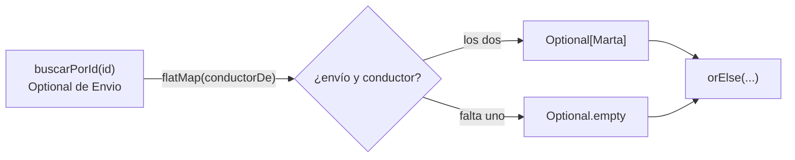

¿Por qué `map` produce `Optional[Optional[Marta]]`? Porque `map` siempre envuelve lo que devuelve la función. Si la
función ya devuelve un `Optional`, el resultado queda dentro de otro. `flatMap` existe para evitar esa doble caja.

`map` tiene un detalle útil: si la función devuelve `null`, el resultado es vacío, no una caja con `null` dentro.

```java
System.out.println(Optional.of("A1").map(s -> (String) null));   // Optional.empty
```

##### 4. Reglas, variantes y casos límite

`Optional.of(null)` lanza `NullPointerException`; usa `ofNullable` cuando el origen puede dar `null`, como `Map.get`.
La documentación pide que una variable de tipo `Optional` nunca valga `null`: debe apuntar a un `Optional` real.

`orElse(valor)` evalúa su argumento siempre, aunque haya valor. `orElseGet(supplier)` solo llama al `Supplier` si
falta. La diferencia importa cuando el valor por defecto es costoso:

```java
Optional<String> id = Optional.of("A1");
id.orElse(porDefecto());          // imprime "calculando por defecto" igual
id.orElseGet(() -> porDefecto()); // no lo imprime
```

Por la misma razón, `orElseThrow(() -> new IllegalArgumentException(...))` recibe un `Supplier`: la excepción solo se
crea si hace falta.

La API creció después de Java 8. Java 9 añadió `or`, `ifPresentOrElse` y `stream()`. Java 10 añadió `orElseThrow()`
sin argumentos, que lanza `NoSuchElementException` y equivale a `get()` con un nombre más claro. Java 11 añadió
`isEmpty()`.

`Optional` es una clase **basada en valor**: no debes compararla con `==` ni sincronizar sobre ella. Compárala con
`equals`. Tampoco es serializable, una razón más para no usarla como campo.

Existen versiones primitivas, `OptionalInt`, `OptionalLong` y `OptionalDouble`. Las devuelven terminales como
`IntStream.max()`. No tienen `map`, `flatMap` ni `filter`.

##### 5. Relación con lo que ya sabes y lo que viene

En Java, Módulo 4, Tema 2 aprendiste a crear y abrir un `Optional` con `orElse` y `orElseThrow`. Este tema trabaja
el tramo intermedio: transformar, filtrar y encadenar sin abrir la caja hasta el final.

`map`, `flatMap` y `filter` tienen los mismos nombres que en los streams, y no es casualidad. Un `Optional` se
comporta como un stream de cero o un elemento. Las funciones que pasas son las `Function` y `Predicate` del Tema 1,
y referencias como `Envio::id` del Tema 6.

Diferencia clave con `null`: un `null` no aparece en la firma y el compilador no te obliga a tratarlo. `Optional<Envio>`
sí aparece, y quien llama ve la ausencia antes de ejecutar.

El Tema 9 muestra terminales que devuelven `Optional`, como `findFirst`, `max` y `reduce` sin identidad. El Tema 12
usa la distinción entre consulta y obligación para separar el núcleo puro del borde que lanza errores.

#### Problema resuelto 7.1
Busca envíos por id, extrae su id, comprueba si están entregados, obtén su conductor y exige un envío obligatorio.

**Razonamiento:**
1. La búsqueda devuelve `Optional<Envio>` porque el id puede no existir: `ofNullable` sobre el mapa.
2. Extraer un campo es `map`; comprobar el estado es `filter`.
3. El conductor también puede faltar, así que `conductorDe` devuelve `Optional<String>`: se encadena con `flatMap`.
4. Cuando el envío es obligatorio, la ausencia es un error: `orElseThrow` con un mensaje que nombra el id.

```java
import java.util.Map;
import java.util.Optional;

public class BuscarEnvio {

    enum Estado { PENDIENTE, EN_RUTA, ENTREGADO, FALLIDO }

    record Envio(String id, String destino, Estado estado) {}

    static final Map<String, Envio> ENVIOS = Map.of(
            "A1", new Envio("A1", "BOG", Estado.ENTREGADO),
            "A4", new Envio("A4", "CALI", Estado.EN_RUTA));

    static final Map<String, String> CONDUCTORES = Map.of("A4", "Marta");

    static Optional<Envio> buscarPorId(String id) {
        return Optional.ofNullable(ENVIOS.get(id));
    }

    static Optional<String> conductorDe(Envio envio) {
        return Optional.ofNullable(CONDUCTORES.get(envio.id()));
    }

    static Envio obtenerObligatorio(String id) {
        return buscarPorId(id)
                .orElseThrow(() -> new IllegalArgumentException("envío obligatorio no encontrado: " + id));
    }

    public static void main(String[] args) {
        System.out.println("OPT="  + buscarPorId("A1").map(Envio::id).orElse("NA"));
        System.out.println("MISS=" + buscarPorId("ZZ").map(Envio::id).orElse("NA"));

        System.out.println("A1 entregado? " + buscarPorId("A1")
                .filter(e -> e.estado() == Estado.ENTREGADO).isPresent());
        System.out.println("A4 entregado? " + buscarPorId("A4")
                .filter(e -> e.estado() == Estado.ENTREGADO).isPresent());

        System.out.println("map     A4 -> " + buscarPorId("A4").map(BuscarEnvio::conductorDe));
        System.out.println("flatMap A4 -> " + buscarPorId("A4").flatMap(BuscarEnvio::conductorDe));
        System.out.println("flatMap A1 -> " + buscarPorId("A1").flatMap(BuscarEnvio::conductorDe));

        try {
            obtenerObligatorio("ZZ");
        } catch (IllegalArgumentException e) {
            System.out.println("error: " + e.getMessage());
        }
    }
}
```

```text
$ java BuscarEnvio.java
OPT=A1
MISS=NA
A1 entregado? true
A4 entregado? false
map     A4 -> Optional[Optional[Marta]]
flatMap A4 -> Optional[Marta]
flatMap A1 -> Optional.empty
error: envío obligatorio no encontrado: ZZ
```

**Explicación por partes.**
- Líneas 16–22: las dos búsquedas usan `Optional.ofNullable` porque `Map.get` devuelve `null` si no encuentra la clave.
- Líneas 24–27: `orElseThrow` con un `Supplier` crea la excepción solo si falta el envío.
- Líneas 30–31: `map` transforma solo cuando hay valor; con `ZZ` la función no se llama y queda `NA`.
- Líneas 33–36: `filter` conserva `A1` (entregado) y vacía `A4` (en ruta).
- Líneas 38–40: `map` anida (`Optional[Optional[Marta]]`); `flatMap` aplana. `A1` no tiene conductor: `Optional.empty`.

> **Error común.** Usar `map` con una función que devuelve `Optional` y asignar el resultado a `Optional<String>`.
> `Optional<String> conductor = Optional.of("A4").map(MapMal::conductorDe);` produce `error: incompatible types:
> inference variable U has incompatible bounds`, con `equality constraints: String` y `lower bounds: Optional<String>`.
> Cambia `map` por `flatMap`.

> **Buena práctica.** Devuelve `Optional` en métodos de consulta (`buscarPorId`) y un valor directo en métodos que
> exigen existencia (`obtenerObligatorio`). El nombre y el tipo cuentan al lector qué esperar.

> **Prevenir errores.** No uses `Optional` como campo de un `record` ni como parámetro. Está pensado para el retorno
> de una consulta; en campos y parámetros complica la llamada sin evitar el `null`.

#### Checkpoint 7.1
¿Qué imprime `buscarPorId("ZZ").flatMap(BuscarEnvio::conductorDe)`?

Respuesta: `Optional.empty`. El envío no existe, así que `conductorDe` ni siquiera se llama.

</details>

<details>
<summary><strong>Capa 2 — Construcción</strong></summary>

#### Paso 1 · Ejecuta las búsquedas
Guarda el Problema resuelto 7.1 como `BuscarEnvio.java` y ejecuta `java BuscarEnvio.java`. Compara la línea de `map`
con la de `flatMap`.

#### Paso 2 · Revisa el repositorio del proyecto
Abre `EnvioRepository.java`. `buscarPorId` usa `Optional.ofNullable` y `obtenerObligatorio` usa `orElseThrow` con el
mensaje `envío obligatorio no encontrado: `. La salida de `./gradlew -q run` muestra `OPT=A1` y `MISS=NA`.

#### Paso 3 · Comprueba la excepción con mensaje
El test `optionalExplicito` exige `IllegalArgumentException` al pedir `ZZ` como obligatorio. En el Problema resuelto
7.1, la última línea muestra el mensaje completo.

#### Resumen
- **`Optional.map`** transforma el valor si existe; si no, no llama a la función.
- **`Optional.flatMap`** encadena una función que devuelve `Optional` sin anidar cajas.
- **`Optional.filter`** vacía el `Optional` si el valor no cumple la condición.
- La decisión sobre la ausencia se toma al final: `orElse` para un valor por defecto, `orElseThrow` para un error.
- Un mensaje que nombra el id que faltó ahorra tiempo en producción frente a `No value present`.

#### Ejercicio verificable 1
Básico. ¿Qué imprime `buscarPorId("A4").map(Envio::destino).orElse("NA")`?

Respuesta esperada: `CALI`.

#### Ejercicio verificable 2
Intermedio. Obtén el conductor de `A1` con `flatMap` y muestra `sin asignar` si no tiene.

Respuesta esperada: `buscarPorId("A1").flatMap(BuscarEnvio::conductorDe).orElse("sin asignar")` imprime `sin asignar`.

#### Ejercicio verificable 3
Reto. Escribe `estadoDe(String id)` que devuelva el nombre del estado o `desconocido`, sin `if`. Pruébalo con `A4` y `ZZ`.

Respuesta esperada: `EN_RUTA` y `desconocido`. El cuerpo es `buscarPorId(id).map(e -> e.estado().name()).orElse("desconocido")`.

#### En el trabajo
Spring Data devuelve `Optional<T>` en `findById`. El patrón habitual en un servicio es
`repositorio.findById(id).orElseThrow(() -> new RecursoNoEncontrado(id))`, y un manejador global convierte esa
excepción en una respuesta HTTP 404 con el id en el mensaje.

</details>

### Tema 8: Streams intermedios: filtrar, transformar, aplanar y ordenar · Intermedio · 45 min

<details open>
<summary><strong>Capa 1 — Lectura</strong></summary>

#### Objetivos
Al terminar este tema podrás:
- aplanar las paradas de varios envíos y dejar una lista limpia, única y ordenada;
- ordenar con un `Comparator` compuesto de dos criterios;
- explicar por qué normalizar antes de filtrar cambia el resultado;
- leer la `ClassCastException` que lanza `sorted()` sobre un tipo sin orden natural.

**Conceptos clave:** distinct, sorted, normalización

Ya los conoces y no se repiten: `filter`, `map` y `flatMap` (Java, Módulo 4, Tema 1); `Comparable` y `Comparator`
(Java, Módulo 2, Tema 5); operación con estado (Tema 4 de este módulo).

#### El problema
Cada envío de Tienda Aurora trae su lista de paradas, escrita a mano: `"Bodega"`, `"MED"`, `"med"`. El tablero
necesita todas las paradas sin repetir y en orden. Además, los destinos llegan de un formulario como `" bog "` y se
validan contra una lista permitida. Con el orden equivocado, destinos válidos quedan rechazados. ¿En qué orden van
los pasos?

#### Glosario del tema

**`distinct`**
- **Definición técnica:** operación intermedia con estado que deja pasar cada elemento solo la primera vez, usando `equals` y `hashCode` para comparar.
- **En palabras sencillas:** un portero que recuerda a quién ya dejó pasar.
- **Dónde se rompe la comparación:** el portero compara con `equals`: `"MED"` y `"med"` son distintos hasta que los normalizas.
- **Ejemplo:** en el Problema resuelto 8.1, `distinct()` (línea 22) deja 4 paradas de las 8 originales.
- **Error típico:** aplicar `distinct` antes de pasar a mayúsculas: `MED` y `med` sobreviven los dos.

**`sorted`**
- **Definición técnica:** operación intermedia con estado que ordena los elementos; sin argumentos usa el orden natural (`Comparable`) y con un `Comparator` usa ese criterio.
- **En palabras sencillas:** reunir todas las tarjetas y ponerlas en fila antes de entregar la primera.
- **Dónde se rompe la comparación:** si el tipo no tiene orden natural, el error no aparece al compilar sino al ejecutar.
- **Ejemplo:** `sorted(Comparator.comparing(String::length).thenComparing(Comparator.reverseOrder()))` (línea 28) imprime `[MED, BOG, CALI, BODEGA]`.
- **Error típico:** `sorted()` sobre un `record` sin `Comparable`: `ClassCastException: class SortedMal$Envio cannot be cast to class java.lang.Comparable`.

**normalización**
- **Definición técnica:** transformar datos equivalentes a una forma canónica única (sin espacios, misma capitalización) antes de compararlos o validarlos.
- **En palabras sencillas:** pasar todo al mismo formato para que «bog», « BOG » y «BOG» cuenten como lo mismo.
- **Dónde se rompe la comparación:** normalizar de más borra información: si `"Bogotá"` y `"BOGOTA"` deben distinguirse, no quites tildes.
- **Ejemplo:** `map(String::trim).map(String::toUpperCase).filter(permitido)` (líneas 36–37) imprime `NORMALIZADOS=[BOG, MED]`.
- **Error típico:** filtrar antes de normalizar: `filtrar y luego normalizar = []`.

#### ► CÓMO FUNCIONA

##### 1. La idea en lenguaje sencillo

Imagina que recibes cuatro sobres, y cada sobre trae varias tarjetas de paradas escritas a mano. Para armar el
tablero, primero vacías todos los sobres en la mesa. Después borras espacios y pasas todo a mayúsculas. Luego retiras
las tarjetas repetidas y, al final, las pones en fila.

Si cambias el orden, el resultado cambia. Si retiras repetidas antes de pasar a mayúsculas, `MED` y `med` quedan las
dos. Si comparas con la lista de destinos permitidos antes de limpiar, `" bog "` queda rechazado aunque es válido.
Las operaciones intermedias de un stream son esos pasos, y este tema trata de su orden.

##### 2. Definición formal y vocabulario

Una operación intermedia recibe un stream y devuelve otro stream. Las cinco de este tema son:

- `filter(Predicate)`: deja pasar los elementos que cumplen el predicado.
- `map(Function)`: reemplaza cada elemento por el resultado de la función.
- `flatMap(Function)`: la función devuelve un stream por elemento, y esos streams se vuelcan en uno solo.
- **`distinct`**: deja pasar cada elemento la primera vez, comparando con `equals` y `hashCode`.
- **`sorted`**: ordena por orden natural (`Comparable`) o por el `Comparator` que le pases.

La **normalización** no es un método del JDK, sino una práctica. Consiste en llevar datos equivalentes a una forma
única antes de compararlos. Dicho de forma sencilla: escribir todo igual para que lo igual se reconozca como igual.

##### 3. Cómo funciona por dentro, paso a paso

Sigue el pipeline de `PARADAS` del Problema resuelto 8.1. El diagrama muestra cuántos elementos quedan en cada etapa:

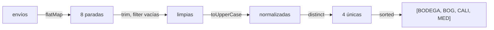

1. `toList()` arranca el recorrido. La fuente entrega el primer envío, `A1`.
2. `flatMap` llama a `e.paradas().stream()` y empuja sus elementos, uno a uno, a la etapa siguiente. Cuando ese
   stream interno se agota, lo cierra y pide el envío siguiente.
3. Cada parada pasa por `trim`, por el `filter` de vacías y por `toUpperCase`, en procesamiento vertical.
4. `distinct` guarda en un conjunto interno lo que ya vio. `"MED"` entra; el `"med"` siguiente llega como `"MED"` y
   se descarta. De ocho paradas quedan cuatro.
5. `sorted` acumula las cuatro. Cuando la fuente se agota, las ordena y las entrega a `toList()`.

La diferencia entre `map` y `flatMap` se ve con el mismo dato:

```java
envios.stream().map(Envio::paradas).toList();                // [[Bodega, BOG], [BOG]]
envios.stream().flatMap(e -> e.paradas().stream()).toList(); // [Bodega, BOG, BOG]
```

Con `map` obtienes una lista de listas, porque cada envío se reemplaza por su lista. Con `flatMap`, cada lista se
vacía en el flujo principal.

Para ordenar por dos criterios, `Comparator.comparing(String::length)` compara primero por largo. Si hay empate,
`thenComparing(Comparator.reverseOrder())` desempata de Z a A. Por eso `MED` va antes que `BOG`.

La validación de destinos muestra que el orden no es solo eficiencia. `filter(permitido)` antes de normalizar recibe
`" bog "`, que no está en el conjunto, y lo descarta. Ya no hay paso posterior que lo rescate: el resultado es `[]`.

##### 4. Reglas, variantes y casos límite

La documentación de `Stream` fija varias garantías. En un stream con orden, `distinct` conserva la primera aparición
de cada elemento. `sorted` es **estable** en streams con orden: dos elementos iguales según el criterio conservan su
orden original. En streams sin orden, ninguna de las dos garantías aplica.

`sorted()` sin argumentos exige que los elementos sean `Comparable`. El compilador no lo comprueba, porque la firma
acepta cualquier `T`. Si no lo son, la `ClassCastException` aparece al ejecutar la terminal, como muestra el recuadro.

`distinct` depende de `equals` y `hashCode`. Los `record` los generan a partir de sus componentes, así que dos envíos
con los mismos datos cuentan como repetidos. Una clase sin esos métodos compara por identidad.

Hubo cambios entre versiones. Java 9 añadió `takeWhile` y `dropWhile`, que cortan según una condición y no según una
cantidad. Java 10 corrigió `flatMap` para que respete el cortocircuito; antes, un `findFirst` posterior podía
recorrer entero el stream interno. Java 16 añadió `mapMulti` y la terminal `toList()`.

`mapMulti` es una alternativa a `flatMap` que no crea un stream por elemento:

```java
List<String> paradas = envios.stream()
        .<String>mapMulti((e, salida) -> e.paradas().forEach(salida))
        .toList();
```

Da el mismo `[Bodega, BOG, BOG]`. Conviene cuando cada elemento produce pocos valores y crear un stream por cada uno
resulta costoso.

##### 5. Relación con lo que ya sabes y lo que viene

Ya usaste `filter`, `map` y `flatMap` en Java, Módulo 4, Tema 1, y `Comparator.comparing` con `thenComparing` en
Java, Módulo 2, Tema 5. Este tema los combina y pone el foco en el orden entre etapas.

En el Tema 4 viste que `sorted` es una operación con estado que actúa como barrera. Aquí aparece su compañera,
`distinct`, que también guarda memoria, pero deja pasar cada elemento en cuanto llega.

La normalización conecta con el Tema 3. La función `normalizar = recortar.andThen(String::toUpperCase)` es
exactamente la pareja de `map` de este pipeline; usar una sola función evita dos normalizaciones distintas.

El Tema 9 cierra estos pipelines con terminales como `count`, `max` y `reduce`. El Tema 10 usa `collect` para
producir mapas y conjuntos ordenados, como `TreeSet`, en lugar de ordenar con `sorted`.

#### Problema resuelto 8.1
Obtén las paradas únicas y ordenadas de los cuatro envíos, ordénalas por un segundo criterio y valida destinos crudos
en dos órdenes distintos.

**Razonamiento:**
1. Cada envío aporta varias paradas: `flatMap` las vuelca en un solo stream.
2. `trim` y `toUpperCase` igualan `"MED"` y `"med"`; solo entonces `distinct` los reconoce como iguales.
3. Para ordenar por largo y, a igual largo, de Z a A, compón dos criterios con `thenComparing`.
4. La lista permitida está en mayúsculas sin espacios; el dato crudo debe llegar así antes del `filter`.

```java
import java.util.Comparator;
import java.util.List;
import java.util.Set;
import java.util.function.Predicate;

public class Intermedias {

    record Envio(String id, String destino, List<String> paradas) {}

    public static void main(String[] args) {
        List<Envio> envios = List.of(
                new Envio("A1", "BOG", List.of("Bodega", "BOG")),
                new Envio("A2", "MED", List.of("Bodega", "MED", "med")),
                new Envio("A3", "BOG", List.of("BOG")),
                new Envio("A4", "CALI", List.of("BOG", "CALI")));

        List<String> paradas = envios.stream()
                .flatMap(e -> e.paradas().stream())
                .map(String::trim)
                .filter(p -> !p.isBlank())
                .map(String::toUpperCase)
                .distinct()
                .sorted()
                .toList();
        System.out.println("PARADAS=" + paradas);

        List<String> porLargo = paradas.stream()
                .sorted(Comparator.comparing(String::length).thenComparing(Comparator.reverseOrder()))
                .toList();
        System.out.println("por largo, luego Z-A=" + porLargo);

        List<String> crudos = List.of(" bog ", "med", "XX");
        Predicate<String> permitido = d -> Set.of("BOG", "MED", "CALI").contains(d);
        List<String> filtrandoPrimero = crudos.stream()
                .filter(permitido).map(String::trim).map(String::toUpperCase).toList();
        List<String> normalizandoPrimero = crudos.stream()
                .map(String::trim).map(String::toUpperCase).filter(permitido).toList();
        System.out.println("filtrar y luego normalizar = " + filtrandoPrimero);
        System.out.println("NORMALIZADOS=" + normalizandoPrimero);
    }
}
```

```text
$ java Intermedias.java
PARADAS=[BODEGA, BOG, CALI, MED]
por largo, luego Z-A=[MED, BOG, CALI, BODEGA]
filtrar y luego normalizar = []
NORMALIZADOS=[BOG, MED]
```

**Explicación por partes.**
- Líneas 17–24: aplanar, recortar, quitar vacías, normalizar, quitar duplicados y ordenar. El resultado coincide con `PARADAS` de `App`.
- Líneas 27–29: tres letras primero (`MED`, `BOG`, en orden Z-A), luego cuatro (`CALI`) y seis (`BODEGA`).
- Líneas 34–35: el filtro recibe `" bog "` y `"med"` sin normalizar; ninguno está en la lista y queda `[]`.
- Líneas 36–37: con el orden correcto, `" bog "` se vuelve `BOG` antes de validar; `XX` sigue fuera.

> **Error común.** Llamar a `sorted()` sobre un tipo que no implementa `Comparable`. Compila, pero al ejecutar
> termina con `java.lang.ClassCastException: class SortedMal$Envio cannot be cast to class java.lang.Comparable`.
> Pasa un criterio: `sorted(Comparator.comparing(Envio::id))`.

> **Buena práctica.** Pon `distinct` y `sorted` lo más tarde posible, después de los `filter`. Las dos son operaciones
> con estado y su costo crece con la cantidad de elementos que reciben.

> **Prevenir errores.** Escribe la normalización como una sola función con nombre (por ejemplo, la `normalizar` del
> Tema 3) y úsala en todos los lugares que comparan destinos. Dos normalizaciones distintas producen rechazos falsos.

#### Checkpoint 8.1
Si quitas `.map(String::toUpperCase)` de la línea 21, ¿cuántas paradas quedan?

Respuesta: cinco: `[BOG, Bodega, CALI, MED, med]`. `distinct` ya no une `MED` con `med`, y el orden natural pone las mayúsculas antes.

</details>

<details>
<summary><strong>Capa 2 — Construcción</strong></summary>

#### Paso 1 · Ejecuta el pipeline
Guarda el Problema resuelto 8.1 como `Intermedias.java` y ejecuta `java Intermedias.java`. Comprueba
`PARADAS=[BODEGA, BOG, CALI, MED]`.

#### Paso 2 · Provoca la ClassCastException
Escribe un programa que ordene dos `record Envio(String id, String destino)` con `sorted()` sin argumentos. Ejecútalo
y lee la primera línea de la traza. Corrígelo con `sorted(Comparator.comparing(Envio::id))`.

#### Paso 3 · Compara con el proyecto
`ReporteEnvios.paradasNormalizadas` y `destinosValidosNormalizados` siguen el mismo orden. El test
`normalizaAntesDeValidar` exige `[BOG, MED]`.

#### Resumen
- **`distinct`** quita repetidos usando `equals`; necesita datos ya normalizados.
- **`sorted`** ordena con el orden natural o con un `Comparator`; sin orden natural falla al ejecutar.
- La **normalización** lleva datos equivalentes a una sola forma antes de comparar o validar.
- Orden recomendado: aplanar, limpiar, normalizar, filtrar, quitar duplicados y ordenar.
- Filtrar antes de normalizar rechaza datos válidos.

#### Ejercicio verificable 1
Básico. Con los cuatro envíos, obtén los destinos sin repetir y ordenados.

Respuesta esperada: `envios.stream().map(Envio::destino).distinct().sorted().toList()` imprime `[BOG, CALI, MED]`.

#### Ejercicio verificable 2
Intermedio. Agrega un campo `BigDecimal costo` (10000, 25000, 8000, 12000) y ordena los ids de mayor a menor costo.

Respuesta esperada: `sorted(Comparator.comparing(Envio::costo).reversed())` imprime `[A2, A4, A1, A3]`.

#### Ejercicio verificable 3
Reto. Cuenta las paradas después de `flatMap` y `toUpperCase`, con y sin `distinct`.

Respuesta esperada: `8` sin `distinct` y `4` con `distinct`.

#### En el trabajo
La normalización de direcciones y ciudades es una fuente constante de errores en logística: «Bogotá D.C.», «BOGOTA»
y «bogota» llegan de sistemas distintos. Los equipos fijan una función de normalización compartida y la prueban con
casos reales antes de usarla para validar o agrupar.

</details>

### Tema 9: Streams terminales: encontrar, contar y combinar resultados · Intermedio · 45 min

<details open>
<summary><strong>Capa 1 — Lectura</strong></summary>

#### Objetivos
Al terminar este tema podrás:
- contar, encontrar el mayor y el menor y sumar con la terminal adecuada;
- responder preguntas de sí o no con `anyMatch`, `allMatch` y `noneMatch`;
- tomar el primer elemento que cumple una condición con `findFirst`;
- predecir qué devuelven estas terminales con una lista vacía.

**Conceptos clave:** count, max y min, anyMatch, allMatch, noneMatch, findFirst

Ya los conoces y no se repiten: operación terminal, `reduce` y `collect` (Java, Módulo 4, Tema 1); `Optional` (Java,
Módulo 4, Tema 2); `Comparator` (Java, Módulo 2, Tema 5); `BinaryOperator` (Tema 5 de este módulo).

#### El problema
El supervisor de Tienda Aurora pide cinco datos del día: cuántos envíos se entregaron, cuál es el más caro y el más
barato, cuánto suman, si hay alguno fallido y cuál es el primero en ruta. Cada pregunta tiene una terminal distinta.
Si usas `collect` o `forEach` para todo, el código no dice qué preguntas. ¿Qué terminal responde cada pregunta?

#### Glosario del tema

**`count`**
- **Definición técnica:** operación terminal que devuelve un `long` con la cantidad de elementos que llegan al final del pipeline.
- **En palabras sencillas:** contar lo que salió de la cinta.
- **Dónde se rompe la comparación:** si el tamaño se conoce sin recorrer, no recorre: los pasos intermedios pueden no ejecutarse (Tema 4).
- **Ejemplo:** `filter(e -> e.estado() == Estado.ENTREGADO).count()` (línea 19 del Problema resuelto 9.1) da `ENTREGADOS=1`.
- **Error típico:** guardar el resultado en un `int`: `count()` devuelve `long` y la asignación no compila sin conversión.

**`max` y `min`**
- **Definición técnica:** operaciones terminales que reciben un `Comparator` y devuelven `Optional<T>` con el mayor o el menor elemento; vacío si el stream no tiene elementos.
- **En palabras sencillas:** recorrer una vez y quedarte con el ganador según una regla.
- **Dónde se rompe la comparación:** puede no haber ganador: con una lista vacía devuelven `Optional.empty`.
- **Ejemplo:** `max(Comparator.comparing(Envio::costo))` (línea 20) da `MAS_CARO=A2`; `min` (línea 21) da `MAS_BARATO=A3`.
- **Error típico:** ordenar toda la lista con `sorted` para tomar el primero; `max` y `min` hacen una sola pasada.

**`anyMatch`, `allMatch` y `noneMatch`**
- **Definición técnica:** terminales de cortocircuito que reciben un `Predicate` y devuelven `boolean`: si alguno cumple, si todos cumplen o si ninguno cumple.
- **En palabras sencillas:** las preguntas «¿hay alguno?», «¿son todos?» y «¿no hay ninguno?».
- **Dónde se rompe la comparación:** con una lista vacía, `allMatch` y `noneMatch` responden `true` y `anyMatch` responde `false`.
- **Ejemplo:** `anyMatch(e -> e.estado() == Estado.FALLIDO)` (línea 26) imprime `true` y deja de recorrer al encontrar `A3`.
- **Error típico:** escribir `filter(...).count() > 0` en vez de `anyMatch`: recorre todo aunque el primero ya cumpla.

**`findFirst`**
- **Definición técnica:** terminal de cortocircuito que devuelve `Optional<T>` con el primer elemento del stream en el orden de encuentro.
- **En palabras sencillas:** detener la cinta en cuanto aparece la primera pieza que sirve.
- **Dónde se rompe la comparación:** en un stream paralelo, `findAny` puede devolver otro elemento; `findFirst` respeta el orden aunque cueste más.
- **Ejemplo:** `filter(e -> e.estado() == Estado.EN_RUTA).findFirst()` (líneas 29–30) da `A4`.
- **Error típico:** llamar a `get()` sobre el resultado sin comprobar; si nada cumple, lanza `NoSuchElementException`.

#### ► CÓMO FUNCIONA

##### 1. La idea en lenguaje sencillo

Al final de una jornada, el supervisor no quiere ver todos los envíos uno por uno. Quiere respuestas cortas: un
número, un ganador, un total, un sí o un no. Cada pregunta pide una forma de cerrar el día distinta, y algunas se
pueden contestar sin revisar todo. Si buscas «¿hay algún fallido?», dejas de mirar en cuanto encuentras uno.

En un stream, la **operación terminal** es esa forma de cerrar. Las intermedias del Tema 8 preparan los datos; la
terminal los convierte en una respuesta y termina el recorrido. Tienda Aurora tiene cinco preguntas, y para cada una
hay una terminal cuyo nombre dice exactamente lo que se pregunta.

##### 2. Definición formal y vocabulario

Según la documentación de `java.util.stream`, una operación terminal recorre el stream para producir un resultado o
un efecto. Después de ejecutarla, el pipeline se considera consumido y no puede volver a usarse.

Las terminales de este tema son:

- **`count`**: devuelve un `long` con la cantidad de elementos.
- **`max` y `min`**: reciben un `Comparator` y devuelven `Optional<T>` con el mayor o el menor.
- `reduce`: combina todos los elementos con un `BinaryOperator`, con o sin identidad.
- **`anyMatch`, `allMatch` y `noneMatch`**: reciben un `Predicate` y devuelven `boolean`.
- **`findFirst`**: devuelve `Optional<T>` con el primer elemento en el orden de encuentro.

Las cuatro últimas son de **cortocircuito**: pueden terminar sin recorrer todos los elementos. Dicho de forma
sencilla: dejan de trabajar en cuanto ya conocen la respuesta.

##### 3. Cómo funciona por dentro, paso a paso

El diagrama te ayuda a elegir la terminal a partir de la pregunta:

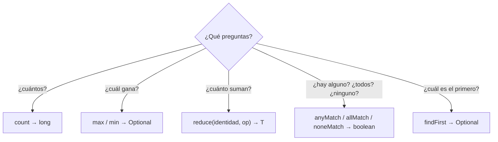

Sigue `max(Comparator.comparing(Envio::costo))` sobre los cuatro envíos:

1. La terminal arranca el recorrido y guarda el primer elemento, `A1`, como candidato.
2. Llega `A2`. El comparador compara `25000` con `10000`; `A2` pasa a ser el candidato.
3. Llegan `A3` y `A4`. Ninguno supera `25000`, así que el candidato no cambia.
4. Se agota la fuente y `max` devuelve `Optional[A2]`. Internamente equivale a un `reduce` con
   `BinaryOperator.maxBy`, el operador que viste en el Tema 5.

Ahora sigue `anyMatch(e -> e.estado() == Estado.FALLIDO)`:

1. `A1` no cumple y `A2` tampoco. La terminal sigue pidiendo elementos.
2. `A3` cumple. La terminal ya sabe la respuesta y avisa a la fuente que no quiere más.
3. Devuelve `true`. `A4` nunca se evalúa.

`allMatch` hace lo contrario: corta en cuanto encuentra el primero que **no** cumple. `noneMatch` corta en cuanto
encuentra uno que sí cumple. `findFirst` corta en cuanto el primer elemento atraviesa el `filter`.

Puedes comprobar el corte con una traza, igual que en el Tema 4:

```java
List<String> vistos = new ArrayList<>();
boolean hay = envios.stream()
        .peek(e -> vistos.add(e.id()))
        .anyMatch(e -> e.estado() == Estado.FALLIDO);
```

Con los envíos del problema resuelto, `vistos` termina con `[A1, A2, A3]`. El cuarto envío nunca entró al pipeline.

##### 4. Reglas, variantes y casos límite

Las listas vacías tienen reglas fijas, tomadas de la lógica. `anyMatch` devuelve `false` y no evalúa el predicado.
`allMatch` y `noneMatch` devuelven `true`: «todos los elementos de un conjunto vacío cumplen» es verdadero por
vacuidad. `max`, `min`, `findFirst` y `reduce` sin identidad devuelven `Optional.empty`.

`max`, `min` y `findFirst` lanzan `NullPointerException` si el elemento elegido es `null`. La razón es que `Optional`
no puede contener `null`.

`findFirst` respeta el orden de encuentro. `findAny` puede devolver cualquier elemento que cumpla, y su resultado
puede variar en un stream paralelo. En secuencial suelen coincidir, pero la documentación no lo garantiza.

`count` devuelve `long`, no `int`. Desde Java 9 puede responder sin recorrer si la fuente conoce su tamaño, como
viste en el Tema 4.

Hay otras terminales que verás en otros temas. `forEach` ejecuta un `Consumer` por elemento; en paralelo no respeta
el orden, y `forEachOrdered` sí. `toArray` produce un arreglo. `toList()`, desde Java 16, produce una lista que no
se puede modificar. `collect` es la terminal general del Tema 10.

Un stream, una terminal. Si necesitas dos respuestas sobre los mismos datos, crea un stream nuevo desde la lista para
cada una, como hace el problema resuelto.

##### 5. Relación con lo que ya sabes y lo que viene

En Java, Módulo 4, Tema 1 usaste `reduce` y `collect` como terminales. Este tema completa el catálogo y, sobre todo,
une cada terminal con la pregunta que responde.

`max` y `min` aplican el `Comparator` de Java, Módulo 2, Tema 5 en una sola pasada. Es más barato que `sorted` del
Tema 8 seguido de `findFirst`, que necesita guardar y ordenar todo.

Las terminales que devuelven `Optional` conectan con el Tema 7. Cierras su resultado con `map`, `orElse` u
`orElseThrow`, igual que la búsqueda por id del repositorio.

El cortocircuito es la versión terminal de `limit` del Tema 4. El Tema 10 presenta `collect` con collectors, para
respuestas con forma de lista, mapa o texto. El Tema 11 muestra por qué `findAny` es más barato que `findFirst` en
paralelo.

#### Problema resuelto 9.1
Responde las preguntas del supervisor sobre los cuatro envíos y comprueba qué devuelven las mismas terminales con
una lista vacía.

**Razonamiento:**
1. «¿Cuántos entregados?» es filtrar y contar.
2. «¿El más caro y el más barato?» compara costos: `max` y `min` con `Comparator.comparing(Envio::costo)`.
3. «¿Cuánto suman?» es `reduce` con `BigDecimal.ZERO` y `BigDecimal::add`.
4. Las preguntas de sí o no usan las terminales `Match`; «el primero en ruta» es `filter` y `findFirst`.

```java
import java.math.BigDecimal;
import java.util.Comparator;
import java.util.List;
import java.util.Optional;

public class Terminales {

    enum Estado { PENDIENTE, EN_RUTA, ENTREGADO, FALLIDO }

    record Envio(String id, String destino, BigDecimal costo, Estado estado) {}

    public static void main(String[] args) {
        List<Envio> envios = List.of(
                new Envio("A1", "BOG", new BigDecimal("10000"), Estado.ENTREGADO),
                new Envio("A2", "MED", new BigDecimal("25000"), Estado.PENDIENTE),
                new Envio("A3", "BOG", new BigDecimal("8000"), Estado.FALLIDO),
                new Envio("A4", "CALI", new BigDecimal("12000"), Estado.EN_RUTA));

        long entregados = envios.stream().filter(e -> e.estado() == Estado.ENTREGADO).count();
        Optional<Envio> masCaro = envios.stream().max(Comparator.comparing(Envio::costo));
        Optional<Envio> masBarato = envios.stream().min(Comparator.comparing(Envio::costo));
        BigDecimal suma = envios.stream().map(Envio::costo).reduce(BigDecimal.ZERO, BigDecimal::add);
        System.out.println("ENTREGADOS=" + entregados + " MAS_CARO=" + masCaro.map(Envio::id).orElse("NA")
                + " MAS_BARATO=" + masBarato.map(Envio::id).orElse("NA") + " SUMA=" + suma);

        System.out.println("¿alguno fallido?     " + envios.stream().anyMatch(e -> e.estado() == Estado.FALLIDO));
        System.out.println("¿todos con costo>0?  " + envios.stream().allMatch(e -> e.costo().signum() > 0));
        System.out.println("¿ninguno a PAS?      " + envios.stream().noneMatch(e -> e.destino().equals("PAS")));
        System.out.println("primero en ruta:     " + envios.stream()
                .filter(e -> e.estado() == Estado.EN_RUTA).findFirst().map(Envio::id).orElse("NA"));

        List<Envio> vacia = List.of();
        System.out.println("max de lista vacía:  " + vacia.stream().max(Comparator.comparing(Envio::costo)));
        System.out.println("anyMatch vacía:      " + vacia.stream().anyMatch(e -> true)
                + " | allMatch vacía: " + vacia.stream().allMatch(e -> false));
    }
}
```

```text
$ java Terminales.java
ENTREGADOS=1 MAS_CARO=A2 MAS_BARATO=A3 SUMA=55000
¿alguno fallido?     true
¿todos con costo>0?  true
¿ninguno a PAS?      true
primero en ruta:     A4
max de lista vacía:  Optional.empty
anyMatch vacía:      false | allMatch vacía: true
```

**Explicación por partes.**
- Línea 19: solo `A1` está entregado: `1`.
- Líneas 20–21: `max` y `min` devuelven `Optional<Envio>`; `map(Envio::id)` y `orElse` sacan el id.
- Línea 22: la suma con identidad devuelve `BigDecimal` directamente: `55000`.
- Líneas 26–30: las tres preguntas de sí o no y el primer envío en ruta.
- Líneas 32–35: con la lista vacía, `max` devuelve `Optional.empty`, `anyMatch` da `false` y `allMatch` da `true`.

> **Error común.** Usar `reduce` sin identidad y esperar un valor directo. `BigDecimal suma = ...stream().reduce(BigDecimal::add);`
> produce `error: incompatible types: Optional<BigDecimal> cannot be converted to BigDecimal`. Pasa la identidad
> (`reduce(BigDecimal.ZERO, BigDecimal::add)`) o cierra el `Optional`.

> **Buena práctica.** Elige la terminal que nombra la pregunta. `anyMatch(fallido)` se lee como «¿hay algún
> fallido?»; `filter(fallido).count() > 0` obliga a traducir y además recorre todo.

> **Prevenir errores.** Prueba cada terminal con una lista vacía. `allMatch` devuelve `true` sin elementos; si tu
> regla es «todos los envíos están entregados», un lote vacío pasaría como correcto.

#### Checkpoint 9.1
¿Por qué `allMatch(e -> false)` devuelve `true` con una lista vacía?

Respuesta: porque no hay ningún elemento que incumpla. «Todos cumplen» es verdadero cuando no existe un contraejemplo.

</details>

<details>
<summary><strong>Capa 2 — Construcción</strong></summary>

#### Paso 1 · Ejecuta las preguntas
Guarda el Problema resuelto 9.1 como `Terminales.java` y ejecuta `java Terminales.java`. Comprueba
`ENTREGADOS=1 MAS_CARO=A2 MAS_BARATO=A3 SUMA=55000`.

#### Paso 2 · Compara con el proyecto
En `ReporteEnvios`, `masCaro` usa `max`, `totalEntregados` usa `count` y `sumaCostos` usa `reduce`. La salida de
`./gradlew -q run` muestra `MAS_CARO=A2`, `ENTREGADOS=1` y `SUMA=55000`.

#### Paso 3 · Provoca el error de tipos de reduce
Quita `BigDecimal.ZERO` de la línea 22 y compila. Lee el mensaje `Optional<BigDecimal> cannot be converted to
BigDecimal` y vuelve a poner la identidad.

#### Resumen
- **`count`** devuelve un `long` con la cantidad de elementos.
- **`max` y `min`** recorren una vez y devuelven `Optional`, vacío si no hay elementos.
- **`anyMatch`**, **`allMatch`** y **`noneMatch`** responden sí o no y pueden parar antes de terminar.
- **`findFirst`** devuelve el primer elemento en orden de encuentro dentro de un `Optional`.
- `reduce` con identidad devuelve el tipo directo; sin identidad, un `Optional`.

#### Ejercicio verificable 1
Básico. ¿Cuántos envíos van a `BOG`?

Respuesta esperada: `2`, con `filter(e -> e.destino().equals("BOG")).count()`.

#### Ejercicio verificable 2
Intermedio. ¿Cuál es el envío más barato entre los que no están fallidos?

Respuesta esperada: `A1`. `filter(e -> e.estado() != Estado.FALLIDO).min(Comparator.comparing(Envio::costo))`; sin `A3`, el menor es `10000`.

#### Ejercicio verificable 3
Reto. ¿Qué imprime `List.<Envio>of().stream().noneMatch(e -> true)` y por qué?

Respuesta esperada: `true`. No hay ningún elemento que cumpla, así que «ninguno cumple» es verdadero.

#### En el trabajo
Los validadores de lotes usan `allMatch` para aceptar un archivo y `anyMatch` para rechazarlo. Un lote vacío que pasa
`allMatch` es un fallo real que se ha visto en producción; por eso se valida el tamaño antes de la regla.

</details>

### Tema 10: Collectors: formar listas, mapas, grupos y texto · Avanzado · 50 min

<details open>
<summary><strong>Capa 1 — Lectura</strong></summary>

#### Objetivos
Al terminar este tema podrás:
- agrupar envíos con `groupingBy` eligiendo la clave, el tipo de mapa y lo que se acumula en cada grupo;
- combinar collectors *downstream* como `mapping`, `counting` y `reducing`;
- fijar el orden de un mapa por enum con `EnumMap` y reunir resultados en el contenedor que elijas;
- corregir el error de tipos de `joining` sobre un stream que no es de texto.

**Conceptos clave:** groupingBy, collector downstream, mapping, toCollection, EnumMap

Ya los conoces y no se repiten: `collect` y Collectors, incluido `joining` (Java, Módulo 4, Tema 1); `HashMap`,
`LinkedHashMap`, `TreeMap` y `TreeSet` (Java, Módulo 2, Tema 1); `enum` (Java, Módulo 0, Tema 6).

#### El problema
El tablero de Tienda Aurora muestra los envíos por estado, el costo por destino y la lista de ids. Un día el orden de
los estados en pantalla cambió sin que nadie tocara el código. El mapa salía de `groupingBy(Envio::estado)`. ¿Qué
decide el orden de un mapa agrupado y cómo lo fijas?

#### Glosario del tema

**`groupingBy`**
- **Definición técnica:** collector de `Collectors` que reparte los elementos en un `Map` según una función clasificadora; acepta la fábrica del mapa y un collector para los valores de cada grupo.
- **En palabras sencillas:** clasificar cartas en casilleros: la clave dice el casillero y lo de adentro es lo que guardas.
- **Dónde se rompe la comparación:** sin fábrica, el mapa es un `HashMap` y el orden de los casilleros no está garantizado.
- **Ejemplo:** `groupingBy(Envio::estado)` (líneas 23–24 del Problema resuelto 10.1) devuelve un mapa de tipo `HashMap`.
- **Error típico:** confiar en el orden de impresión de ese `HashMap`; cambia entre equipos y versiones.

**collector downstream**
- **Definición técnica:** collector que `groupingBy` aplica a los elementos de cada grupo para producir el valor de esa clave; por defecto es `toList()`.
- **En palabras sencillas:** la regla de qué guardas en cada casillero: la carta entera, solo su número o el total.
- **Dónde se rompe la comparación:** los downstream se anidan: un `mapping` puede contener un `toList` o un `joining`.
- **Ejemplo:** `Collectors.reducing(BigDecimal.ZERO, Envio::costo, BigDecimal::add)` (línea 38) suma costos por destino: `{BOG=18000, MED=25000, CALI=12000}`.
- **Error típico:** agrupar con `toList()` y luego recorrer el mapa para sumar; el downstream lo hace en la misma pasada.

**`mapping`**
- **Definición técnica:** collector `Collectors.mapping(Function, Collector)` que transforma cada elemento antes de pasarlo a otro collector.
- **En palabras sencillas:** quedarte solo con el número de la carta antes de meterla al casillero.
- **Dónde se rompe la comparación:** es el `map` de los collectors; solo tiene sentido dentro de otro collector como `groupingBy`.
- **Ejemplo:** `Collectors.mapping(Envio::id, Collectors.toList())` (línea 31) guarda ids en lugar de envíos completos.
- **Error típico:** hacer `map(Envio::id)` antes de `groupingBy`; pierdes el estado con el que querías agrupar.

**`toCollection`**
- **Definición técnica:** collector `Collectors.toCollection(Supplier<C>)` que reúne los elementos en la colección que crea el `Supplier`.
- **En palabras sencillas:** elegir la caja donde quedará el resultado: lista, conjunto ordenado o cola.
- **Dónde se rompe la comparación:** la caja define reglas: un `TreeSet` ordena y quita duplicados aunque no lo pidas.
- **Ejemplo:** `Collectors.toCollection(TreeSet::new)` (línea 47) imprime `DEST_SET=[BOG, CALI, MED]`.
- **Error típico:** usar `toSet()` y esperar orden; `toSet()` no promete ningún tipo de conjunto en particular.

**`EnumMap`**
- **Definición técnica:** implementación de `Map` de `java.util` para claves de un `enum`; guarda las entradas en un arreglo indexado por el ordinal y recorre en el orden de declaración.
- **En palabras sencillas:** un casillero por cada valor del enum, siempre en la misma fila.
- **Dónde se rompe la comparación:** solo acepta claves de un enum; se crea con la clase del enum: `new EnumMap<>(Estado.class)`.
- **Ejemplo:** con `() -> new EnumMap<>(Estado.class)` (línea 30), la salida sigue la declaración: `PENDIENTE, EN_RUTA, ENTREGADO, FALLIDO`.
- **Error típico:** pasar `EnumMap::new` como fábrica; no compila porque `EnumMap` no tiene constructor sin argumentos.

#### ► CÓMO FUNCIONA

##### 1. La idea en lenguaje sencillo

En una oficina de correo, las cartas del día se reparten en casilleros. Para hacerlo bien decides tres cosas: qué
dato de la carta elige el casillero, cómo está ordenado el mueble de casilleros y qué guardas en cada uno. Puedes
guardar la carta entera, solo su número o el total del franqueo.

Un collector es esa decisión escrita como objeto. `collect` recibe uno y lo usa para reunir el resultado del stream
en una lista, un conjunto, un texto o un mapa. Tienda Aurora descubrió que el mueble importa: con un `HashMap`, el
orden de los estados en pantalla dependía de la máquina. Este tema explica qué decide ese orden y cómo lo fijas.

##### 2. Definición formal y vocabulario

`Stream.collect(Collector)` es una terminal de **reducción mutable**: acumula los elementos en un contenedor que se
va modificando. La interfaz `Collector<T, A, R>` describe esa reducción con cuatro funciones: un `supplier` crea el
contenedor, un `accumulator` agrega cada elemento, un `combiner` une dos contenedores parciales y un `finisher`
produce el resultado final.

La clase `Collectors` trae implementaciones listas:

- **`groupingBy`** reparte los elementos en un `Map` según una función clasificadora.
- Un **collector downstream** es el que `groupingBy` aplica dentro de cada grupo; por defecto, `toList()`.
- **`mapping`** transforma cada elemento antes de entregarlo a otro collector.
- **`toCollection`** reúne en la colección que crea el `Supplier` que le pasas.

**`EnumMap`** es el mapa de `java.util` para claves de un `enum`. Guarda los valores en un arreglo indexado por el
ordinal y, por eso, recorre siempre en el orden de declaración. Dicho de forma sencilla: una fila de casilleros fija.

##### 3. Cómo funciona por dentro, paso a paso

`groupingBy` con tres argumentos toma tres decisiones, que el diagrama muestra en orden:

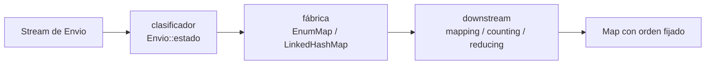

Sigue `idsPorEstado` del Problema resuelto 10.1:

1. El `supplier` del collector llama a la fábrica `() -> new EnumMap<>(Estado.class)` y crea un mapa vacío.
2. Llega `A1`. El clasificador devuelve `ENTREGADO`. Como esa clave no existe, el collector crea el contenedor del
   downstream, una lista vacía, y lo guarda bajo esa clave.
3. El downstream `mapping` aplica `Envio::id` y entrega `"A1"` a la lista de `ENTREGADO`.
4. Lo mismo ocurre con `A2`, `A3` y `A4`, cada uno en su clave.
5. Al final, el `finisher` de cada downstream convierte su contenedor en el valor definitivo. En `toList()` no hay
   nada que convertir.
6. Al imprimir, `EnumMap` recorre por ordinal: `PENDIENTE, EN_RUTA, ENTREGADO, FALLIDO`.

Sin fábrica, el paso 1 crea un `HashMap`. Un `HashMap` ordena sus entradas por el hash de la clave. El hash de una
constante de enum es el de identidad del objeto, que puede cambiar entre ejecuciones de la JVM. Por eso el mismo proyecto
imprimió `POR_ESTADO=[ENTREGADO, EN_RUTA, PENDIENTE, FALLIDO]` en macOS y
`POR_ESTADO=[FALLIDO, ENTREGADO, PENDIENTE, EN_RUTA]` con OpenJDK 25.0.5.1 en Linux.

Con `LinkedHashMap::new`, el mapa recuerda el orden de inserción: `BOG, MED, CALI`, que es el orden en que esos
destinos aparecen por primera vez. Con `reducing(BigDecimal.ZERO, Envio::costo, BigDecimal::add)`, cada grupo empieza
en cero y suma: `BOG=18000`.

##### 4. Reglas, variantes y casos límite

La documentación de `groupingBy`, `toList` y `toSet` no garantiza el tipo, la mutabilidad ni el orden del resultado.
Que hoy devuelvan `HashMap` o `ArrayList` es un detalle de implementación. Si necesitas un tipo concreto, pásalo con
una fábrica o con `toCollection`.

`toMap` se parece a `groupingBy`, pero no admite dos elementos con la misma clave. Si los hay, lanza
`IllegalStateException`:

```java
envios.stream().collect(Collectors.toMap(Envio::destino, Envio::id));
// Duplicate key BOG (attempted merging values A1 and A3)
```

Para resolverlo, pasa una función de mezcla como tercer argumento: `(x, y) -> x + "+" + y` produce `BOG=A1+A3`.

`joining` solo acepta `CharSequence`. Sobre números falla al compilar, como muestra el recuadro de error.

La biblioteca creció por versiones. Java 9 añadió `filtering` y `flatMapping` como downstream. Java 10 añadió
`toUnmodifiableList`, `toUnmodifiableSet` y `toUnmodifiableMap`. Java 12 añadió `teeing`, que alimenta dos collectors
con el mismo stream y combina sus resultados.

`EnumMap::new` no sirve como fábrica: `EnumMap` no tiene constructor sin argumentos, porque necesita la clase del enum.
Escribe la lambda `() -> new EnumMap<>(Estado.class)`.

En paralelo, cada hilo llena su propio mapa y el `combiner` los une. Existe `groupingByConcurrent`, que usa un solo
`ConcurrentMap` compartido, pero no conserva el orden de encuentro.

##### 5. Relación con lo que ya sabes y lo que viene

En Java, Módulo 4, Tema 1 usaste `collect` con `toList` y `joining`. Este tema abre el collector y muestra sus
piezas: contenedor, acumulación, combinación y acabado.

`HashMap`, `LinkedHashMap`, `TreeMap` y `TreeSet` vienen de Java, Módulo 2, Tema 1. Aquí su diferencia de orden deja
de ser teoría: decide lo que ve el usuario en el tablero.

`reducing` es el `reduce` del Tema 9 aplicado a cada grupo, con la misma regla de identidad neutra y operación
asociativa del Tema 5. `mapping` es el `map` del Tema 8 metido dentro de un collector.

El Tema 11 explica por qué el `combiner` existe: en un stream paralelo, cada parte llena su propio contenedor. El
Tema 12 usa estos collectors como cálculos puros que devuelven datos sin imprimir nada.

#### Problema resuelto 10.1
Agrupa los envíos por estado con orden fijo, suma y cuenta por destino conservando el orden de llegada, une los ids
en texto y reúne los destinos en un conjunto ordenado.

**Razonamiento:**
1. Primero comprueba qué mapa crea `groupingBy` sin fábrica: imprime su clase.
2. Para estados, la fábrica es `EnumMap`; en cada grupo solo interesan los ids: `mapping(Envio::id, toList())`.
3. Para destinos, el orden de llegada se conserva con `LinkedHashMap`; el valor es una suma (`reducing`) o un conteo (`counting`).
4. Los ids van a texto con `joining`; los destinos a un `TreeSet` con `toCollection`.

```java
import java.math.BigDecimal;
import java.util.EnumMap;
import java.util.LinkedHashMap;
import java.util.List;
import java.util.Map;
import java.util.Set;
import java.util.TreeSet;
import java.util.stream.Collectors;

public class Agrupar {

    enum Estado { PENDIENTE, EN_RUTA, ENTREGADO, FALLIDO }

    record Envio(String id, String destino, BigDecimal costo, Estado estado) {}

    public static void main(String[] args) {
        List<Envio> envios = List.of(
                new Envio("A1", "BOG", new BigDecimal("10000"), Estado.ENTREGADO),
                new Envio("A2", "MED", new BigDecimal("25000"), Estado.PENDIENTE),
                new Envio("A3", "BOG", new BigDecimal("8000"), Estado.FALLIDO),
                new Envio("A4", "CALI", new BigDecimal("12000"), Estado.EN_RUTA));

        Map<Estado, List<Envio>> porEstado = envios.stream()
                .collect(Collectors.groupingBy(Envio::estado));
        System.out.println("tipo de mapa: " + porEstado.getClass().getSimpleName());

        Map<Estado, List<String>> idsPorEstado = envios.stream()
                .collect(Collectors.groupingBy(
                        Envio::estado,
                        () -> new EnumMap<>(Estado.class),
                        Collectors.mapping(Envio::id, Collectors.toList())));
        System.out.println("POR_ESTADO=" + idsPorEstado);

        Map<String, BigDecimal> costoPorDestino = envios.stream()
                .collect(Collectors.groupingBy(
                        Envio::destino,
                        LinkedHashMap::new,
                        Collectors.reducing(BigDecimal.ZERO, Envio::costo, BigDecimal::add)));
        System.out.println("COSTO_DESTINO=" + costoPorDestino);

        Map<String, Long> cuantosPorDestino = envios.stream()
                .collect(Collectors.groupingBy(Envio::destino, LinkedHashMap::new, Collectors.counting()));
        System.out.println("CUANTOS=" + cuantosPorDestino);

        String ids = envios.stream().map(Envio::id).collect(Collectors.joining(", ", "[", "]"));
        Set<String> destinos = envios.stream().map(Envio::destino)
                .collect(Collectors.toCollection(TreeSet::new));
        System.out.println("IDS=" + ids + " DEST_SET=" + destinos);
    }
}
```

```text
$ java Agrupar.java
tipo de mapa: HashMap
POR_ESTADO={PENDIENTE=[A2], EN_RUTA=[A4], ENTREGADO=[A1], FALLIDO=[A3]}
COSTO_DESTINO={BOG=18000, MED=25000, CALI=12000}
CUANTOS={BOG=2, MED=1, CALI=1}
IDS=[A1, A2, A3, A4] DEST_SET=[BOG, CALI, MED]
```

**Explicación por partes.**
- Líneas 23–25: sin fábrica, el mapa es un `HashMap`: su orden de recorrido no está garantizado.
- Líneas 27–32: clasificador, fábrica `EnumMap` y downstream `mapping`. El orden sigue la declaración del enum.
- Líneas 34–39: `LinkedHashMap::new` conserva `BOG, MED, CALI`, el orden en que aparecen; `reducing` suma `10000 + 8000` en BOG.
- Líneas 41–43: el mismo agrupamiento con `counting()` da `{BOG=2, MED=1, CALI=1}`.
- Líneas 45–48: `joining` con separador, prefijo y sufijo; `toCollection(TreeSet::new)` ordena y quita duplicados.

> **Error común.** Usar `joining` sobre un stream que no es de texto. `List.of(10000, 25000).stream().collect(Collectors.joining(", "))`
> produce `error: no suitable method found for collect(Collector<CharSequence,CAP#1,String>)`. Convierte antes:
> `map(String::valueOf)` y después `joining`.

> **Buena práctica.** Declara el orden que necesitas con la fábrica del mapa: `EnumMap` para enums, `LinkedHashMap`
> para orden de llegada y `TreeMap` para orden natural. Un `HashMap` solo sirve cuando el orden no se muestra.

> **Prevenir errores.** Si una prueba compara la impresión de un mapa, asegúrate de que el mapa tiene orden
> garantizado. Si no, la prueba pasa en tu equipo y falla en el servidor de integración.

#### Checkpoint 10.1
¿Por qué `COSTO_DESTINO` muestra `BOG` primero y `CALI` al final, si `CALI` va antes que `MED` en orden alfabético?

Respuesta: porque el mapa es un `LinkedHashMap`, que conserva el orden de inserción: `BOG` (A1), `MED` (A2) y `CALI` (A4).

</details>

<details>
<summary><strong>Capa 2 — Construcción</strong></summary>

#### Paso 1 · Ejecuta los collectors
Guarda el Problema resuelto 10.1 como `Agrupar.java` y ejecuta `java Agrupar.java`. Comprueba que
`POR_ESTADO` sigue el orden `PENDIENTE, EN_RUTA, ENTREGADO, FALLIDO`.

#### Paso 2 · Revisa los collectors del proyecto
En `ReporteEnvios`, localiza `porEstado`, `costoPorDestino`, `resumenIds` y `destinosOrdenados`. Identifica en cada
uno el collector y, si existe, la fábrica y el downstream.

#### Paso 3 · Fija el orden de porEstado
En tu copia del proyecto, cambia `porEstado` a `groupingBy(Envio::estado, () -> new EnumMap<>(EstadoEnvio.class),
Collectors.toList())`. Agrega `import java.util.EnumMap;`. Ejecuta `./gradlew -q run`
dos veces: `POR_ESTADO` debe salir `[PENDIENTE, EN_RUTA, ENTREGADO, FALLIDO]` en cualquier equipo.

#### Resumen
- **`groupingBy`** reparte en un mapa; sin fábrica crea un `HashMap` sin orden garantizado.
- Un **collector downstream** decide qué se guarda por grupo: lista, conteo, suma o texto.
- **`mapping`** transforma cada elemento antes de entregarlo al collector interno.
- **`toCollection`** reúne el resultado en la colección que elijas, con sus reglas.
- **`EnumMap`** recorre las claves en el orden en que el enum las declara.

#### Ejercicio verificable 1
Básico. Cuenta los envíos por destino en orden alfabético.

Respuesta esperada: `groupingBy(Envio::destino, TreeMap::new, Collectors.counting())` imprime `{BOG=2, CALI=1, MED=1}`.

#### Ejercicio verificable 2
Intermedio. Agrupa los ids por destino conservando el orden de llegada.

Respuesta esperada: `groupingBy(Envio::destino, LinkedHashMap::new, Collectors.mapping(Envio::id, Collectors.toList()))`
imprime `{BOG=[A1, A3], MED=[A2], CALI=[A4]}`.

#### Ejercicio verificable 3
Reto. Suma los costos por estado en un `EnumMap`.

Respuesta esperada: `{PENDIENTE=25000, EN_RUTA=12000, ENTREGADO=10000, FALLIDO=8000}`, con la fábrica
`() -> new EnumMap<>(Estado.class)` y el downstream `reducing(BigDecimal.ZERO, Envio::costo, BigDecimal::add)`.

#### En el trabajo
Los reportes que se exportan a CSV o se muestran en un tablero necesitan columnas en un orden estable. Los equipos
fijan la fábrica del mapa en el collector, o convierten a una lista ordenada antes de serializar, para que el archivo
no cambie entre ejecuciones.

</details>

### Tema 11: Streams paralelos: comparar antes de acelerarlos · Avanzado · 50 min

<details open>
<summary><strong>Capa 1 — Lectura</strong></summary>

#### Objetivos
Al terminar este tema podrás:
- reproducir una suma paralela que pierde valores por estado mutable compartido y corregirla;
- elegir la identidad correcta de `reduce` y explicar por qué una incorrecta cambia el resultado en paralelo;
- distinguir una medición casera de un microbenchmark antes de decidir si usar `parallelStream()`.

**Conceptos clave:** elemento identidad, microbenchmark

Ya los conoces y no se repiten: stream paralelo, ForkJoinPool común, operación asociativa y efecto secundario (Java,
Módulo 4, Tema 4); estado mutable compartido y operación atómica (Java, Módulo 5, Tema 4); condición de carrera
(Fundamentos, Módulo 5, Tema 2); desbordamiento (Java, Módulo 0, Tema 4); `BinaryOperator` (Tema 5 de este módulo).

#### El problema
El cierre diario de Tienda Aurora suma un millón de valores. Alguien cambió `stream()` por `parallelStream()` y
acumuló en un arreglo `caja[0] += v`. Las pruebas pasaron casi siempre; en producción, algunos cierres no cuadran.
¿Por qué la misma suma da resultados distintos, y qué condiciones debe cumplir un cálculo para ir en paralelo?

#### Glosario del tema

**elemento identidad**
- **Definición técnica:** valor `id` que, combinado con cualquier `x` mediante la operación, devuelve `x`: `op(id, x) == x`. `reduce(identidad, op)` lo usa como punto de partida de cada parte.
- **En palabras sencillas:** el valor que no cambia nada: el cero para sumar, el uno para multiplicar.
- **Dónde se rompe la comparación:** en paralelo, la identidad no se usa una vez sino una por cada parte; si no es neutra, se suma varias veces.
- **Ejemplo:** con identidad `1`, la suma secuencial da `55001` y la paralela `55004` (líneas 30–31 del Problema resuelto 11.1).
- **Error típico:** usar como identidad un valor inicial de negocio, como un saldo de apertura; súmalo después del `reduce`.

**microbenchmark**
- **Definición técnica:** medición controlada del tiempo de una porción pequeña de código, con calentamiento del JIT, repeticiones y análisis estadístico; en Java se hace con JMH (*Java Microbenchmark Harness*).
- **En palabras sencillas:** cronometrar muchas veces, en condiciones parecidas, antes de decir cuál es más rápido.
- **Dónde se rompe la comparación:** un cronómetro con `System.nanoTime()` mide una sola vez y mezcla calentamiento, recolección de basura y ruido del equipo.
- **Ejemplo:** la auditoría de Java, Módulo 4, Tema 4, midió `seq=12ms par=2ms` en una corrida; el número útil allí era `same=true`, no los milisegundos.
- **Error típico:** decidir con una sola medición casera; en este módulo no se ejecutó JMH, así que no se afirma ninguna aceleración.

#### ► CÓMO FUNCIONA

##### 1. La idea en lenguaje sencillo

Para contar el dinero de cuatro cajas registradoras, puedes pedir a cuatro personas que cuenten una caja cada una y
luego sumar sus totales. Funciona si cada persona anota en su propia hoja. Si las cuatro escriben a la vez en el
mismo cuaderno, una borra lo que otra acaba de anotar y el total no cuadra.

Un stream paralelo reparte el trabajo de esa forma. Gana velocidad solo si cada parte trabaja sola y las partes se
pueden juntar en cualquier agrupación. El cierre de Tienda Aurora falló por compartir el cuaderno: varios hilos
escribían en `caja[0]`. Y aunque el cálculo sea correcto, repartir tiene un costo: para cuatro números, organizar a
cuatro personas tarda más que sumar.

##### 2. Definición formal y vocabulario

Un stream paralelo, según la documentación de `java.util.stream`, divide su fuente en partes que se procesan en
varios hilos. Lo obtienes con `parallelStream()` sobre una colección o con `parallel()` sobre un stream. Por defecto
usa el `ForkJoinPool` común de la JVM.

`reduce(identidad, op)` exige dos propiedades. La operación debe ser **asociativa**: `(a op b) op c` igual a
`a op (b op c)`. Y la identidad debe ser un **elemento identidad**: `op(identidad, x)` debe devolver `x` para todo
`x`. En lenguaje sencillo: el valor que no cambia nada, como el cero en la suma.

Un **microbenchmark** es una medición controlada de un fragmento pequeño de código. En Java se hace con JMH, que
calienta el compilador JIT, repite muchas veces y entrega resultados con su margen de error.

##### 3. Cómo funciona por dentro, paso a paso

Sigue `costos.parallelStream().reduce(BigDecimal.ONE, BigDecimal::add)` del Problema resuelto 11.1:

1. La terminal pide al **Spliterator** de la lista que se divida. Un *spliterator* es el iterador que sabe partirse
   en dos con `trySplit()`. Una lista basada en arreglo se parte a la mitad sin recorrerse.
2. Cada mitad se vuelve a partir hasta llegar a trozos pequeños. Con cuatro costos, aquí quedaron cuatro partes.
3. Las partes se entregan como tareas al `ForkJoinPool` común. Cada hilo reduce su parte empezando desde la
   identidad: `1 + 10000`, `1 + 25000`, y así con las demás.
4. Los resultados parciales se combinan con la misma operación, en el orden de las partes.
5. Con identidad `ONE`, el `1` entró una vez por parte: `55004`. Con `ZERO` también entró cuatro veces, pero sumar cero no cambia nada: `55000`.

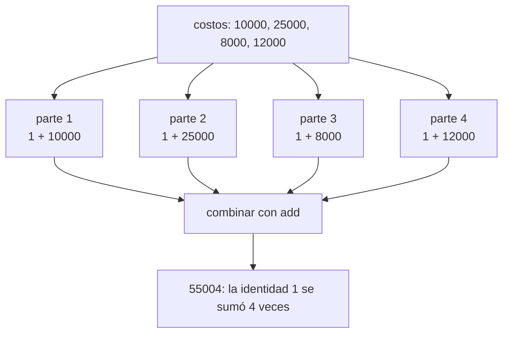

`caja[0] += v` falla por otra razón. Esa línea son tres pasos: leer `caja[0]`, sumar `v` y escribir el resultado.

1. El hilo A lee `caja[0]` y obtiene, por ejemplo, `100`.
2. Antes de que A escriba, el hilo B también lee `100`.
3. A escribe `100 + 7` y B escribe `100 + 9`. La suma de A se pierde.

Eso es una **condición de carrera**. No produce excepción: produce un número equivocado a veces. En la corrida del
tema, la versión insegura acertó tres de cinco veces.

La versión segura evita el problema por diseño. `mapToLong(...).sum()` da a cada parte su propio acumulador y solo
combina al final, que es exactamente el paso 4.

##### 4. Reglas, variantes y casos límite

El paralelismo del pool común es, por defecto, el número de procesadores menos uno. El hilo que llama a la terminal
también trabaja. Puedes cambiarlo con la propiedad del sistema `java.util.concurrent.ForkJoinPool.common.parallelism`,
pero afecta a toda la JVM.

`parallel()` y `sequential()` no actúan por etapa. La última llamada decide el modo de todo el pipeline.

Los streams paralelos conservan el orden de encuentro cuando la fuente lo tiene. `findFirst`, `forEachOrdered` y
`collect` con `toList()` respetan ese orden, pero pagan coordinación. `forEach` y `findAny` no lo respetan, y por eso
son más baratos. `unordered()` declara que el orden no importa.

La fuente decide cuánto se gana. `ArrayList`, arreglos y `IntStream.range` se parten bien. `LinkedList`,
`Stream.iterate` y fuentes de I/O se parten mal, y el paralelismo puede empeorar el tiempo.

El pool común es compartido. Una tarea que se bloquea en red o en disco ocupa un hilo que otros streams paralelos de
la misma JVM necesitan.

En `reduce` de tres argumentos, la documentación exige además que el combinador sea compatible con el acumulador.
Si no lo es, el resultado secuencial y el paralelo difieren, igual que con una identidad incorrecta.

##### 5. Relación con lo que ya sabes y lo que viene

En Java, Módulo 4, Tema 4 conociste el stream paralelo, el pool común y la asociatividad. Este tema muestra el
mecanismo que hace obligatorias esas reglas: dividir, reducir cada parte desde la identidad y combinar.

La carrera es la misma que viste en Fundamentos, Módulo 5, Tema 2 y en Java, Módulo 5, Tema 4. La diferencia es que
aquí los hilos no se ven: los crea el stream.

La identidad neutra y la asociatividad vienen del `BinaryOperator` del Tema 5. El `combiner` de los collectors del
Tema 10 existe por este mismo motivo: unir los contenedores parciales de cada parte.

El Tema 12 da la solución de fondo. Un cálculo puro, que no toca estado externo, se puede paralelizar sin carreras.
El Tema 13 presenta otra forma de repartir trabajo entre hilos, con eventos y demanda explícita.

#### Problema resuelto 11.1
Suma un millón de valores en paralelo con un acumulador compartido y con una suma sin estado. Después reduce los
costos de los envíos con una identidad correcta y con una incorrecta.

**Razonamiento:**
1. El acumulador `long[] caja` es estado mutable compartido: varios hilos ejecutan `caja[0] += v` a la vez.
2. La versión segura no comparte nada: `mapToLong(...).sum()` reduce cada parte y combina al final.
3. Repite cinco veces: una carrera no falla siempre, así que una sola corrida no prueba nada.
4. Para la identidad, compara `reduce` secuencial y paralelo con `ZERO` y con `ONE`.

```java
import java.math.BigDecimal;
import java.util.List;
import java.util.stream.IntStream;

public class Carrera {

    static long sumaInsegura(List<Integer> valores) {
        final long[] caja = {0};                      // estado mutable compartido
        valores.parallelStream().forEach(v -> caja[0] += v);
        return caja[0];
    }

    static long sumaSegura(List<Integer> valores) {
        return valores.parallelStream().mapToLong(Integer::longValue).sum();
    }

    public static void main(String[] args) {
        List<Integer> valores = IntStream.rangeClosed(1, 1_000_000).boxed().toList();
        System.out.println("esperado = 500000500000");
        for (int corrida = 1; corrida <= 5; corrida++) {
            System.out.println("corrida " + corrida + ": insegura=" + sumaInsegura(valores)
                    + " segura=" + sumaSegura(valores));
        }

        List<BigDecimal> costos = List.of(new BigDecimal("10000"), new BigDecimal("25000"),
                new BigDecimal("8000"), new BigDecimal("12000"));
        System.out.println("PARALELA=" + costos.parallelStream().reduce(BigDecimal.ZERO, BigDecimal::add));
        System.out.println("identidad 0 secuencial=" + costos.stream().reduce(BigDecimal.ZERO, BigDecimal::add)
                + " paralela=" + costos.parallelStream().reduce(BigDecimal.ZERO, BigDecimal::add));
        System.out.println("identidad 1 secuencial=" + costos.stream().reduce(BigDecimal.ONE, BigDecimal::add)
                + " paralela=" + costos.parallelStream().reduce(BigDecimal.ONE, BigDecimal::add));
    }
}
```

```text
$ java Carrera.java
esperado = 500000500000
corrida 1: insegura=500000500000 segura=500000500000
corrida 2: insegura=500000500000 segura=500000500000
corrida 3: insegura=496669200158 segura=500000500000
corrida 4: insegura=500000500000 segura=500000500000
corrida 5: insegura=478701291489 segura=500000500000
PARALELA=55000
identidad 0 secuencial=55000 paralela=55000
identidad 1 secuencial=55001 paralela=55004
```

**Explicación por partes.**
- Líneas 7–11: `caja[0] += v` no es atómico. Dos hilos leen el mismo valor, suman cada uno el suyo y uno pisa al otro.
- Líneas 13–15: `mapToLong(Integer::longValue).sum()` no comparte estado; siempre da `500000500000`.
- Líneas 20–23: en esta corrida, la versión insegura acertó tres veces y falló dos (`496669200158` y `478701291489`). Tu salida será distinta.
- Línea 27: la suma paralela de los costos con identidad `ZERO` coincide con `PARALELA=55000` del proyecto.
- Líneas 28–31: con `ZERO` las dos versiones coinciden. Con `ONE`, la secuencial suma 1 una vez y la paralela una vez por parte: `55004`.

> **Error común.** Acumular desde `forEach` de un stream paralelo en una variable externa. La salida de esta corrida
> mostró `insegura=478701291489` frente a `esperado = 500000500000`: no hay mensaje de error, solo un número
> equivocado. Usa `sum()`, `reduce` o un collector.

> **Error común.** Que el acumulador sea `int`. El `sumaParalelaInsegura` del proyecto usa `int[]`; con el millón de
> valores de este tema, un `int[]` desborda incluso sin carrera, porque `500000500000` no cabe en 32 bits. Por eso el
> Problema resuelto 11.1 usa `long[]`: así el único fallo visible es la carrera.

> **Prevenir errores.** Antes de agregar `.parallel()`, comprueba tres cosas: la operación es asociativa, la identidad
> es neutra y ningún paso modifica estado externo. Después ejecuta varias veces y compara con la versión secuencial.

> **Rendimiento.** Con 2 núcleos, el pool común tiene un hilo trabajador más el hilo que llama. Para sumar 4 costos,
> dividir y combinar cuesta más que sumar. Mide con JMH sobre tus datos antes de decidir.

#### Checkpoint 11.1
¿Por qué la versión insegura a veces da el resultado correcto?

Respuesta: porque la carrera solo ocurre cuando dos hilos leen y escriben `caja[0]` casi al mismo tiempo. Si no se
cruzan, la suma sale bien; por eso una prueba que pasa una vez no demuestra que el código sea correcto.

</details>

<details>
<summary><strong>Capa 2 — Construcción</strong></summary>

#### Paso 1 · Reproduce la carrera
Guarda el Problema resuelto 11.1 como `Carrera.java` y ejecútalo tres veces con `java Carrera.java`. Anota cuántas
corridas de `insegura` fallan; la columna `segura` debe ser siempre `500000500000`.

#### Paso 2 · Corrige con una operación atómica
Cambia el cuerpo de `sumaInsegura` por un `AtomicLong total` y `valores.parallelStream().forEach(total::addAndGet)`.
Ejecuta de nuevo: todas las corridas dan `500000500000`, aunque sigue siendo más lento que `sum()`.

#### Paso 3 · Compara con el proyecto
`ReporteEnvios.sumaParalelaSegura` usa `reduce(BigDecimal.ZERO, BigDecimal::add)`; `App` imprime `PARALELA=55000`.
`sumaParalelaInsegura` se conserva solo como contraejemplo.

#### Resumen
- `parallelStream()` divide la fuente, reduce cada parte y combina; no protege el estado compartido.
- Acumular en una variable externa desde varios hilos produce una condición de carrera silenciosa.
- El **elemento identidad** se usa una vez por parte; si no es neutro, el resultado paralelo cambia.
- La operación de `reduce` debe ser asociativa y sin efectos externos.
- Un **microbenchmark** con JMH es la forma seria de decidir si el paralelo acelera; una medición casera no basta.

#### Ejercicio verificable 1
Básico. Con los costos del Problema resuelto 11.1, usa `BigDecimal.TEN` como identidad. ¿Qué dan la versión
secuencial y la paralela?

Respuesta esperada: `55010` y `55040` en este equipo. La paralela divide los 4 costos en 4 partes y suma el 10 en cada una.

#### Ejercicio verificable 2
Intermedio. Implementa la corrección del Paso 2 con `AtomicLong` y ejecútala tres veces. ¿Qué imprime?

Respuesta esperada: `500000500000` las tres veces. `addAndGet` es una operación atómica: lee, suma y escribe sin que otro hilo se intercale.

#### Ejercicio verificable 3
Reto. Calcula la misma suma con `valores.parallelStream().collect(Collectors.summingLong(Integer::longValue))`. ¿Por
qué es segura sin `AtomicLong`?

Respuesta esperada: imprime `500000500000`. Cada parte acumula en su propio contenedor y el collector combina los
contenedores al final; ningún hilo escribe en el de otro.

#### En el trabajo
En servidores web, el pool común lo comparten todas las peticiones. Un `parallelStream()` en un endpoint puede
acaparar sus hilos y frenar a otros. Por eso muchos equipos lo evitan en código de peticiones y lo reservan para lotes
grandes, medidos con JMH.

</details>

### Tema 12: Pureza y efectos: calcular separado de guardar o imprimir · Avanzado · 45 min

<details open>
<summary><strong>Capa 1 — Lectura</strong></summary>

#### Objetivos
Al terminar este tema podrás:
- distinguir una función pura de una impura con una prueba de dos llamadas;
- reescribir un reporte para que el cálculo sea puro y el efecto quede en el borde;
- inyectar el efecto como `Consumer` y probarlo sin consola;
- proteger la inmutabilidad de un `record` con copia defensiva y leer la `UnsupportedOperationException`.

**Conceptos clave:** función pura, transparencia referencial, núcleo funcional y borde imperativo

Ya los conoces y no se repiten: efecto secundario (Java, Módulo 4, Tema 4); inmutable (Java, Módulo 0, Tema 5);
copia defensiva e inmutabilidad superficial (Java, Módulo 1, Tema 5); colección inmodificable (Java, Módulo 2,
Tema 1); puerto (Java, Módulo 13, Tema 1); `Consumer` (Tema 1 de este módulo).

#### El problema
El reporte diario de Tienda Aurora se arma, se numera e imprime en el mismo método. Para probarlo hay que capturar la
consola, y dos llamadas seguidas devuelven textos distintos porque el contador global avanza. Mañana el reporte irá a
un log y luego a una cola de mensajes. ¿Cómo separas lo que se calcula de lo que se hace con el resultado?

#### Glosario del tema

**función pura**
- **Definición técnica:** función cuyo resultado depende solo de sus argumentos y que no produce efectos observables: no modifica estado externo, no imprime, no lee reloj ni red.
- **En palabras sencillas:** una calculadora: con los mismos números, siempre el mismo resultado, y no toca nada más.
- **Dónde se rompe la comparación:** puede crear objetos nuevos y variables locales; lo prohibido es lo que se ve desde afuera.
- **Ejemplo:** `reportePuro(envios)` (líneas 24–26 del Problema resuelto 12.1) devuelve `REPORTE:[A1, A2]` todas las veces.
- **Error típico:** leer un campo `static` que otro código cambia; la función parece pura pero su resultado depende de ese campo.

**transparencia referencial**
- **Definición técnica:** propiedad de una expresión que puede reemplazarse por su valor sin cambiar el comportamiento del programa.
- **En palabras sencillas:** si `reporte(envios)` vale `"REPORTE:[A1, A2]"`, puedes escribir ese texto en su lugar y nada cambia.
- **Dónde se rompe la comparación:** con una función impura, reemplazar la llamada por su valor borra el efecto: el texto ya no se imprime.
- **Ejemplo:** `a.equals(b)` da `false` con `reporteImpuro` y `c.equals(d)` da `true` con `reportePuro` (líneas 32–38).
- **Error típico:** guardar en caché el resultado de una función impura; las siguientes llamadas pierden su efecto o su valor nuevo.

**núcleo funcional y borde imperativo**
- **Definición técnica:** organización del código en la que la lógica de negocio son funciones puras (núcleo) y los efectos de E/S viven en una capa delgada exterior (borde) que llama al núcleo.
- **En palabras sencillas:** la cocina prepara el plato; el mesero lo lleva. La cocina no sale al comedor.
- **Dónde se rompe la comparación:** el borde también decide cuándo llamar al núcleo y qué hacer si falla la E/S; no es solo un mensajero.
- **Ejemplo:** en el proyecto, `ReporteEnvios` es el núcleo y `App.main` el borde: calcula `REPORTE:[A1, A2, A3, A4]` y se lo pasa al `Consumer`.
- **Error típico:** llamar a `System.out.println` o a un repositorio desde dentro de `ReporteEnvios`; el núcleo deja de poder probarse solo.

#### ► CÓMO FUNCIONA

##### 1. La idea en lenguaje sencillo

En un restaurante, la cocina prepara el plato y el mesero lo lleva a la mesa. La cocina no sale al comedor, y el
mesero no cocina. Si mañana el plato se entrega a domicilio, cambia quién lo lleva, pero la receta sigue igual.

El reporte de Tienda Aurora hace hoy las dos cosas en el mismo método: arma el texto y lo imprime. Además, numera
cada reporte con un contador global, así que dos llamadas iguales dan textos distintos. Este tema separa la cocina
del mesero. El cálculo queda en funciones que solo transforman datos. Imprimir, guardar o publicar queda fuera, en un
`Consumer` que puedes cambiar sin tocar el cálculo.

##### 2. Definición formal y vocabulario

Una **función pura** cumple dos condiciones. Su resultado depende solo de sus argumentos, y no produce efectos
observables fuera de ella. En lenguaje sencillo: con los mismos datos da siempre lo mismo, y no toca nada más.

Un **efecto secundario** es cualquier cambio visible fuera de la función: escribir en consola, modificar un campo
`static`, guardar en una base de datos, leer el reloj o la red. Crear objetos nuevos o usar variables locales no
cuenta como efecto.

La **transparencia referencial** es la consecuencia práctica de la pureza. Una expresión pura se puede reemplazar por
su valor sin cambiar el programa. Si `reportePuro(envios)` vale `"REPORTE:[A1, A2]"`, escribir ese texto en su lugar
da el mismo comportamiento.

El patrón **núcleo funcional y borde imperativo** organiza un programa con esa idea. El núcleo son funciones puras con
la lógica de negocio. El borde es una capa delgada que lee datos, llama al núcleo y ejecuta los efectos.

##### 3. Cómo funciona por dentro, paso a paso

El diagrama muestra cómo `App.main` reparte las responsabilidades en el proyecto:

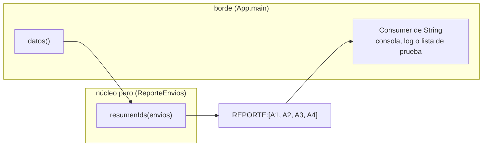

1. El borde obtiene los datos con `datos()`. En un sistema real, ese paso leería una base de datos.
2. El borde llama a `ReporteEnvios.resumenIds(envios)`. Esa función recorre la lista, extrae ids y devuelve texto.
3. El borde arma `"REPORTE:" + ...` y lo entrega al `Consumer` inyectado. Ahí ocurre el único efecto: imprimir.
4. En una prueba, el `Consumer` es `capturado::add`. El núcleo no nota la diferencia.

¿Por qué `reporteImpuro` falla la prueba de dos llamadas? Sigue su ejecución:

1. La primera llamada incrementa `reportesEmitidos` a `1`, arma `REPORTE#1:[A1, A2]` y lo imprime.
2. La segunda llamada encuentra el contador en `1`, lo pasa a `2` y arma `REPORTE#2:[A1, A2]`.
3. Los textos difieren aunque la entrada sea la misma. El resultado depende de un estado oculto, no solo del argumento.

La pureza necesita datos que no cambien mientras se calcula. El constructor compacto del `record` hace una copia
defensiva con `List.copyOf`. La copia es una lista nueva e inmodificable, sin relación con la original. Ojo: no es lo
mismo que una vista de solo lectura.

```java
List<String> mutable = new ArrayList<>(List.of("BOG"));
List<String> vista = Collections.unmodifiableList(mutable);
List<String> copia = List.copyOf(mutable);
mutable.add("CALI");   // vista=[BOG, CALI] copia=[BOG]
```

`Collections.unmodifiableList` solo impide escribir a través de la vista. Si alguien cambia la lista original, la
vista refleja el cambio. `List.copyOf` copia los elementos y queda aislada.

##### 4. Reglas, variantes y casos límite

`List.copyOf` existe desde Java 10. Rechaza elementos `null` con `NullPointerException`. Si recibe una lista que ya es
inmodificable, como la de `List.of`, puede devolver la misma sin copiar, porque nadie puede cambiarla.

Los `record` llegaron como estándar en Java 16. Sus campos son `final`, pero eso solo impide reasignarlos. Si un
campo apunta a una lista mutable, el `record` es inmutable solo en la superficie. Por eso `Envio` copia `paradas`.

La copia es superficial: copia las referencias, no los objetos. Si los elementos fueran objetos mutables, el
`record` seguiría expuesto a cambios en ellos. Con `String` y `BigDecimal`, que son inmutables, no hay ese riesgo.

Intentar modificar la copia lanza `UnsupportedOperationException`, sin mensaje. La traza apunta a
`ImmutableCollections.uoe`, el método interno que lanza la excepción.

La pureza tiene grados en la práctica. Una función que crea un `ArrayList` local, lo llena y lo devuelve sigue siendo
pura, porque nadie fuera ve la mutación. Una función que lee `LocalDate.now()` no lo es: su resultado cambia con el
reloj. La solución es recibir la fecha o un `Clock` como parámetro desde el borde.

Las excepciones son un caso fronterizo. Un núcleo que lanza `IllegalArgumentException` ante datos inválidos se suele
aceptar como puro, porque el resultado sigue dependiendo solo de la entrada.

##### 5. Relación con lo que ya sabes y lo que viene

El efecto secundario de Java, Módulo 4, Tema 4 era un riesgo dentro de un stream. Aquí se convierte en un criterio de
diseño: decidir en qué capa vive cada efecto.

La copia defensiva viene de Java, Módulo 1, Tema 5, y las colecciones inmodificables de Java, Módulo 2, Tema 1. Este
tema muestra por qué importan: sin datos estables, una función no puede ser pura.

Inyectar un `Consumer` es aplicar el Tema 1: el efecto es una pieza intercambiable. El puerto de Java, Módulo 13,
Tema 1 es la versión arquitectónica de esta misma idea.

El Tema 11 mostró que el estado compartido rompe el paralelismo. Un núcleo puro no comparte estado, así que se puede
paralelizar sin carreras. El Tema 13 lleva el efecto a otro borde: publicar eventos a un suscriptor.

#### Problema resuelto 12.1
Compara un reporte impuro con uno puro, publica el puro en dos destinos distintos y comprueba que un `record` con
copia defensiva no cambia cuando cambian sus datos de origen.

**Razonamiento:**
1. El impuro incrementa un contador global e imprime: dos llamadas deben dar textos distintos.
2. El puro solo transforma la lista: dos llamadas deben dar el mismo texto.
3. El destino del texto es un `Consumer`: la consola en producción, una lista en una prueba.
4. El constructor compacto del `record` copia la lista con `List.copyOf`; mutar la original no debe afectarlo.

```java
import java.util.ArrayList;
import java.util.List;
import java.util.function.Consumer;

public class Pureza {

    record Envio(String id, List<String> paradas) {
        Envio {
            paradas = List.copyOf(paradas);       // copia defensiva: nadie la muta después
        }
    }

    static int reportesEmitidos = 0;

    // Impura: lee y cambia estado global, e imprime.
    static String reporteImpuro(List<Envio> envios) {
        reportesEmitidos++;
        String texto = "REPORTE#" + reportesEmitidos + ":" + envios.stream().map(Envio::id).toList();
        System.out.println(texto);
        return texto;
    }

    // Pura: el resultado depende solo de la entrada; no toca nada afuera.
    static String reportePuro(List<Envio> envios) {
        return "REPORTE:" + envios.stream().map(Envio::id).toList();
    }

    public static void main(String[] args) {
        List<Envio> envios = List.of(new Envio("A1", List.of("Bodega", "BOG")),
                new Envio("A2", List.of("MED")));

        String a = reporteImpuro(envios);
        String b = reporteImpuro(envios);
        System.out.println("impuro: misma entrada, mismo resultado? " + a.equals(b));

        String c = reportePuro(envios);
        String d = reportePuro(envios);
        System.out.println("puro:   misma entrada, mismo resultado? " + c.equals(d));

        // El efecto vive en el borde y se inyecta.
        Consumer<String> consola = System.out::println;
        List<String> capturado = new ArrayList<>();
        Consumer<String> prueba = capturado::add;
        consola.accept(reportePuro(envios));
        prueba.accept(reportePuro(envios));
        System.out.println("capturado en prueba=" + capturado);

        List<String> mutable = new ArrayList<>(List.of("BOG"));
        Envio e = new Envio("A3", mutable);
        mutable.add("CALI");
        System.out.println("paradas de A3 tras mutar la lista original=" + e.paradas());
    }
}
```

```text
$ java Pureza.java
REPORTE#1:[A1, A2]
REPORTE#2:[A1, A2]
impuro: misma entrada, mismo resultado? false
puro:   misma entrada, mismo resultado? true
REPORTE:[A1, A2]
capturado en prueba=[REPORTE:[A1, A2]]
paradas de A3 tras mutar la lista original=[BOG]
```

**Explicación por partes.**
- Líneas 16–21: `reporteImpuro` cambia `reportesEmitidos` e imprime. Por eso aparecen `REPORTE#1` y `REPORTE#2`.
- Líneas 24–26: `reportePuro` no toca nada fuera de su parámetro.
- Líneas 32–38: dos llamadas con la misma entrada. La impura da `false`; la pura, `true`.
- Líneas 41–46: el mismo texto puro va a la consola y a una lista. La lista permite verificarlo sin leer la consola.
- Líneas 48–51: `mutable.add("CALI")` cambia la lista original, pero `A3` conserva `[BOG]` gracias a `List.copyOf`.

> **Error común.** Intentar modificar una lista que el `record` ya copió como inmodificable.
> `envio.paradas().add("CALI")` termina con `Exception in thread "main" java.lang.UnsupportedOperationException`,
> sin mensaje, y la traza apunta a `ImmutableCollections.uoe`. Crea un `Envio` nuevo con la lista que necesitas.

> **Buena práctica.** Deja la E/S en la raíz del programa (`main`, el controlador, el consumidor de la cola) y pasa al
> núcleo solo datos. Cuando cambie el destino, solo cambia el `Consumer` que inyectas.

> **Ingeniería de software.** Un núcleo puro se prueba con datos de entrada y aserciones sobre la salida, sin mocks.
> Los mocks quedan para el borde, donde de verdad hay E/S (Java, Módulo 13, Tema 1).

#### Checkpoint 12.1
¿Es pura `ReporteEnvios.contarConTraza(Stream<Integer>, List<String>)`?

Respuesta: no. Agrega textos a la lista `traza` que recibe: modifica un objeto que se ve desde afuera.

</details>

<details>
<summary><strong>Capa 2 — Construcción</strong></summary>

#### Paso 1 · Ejecuta la comparación
Guarda el Problema resuelto 12.1 como `Pureza.java` y ejecuta `java Pureza.java`. Comprueba `false` para el impuro y
`true` para el puro.

#### Paso 2 · Localiza núcleo y borde en el proyecto
En `App.main`, la línea `String reporte = "REPORTE:" + ReporteEnvios.resumenIds(envios);` es cálculo puro y
`auditor.accept(reporte)` es el efecto. `ReporteEnvios` y `ReglasEnvio` no llaman a `System.out`: lo recibe `App` como `Consumer`.

#### Paso 3 · Provoca la UnsupportedOperationException
Escribe un programa que cree `new Envio("A1", List.of("Bodega", "BOG"))` y llame a `envio.paradas().add("CALI")`.
Lee la traza y cámbialo por la creación de un envío nuevo.

#### Resumen
- Una **función pura** depende solo de sus argumentos y no produce efectos observables.
- La **transparencia referencial** permite cambiar una llamada pura por su valor sin alterar el programa.
- En **núcleo funcional y borde imperativo**, el cálculo es puro y la E/S vive afuera.
- Inyectar el efecto como `Consumer` permite probar el reporte con una lista en vez de la consola.
- La copia defensiva en el constructor del `record` impide que cambien los datos del núcleo.

#### Ejercicio verificable 1
Básico. Clasifica como puras o impuras: `ReglasEnvio.etiqueta()`, el `Consumer` de `auditor`, `generadorId("TMP", 99)` y
`ReporteEnvios.contarConTraza`.

Respuesta esperada: `etiqueta()` es pura; `generadorId("TMP", 99)` es pura (siempre `TMP-99`); el `Consumer` que
imprime es impuro; `contarConTraza` es impura porque modifica la lista `traza`.

#### Ejercicio verificable 2
Intermedio. Convierte `reporteImpuro` en pura: recibe el número de reporte como parámetro y no imprime. ¿Qué devuelve
dos veces `reporte(envios, 1)`?

Respuesta esperada: dos veces `REPORTE#1:[A1, A2]`, y `equals` da `true`. El contador pasa al borde, que decide el número.

#### Ejercicio verificable 3
Reto. Escribe una prueba sin consola: crea `List<String> capturado`, pásale `capturado::add` como `Consumer` y publica
`reportePuro(envios)`. ¿Qué contiene la lista?

Respuesta esperada: `[REPORTE:[A1, A2]]`, igual que la línea `capturado en prueba=` del Problema resuelto 12.1.

#### En el trabajo
Esta separación se conoce como *functional core, imperative shell*. En un microservicio, el controlador HTTP o el
consumidor de Kafka es el borde; las reglas de precios o de validación son el núcleo. Las pruebas del núcleo corren en
milisegundos y no necesitan contenedores.

</details>

### Tema 13: Flow API: publicar datos con demanda y cierre · Intermedio · 40 min

<details open>
<summary><strong>Capa 1 — Lectura</strong></summary>

#### Objetivos
Al terminar este tema podrás:
- implementar un `Flow.Subscriber` que pide eventos por lotes con `request(n)`;
- publicar eventos con `SubmissionPublisher` y cerrarlo con try-with-resources;
- esperar el cierre del flujo con un `CompletableFuture` en lugar de `Thread.sleep`;
- leer el error `non-positive subscription request` y el `TimeoutException` de un suscriptor que deja de pedir.

**Conceptos clave:** Reactive Streams, Publisher, Subscriber, Subscription, backpressure, SubmissionPublisher

Ya los conoces y no se repiten: `CompletableFuture` (Java, Módulo 5, Tema 2); timeout y `TimeoutException` (Java,
Módulo 5, Tema 7); try-with-resources (Java, Módulo 3); `Consumer` (Tema 1 de este módulo).

#### El problema
Tienda Aurora publica eventos de cada envío: creado, validado, enviado. El auditor que los registra es más lento que
el emisor. Si el emisor empuja todo de golpe, el auditor acumula una cola sin límite. Y la prueba antigua esperaba
200 ms con `Thread.sleep`, a veces antes de que el auditor terminara. ¿Cómo controla el consumidor cuánto recibe y
cómo sabes que terminó?

#### Glosario del tema

**Reactive Streams**
- **Definición técnica:** especificación de interfaces y reglas para procesar flujos asíncronos con demanda controlada por el consumidor; Java 9 la incorporó en `java.util.concurrent.Flow`.
- **En palabras sencillas:** un acuerdo entre quien envía y quien recibe: el que recibe dice cuánto puede tomar.
- **Dónde se rompe la comparación:** el acuerdo trae reglas estrictas (por ejemplo, pedir 0 es un error); no es solo una costumbre.
- **Ejemplo:** `Flow.Publisher`, `Flow.Subscriber`, `Flow.Subscription` y `Flow.Processor` son las cuatro interfaces de la especificación.
- **Error típico:** creer que `Flow` trae operadores como `map` o `retry`; solo define el contrato. Los operadores vienen de Reactor, Mutiny o RxJava.

**Publisher**
- **Definición técnica:** `Flow.Publisher<T>`, interfaz con `subscribe(Subscriber<? super T>)`; produce elementos y los entrega a cada suscriptor según la demanda que este señala.
- **En palabras sencillas:** la emisora de eventos.
- **Dónde se rompe la comparación:** no decide el ritmo de entrega; lo decide la demanda del suscriptor.
- **Ejemplo:** el `SubmissionPublisher<Evento>` de la línea 52 del Problema resuelto 13.1.
- **Error típico:** publicar sin suscriptores y esperar que alguien reciba después; los eventos ya enviados no se repiten.

**Subscriber**
- **Definición técnica:** `Flow.Subscriber<T>`, interfaz con cuatro métodos: `onSubscribe`, `onNext`, `onError` y `onComplete`; los dos últimos son terminales y excluyentes.
- **En palabras sencillas:** el receptor, con cuatro avisos: «ya estás conectado», «llegó uno», «falló» y «se acabó».
- **Dónde se rompe la comparación:** los avisos llegan desde otro hilo; no ocurren dentro de la llamada a `submit`.
- **Ejemplo:** `Auditor` (líneas 10–47) registra cada aviso en el `log`.
- **Error típico:** no completar nada en `onError`; quien espera el final queda bloqueado hasta el timeout.

**Subscription**
- **Definición técnica:** `Flow.Subscription`, el vínculo entre un publisher y un suscriptor, con `request(long n)` para pedir `n` elementos más y `cancel()` para dejar de recibir.
- **En palabras sencillas:** el contrato firmado; con él pides más o te das de baja.
- **Dónde se rompe la comparación:** pedir es acumulativo: dos `request(2)` permiten cuatro entregas.
- **Ejemplo:** `s.request(lote)` (línea 26) y `subscription.request(lote)` (línea 34).
- **Error típico:** pedir `0` o un número negativo: `IllegalArgumentException: non-positive subscription request`.

**backpressure**
- **Definición técnica:** mecanismo por el cual el consumidor limita la velocidad del productor indicando cuántos elementos puede recibir.
- **En palabras sencillas:** el que recibe dice «mándame dos» y no le llega el tercero hasta que pide más.
- **Dónde se rompe la comparación:** si el productor genera más rápido, los elementos se acumulan en un búfer; cuando se llena, `submit` bloquea.
- **Ejemplo:** con lote 2, la salida muestra `REQUEST:2`, dos `NEXT`, otra vez `REQUEST:2` y el tercero.
- **Error típico:** pedir `Long.MAX_VALUE` en `onSubscribe` y anular el control sin darte cuenta.

**SubmissionPublisher**
- **Definición técnica:** implementación de `Flow.Publisher` en `java.util.concurrent` que entrega los elementos de `submit` de forma asíncrona, con un búfer por suscriptor; es `AutoCloseable` y `close()` emite `onComplete`.
- **En palabras sencillas:** una emisora lista para usar, con una sala de espera por cada oyente.
- **Dónde se rompe la comparación:** `onComplete` llega solo después de entregar lo pendiente; si el suscriptor no pide más, nunca llega.
- **Ejemplo:** el bloque try-with-resources de las líneas 52–57 publica tres eventos y cierra.
- **Error típico:** esperar con `Thread.sleep` a que termine; el tiempo varía entre equipos y la prueba se vuelve intermitente.

#### ► CÓMO FUNCIONA

##### 1. La idea en lenguaje sencillo

En una cafetería con barra, el barista no prepara cien cafés y los deja caer sobre el mostrador. Prepara los que el
mesero puede llevar. Cuando el mesero vuelve y dice «dame dos más», el barista entrega dos más. Al cerrar, alguien
avisa «no hay más pedidos», y el mesero sabe que su turno terminó.

Así trabaja la Flow API. El emisor de eventos de Tienda Aurora es el barista, y el auditor lento es el mesero. El
auditor dice cuántos eventos puede recibir, y el emisor no le entrega más que eso. Cuando ya no hay eventos, llega un
aviso explícito de cierre. La prueba no necesita adivinar cuánto esperar: espera ese aviso.

##### 2. Definición formal y vocabulario

**Reactive Streams** es una especificación para procesar flujos asíncronos con demanda controlada por el
consumidor. Java 9 la incorporó en la clase `java.util.concurrent.Flow`, que contiene cuatro interfaces anidadas:

- **Publisher**: `Flow.Publisher<T>` produce elementos. Su único método es `subscribe(Subscriber)`.
- **Subscriber**: `Flow.Subscriber<T>` los recibe mediante cuatro avisos: `onSubscribe`, `onNext`, `onError` y
  `onComplete`.
- **Subscription**: `Flow.Subscription` es el vínculo entre ambos. Tiene `request(long n)` y `cancel()`.
- `Flow.Processor<T,R>` es a la vez suscriptor y publicador, para etapas intermedias.

La **backpressure** es el mecanismo por el cual el consumidor limita al productor. En lenguaje sencillo: el que
recibe dice cuánto puede tomar, y el que envía respeta esa cifra.

**SubmissionPublisher** es la implementación de `Publisher` que trae el JDK. Entrega lo que recibe con `submit` de
forma asíncrona, desde un ejecutor que por defecto es el `ForkJoinPool` común. Guarda un búfer por suscriptor y
cierra el flujo con `close()`.

##### 3. Cómo funciona por dentro, paso a paso

**Visual:** [Flow API: backpressure por demanda](/visuals/temas/java/modulo-20-flow.html). El diagrama animado muestra
la demanda viajando del suscriptor al publicador; con movimiento reducido queda estático.

El diagrama de secuencia recorre la ejecución con lote 2 del Problema resuelto 13.1:

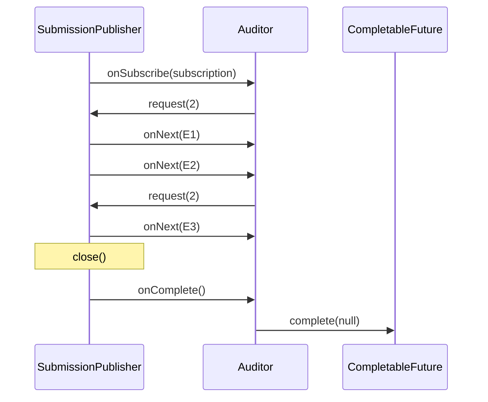

1. `publisher.subscribe(auditor)` crea una `Subscription` y llama, en otro hilo, a `onSubscribe(subscription)`.
2. El auditor guarda el vínculo y llama a `request(2)`. La demanda pendiente pasa a ser 2.
3. El hilo principal ejecuta `submit` tres veces. Cada evento entra al búfer del suscriptor; `submit` no espera a
   que se entregue.
4. El ejecutor entrega `E1` y `E2` con `onNext`. La demanda baja a 0 y `E3` se queda en el búfer.
5. Al recibir `E2`, el auditor completa su lote y pide `request(2)`. Ahora sí se entrega `E3`.
6. El try-with-resources llama a `close()`. El publicador marca el cierre, termina de entregar lo pendiente y llama a
   `onComplete()`.
7. `onComplete` completa el `CompletableFuture`. El hilo principal, bloqueado en `get(2, TimeUnit.SECONDS)`, despierta.

El paso 7 explica por qué el test es determinista. No espera un tiempo fijo: espera el evento que indica el final.
Si el evento no llega en 2 segundos, falla con `TimeoutException` en lugar de seguir con datos incompletos.

Cuando no necesitas controlar la demanda, `SubmissionPublisher` trae un atajo:

```java
CompletableFuture<Void> fin;
try (SubmissionPublisher<String> publisher = new SubmissionPublisher<>()) {
    fin = publisher.consume(e -> System.out.println("NEXT:" + e));
    publisher.submit("E1");
}
fin.get(2, TimeUnit.SECONDS);
```

`consume` crea un suscriptor que pide sin límite, ejecuta el `Consumer` por cada elemento y devuelve un futuro que se
completa al cierre.

##### 4. Reglas, variantes y casos límite

La especificación fija reglas que el JDK respeta. Un publicador nunca entrega más `onNext` que la suma de lo pedido.
Los avisos a un mismo suscriptor llegan en serie, nunca dos a la vez. `onError` y `onComplete` son terminales: tras
uno de ellos no llega nada más.

Pedir `n <= 0` es una violación. La especificación exige responder con `onError` y una `IllegalArgumentException`.
Por eso el lote 0 produce `non-positive subscription request` y no un `onNext`.

La demanda se acumula: dos `request(2)` seguidos permiten cuatro entregas. Pedir `Long.MAX_VALUE` equivale a demanda
ilimitada y anula la backpressure.

El búfer por suscriptor tiene una capacidad máxima; por defecto es `Flow.defaultBufferSize()`, que vale 256. Si se
llena, `submit` bloquea al emisor hasta que haya espacio. `offer` es la alternativa que, en vez de bloquear, permite
descartar elementos con una política propia.

`close()` no espera a que los suscriptores terminen; solo programa el cierre. Para cerrar con error existe
`closeExceptionally(Throwable)`, que entrega `onError` a cada suscriptor.

Flow solo define el contrato. No trae operadores como `map`, `filter` o `retry`. Para eso se usan bibliotecas como
Reactor, Mutiny o RxJava, que implementan estas mismas interfaces o se adaptan a ellas.

##### 5. Relación con lo que ya sabes y lo que viene

`CompletableFuture` viene de Java, Módulo 5, Tema 2, y el timeout de Java, Módulo 5, Tema 7. Aquí los usas como
señal de fin de un flujo, no como resultado de un cálculo.

El try-with-resources de Java, Módulo 3 funciona porque `SubmissionPublisher` es `AutoCloseable`. Al salir del bloque,
`close()` dispara el cierre ordenado.

Compara con los streams de este módulo. Un `Stream` es de extracción: la terminal tira de los elementos cuando los
necesita. Un `Publisher` es de empuje: el emisor entrega cuando hay datos. La demanda con `request(n)` es lo que
evita que ese empuje desborde al consumidor.

El auditor es un borde en el sentido del Tema 12: recibe eventos ya calculados y ejecuta el efecto de registrarlos.
El `HttpClient` de Java, Módulo 18, Tema 1 se apoya en ellas sin mostrarlo: `HttpRequest.BodyPublisher` extiende
`Flow.Publisher` y `HttpResponse.BodySubscriber` extiende `Flow.Subscriber`, para mover el cuerpo por partes.

#### Problema resuelto 13.1
Haz visible la demanda: registra cada `request` junto a los eventos. Ejecuta el flujo con lote 2 y con lote 0 y
espera el cierre con un `CompletableFuture` limitado a 2 segundos.

**Razonamiento:**
1. El suscriptor guarda la `Subscription` en `onSubscribe` y pide el primer lote ahí.
2. En `onNext` cuenta lo recibido; al completar un lote, pide otro.
3. `onComplete` y `onError` completan el futuro; `get(2, TimeUnit.SECONDS)` espera ese evento y no un temporizador.
4. Con lote 0, la especificación exige un error: debe llegar `onError`, no `onNext`.

```java
import java.util.concurrent.CompletableFuture;
import java.util.concurrent.Flow;
import java.util.concurrent.SubmissionPublisher;
import java.util.concurrent.TimeUnit;

public class Demanda {

    record Evento(String id, String mensaje) {}

    static class Auditor implements Flow.Subscriber<Evento> {
        private final int lote;
        private final StringBuilder log;
        private final CompletableFuture<Void> terminado;
        private Flow.Subscription subscription;
        private int recibidos;

        Auditor(int lote, StringBuilder log, CompletableFuture<Void> terminado) {
            this.lote = lote;
            this.log = log;
            this.terminado = terminado;
        }

        @Override public void onSubscribe(Flow.Subscription s) {
            subscription = s;
            log.append("REQUEST:").append(lote).append('\n');
            s.request(lote);
        }

        @Override public void onNext(Evento e) {
            recibidos++;
            log.append("NEXT:").append(e.id()).append(':').append(e.mensaje()).append('\n');
            if (recibidos % lote == 0) {
                log.append("REQUEST:").append(lote).append('\n');
                subscription.request(lote);
            }
        }

        @Override public void onError(Throwable t) {
            log.append("ERROR:").append(t).append('\n');
            terminado.completeExceptionally(t);
        }

        @Override public void onComplete() {
            log.append("DONE").append('\n');
            terminado.complete(null);
        }
    }

    static String ejecutar(int lote) throws Exception {
        StringBuilder log = new StringBuilder();
        CompletableFuture<Void> terminado = new CompletableFuture<>();
        try (SubmissionPublisher<Evento> publisher = new SubmissionPublisher<>()) {
            publisher.subscribe(new Auditor(lote, log, terminado));
            publisher.submit(new Evento("E1", "creado"));
            publisher.submit(new Evento("E2", "validado"));
            publisher.submit(new Evento("E3", "enviado"));
        }
        try {
            terminado.get(2, TimeUnit.SECONDS);
        } catch (Exception e) {
            log.append("get lanzó ").append(e.getClass().getSimpleName()).append('\n');
        }
        return log.toString();
    }

    public static void main(String[] args) throws Exception {
        System.out.print(ejecutar(2));
        System.out.println("--- lote 0 ---");
        System.out.print(ejecutar(0));
    }
}
```

```text
$ java Demanda.java
REQUEST:2
NEXT:E1:creado
NEXT:E2:validado
REQUEST:2
NEXT:E3:enviado
DONE
--- lote 0 ---
REQUEST:0
ERROR:java.lang.IllegalArgumentException: non-positive subscription request
get lanzó ExecutionException
```

**Explicación por partes.**
- Líneas 23–27: al suscribirse, el auditor guarda el vínculo, registra `REQUEST:2` y pide dos.
- Líneas 29–36: tras el segundo evento pide dos más; por eso `REQUEST:2` aparece entre `E2` y `E3`.
- Líneas 38–46: los dos avisos terminales completan el futuro, con error o sin él.
- Líneas 52–57: el try-with-resources llama a `close()`, que envía `onComplete` cuando se entregó lo pendiente.
- Líneas 58–62: `get` espera el cierre real. Con lote 0, `onError` recibe `non-positive subscription request` y `get` lanza `ExecutionException`.
- La sección de lote 2 dio la misma salida en ocho corridas seguidas en este entorno.

> **Error común.** Pedir `request(0)`. El publisher no entrega nada y llama a `onError` con
> `java.lang.IllegalArgumentException: non-positive subscription request`. Si tu `onError` no completa el futuro,
> quien espera se queda bloqueado hasta el timeout.

> **Error común.** Olvidar pedir el siguiente lote. Si quitas las líneas 32–35, el auditor recibe `E1` y `E2`, nunca
> `E3`, y `onComplete` no llega: `get` termina con `TimeoutException` a los 2 segundos.

> **Buena práctica.** Espera el final del flujo con un evento (`CompletableFuture`, `CountDownLatch`) y un timeout,
> nunca con `Thread.sleep`. El test del proyecto llama dos veces a `EventosEnvio.demo()` y exige la misma salida.

#### Checkpoint 13.1
Con lote 3 y tres eventos, ¿cuántas líneas `REQUEST` aparecen?

Respuesta: dos. Una en `onSubscribe` y otra después del tercer evento, porque `3 % 3 == 0`. Después llega `DONE`.

</details>

<details>
<summary><strong>Capa 2 — Construcción</strong></summary>

#### Paso 1 · Ejecuta el flujo
Guarda el Problema resuelto 13.1 como `Demanda.java` y ejecuta `java Demanda.java` varias veces. La sección de lote 2
debe ser idéntica en todas las corridas.

#### Paso 2 · Compara con el proyecto
`EventosEnvio.SuscriptorAuditor` es la misma idea sin las líneas `REQUEST`. La salida de `./gradlew -q run` termina
con los tres `NEXT` y `DONE`, y el test `flowEntregaEventos` exige dos veces la misma cadena.

#### Paso 3 · Provoca el timeout
En `Demanda.java`, comenta las líneas 32–35 y ejecuta. Observa que la ejecución tarda unos 2 segundos y termina con
`get lanzó TimeoutException`. Restaura las líneas.

#### Resumen
- **Reactive Streams** define el contrato; `java.util.concurrent.Flow` trae sus cuatro interfaces.
- El **Publisher** produce; el **Subscriber** recibe por cuatro avisos; la **Subscription** los une.
- Con **backpressure**, el consumidor fija el ritmo con `request(n)`.
- **SubmissionPublisher** entrega de forma asíncrona y su `close()` emite `onComplete` cuando ya no hay pendientes.
- El final se espera con un `CompletableFuture` y un timeout, nunca con `Thread.sleep`.

#### Ejercicio verificable 1
Básico. Ejecuta `ejecutar(1)`. ¿Cuántas líneas `REQUEST:1` aparecen?

Respuesta esperada: cuatro: una al suscribirse y una después de cada uno de los tres eventos. La última va seguida de `DONE`.

#### Ejercicio verificable 2
Intermedio. Ejecuta `ejecutar(3)` y escribe la salida.

Respuesta esperada: `REQUEST:3`, `NEXT:E1:creado`, `NEXT:E2:validado`, `NEXT:E3:enviado`, `REQUEST:3` y `DONE`.

#### Ejercicio verificable 3
Reto. Con lote 2, haz que el auditor no vuelva a pedir después del primer lote. ¿Qué imprime y por qué?

Respuesta esperada: `REQUEST:2`, `NEXT:E1:creado`, `NEXT:E2:validado` y `get lanzó TimeoutException`. `E3` queda en el
búfer, así que el publisher no puede emitir `onComplete`.

#### En el trabajo
Spring WebFlux, R2DBC y los clientes de Kafka reactivos se apoyan en este mismo contrato. Cuando una base de datos
lenta recibe filas a demanda, el servicio no se queda sin memoria. Entender `request(n)` ayuda a leer por qué un flujo
«se queda colgado»: casi siempre alguien dejó de pedir.

</details>

## Verificación real

Ejecutado el 2026-11-23 en `~/labs/aurora-m20` (macOS arm64, JDK 27.0.1.0.2 con toolchain Java 25, Gradle 9.9.1):

```bash
./gradlew -q test
./gradlew -q run
```

`./gradlew -q test`: **7 tests, 0 fallas** (`build/test-results/test/TEST-com.aurora.funcional.FuncionalTest.xml`). El test de Flow llama dos veces a `EventosEnvio.demo()` y exige la misma salida exacta, sin temporizadores.

Salida real de `./gradlew -q run`:

```text
ID=TMP-99
A1@BOG
A4@CALI
REGLA=peso <= 10 Y no fallido
TOTAL=107.10
MAYOR=25
CUENTA=2
TRAZA=7
DESTINOS=[BOG, CALI, MED]
OPT=A1
MISS=NA
PARADAS=[BODEGA, BOG, CALI, MED]
MAS_CARO=A2
ENTREGADOS=1
SUMA=55000
POR_ESTADO=[ENTREGADO, EN_RUTA, PENDIENTE, FALLIDO]
COSTO_DESTINO={BOG=18000, MED=25000, CALI=12000}
IDS=[A1, A2, A3, A4]
DEST_SET=[BOG, CALI, MED]
NORMALIZADOS=[BOG, MED]
PARALELA=55000
REPORTE:[A1, A2, A3, A4]
NEXT:E1:creado
NEXT:E2:validado
NEXT:E3:enviado
DONE
```

**Comprobación adicional (2026-11-24, Linux x86_64, OpenJDK 25.0.5.1, `javac -Xlint:all -Werror` y `java`, sin
Gradle):** el código principal compila sin advertencias y `App` produce las mismas líneas, salvo una. La línea
`POR_ESTADO` salió `POR_ESTADO=[FALLIDO, ENTREGADO, PENDIENTE, EN_RUTA]`. No es un fallo del entorno:
`groupingBy(Envio::estado)` devuelve un `HashMap` y su orden no está garantizado (Tema 10). Con la fábrica
`() -> new EnumMap<>(EstadoEnvio.class)` la línea sale `POR_ESTADO=[PENDIENTE, EN_RUTA, ENTREGADO, FALLIDO]` en ese
mismo entorno. Las pruebas JUnit no se ejecutaron allí.

## Errores comunes y diagnóstico

| Síntoma | Causa probable | Diagnóstico | Corrección |
|---|---|---|---|
| `error: cannot infer type for local variable` con `(lambda expression needs an explicit target-type)` | La lambda no tiene tipo objetivo (por ejemplo, `var f = x -> x * 2;`) | Revisar a qué variable o parámetro se asigna | Declarar la interfaz funcional concreta: `UnaryOperator<Integer> f = x -> x * 2;` |
| `error: local variables referenced from a lambda expression must be final or effectively final` | Variable local mutada en la lambda | Compilador lo señala | Usar variable final/efectivamente final o acumulador explícito |
| `119.00` contra `107.10` | Comparar dos puntos del pipeline | Revisar si se aplicó descuento | `119.00` es tarifa con impuesto; `107.10` es tras descuento del 10 % |
| Efectos antes de la terminal | Confundir declaración con ejecución del stream | Añadir traza y ver cuándo aparece | Recordar que las operaciones intermedias son perezosas |
| `IllegalStateException: stream has already been operated upon` | Reutilizar un stream consumido | Contar cuántas terminales se aplican | Crear un stream nuevo desde la colección |
| Salida de Flow a medias o distinta entre corridas | Esperar con `Thread.sleep` | Repetir el test varias veces | Esperar a `onComplete()` con `CompletableFuture.get(timeout)` |
| Resultado paralelo inconsistente | Estado mutable compartido | Revisar arrays/cajas en `forEach` | Usar `reduce`/collectors sin estado compartido |
| Pérdida de centavos | Mezclar `double` con `BigDecimal` | Imprimir escala y valor | Construir `BigDecimal` desde `String` y fijar `RoundingMode` |

## Checklist de cierre

- [ ] Cada interfaz funcional se eligió por su forma de entrada/salida, no por moda.
- [ ] Las reglas de negocio llevan motivo y se componen sin anidar lambdas.
- [ ] Los cálculos son puros; imprimir o publicar queda en el borde.
- [ ] Los streams se tratan como recursos de un solo uso y se verifica la pereza.
- [ ] `Optional` comunica ausencia sin mensajes genéricos.
- [ ] El paralelismo no comparte estado mutable y se mide antes de adoptarse.
- [ ] Flow usa demanda explícita y espera al evento de cierre, no a un temporizador.

Siguiente paso natural: **Módulo 21 — APIs públicas, compatibilidad y evolución**. Allí las funciones y tipos que diseñaste se vuelven contrato para otros equipos; un cambio pequeño puede romper compatibilidad binaria o de fuente.
