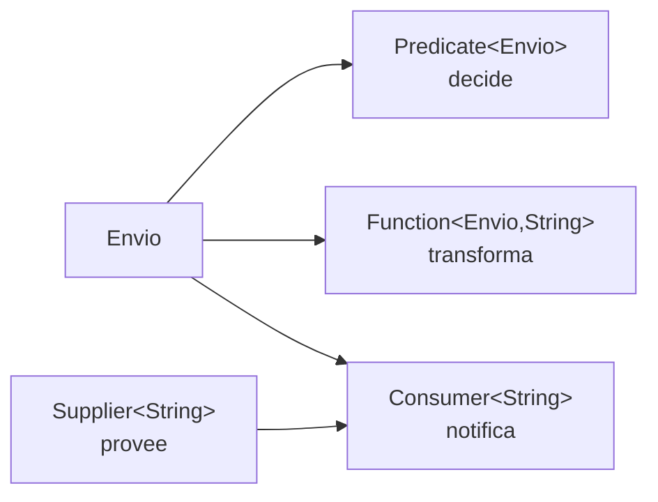
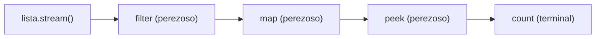

# Módulo 20: Java funcional — interfaces que componen comportamiento

## Aprende construyendo

El módulo se amplía de 3 a 13 temas para cubrir el inventario del prompt: funciones de una y dos entradas, operadores, referencias a métodos, `Optional`, operaciones intermedias y terminales de Streams, Collectors, paralelismo, efectos y Flow API. Los temas 4–13 tienen tres subtemas ejecutables de 5–15 minutos; los temas 1–3 conservan sus lecciones originales y su hito, pero aún requieren descomponer cada práctica en el mismo formato atómico.

Cada Tema parte de una carpeta vacía y se compila con `javac` para ver el error real, no para describirlo.

### Tema 1: Las cuatro formas: Predicate, Function, Consumer y Supplier

#### Paso 1 · Objetivo y preparación

Al finalizar vas a elegir la interfaz funcional correcta para cada intención —decidir, transformar, notificar o proveer— y a compilar un ejemplo que use las cuatro sin envolver lambdas a mano.

**Conocimiento previo:** Java 21 o superior, lambdas y `javac`/`java` en el `PATH`. Comprueba `java -version` y `javac -version`.

#### Paso 2 · Contexto y caso real

**¿Por qué es importante?** En un caso real, el equipo de RutaFlow necesita aplicar reglas distintas por cliente: unas deciden si un envío requiere revisión, otras transforman la guía para imprimirla, otras registran la decisión y otras proveen la fecha del turno. Si cada regla se modela con la interfaz equivocada, el código compila pero obliga a envolver lambdas y a repetir `if` por todas partes.

Elegir la forma correcta convierte una regla de negocio en un valor que se pasa, se compone y se prueba por separado. Ese es el primer paso para que el proyecto integrador no acumule lógica en un método de mil líneas.

#### Paso 3 · Teoría, modelo mental y analogía

`java.util.function` define cuatro formas base:

- `Predicate<T>`: recibe un valor y decide (`boolean`). Es un portero.
- `Function<T, R>`: recibe un valor y devuelve otro. Es un traductor.
- `Consumer<T>`: recibe un valor y no devuelve nada; produce un efecto. Es un notificador.
- `Supplier<T>`: no recibe nada y devuelve un valor. Es un proveedor.

**Analogía:** en una bodega, el portero decide si un paquete entra (`Predicate`), el traductor reetiqueta el paquete en otro idioma (`Function`), el notificador avisa al sistema (`Consumer`) y el proveedor entrega el turno del día (`Supplier`). La analogía deja de servir si conviertes la interfaz en el modelo del negocio: `Predicate<Envio>` describe una decisión, no un envío.

**Diagrama:**



#### Paso 4 · Demostración guiada desde cero

Desde una carpeta vacía:

```bash
mkdir java-funcional && cd java-funcional
mkdir src
```

Crea `src/Formas.java` con este contenido completo:

```java
import java.util.List;
import java.util.function.Consumer;
import java.util.function.Function;
import java.util.function.Predicate;
import java.util.function.Supplier;

public final class Formas {
    record Envio(String guia, String destino, double pesoKg) {}

    public static void main(String[] args) {
        // Predicate: decide si el envío requiere revisión.
        Predicate<Envio> requiereRevision = envio -> envio.pesoKg() > 20;
        // Function: transforma el envío en la línea que se imprime.
        Function<Envio, String> etiqueta = envio -> envio.guia() + " -> " + envio.destino();
        // Consumer: produce un efecto, no devuelve valor.
        Consumer<String> registrar = linea -> System.out.println("[log] " + linea);
        // Supplier: entrega un valor cuando se le pide.
        Supplier<String> turno = () -> "Turno AM";

        List<Envio> envios = List.of(
            new Envio("ENV-1", "Bogotá", 5.5),
            new Envio("ENV-2", "Medellín", 32.0)
        );

        for (Envio envio : envios) {
            if (requiereRevision.test(envio)) {
                registrar.accept(turno.get() + " | " + etiqueta.apply(envio));
            }
        }
    }
}
```

Compila y ejecuta:

```bash
javac -d out src/Formas.java
java -cp out Formas
```

**Resultado esperado:** una sola línea, `[log] Turno AM | ENV-2 -> Medellín`. El envío de 5,5 kg no entra al bloque porque `requiereRevision` devuelve `false`.

**Fallo deliberado:** cambia la `Function` por una lambda de dos parámetros:

```java
Function<Envio, String> etiqueta = (guia, destino) -> guia;
```

Al compilar, `javac` responde:

```text
Formas.java:12: error: incompatible types: incompatible parameter types in lambda expression
```

El diagnóstico es que `Function` declara un único parámetro. El compilador no está fallando por la sintaxis de la lambda, sino por su aridad: la interfaz fija la forma. Corrige la lambda a un parámetro y vuelve a compilar.

**Conceptos clave:** interfaz funcional, aridad, `apply`, `test`, `accept`, `get`.

#### Paso 5 · Práctica guiada

**Pista:** cambia `Predicate<Envio>` por `Function<Envio, Boolean>` y observa el error: `boolean cannot be dereferenced` o un fallo al llamar `test`. La interfaz correcta se elige por la pregunta que responde, no por el tipo que devuelve.

**Resultado esperado:** documentas el error de compilación y explicas en una frase por qué `Predicate` expresa mejor la decisión.

#### Paso 6 · Práctica independiente

Crea `src/Reglas.java` con un `Predicate<String>` que valide un correo, una `Function<String, String>` que lo normalice, un `Consumer<String>` que registre el resultado y un `Supplier<LocalDate>` que devuelva la fecha de hoy. Ejecuta con `-cp out Reglas`.

**Resultado esperado:** el correo normalizado se registra una sola vez y la fecha aparece en el formato ISO.

#### Paso 7 · Cierre y evidencia

Siguiente paso: componer estas formas sin anidar lambdas. **Evidencia de aprendizaje:** entrega `Formas.java`, la salida `[log] Turno AM | ENV-2 -> Medellín` y el error de compilación de la lambda de dos parámetros junto con su diagnóstico.

**Errores comunes:** usar `Function` cuando la intención es decidir; olvidar que `Consumer` no devuelve nada; crear un `Supplier` que en realidad depende de un parámetro; asumir que una lambda con dos parámetros encaja en una interfaz de uno.

**Límites y decisión de uso:** estas interfaces sirven para pasar comportamiento, no para modelar entidades. Si una regla necesita estado propio o más de dos parámetros, una clase con nombre comunica mejor la intención. En el proyecto integrador, las reglas de revisión se prueban por separado precisamente porque son `Predicate`, no métodos privados.

**Fuente oficial:** [java.util.function](https://docs.oracle.com/en/java/javase/21/docs/api/java.base/java/util/function/package-summary.html) y [lambdas en el tutorial de Java](https://docs.oracle.com/javase/tutorial/java/javaOO/lambdaexpressions.html).

### Tema 2: Componer sin anidar: andThen, compose, negate y reglas encadenadas

#### Paso 1 · Objetivo y preparación

Al finalizar vas a encadenar reglas con `and`, `or`, `negate`, `andThen` y `compose`, y a explicar por qué el orden de composición cambia el resultado.

**Conocimiento previo:** Tema 1 de este módulo; `javac` funcionando.

#### Paso 2 · Contexto y caso real

**¿Por qué es importante?** El proyecto integrador valida correos que llegan de un formulario. Si se valida antes de normalizar, un correo correcto con espacios alrededor se rechaza; si se normaliza antes de validar, pasa. El error no está en la regla sino en el orden en que se compone.

Componer con las interfaces de Java hace visible ese orden en una sola expresión, en lugar de esconderlo en una sucesión de `if` que nadie revisa.

#### Paso 3 · Teoría, modelo mental y analogía

`Predicate` ofrece `and`, `or` y `negate`; `Function` ofrece `andThen` y `compose`. La diferencia es el sentido de la lectura: `f.andThen(g)` aplica `f` y luego `g`; `g.compose(f)` aplica `f` y luego `g`. Son equivalentes, pero una se lee de izquierda a derecha y la otra de derecha a izquierda.

**Analogía:** es una cadena de montaje. `andThen` añade una estación al final; `compose` declara que la estación actual va después de otra. El límite es que la cadena no valida la semántica: si el orden es incorrecto, compila y produce el resultado equivocado.

#### Paso 4 · Demostración guiada desde cero

Desde una carpeta vacía:

```bash
mkdir java-composicion && cd java-composicion
mkdir src
```

Crea `src/Composicion.java`:

```java
import java.util.function.Function;
import java.util.function.Predicate;

public final class Composicion {
    // Decide si el texto ya normalizado parece un correo.
    static final Predicate<String> correo = texto ->
        texto.contains("@") && texto.indexOf('@') > 0 && texto.indexOf('@') < texto.length() - 1;

    public static void main(String[] args) {
        // Function: normaliza antes de validar.
        Function<String, String> normalizar = texto -> texto.trim().toLowerCase();

        // andThen: primero normaliza, luego decide.
        Function<String, Boolean> validar = normalizar.andThen(correo::test);

        String entrada = "  ANA@ACADEMIA.COM  ";
        System.out.println("normalizado: " + validar.apply(entrada));

        // Predicate: combina reglas con and / or / negate.
        Predicate<String> noVacio = texto -> !texto.isBlank();
        Predicate<String> conArroba = texto -> texto.contains("@");
        Predicate<String> sospechoso = noVacio.and(conArroba).negate();

        System.out.println("sospechoso: " + sospechoso.test(entrada));
        System.out.println("sospechoso vacío: " + sospechoso.test("   "));
    }
}
```

```bash
javac -d out src/Composicion.java
java -cp out Composicion
```

**Resultado esperado:**

```text
normalizado: true
sospechoso: false
sospechoso vacío: true
```

**Fallo deliberado:** invierte el orden. Crea `Function<String, Boolean> sinNormalizar = correo::test;` y evalúa `sinNormalizar.apply("  ANA@ACADEMIA.COM  ")`. Obtienes `false`: la regla es correcta, pero recibe el texto crudo. El diagnóstico es que `correo::test` no normaliza; la composición `andThen` es la que aporta el orden. Corrige usando `normalizar.andThen(correo::test)`.

**Conceptos clave:** `andThen`, `compose`, `and`, `or`, `negate`, orden de evaluación.

#### Paso 5 · Práctica guiada

**Pista:** añade una regla `terminaEnCom` con `correo.and(texto -> texto.endsWith(".com"))` y comprueba con `"ana@academia.com"` y `"ana@academia.org"`.

**Resultado esperado:** el primer texto pasa y el segundo no; puedes señalar qué regla lo rechazó.

#### Paso 6 · Práctica independiente

Crea `src/ReglasEnvio.java` con tres `Predicate<Envio>` (peso, destino y estado) y una función que devuelva el motivo del rechazo en lugar de un `boolean`. Ejecuta con `java -cp out ReglasEnvio`.

**Resultado esperado:** cada envío rechazado muestra el motivo, y un envío válido no produce ningún mensaje.

#### Paso 7 · Cierre y evidencia

Siguiente paso: aplicar composición a colecciones con Streams. **Evidencia de aprendizaje:** entrega `Composicion.java`, la salida de los tres `println` y la comparación entre validar antes y después de normalizar.

**Errores comunes:** confundir `andThen` con `compose`; validar antes de normalizar; encadenar `or` donde la regla pedía `and`; usar `negate` para esconder una condición que debería tener nombre propio.

**Límites y decisión de uso:** componer es útil cuando las reglas son independientes y se combinan; si dependen entre sí o necesitan explicar el motivo del rechazo, un tipo de resultado (`Resultado`) comunica más que un `boolean` compuesto. En el proyecto integrador, la validación que debe informar al usuario usa motivos, no solo `Predicate`.

**Fuente oficial:** [Predicate](https://docs.oracle.com/en/java/javase/21/docs/api/java.base/java/util/function/Predicate.html) y [Function](https://docs.oracle.com/en/java/javase/21/docs/api/java.base/java/util/function/Function.html).

**Hito del tema:** confirma que puedes (1) decidir con `Predicate`, (2) transformar con `Function`, (3) ejecutar un efecto con `Consumer` y (4) pedir un dato con `Supplier`; anota el método usado (`test`, `apply`, `accept` o `get`) y su salida.

### Tema 3: Streams como composición: pereza, orden y efectos que se esconden

#### Paso 1 · Objetivo y preparación

Al finalizar vas a explicar por qué un Stream no ejecuta nada hasta la operación terminal, a depurar un pipeline con `peek` sin confundirlo con un `for`, y a diagnosticar el error de reutilizar un Stream consumido.

**Conocimiento previo:** Temas 1 y 2; `javac` y `java` funcionando.

#### Paso 2 · Contexto y caso real

**¿Por qué es importante?** En el proyecto integrador, un informe procesa miles de envíos. Si el pipeline se ejecuta dos veces o se mezclan efectos dentro de `map`, el informe puede duplicar registros o tardar el doble sin que nadie lo note. La pereza de Streams es una ventaja solo si se entiende: el trabajo ocurre en la operación terminal, no donde se declara.

#### Paso 3 · Teoría, modelo mental y analogía

Un `Stream` es una descripción de trabajo, no una colección. `filter`, `map` y `peek` son perezosas; `count`, `collect`, `forEach` y `reduce` son terminales y disparan el recorrido. Un Stream se consume una sola vez.

**Analogía:** es una receta escrita frente a una comida cocinada. Escribir la receta no cocina nada; el primer plato que se sirve dispara el trabajo. El límite es que, a diferencia de una receta, el Stream no se puede volver a cocinar: si lo intentas, la API lanza una excepción.

**Diagrama:**



#### Paso 4 · Demostración guiada desde cero

Desde una carpeta vacía:

```bash
mkdir java-streams && cd java-streams
mkdir src
```

Crea `src/Pereza.java`:

```java
import java.util.List;
import java.util.stream.Stream;

public final class Pereza {
    record Envio(String guia, double pesoKg) {}

    public static void main(String[] args) {
        List<Envio> envios = List.of(
            new Envio("ENV-1", 5.5),
            new Envio("ENV-2", 32.0),
            new Envio("ENV-3", 18.0)
        );

        Stream<Envio> pesados = envios.stream()
            .filter(envio -> envio.pesoKg() > 20)
            .peek(envio -> System.out.println("filtrado " + envio.guia()));

        System.out.println("antes de la operación terminal: no se ejecutó ningún filtro");
        long total = pesados.count();
        System.out.println("pesados=" + total);
    }
}
```

```bash
javac -d out src/Pereza.java
java -cp out Pereza
```

**Resultado esperado:**

```text
antes de la operación terminal: no se ejecutó ningún filtro
filtrado ENV-2
pesados=1
```

La línea «filtrado» aparece después del mensaje, no antes: el `peek` no se ejecutó al declarar el pipeline.

**Fallo deliberado:** reutiliza el Stream consumido:

```java
long primero = pesados.count();
long segundo = pesados.count();
```

Al ejecutar, la JVM responde:

```text
Exception in thread "main" java.lang.IllegalStateException: stream has already been operated upon or closed
```

El diagnóstico es que `count` es terminal y cierra el Stream. No es un problema de `count`: es que un Stream no es una colección reutilizable. Corrige guardando el resultado en una variable o creando un Stream nuevo desde la lista.

**Conceptos clave:** operación perezosa, operación terminal, consumo único, `peek` para depurar.

#### Paso 5 · Práctica guiada

**Pista:** añade `.map(Envio::guia)` antes de `peek` y observa que `peek` ya recibe un `String`; el pipeline cambia de tipo en cada estación.

**Resultado esperado:** el mensaje de depuración muestra solo la guía, y el `count` sigue siendo 1.

#### Paso 6 · Práctica independiente

Crea `src/Informe.java` que calcule el peso total de los envíos con `mapToDouble` y `sum`, y que cuente cuántos superan 20 kg sin recorrer la lista dos veces. Ejecuta con `java -cp out Informe`.

**Resultado esperado:** el programa imprime el total y el conteo en una sola pasada, y puedes explicar dónde ocurrió el trabajo.

#### Paso 7 · Cierre y evidencia

Siguiente paso: decidir cuándo Streams no conviene. **Evidencia de aprendizaje:** entrega `Pereza.java`, la salida que demuestra la pereza y la excepción completa de reutilizar el Stream con su corrección.

**Errores comunes:** creer que `filter` ejecuta el trabajo al declararlo; usar `peek` para lógica de negocio; reutilizar un Stream; usar `parallelStream` sin medir; esconder efectos en `map`.

**Límites y decisión de uso:** un `for` es más claro cuando hay índices, `break`, `continue` o efectos que deben ocurrir en orden; Streams brillan cuando la operación es una transformación o agregación sin efectos. En el proyecto integrador, el cálculo de totales usa Streams y el envío de notificaciones usa un `for`, porque el efecto importa.

**Fuente oficial:** [Stream](https://docs.oracle.com/en/java/javase/21/docs/api/java.base/java/util/stream/Stream.html) y [procesamiento de datos con Streams](https://docs.oracle.com/javase/tutorial/collections/streams/index.html).

**Hito del tema:** identifica la operación terminal; muestra el mensaje que no aparece antes de ella; reproduce la excepción al reutilizar el Stream; corrige el caso creando un Stream nuevo.

### Tema 4: Function y BiFunction: transformar uno o dos datos

#### Paso 1 · Objetivo y preparación

Al finalizar podrás escoger `Function<T,R>` cuando entra un dato y `BiFunction<T,U,R>` cuando entran dos, y ejecutar cada regla con valores de RutaFlow. **Prerrequisito:** Java M20 Tema 1, `java -version` 21 o superior. Crea su carpeta: `mkdir -p java-funcional-t04/src`.

#### Paso 2 · Contexto y caso real

**¿Por qué es importante?** Una tarifa se calcula con peso y distancia; un formato de guía se transforma a partir de una sola cadena. La cantidad de entradas ayuda a elegir la interfaz sin envolver datos en arreglos o clases innecesarias.

#### Paso 3 · Entiende

Piensa en una función como una máquina: recibe lo que necesita y entrega un resultado. `Function` recibe una entrada; `BiFunction`, dos. Ambas devuelven un valor y no describen por sí solas una acción que guarda datos.

#### Paso 4 · Ejercicio 1

##### Subtema 4.1: Transformar una entrada · 5-10 min

**Contexto:** la vista debe convertir el peso de un envío a una etiqueta legible.

**Hazlo tú:** desde la raíz del repositorio crea `java-funcional-t04/src/Peso.java`:

```java
import java.util.function.Function;

public class Peso {
    public static void main(String[] args) {
        Function<Double, String> describir = kg -> kg > 20 ? "pesado" : "normal";
        System.out.println(describir.apply(8.5));
        System.out.println(describir.apply(32.0));
    }
}
```

Ejecuta `cd java-funcional-t04 && java src/Peso.java`.

**Resultado esperado:** `normal` y luego `pesado`.

**Fallo deliberado:** cambia `apply(8.5)` por `apply("8.5")`. **Error esperado:** el compilador indica que `String` no se puede convertir a `Double`. **Diagnóstico:** el tipo de entrada de `Function<Double, String>` es `Double`.

**Entiende:** `apply` entrega un valor nuevo. El dato original no cambia si la función solo lo calcula.

#### Paso 5 · Ejercicio 2

##### Subtema 4.2: Combinar dos entradas · 5-10 min

**Contexto:** el código de envío necesita unir un prefijo con un número.

**Hazlo tú:** crea `java-funcional-t04/src/Guia.java`:

```java
import java.util.function.BiFunction;

public class Guia {
    public static void main(String[] args) {
        BiFunction<String, Integer, String> crear = (prefijo, numero) -> prefijo + "-" + numero;
        System.out.println(crear.apply("RT", 18));
    }
}
```

Ejecuta `cd java-funcional-t04 && java src/Guia.java`.

**Resultado esperado:** `RT-18`.

**Fallo deliberado:** reemplaza el segundo argumento por `"18"`. **Error esperado:** `String cannot be converted to Integer`. **Diagnóstico:** `BiFunction` tiene dos tipos de entrada y ambos deben respetarse.

**Entiende:** los dos primeros parámetros genéricos son las entradas; el tercero es el resultado.

#### Paso 6 · Ejercicio 3

##### Subtema 4.3: Calcular un valor con ambos datos · 5-10 min

**Contexto:** una tarifa usa el precio por kilómetro y la distancia.

**Hazlo tú:** crea `java-funcional-t04/src/Tarifa.java`:

```java
import java.math.BigDecimal;
import java.util.function.BiFunction;

public class Tarifa {
    public static void main(String[] args) {
        BiFunction<BigDecimal, BigDecimal, BigDecimal> multiplicar = BigDecimal::multiply;
        BigDecimal total = multiplicar.apply(new BigDecimal("1250"), new BigDecimal("2.4"));
        System.out.println(total.setScale(2));
    }
}
```

Ejecuta `cd java-funcional-t04 && java src/Tarifa.java`.

**Resultado esperado:** `3000.00`.

**Fallo deliberado:** cambia `multiplicar.apply` a `multiplicar.apply("1250", new BigDecimal("2.4"))`. **Error esperado:** argumento `String` no compatible con `BigDecimal`. **Diagnóstico:** crea valores decimales desde texto antes de pasarlos.

**Entiende:** usa `BiFunction` cuando el resultado depende de dos valores; para dinero, representa ambos con `BigDecimal`.

#### Paso 7 · Cierre y evidencia

**Hito de 4 puntos:** corre los tres archivos; muestra el resultado de cada uno; reproduce y diagnostica un error de tipo; explica cuándo la regla necesita una entrada y cuándo dos. **Proyecto RutaFlow:** usa una función para describir el peso y una bifunción para calcular la tarifa. Fuente: [java.util.function de Java 25](https://docs.oracle.com/en/java/javase/25/docs/api/java.base/java/util/function/package-summary.html).

### Tema 5: UnaryOperator y BinaryOperator: la salida conserva el tipo

#### Paso 1 · Objetivo y preparación

Al finalizar podrás usar `UnaryOperator<T>` para transformar un valor de tipo `T` en otro `T`, y `BinaryOperator<T>` para combinar dos valores `T` en uno. **Prerrequisito:** Java M20 Tema 4. Crea su carpeta: `mkdir -p java-funcional-t05/src`.

#### Paso 2 · Contexto y caso real

**¿Por qué es importante?** Normalizar el nombre de una ciudad mantiene el tipo `String`. Sumar dos importes mantiene `BigDecimal`. Los operadores nombran esas formas frecuentes sin repetir los tres tipos genéricos.

#### Paso 3 · Entiende

`UnaryOperator<String>` es una función de `String` a `String`. `BinaryOperator<BigDecimal>` combina dos importes y entrega otro importe. No son operadores matemáticos especiales: son interfaces funcionales.

#### Paso 4 · Ejercicio 1

##### Subtema 5.1: Normalizar una cadena · 5-10 min

**Contexto:** las ciudades deben compararse sin espacios sobrantes.

**Hazlo tú:** crea `java-funcional-t05/src/Ciudad.java`:

```java
import java.util.function.UnaryOperator;

public class Ciudad {
    public static void main(String[] args) {
        UnaryOperator<String> normalizar = texto -> texto.trim().toLowerCase();
        System.out.println(normalizar.apply("  BOGOTÁ  "));
    }
}
```

Ejecuta `cd java-funcional-t05 && java src/Ciudad.java`.

**Resultado esperado:** `bogotá`.

**Fallo deliberado:** cambia la lambda a `texto -> texto.length()`. **Error esperado:** `int cannot be converted to String`. **Diagnóstico:** la salida de `UnaryOperator<String>` también debe ser `String`.

**Entiende:** usa este alias si el tipo de entrada y salida es el mismo.

#### Paso 5 · Ejercicio 2

##### Subtema 5.2: Sumar dos importes · 5-10 min

**Contexto:** el total reúne tarifa y seguro.

**Hazlo tú:** crea `java-funcional-t05/src/Total.java`:

```java
import java.math.BigDecimal;
import java.util.function.BinaryOperator;

public class Total {
    public static void main(String[] args) {
        BinaryOperator<BigDecimal> sumar = BigDecimal::add;
        System.out.println(sumar.apply(new BigDecimal("1200.00"), new BigDecimal("350.00")));
    }
}
```

Ejecuta `cd java-funcional-t05 && java src/Total.java`.

**Resultado esperado:** `1550.00`.

**Fallo deliberado:** pasa `350` como entero. **Error esperado:** no se encuentra un método `apply(BigDecimal, int)`. **Diagnóstico:** convierte el segundo dato a `BigDecimal` antes de llamar al operador.

**Entiende:** `BinaryOperator<T>` recibe dos valores `T` y devuelve un valor `T`.

#### Paso 6 · Ejercicio 3

##### Subtema 5.3: Comparar dos valores del mismo tipo · 5-10 min

**Contexto:** escoge la tarifa menor entre dos cotizaciones.

**Hazlo tú:** crea `java-funcional-t05/src/Minimo.java`:

```java
import java.math.BigDecimal;
import java.util.function.BinaryOperator;

public class Minimo {
    public static void main(String[] args) {
        BinaryOperator<BigDecimal> menor = BinaryOperator.minBy(BigDecimal::compareTo);
        System.out.println(menor.apply(new BigDecimal("4800"), new BigDecimal("5200")));
    }
}
```

Ejecuta `cd java-funcional-t05 && java src/Minimo.java`.

**Resultado esperado:** `4800`.

**Fallo deliberado:** cambia `BigDecimal::compareTo` por `(a, b) -> a`. **Error esperado:** el compilador rechaza que la comparación devuelva `BigDecimal` en vez de `int`. **Diagnóstico:** el comparador debe indicar cuál valor va primero.

**Entiende:** `minBy` necesita una regla que compare los dos valores y devuelve uno de ellos.

#### Paso 7 · Cierre y evidencia

**Hito de 4 puntos:** demuestra una transformación del mismo tipo; una suma; una selección de mínimo; diagnostica el fallo de tipo. **Proyecto RutaFlow:** normaliza el destino y escoge la menor tarifa entre dos opciones. Fuente: [java.util.function de Java 25](https://docs.oracle.com/en/java/javase/25/docs/api/java.base/java/util/function/package-summary.html).

### Tema 6: Referencias a métodos: escribir la operación sin repetirla

#### Paso 1 · Objetivo y preparación

Al finalizar identificarás referencias estáticas, ligadas a un objeto, no ligadas y de constructor. **Prerrequisito:** Java M20 Temas 1 y 4. Crea su carpeta: `mkdir -p java-funcional-t06/src`.

#### Paso 2 · Contexto y caso real

**¿Por qué es importante?** Al convertir una lista de guías, una lambda puede limitarse a llamar un método existente. La referencia a métodos hace visible esa llamada y deja la colección libre de detalles repetidos.

#### Paso 3 · Entiende

Una referencia a método no agrega comportamiento nuevo: conecta una interfaz funcional con un método compatible. El tipo de la variable permite saber qué datos recibirá y qué devolverá.

#### Paso 4 · Ejercicio 1

##### Subtema 6.1: Referencia a un método estático · 5-10 min

**Contexto:** lee un número de guía que llega como texto.

**Hazlo tú:** crea `java-funcional-t06/src/Parsear.java`:

```java
import java.util.function.Function;

public class Parsear {
    public static void main(String[] args) {
        Function<String, Integer> convertir = Integer::parseInt;
        System.out.println(convertir.apply("42"));
    }
}
```

Ejecuta `cd java-funcional-t06 && java src/Parsear.java`.

**Resultado esperado:** `42`.

**Fallo deliberado:** reemplaza por `Integer::sum`. **Error esperado:** el método requiere dos argumentos. **Diagnóstico:** `Function<String,Integer>` entrega un solo argumento; `parseInt` coincide.

**Entiende:** `Tipo::metodoEstatico` no requiere crear primero un objeto.

#### Paso 5 · Ejercicio 2

##### Subtema 6.2: Referencia ligada a un objeto · 5-10 min

**Contexto:** antepone el prefijo que ya eligió la sesión.

**Hazlo tú:** crea `java-funcional-t06/src/Prefijo.java`:

```java
import java.util.function.UnaryOperator;

public class Prefijo {
    public static void main(String[] args) {
        String prefijo = "RT-";
        UnaryOperator<String> agregar = prefijo::concat;
        System.out.println(agregar.apply("42"));
    }
}
```

Ejecuta `cd java-funcional-t06 && java src/Prefijo.java`.

**Resultado esperado:** `RT-42`.

**Fallo deliberado:** cambia `prefijo::concat` por `String::concat`. **Error esperado:** los parámetros no coinciden con `UnaryOperator<String>`. **Diagnóstico:** una referencia ligada ya conserva el objeto `prefijo`.

**Entiende:** `objeto::metodo` usa el objeto indicado al crear la referencia.

#### Paso 6 · Ejercicio 3

##### Subtema 6.3: Referencia no ligada y constructor · 5-10 min

**Contexto:** limpia una guía y después crea un objeto `Envio` con el texto.

**Hazlo tú:** crea `java-funcional-t06/src/CrearEnvio.java`:

```java
import java.util.function.Function;
import java.util.function.Supplier;

public class CrearEnvio {
    record Envio(String guia) {}

    public static void main(String[] args) {
        Function<String, String> mayusculas = String::toUpperCase; // objeto pasa como entrada
        Function<String, Envio> crear = Envio::new;                // constructor
        System.out.println(mayusculas.apply("rt-7"));
        System.out.println(crear.apply("RT-7"));
        Supplier<Envio> vacio = () -> new Envio("SIN-GUIA");       // constructor sin entrada
        System.out.println(vacio.get());
    }
}
```

Ejecuta `cd java-funcional-t06 && java src/CrearEnvio.java`.

**Resultado esperado:** `RT-7`, `Envio[guia=RT-7]`, `Envio[guia=SIN-GUIA]`.

**Fallo deliberado:** cambia `Function<String, Envio> crear = Envio::new` por `Supplier<Envio> crear = Envio::new`. **Error esperado:** el constructor necesita un `String`. **Diagnóstico:** usa `Function` cuando el constructor recibe el dato, `Supplier` cuando no recibe ninguno.

**Entiende:** `Tipo::metodoDeInstancia` puede usar el primer argumento como receptor; `Tipo::new` apunta al constructor compatible.

#### Paso 7 · Cierre y evidencia

**Hito de 4 puntos:** muestra las cuatro formas; asocia cada forma con su sintaxis; ejecuta la conversión de guía; diagnostica la referencia de constructor incompatible. **Proyecto RutaFlow:** normaliza y construye una guía con referencias legibles. Fuente: [java.util.function de Java 25](https://docs.oracle.com/en/java/javase/25/docs/api/java.base/java/util/function/package-summary.html).

### Tema 7: Optional: buscar un envío que puede no existir

#### Paso 1 · Objetivo y preparación

Al finalizar podrás convertir un resultado que puede faltar en `Optional`, transformarlo y decidir qué hacer con la ausencia. **Prerrequisito:** Java M20 Tema 4; no uses `Optional` como campo de entidad ni como reemplazo de una lista. Crea su carpeta: `mkdir -p java-funcional-t07/src`.

#### Paso 2 · Contexto y caso real

**¿Por qué es importante?** Buscar una guía puede devolver un envío o no encontrar nada. El programa debe mostrar esa diferencia en vez de fallar después con un `NullPointerException`.

#### Paso 3 · Entiende

`Optional` es una cajita que puede tener un valor o estar vacía. `map` transforma el valor si está; `filter` lo conserva si cumple una condición; `orElseGet` calcula una alternativa solo cuando falta.

#### Paso 4 · Ejercicio 1

##### Subtema 7.1: Representar una búsqueda vacía · 5-10 min

**Contexto:** el diccionario puede no tener la guía solicitada.

**Hazlo tú:** crea `java-funcional-t07/src/Buscar.java`:

```java
import java.util.Map;
import java.util.Optional;

public class Buscar {
    public static void main(String[] args) {
        Map<String, String> envios = Map.of("RT-1", "EN_RUTA");
        Optional<String> encontrado = Optional.ofNullable(envios.get("RT-404"));
        System.out.println(encontrado.isPresent());
        System.out.println(encontrado.orElse("No existe"));
    }
}
```

Ejecuta `cd java-funcional-t07 && java src/Buscar.java`.

**Resultado esperado:** `false` y `No existe`.

**Fallo deliberado:** cambia `orElse` por `get()`. **Error esperado:** `NoSuchElementException: No value present`. **Diagnóstico:** `get()` exige un valor, pero esta búsqueda está vacía.

**Entiende:** pregunta por la ausencia o entrega una alternativa antes de usar el valor.

#### Paso 5 · Ejercicio 2

##### Subtema 7.2: Transformar solo cuando hay valor · 5-10 min

**Contexto:** convierte el estado guardado a minúsculas, pero solo si existe.

**Hazlo tú:** crea `java-funcional-t07/src/Transformar.java`:

```java
import java.util.Optional;

public class Transformar {
    public static void main(String[] args) {
        Optional<String> estado = Optional.of("EN_RUTA");
        String salida = estado.map(String::toLowerCase)
            .filter(valor -> valor.contains("ruta"))
            .orElseGet(() -> "sin estado");
        System.out.println(salida);
    }
}
```

Ejecuta `cd java-funcional-t07 && java src/Transformar.java`.

**Resultado esperado:** `en_ruta`.

**Fallo deliberado:** cambia `contains("ruta")` por `contains("pago")`. **Resultado del fallo:** `sin estado`. **Diagnóstico:** el valor existe, pero `filter` lo descarta cuando la condición no coincide.

**Entiende:** las operaciones siguen dentro de la cajita hasta pedir el resultado final.

#### Paso 6 · Ejercicio 3

##### Subtema 7.3: Fallar con un mensaje útil · 5-10 min

**Contexto:** una factura sí necesita existir; si falta, informa qué guía se buscó.

**Hazlo tú:** crea `java-funcional-t07/src/Exigir.java`:

```java
import java.util.Map;

public class Exigir {
    public static void main(String[] args) {
        var envios = Map.of("RT-1", "EN_RUTA");
        String estado = java.util.Optional.ofNullable(envios.get("RT-404"))
            .orElseThrow(() -> new IllegalArgumentException("Guía RT-404 no existe"));
        System.out.println(estado);
    }
}
```

Ejecuta `cd java-funcional-t07 && java src/Exigir.java`.

**Resultado esperado:** el programa termina con `IllegalArgumentException: Guía RT-404 no existe`.

**Fallo deliberado:** quita el mensaje y usa `orElseThrow()`. **Resultado del fallo:** la excepción ya no dice qué guía faltó. **Diagnóstico:** incluye contexto que ayude a encontrar el dato incorrecto.

**Entiende:** `Optional` sirve para resultados que pueden faltar; en un campo obligatorio, valida y reporta el problema en el límite de entrada.

#### Paso 7 · Cierre y evidencia

**Hito de 4 puntos:** demuestra una búsqueda vacía; transforma un valor presente; muestra el error útil de una búsqueda obligatoria; explica por qué `Optional` no reemplaza una lista. **Proyecto RutaFlow:** busca el estado de una guía e informa cuál referencia falta. Fuente: [Optional de Java 25](https://docs.oracle.com/en/java/javase/25/docs/api/java.base/java/util/Optional.html).

### Tema 8: Streams intermedios: filtrar, transformar, aplanar y ordenar

#### Paso 1 · Objetivo y preparación

Al finalizar podrás transformar una lista de entregas con `filter`, `map`, `flatMap` y `sorted`. **Prerrequisito:** Java M20 Tema 3. Crea su carpeta: `mkdir -p java-funcional-t08/src`.

#### Paso 2 · Contexto y caso real

**¿Por qué es importante?** Un reporte muestra las guías pesadas y las ciudades que visitará cada ruta. Las operaciones intermedias permiten describir esos cambios y dejan la lista original quieta.

#### Paso 3 · Entiende

`filter` conserva elementos; `map` convierte cada elemento en uno; `flatMap` convierte uno en varios y aplana el resultado; `sorted` pone los valores en orden. Son estaciones antes del resultado.

#### Paso 4 · Ejercicio 1

##### Subtema 8.1: Filtrar y convertir · 5-10 min

**Contexto:** la pantalla muestra solo envíos de más de 20 kg y sus guías.

**Hazlo tú:** crea `java-funcional-t08/src/Pesados.java`:

```java
import java.util.List;

public class Pesados {
    record Envio(String guia, double kg) {}
    public static void main(String[] args) {
        var guias = List.of(new Envio("RT-1", 8), new Envio("RT-2", 32)).stream()
            .filter(envio -> envio.kg() > 20)
            .map(Envio::guia)
            .toList();
        System.out.println(guias);
    }
}
```

Ejecuta `cd java-funcional-t08 && java src/Pesados.java`.

**Resultado esperado:** `[RT-2]`.

**Fallo deliberado:** cambia `.filter` por `.map`. **Error esperado:** el compilador dice que el resultado de `map` no es `boolean`. **Diagnóstico:** `filter` recibe una condición; `map` necesita producir un valor.

**Entiende:** primero decides cuáles pasan y luego eliges qué dato mostrar.

#### Paso 5 · Ejercicio 2

##### Subtema 8.2: Aplanar varias paradas · 5-10 min

**Contexto:** cada ruta tiene varias ciudades y el reporte necesita una sola lista.

**Hazlo tú:** crea `java-funcional-t08/src/Paradas.java`:

```java
import java.util.List;

public class Paradas {
    record Ruta(String guia, List<String> ciudades) {}
    public static void main(String[] args) {
        var ciudades = List.of(
            new Ruta("RT-1", List.of("Cali", "Pasto")),
            new Ruta("RT-2", List.of("Bogotá")))
            .stream().flatMap(ruta -> ruta.ciudades().stream()).toList();
        System.out.println(ciudades);
    }
}
```

Ejecuta `cd java-funcional-t08 && java src/Paradas.java`.

**Resultado esperado:** `[Cali, Pasto, Bogotá]`.

**Fallo deliberado:** cambia `flatMap` por `map`. **Resultado del fallo:** imprime dos listas internas, no una lista de ciudades. **Diagnóstico:** `map` conserva un resultado por ruta; `flatMap` combina las listas.

**Entiende:** `flatMap` abre cada lista pequeña y las reúne en una sola secuencia.

#### Paso 6 · Ejercicio 3

##### Subtema 8.3: Ordenar un reporte · 5-10 min

**Contexto:** los paquetes se agrupan en la pantalla por peso ascendente.

**Hazlo tú:** crea `java-funcional-t08/src/Ordenar.java`:

```java
import java.util.List;

public class Ordenar {
    record Envio(String guia, int kg) {}
    public static void main(String[] args) {
        var ordenados = List.of(new Envio("RT-3", 32), new Envio("RT-1", 8), new Envio("RT-2", 20))
            .stream().sorted(java.util.Comparator.comparingInt(Envio::kg)).toList();
        System.out.println(ordenados);
    }
}
```

Ejecuta `cd java-funcional-t08 && java src/Ordenar.java`.

**Resultado esperado:** `[Envio[guia=RT-1, kg=8], Envio[guia=RT-2, kg=20], Envio[guia=RT-3, kg=32]]`.

**Fallo deliberado:** elimina `.sorted(java.util.Comparator.comparingInt(Envio::kg))`. **Error esperado:** el resultado deja de estar ordenado; este código no lanza excepción porque `Stream.toList()` conserva el orden de encuentro. **Diagnóstico:** `sorted` necesita una regla de comparación para cambiar el orden; elimina también la salida esperada anterior y comprueba que el orden original se conserva.

**Entiende:** ordena con una regla que tenga sentido para el reporte; no dependas del orden incidental de una lista.

#### Paso 7 · Cierre y evidencia

**Hito de 4 puntos:** filtra por peso; transforma a guía; aplana paradas; ordena una lista con criterio explícito. **Proyecto RutaFlow:** genera el resumen de paquetes pesados y paradas de la ruta. Fuente: [java.util.stream de Java 25](https://docs.oracle.com/en/java/javase/25/docs/api/java.base/java/util/stream/package-summary.html).

### Tema 9: Streams terminales: encontrar, contar y combinar resultados

#### Paso 1 · Objetivo y preparación

Al finalizar distinguirás entre `findFirst`, `forEach`, `reduce` y operaciones que terminan el recorrido. **Prerrequisito:** Java M20 Temas 3 y 8. Crea su carpeta: `mkdir -p java-funcional-t09/src`.

#### Paso 2 · Contexto y caso real

**¿Por qué es importante?** El sistema busca una guía urgente, suma el peso de una ruta y escribe las etiquetas. Cada pedido necesita una acción terminal distinta.

#### Paso 3 · Entiende

Una operación terminal hace que el Stream recorra los datos. Algunas devuelven un resultado; otras hacen una acción. Después de esa llamada no puedes volver a usar ese mismo Stream.

#### Paso 4 · Ejercicio 1

##### Subtema 9.1: Encontrar el primer resultado · 5-10 min

**Contexto:** busca el primer paquete que supera el límite.

**Hazlo tú:** crea `java-funcional-t09/src/Encontrar.java`:

```java
import java.util.List;

public class Encontrar {
    record Envio(String guia, int kg) {}
    public static void main(String[] args) {
        var primero = List.of(new Envio("RT-1", 8), new Envio("RT-2", 32), new Envio("RT-3", 40))
            .stream().filter(e -> e.kg() > 20).findFirst();
        System.out.println(primero.map(Envio::guia).orElse("ninguno"));
    }
}
```

Ejecuta `cd java-funcional-t09 && java src/Encontrar.java`.

**Resultado esperado:** `RT-2`.

**Fallo deliberado:** cambia el límite a 50. **Resultado del fallo:** `ninguno`. **Diagnóstico:** `findFirst` devuelve vacío si ningún elemento cumple.

**Entiende:** `findFirst` puede parar cuando encuentra el primer dato que sirve.

#### Paso 5 · Ejercicio 2

##### Subtema 9.2: Sumar con reduce · 5-10 min

**Contexto:** calcula el total de kilos que van en el camión.

**Hazlo tú:** crea `java-funcional-t09/src/Sumar.java`:

```java
import java.util.List;

public class Sumar {
    public static void main(String[] args) {
        int total = List.of(8, 12, 5).stream().reduce(0, Integer::sum);
        System.out.println(total);
    }
}
```

Ejecuta `cd java-funcional-t09 && java src/Sumar.java`.

**Resultado esperado:** `25`.

**Fallo deliberado:** elimina el `0` inicial. **Resultado del fallo:** Java devuelve `Optional<Integer>`, por lo que no puedes guardarlo directamente en `int`. **Diagnóstico:** sin valor inicial, la lista podría estar vacía.

**Entiende:** el valor inicial es el resultado para una lista vacía y el punto desde el cual se combinan los demás números.

#### Paso 6 · Ejercicio 3

##### Subtema 9.3: Ejecutar una acción · 5-10 min

**Contexto:** imprime cada guía de un lote.

**Hazlo tú:** crea `java-funcional-t09/src/Imprimir.java`:

```java
import java.util.List;

public class Imprimir {
    public static void main(String[] args) {
        List.of("RT-1", "RT-2", "RT-3").stream().forEach(System.out::println);
    }
}
```

Ejecuta `cd java-funcional-t09 && java src/Imprimir.java`.

**Resultado esperado:** tres guías en tres líneas, en el orden indicado.

**Fallo deliberado:** cambia a `parallelStream().forEach(...)`. **Resultado del fallo:** el orden puede cambiar. **Diagnóstico:** si necesitas conservar el orden, usa `forEachOrdered` o un bucle normal.

**Entiende:** `forEach` produce una acción; no lo uses para construir una lista que `collect` ya puede devolver.

#### Paso 7 · Cierre y evidencia

**Hito de 4 puntos:** encuentra el primer envío; suma los pesos; imprime el lote; explica por qué cada terminal consume el Stream. **Proyecto RutaFlow:** busca guías urgentes y suma la carga del vehículo. Fuente: [Stream de Java 25](https://docs.oracle.com/en/java/javase/25/docs/api/java.base/java/util/stream/Stream.html).

### Tema 10: Collectors: formar listas, mapas, grupos y texto

#### Paso 1 · Objetivo y preparación

Al finalizar podrás reunir resultados con `toList`, `toMap`, `groupingBy` y `joining`. **Prerrequisito:** Java M20 Tema 9. Crea su carpeta: `mkdir -p java-funcional-t10/src`.

#### Paso 2 · Contexto y caso real

**¿Por qué es importante?** El reporte necesita una lista de guías, agrupar por ciudad y mostrar nombres en una línea. `Collectors` convierte el flujo en el formato que la pantalla necesita.

#### Paso 3 · Entiende

Un collector junta resultados mientras el Stream recorre datos. Para crear un mapa, define qué hacer si dos elementos tienen la misma llave; no dejes que el primer duplicado sorprenda al alumno.

#### Paso 4 · Ejercicio 1

##### Subtema 10.1: Crear lista y mapa · 5-10 min

**Contexto:** exporta las guías y su ciudad de destino.

**Hazlo tú:** crea `java-funcional-t10/src/Mapa.java`:

```java
import java.util.List;
import java.util.stream.Collectors;

public class Mapa {
    record Envio(String guia, String ciudad) {}
    public static void main(String[] args) {
        var envios = List.of(new Envio("RT-1", "Cali"), new Envio("RT-2", "Pasto"));
        var guias = envios.stream().map(Envio::guia).collect(Collectors.toList());
        var porGuia = envios.stream().collect(Collectors.toMap(Envio::guia, Envio::ciudad));
        System.out.println(guias);
        System.out.println(porGuia);
    }
}
```

Ejecuta `cd java-funcional-t10 && java src/Mapa.java`.

**Resultado esperado:** `[RT-1, RT-2]` y `{RT-1=Cali, RT-2=Pasto}`.

**Fallo deliberado:** cambia la primera guía a `RT-2`. **Error esperado:** `IllegalStateException: Duplicate key`. **Diagnóstico:** `toMap` exige llaves únicas o una regla para resolver choques.

**Entiende:** una lista admite repetidos; un mapa necesita una llave única o una política explícita.

#### Paso 5 · Ejercicio 2

##### Subtema 10.2: Agrupar por ciudad · 5-10 min

**Contexto:** calcula cuántos paquetes van a cada ciudad.

**Hazlo tú:** crea `java-funcional-t10/src/Agrupar.java`:

```java
import java.util.List;
import java.util.stream.Collectors;

public class Agrupar {
    record Envio(String guia, String ciudad) {}
    public static void main(String[] args) {
        var envios = List.of(new Envio("RT-1", "Cali"), new Envio("RT-2", "Cali"), new Envio("RT-3", "Pasto"));
        var conteo = envios.stream().collect(Collectors.groupingBy(Envio::ciudad, Collectors.counting()));
        System.out.println(conteo);
    }
}
```

Ejecuta `cd java-funcional-t10 && java src/Agrupar.java`.

**Resultado esperado:** `{Cali=2, Pasto=1}`.

**Fallo deliberado:** usa `Collectors.toMap(Envio::ciudad, Envio::guia)` sin regla de duplicados. **Error esperado:** `Duplicate key Cali`. **Diagnóstico:** varias guías pueden compartir la ciudad; agrupa una colección por llave.

**Entiende:** `groupingBy` guarda todos los resultados que pertenecen a la misma categoría.

#### Paso 6 · Ejercicio 3

##### Subtema 10.3: Unir resultados en texto · 5-10 min

**Contexto:** imprime las ciudades en un resumen que pueda leerse en pantalla.

**Hazlo tú:** crea `java-funcional-t10/src/Unir.java`:

```java
import java.util.List;
import java.util.stream.Collectors;

public class Unir {
    public static void main(String[] args) {
        String destinos = List.of("Cali", "Pasto", "Bogotá").stream()
            .collect(Collectors.joining(" -> ", "Ruta: ", ""));
        System.out.println(destinos);
    }
}
```

Ejecuta `cd java-funcional-t10 && java src/Unir.java`.

**Resultado esperado:** `Ruta: Cali -> Pasto -> Bogotá`.

**Fallo deliberado:** elimina el delimitador. **Resultado del fallo:** los nombres quedan pegados. **Diagnóstico:** `joining` necesita un separador que haga visible el límite entre elementos.

**Entiende:** el collector transforma muchos textos en una sola cadena.

#### Paso 7 · Cierre y evidencia

**Hito de 4 puntos:** crea una lista; crea un mapa sin duplicados; agrupa por ciudad; une textos con separador. **Proyecto RutaFlow:** produce un resumen de destinos por lote. Fuente: [Collectors de Java 25](https://docs.oracle.com/en/java/javase/25/docs/api/java.base/java/util/stream/Collectors.html).

### Tema 11: Streams paralelos: comparar antes de acelerarlos

#### Paso 1 · Objetivo y preparación

Al finalizar compararás el mismo cálculo secuencial y paralelo, y elegirás una operación que no dependa de un orden compartido. **Prerrequisito:** Java M20 Temas 9–10. Crea su carpeta: `mkdir -p java-funcional-t11/src`.

#### Paso 2 · Contexto y caso real

**¿Por qué es importante?** Un informe grande puede repartirse entre procesadores, pero dividir y reunir resultados también cuesta. Si el cálculo es pequeño, el trabajo extra puede tardar más que hacerlo en orden.

#### Paso 3 · Entiende

`parallelStream` puede procesar partes en paralelo. Para obtener un resultado correcto, la función no debe alterar datos compartidos y la combinación debe funcionar con cualquier agrupación.

#### Paso 4 · Ejercicio 1

##### Subtema 11.1: Comparar resultados · 5-10 min

**Contexto:** suma los kilos de 100 000 envíos.

**Hazlo tú:** crea `java-funcional-t11/src/Comparar.java`:

```java
import java.util.stream.LongStream;

public class Comparar {
    public static void main(String[] args) {
        long normal = LongStream.rangeClosed(1, 100_000).sum();
        long paralelo = LongStream.rangeClosed(1, 100_000).parallel().sum();
        System.out.println("normal=" + normal);
        System.out.println("paralelo=" + paralelo);
    }
}
```

Ejecuta `cd java-funcional-t11 && java src/Comparar.java`.

**Resultado esperado:** ambos muestran `5000050000`.

**Fallo deliberado:** cambia la suma por restas en una combinación paralela. **Resultado del fallo:** el resultado deja de ser una suma estable. **Diagnóstico:** la operación de combinación debe tener el mismo sentido cuando Java junta grupos distintos.

**Entiende:** primero comprueba que ambas versiones dan la misma respuesta; medir velocidad viene después.

#### Paso 5 · Ejercicio 2

##### Subtema 11.2: Mantener el orden de salida · 5-10 min

**Contexto:** una etiqueta se imprime siguiendo el número de guía.

**Hazlo tú:** crea `java-funcional-t11/src/OrdenParalelo.java`:

```java
import java.util.List;

public class OrdenParalelo {
    public static void main(String[] args) {
        List.of("RT-1", "RT-2", "RT-3").parallelStream().forEachOrdered(System.out::println);
    }
}
```

Ejecuta `cd java-funcional-t11 && java src/OrdenParalelo.java`.

**Resultado esperado:** tres guías en el orden `RT-1`, `RT-2`, `RT-3`.

**Fallo deliberado:** cambia a `forEach`. **Resultado del fallo:** el orden deja de estar garantizado. **Diagnóstico:** un stream paralelo no promete el orden de `forEach`.

**Entiende:** conservar el orden puede reducir la ventaja de paralelizar; si el orden importa, decláralo.

#### Paso 6 · Ejercicio 3

##### Subtema 11.3: Medir sin prometer un ganador · 5-10 min

**Contexto:** registra cuánto tarda cada forma en tu equipo.

**Hazlo tú:** crea `java-funcional-t11/src/Medir.java`:

```java
import java.util.stream.LongStream;

public class Medir {
    public static void main(String[] args) {
        var datos = LongStream.rangeClosed(1, 500_000).boxed().toList();
        long inicio = System.nanoTime();
        long normal = datos.stream().mapToLong(Long::longValue).sum();
        long normalNs = System.nanoTime() - inicio;
        inicio = System.nanoTime();
        long paralelo = datos.parallelStream().mapToLong(Long::longValue).sum();
        long paraleloNs = System.nanoTime() - inicio;
        System.out.printf("iguales=%s normal=%d ns paralelo=%d ns%n", normal == paralelo, normalNs, paraleloNs);
    }
}
```

Ejecuta `cd java-funcional-t11 && java src/Medir.java` varias veces.

**Resultado esperado:** `iguales=true` y dos tiempos medidos. No esperes el mismo tiempo en cada corrida.

**Fallo deliberado:** mide una lista de tres elementos y concluye que esa prueba representa producción. **Diagnóstico:** una muestra pequeña y una sola corrida no describen el costo real de la aplicación.

**Entiende:** compara valores de salida primero; usa datos y repeticiones representativos antes de cambiar el sistema.

#### Paso 7 · Cierre y evidencia

**Hito de 4 puntos:** iguala resultados; conserva orden con `forEachOrdered`; registra tiempos repetidos; explica por qué no se promete que paralelo sea más rápido. **Proyecto RutaFlow:** evalúa paralelismo solo en un cálculo grande sin efectos externos. Fuente: [Parallelism de Streams, Java 25](https://docs.oracle.com/en/java/javase/25/docs/api/java.base/java/util/stream/package-summary.html).

### Tema 12: Pureza y efectos: calcular separado de guardar o imprimir

#### Paso 1 · Objetivo y preparación

Al finalizar separarás cálculos repetibles de acciones como imprimir o escribir a un archivo. **Prerrequisito:** Java M20 Temas 8–11. Crea su carpeta: `mkdir -p java-funcional-t12/src`.

#### Paso 2 · Contexto y caso real

**¿Por qué es importante?** Si una función cambia una lista que vive afuera, el resultado puede depender de cuántas veces corrió. Separar el cálculo del guardado ayuda a repetir una prueba sin mandar mensajes reales.

#### Paso 3 · Entiende

Una función pura devuelve el mismo resultado para los mismos datos y no cambia cosas externas. Imprimir, guardar o llamar una API son efectos: hazlos en un paso visible.

#### Paso 4 · Ejercicio 1

##### Subtema 12.1: Calcular sin cambiar la entrada · 5-10 min

**Contexto:** redondea una tarifa sin modificar la lista original.

**Hazlo tú:** crea `java-funcional-t12/src/Calcular.java`:

```java
import java.util.List;

public class Calcular {
    public static void main(String[] args) {
        List<Integer> pesos = List.of(5, 10, 20);
        var totales = pesos.stream().map(kg -> kg * 1500).toList();
        System.out.println(totales);
        System.out.println(pesos);
    }
}
```

Ejecuta `cd java-funcional-t12 && java src/Calcular.java`.

**Resultado esperado:** `[7500, 15000, 30000]` y la lista original `[5, 10, 20]`.

**Fallo deliberado:** reemplaza la lista con `new ArrayList` y cambia sus elementos dentro de un `forEach` paralelo. **Resultado del fallo:** las modificaciones no tienen un orden fiable. **Diagnóstico:** el cálculo comparte y altera un contenedor externo.

**Entiende:** `map` produce una lista nueva; no modifica el origen.

#### Paso 5 · Ejercicio 2

##### Subtema 12.2: Hacer visible el efecto · 5-10 min

**Contexto:** registra el costo calculado solo después de terminar el cálculo.

**Hazlo tú:** crea `java-funcional-t12/src/Registrar.java`:

```java
import java.util.List;
import java.util.function.Consumer;

public class Registrar {
    public static void main(String[] args) {
        var costos = List.of(5, 10).stream().map(kg -> kg * 1500).toList();
        Consumer<Integer> registrar = costo -> System.out.println("costo=" + costo);
        costos.forEach(registrar);
    }
}
```

Ejecuta `cd java-funcional-t12 && java src/Registrar.java`.

**Resultado esperado:** `costo=7500` y `costo=15000`.

**Fallo deliberado:** mueve el `println` dentro de `map`. **Resultado del fallo:** `map` deja de expresar una transformación sencilla y retorna `null` si el lambda no devuelve un valor. **Diagnóstico:** `map` debe transformar; `Consumer` puede hacer el efecto al final.

**Entiende:** puedes probar `costos` sin invocar la acción de registrar.

#### Paso 6 · Ejercicio 3

##### Subtema 12.3: Repetir la misma regla · 5-10 min

**Contexto:** una regla decide si una ruta cobra recargo por peso.

**Hazlo tú:** crea `java-funcional-t12/src/ReglaPura.java`:

```java
import java.util.function.Function;

public class ReglaPura {
    static Function<Integer, Integer> recargo = kg -> kg > 20 ? 5000 : 0;
    public static void main(String[] args) {
        System.out.println(recargo.apply(25));
        System.out.println(recargo.apply(25));
    }
}
```

Ejecuta `cd java-funcional-t12 && java src/ReglaPura.java`.

**Resultado esperado:** `5000` dos veces.

**Fallo deliberado:** agrega una variable externa que se sume cada vez que corre la regla. **Resultado del fallo:** la segunda salida cambia aunque la entrada sea igual. **Diagnóstico:** el resultado ahora depende de un estado compartido.

**Entiende:** una regla sin cambios externos se vuelve fácil de repetir y comprobar.

#### Paso 7 · Cierre y evidencia

**Hito de 4 puntos:** muestra que la lista de entrada no cambia; realiza el registro después del cálculo; repite una entrada y obtiene la misma salida; señala qué línea produce el efecto. **Proyecto RutaFlow:** separa el costo de envío del envío de notificaciones. Fuente: [java.util.function de Java 25](https://docs.oracle.com/en/java/javase/25/docs/api/java.base/java/util/function/package-summary.html).

### Tema 13: Flow API: publicar datos con demanda y cierre

#### Paso 1 · Objetivo y preparación

Al finalizar podrás conectar un `Publisher` con un `Subscriber`, pedir datos mediante `Subscription.request` y cerrar el flujo. **Prerrequisito:** Java M20 Temas 1–12 y Java 9 o superior. Crea su carpeta: `mkdir -p java-funcional-t13/src`.

#### Paso 2 · Contexto y caso real

**¿Por qué es importante?** Una ruta puede emitir muchas actualizaciones mientras la pantalla está ocupada. El consumidor puede pedir un elemento a la vez para no recibir más trabajo del que procesa.

#### Paso 3 · Entiende

`Publisher` emite datos; `Subscriber` los recibe; `Subscription` permite pedir más o cancelar. La cantidad pedida limita cuánto envía el publicador antes de recibir otra solicitud.

#### Paso 4 · Ejercicio 1

##### Subtema 13.1: Recibir datos de un publicador · 5-10 min

**Contexto:** imprime los estados que publica un envío.

**Hazlo tú:** crea `java-funcional-t13/src/Estados.java`:

```java
import java.util.concurrent.CountDownLatch;
import java.util.concurrent.Flow;
import java.util.concurrent.SubmissionPublisher;
import java.util.concurrent.TimeUnit;

public class Estados {
    public static void main(String[] args) throws Exception {
        var publisher = new SubmissionPublisher<String>();
        var fin = new CountDownLatch(1);
        publisher.subscribe(new Flow.Subscriber<>() {
            public void onSubscribe(Flow.Subscription s) { s.request(Long.MAX_VALUE); }
            public void onNext(String estado) { System.out.println(estado); }
            public void onError(Throwable error) { error.printStackTrace(); fin.countDown(); }
            public void onComplete() { System.out.println("fin"); fin.countDown(); }
        });
        publisher.submit("RECIBIDO");
        publisher.submit("EN_RUTA");
        publisher.close();
        if (!fin.await(3, TimeUnit.SECONDS)) throw new IllegalStateException("No llegó onComplete");
    }
}
```

Ejecuta `cd java-funcional-t13 && java src/Estados.java`.

**Resultado esperado:** `RECIBIDO`, `EN_RUTA`, `fin`, en ese orden.

**Fallo deliberado:** omite `publisher.close()`. **Resultado del fallo:** el callback `onComplete` no llega antes del tiempo límite. **Diagnóstico:** el suscriptor no sabe que el productor terminó.

**Entiende:** el cierre también es una señal del flujo, no solo liberar un recurso.

#### Paso 5 · Ejercicio 2

##### Subtema 13.2: Pedir un elemento por vez · 5-10 min

**Contexto:** el consumidor procesa cada actualización antes de pedir la siguiente.

**Hazlo tú:** crea `java-funcional-t13/src/Demanda.java`:

```java
import java.util.concurrent.CountDownLatch;
import java.util.concurrent.Flow;
import java.util.concurrent.SubmissionPublisher;
import java.util.concurrent.TimeUnit;

public class Demanda {
    public static void main(String[] args) throws Exception {
        var publisher = new SubmissionPublisher<Integer>();
        var fin = new CountDownLatch(1);
        publisher.subscribe(new Flow.Subscriber<>() {
            private Flow.Subscription subscription;
            public void onSubscribe(Flow.Subscription s) { subscription = s; s.request(1); }
            public void onNext(Integer n) { System.out.println(n); subscription.request(1); }
            public void onError(Throwable error) { error.printStackTrace(); fin.countDown(); }
            public void onComplete() { System.out.println("fin"); fin.countDown(); }
        });
        publisher.submit(1);
        publisher.submit(2);
        publisher.close();
        if (!fin.await(3, TimeUnit.SECONDS)) throw new IllegalStateException("No llegó onComplete");
    }
}
```

Ejecuta `cd java-funcional-t13 && java src/Demanda.java`.

**Resultado esperado:** llegan `1`, `2` y luego `fin`; el suscriptor solicita el siguiente después de procesar cada uno.

**Fallo deliberado:** elimina `subscription.request(1)` al final de `onNext`. **Resultado del fallo:** solo llega `1` y no se completa antes del límite de espera. **Diagnóstico:** se solicitó un solo elemento y no se pidió demanda nueva; restaura la solicitud al final de `onNext`.

**Entiende:** `request(1)` comunica cuántos elementos estás listo para procesar.

#### Paso 6 · Ejercicio 3

##### Subtema 13.3: Cancelar una suscripción · 5-10 min

**Contexto:** una pantalla deja de observar el envío cuando el usuario la cierra.

**Hazlo tú:** crea `java-funcional-t13/src/Cancelar.java`:

```java
import java.util.concurrent.CountDownLatch;
import java.util.concurrent.Flow;
import java.util.concurrent.SubmissionPublisher;
import java.util.concurrent.TimeUnit;

public class Cancelar {
    public static void main(String[] args) throws Exception {
        var publisher = new SubmissionPublisher<Integer>();
        var fin = new CountDownLatch(1);
        publisher.subscribe(new Flow.Subscriber<>() {
            private Flow.Subscription subscription;
            public void onSubscribe(Flow.Subscription s) { subscription = s; s.request(1); }
            public void onNext(Integer n) { System.out.println(n); subscription.cancel(); fin.countDown(); }
            public void onError(Throwable error) { error.printStackTrace(); fin.countDown(); }
            public void onComplete() { System.out.println("fin"); fin.countDown(); }
        });
        publisher.submit(1);
        publisher.submit(2);
        publisher.close();
        if (!fin.await(3, TimeUnit.SECONDS)) throw new IllegalStateException("No llegó el primer dato");
    }
}
```

Ejecuta `cd java-funcional-t13 && java src/Cancelar.java`.

**Resultado esperado:** se procesa el primer estado; no aparece el segundo para ese suscriptor.

**Fallo deliberado:** comenta `cancel()` y solicita `Long.MAX_VALUE`. **Resultado del fallo:** el suscriptor sigue recibiendo estados después de que la pantalla ya no los necesita. **Diagnóstico:** deja de pedir cuando se cancela el trabajo.

**Entiende:** cancelar detiene futuras entregas a ese suscriptor; no equivale a cerrar a todos los suscriptores.

#### Paso 7 · Cierre y evidencia

**Hito de 4 puntos:** conecta publisher y subscriber; recibe estados en orden; procesa bajo demanda; cancela un suscriptor. **Proyecto RutaFlow:** adapta el ejemplo a cambios de estado visibles en una pantalla y conserva un límite de demanda. Fuente: [Flow de Java 25](https://docs.oracle.com/en/java/javase/25/docs/api/java.base/java/util/concurrent/Flow.html) y [SubmissionPublisher](https://docs.oracle.com/en/java/javase/25/docs/api/java.base/java/util/concurrent/SubmissionPublisher.html).

## Laboratorio práctico

**Entregable:** el motor de reglas del proyecto integrador, compuesto con las cuatro interfaces funcionales y con un informe de envíos que no recorra la lista dos veces.

**Criterio de aceptación (se ejecuta, no se opina):**

1. `javac -d out src/*.java` termina con código 0.
2. `java -cp out Formas` imprime exactamente `[log] Turno AM | ENV-2 -> Medellín`.
3. `java -cp out Pereza` imprime el aviso de pereza **antes** de la línea `filtrado ENV-2`.
4. Un correo con espacios se acepta solo si se normaliza antes de validar.
5. El informe calcula total y conteo en una sola pasada; el código no contiene dos `stream()` sobre la misma lista para el mismo cálculo.

**Checkpoint:** guarda este verificador junto a tus fuentes y ejecútalo antes de entregar:

```bash
cat > verificar.sh <<'SCRIPT'
#!/usr/bin/env bash
set -euo pipefail
javac -d out src/*.java
salida=$(java -cp out Formas)
[ "$salida" = "[log] Turno AM | ENV-2 -> Medellín" ] || { echo "FALLA: Formas imprimió: $salida"; exit 1; }
java -cp out Pereza | head -1 | grep -q "antes de la operación terminal" || { echo "FALLA: el pipeline no es perezoso"; exit 1; }
echo "Checkpoint OK"
SCRIPT
bash verificar.sh
```

**Resultado esperado:** `Checkpoint OK`. Si falla, el mensaje dice qué criterio no se cumplió; no hay que adivinar.
