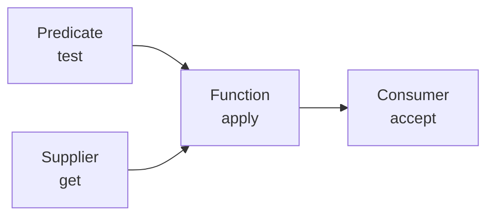
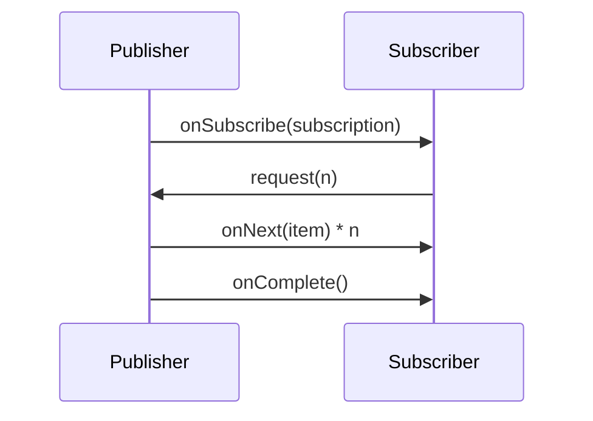

# Módulo 20: Programación funcional y streams

Este módulo profundiza el estilo funcional en Java: interfaces funcionales core, composición, referencias a métodos, Optional, streams intermedios/terminales, collectors, paralelismo, pureza y Flow API. La meta es escribir transformaciones claras y seguras, no forzar “todo stream”.

**Contexto Tienda Aurora.** Este módulo aporta bases para Tienda Aurora: los conceptos aquí se aplican en el monolito modular y luego en los microservicios.

**Entorno de referencia verificado (2026-05-22):** JDK 27.0.1.0.2.

## Aprende construyendo

## Proyecto desde cero: tienda-aurora-java-m20

## Prerrequisitos

```bash
java -version    # JDK 25+
gradle --version # Gradle 9.x
```

## Estructura del proyecto

```text
tienda-aurora-java-m20/
├── build.gradle.kts
├── settings.gradle.kts
└── src/
    └── main/
        └── java/com/aurora/java/
            └── Main.java
```

## build.gradle.kts

```kotlin
plugins {
    java
    application
}

group = "com.aurora"
version = "1.0.0"

java {
    toolchain {
        languageVersion = JavaLanguageVersion.of(25)
    }
}

application {
    mainClass.set("com.aurora.java.Main")
}

repositories {
    mavenCentral()
}
```

## settings.gradle.kts

```kotlin
rootProject.name = "tienda-aurora-java-m20"
```

## Ejecutar

```bash
./gradlew run
# O directamente:
mkdir -p out
javac -d out src/main/java/com/aurora/java/**/*.java
java -cp out com.aurora.java.Main
```

### Tema 1: Las cuatro formas: Predicate, Function, Consumer y Supplier · Básico · 30 min

**Caso guía.** filtrar guías válidas, transformarlas, imprimirlas y generar IDs.

Interfaces funcionales core

**Definición.** `Predicate<T>` (T->boolean), `Function<T,R>` (T->R), `Consumer<T>` (T->void), `Supplier<T>` (()->T). Son contratos para pasar comportamiento.



**Ejemplo mínimo enfocado (ejecutable).**

```bash
mkdir -p java-m20-core
cd java-m20-core
```

Crea el archivo `DemoCore.java`:

```java
import java.util.function.*;
public class DemoCore {
  public static void main(String[] args) {
    Predicate<Integer> positivo = x -> x > 0;
    Function<Integer,String> tag = x -> "N" + x;
    Consumer<String> out = System.out::println;
    Supplier<Integer> uno = () -> 1;
    if (positivo.test(uno.get())) out.accept(tag.apply(uno.get()));
  }
}
```

```bash
javac DemoCore.java
java DemoCore
```

**Verificación (JDK 27, 2026-05-22).** `N1`.

### Tema 2: Function y BiFunction: transformar uno o dos datos · Básico · 35 min

**Caso guía.** calcular precio con impuesto (dos entradas) o transformar un valor (una entrada).

`Function` y `BiFunction`

**Ejemplo mínimo enfocado (ejecutable).**

```bash
mkdir -p java-m20-fn
cd java-m20-fn
```

Crea el archivo `DemoFn.java`:

```java
import java.util.function.*;
public class DemoFn {
  public static void main(String[] args) {
    Function<Integer,Integer> doble = x -> x * 2;
    BiFunction<Integer,Integer,Integer> suma = Integer::sum;
    System.out.println(doble.apply(5));
    System.out.println(suma.apply(2,3));
  }
}
```

```bash
javac DemoFn.java
java DemoFn
```

**Verificación (JDK 27, 2026-05-22).** `10`, `5`.

### Tema 3: Componer sin anidar: andThen, compose, negate y reglas encadenadas · Intermedio · 40 min

**Caso guía.** validar con varias reglas y componer transformaciones.

Composición

**Definición.** `andThen/compose` encadenan funciones; `and/or/negate` combinan predicados.

**Ejemplo mínimo enfocado (ejecutable).**

```bash
mkdir -p java-m20-comp
cd java-m20-comp
```

Crea el archivo `DemoComp.java`:

```java
import java.util.function.*;
public class DemoComp {
  public static void main(String[] args) {
    Predicate<Integer> pos = x -> x > 0;
    Predicate<Integer> par = x -> x % 2 == 0;
    Function<Integer,Integer> doble = x -> x * 2;
    Function<Integer,Integer> masUno = x -> x + 1;
    System.out.println(pos.and(par).test(4));
    System.out.println(doble.andThen(masUno).apply(3));
  }
}
```

```bash
javac DemoComp.java
java DemoComp
```

**Verificación (JDK 27, 2026-05-22).** `true`, `7`.

### Tema 4: Streams como composición: pereza, orden y efectos que se esconden · Intermedio · 40 min

**Caso guía.** un pipeline parece ejecutar todo, pero intermedias son lazy.

Laziness y orden

**Definición.** Operaciones intermedias se evalúan al ejecutar una terminal. El orden importa (`filter` antes de `map` puede reducir trabajo).

**Ejemplo mínimo enfocado (ejecutable).**

```bash
mkdir -p java-m20-lazy
cd java-m20-lazy
```

Crea el archivo `DemoLazy.java`:

```java
import java.util.stream.*;
public class DemoLazy {
  public static void main(String[] args) {
    long c = Stream.of(1,2,3,4).filter(x -> x > 2).peek(x -> {}).count();
    System.out.println(c);
  }
}
```

```bash
javac DemoLazy.java
java DemoLazy
```

**Error común.** Usar `peek` para efectos de negocio. Corrección: `forEach` terminal u operación explícita; mantener pipeline puro.

**Verificación (JDK 27, 2026-05-22).** `2`.

### Tema 5: UnaryOperator y BinaryOperator: la salida conserva el tipo · Intermedio · 35 min

**Caso guía.** transformaciones donde tipo de entrada y salida son iguales.

Operadores

**Ejemplo mínimo enfocado (ejecutable).**

```bash
mkdir -p java-m20-op
cd java-m20-op
```

Crea el archivo `DemoOp.java`:

```java
import java.util.function.*;
public class DemoOp {
  public static void main(String[] args) {
    UnaryOperator<Integer> inc = x -> x + 1;
    BinaryOperator<Integer> max = Integer::max;
    System.out.println(inc.apply(4));
    System.out.println(max.apply(3,9));
  }
}
```

```bash
javac DemoOp.java
java DemoOp
```

**Verificación (JDK 27, 2026-05-22).** `5`, `9`.

### Tema 6: Referencias a métodos: escribir la operación sin repetirla · Intermedio · 40 min

**Caso guía.** `x -> System.out.println(x)` vs `System.out::println`.

Method references

**Ejemplo mínimo enfocado (ejecutable).**

```bash
mkdir -p java-m20-ref
cd java-m20-ref
```

Crea el archivo `DemoRef.java`:

```java
import java.util.*;
public class DemoRef {
  public static void main(String[] args) {
    List.of("a","b").forEach(System.out::println);
  }
}
```

```bash
javac DemoRef.java
java DemoRef
```

**Verificación (JDK 27, 2026-05-22).** `a`, `b`.

### Tema 7: Optional: buscar un envío que puede no existir · Intermedio · 35 min

**Caso guía.** repo devuelve vacío si no existe.

Optional

**Ejemplo mínimo enfocado (ejecutable).**

```bash
mkdir -p java-m20-opt
cd java-m20-opt
```

Crea el archivo `DemoOpt.java`:

```java
import java.util.*;
public class DemoOpt {
  static Optional<String> find(String id){ return "A1".equals(id)?Optional.of("ok"):Optional.empty(); }
  public static void main(String[] args){ System.out.println(find("A1").orElse("no")); System.out.println(find("X").orElse("no")); }
}
```

```bash
javac DemoOpt.java
java DemoOpt
```

**Verificación (JDK 27, 2026-05-22).** `ok`, `no`.

### Tema 8: Streams intermedios: filtrar, transformar, aplanar y ordenar · Intermedio · 40 min

**Caso guía.** normalizar y aplanar listas de tags.

`filter`, `map`, `flatMap`, `sorted`, `distinct`

**Ejemplo mínimo enfocado (ejecutable).**

```bash
mkdir -p java-m20-mid
cd java-m20-mid
```

Crea el archivo `DemoMid.java`:

```java
import java.util.*; import java.util.stream.*;
public class DemoMid {
  public static void main(String[] args) {
    var r = Stream.of(List.of("b","a"), List.of("a","c"))
      .flatMap(List::stream).distinct().sorted().toList();
    System.out.println(r);
  }
}
```

```bash
javac DemoMid.java
java DemoMid
```

**Verificación (JDK 27, 2026-05-22).** `[a, b, c]`.

### Tema 9: Streams terminales: encontrar, contar y combinar resultados · Intermedio · 40 min

**Caso guía.** contar, encontrar y reducir.

Terminales

**Ejemplo mínimo enfocado (ejecutable).**

```bash
mkdir -p java-m20-term
cd java-m20-term
```

Crea el archivo `DemoTerm.java`:

```java
import java.util.*;
public class DemoTerm {
  public static void main(String[] args) {
    var xs = List.of(1,2,3,4);
    System.out.println(xs.stream().filter(x->x>2).count());
    System.out.println(xs.stream().findFirst().orElse(-1));
    System.out.println(xs.stream().reduce(0, Integer::sum));
  }
}
```

```bash
javac DemoTerm.java
java DemoTerm
```

**Verificación (JDK 27, 2026-05-22).** `2`, `1`, `10`.

### Tema 10: Collectors: formar listas, mapas, grupos y texto · Intermedio · 40 min

**Caso guía.** agrupar guías por estado.

Collectors

**Ejemplo mínimo enfocado (ejecutable).**

```bash
mkdir -p java-m20-col
cd java-m20-col
```

Crea el archivo `DemoCol.java`:

```java
import java.util.*; import java.util.stream.*;
public class DemoCol {
  public static void main(String[] args) {
    var m = Stream.of("A","B","A").collect(Collectors.groupingBy(x->x, Collectors.counting()));
    System.out.println(m.get("A"));
    System.out.println(m.get("B"));
  }
}
```

```bash
javac DemoCol.java
java DemoCol
```

**Verificación (JDK 27, 2026-05-22).** `2`, `1`.

### Tema 11: Streams paralelos: comparar antes de acelerarlos · Intermedio · 40 min

**Caso guía.** operación CPU-bound grande e independiente.

Parallel streams

**Ejemplo mínimo enfocado (ejecutable).**

```bash
mkdir -p java-m20-par
cd java-m20-par
```

Crea el archivo `DemoPar.java`:

```java
import java.util.stream.*;
public class DemoPar { public static void main(String[] args){ System.out.println(IntStream.rangeClosed(1,1000).parallel().sum()); } }
```

```bash
javac DemoPar.java
java DemoPar
```

**Error común.** Paralelizar I/O bloqueante o mutar estado compartido. Corrección: medir y usar `collect`.

**Verificación (JDK 27, 2026-05-22).** `500500`.

### Tema 12: Pureza y efectos: calcular separado de guardar o imprimir · Intermedio · 40 min

**Caso guía.** una lambda que modifica una lista externa hace el pipeline impredecible.

Pureza y efectos secundarios

**Definición.** Función pura: mismo input, mismo output, sin efectos secundarios observables. En streams, favorece predictibilidad y paralelismo seguro.

**Ejemplo mínimo enfocado (ejecutable).**

```bash
mkdir -p java-m20-pure
cd java-m20-pure
```

Crea el archivo `DemoPure.java`:

```java
import java.util.*; import java.util.stream.*;
public class DemoPure {
  static int impuro = 0;
  public static void main(String[] args) {
    var xs = List.of(1,2,3).stream().map(x -> x * 2).toList(); // puro
    List.of(1,2,3).forEach(x -> impuro += x); // efecto lateral
    System.out.println(xs);
    System.out.println(impuro);
  }
}
```

```bash
javac DemoPure.java
java DemoPure
```

**Error común.** Mutar estado externo desde `map/filter`. Corrección: mantener transformaciones puras.

**Verificación (JDK 27, 2026-05-22).** `[2, 4, 6]`, `6`.

### Tema 13: Flow API: publicar datos con demanda y cierre · Intermedio · 40 min

**Caso guía.** productor emite eventos; consumidor controla demanda.

`Flow.Publisher/Subscriber/Subscription`

**Definición.** Flow API (Java 9) implementa Reactive Streams con backpressure: el suscriptor solicita `n` elementos.



**Ejemplo mínimo enfocado (ejecutable).**

```bash
mkdir -p java-m20-flow
cd java-m20-flow
```

Crea el archivo `DemoFlow.java`:

```java
import java.util.concurrent.*;
public class DemoFlow {
  public static void main(String[] args) throws Exception {
    SubmissionPublisher<String> pub = new SubmissionPublisher<>();
    pub.subscribe(new Flow.Subscriber<>() {
      private Flow.Subscription sub;
      public void onSubscribe(Flow.Subscription s){ sub=s; s.request(2); }
      public void onNext(String i){ System.out.println(i); }
      public void onError(Throwable t){ t.printStackTrace(); }
      public void onComplete(){ System.out.println("done"); }
    });
    pub.submit("A"); pub.submit("B"); pub.close();
    Thread.sleep(200);
  }
}
```

```bash
javac DemoFlow.java
java DemoFlow
```

**Error común.** No respetar backpressure o bloquear en callbacks. Corrección: solicitar demanda, manejar errores y no bloquear el publisher.

**Verificación (JDK 27, 2026-05-22).** `A`, `B`, `done` (orden A,B estable; cierre después).

## Cierre

La programación funcional en Java es una herramienta de claridad. Combínala con OOP y sentido común: pureza donde aporte, efectos controlados en bordes.

## Checklist

- Uso interfaces funcionales core y composición.
- Mantengo streams legibles y sin efectos laterales ocultos.
- Uso Optional para ausencia, no como campo.
- Entiendo backpressure básico en Flow API.
