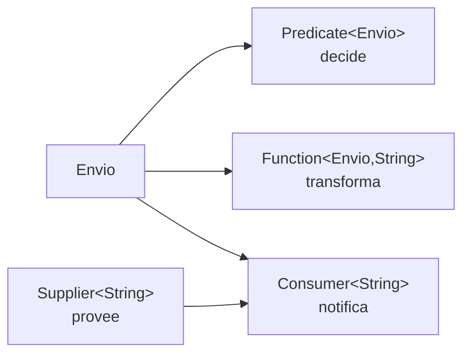
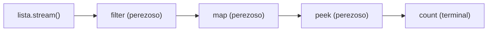

# Módulo 20: Java funcional — interfaces que componen comportamiento

## Aprende construyendo

Cada Tema parte de una carpeta vacía y se compila con `javac` para ver el error real, no para describirlo.

### Tema 1: Las cuatro formas: Predicate, Function, Consumer y Supplier

#### Paso 1 · Objetivo y preparación

Al finalizar vas a elegir la interfaz funcional correcta para cada intención —decidir, transformar, notificar o proveer— y a compilar un ejemplo que use las cuatro sin envolver lambdas a mano.

**Conocimiento previo:** Java 21 o superior, lambdas y `javac`/`java` en el `PATH`. Comprueba `java -version` y `javac -version`.

#### Paso 2 · Contexto y caso real

**¿Por qué es importante?** En un caso real, el equipo de RutaFlow necesita aplicar reglas distintas por cliente: unas deciden si un envío requiere revisión, otras transforman la guía para imprimirla, otras registran la decisión y otras proveen la fecha del turno. Si cada regla se modela con la interfaz equivocada, el código compila pero obliga a envolver lambdas y a repetir `if` por todas partes.

Elegir la forma correcta convierte una regla de negocio en un valor que se pasa, se compone y se prueba por separado. Ese es el primer paso para que el proyecto integrador no acumule lógica en un método de mil líneas.

#### Paso 3 · Teoría, modelo mental y analogía

`java.util.function` define cuatro formas base:

- `Predicate<T>`: recibe un valor y decide (`boolean`). Es un portero.
- `Function<T, R>`: recibe un valor y devuelve otro. Es un traductor.
- `Consumer<T>`: recibe un valor y no devuelve nada; produce un efecto. Es un notificador.
- `Supplier<T>`: no recibe nada y devuelve un valor. Es un proveedor.

**Analogía:** en una bodega, el portero decide si un paquete entra (`Predicate`), el traductor reetiqueta el paquete en otro idioma (`Function`), el notificador avisa al sistema (`Consumer`) y el proveedor entrega el turno del día (`Supplier`). La analogía deja de servir si conviertes la interfaz en el modelo del negocio: `Predicate<Envio>` describe una decisión, no un envío.

**Diagrama:**



#### Paso 4 · Demostración guiada desde cero

Desde una carpeta vacía:

```bash
mkdir java-funcional && cd java-funcional
mkdir src
```

Crea `src/Formas.java` con este contenido completo:

```java
import java.util.List;
import java.util.function.Consumer;
import java.util.function.Function;
import java.util.function.Predicate;
import java.util.function.Supplier;

public final class Formas {
    record Envio(String guia, String destino, double pesoKg) {}

    public static void main(String[] args) {
        // Predicate: decide si el envío requiere revisión.
        Predicate<Envio> requiereRevision = envio -> envio.pesoKg() > 20;
        // Function: transforma el envío en la línea que se imprime.
        Function<Envio, String> etiqueta = envio -> envio.guia() + " -> " + envio.destino();
        // Consumer: produce un efecto, no devuelve valor.
        Consumer<String> registrar = linea -> System.out.println("[log] " + linea);
        // Supplier: entrega un valor cuando se le pide.
        Supplier<String> turno = () -> "Turno AM";

        List<Envio> envios = List.of(
            new Envio("ENV-1", "Bogotá", 5.5),
            new Envio("ENV-2", "Medellín", 32.0)
        );

        for (Envio envio : envios) {
            if (requiereRevision.test(envio)) {
                registrar.accept(turno.get() + " | " + etiqueta.apply(envio));
            }
        }
    }
}
```

Compila y ejecuta:

```bash
javac -d out src/Formas.java
java -cp out Formas
```

**Resultado esperado:** una sola línea, `[log] Turno AM | ENV-2 -> Medellín`. El envío de 5,5 kg no entra al bloque porque `requiereRevision` devuelve `false`.

**Fallo deliberado:** cambia la `Function` por una lambda de dos parámetros:

```java
Function<Envio, String> etiqueta = (guia, destino) -> guia;
```

Al compilar, `javac` responde:

```text
Formas.java:12: error: incompatible types: incompatible parameter types in lambda expression
```

El diagnóstico es que `Function` declara un único parámetro. El compilador no está fallando por la sintaxis de la lambda, sino por su aridad: la interfaz fija la forma. Corrige la lambda a un parámetro y vuelve a compilar.

**Conceptos clave:** interfaz funcional, aridad, `apply`, `test`, `accept`, `get`.

#### Paso 5 · Práctica guiada

**Pista:** cambia `Predicate<Envio>` por `Function<Envio, Boolean>` y observa el error: `boolean cannot be dereferenced` o un fallo al llamar `test`. La interfaz correcta se elige por la pregunta que responde, no por el tipo que devuelve.

**Resultado esperado:** documentas el error de compilación y explicas en una frase por qué `Predicate` expresa mejor la decisión.

#### Paso 6 · Práctica independiente

Crea `src/Reglas.java` con un `Predicate<String>` que valide un correo, una `Function<String, String>` que lo normalice, un `Consumer<String>` que registre el resultado y un `Supplier<LocalDate>` que devuelva la fecha de hoy. Ejecuta con `-cp out Reglas`.

**Resultado esperado:** el correo normalizado se registra una sola vez y la fecha aparece en el formato ISO.

#### Paso 7 · Cierre

Siguiente paso: componer estas formas sin anidar lambdas.

**Errores comunes:** usar `Function` cuando la intención es decidir; olvidar que `Consumer` no devuelve nada; crear un `Supplier` que en realidad depende de un parámetro; asumir que una lambda con dos parámetros encaja en una interfaz de uno.

**Límites y decisión de uso:** estas interfaces sirven para pasar comportamiento, no para modelar entidades. Si una regla necesita estado propio o más de dos parámetros, una clase con nombre comunica mejor la intención. En el proyecto integrador, las reglas de revisión se prueban por separado precisamente porque son `Predicate`, no métodos privados.

**Fuente oficial:** [java.util.function](https://docs.oracle.com/en/java/javase/21/docs/api/java.base/java/util/function/package-summary.html) y [lambdas en el tutorial de Java](https://docs.oracle.com/javase/tutorial/java/javaOO/lambdaexpressions.html).

### Tema 2: Componer sin anidar: andThen, compose, negate y reglas encadenadas

#### Paso 1 · Objetivo y preparación

Al finalizar vas a encadenar reglas con `and`, `or`, `negate`, `andThen` y `compose`, y a explicar por qué el orden de composición cambia el resultado.

**Conocimiento previo:** Tema 1 de este módulo; `javac` funcionando.

#### Paso 2 · Contexto y caso real

**¿Por qué es importante?** El proyecto integrador valida correos que llegan de un formulario. Si se valida antes de normalizar, un correo correcto con espacios alrededor se rechaza; si se normaliza antes de validar, pasa. El error no está en la regla sino en el orden en que se compone.

Componer con las interfaces de Java hace visible ese orden en una sola expresión, en lugar de esconderlo en una sucesión de `if` que nadie revisa.

#### Paso 3 · Teoría, modelo mental y analogía

`Predicate` ofrece `and`, `or` y `negate`; `Function` ofrece `andThen` y `compose`. La diferencia es el sentido de la lectura: `f.andThen(g)` aplica `f` y luego `g`; `g.compose(f)` aplica `f` y luego `g`. Son equivalentes, pero una se lee de izquierda a derecha y la otra de derecha a izquierda.

**Analogía:** es una cadena de montaje. `andThen` añade una estación al final; `compose` declara que la estación actual va después de otra. El límite es que la cadena no valida la semántica: si el orden es incorrecto, compila y produce el resultado equivocado.

#### Paso 4 · Demostración guiada desde cero

Desde una carpeta vacía:

```bash
mkdir java-composicion && cd java-composicion
mkdir src
```

Crea `src/Composicion.java`:

```java
import java.util.function.Function;
import java.util.function.Predicate;

public final class Composicion {
    // Decide si el texto ya normalizado parece un correo.
    static final Predicate<String> correo = texto ->
        texto.contains("@") && texto.indexOf('@') > 0 && texto.indexOf('@') < texto.length() - 1;

    public static void main(String[] args) {
        // Function: normaliza antes de validar.
        Function<String, String> normalizar = texto -> texto.trim().toLowerCase();

        // andThen: primero normaliza, luego decide.
        Function<String, Boolean> validar = normalizar.andThen(correo::test);

        String entrada = "  ANA@ACADEMIA.COM  ";
        System.out.println("normalizado: " + validar.apply(entrada));

        // Predicate: combina reglas con and / or / negate.
        Predicate<String> noVacio = texto -> !texto.isBlank();
        Predicate<String> conArroba = texto -> texto.contains("@");
        Predicate<String> sospechoso = noVacio.and(conArroba).negate();

        System.out.println("sospechoso: " + sospechoso.test(entrada));
        System.out.println("sospechoso vacío: " + sospechoso.test("   "));
    }
}
```

```bash
javac -d out src/Composicion.java
java -cp out Composicion
```

**Resultado esperado:**

```text
normalizado: true
sospechoso: false
sospechoso vacío: true
```

**Fallo deliberado:** invierte el orden. Crea `Function<String, Boolean> sinNormalizar = correo::test;` y evalúa `sinNormalizar.apply("  ANA@ACADEMIA.COM  ")`. Obtienes `false`: la regla es correcta, pero recibe el texto crudo. El diagnóstico es que `correo::test` no normaliza; la composición `andThen` es la que aporta el orden. Corrige usando `normalizar.andThen(correo::test)`.

**Conceptos clave:** `andThen`, `compose`, `and`, `or`, `negate`, orden de evaluación.

#### Paso 5 · Práctica guiada

**Pista:** añade una regla `terminaEnCom` con `correo.and(texto -> texto.endsWith(".com"))` y comprueba con `"ana@academia.com"` y `"ana@academia.org"`.

**Resultado esperado:** el primer texto pasa y el segundo no; puedes señalar qué regla lo rechazó.

#### Paso 6 · Práctica independiente

Crea `src/ReglasEnvio.java` con tres `Predicate<Envio>` (peso, destino y estado) y una función que devuelva el motivo del rechazo en lugar de un `boolean`. Ejecuta con `java -cp out ReglasEnvio`.

**Resultado esperado:** cada envío rechazado muestra el motivo, y un envío válido no produce ningún mensaje.

#### Paso 7 · Cierre

Siguiente paso: aplicar composición a colecciones con Streams.

**Errores comunes:** confundir `andThen` con `compose`; validar antes de normalizar; encadenar `or` donde la regla pedía `and`; usar `negate` para esconder una condición que debería tener nombre propio.

**Límites y decisión de uso:** componer es útil cuando las reglas son independientes y se combinan; si dependen entre sí o necesitan explicar el motivo del rechazo, un tipo de resultado (`Resultado`) comunica más que un `boolean` compuesto. En el proyecto integrador, la validación que debe informar al usuario usa motivos, no solo `Predicate`.

**Fuente oficial:** [Predicate](https://docs.oracle.com/en/java/javase/21/docs/api/java.base/java/util/function/Predicate.html) y [Function](https://docs.oracle.com/en/java/javase/21/docs/api/java.base/java/util/function/Function.html).

### Tema 3: Streams como composición: pereza, orden y efectos que se esconden

#### Paso 1 · Objetivo y preparación

Al finalizar vas a explicar por qué un Stream no ejecuta nada hasta la operación terminal, a depurar un pipeline con `peek` sin confundirlo con un `for`, y a diagnosticar el error de reutilizar un Stream consumido.

**Conocimiento previo:** Temas 1 y 2; `javac` y `java` funcionando.

#### Paso 2 · Contexto y caso real

**¿Por qué es importante?** En el proyecto integrador, un informe procesa miles de envíos. Si el pipeline se ejecuta dos veces o se mezclan efectos dentro de `map`, el informe puede duplicar registros o tardar el doble sin que nadie lo note. La pereza de Streams es una ventaja solo si se entiende: el trabajo ocurre en la operación terminal, no donde se declara.

#### Paso 3 · Teoría, modelo mental y analogía

Un `Stream` es una descripción de trabajo, no una colección. `filter`, `map` y `peek` son perezosas; `count`, `collect`, `forEach` y `reduce` son terminales y disparan el recorrido. Un Stream se consume una sola vez.

**Analogía:** es una receta escrita frente a una comida cocinada. Escribir la receta no cocina nada; el primer plato que se sirve dispara el trabajo. El límite es que, a diferencia de una receta, el Stream no se puede volver a cocinar: si lo intentas, la API lanza una excepción.

**Diagrama:**



#### Paso 4 · Demostración guiada desde cero

Desde una carpeta vacía:

```bash
mkdir java-streams && cd java-streams
mkdir src
```

Crea `src/Pereza.java`:

```java
import java.util.List;
import java.util.stream.Stream;

public final class Pereza {
    record Envio(String guia, double pesoKg) {}

    public static void main(String[] args) {
        List<Envio> envios = List.of(
            new Envio("ENV-1", 5.5),
            new Envio("ENV-2", 32.0),
            new Envio("ENV-3", 18.0)
        );

        Stream<Envio> pesados = envios.stream()
            .filter(envio -> envio.pesoKg() > 20)
            .peek(envio -> System.out.println("filtrado " + envio.guia()));

        System.out.println("antes de la operación terminal: no se ejecutó ningún filtro");
        long total = pesados.count();
        System.out.println("pesados=" + total);
    }
}
```

```bash
javac -d out src/Pereza.java
java -cp out Pereza
```

**Resultado esperado:**

```text
antes de la operación terminal: no se ejecutó ningún filtro
filtrado ENV-2
pesados=1
```

La línea «filtrado» aparece después del mensaje, no antes: el `peek` no se ejecutó al declarar el pipeline.

**Fallo deliberado:** reutiliza el Stream consumido:

```java
long primero = pesados.count();
long segundo = pesados.count();
```

Al ejecutar, la JVM responde:

```text
Exception in thread "main" java.lang.IllegalStateException: stream has already been operated upon or closed
```

El diagnóstico es que `count` es terminal y cierra el Stream. No es un problema de `count`: es que un Stream no es una colección reutilizable. Corrige guardando el resultado en una variable o creando un Stream nuevo desde la lista.

**Conceptos clave:** operación perezosa, operación terminal, consumo único, `peek` para depurar.

#### Paso 5 · Práctica guiada

**Pista:** añade `.map(Envio::guia)` antes de `peek` y observa que `peek` ya recibe un `String`; el pipeline cambia de tipo en cada estación.

**Resultado esperado:** el mensaje de depuración muestra solo la guía, y el `count` sigue siendo 1.

#### Paso 6 · Práctica independiente

Crea `src/Informe.java` que calcule el peso total de los envíos con `mapToDouble` y `sum`, y que cuente cuántos superan 20 kg sin recorrer la lista dos veces. Ejecuta con `java -cp out Informe`.

**Resultado esperado:** el programa imprime el total y el conteo en una sola pasada, y puedes explicar dónde ocurrió el trabajo.

#### Paso 7 · Cierre

Siguiente paso: decidir cuándo Streams no conviene.

**Errores comunes:** creer que `filter` ejecuta el trabajo al declararlo; usar `peek` para lógica de negocio; reutilizar un Stream; usar `parallelStream` sin medir; esconder efectos en `map`.

**Límites y decisión de uso:** un `for` es más claro cuando hay índices, `break`, `continue` o efectos que deben ocurrir en orden; Streams brillan cuando la operación es una transformación o agregación sin efectos. En el proyecto integrador, el cálculo de totales usa Streams y el envío de notificaciones usa un `for`, porque el efecto importa.

**Fuente oficial:** [Stream](https://docs.oracle.com/en/java/javase/21/docs/api/java.base/java/util/stream/Stream.html) y [procesamiento de datos con Streams](https://docs.oracle.com/javase/tutorial/collections/streams/index.html).

## Laboratorio práctico

**Entregable:** el motor de reglas del proyecto integrador, compuesto con las cuatro interfaces funcionales y con un informe de envíos que no recorra la lista dos veces.

**Criterio de aceptación (se ejecuta, no se opina):**

1. `javac -d out src/*.java` termina con código 0.
2. `java -cp out Formas` imprime exactamente `[log] Turno AM | ENV-2 -> Medellín`.
3. `java -cp out Pereza` imprime el aviso de pereza **antes** de la línea `filtrado ENV-2`.
4. Un correo con espacios se acepta solo si se normaliza antes de validar.
5. El informe calcula total y conteo en una sola pasada; el código no contiene dos `stream()` sobre la misma lista para el mismo cálculo.

**Checkpoint:** guarda este verificador junto a tus fuentes y ejecútalo antes de entregar:

```bash
cat > verificar.sh <<'SCRIPT'
#!/usr/bin/env bash
set -euo pipefail
javac -d out src/*.java
salida=$(java -cp out Formas)
[ "$salida" = "[log] Turno AM | ENV-2 -> Medellín" ] || { echo "FALLA: Formas imprimió: $salida"; exit 1; }
java -cp out Pereza | head -1 | grep -q "antes de la operación terminal" || { echo "FALLA: el pipeline no es perezoso"; exit 1; }
echo "Checkpoint OK"
SCRIPT
bash verificar.sh
```

**Resultado esperado:** `Checkpoint OK`. Si falla, el mensaje dice qué criterio no se cumplió; no hay que adivinar.
