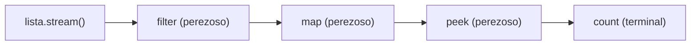

# Módulo 20: Java funcional — interfaces que componen comportamiento

## Aprende construyendo

El módulo se amplía de 3 a 13 temas para cubrir el inventario del prompt: funciones de una y dos entradas, operadores, referencias a métodos, `Optional`, operaciones intermedias y terminales de Streams, Collectors, paralelismo, efectos y Flow API. Cada uno de los 13 temas tiene tres subtemas de 5–15 minutos; los temas 1–3 reutilizan la carpeta creada en su demostración inicial y los temas 4–13 tienen proyectos independientes.

Cada Tema parte de una carpeta vacía y se compila con `javac` para ver el error real, no para describirlo.


### Tema 1: Las cuatro formas: Predicate, Function, Consumer y Supplier · Básico · 30 min

<details open>
<summary><strong>Capa 1 — Lectura</strong></summary>

#### ► DE QUÉ TRATA
Este tema te guía por las cuatro formas: predicate, function, consumer y supplier con foco en comprensión antes de implementación.

#### ► LA IDEA EN UNA FRASE
**Entender las cuatro formas: predicate, function, consumer y supplier te permite tomar mejores decisiones técnicas.**

#### ► POR QUÉ EXISTE ESTO
Resuelve un problema real de diseño o implementación y evita decisiones a ciegas.

#### ► LA ANALOGÍA
Piensa en las cuatro formas: predicate, function, consumer y supplier como una herramienta de taller: útil cuando conoces su propósito y sus límites.
**Dónde se rompe la analogía:** en software, los efectos dependen del contexto, la escala y los trade-offs.

#### ► CÓMO FUNCIONA
1. Identifica el problema que las cuatro formas: predicate, function, consumer y supplier resuelve.
2. Observa sus componentes y relaciones.
3. Aplica la opción más simple que funcione.
4. Verifica el resultado y los límites.

#### ► LO QUE PUEDE SALIR MAL
| Síntoma | Causa probable | Arreglo |
|---|---|---|
| Las cuatro formas: Predicate, Function, Consumer y Supplier se aplica pero el resultado no mejora | Se usó sin medir el problema real | Mide antes y compara contra la alternativa simple |
| Aparece complejidad inesperada | Se adoptó la técnica sin comprender sus trade-offs | Vuelve a la sección de trade-offs y reduce el alcance |
| Falla en un caso límite | Se asumió un contexto que no se cumple | Prueba el caso límite y documenta cuándo NO usarlo |

#### ► TRADE-OFFS
| Opción | Cuándo usarla | Cuándo NO usarla |
|---|---|---|
| Usar Las cuatro formas: Predicate, Function, Consumer y Supplier | Cuando el problema coincide con su propósito y el beneficio es observable | Cuando agrega complejidad sin resolver un problema real |
| Alternativa más simple | Cuando el contexto es pequeño, estable o fácil de razonar | Cuando ya demostró no escalar o no cumplir el requisito |
| Postergar la decisión | Cuando falta evidencia del problema | Cuando el costo de esperar es mayor que el costo de probar |

#### ► CUÁNDO NO USAR ESTO
No uses las cuatro formas: predicate, function, consumer y supplier por defecto. Aplícalo cuando el problema lo justifique y puedas verificar el beneficio; si una alternativa más simple resuelve igual, prefiérela.

#### ► DE VUELTA A LA ANALOGÍA
Volviendo a la analogía: las cuatro formas: predicate, function, consumer y supplier funciona como el modelo inicial, pero recuerda dónde se rompe: en producción importan la evidencia, la escala y el costo de equivocarte.

#### ► LO QUE DEBES RECORDAR
- Las cuatro formas: Predicate, Function, Consumer y Supplier existe para resolver un problema específico.
- Mide antes de adoptar complejidad.
- Conoce el caso donde NO usarlo.
- Verifica con evidencia observable.

#### ► PREGUNTAS PARA PENSAR
1. ¿Qué problema concreto resuelve las cuatro formas: predicate, function, consumer y supplier en tu contexto?
2. ¿Cómo sabrías que las cuatro formas: predicate, function, consumer y supplier no está funcionando bien?
3. ¿Qué alternativa más simple considerarías antes de usar las cuatro formas: predicate, function, consumer y supplier?

</details>

<details>
<summary><strong>Capa 2 — Construcción</strong></summary>

#### Código y verificación
```java
import java.util.List;
import java.util.function.Consumer;
import java.util.function.Function;
import java.util.function.Predicate;
import java.util.function.Supplier;

public final class Formas {
    record Envio(String guia, String destino, double pesoKg) {}

    public static void main(String[] args) {
        Predicate<Envio> revisar = envio -> envio.pesoKg() > 20;
        Function<Envio, String> etiqueta = envio -> envio.guia() + " -> " + envio.destino();
        Consumer<String> registrar = texto -> System.out.println("[log] " + texto);
        Supplier<String> turno = () -> "Turno AM";

        List<Envio> envios = List.of(
            new Envio("ENV-1", "Bogotá", 5.5),
            new Envio("ENV-2", "Medellín", 32.0)
        );
        for (Envio envio : envios) {
            if (revisar.test(envio)) registrar.accept(turno.get() + " | " + etiqueta.apply(envio));
        }
    }
}
```

```bash
mkdir -p out
javac -d out src/Formas.java
java -cp out Formas
```

```java
import java.util.function.Function;

public final class Etiqueta {
    public static void main(String[] args) {
        Function<String, String> normalizar = texto -> texto.trim().toUpperCase();
        System.out.println(normalizar.apply(" rt-8 "));
    }
}
```

```bash
javac -d out src/Etiqueta.java
java -cp out Etiqueta
```

```java
import java.util.function.Consumer;
import java.util.function.Supplier;

public final class Registro {
    public static void main(String[] args) {
        Supplier<String> turno = () -> "Turno AM";
        Consumer<String> registrar = guia -> System.out.println(turno.get() + " | " + guia);
        registrar.accept("RT-8");
    }
}
```

```bash
javac -d out src/Registro.java
java -cp out Registro
```

</details>

### Tema 2: Function y BiFunction: transformar uno o dos datos · Básico · 35 min

<details open>
<summary><strong>Capa 1 — Lectura</strong></summary>

#### ► DE QUÉ TRATA
Al finalizar podrás escoger Function<T,R> cuando entra un dato y BiFunction<T,U,R> cuando entran dos, y ejecutar cada regla con valores de RutaFlow. Prerrequisito: Java M20 Tema 1, java -version 21 o superior. Crea su carpeta: mkdir -p java-funcional-t04/src.

#### ► LA IDEA EN UNA FRASE
**Al finalizar podrás escoger Function<T,R> cuando entra un dato y BiFunction<T,U,R> cuando entran dos, y ejecutar cada regla con valores de RutaFlow.**

#### ► POR QUÉ EXISTE ESTO
Resuelve un problema real de diseño o implementación y evita decisiones a ciegas.

#### ► LA ANALOGÍA
Piensa en function y bifunction: transformar uno o dos datos como una herramienta de taller: útil cuando conoces su propósito y sus límites.
**Dónde se rompe la analogía:** en software, los efectos dependen del contexto, la escala y los trade-offs.

#### ► CÓMO FUNCIONA
1. Identifica el problema que function y bifunction: transformar uno o dos datos resuelve.
2. Observa sus componentes y relaciones.
3. Aplica la opción más simple que funcione.
4. Verifica el resultado y los límites.

#### ► LO QUE PUEDE SALIR MAL
| Síntoma | Causa probable | Arreglo |
|---|---|---|
| Function y BiFunction: transformar uno o dos datos se aplica pero el resultado no mejora | Se usó sin medir el problema real | Mide antes y compara contra la alternativa simple |
| Aparece complejidad inesperada | Se adoptó la técnica sin comprender sus trade-offs | Vuelve a la sección de trade-offs y reduce el alcance |
| Falla en un caso límite | Se asumió un contexto que no se cumple | Prueba el caso límite y documenta cuándo NO usarlo |

#### ► TRADE-OFFS
| Opción | Cuándo usarla | Cuándo NO usarla |
|---|---|---|
| Usar Function y BiFunction: transformar uno o dos datos | Cuando el problema coincide con su propósito y el beneficio es observable | Cuando agrega complejidad sin resolver un problema real |
| Alternativa más simple | Cuando el contexto es pequeño, estable o fácil de razonar | Cuando ya demostró no escalar o no cumplir el requisito |
| Postergar la decisión | Cuando falta evidencia del problema | Cuando el costo de esperar es mayor que el costo de probar |

#### ► CUÁNDO NO USAR ESTO
No uses function y bifunction: transformar uno o dos datos por defecto. Aplícalo cuando el problema lo justifique y puedas verificar el beneficio; si una alternativa más simple resuelve igual, prefiérela.

#### ► DE VUELTA A LA ANALOGÍA
Volviendo a la analogía: function y bifunction: transformar uno o dos datos funciona como el modelo inicial, pero recuerda dónde se rompe: en producción importan la evidencia, la escala y el costo de equivocarte.

#### ► LO QUE DEBES RECORDAR
- Function y BiFunction: transformar uno o dos datos existe para resolver un problema específico.
- Mide antes de adoptar complejidad.
- Conoce el caso donde NO usarlo.
- Verifica con evidencia observable.

#### ► PREGUNTAS PARA PENSAR
1. ¿Qué problema concreto resuelve function y bifunction: transformar uno o dos datos en tu contexto?
2. ¿Cómo sabrías que function y bifunction: transformar uno o dos datos no está funcionando bien?
3. ¿Qué alternativa más simple considerarías antes de usar function y bifunction: transformar uno o dos datos?

</details>

<details>
<summary><strong>Capa 2 — Construcción</strong></summary>

#### Código y verificación
```java
import java.util.function.Function;

public class Peso {
    public static void main(String[] args) {
        Function<Double, String> describir = kg -> kg > 20 ? "pesado" : "normal";
        System.out.println(describir.apply(8.5));
        System.out.println(describir.apply(32.0));
    }
}
```

```bash
cd java-funcional-t04
java src/Peso.java
```

```java
import java.util.function.BiFunction;

public class Guia {
    public static void main(String[] args) {
        BiFunction<String, Integer, String> crear = (prefijo, numero) -> prefijo + "-" + numero;
        System.out.println(crear.apply("RT", 18));
    }
}
```

```bash
cd java-funcional-t04
java src/Guia.java
```

```java
import java.math.BigDecimal;
import java.util.function.BiFunction;

public class Tarifa {
    public static void main(String[] args) {
        BiFunction<BigDecimal, BigDecimal, BigDecimal> multiplicar = BigDecimal::multiply;
        BigDecimal total = multiplicar.apply(new BigDecimal("1250"), new BigDecimal("2.4"));
        System.out.println(total.setScale(2));
    }
}
```

```bash
cd java-funcional-t04
java src/Tarifa.java
```

</details>

### Tema 3: Componer sin anidar: andThen, compose, negate y reglas encadenadas · Intermedio · 40 min

<details open>
<summary><strong>Capa 1 — Lectura</strong></summary>

#### ► DE QUÉ TRATA
Al finalizar vas a encadenar reglas con and, or, negate, andThen y compose, y a explicar por qué el orden de composición cambia el resultado.

#### ► LA IDEA EN UNA FRASE
**Al finalizar vas a encadenar reglas con and, or, negate, andThen y compose, y a explicar por qué el orden de composición cambia el resultado.**

#### ► POR QUÉ EXISTE ESTO
Resuelve un problema real de diseño o implementación y evita decisiones a ciegas.

#### ► LA ANALOGÍA
Piensa en componer sin anidar: andthen, compose, negate y reglas encadenadas como una herramienta de taller: útil cuando conoces su propósito y sus límites.
**Dónde se rompe la analogía:** en software, los efectos dependen del contexto, la escala y los trade-offs.

#### ► CÓMO FUNCIONA
1. Identifica el problema que componer sin anidar: andthen, compose, negate y reglas encadenadas resuelve.
2. Observa sus componentes y relaciones.
3. Aplica la opción más simple que funcione.
4. Verifica el resultado y los límites.

#### ► LO QUE PUEDE SALIR MAL
| Síntoma | Causa probable | Arreglo |
|---|---|---|
| Componer sin anidar: andThen, compose, negate y reglas encadenadas se aplica pero el resultado no mejora | Se usó sin medir el problema real | Mide antes y compara contra la alternativa simple |
| Aparece complejidad inesperada | Se adoptó la técnica sin comprender sus trade-offs | Vuelve a la sección de trade-offs y reduce el alcance |
| Falla en un caso límite | Se asumió un contexto que no se cumple | Prueba el caso límite y documenta cuándo NO usarlo |

#### ► TRADE-OFFS
| Opción | Cuándo usarla | Cuándo NO usarla |
|---|---|---|
| Usar Componer sin anidar: andThen, compose, negate y reglas encadenadas | Cuando el problema coincide con su propósito y el beneficio es observable | Cuando agrega complejidad sin resolver un problema real |
| Alternativa más simple | Cuando el contexto es pequeño, estable o fácil de razonar | Cuando ya demostró no escalar o no cumplir el requisito |
| Postergar la decisión | Cuando falta evidencia del problema | Cuando el costo de esperar es mayor que el costo de probar |

#### ► CUÁNDO NO USAR ESTO
No uses componer sin anidar: andthen, compose, negate y reglas encadenadas por defecto. Aplícalo cuando el problema lo justifique y puedas verificar el beneficio; si una alternativa más simple resuelve igual, prefiérela.

#### ► DE VUELTA A LA ANALOGÍA
Volviendo a la analogía: componer sin anidar: andthen, compose, negate y reglas encadenadas funciona como el modelo inicial, pero recuerda dónde se rompe: en producción importan la evidencia, la escala y el costo de equivocarte.

#### ► LO QUE DEBES RECORDAR
- Componer sin anidar: andThen, compose, negate y reglas encadenadas existe para resolver un problema específico.
- Mide antes de adoptar complejidad.
- Conoce el caso donde NO usarlo.
- Verifica con evidencia observable.

#### ► PREGUNTAS PARA PENSAR
1. ¿Qué problema concreto resuelve componer sin anidar: andthen, compose, negate y reglas encadenadas en tu contexto?
2. ¿Cómo sabrías que componer sin anidar: andthen, compose, negate y reglas encadenadas no está funcionando bien?
3. ¿Qué alternativa más simple considerarías antes de usar componer sin anidar: andthen, compose, negate y reglas encadenadas?

</details>

<details>
<summary><strong>Capa 2 — Construcción</strong></summary>

#### Código y verificación
```bash
mkdir java-composicion && cd java-composicion
mkdir src
```

```java
import java.util.function.Function;
import java.util.function.Predicate;

public final class Composicion {
    // Decide si el texto ya normalizado parece un correo.
    static final Predicate<String> correo = texto ->
        texto.contains("@") && texto.indexOf('@') > 0 && texto.indexOf('@') < texto.length() - 1;

    public static void main(String[] args) {
        // Function: normaliza antes de validar.
        Function<String, String> normalizar = texto -> texto.trim().toLowerCase();

        // andThen: primero normaliza, luego decide.
        Function<String, Boolean> validar = normalizar.andThen(correo::test);

        String entrada = "  ANA@ACADEMIA.COM  ";
        System.out.println("normalizado: " + validar.apply(entrada));

        // Predicate: combina reglas con and / or / negate.
        Predicate<String> noVacio = texto -> !texto.isBlank();
        Predicate<String> conArroba = texto -> texto.contains("@");
        Predicate<String> sospechoso = noVacio.and(conArroba).negate();

        System.out.println("sospechoso: " + sospechoso.test(entrada));
        System.out.println("sospechoso vacío: " + sospechoso.test("   "));
    }
}
```

```bash
javac -d out src/Composicion.java
java -cp out Composicion
```

```text
normalizado: true
sospechoso: false
sospechoso vacío: true
```

```java
import java.util.function.Predicate;

public class Destino {
    public static void main(String[] args) {
        Predicate<String> noVacio = texto -> !texto.isBlank();
        Predicate<String> empiezaConCo = texto -> texto.startsWith("CO-");
        Predicate<String> habilitado = noVacio.and(empiezaConCo);
        System.out.println(habilitado.test("CO-BOG"));
        System.out.println(habilitado.test("MX-CDMX"));
    }
}
```

```java
import java.util.function.Function;
import java.util.function.Predicate;

public class OrdenCorreo {
    public static void main(String[] args) {
        Function<String, String> limpiar = texto -> texto.trim().toLowerCase();
        Predicate<String> correoLimpio = texto -> texto.contains("@") && texto.equals(texto.trim().toLowerCase());
        Function<String, Boolean> flujoCorrecto = limpiar.andThen(correoLimpio::test);
        Function<String, Boolean> flujoIncorrecto = correoLimpio::test;
        String entrada = " ANA@RUTAFLOW.COM ";
        System.out.println(flujoCorrecto.apply(entrada));
        System.out.println(flujoIncorrecto.apply(entrada));
    }
}
```

</details>

### Tema 4: Streams como composición: pereza, orden y efectos que se esconden · Intermedio · 40 min

<details open>
<summary><strong>Capa 1 — Lectura</strong></summary>

#### ► DE QUÉ TRATA
Al finalizar vas a explicar por qué un Stream no ejecuta nada hasta la operación terminal, a depurar un pipeline con peek sin confundirlo con un for, y a diagnosticar el error de reutilizar un Stream consumido.

#### ► LA IDEA EN UNA FRASE
**Al finalizar vas a explicar por qué un Stream no ejecuta nada hasta la operación terminal, a depurar un pipeline con peek sin confundirlo con un for, y a diagnosticar el error de reutilizar un Stream consumido.**

#### ► POR QUÉ EXISTE ESTO
Resuelve un problema real de diseño o implementación y evita decisiones a ciegas.

#### ► LA ANALOGÍA
Piensa en streams como composición: pereza, orden y efectos que se esconden como una herramienta de taller: útil cuando conoces su propósito y sus límites.
**Dónde se rompe la analogía:** en software, los efectos dependen del contexto, la escala y los trade-offs.

#### ► CÓMO FUNCIONA


#### ► LO QUE PUEDE SALIR MAL
| Síntoma | Causa probable | Arreglo |
|---|---|---|
| Streams como composición: pereza, orden y efectos que se esconden se aplica pero el resultado no mejora | Se usó sin medir el problema real | Mide antes y compara contra la alternativa simple |
| Aparece complejidad inesperada | Se adoptó la técnica sin comprender sus trade-offs | Vuelve a la sección de trade-offs y reduce el alcance |
| Falla en un caso límite | Se asumió un contexto que no se cumple | Prueba el caso límite y documenta cuándo NO usarlo |

#### ► TRADE-OFFS
| Opción | Cuándo usarla | Cuándo NO usarla |
|---|---|---|
| Usar Streams como composición: pereza, orden y efectos que se esconden | Cuando el problema coincide con su propósito y el beneficio es observable | Cuando agrega complejidad sin resolver un problema real |
| Alternativa más simple | Cuando el contexto es pequeño, estable o fácil de razonar | Cuando ya demostró no escalar o no cumplir el requisito |
| Postergar la decisión | Cuando falta evidencia del problema | Cuando el costo de esperar es mayor que el costo de probar |

#### ► CUÁNDO NO USAR ESTO
No uses streams como composición: pereza, orden y efectos que se esconden por defecto. Aplícalo cuando el problema lo justifique y puedas verificar el beneficio; si una alternativa más simple resuelve igual, prefiérela.

#### ► DE VUELTA A LA ANALOGÍA
Volviendo a la analogía: streams como composición: pereza, orden y efectos que se esconden funciona como el modelo inicial, pero recuerda dónde se rompe: en producción importan la evidencia, la escala y el costo de equivocarte.

#### ► LO QUE DEBES RECORDAR
- Streams como composición: pereza, orden y efectos que se esconden existe para resolver un problema específico.
- Mide antes de adoptar complejidad.
- Conoce el caso donde NO usarlo.
- Verifica con evidencia observable.

#### ► PREGUNTAS PARA PENSAR
1. ¿Qué problema concreto resuelve streams como composición: pereza, orden y efectos que se esconden en tu contexto?
2. ¿Cómo sabrías que streams como composición: pereza, orden y efectos que se esconden no está funcionando bien?
3. ¿Qué alternativa más simple considerarías antes de usar streams como composición: pereza, orden y efectos que se esconden?

</details>

<details>
<summary><strong>Capa 2 — Construcción</strong></summary>

#### Código y verificación


```bash
mkdir java-streams && cd java-streams
mkdir src
```

```java
import java.util.List;
import java.util.stream.Stream;

public final class Pereza {
    record Envio(String guia, double pesoKg) {}

    public static void main(String[] args) {
        List<Envio> envios = List.of(
            new Envio("ENV-1", 5.5),
            new Envio("ENV-2", 32.0),
            new Envio("ENV-3", 18.0)
        );

        Stream<Envio> pesados = envios.stream()
            .filter(envio -> envio.pesoKg() > 20)
            .peek(envio -> System.out.println("filtrado " + envio.guia()));

        System.out.println("antes de la operación terminal: no se ejecutó ningún filtro");
        long total = pesados.count();
        System.out.println("pesados=" + total);
    }
}
```

```bash
javac -d out src/Pereza.java
java -cp out Pereza
```

```text
antes de la operación terminal: no se ejecutó ningún filtro
filtrado ENV-2
pesados=1
```

```java
long primero = pesados.count();
long segundo = pesados.count();
```

</details>

### Tema 5: UnaryOperator y BinaryOperator: la salida conserva el tipo · Intermedio · 35 min

<details open>
<summary><strong>Capa 1 — Lectura</strong></summary>

#### ► DE QUÉ TRATA
Al finalizar podrás usar UnaryOperator<T> para transformar un valor de tipo T en otro T, y BinaryOperator<T> para combinar dos valores T en uno. Prerrequisito: Java M20 Tema 2. Crea su carpeta: mkdir -p java-funcional-t05/src.

#### ► LA IDEA EN UNA FRASE
**Al finalizar podrás usar UnaryOperator<T> para transformar un valor de tipo T en otro T, y BinaryOperator<T> para combinar dos valores T en uno.**

#### ► POR QUÉ EXISTE ESTO
Resuelve un problema real de diseño o implementación y evita decisiones a ciegas.

#### ► LA ANALOGÍA
Piensa en unaryoperator y binaryoperator: la salida conserva el tipo como una herramienta de taller: útil cuando conoces su propósito y sus límites.
**Dónde se rompe la analogía:** en software, los efectos dependen del contexto, la escala y los trade-offs.

#### ► CÓMO FUNCIONA
1. Identifica el problema que unaryoperator y binaryoperator: la salida conserva el tipo resuelve.
2. Observa sus componentes y relaciones.
3. Aplica la opción más simple que funcione.
4. Verifica el resultado y los límites.

#### ► LO QUE PUEDE SALIR MAL
| Síntoma | Causa probable | Arreglo |
|---|---|---|
| UnaryOperator y BinaryOperator: la salida conserva el tipo se aplica pero el resultado no mejora | Se usó sin medir el problema real | Mide antes y compara contra la alternativa simple |
| Aparece complejidad inesperada | Se adoptó la técnica sin comprender sus trade-offs | Vuelve a la sección de trade-offs y reduce el alcance |
| Falla en un caso límite | Se asumió un contexto que no se cumple | Prueba el caso límite y documenta cuándo NO usarlo |

#### ► TRADE-OFFS
| Opción | Cuándo usarla | Cuándo NO usarla |
|---|---|---|
| Usar UnaryOperator y BinaryOperator: la salida conserva el tipo | Cuando el problema coincide con su propósito y el beneficio es observable | Cuando agrega complejidad sin resolver un problema real |
| Alternativa más simple | Cuando el contexto es pequeño, estable o fácil de razonar | Cuando ya demostró no escalar o no cumplir el requisito |
| Postergar la decisión | Cuando falta evidencia del problema | Cuando el costo de esperar es mayor que el costo de probar |

#### ► CUÁNDO NO USAR ESTO
No uses unaryoperator y binaryoperator: la salida conserva el tipo por defecto. Aplícalo cuando el problema lo justifique y puedas verificar el beneficio; si una alternativa más simple resuelve igual, prefiérela.

#### ► DE VUELTA A LA ANALOGÍA
Volviendo a la analogía: unaryoperator y binaryoperator: la salida conserva el tipo funciona como el modelo inicial, pero recuerda dónde se rompe: en producción importan la evidencia, la escala y el costo de equivocarte.

#### ► LO QUE DEBES RECORDAR
- UnaryOperator y BinaryOperator: la salida conserva el tipo existe para resolver un problema específico.
- Mide antes de adoptar complejidad.
- Conoce el caso donde NO usarlo.
- Verifica con evidencia observable.

#### ► PREGUNTAS PARA PENSAR
1. ¿Qué problema concreto resuelve unaryoperator y binaryoperator: la salida conserva el tipo en tu contexto?
2. ¿Cómo sabrías que unaryoperator y binaryoperator: la salida conserva el tipo no está funcionando bien?
3. ¿Qué alternativa más simple considerarías antes de usar unaryoperator y binaryoperator: la salida conserva el tipo?

</details>

<details>
<summary><strong>Capa 2 — Construcción</strong></summary>

#### Código y verificación
```java
import java.util.function.UnaryOperator;

public class Ciudad {
    public static void main(String[] args) {
        UnaryOperator<String> normalizar = texto -> texto.trim().toLowerCase();
        System.out.println(normalizar.apply("  BOGOTÁ  "));
    }
}
```

```bash
cd java-funcional-t05
java src/Ciudad.java
```

```java
import java.math.BigDecimal;
import java.util.function.BinaryOperator;

public class Total {
    public static void main(String[] args) {
        BinaryOperator<BigDecimal> sumar = BigDecimal::add;
        System.out.println(sumar.apply(new BigDecimal("1200.00"), new BigDecimal("350.00")));
    }
}
```

```bash
cd java-funcional-t05
java src/Total.java
```

```java
import java.math.BigDecimal;
import java.util.function.BinaryOperator;

public class Minimo {
    public static void main(String[] args) {
        BinaryOperator<BigDecimal> menor = BinaryOperator.minBy(BigDecimal::compareTo);
        System.out.println(menor.apply(new BigDecimal("4800"), new BigDecimal("5200")));
    }
}
```

```bash
cd java-funcional-t05
java src/Minimo.java
```

</details>

### Tema 6: Referencias a métodos: escribir la operación sin repetirla · Intermedio · 40 min

<details open>
<summary><strong>Capa 1 — Lectura</strong></summary>

#### ► DE QUÉ TRATA
Al finalizar identificarás referencias estáticas, ligadas a un objeto, no ligadas y de constructor. Prerrequisito: Java M20 Temas 1–2. Crea su carpeta: mkdir -p java-funcional-t06/src.

#### ► LA IDEA EN UNA FRASE
**Al finalizar identificarás referencias estáticas, ligadas a un objeto, no ligadas y de constructor.**

#### ► POR QUÉ EXISTE ESTO
Resuelve un problema real de diseño o implementación y evita decisiones a ciegas.

#### ► LA ANALOGÍA
Piensa en referencias a métodos: escribir la operación sin repetirla como una herramienta de taller: útil cuando conoces su propósito y sus límites.
**Dónde se rompe la analogía:** en software, los efectos dependen del contexto, la escala y los trade-offs.

#### ► CÓMO FUNCIONA
1. Identifica el problema que referencias a métodos: escribir la operación sin repetirla resuelve.
2. Observa sus componentes y relaciones.
3. Aplica la opción más simple que funcione.
4. Verifica el resultado y los límites.

#### ► LO QUE PUEDE SALIR MAL
| Síntoma | Causa probable | Arreglo |
|---|---|---|
| Referencias a métodos: escribir la operación sin repetirla se aplica pero el resultado no mejora | Se usó sin medir el problema real | Mide antes y compara contra la alternativa simple |
| Aparece complejidad inesperada | Se adoptó la técnica sin comprender sus trade-offs | Vuelve a la sección de trade-offs y reduce el alcance |
| Falla en un caso límite | Se asumió un contexto que no se cumple | Prueba el caso límite y documenta cuándo NO usarlo |

#### ► TRADE-OFFS
| Opción | Cuándo usarla | Cuándo NO usarla |
|---|---|---|
| Usar Referencias a métodos: escribir la operación sin repetirla | Cuando el problema coincide con su propósito y el beneficio es observable | Cuando agrega complejidad sin resolver un problema real |
| Alternativa más simple | Cuando el contexto es pequeño, estable o fácil de razonar | Cuando ya demostró no escalar o no cumplir el requisito |
| Postergar la decisión | Cuando falta evidencia del problema | Cuando el costo de esperar es mayor que el costo de probar |

#### ► CUÁNDO NO USAR ESTO
No uses referencias a métodos: escribir la operación sin repetirla por defecto. Aplícalo cuando el problema lo justifique y puedas verificar el beneficio; si una alternativa más simple resuelve igual, prefiérela.

#### ► DE VUELTA A LA ANALOGÍA
Volviendo a la analogía: referencias a métodos: escribir la operación sin repetirla funciona como el modelo inicial, pero recuerda dónde se rompe: en producción importan la evidencia, la escala y el costo de equivocarte.

#### ► LO QUE DEBES RECORDAR
- Referencias a métodos: escribir la operación sin repetirla existe para resolver un problema específico.
- Mide antes de adoptar complejidad.
- Conoce el caso donde NO usarlo.
- Verifica con evidencia observable.

#### ► PREGUNTAS PARA PENSAR
1. ¿Qué problema concreto resuelve referencias a métodos: escribir la operación sin repetirla en tu contexto?
2. ¿Cómo sabrías que referencias a métodos: escribir la operación sin repetirla no está funcionando bien?
3. ¿Qué alternativa más simple considerarías antes de usar referencias a métodos: escribir la operación sin repetirla?

</details>

<details>
<summary><strong>Capa 2 — Construcción</strong></summary>

#### Código y verificación
```java
import java.util.function.Function;

public class Parsear {
    public static void main(String[] args) {
        Function<String, Integer> convertir = Integer::parseInt;
        System.out.println(convertir.apply("42"));
    }
}
```

```bash
cd java-funcional-t06
java src/Parsear.java
```

```java
import java.util.function.UnaryOperator;

public class Prefijo {
    public static void main(String[] args) {
        String prefijo = "RT-";
        UnaryOperator<String> agregar = prefijo::concat;
        System.out.println(agregar.apply("42"));
    }
}
```

```bash
cd java-funcional-t06
java src/Prefijo.java
```

```java
import java.util.function.Function;
import java.util.function.Supplier;

public class CrearEnvio {
    record Envio(String guia) {}

    public static void main(String[] args) {
        Function<String, String> mayusculas = String::toUpperCase; // objeto pasa como entrada
        Function<String, Envio> crear = Envio::new;                // constructor
        System.out.println(mayusculas.apply("rt-7"));
        System.out.println(crear.apply("RT-7"));
        Supplier<Envio> vacio = () -> new Envio("SIN-GUIA");       // constructor sin entrada
        System.out.println(vacio.get());
    }
}
```

```bash
cd java-funcional-t06
java src/CrearEnvio.java
```

</details>

### Tema 7: Optional: buscar un envío que puede no existir · Intermedio · 35 min

<details open>
<summary><strong>Capa 1 — Lectura</strong></summary>

#### ► DE QUÉ TRATA
Al finalizar podrás convertir un resultado que puede faltar en Optional, transformarlo y decidir qué hacer con la ausencia. Prerrequisito: Java M20 Tema 2; no uses Optional como campo de entidad ni como reemplazo de una lista. Crea su carpeta: mkdir -p java-funcional-t07/src.

#### ► LA IDEA EN UNA FRASE
**Al finalizar podrás convertir un resultado que puede faltar en Optional, transformarlo y decidir qué hacer con la ausencia.**

#### ► POR QUÉ EXISTE ESTO
Resuelve un problema real de diseño o implementación y evita decisiones a ciegas.

#### ► LA ANALOGÍA
Piensa en optional: buscar un envío que puede no existir como una herramienta de taller: útil cuando conoces su propósito y sus límites.
**Dónde se rompe la analogía:** en software, los efectos dependen del contexto, la escala y los trade-offs.

#### ► CÓMO FUNCIONA
1. Identifica el problema que optional: buscar un envío que puede no existir resuelve.
2. Observa sus componentes y relaciones.
3. Aplica la opción más simple que funcione.
4. Verifica el resultado y los límites.

#### ► LO QUE PUEDE SALIR MAL
| Síntoma | Causa probable | Arreglo |
|---|---|---|
| Optional: buscar un envío que puede no existir se aplica pero el resultado no mejora | Se usó sin medir el problema real | Mide antes y compara contra la alternativa simple |
| Aparece complejidad inesperada | Se adoptó la técnica sin comprender sus trade-offs | Vuelve a la sección de trade-offs y reduce el alcance |
| Falla en un caso límite | Se asumió un contexto que no se cumple | Prueba el caso límite y documenta cuándo NO usarlo |

#### ► TRADE-OFFS
| Opción | Cuándo usarla | Cuándo NO usarla |
|---|---|---|
| Usar Optional: buscar un envío que puede no existir | Cuando el problema coincide con su propósito y el beneficio es observable | Cuando agrega complejidad sin resolver un problema real |
| Alternativa más simple | Cuando el contexto es pequeño, estable o fácil de razonar | Cuando ya demostró no escalar o no cumplir el requisito |
| Postergar la decisión | Cuando falta evidencia del problema | Cuando el costo de esperar es mayor que el costo de probar |

#### ► CUÁNDO NO USAR ESTO
No uses optional: buscar un envío que puede no existir por defecto. Aplícalo cuando el problema lo justifique y puedas verificar el beneficio; si una alternativa más simple resuelve igual, prefiérela.

#### ► DE VUELTA A LA ANALOGÍA
Volviendo a la analogía: optional: buscar un envío que puede no existir funciona como el modelo inicial, pero recuerda dónde se rompe: en producción importan la evidencia, la escala y el costo de equivocarte.

#### ► LO QUE DEBES RECORDAR
- Optional: buscar un envío que puede no existir existe para resolver un problema específico.
- Mide antes de adoptar complejidad.
- Conoce el caso donde NO usarlo.
- Verifica con evidencia observable.

#### ► PREGUNTAS PARA PENSAR
1. ¿Qué problema concreto resuelve optional: buscar un envío que puede no existir en tu contexto?
2. ¿Cómo sabrías que optional: buscar un envío que puede no existir no está funcionando bien?
3. ¿Qué alternativa más simple considerarías antes de usar optional: buscar un envío que puede no existir?

</details>

<details>
<summary><strong>Capa 2 — Construcción</strong></summary>

#### Código y verificación
```java
import java.util.Map;
import java.util.Optional;

public class Buscar {
    public static void main(String[] args) {
        Map<String, String> envios = Map.of("RT-1", "EN_RUTA");
        Optional<String> encontrado = Optional.ofNullable(envios.get("RT-404"));
        System.out.println(encontrado.isPresent());
        System.out.println(encontrado.orElse("No existe"));
    }
}
```

```bash
cd java-funcional-t07
java src/Buscar.java
```

```java
import java.util.Optional;

public class Transformar {
    public static void main(String[] args) {
        Optional<String> estado = Optional.of("EN_RUTA");
        String salida = estado.map(String::toLowerCase)
            .filter(valor -> valor.contains("ruta"))
            .orElseGet(() -> "sin estado");
        System.out.println(salida);
    }
}
```

```bash
cd java-funcional-t07
java src/Transformar.java
```

```java
import java.util.Map;

public class Exigir {
    public static void main(String[] args) {
        var envios = Map.of("RT-1", "EN_RUTA");
        String estado = java.util.Optional.ofNullable(envios.get("RT-404"))
            .orElseThrow(() -> new IllegalArgumentException("Guía RT-404 no existe"));
        System.out.println(estado);
    }
}
```

```bash
cd java-funcional-t07
java src/Exigir.java
```

</details>

### Tema 8: Streams intermedios: filtrar, transformar, aplanar y ordenar · Intermedio · 40 min

<details open>
<summary><strong>Capa 1 — Lectura</strong></summary>

#### ► DE QUÉ TRATA
Al finalizar podrás transformar una lista de entregas con filter, map, flatMap y sorted. Prerrequisito: Java M20 Tema 4. Crea su carpeta: mkdir -p java-funcional-t08/src.

#### ► LA IDEA EN UNA FRASE
**Al finalizar podrás transformar una lista de entregas con filter, map, flatMap y sorted.**

#### ► POR QUÉ EXISTE ESTO
Resuelve un problema real de diseño o implementación y evita decisiones a ciegas.

#### ► LA ANALOGÍA
Piensa en streams intermedios: filtrar, transformar, aplanar y ordenar como una herramienta de taller: útil cuando conoces su propósito y sus límites.
**Dónde se rompe la analogía:** en software, los efectos dependen del contexto, la escala y los trade-offs.

#### ► CÓMO FUNCIONA
1. Identifica el problema que streams intermedios: filtrar, transformar, aplanar y ordenar resuelve.
2. Observa sus componentes y relaciones.
3. Aplica la opción más simple que funcione.
4. Verifica el resultado y los límites.

#### ► LO QUE PUEDE SALIR MAL
| Síntoma | Causa probable | Arreglo |
|---|---|---|
| Streams intermedios: filtrar, transformar, aplanar y ordenar se aplica pero el resultado no mejora | Se usó sin medir el problema real | Mide antes y compara contra la alternativa simple |
| Aparece complejidad inesperada | Se adoptó la técnica sin comprender sus trade-offs | Vuelve a la sección de trade-offs y reduce el alcance |
| Falla en un caso límite | Se asumió un contexto que no se cumple | Prueba el caso límite y documenta cuándo NO usarlo |

#### ► TRADE-OFFS
| Opción | Cuándo usarla | Cuándo NO usarla |
|---|---|---|
| Usar Streams intermedios: filtrar, transformar, aplanar y ordenar | Cuando el problema coincide con su propósito y el beneficio es observable | Cuando agrega complejidad sin resolver un problema real |
| Alternativa más simple | Cuando el contexto es pequeño, estable o fácil de razonar | Cuando ya demostró no escalar o no cumplir el requisito |
| Postergar la decisión | Cuando falta evidencia del problema | Cuando el costo de esperar es mayor que el costo de probar |

#### ► CUÁNDO NO USAR ESTO
No uses streams intermedios: filtrar, transformar, aplanar y ordenar por defecto. Aplícalo cuando el problema lo justifique y puedas verificar el beneficio; si una alternativa más simple resuelve igual, prefiérela.

#### ► DE VUELTA A LA ANALOGÍA
Volviendo a la analogía: streams intermedios: filtrar, transformar, aplanar y ordenar funciona como el modelo inicial, pero recuerda dónde se rompe: en producción importan la evidencia, la escala y el costo de equivocarte.

#### ► LO QUE DEBES RECORDAR
- Streams intermedios: filtrar, transformar, aplanar y ordenar existe para resolver un problema específico.
- Mide antes de adoptar complejidad.
- Conoce el caso donde NO usarlo.
- Verifica con evidencia observable.

#### ► PREGUNTAS PARA PENSAR
1. ¿Qué problema concreto resuelve streams intermedios: filtrar, transformar, aplanar y ordenar en tu contexto?
2. ¿Cómo sabrías que streams intermedios: filtrar, transformar, aplanar y ordenar no está funcionando bien?
3. ¿Qué alternativa más simple considerarías antes de usar streams intermedios: filtrar, transformar, aplanar y ordenar?

</details>

<details>
<summary><strong>Capa 2 — Construcción</strong></summary>

#### Código y verificación
```java
import java.util.List;

public class Pesados {
    record Envio(String guia, double kg) {}
    public static void main(String[] args) {
        var guias = List.of(new Envio("RT-1", 8), new Envio("RT-2", 32)).stream()
            .filter(envio -> envio.kg() > 20)
            .map(Envio::guia)
            .toList();
        System.out.println(guias);
    }
}
```

```bash
cd java-funcional-t08
java src/Pesados.java
```

```java
import java.util.List;

public class Paradas {
    record Ruta(String guia, List<String> ciudades) {}
    public static void main(String[] args) {
        var ciudades = List.of(
            new Ruta("RT-1", List.of("Cali", "Pasto")),
            new Ruta("RT-2", List.of("Bogotá")))
            .stream().flatMap(ruta -> ruta.ciudades().stream()).toList();
        System.out.println(ciudades);
    }
}
```

```bash
cd java-funcional-t08
java src/Paradas.java
```

```java
import java.util.List;

public class Ordenar {
    record Envio(String guia, int kg) {}
    public static void main(String[] args) {
        var ordenados = List.of(new Envio("RT-3", 32), new Envio("RT-1", 8), new Envio("RT-2", 20))
            .stream().sorted(java.util.Comparator.comparingInt(Envio::kg)).toList();
        System.out.println(ordenados);
    }
}
```

```bash
cd java-funcional-t08
java src/Ordenar.java
```

</details>

### Tema 9: Streams terminales: encontrar, contar y combinar resultados · Intermedio · 40 min

<details open>
<summary><strong>Capa 1 — Lectura</strong></summary>

#### ► DE QUÉ TRATA
Al finalizar distinguirás entre findFirst, forEach, reduce y operaciones que terminan el recorrido. Prerrequisito: Java M20 Temas 4 y 8. Crea su carpeta: mkdir -p java-funcional-t09/src.

#### ► LA IDEA EN UNA FRASE
**Al finalizar distinguirás entre findFirst, forEach, reduce y operaciones que terminan el recorrido.**

#### ► POR QUÉ EXISTE ESTO
Resuelve un problema real de diseño o implementación y evita decisiones a ciegas.

#### ► LA ANALOGÍA
Piensa en streams terminales: encontrar, contar y combinar resultados como una herramienta de taller: útil cuando conoces su propósito y sus límites.
**Dónde se rompe la analogía:** en software, los efectos dependen del contexto, la escala y los trade-offs.

#### ► CÓMO FUNCIONA
1. Identifica el problema que streams terminales: encontrar, contar y combinar resultados resuelve.
2. Observa sus componentes y relaciones.
3. Aplica la opción más simple que funcione.
4. Verifica el resultado y los límites.

#### ► LO QUE PUEDE SALIR MAL
| Síntoma | Causa probable | Arreglo |
|---|---|---|
| Streams terminales: encontrar, contar y combinar resultados se aplica pero el resultado no mejora | Se usó sin medir el problema real | Mide antes y compara contra la alternativa simple |
| Aparece complejidad inesperada | Se adoptó la técnica sin comprender sus trade-offs | Vuelve a la sección de trade-offs y reduce el alcance |
| Falla en un caso límite | Se asumió un contexto que no se cumple | Prueba el caso límite y documenta cuándo NO usarlo |

#### ► TRADE-OFFS
| Opción | Cuándo usarla | Cuándo NO usarla |
|---|---|---|
| Usar Streams terminales: encontrar, contar y combinar resultados | Cuando el problema coincide con su propósito y el beneficio es observable | Cuando agrega complejidad sin resolver un problema real |
| Alternativa más simple | Cuando el contexto es pequeño, estable o fácil de razonar | Cuando ya demostró no escalar o no cumplir el requisito |
| Postergar la decisión | Cuando falta evidencia del problema | Cuando el costo de esperar es mayor que el costo de probar |

#### ► CUÁNDO NO USAR ESTO
No uses streams terminales: encontrar, contar y combinar resultados por defecto. Aplícalo cuando el problema lo justifique y puedas verificar el beneficio; si una alternativa más simple resuelve igual, prefiérela.

#### ► DE VUELTA A LA ANALOGÍA
Volviendo a la analogía: streams terminales: encontrar, contar y combinar resultados funciona como el modelo inicial, pero recuerda dónde se rompe: en producción importan la evidencia, la escala y el costo de equivocarte.

#### ► LO QUE DEBES RECORDAR
- Streams terminales: encontrar, contar y combinar resultados existe para resolver un problema específico.
- Mide antes de adoptar complejidad.
- Conoce el caso donde NO usarlo.
- Verifica con evidencia observable.

#### ► PREGUNTAS PARA PENSAR
1. ¿Qué problema concreto resuelve streams terminales: encontrar, contar y combinar resultados en tu contexto?
2. ¿Cómo sabrías que streams terminales: encontrar, contar y combinar resultados no está funcionando bien?
3. ¿Qué alternativa más simple considerarías antes de usar streams terminales: encontrar, contar y combinar resultados?

</details>

<details>
<summary><strong>Capa 2 — Construcción</strong></summary>

#### Código y verificación
```java
import java.util.List;

public class Encontrar {
    record Envio(String guia, int kg) {}
    public static void main(String[] args) {
        var primero = List.of(new Envio("RT-1", 8), new Envio("RT-2", 32), new Envio("RT-3", 40))
            .stream().filter(e -> e.kg() > 20).findFirst();
        System.out.println(primero.map(Envio::guia).orElse("ninguno"));
    }
}
```

```bash
cd java-funcional-t09
java src/Encontrar.java
```

```java
import java.util.List;

public class Sumar {
    public static void main(String[] args) {
        int total = List.of(8, 12, 5).stream().reduce(0, Integer::sum);
        System.out.println(total);
    }
}
```

```bash
cd java-funcional-t09
java src/Sumar.java
```

```java
import java.util.List;

public class Imprimir {
    public static void main(String[] args) {
        List.of("RT-1", "RT-2", "RT-3").stream().forEach(System.out::println);
    }
}
```

```bash
cd java-funcional-t09
java src/Imprimir.java
```

</details>

### Tema 10: Collectors: formar listas, mapas, grupos y texto · Intermedio · 40 min

<details open>
<summary><strong>Capa 1 — Lectura</strong></summary>

#### ► DE QUÉ TRATA
Al finalizar podrás reunir resultados con toList, toMap, groupingBy y joining. Prerrequisito: Java M20 Tema 9. Crea su carpeta: mkdir -p java-funcional-t10/src.

#### ► LA IDEA EN UNA FRASE
**Al finalizar podrás reunir resultados con toList, toMap, groupingBy y joining.**

#### ► POR QUÉ EXISTE ESTO
Resuelve un problema real de diseño o implementación y evita decisiones a ciegas.

#### ► LA ANALOGÍA
Piensa en collectors: formar listas, mapas, grupos y texto como una herramienta de taller: útil cuando conoces su propósito y sus límites.
**Dónde se rompe la analogía:** en software, los efectos dependen del contexto, la escala y los trade-offs.

#### ► CÓMO FUNCIONA
1. Identifica el problema que collectors: formar listas, mapas, grupos y texto resuelve.
2. Observa sus componentes y relaciones.
3. Aplica la opción más simple que funcione.
4. Verifica el resultado y los límites.

#### ► LO QUE PUEDE SALIR MAL
| Síntoma | Causa probable | Arreglo |
|---|---|---|
| Collectors: formar listas, mapas, grupos y texto se aplica pero el resultado no mejora | Se usó sin medir el problema real | Mide antes y compara contra la alternativa simple |
| Aparece complejidad inesperada | Se adoptó la técnica sin comprender sus trade-offs | Vuelve a la sección de trade-offs y reduce el alcance |
| Falla en un caso límite | Se asumió un contexto que no se cumple | Prueba el caso límite y documenta cuándo NO usarlo |

#### ► TRADE-OFFS
| Opción | Cuándo usarla | Cuándo NO usarla |
|---|---|---|
| Usar Collectors: formar listas, mapas, grupos y texto | Cuando el problema coincide con su propósito y el beneficio es observable | Cuando agrega complejidad sin resolver un problema real |
| Alternativa más simple | Cuando el contexto es pequeño, estable o fácil de razonar | Cuando ya demostró no escalar o no cumplir el requisito |
| Postergar la decisión | Cuando falta evidencia del problema | Cuando el costo de esperar es mayor que el costo de probar |

#### ► CUÁNDO NO USAR ESTO
No uses collectors: formar listas, mapas, grupos y texto por defecto. Aplícalo cuando el problema lo justifique y puedas verificar el beneficio; si una alternativa más simple resuelve igual, prefiérela.

#### ► DE VUELTA A LA ANALOGÍA
Volviendo a la analogía: collectors: formar listas, mapas, grupos y texto funciona como el modelo inicial, pero recuerda dónde se rompe: en producción importan la evidencia, la escala y el costo de equivocarte.

#### ► LO QUE DEBES RECORDAR
- Collectors: formar listas, mapas, grupos y texto existe para resolver un problema específico.
- Mide antes de adoptar complejidad.
- Conoce el caso donde NO usarlo.
- Verifica con evidencia observable.

#### ► PREGUNTAS PARA PENSAR
1. ¿Qué problema concreto resuelve collectors: formar listas, mapas, grupos y texto en tu contexto?
2. ¿Cómo sabrías que collectors: formar listas, mapas, grupos y texto no está funcionando bien?
3. ¿Qué alternativa más simple considerarías antes de usar collectors: formar listas, mapas, grupos y texto?

</details>

<details>
<summary><strong>Capa 2 — Construcción</strong></summary>

#### Código y verificación
```java
import java.util.List;
import java.util.stream.Collectors;

public class Mapa {
    record Envio(String guia, String ciudad) {}
    public static void main(String[] args) {
        var envios = List.of(new Envio("RT-1", "Cali"), new Envio("RT-2", "Pasto"));
        var guias = envios.stream().map(Envio::guia).collect(Collectors.toList());
        var porGuia = envios.stream().collect(Collectors.toMap(Envio::guia, Envio::ciudad));
        System.out.println(guias);
        System.out.println(porGuia);
    }
}
```

```bash
cd java-funcional-t10
java src/Mapa.java
```

```java
import java.util.List;
import java.util.stream.Collectors;

public class Agrupar {
    record Envio(String guia, String ciudad) {}
    public static void main(String[] args) {
        var envios = List.of(new Envio("RT-1", "Cali"), new Envio("RT-2", "Cali"), new Envio("RT-3", "Pasto"));
        var conteo = envios.stream().collect(Collectors.groupingBy(Envio::ciudad, Collectors.counting()));
        System.out.println(conteo);
    }
}
```

```bash
cd java-funcional-t10
java src/Agrupar.java
```

```java
import java.util.List;
import java.util.stream.Collectors;

public class Unir {
    public static void main(String[] args) {
        String destinos = List.of("Cali", "Pasto", "Bogotá").stream()
            .collect(Collectors.joining(" -> ", "Ruta: ", ""));
        System.out.println(destinos);
    }
}
```

```bash
cd java-funcional-t10
java src/Unir.java
```

</details>

### Tema 11: Streams paralelos: comparar antes de acelerarlos · Intermedio · 40 min

<details open>
<summary><strong>Capa 1 — Lectura</strong></summary>

#### ► DE QUÉ TRATA
Al finalizar compararás el mismo cálculo secuencial y paralelo, y elegirás una operación que no dependa de un orden compartido. Prerrequisito: Java M20 Temas 9–10. Crea su carpeta: mkdir -p java-funcional-t11/src.

#### ► LA IDEA EN UNA FRASE
**Al finalizar compararás el mismo cálculo secuencial y paralelo, y elegirás una operación que no dependa de un orden compartido.**

#### ► POR QUÉ EXISTE ESTO
Resuelve un problema real de diseño o implementación y evita decisiones a ciegas.

#### ► LA ANALOGÍA
Piensa en streams paralelos: comparar antes de acelerarlos como una herramienta de taller: útil cuando conoces su propósito y sus límites.
**Dónde se rompe la analogía:** en software, los efectos dependen del contexto, la escala y los trade-offs.

#### ► CÓMO FUNCIONA
1. Identifica el problema que streams paralelos: comparar antes de acelerarlos resuelve.
2. Observa sus componentes y relaciones.
3. Aplica la opción más simple que funcione.
4. Verifica el resultado y los límites.

#### ► LO QUE PUEDE SALIR MAL
| Síntoma | Causa probable | Arreglo |
|---|---|---|
| Streams paralelos: comparar antes de acelerarlos se aplica pero el resultado no mejora | Se usó sin medir el problema real | Mide antes y compara contra la alternativa simple |
| Aparece complejidad inesperada | Se adoptó la técnica sin comprender sus trade-offs | Vuelve a la sección de trade-offs y reduce el alcance |
| Falla en un caso límite | Se asumió un contexto que no se cumple | Prueba el caso límite y documenta cuándo NO usarlo |

#### ► TRADE-OFFS
| Opción | Cuándo usarla | Cuándo NO usarla |
|---|---|---|
| Usar Streams paralelos: comparar antes de acelerarlos | Cuando el problema coincide con su propósito y el beneficio es observable | Cuando agrega complejidad sin resolver un problema real |
| Alternativa más simple | Cuando el contexto es pequeño, estable o fácil de razonar | Cuando ya demostró no escalar o no cumplir el requisito |
| Postergar la decisión | Cuando falta evidencia del problema | Cuando el costo de esperar es mayor que el costo de probar |

#### ► CUÁNDO NO USAR ESTO
No uses streams paralelos: comparar antes de acelerarlos por defecto. Aplícalo cuando el problema lo justifique y puedas verificar el beneficio; si una alternativa más simple resuelve igual, prefiérela.

#### ► DE VUELTA A LA ANALOGÍA
Volviendo a la analogía: streams paralelos: comparar antes de acelerarlos funciona como el modelo inicial, pero recuerda dónde se rompe: en producción importan la evidencia, la escala y el costo de equivocarte.

#### ► LO QUE DEBES RECORDAR
- Streams paralelos: comparar antes de acelerarlos existe para resolver un problema específico.
- Mide antes de adoptar complejidad.
- Conoce el caso donde NO usarlo.
- Verifica con evidencia observable.

#### ► PREGUNTAS PARA PENSAR
1. ¿Qué problema concreto resuelve streams paralelos: comparar antes de acelerarlos en tu contexto?
2. ¿Cómo sabrías que streams paralelos: comparar antes de acelerarlos no está funcionando bien?
3. ¿Qué alternativa más simple considerarías antes de usar streams paralelos: comparar antes de acelerarlos?

</details>

<details>
<summary><strong>Capa 2 — Construcción</strong></summary>

#### Código y verificación
```java
import java.util.stream.LongStream;

public class Comparar {
    public static void main(String[] args) {
        long normal = LongStream.rangeClosed(1, 100_000).sum();
        long paralelo = LongStream.rangeClosed(1, 100_000).parallel().sum();
        System.out.println("normal=" + normal);
        System.out.println("paralelo=" + paralelo);
    }
}
```

```bash
cd java-funcional-t11
java src/Comparar.java
```

```java
import java.util.List;

public class OrdenParalelo {
    public static void main(String[] args) {
        List.of("RT-1", "RT-2", "RT-3").parallelStream().forEachOrdered(System.out::println);
    }
}
```

```bash
cd java-funcional-t11
java src/OrdenParalelo.java
```

```java
import java.util.stream.LongStream;

public class Medir {
    public static void main(String[] args) {
        var datos = LongStream.rangeClosed(1, 500_000).boxed().toList();
        long inicio = System.nanoTime();
        long normal = datos.stream().mapToLong(Long::longValue).sum();
        long normalNs = System.nanoTime() - inicio;
        inicio = System.nanoTime();
        long paralelo = datos.parallelStream().mapToLong(Long::longValue).sum();
        long paraleloNs = System.nanoTime() - inicio;
        System.out.printf("iguales=%s normal=%d ns paralelo=%d ns%n", normal == paralelo, normalNs, paraleloNs);
    }
}
```

```bash
cd java-funcional-t11
java src/Medir.java
```

</details>

### Tema 12: Pureza y efectos: calcular separado de guardar o imprimir · Intermedio · 40 min

<details open>
<summary><strong>Capa 1 — Lectura</strong></summary>

#### ► DE QUÉ TRATA
Al finalizar separarás cálculos repetibles de acciones como imprimir o escribir a un archivo. Prerrequisito: Java M20 Temas 8–11. Crea su carpeta: mkdir -p java-funcional-t12/src.

#### ► LA IDEA EN UNA FRASE
**Al finalizar separarás cálculos repetibles de acciones como imprimir o escribir a un archivo.**

#### ► POR QUÉ EXISTE ESTO
Resuelve un problema real de diseño o implementación y evita decisiones a ciegas.

#### ► LA ANALOGÍA
Piensa en pureza y efectos: calcular separado de guardar o imprimir como una herramienta de taller: útil cuando conoces su propósito y sus límites.
**Dónde se rompe la analogía:** en software, los efectos dependen del contexto, la escala y los trade-offs.

#### ► CÓMO FUNCIONA
1. Identifica el problema que pureza y efectos: calcular separado de guardar o imprimir resuelve.
2. Observa sus componentes y relaciones.
3. Aplica la opción más simple que funcione.
4. Verifica el resultado y los límites.

#### ► LO QUE PUEDE SALIR MAL
| Síntoma | Causa probable | Arreglo |
|---|---|---|
| Pureza y efectos: calcular separado de guardar o imprimir se aplica pero el resultado no mejora | Se usó sin medir el problema real | Mide antes y compara contra la alternativa simple |
| Aparece complejidad inesperada | Se adoptó la técnica sin comprender sus trade-offs | Vuelve a la sección de trade-offs y reduce el alcance |
| Falla en un caso límite | Se asumió un contexto que no se cumple | Prueba el caso límite y documenta cuándo NO usarlo |

#### ► TRADE-OFFS
| Opción | Cuándo usarla | Cuándo NO usarla |
|---|---|---|
| Usar Pureza y efectos: calcular separado de guardar o imprimir | Cuando el problema coincide con su propósito y el beneficio es observable | Cuando agrega complejidad sin resolver un problema real |
| Alternativa más simple | Cuando el contexto es pequeño, estable o fácil de razonar | Cuando ya demostró no escalar o no cumplir el requisito |
| Postergar la decisión | Cuando falta evidencia del problema | Cuando el costo de esperar es mayor que el costo de probar |

#### ► CUÁNDO NO USAR ESTO
No uses pureza y efectos: calcular separado de guardar o imprimir por defecto. Aplícalo cuando el problema lo justifique y puedas verificar el beneficio; si una alternativa más simple resuelve igual, prefiérela.

#### ► DE VUELTA A LA ANALOGÍA
Volviendo a la analogía: pureza y efectos: calcular separado de guardar o imprimir funciona como el modelo inicial, pero recuerda dónde se rompe: en producción importan la evidencia, la escala y el costo de equivocarte.

#### ► LO QUE DEBES RECORDAR
- Pureza y efectos: calcular separado de guardar o imprimir existe para resolver un problema específico.
- Mide antes de adoptar complejidad.
- Conoce el caso donde NO usarlo.
- Verifica con evidencia observable.

#### ► PREGUNTAS PARA PENSAR
1. ¿Qué problema concreto resuelve pureza y efectos: calcular separado de guardar o imprimir en tu contexto?
2. ¿Cómo sabrías que pureza y efectos: calcular separado de guardar o imprimir no está funcionando bien?
3. ¿Qué alternativa más simple considerarías antes de usar pureza y efectos: calcular separado de guardar o imprimir?

</details>

<details>
<summary><strong>Capa 2 — Construcción</strong></summary>

#### Código y verificación
```java
import java.util.List;

public class Calcular {
    public static void main(String[] args) {
        List<Integer> pesos = List.of(5, 10, 20);
        var totales = pesos.stream().map(kg -> kg * 1500).toList();
        System.out.println(totales);
        System.out.println(pesos);
    }
}
```

```bash
cd java-funcional-t12
java src/Calcular.java
```

```java
import java.util.List;
import java.util.function.Consumer;

public class Registrar {
    public static void main(String[] args) {
        var costos = List.of(5, 10).stream().map(kg -> kg * 1500).toList();
        Consumer<Integer> registrar = costo -> System.out.println("costo=" + costo);
        costos.forEach(registrar);
    }
}
```

```bash
cd java-funcional-t12
java src/Registrar.java
```

```java
import java.util.function.Function;

public class ReglaPura {
    static Function<Integer, Integer> recargo = kg -> kg > 20 ? 5000 : 0;
    public static void main(String[] args) {
        System.out.println(recargo.apply(25));
        System.out.println(recargo.apply(25));
    }
}
```

```bash
cd java-funcional-t12
java src/ReglaPura.java
```

</details>

### Tema 13: Flow API: publicar datos con demanda y cierre · Intermedio · 40 min

<details open>
<summary><strong>Capa 1 — Lectura</strong></summary>

#### ► DE QUÉ TRATA
Al finalizar podrás conectar un Publisher con un Subscriber, pedir datos mediante Subscription.request y cerrar el flujo. Prerrequisito: Java M20 Temas 1–12 y Java 9 o superior. Crea su carpeta: mkdir -p java-funcional-t13/src.

#### ► LA IDEA EN UNA FRASE
**Al finalizar podrás conectar un Publisher con un Subscriber, pedir datos mediante Subscription.request y cerrar el flujo.**

#### ► POR QUÉ EXISTE ESTO
Resuelve un problema real de diseño o implementación y evita decisiones a ciegas.

#### ► LA ANALOGÍA
Piensa en flow api: publicar datos con demanda y cierre como una herramienta de taller: útil cuando conoces su propósito y sus límites.
**Dónde se rompe la analogía:** en software, los efectos dependen del contexto, la escala y los trade-offs.

#### ► CÓMO FUNCIONA
1. Identifica el problema que flow api: publicar datos con demanda y cierre resuelve.
2. Observa sus componentes y relaciones.
3. Aplica la opción más simple que funcione.
4. Verifica el resultado y los límites.

#### ► LO QUE PUEDE SALIR MAL
| Síntoma | Causa probable | Arreglo |
|---|---|---|
| Flow API: publicar datos con demanda y cierre se aplica pero el resultado no mejora | Se usó sin medir el problema real | Mide antes y compara contra la alternativa simple |
| Aparece complejidad inesperada | Se adoptó la técnica sin comprender sus trade-offs | Vuelve a la sección de trade-offs y reduce el alcance |
| Falla en un caso límite | Se asumió un contexto que no se cumple | Prueba el caso límite y documenta cuándo NO usarlo |

#### ► TRADE-OFFS
| Opción | Cuándo usarla | Cuándo NO usarla |
|---|---|---|
| Usar Flow API: publicar datos con demanda y cierre | Cuando el problema coincide con su propósito y el beneficio es observable | Cuando agrega complejidad sin resolver un problema real |
| Alternativa más simple | Cuando el contexto es pequeño, estable o fácil de razonar | Cuando ya demostró no escalar o no cumplir el requisito |
| Postergar la decisión | Cuando falta evidencia del problema | Cuando el costo de esperar es mayor que el costo de probar |

#### ► CUÁNDO NO USAR ESTO
No uses flow api: publicar datos con demanda y cierre por defecto. Aplícalo cuando el problema lo justifique y puedas verificar el beneficio; si una alternativa más simple resuelve igual, prefiérela.

#### ► DE VUELTA A LA ANALOGÍA
Volviendo a la analogía: flow api: publicar datos con demanda y cierre funciona como el modelo inicial, pero recuerda dónde se rompe: en producción importan la evidencia, la escala y el costo de equivocarte.

#### ► LO QUE DEBES RECORDAR
- Flow API: publicar datos con demanda y cierre existe para resolver un problema específico.
- Mide antes de adoptar complejidad.
- Conoce el caso donde NO usarlo.
- Verifica con evidencia observable.

#### ► PREGUNTAS PARA PENSAR
1. ¿Qué problema concreto resuelve flow api: publicar datos con demanda y cierre en tu contexto?
2. ¿Cómo sabrías que flow api: publicar datos con demanda y cierre no está funcionando bien?
3. ¿Qué alternativa más simple considerarías antes de usar flow api: publicar datos con demanda y cierre?

</details>

<details>
<summary><strong>Capa 2 — Construcción</strong></summary>

#### Código y verificación
```java
import java.util.concurrent.CountDownLatch;
import java.util.concurrent.Flow;
import java.util.concurrent.SubmissionPublisher;
import java.util.concurrent.TimeUnit;

public class Estados {
    public static void main(String[] args) throws Exception {
        var publisher = new SubmissionPublisher<String>();
        var fin = new CountDownLatch(1);
        publisher.subscribe(new Flow.Subscriber<>() {
            public void onSubscribe(Flow.Subscription s) { s.request(Long.MAX_VALUE); }
            public void onNext(String estado) { System.out.println(estado); }
            public void onError(Throwable error) { error.printStackTrace(); fin.countDown(); }
            public void onComplete() { System.out.println("fin"); fin.countDown(); }
        });
        publisher.submit("RECIBIDO");
        publisher.submit("EN_RUTA");
        publisher.close();
        if (!fin.await(3, TimeUnit.SECONDS)) throw new IllegalStateException("No llegó onComplete");
    }
}
```

```bash
cd java-funcional-t13
java src/Estados.java
```

```java
import java.util.concurrent.CountDownLatch;
import java.util.concurrent.Flow;
import java.util.concurrent.SubmissionPublisher;
import java.util.concurrent.TimeUnit;

public class Demanda {
    public static void main(String[] args) throws Exception {
        var publisher = new SubmissionPublisher<Integer>();
        var fin = new CountDownLatch(1);
        publisher.subscribe(new Flow.Subscriber<>() {
            private Flow.Subscription subscription;
            public void onSubscribe(Flow.Subscription s) { subscription = s; s.request(1); }
            public void onNext(Integer n) { System.out.println(n); subscription.request(1); }
            public void onError(Throwable error) { error.printStackTrace(); fin.countDown(); }
            public void onComplete() { System.out.println("fin"); fin.countDown(); }
        });
        publisher.submit(1);
        publisher.submit(2);
        publisher.close();
        if (!fin.await(3, TimeUnit.SECONDS)) throw new IllegalStateException("No llegó onComplete");
    }
}
```

```bash
cd java-funcional-t13
java src/Demanda.java
```

```java
import java.util.concurrent.CountDownLatch;
import java.util.concurrent.Flow;
import java.util.concurrent.SubmissionPublisher;
import java.util.concurrent.TimeUnit;

public class Cancelar {
    public static void main(String[] args) throws Exception {
        var publisher = new SubmissionPublisher<Integer>();
        var fin = new CountDownLatch(1);
        publisher.subscribe(new Flow.Subscriber<>() {
            private Flow.Subscription subscription;
            public void onSubscribe(Flow.Subscription s) { subscription = s; s.request(1); }
            public void onNext(Integer n) { System.out.println(n); subscription.cancel(); fin.countDown(); }
            public void onError(Throwable error) { error.printStackTrace(); fin.countDown(); }
            public void onComplete() { System.out.println("fin"); fin.countDown(); }
        });
        publisher.submit(1);
        publisher.submit(2);
        publisher.close();
        if (!fin.await(3, TimeUnit.SECONDS)) throw new IllegalStateException("No llegó el primer dato");
    }
}
```

```bash
cd java-funcional-t13
java src/Cancelar.java
```

</details>
