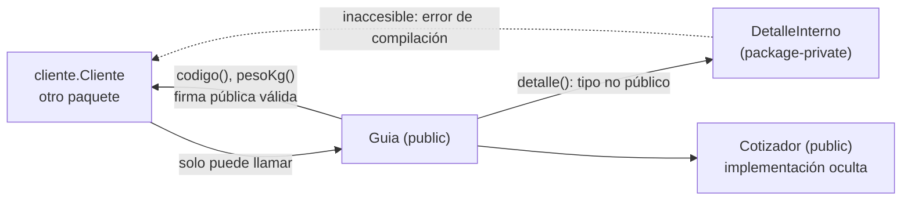
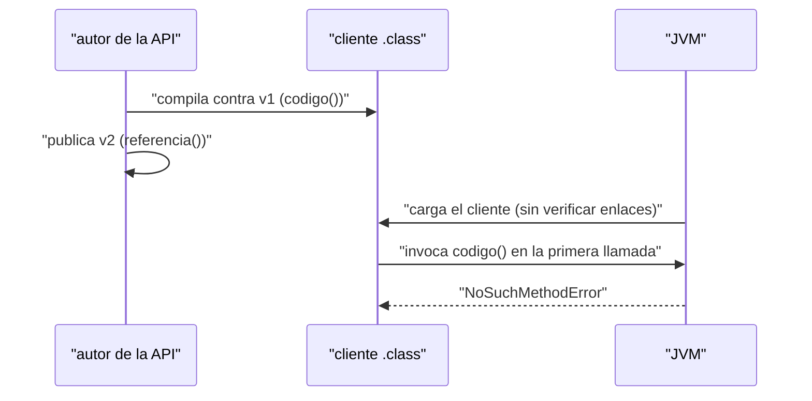
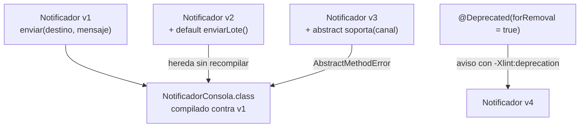
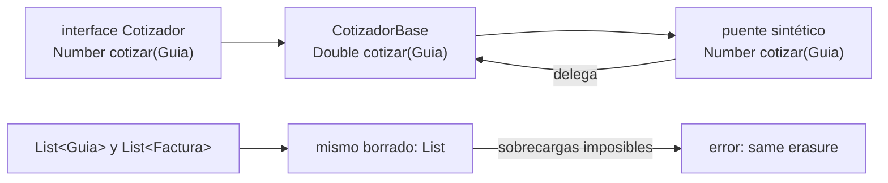
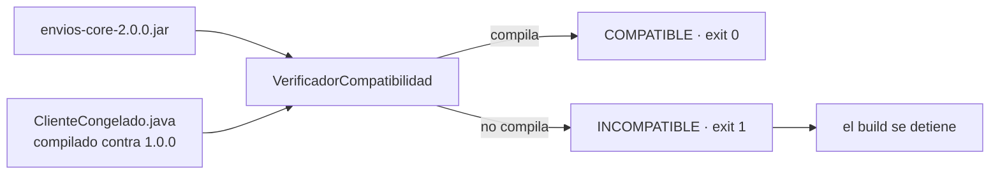

# Módulo 21: APIs públicas, compatibilidad y evolución

Una librería no se rompe cuando deja de compilar: se rompe cuando un cliente que ya estaba compilado deja de ejecutarse en producción. Este módulo construye `envios-core`, una librería con contrato público explícito, y provoca con la JVM real cada tipo de ruptura: `NoSuchMethodError`, `AbstractMethodError`, choques de borrado y constantes que se copian dentro del cliente. Todo se ejecuta con `javac`, `jar`, `javap` y `java` del JDK; no hace falta Maven, Gradle ni conexión a red.

## Aprende construyendo

El proyecto del módulo es una librería de dominio para RutaFlow: guías, cotización y notificaciones, con una regla de oro —lo que se publica se puede prometer y lo que se promete se puede retirar sin sorpresas—. Cada tema añade una capa de esa promesa y termina verificándola con un cliente congelado: un código que se compila una vez contra la versión 1 y se vuelve a ejecutar contra cada versión posterior.


### Tema 1: Qué es la superficie pública de una API · Básico · 40 min

<details open>
<summary><strong>Capa 1 — Lectura</strong></summary>

#### ► DE QUÉ TRATA
Este tema te guía por qué es la superficie pública de una api con foco en comprensión antes de implementación.

#### ► LA IDEA EN UNA FRASE
**Entender qué es la superficie pública de una api te permite tomar mejores decisiones técnicas.**

#### ► POR QUÉ EXISTE ESTO
Resuelve un problema real de diseño o implementación y evita decisiones a ciegas.

#### ► LA ANALOGÍA
Piensa en qué es la superficie pública de una api como una herramienta de taller: útil cuando conoces su propósito y sus límites.
**Dónde se rompe la analogía:** en software, los efectos dependen del contexto, la escala y los trade-offs.

#### ► CÓMO FUNCIONA


#### ► LO QUE PUEDE SALIR MAL
| Síntoma | Causa probable | Arreglo |
|---|---|---|
| Qué es la superficie pública de una API se aplica pero el resultado no mejora | Se usó sin medir el problema real | Mide antes y compara contra la alternativa simple |
| Aparece complejidad inesperada | Se adoptó la técnica sin comprender sus trade-offs | Vuelve a la sección de trade-offs y reduce el alcance |
| Falla en un caso límite | Se asumió un contexto que no se cumple | Prueba el caso límite y documenta cuándo NO usarlo |

#### ► TRADE-OFFS
| Opción | Cuándo usarla | Cuándo NO usarla |
|---|---|---|
| Usar Qué es la superficie pública de una API | Cuando el problema coincide con su propósito y el beneficio es observable | Cuando agrega complejidad sin resolver un problema real |
| Alternativa más simple | Cuando el contexto es pequeño, estable o fácil de razonar | Cuando ya demostró no escalar o no cumplir el requisito |
| Postergar la decisión | Cuando falta evidencia del problema | Cuando el costo de esperar es mayor que el costo de probar |

#### ► CUÁNDO NO USAR ESTO
No uses qué es la superficie pública de una api por defecto. Aplícalo cuando el problema lo justifique y puedas verificar el beneficio; si una alternativa más simple resuelve igual, prefiérela.

#### ► DE VUELTA A LA ANALOGÍA
Volviendo a la analogía: qué es la superficie pública de una api funciona como el modelo inicial, pero recuerda dónde se rompe: en producción importan la evidencia, la escala y el costo de equivocarte.

#### ► LO QUE DEBES RECORDAR
- Qué es la superficie pública de una API existe para resolver un problema específico.
- Mide antes de adoptar complejidad.
- Conoce el caso donde NO usarlo.
- Verifica con evidencia observable.

#### ► PREGUNTAS PARA PENSAR
1. ¿Qué problema concreto resuelve qué es la superficie pública de una api en tu contexto?
2. ¿Cómo sabrías que qué es la superficie pública de una api no está funcionando bien?
3. ¿Qué alternativa más simple considerarías antes de usar qué es la superficie pública de una api?

</details>

<details>
<summary><strong>Capa 2 — Construcción</strong></summary>

#### Código y verificación


```bash
mkdir envios-core && cd envios-core
mkdir -p src/io/academia/envios cliente
```

```java
// src/io/academia/envios/Guia.java
package io.academia.envios;

public final class Guia {
    public static final int MAX_BULTO = 30;

    private final String codigo;
    private final double pesoKg;

    public Guia(String codigo, double pesoKg) {
        if (codigo == null || codigo.isBlank()) {
            throw new IllegalArgumentException("El código de guía es obligatorio");
        }
        if (pesoKg <= 0) {
            throw new IllegalArgumentException("El peso debe ser positivo");
        }
        this.codigo = codigo;
        this.pesoKg = pesoKg;
    }

    public String codigo() {
        return codigo;
    }

    public double pesoKg() {
        return pesoKg;
    }

    public DetalleInterno detalle() {
        return new DetalleInterno(codigo);
    }
}
```

```java
// src/io/academia/envios/DetalleInterno.java
package io.academia.envios;

final class DetalleInterno {
    private final String codigo;

    DetalleInterno(String codigo) {
        this.codigo = codigo;
    }

    String codigo() {
        return codigo;
    }
}
```

```java
// src/io/academia/envios/Cotizador.java
package io.academia.envios;

public interface Cotizador {
    double cotizar(Guia guia);
}
```

```java
// src/io/academia/envios/CotizadorBase.java
package io.academia.envios;

public final class CotizadorBase implements Cotizador {
    @Override
    public double cotizar(Guia guia) {
        return guia.pesoKg() * 1.2;
    }
}
```

</details>

### Tema 2: Compatibilidad binaria frente a compatibilidad de fuente · Intermedio · 45 min

<details open>
<summary><strong>Capa 1 — Lectura</strong></summary>

#### ► DE QUÉ TRATA
Este tema te guía por compatibilidad binaria frente a compatibilidad de fuente con foco en comprensión antes de implementación.

#### ► LA IDEA EN UNA FRASE
**Entender compatibilidad binaria frente a compatibilidad de fuente te permite tomar mejores decisiones técnicas.**

#### ► POR QUÉ EXISTE ESTO
Resuelve un problema real de diseño o implementación y evita decisiones a ciegas.

#### ► LA ANALOGÍA
Piensa en compatibilidad binaria frente a compatibilidad de fuente como una herramienta de taller: útil cuando conoces su propósito y sus límites.
**Dónde se rompe la analogía:** en software, los efectos dependen del contexto, la escala y los trade-offs.

#### ► CÓMO FUNCIONA


#### ► LO QUE PUEDE SALIR MAL
| Síntoma | Causa probable | Arreglo |
|---|---|---|
| Compatibilidad binaria frente a compatibilidad de fuente se aplica pero el resultado no mejora | Se usó sin medir el problema real | Mide antes y compara contra la alternativa simple |
| Aparece complejidad inesperada | Se adoptó la técnica sin comprender sus trade-offs | Vuelve a la sección de trade-offs y reduce el alcance |
| Falla en un caso límite | Se asumió un contexto que no se cumple | Prueba el caso límite y documenta cuándo NO usarlo |

#### ► TRADE-OFFS
| Opción | Cuándo usarla | Cuándo NO usarla |
|---|---|---|
| Usar Compatibilidad binaria frente a compatibilidad de fuente | Cuando el problema coincide con su propósito y el beneficio es observable | Cuando agrega complejidad sin resolver un problema real |
| Alternativa más simple | Cuando el contexto es pequeño, estable o fácil de razonar | Cuando ya demostró no escalar o no cumplir el requisito |
| Postergar la decisión | Cuando falta evidencia del problema | Cuando el costo de esperar es mayor que el costo de probar |

#### ► CUÁNDO NO USAR ESTO
No uses compatibilidad binaria frente a compatibilidad de fuente por defecto. Aplícalo cuando el problema lo justifique y puedas verificar el beneficio; si una alternativa más simple resuelve igual, prefiérela.

#### ► DE VUELTA A LA ANALOGÍA
Volviendo a la analogía: compatibilidad binaria frente a compatibilidad de fuente funciona como el modelo inicial, pero recuerda dónde se rompe: en producción importan la evidencia, la escala y el costo de equivocarte.

#### ► LO QUE DEBES RECORDAR
- Compatibilidad binaria frente a compatibilidad de fuente existe para resolver un problema específico.
- Mide antes de adoptar complejidad.
- Conoce el caso donde NO usarlo.
- Verifica con evidencia observable.

#### ► PREGUNTAS PARA PENSAR
1. ¿Qué problema concreto resuelve compatibilidad binaria frente a compatibilidad de fuente en tu contexto?
2. ¿Cómo sabrías que compatibilidad binaria frente a compatibilidad de fuente no está funcionando bien?
3. ¿Qué alternativa más simple considerarías antes de usar compatibilidad binaria frente a compatibilidad de fuente?

</details>

<details>
<summary><strong>Capa 2 — Construcción</strong></summary>

#### Código y verificación


```bash
mkdir -p v2-src/io/academia/envios
cp src/io/academia/envios/*.java v2-src/io/academia/envios/
```

```java
// v2-src/io/academia/envios/Guia.java (solo cambian la constante y el nombre del método)
package io.academia.envios;

public final class Guia {
    public static final int MAX_BULTO = 50;

    private final String codigo;
    private final double pesoKg;

    public Guia(String codigo, double pesoKg) {
        if (codigo == null || codigo.isBlank()) {
            throw new IllegalArgumentException("El código de guía es obligatorio");
        }
        if (pesoKg <= 0) {
            throw new IllegalArgumentException("El peso debe ser positivo");
        }
        this.codigo = codigo;
        this.pesoKg = pesoKg;
    }

    public String referencia() {   // antes: codigo()
        return codigo;
    }

    public double pesoKg() {
        return pesoKg;
    }

    public DetalleInterno detalle() {
        return new DetalleInterno(codigo);
    }
}
```

```bash
javac -d v2-out $(find v2-src -name '*.java')
jar --create --file envios-core-2.0.0.jar -C v2-out .
java -cp "envios-core-2.0.0.jar:cliente-out" cliente.Cliente
```

```text
Exception in thread "main" java.lang.NoSuchMethodError: 'java.lang.String io.academia.envios.Guia.codigo()'
```

```bash
javac -cp envios-core-2.0.0.jar -d cliente-out cliente/Cliente.java
```

</details>

### Tema 3: Evolucionar sin romper: default methods, deprecación y retirada · Intermedio · 45 min

<details open>
<summary><strong>Capa 1 — Lectura</strong></summary>

#### ► DE QUÉ TRATA
Este tema te guía por evolucionar sin romper: default methods, deprecación y retirada con foco en comprensión antes de implementación.

#### ► LA IDEA EN UNA FRASE
**Entender evolucionar sin romper: default methods, deprecación y retirada te permite tomar mejores decisiones técnicas.**

#### ► POR QUÉ EXISTE ESTO
Resuelve un problema real de diseño o implementación y evita decisiones a ciegas.

#### ► LA ANALOGÍA
Piensa en evolucionar sin romper: default methods, deprecación y retirada como una herramienta de taller: útil cuando conoces su propósito y sus límites.
**Dónde se rompe la analogía:** en software, los efectos dependen del contexto, la escala y los trade-offs.

#### ► CÓMO FUNCIONA


#### ► LO QUE PUEDE SALIR MAL
| Síntoma | Causa probable | Arreglo |
|---|---|---|
| Evolucionar sin romper: default methods, deprecación y retirada se aplica pero el resultado no mejora | Se usó sin medir el problema real | Mide antes y compara contra la alternativa simple |
| Aparece complejidad inesperada | Se adoptó la técnica sin comprender sus trade-offs | Vuelve a la sección de trade-offs y reduce el alcance |
| Falla en un caso límite | Se asumió un contexto que no se cumple | Prueba el caso límite y documenta cuándo NO usarlo |

#### ► TRADE-OFFS
| Opción | Cuándo usarla | Cuándo NO usarla |
|---|---|---|
| Usar Evolucionar sin romper: default methods, deprecación y retirada | Cuando el problema coincide con su propósito y el beneficio es observable | Cuando agrega complejidad sin resolver un problema real |
| Alternativa más simple | Cuando el contexto es pequeño, estable o fácil de razonar | Cuando ya demostró no escalar o no cumplir el requisito |
| Postergar la decisión | Cuando falta evidencia del problema | Cuando el costo de esperar es mayor que el costo de probar |

#### ► CUÁNDO NO USAR ESTO
No uses evolucionar sin romper: default methods, deprecación y retirada por defecto. Aplícalo cuando el problema lo justifique y puedas verificar el beneficio; si una alternativa más simple resuelve igual, prefiérela.

#### ► DE VUELTA A LA ANALOGÍA
Volviendo a la analogía: evolucionar sin romper: default methods, deprecación y retirada funciona como el modelo inicial, pero recuerda dónde se rompe: en producción importan la evidencia, la escala y el costo de equivocarte.

#### ► LO QUE DEBES RECORDAR
- Evolucionar sin romper: default methods, deprecación y retirada existe para resolver un problema específico.
- Mide antes de adoptar complejidad.
- Conoce el caso donde NO usarlo.
- Verifica con evidencia observable.

#### ► PREGUNTAS PARA PENSAR
1. ¿Qué problema concreto resuelve evolucionar sin romper: default methods, deprecación y retirada en tu contexto?
2. ¿Cómo sabrías que evolucionar sin romper: default methods, deprecación y retirada no está funcionando bien?
3. ¿Qué alternativa más simple considerarías antes de usar evolucionar sin romper: default methods, deprecación y retirada?

</details>

<details>
<summary><strong>Capa 2 — Construcción</strong></summary>

#### Código y verificación


```bash
mkdir notificaciones && cd notificaciones
mkdir -p lib-src/io/academia/notificaciones app-src/app
```

```java
// lib-src/io/academia/notificaciones/Notificador.java
package io.academia.notificaciones;

public interface Notificador {
    void enviar(String destino, String mensaje);
}
```

```bash
javac -d lib-out $(find lib-src -name '*.java')
jar --create --file notificaciones-core-1.0.0.jar -C lib-out .
```

```java
// app-src/app/NotificadorConsola.java
package app;

import io.academia.notificaciones.Notificador;

public final class NotificadorConsola implements Notificador {
    @Override
    public void enviar(String destino, String mensaje) {
        System.out.println("Para " + destino + ": " + mensaje);
    }
}
```

```java
// app-src/app/Enviador.java
package app;

import io.academia.notificaciones.Notificador;
import java.util.List;

public final class Enviador {
    private final Notificador notificador;

    public Enviador(Notificador notificador) {
        this.notificador = notificador;
    }

    public void avisar(String destino, String mensaje) {
        notificador.enviarLote(List.of(destino), mensaje);
    }

    public static void main(String[] args) {
        new Enviador(new NotificadorConsola()).avisar("RF-001", "En reparto");
    }
}
```

</details>

### Tema 4: Genéricos, borrado y métodos puente en la superficie pública · Avanzado · 45 min

<details open>
<summary><strong>Capa 1 — Lectura</strong></summary>

#### ► DE QUÉ TRATA
Este tema te guía por genéricos, borrado y métodos puente en la superficie pública con foco en comprensión antes de implementación.

#### ► LA IDEA EN UNA FRASE
**Entender genéricos, borrado y métodos puente en la superficie pública te permite tomar mejores decisiones técnicas.**

#### ► POR QUÉ EXISTE ESTO
Resuelve un problema real de diseño o implementación y evita decisiones a ciegas.

#### ► LA ANALOGÍA
Piensa en genéricos, borrado y métodos puente en la superficie pública como una herramienta de taller: útil cuando conoces su propósito y sus límites.
**Dónde se rompe la analogía:** en software, los efectos dependen del contexto, la escala y los trade-offs.

#### ► CÓMO FUNCIONA


#### ► LO QUE PUEDE SALIR MAL
| Síntoma | Causa probable | Arreglo |
|---|---|---|
| Genéricos, borrado y métodos puente en la superficie pública se aplica pero el resultado no mejora | Se usó sin medir el problema real | Mide antes y compara contra la alternativa simple |
| Aparece complejidad inesperada | Se adoptó la técnica sin comprender sus trade-offs | Vuelve a la sección de trade-offs y reduce el alcance |
| Falla en un caso límite | Se asumió un contexto que no se cumple | Prueba el caso límite y documenta cuándo NO usarlo |

#### ► TRADE-OFFS
| Opción | Cuándo usarla | Cuándo NO usarla |
|---|---|---|
| Usar Genéricos, borrado y métodos puente en la superficie pública | Cuando el problema coincide con su propósito y el beneficio es observable | Cuando agrega complejidad sin resolver un problema real |
| Alternativa más simple | Cuando el contexto es pequeño, estable o fácil de razonar | Cuando ya demostró no escalar o no cumplir el requisito |
| Postergar la decisión | Cuando falta evidencia del problema | Cuando el costo de esperar es mayor que el costo de probar |

#### ► CUÁNDO NO USAR ESTO
No uses genéricos, borrado y métodos puente en la superficie pública por defecto. Aplícalo cuando el problema lo justifique y puedas verificar el beneficio; si una alternativa más simple resuelve igual, prefiérela.

#### ► DE VUELTA A LA ANALOGÍA
Volviendo a la analogía: genéricos, borrado y métodos puente en la superficie pública funciona como el modelo inicial, pero recuerda dónde se rompe: en producción importan la evidencia, la escala y el costo de equivocarte.

#### ► LO QUE DEBES RECORDAR
- Genéricos, borrado y métodos puente en la superficie pública existe para resolver un problema específico.
- Mide antes de adoptar complejidad.
- Conoce el caso donde NO usarlo.
- Verifica con evidencia observable.

#### ► PREGUNTAS PARA PENSAR
1. ¿Qué problema concreto resuelve genéricos, borrado y métodos puente en la superficie pública en tu contexto?
2. ¿Cómo sabrías que genéricos, borrado y métodos puente en la superficie pública no está funcionando bien?
3. ¿Qué alternativa más simple considerarías antes de usar genéricos, borrado y métodos puente en la superficie pública?

</details>

<details>
<summary><strong>Capa 2 — Construcción</strong></summary>

#### Código y verificación


```bash
mkdir genericos && cd genericos
mkdir -p src/io/academia/envios
```

```java
// src/io/academia/envios/Guia.java
package io.academia.envios;

public record Guia(String codigo, double pesoKg) {}
```

```java
// src/io/academia/envios/Cotizador.java
package io.academia.envios;

public interface Cotizador {
    Number cotizar(Guia guia);
}
```

```java
// src/io/academia/envios/CotizadorBase.java
package io.academia.envios;

public final class CotizadorBase implements Cotizador {
    @Override
    public Double cotizar(Guia guia) {
        return guia.pesoKg() * 1.2;
    }
}
```

```bash
javac -d out $(find src -name '*.java')
javap -p -cp out io.academia.envios.CotizadorBase
```

</details>

### Tema 5: Verificar la compatibilidad en el build · Avanzado · 45 min

<details open>
<summary><strong>Capa 1 — Lectura</strong></summary>

#### ► DE QUÉ TRATA
Este tema te guía por verificar la compatibilidad en el build con foco en comprensión antes de implementación.

#### ► LA IDEA EN UNA FRASE
**Entender verificar la compatibilidad en el build te permite tomar mejores decisiones técnicas.**

#### ► POR QUÉ EXISTE ESTO
Resuelve un problema real de diseño o implementación y evita decisiones a ciegas.

#### ► LA ANALOGÍA
Piensa en verificar la compatibilidad en el build como una herramienta de taller: útil cuando conoces su propósito y sus límites.
**Dónde se rompe la analogía:** en software, los efectos dependen del contexto, la escala y los trade-offs.

#### ► CÓMO FUNCIONA


#### ► LO QUE PUEDE SALIR MAL
| Síntoma | Causa probable | Arreglo |
|---|---|---|
| Verificar la compatibilidad en el build se aplica pero el resultado no mejora | Se usó sin medir el problema real | Mide antes y compara contra la alternativa simple |
| Aparece complejidad inesperada | Se adoptó la técnica sin comprender sus trade-offs | Vuelve a la sección de trade-offs y reduce el alcance |
| Falla en un caso límite | Se asumió un contexto que no se cumple | Prueba el caso límite y documenta cuándo NO usarlo |

#### ► TRADE-OFFS
| Opción | Cuándo usarla | Cuándo NO usarla |
|---|---|---|
| Usar Verificar la compatibilidad en el build | Cuando el problema coincide con su propósito y el beneficio es observable | Cuando agrega complejidad sin resolver un problema real |
| Alternativa más simple | Cuando el contexto es pequeño, estable o fácil de razonar | Cuando ya demostró no escalar o no cumplir el requisito |
| Postergar la decisión | Cuando falta evidencia del problema | Cuando el costo de esperar es mayor que el costo de probar |

#### ► CUÁNDO NO USAR ESTO
No uses verificar la compatibilidad en el build por defecto. Aplícalo cuando el problema lo justifique y puedas verificar el beneficio; si una alternativa más simple resuelve igual, prefiérela.

#### ► DE VUELTA A LA ANALOGÍA
Volviendo a la analogía: verificar la compatibilidad en el build funciona como el modelo inicial, pero recuerda dónde se rompe: en producción importan la evidencia, la escala y el costo de equivocarte.

#### ► LO QUE DEBES RECORDAR
- Verificar la compatibilidad en el build existe para resolver un problema específico.
- Mide antes de adoptar complejidad.
- Conoce el caso donde NO usarlo.
- Verifica con evidencia observable.

#### ► PREGUNTAS PARA PENSAR
1. ¿Qué problema concreto resuelve verificar la compatibilidad en el build en tu contexto?
2. ¿Cómo sabrías que verificar la compatibilidad en el build no está funcionando bien?
3. ¿Qué alternativa más simple considerarías antes de usar verificar la compatibilidad en el build?

</details>

<details>
<summary><strong>Capa 2 — Construcción</strong></summary>

#### Código y verificación


```bash
mkdir verificador && cd verificador
```

```java
// VerificadorCompatibilidad.java
import javax.tools.Diagnostic;
import javax.tools.DiagnosticCollector;
import javax.tools.JavaCompiler;
import javax.tools.JavaFileObject;
import javax.tools.StandardJavaFileManager;
import javax.tools.ToolProvider;
import java.nio.file.Files;
import java.nio.file.Path;
import java.util.List;

public final class VerificadorCompatibilidad {

    public static void main(String[] args) throws Exception {
        if (args.length != 2) {
            System.err.println("Uso: java VerificadorCompatibilidad <api.jar> <ClienteCongelado.java>");
            System.exit(2);
        }

        Path api = Path.of(args[0]).toAbsolutePath();
        Path cliente = Path.of(args[1]).toAbsolutePath();
        Path salida = Files.createTempDirectory("compatibilidad");

        JavaCompiler compilador = ToolProvider.getSystemJavaCompiler();
        if (compilador == null) {
            System.err.println("Sin compilador: ejecuta esto con un JDK, no con un JRE.");
            System.exit(2);
        }

        DiagnosticCollector<JavaFileObject> diagnosticos = new DiagnosticCollector<>();
        try (StandardJavaFileManager archivos =
                     compilador.getStandardFileManager(diagnosticos, null, null)) {
            Iterable<? extends JavaFileObject> unidades =
                    archivos.getJavaFileObjects(cliente.toFile());
            List<String> opciones = List.of(
                    "-classpath", api.toString(),
                    "-d", salida.toString());
            boolean compilo = Boolean.TRUE.equals(
                    compilador.getTask(null, archivos, diagnosticos, opciones, null, unidades).call());

            if (compilo) {
                System.out.println("COMPATIBLE: el cliente congelado compila contra " + api.getFileName());
                return;
            }

            System.out.println("INCOMPATIBLE: el cliente congelado ya no compila contra " + api.getFileName());
            for (Diagnostic<? extends JavaFileObject> d : diagnosticos.getDiagnostics()) {
                if (d.getKind() == Diagnostic.Kind.ERROR) {
                    System.out.println("  linea " + d.getLineNumber() + ": " + d.getMessage(null));
                }
            }
            System.exit(1);
        }
    }
}
```

```bash
javac -d verificador-out VerificadorCompatibilidad.java
java -cp verificador-out VerificadorCompatibilidad ../envios-core-1.0.0.jar ../cliente/Cliente.java
```

```bash
java -cp verificador-out VerificadorCompatibilidad ../envios-core-2.0.0.jar ../cliente/Cliente.java; echo "salida=$?"
```

```text
INCOMPATIBLE: el cliente congelado ya no compila contra envios-core-2.0.0.jar
  linea 8: cannot find symbol
  symbol:   method codigo()
  location: variable guia of type io.academia.envios.Guia
salida=1
```

</details>
