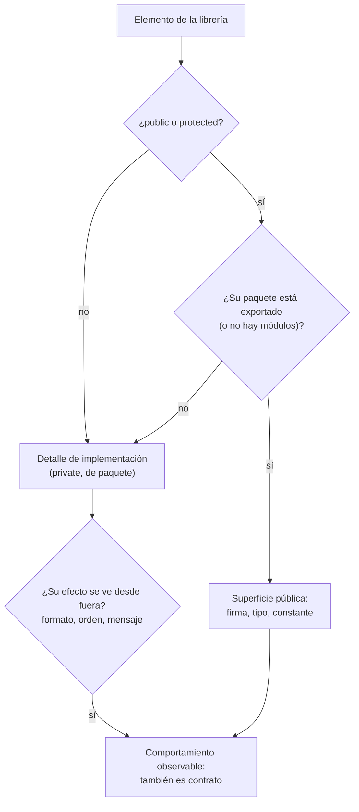
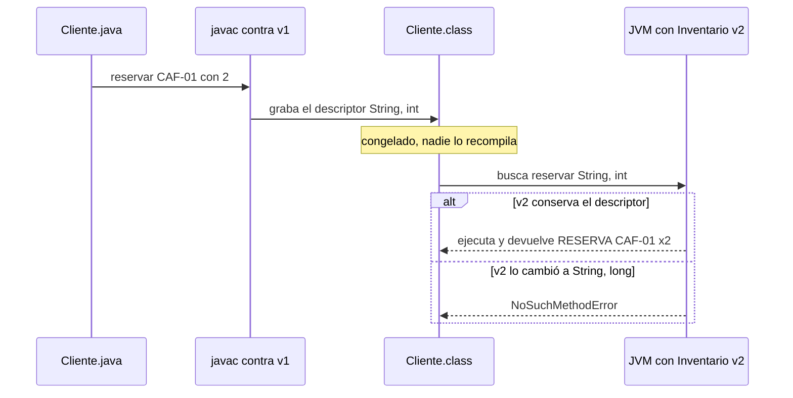
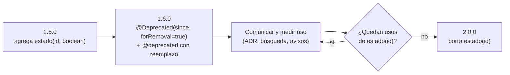
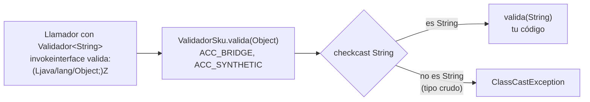
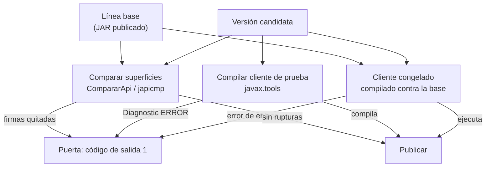

# Módulo 21: APIs públicas, compatibilidad y evolución

Cuando publicas una librería o un módulo interno que usan otros equipos, cada clase pública, método, firma y comportamiento observable se vuelve un contrato. Cambiarlo puede compilar en tu repo y aun así romper a quienes dependen de tu artefacto. Ese tipo de rotura es caro porque ocurre lejos de tu cambio: en el build de otro equipo, en runtime, o sutilmente en la semántica.

En este módulo vas a construir `tienda-aurora-java-m21`, un proyecto multi-módulo con `api-v1`, `api-v2`, `api-v2-rompe`, `cliente-v1` y `app`. La idea es ver la evolución de una API pequeña: qué se considera superficie pública, la diferencia entre compatibilidad binaria y de fuente, cómo usar `default` y `@Deprecated`, por qué el borrado de genéricos genera bridge methods, qué ocurre cuando un cliente congelado se ejecuta contra una versión rota, y cómo verificar compatibilidad con `javap` y `javax.tools`.

## Apertura del módulo

Al terminar este módulo podrás:
- identificar la superficie pública de una librería con `javap -public` y separar contrato de detalle interno;
- distinguir compatibilidad de fuente y binaria con un cliente recompilado y un cliente congelado;
- provocar y leer `NoSuchMethodError` y `AbstractMethodError`, y explicar por qué una constante no llega sin recompilar;
- evolucionar una API con métodos `default`, `@Deprecated(since, forRemoval)` y versionado semántico;
- localizar el método puente que genera el borrado de genéricos y predecir cuándo un cambio genérico rompe binarios;
- verificar la compatibilidad en el build con un comparador de superficies y `javax.tools`.

**Esquema del módulo:** superficie pública (Tema 1), compatibilidad binaria y de fuente (Tema 2), evolución con
`default` y deprecación (Tema 3), borrado y métodos puente (Tema 4) y verificación en el build (Tema 5). El proyecto
`tienda-aurora-java-m21` está completo en «Código completo del proyecto», antes de los temas; cada tema lo usa en su
Capa 2.

**Qué necesitas saber antes:** *API* (Fundamentos, Módulo 3, Tema 2); *cambio compatible*, *deprecación* y *ADR*
(Arquitectura, Módulo 0, Tema 4); *bytecode*, `javap` y *classpath* (Java, Módulo 0, Tema 1); `record` (Java, Módulo 1,
Tema 5); interfaces y *método `default`* (Java, Módulo 1, Tema 3); modificadores de acceso y sobrecarga (Java, Módulo 1,
Tema 4); genéricos, *tipo crudo* y *type erasure* (Java, Módulo 2, Tema 4); excepciones (Java, Módulo 3, Tema 1);
*proyecto multi-módulo* (Java, Módulo 8, Tema 3); JUnit (Java, Módulo 9, Tema 1); `exports` (Java, Módulo 10, Tema 1);
reflexión y cargadores de clases (Java, Módulo 19, Temas 1 y 8).

## Prerrequisitos y bootstrap

```bash
java -version
javac -version
javap -version
gradle --version
mkdir -p tienda-aurora-java-m21/api-v1/src/main/java/com/aurora/api
mkdir -p tienda-aurora-java-m21/api-v2/src/main/java/com/aurora/api
mkdir -p tienda-aurora-java-m21/api-v2-rompe/src/main/java/com/aurora/api
mkdir -p tienda-aurora-java-m21/cliente-v1/src/main/java/com/aurora/cliente
mkdir -p tienda-aurora-java-m21/app/src/main/java/com/aurora/app
mkdir -p tienda-aurora-java-m21/app/src/test/java/com/aurora/app
cd tienda-aurora-java-m21
gradle wrapper --gradle-version 9.9.1
```

**Entorno de referencia verificado (2026-11-23):** macOS arm64, JDK 27.0.1.0.2, Gradle 9.9.1, toolchain Java 25. Con él
se capturaron las salidas del proyecto Gradle (sección «Verificación real»).

**Entorno de los experimentos de los temas (2026-11-24):** Linux x86_64, OpenJDK 25.0.5.1, sin Gradle. Cada problema
resuelto usa `javac`, `java` y `javap` directamente en `~/labs/api-java/<experimento>`, con una carpeta por versión de
la librería. Esas transcripciones son literales de esa ejecución. Con el mismo JDK se recompilaron las fuentes del
proyecto (sin Gradle ni JUnit) y `App`, `ClienteCongelado` y `VerificadorApi` dieron las mismas salidas.

Estructura objetivo:

```text
tienda-aurora-java-m21/
├── build.gradle.kts
├── settings.gradle.kts
├── api-v1/src/main/java/com/aurora/api/          # contrato inicial
├── api-v2/src/main/java/com/aurora/api/          # evolución compatible
├── api-v2-rompe/src/main/java/com/aurora/api/    # versión incompatible deliberada
├── cliente-v1/src/main/java/com/aurora/cliente/  # cliente congelado contra v1
└── app/src/main/java/com/aurora/app/             # consumidor + verificador
```

## Build desde cero

#### `settings.gradle.kts`

```kotlin
rootProject.name = "tienda-aurora-java-m21"
include("api-v1", "api-v2", "api-v2-rompe", "cliente-v1", "app")
```

#### `build.gradle.kts`

```kotlin
plugins { java }
allprojects { group = "com.aurora"; version = "1.0.0"; repositories { mavenCentral() } }
subprojects {
    apply(plugin = "java")
    java { toolchain { languageVersion = JavaLanguageVersion.of(25) } }
    tasks.withType<JavaCompile>().configureEach {
        options.encoding = "UTF-8"
        options.compilerArgs.addAll(listOf("-Xlint:all","-Xlint:-processing","-Werror"))
    }
}
project(":cliente-v1") {
    dependencies { implementation(project(":api-v1")) }
}
project(":app") {
    dependencies {
        implementation(project(":api-v2"))
        testImplementation(platform("org.junit:junit-bom:5.13.4"))
        testImplementation("org.junit.jupiter:junit-jupiter")
        testRuntimeOnly("org.junit.platform:junit-platform-launcher")
    }
    tasks.named<Test>("test") {
        dependsOn(":api-v2:jar", ":api-v2-rompe:jar")
        useJUnitPlatform()
        testLogging { events("passed","skipped","failed") }
        systemProperty("api.v2.jar", project(":api-v2").tasks.named<Jar>("jar").get().archiveFile.get().asFile.absolutePath)
        systemProperty("api.rota.jar", project(":api-v2-rompe").tasks.named<Jar>("jar").get().archiveFile.get().asFile.absolutePath)
    }
}
```

`cliente-v1` depende de `api-v1`: sus `.class` quedan compilados contra la firma antigua. `app` depende de `api-v2` y, en tests, recibe las rutas de ambos JAR para que `VerificadorApi` compile un cliente de prueba contra cada uno.

## Visual del módulo

**Visual:** [Compatibilidad: fuente frente a binaria](/visuals/temas/java/modulo-21-compatibilidad.html)

Lectura: cambiar una firma puede conservar la compatibilidad de fuente y romper la binaria; por eso la superficie pública se verifica con artefactos, no de memoria.

## Código completo del proyecto

#### `api-v1/src/main/java/com/aurora/api/Repositorio.java`

```java
package com.aurora.api;

public interface Repositorio<T> {
    T porId(String id);
}
```

#### `api-v1/src/main/java/com/aurora/api/ServicioEnvio.java`

```java
package com.aurora.api;

public class ServicioEnvio {
    public static final String ETIQUETA = "v1";

    public String estado(String id) { return "PENDIENTE:" + id; }
}
```

#### `api-v1/src/main/java/com/aurora/api/InterfazEvolucion.java`

```java
package com.aurora.api;

public interface InterfazEvolucion {
    default String etiqueta() { return "base"; }
}
```

#### `api-v1/src/main/java/com/aurora/api/ImplEvolucion.java`

```java
package com.aurora.api;

public final class ImplEvolucion implements InterfazEvolucion {
}
```

#### `api-v2/src/main/java/com/aurora/api/Repositorio.java`

```java
package com.aurora.api;

public interface Repositorio<T> {
    T porId(String id);
    default String tipo() { return "generico"; } // método default: evolución compatible
}
```

#### `api-v2/src/main/java/com/aurora/api/RepositorioTexto.java`

```java
package com.aurora.api;

public class RepositorioTexto implements Repositorio<String> {
    @Override
    public String porId(String id) {
        return "TXT:" + id;
    }
}
```

#### `api-v2/src/main/java/com/aurora/api/ServicioEnvio.java`

```java
package com.aurora.api;

public class ServicioEnvio {
    public static final String ETIQUETA = "v2";

    /** @deprecated Use {@link #estado(String, boolean)}. Se mantiene para compatibilidad binaria/fuente. */
    @Deprecated(since = "2.0", forRemoval = false)
    public String estado(String id) { return estado(id, false); }

    public String estado(String id, boolean detallado) {
        return detallado ? "PENDIENTE:" + id + ":detalle" : "PENDIENTE:" + id;
    }
}
```

#### `api-v2/src/main/java/com/aurora/api/InterfazEvolucion.java`

```java
package com.aurora.api;

public interface InterfazEvolucion {
    default String etiqueta() { return "base"; }
}
```

#### `api-v2/src/main/java/com/aurora/api/ImplEvolucion.java`

```java
package com.aurora.api;

public final class ImplEvolucion implements InterfazEvolucion {
}
```

#### `api-v2-rompe/src/main/java/com/aurora/api/ServicioEnvio.java`

```java
package com.aurora.api;

/** Versión deliberadamente incompatible: eliminó estado(String) y cambió la constante. */
public class ServicioEnvio {
    public static final String ETIQUETA = "v2";

    public String estado(String id, boolean detallado) {
        return detallado ? "PENDIENTE:" + id + ":detalle" : "PENDIENTE:" + id;
    }
}
```

#### `api-v2-rompe/src/main/java/com/aurora/api/InterfazEvolucion.java`

```java
package com.aurora.api;

/** Versión deliberadamente incompatible: el default pasó a ser abstracto. */
public interface InterfazEvolucion {
    String etiqueta();
}
```

#### `cliente-v1/src/main/java/com/aurora/cliente/ClienteCongelado.java`

```java
package com.aurora.cliente;

import com.aurora.api.ServicioEnvio;

/** Compilado contra api-v1: la firma y la constante quedan grabadas en su bytecode. */
public final class ClienteCongelado {
    @SuppressWarnings("deprecation")
    public static void main(String[] args) {
        System.out.println("ESTADO=" + new ServicioEnvio().estado("A1"));
        System.out.println("ETIQUETA=" + ServicioEnvio.ETIQUETA);
    }
}
```

#### `cliente-v1/src/main/java/com/aurora/cliente/ClienteAbstracto.java`

```java
package com.aurora.cliente;

import com.aurora.api.ImplEvolucion;
import com.aurora.api.InterfazEvolucion;

/** Compilado contra api-v1: etiqueta() era default en la interfaz. */
public final class ClienteAbstracto {
    public static void main(String[] args) {
        InterfazEvolucion x = new ImplEvolucion();
        System.out.println("EVOLUCION=" + x.etiqueta());
    }
}
```

#### `app/src/main/java/com/aurora/app/App.java`

```java
package com.aurora.app;

import com.aurora.api.ImplEvolucion;
import com.aurora.api.InterfazEvolucion;
import com.aurora.api.Repositorio;
import com.aurora.api.RepositorioTexto;
import com.aurora.api.ServicioEnvio;

public final class App {
    @SuppressWarnings("deprecation")
    public static void main(String[] args) {
        ServicioEnvio s = new ServicioEnvio();
        System.out.println("LEGACY=" + s.estado("A1"));
        System.out.println("NUEVO=" + s.estado("A1", true));
        Repositorio<String> repo = new RepositorioTexto();
        System.out.println("REPO=" + repo.porId("A1"));
        System.out.println("TIPO=" + repo.tipo());
        InterfazEvolucion evolucion = new ImplEvolucion();
        System.out.println("EVOLUCION=" + evolucion.etiqueta());
    }
}
```

#### `app/src/main/java/com/aurora/app/VerificadorApi.java`

```java
package com.aurora.app;

import javax.tools.Diagnostic;
import javax.tools.DiagnosticCollector;
import javax.tools.JavaCompiler;
import javax.tools.JavaFileObject;
import javax.tools.SimpleJavaFileObject;
import javax.tools.StandardJavaFileManager;
import javax.tools.ToolProvider;
import java.net.URI;
import java.nio.file.Files;
import java.nio.file.Path;
import java.util.List;
import java.util.Locale;

/** Verificador de fuente con javax.tools: compila un cliente contra el JAR indicado. */
public final class VerificadorApi {
    public record Resultado(boolean ok, String detalle) {}

    private static final String FUENTE = """
            package com.aurora.verif;
            import com.aurora.api.Repositorio;
            import com.aurora.api.RepositorioTexto;
            import com.aurora.api.ServicioEnvio;
            public class Verificacion {
                @SuppressWarnings("deprecation")
                public static void main(String[] args) {
                    Repositorio<String> r = new RepositorioTexto();
                    String a = r.porId("A1");
                    String b = r.tipo();
                    ServicioEnvio s = new ServicioEnvio();
                    String c = s.estado("A1");
                    System.out.println(a + b + c);
                }
            }
            """;

    private VerificadorApi() {}

    public static Resultado verificar(Path jar) {
        JavaCompiler compiler = ToolProvider.getSystemJavaCompiler();
        if (compiler == null) return new Resultado(false, "sin JavaCompiler (JRE)");
        DiagnosticCollector<JavaFileObject> diagnosticos = new DiagnosticCollector<>();
        JavaFileObject fuente = new SimpleJavaFileObject(
                URI.create("string:///Verificacion.java"), JavaFileObject.Kind.SOURCE) {
            @Override
            public CharSequence getCharContent(boolean ignoreEncodingErrors) {
                return FUENTE;
            }
        };
        try {
            Path salida = Files.createTempDirectory("api-verif");
            try (StandardJavaFileManager manager = compiler.getStandardFileManager(diagnosticos, Locale.ROOT, null)) {
                List<String> opciones = List.of("-classpath", jar.toAbsolutePath().toString(),
                        "-d", salida.toString());
                boolean compilo = compiler.getTask(null, manager, diagnosticos, opciones,
                        null, List.of(fuente)).call();
                if (compilo) return new Resultado(true, "cliente de prueba compila");
                String detalle = diagnosticos.getDiagnostics().stream()
                        .filter(d -> d.getKind() == Diagnostic.Kind.ERROR)
                        .map(d -> d.getMessage(Locale.ROOT))
                        .findFirst()
                        .orElse("error sin detalle");
                return new Resultado(false, detalle.lines().findFirst().orElse(detalle));
            }
        } catch (Exception e) {
            return new Resultado(false, e.toString());
        }
    }

    public static void main(String[] args) {
        if (args.length != 1) throw new IllegalArgumentException("uso: VerificadorApi <jar>");
        Resultado r = verificar(Path.of(args[0]));
        System.out.println("API=" + (r.ok() ? "OK" : "FALLA:" + r.detalle()));
    }
}
```

#### `app/src/test/java/com/aurora/app/ApiCompatTest.java`

```java
package com.aurora.app;

import com.aurora.api.Repositorio;
import com.aurora.api.RepositorioTexto;
import com.aurora.api.ServicioEnvio;
import org.junit.jupiter.api.Test;

import java.lang.reflect.Method;
import java.nio.file.Path;
import java.util.Arrays;
import java.util.Set;
import java.util.stream.Collectors;

import static org.junit.jupiter.api.Assertions.*;

class ApiCompatTest {

    @Test
    @SuppressWarnings("deprecation")
    void metodoLegacySigueFuncionando() {
        ServicioEnvio s = new ServicioEnvio();
        assertEquals("PENDIENTE:A1", s.estado("A1"));
        assertEquals("PENDIENTE:A1:detalle", s.estado("A1", true));
    }

    @Test
    void defaultMethodNoRompeImplementaciones() {
        Repositorio<String> repo = new RepositorioTexto();
        assertEquals("TXT:A1", repo.porId("A1"));
        assertEquals("generico", repo.tipo());
    }

    @Test
    void bridgeMethodExistePorErasure() {
        Set<String> nombres = Arrays.stream(RepositorioTexto.class.getDeclaredMethods())
                .map(Method::getName)
                .collect(Collectors.toSet());
        assertTrue(nombres.contains("porId"));
        boolean hayBridge = Arrays.stream(RepositorioTexto.class.getDeclaredMethods())
                .anyMatch(m -> m.getName().equals("porId") && m.isBridge());
        assertTrue(hayBridge, "se espera bridge method por erasure");
    }

    @Test
    void verificadorJavaxToolsAceptaV2YRechazaRuptura() {
        VerificadorApi.Resultado compatible = VerificadorApi.verificar(
                Path.of(System.getProperty("api.v2.jar")));
        VerificadorApi.Resultado roto = VerificadorApi.verificar(
                Path.of(System.getProperty("api.rota.jar")));
        assertTrue(compatible.ok(), compatible.detalle());
        assertFalse(roto.ok());
        assertTrue(roto.detalle().contains("cannot find symbol")
                || roto.detalle().contains("estado"), roto.detalle());
    }
}
```

### Tema 1: Qué es la superficie pública de una API · Básico · 50 min

<details open>
<summary><strong>Capa 1 — Lectura</strong></summary>

#### Objetivos
Al terminar este tema podrás:
- enumerar qué forma parte de la superficie pública de una clase: firmas, constructores, constantes y comportamiento;
- listar la superficie compilada con `javap -public` y compararla con `javap -p`;
- separar un detalle de implementación de un contrato publicado;
- reconocer un cambio de comportamiento que rompe a un cliente sin tocar ninguna firma.

**Conceptos clave:** superficie pública, contrato de API, comportamiento observable, detalle de implementación

Ya los conoces y no se repiten: *API* (Fundamentos, Módulo 3, Tema 2); *cambio compatible* (Arquitectura, Módulo 0, Tema 4); *bytecode* y `javap` (Java, Módulo 0, Tema 1); modificadores de acceso (Java, Módulo 1, Tema 4); *proyecto
multi-módulo* (Java, Módulo 8, Tema 3); `exports` (Java, Módulo 10, Tema 1).

#### El problema
Tienda Aurora publica `aurora-api`, una librería que usan el equipo de checkout y el de logística. Quieres limpiar
`ServicioEnvio`: renombrar un método auxiliar y cambiar el formato de un texto. Ninguno de los dos equipos está en
tu repositorio. ¿Qué partes puedes cambiar sin avisar y cuáles ya pertenecen a otros?

#### Glosario del tema

**superficie pública**
- **Definición técnica:** conjunto de elementos de una librería que un consumidor externo puede nombrar u observar: tipos, métodos y constructores `public` o `protected`, campos públicos y comportamiento documentado.
- **En palabras sencillas:** el mostrador de la tienda: lo que el cliente ve y puede pedir.
- **Dónde se rompe la comparación:** un mostrador se ve de un vistazo; en Java hay piezas que no escribiste y también son superficie, como el constructor por defecto.
- **Ejemplo:** `javap -public` lista `public com.aurora.api.ServicioEnvio();` aunque el fuente no declara ningún constructor.
- **Error típico:** creer que solo cuentan los métodos `public`; un método `protected` es superficie para quien extiende la clase.

**contrato de API**
- **Definición técnica:** conjunto de promesas que una API hace a sus consumidores: firmas, tipos, precondiciones, postcondiciones, excepciones y formato de los datos que devuelve.
- **En palabras sencillas:** lo que la tienda promete por escrito: precio, garantía y plazo de entrega.
- **Dónde se rompe la comparación:** un contrato de papel se firma completo; en una librería muchas promesas viven solo en el Javadoc o en la costumbre de los clientes.
- **Ejemplo:** «`estado(id)` devuelve `PENDIENTE:<ID en mayúsculas>` y nunca `null`».
- **Error típico:** no escribirlo; cada cliente supone algo distinto y cualquier cambio rompe a alguien.

**comportamiento observable**
- **Definición técnica:** todo efecto de una API que un cliente puede detectar sin leer su código: valores devueltos y su formato, orden, excepciones, mensajes y efectos secundarios.
- **En palabras sencillas:** lo que el cliente nota aunque no vea la cocina.
- **Dónde se rompe la comparación:** un cliente de la tienda se queja en voz alta; el código cliente falla lejos de tu cambio, en el build o en producción de otro equipo.
- **Ejemplo:** cambiar `PENDIENTE:A1` por `PENDIENTE/A1` produce `ArrayIndexOutOfBoundsException` en el cliente del Problema resuelto 1.2.
- **Error típico:** pensar que si ninguna firma cambia, ningún cliente se rompe.

**detalle de implementación**
- **Definición técnica:** elemento que un consumidor no puede nombrar desde fuera: miembros `private`, miembros de paquete o tipos de un paquete que el módulo no exporta.
- **En palabras sencillas:** la cocina: puedes reorganizarla cuando quieras.
- **Dónde se rompe la comparación:** si un detalle se filtra al comportamiento (un mensaje, un orden), deja de ser libre aunque siga siendo `private`.
- **Ejemplo:** `normalizar(String)` es `private` y `formatear(String)` es de paquete; `javap -public` no muestra ninguno de los dos.
- **Error típico:** volver `public` un método «solo para usarlo en otro paquete»; desde ese día es contrato.

#### ► CÓMO FUNCIONA

##### 1. La idea en lenguaje sencillo

Una tienda tiene mostrador y cocina. El mostrador es lo que el cliente ve y puede pedir: el menú, los precios, la
forma en que se entrega el pedido. La cocina es tuya: puedes cambiar ollas, recetas internas y el orden de trabajo
sin pedir permiso. Pero si cambias el tamaño de la porción, el cliente lo nota aunque nunca haya visto la cocina.

`aurora-api` tiene el mismo reparto. Lo que los equipos de checkout y logística pueden nombrar o notar es el
mostrador: ya no es solo tuyo. Lo demás es cocina. Antes de limpiar `ServicioEnvio`, necesitas saber dónde está
la línea entre los dos. Esos equipos no están en tu repositorio y su código no fallará frente a ti.

##### 2. Definición formal y vocabulario

La **superficie pública** de una librería es el conjunto de elementos que un consumidor externo puede nombrar u
observar. Incluye tipos, métodos y constructores `public` o `protected`, campos públicos, jerarquías de herencia y el
comportamiento documentado.

El **contrato de API** son las promesas que esa superficie hace. Abarca firmas, tipos, precondiciones,
postcondiciones, excepciones, reglas sobre `null` y formato de los datos. Dicho de forma sencilla: lo que la tienda
promete por escrito.

El **comportamiento observable** es todo efecto que un cliente detecta sin leer tu código: valores devueltos y su
formato, orden de iteración, excepciones, mensajes y efectos secundarios. No aparece en ninguna firma, pero un
cliente puede depender de él.

Un **detalle de implementación** es lo que un consumidor no puede nombrar: miembros `private`, miembros de paquete y
tipos de paquetes que el módulo no exporta. Es la cocina, y puedes cambiarla libremente mientras no se filtre al
comportamiento.

##### 3. Cómo funciona por dentro, paso a paso

Para clasificar un elemento de la librería, recorre las preguntas del diagrama en orden:



1. **¿Otro paquete puede nombrarlo?** Lo responde el compilador con los modificadores de acceso. `formatear` es de
   paquete: desde `com.aurora.cliente`, `javac` responde `is not public in ServicioEnvio`.
2. **¿Su paquete está exportado?** Si la librería es un módulo, lo responde `module-info.java`. Un tipo `public` en
   un paquete no exportado no es accesible desde otros módulos.
3. **¿Su efecto se ve desde fuera?** Ni el compilador ni el módulo lo responden. Solo tus pruebas y tu documentación
   pueden fijarlo.

La superficie real la decide el `.class`, no el código fuente. Por eso el Problema resuelto 1.1 compila primero y
lee el resultado con `javap`. `javap -public` muestra lo que otro paquete puede nombrar. `javap -p` muestra todo.

La lista pública trae una sorpresa: `public com.aurora.api.ServicioEnvio();`. El fuente no declara ese constructor.
La Especificación del Lenguaje Java (JLS §8.8.9) obliga al compilador a generar un **constructor por defecto** cuando
la clase no declara ninguno. Ese constructor tiene el mismo acceso que la clase, así que en una clase `public` es
`public`, y por lo tanto contrato.

Ahora sigue el Problema resuelto 1.2. Las dos versiones tienen la misma firma, `String estado(String id)`:

1. El compilador del cliente solo comprueba que `estado` exista y reciba un `String`. Las dos versiones pasan.
2. En ejecución, la versión 2 devuelve `PENDIENTE/A1`.
3. El cliente parte el texto por `:` y pide la posición 1. Solo hay una, y falla con
   `ArrayIndexOutOfBoundsException: Index 1 out of bounds for length 1`.

Ninguna herramienta de firmas habría avisado. El formato era parte del contrato, aunque nadie lo escribiera.

##### 4. Reglas, variantes y casos límite

`protected` es superficie para quien extiende la clase. Si la clase no es `final`, sus métodos `protected` y la
posibilidad misma de heredar son promesas. Marcar `final` una clase no diseñada para herencia reduce la superficie.
Desde Java 17, las clases `sealed` permiten limitar quién puede extender.

Los tipos que aparecen en una firma pública también se vuelven superficie. Si `estado` devolviera un tipo de un
paquete interno, ese tipo quedaría expuesto aunque nadie lo hubiera planeado.

Las constantes `public static final` de tipos primitivos o `String` son un caso especial. El compilador del cliente
copia su valor en el código cliente. El Tema 2 muestra qué pasa cuando cambian.

Con módulos, la regla cambió por versiones. Java 9 introdujo el sistema de módulos y `exports`. Java 16 empezó a
negar por defecto el acceso reflexivo a los paquetes internos del JDK, y Java 17 lo volvió definitivo. Sin módulos,
en el *classpath*, todo tipo `public` es accesible desde cualquier paquete.

Existe una observación conocida como **ley de Hyrum**: con suficientes usuarios, alguien dependerá de cualquier
comportamiento observable, prometido o no. Por eso un mensaje de excepción o un orden «accidental» pueden volverse
contrato de hecho.

La forma serializada de una clase `Serializable` también es superficie. Cambiar sus campos puede impedir leer datos
guardados por versiones anteriores.

##### 5. Relación con lo que ya sabes y lo que viene

En Java, Módulo 0, Tema 1 usaste `javap` para mirar bytecode. Aquí lo usas como herramienta de revisión: lo que
muestra con `-public` es lo que prometes.

Los modificadores de acceso de Java, Módulo 1, Tema 4 dejan de ser una cuestión de estilo. Cada `public` que escribes
amplía lo que no podrás cambiar sin avisar. `exports`, de Java, Módulo 10, Tema 1, es la segunda barrera para
mantener paquetes enteros fuera de la superficie.

Diferencia clave: un detalle de implementación es libre en su forma, pero no en sus efectos. `normalizar` es
`private`; si cambia de `toUpperCase` a `toLowerCase`, rompe el contrato de `estado` igual que un cambio de firma.

El Tema 2 explica qué tipos de cambio rompen la compilación del cliente y cuáles rompen su ejecución. El Tema 3
muestra cómo hacer crecer esta superficie sin romperla. El Tema 5 convierte la salida de `javap -public` en una
comprobación automática del build.

#### Problema resuelto 1.1
Lista la superficie compilada de `ServicioEnvio` y compárala con todo lo que la clase contiene.

**Razonamiento:**
1. La superficie la decide el `.class`, no tu intención: compila primero.
2. `javap -public` muestra solo lo que otro paquete puede nombrar; `javap -p` muestra todo, incluido lo privado.
3. La diferencia entre las dos listas son los detalles de implementación que puedes cambiar sin avisar.

```java
// ~/labs/api-java/superficie/v1/com/aurora/api/ServicioEnvio.java
package com.aurora.api;

public class ServicioEnvio {
    public static final String ETIQUETA = "v1";              // público: contrato

    public String estado(String id) {                       // público: contrato
        return "PENDIENTE:" + normalizar(id);
    }

    String formatear(String estado) {                       // de paquete: detalle interno
        return "[" + estado + "]";
    }

    private String normalizar(String id) {                  // privado: detalle interno
        return id.strip().toUpperCase();
    }
}
```

```text
$ javac -d out v1/com/aurora/api/ServicioEnvio.java
$ javap -public -cp out com.aurora.api.ServicioEnvio
Compiled from "ServicioEnvio.java"
public class com.aurora.api.ServicioEnvio {
  public static final java.lang.String ETIQUETA;
  public com.aurora.api.ServicioEnvio();
  public java.lang.String estado(java.lang.String);
}
$ javap -p -cp out com.aurora.api.ServicioEnvio
Compiled from "ServicioEnvio.java"
public class com.aurora.api.ServicioEnvio {
  public static final java.lang.String ETIQUETA;
  public com.aurora.api.ServicioEnvio();
  public java.lang.String estado(java.lang.String);
  java.lang.String formatear(java.lang.String);
  private java.lang.String normalizar(java.lang.String);
}
```

**Explicación por partes.**
- Línea 4: `ETIQUETA` es `public static final`. Aparece en las dos listas: es contrato.
- Líneas 6–8: `estado(String)` es la operación pública. Su firma y su resultado son contrato.
- Líneas 10 y 14: `formatear` (de paquete) y `normalizar` (`private`) solo aparecen con `-p`. Son detalles.
- La salida de `-public` incluye `public com.aurora.api.ServicioEnvio();`. El compilador agregó ese constructor; si mañana
  declaras otro con parámetros, desaparece y rompes a quien hacía `new ServicioEnvio()`.

#### Problema resuelto 1.2
Comprueba que un cambio sin ninguna firma nueva también rompe a un cliente.

**Razonamiento:**
1. Las dos versiones tienen la misma firma: `String estado(String id)`.
2. La versión 2 solo cambia el separador `:` por `/`.
3. Un cliente real extrae el identificador partiendo el texto. Depende del formato, no de la firma.

```java
// ContratoObservable.java — misma firma, distinto comportamiento observable
import java.util.function.Function;

public class ContratoObservable {
    // Dos versiones de la misma operación pública: String estado(String id)
    static String estadoV1(String id) { return "PENDIENTE:" + id; }
    static String estadoV2(String id) { return "PENDIENTE/" + id; }   // solo cambió el separador

    // Código de un equipo cliente: depende del formato, no solo de la firma
    static String extraerId(Function<String, String> estado, String id) {
        String texto = estado.apply(id);
        return texto.split(":")[1];
    }

    public static void main(String[] args) {
        System.out.println("v1 -> " + extraerId(ContratoObservable::estadoV1, "A1"));
        try {
            System.out.println("v2 -> " + extraerId(ContratoObservable::estadoV2, "A1"));
        } catch (RuntimeException e) {
            System.out.println("v2 -> " + e);
        }
    }
}
```

```text
$ java ContratoObservable.java
v1 -> A1
v2 -> java.lang.ArrayIndexOutOfBoundsException: Index 1 out of bounds for length 1
```

**Explicación por partes.**
- Líneas 6–7: dos implementaciones con la misma firma. El compilador no ve diferencia entre ellas.
- Línea 12: el cliente asume que hay un `:`. Con la versión 2, `split(":")` devuelve un solo elemento.
- La segunda línea de la salida es el fallo del cliente: `Index 1 out of bounds for length 1`. El formato era contrato.

> **Error común.** Usar un método de paquete desde otro paquete y «arreglarlo» volviéndolo `public`. Con
> `cliente/com/aurora/cliente/UsaInterno.java` (llama a `s.formatear(...)`), javac responde:
>
> ```text
> $ javac -cp out -d out cliente/com/aurora/cliente/UsaInterno.java
> cliente/com/aurora/cliente/UsaInterno.java:8: error: formatear(String) is not public in ServicioEnvio; cannot be accessed from outside package
>         System.out.println(s.formatear(s.estado(" a1 ")));
>                             ^
> 1 error
> ```
>
> El compilador te está protegiendo. Si haces `public` a `formatear`, la superficie crece y ya no podrás renombrarlo.

> **Buena práctica.** Publica la superficie mínima. Marca `final` las clases que no se diseñaron para herencia y pon
> los auxiliares en un paquete que el módulo no exporte (Java, Módulo 10, Tema 1).

> **Prevenir errores.** Guarda la salida de `javap -public` de cada versión publicada. Compararla con la siguiente
> versión convierte la revisión de compatibilidad en una diferencia de texto (Tema 5).

#### Checkpoint 1.1
Mañana agregas a `ServicioEnvio` un constructor `public ServicioEnvio(String region)` y ningún otro. ¿Rompes a alguien?

Respuesta: sí. Al declarar un constructor, el compilador deja de generar el constructor sin parámetros que mostraba
`javap -public`. Todo cliente que hacía `new ServicioEnvio()` deja de compilar y, si ya estaba compilado, falla al ejecutar.

</details>

<details>
<summary><strong>Capa 2 — Construcción</strong></summary>

#### Paso 1 · Crea la librería mínima
En `~/labs/api-java/superficie`, crea `v1/com/aurora/api/ServicioEnvio.java` del Problema resuelto 1.1. Compila con
`javac -d out v1/com/aurora/api/ServicioEnvio.java` y ejecuta `javap -public` y `javap -p`. Las dos listas deben
diferir en `formatear` y `normalizar`.

#### Paso 2 · Lista la superficie de `api-v1` en el proyecto
En `tienda-aurora-java-m21`, ejecuta `./gradlew -q :api-v1:classes` y luego:

```text
$ javap -public -cp api-v1/build/classes/java/main com.aurora.api.ServicioEnvio
Compiled from "ServicioEnvio.java"
public class com.aurora.api.ServicioEnvio {
  public static final java.lang.String ETIQUETA;
  public com.aurora.api.ServicioEnvio();
  public java.lang.String estado(java.lang.String);
}
```

Esa salida se capturó con OpenJDK 25.0.5.1 compilando con `javac` el mismo fuente de `api-v1`; `javap` no depende de
Gradle. Compárala con la de `api-v2` en «Verificación real»: `api-v2` agrega `estado(java.lang.String, boolean)` y conserva
todo lo demás.

#### Paso 3 · Rompe un cliente sin cambiar firmas
Ejecuta `java ContratoObservable.java`. Cambia el separador de la línea 7 a `-` y vuelve a ejecutar: el fallo es el
mismo, porque el cliente depende del `:`.

#### Resumen
- La **superficie pública** es todo lo que otro paquete puede nombrar: tipos, métodos, constructores y campos `public` o `protected`.
- El **contrato de API** suma a las firmas las promesas sobre formato, nulos, excepciones y orden.
- El **comportamiento observable** también es contrato: cambiarlo rompe clientes aunque `javap` no muestre diferencias.
- Un **detalle de implementación** (`private`, de paquete o no exportado) se cambia con libertad mientras no se filtre.
- `javap -public` lista la superficie compilada, incluido el constructor por defecto que no escribiste.

#### Ejercicio verificable 1
Básico. Agrega a `ServicioEnvio` un método `protected String prefijo()` y ejecuta `javap -public` y `javap -protected`.
¿En cuál aparece y por qué importa?

Respuesta esperada: solo en `-protected`:

```text
$ javac -d ej1out ej1/com/aurora/api/ServicioEnvio.java
$ javap -protected -cp ej1out com.aurora.api.ServicioEnvio
Compiled from "ServicioEnvio.java"
public class com.aurora.api.ServicioEnvio {
  public static final java.lang.String ETIQUETA;
  public com.aurora.api.ServicioEnvio();
  public java.lang.String estado(java.lang.String);
  protected java.lang.String prefijo();
}
```

Aunque `-public` no lo muestre, es superficie: cualquier clase de otro paquete que extienda `ServicioEnvio` puede llamarlo.

#### Ejercicio verificable 2
Intermedio. En `ContratoObservable.java`, cambia `estadoV2` para que devuelva `"pendiente:" + id`. ¿Falla el cliente
`extraerId`? ¿Es un cambio compatible?

Respuesta esperada: el cliente no falla, imprime `v2 -> A1`, porque solo usa lo que va después del `:`. Aun así es un
cambio de comportamiento observable: un cliente que haga `startsWith("PENDIENTE")` sí se rompe. No es compatible.

#### Ejercicio verificable 3
Reto. Crea dos módulos: `aurora.api` exporta solo `com.aurora.api` y guarda una clase pública `Formato` en
`com.aurora.api.interno`; `aurora.checkout` la importa. Compila con `--module-source-path`.

Respuesta esperada: el compilador rechaza el acceso aunque `Formato` sea `public`:

```text
$ javac -d out --module-source-path . -m aurora.api,aurora.checkout
./aurora.checkout/com/aurora/checkout/Pantalla.java:4: error: package com.aurora.api.interno is not visible
import com.aurora.api.interno.Formato;
                     ^
  (package com.aurora.api.interno is declared in module aurora.api, which does not export it)
1 error
```

Con módulos, un tipo `public` de un paquete no exportado es detalle de implementación.

#### En el trabajo
En una empresa, la superficie pública se revisa en cada *pull request* que toca una librería compartida. Los equipos
de plataforma guardan la lista de firmas en el repositorio y el revisor ve qué crece. Las librerías del JDK hacen lo
mismo: todo lo que está en `jdk.internal` no es API, aunque tenga clases `public`.

</details>

### Tema 2: Compatibilidad binaria frente a compatibilidad de fuente · Intermedio · 60 min

<details open>
<summary><strong>Capa 1 — Lectura</strong></summary>

#### Objetivos
Al terminar este tema podrás:
- distinguir compatibilidad de fuente y compatibilidad binaria con un cliente recompilado y otro congelado;
- clasificar cuatro cambios (quitar, ampliar un parámetro, agregar una excepción, agregar un método) en la matriz fuente/binaria;
- leer un `NoSuchMethodError` y relacionarlo con el descriptor grabado en el bytecode del cliente;
- explicar por qué una constante `public static final` no llega a los clientes ya compilados.

**Conceptos clave:** compatibilidad de fuente, compatibilidad binaria, cliente congelado, descriptor de método, error de enlace, constante de compilación

Ya los conoces y no se repiten: *superficie pública* y *contrato de API* (Tema 1 de este módulo); *bytecode*,
`javap` y *classpath* (Java, Módulo 0, Tema 1); sobrecarga (Java, Módulo 1, Tema 4); excepciones comprobadas (Java,
Módulo 3, Tema 1); *cambio compatible* (Arquitectura, Módulo 0, Tema 4).

#### El problema
El equipo de logística de Tienda Aurora usa `aurora-api` 1.0 desde un JAR que compiló hace meses y no va a
recompilar esta semana. Tú publicas la 1.1 con `reservar(String, long)` en lugar de `reservar(String, int)`.
Tu proyecto compila y todos tus tests pasan. ¿Qué le pasa a logística el lunes?

#### Glosario del tema

**compatibilidad de fuente**
- **Definición técnica:** propiedad de una versión nueva de una API por la cual el código fuente de los clientes vuelve a compilar contra ella sin cambios.
- **En palabras sencillas:** el cliente actualiza la dependencia, pulsa «compilar» y no tiene que tocar nada.
- **Dónde se rompe la comparación:** que compile no significa que haga lo mismo: la resolución de sobrecargas puede elegir otro método.
- **Ejemplo:** cambiar `reservar(String, int)` por `reservar(String, long)` es compatible de fuente: `reservar("CAF-01", 2)` recompila.
- **Error típico:** declarar una excepción comprobada nueva: `unreported exception IOException; must be caught or declared to be thrown`.

**compatibilidad binaria**
- **Definición técnica:** propiedad de una versión nueva por la cual los `.class` ya compilados contra la anterior siguen enlazando y ejecutándose sin recompilar.
- **En palabras sencillas:** el programa que ya está instalado sigue funcionando cuando cambias la pieza de abajo.
- **Dónde se rompe la comparación:** una pieza física que no encaja se nota al montarla; en la JVM el fallo aparece recién cuando se ejecuta la línea afectada.
- **Ejemplo:** agregar `reservar(String)` es compatible binario: el cliente congelado sigue imprimiendo `RESERVA CAF-01 x2`.
- **Error típico:** creer que si el cliente recompila, también enlaza: `int` → `long` recompila y aun así rompe el binario.

**cliente congelado**
- **Definición técnica:** cliente compilado una sola vez contra la versión anterior de una API y ejecutado, sin recompilar, contra la versión nueva.
- **En palabras sencillas:** el programa de otro equipo que nadie va a volver a compilar pronto.
- **Dónde se rompe la comparación:** «congelado» no quiere decir viejo: un JAR transitivo publicado ayer también está compilado contra otra versión.
- **Ejemplo:** `build/cliente-congelado` en `matriz.sh`; `ClienteCongelado` en el proyecto del módulo.
- **Error típico:** probar compatibilidad recompilando el cliente; así solo mides la de fuente.

**descriptor de método**
- **Definición técnica:** cadena que la JVM usa para identificar un método: tipos de parámetros y de retorno en notación interna, como `(Ljava/lang/String;I)Ljava/lang/String;`.
- **En palabras sencillas:** la dirección exacta que el cliente anotó para encontrar el método.
- **Dónde se rompe la comparación:** una dirección vieja puede servir si alguien reenvía; la JVM no reenvía: busca el descriptor exacto o falla.
- **Ejemplo:** `javap -c` del cliente congelado muestra `Method com/aurora/api/Inventario.reservar:(Ljava/lang/String;I)Ljava/lang/String;`.
- **Error típico:** pensar que la JVM busca por nombre; busca nombre **y** descriptor completo, incluido el tipo de retorno.

**error de enlace (`NoSuchMethodError`, `AbstractMethodError`)**
- **Definición técnica:** subclase de `LinkageError` que la JVM lanza cuando el bytecode de un cliente referencia un miembro que la clase cargada ya no tiene, o que ya no tiene implementación.
- **En palabras sencillas:** llegas a la dirección anotada y la tienda ya no está.
- **Dónde se rompe la comparación:** no es una excepción de tu lógica: el compilador nunca la vio venir y normalmente no se captura.
- **Ejemplo:** `java.lang.NoSuchMethodError: 'java.lang.String com.aurora.api.Inventario.reservar(java.lang.String, int)'`.
- **Error típico:** «arreglarlo» con un `catch (Exception e)`: `NoSuchMethodError` es un `Error`, no una `Exception`, y no entra en ese `catch`.

**constante de compilación**
- **Definición técnica:** campo `static final` de tipo primitivo o `String` inicializado con una expresión constante; javac copia su valor dentro del `.class` de cada cliente.
- **En palabras sencillas:** el cliente no consulta la etiqueta: se la llevó fotocopiada el día que compiló.
- **Dónde se rompe la comparación:** una fotocopia se puede actualizar; aquí solo cambia si el cliente recompila.
- **Ejemplo:** `javap -c` de `Vitrina` muestra `ldc ... // String campo  = v1`: el valor ya está pegado al texto.
- **Error típico:** publicar la versión de la librería como `public static final String VERSION = "1.0"`: los clientes congelados la siguen viendo en `1.0`.

#### ► CÓMO FUNCIONA

##### 1. La idea en lenguaje sencillo

Imagina que anotas en tu agenda la dirección exacta de una bodega: calle, número y piso. Meses después la bodega se
muda al piso de al lado. Si vuelves a consultar el directorio, encuentras la nueva dirección sin problema. Si vas con
la dirección vieja anotada, llegas a una puerta cerrada.

Los clientes de una librería Java viven las dos situaciones. Un cliente que **recompila** consulta el directorio otra
vez: el compilador busca de nuevo el mejor método. Un cliente ya compilado lleva la dirección anotada en su bytecode
y no la vuelve a buscar. Logística tiene la dirección vieja de `reservar(String, int)`. Por eso tu versión 1.1 compila
en tu repositorio y, aun así, logística fallará el lunes.

##### 2. Definición formal y vocabulario

La **compatibilidad de fuente** se cumple cuando el código fuente de los clientes vuelve a compilar contra la versión
nueva sin cambios. La **compatibilidad binaria** se cumple cuando los `.class` compilados contra la versión anterior
siguen enlazando y ejecutándose sin recompilar. El capítulo 13 de la Especificación del Lenguaje Java (JLS) define
cuáles cambios preservan la binaria.

Un **cliente congelado** es un cliente compilado una sola vez contra la versión anterior y ejecutado contra la nueva.
Es la única forma de medir la compatibilidad binaria.

El **descriptor de método** es la cadena con la que la JVM identifica un método: tipos de parámetros y de retorno en
notación interna. `(Ljava/lang/String;I)Ljava/lang/String;` significa «recibe un `String` y un `int`, devuelve un
`String`».

Un **error de enlace** es una subclase de `LinkageError`. La JVM lo lanza cuando el bytecode referencia un miembro
que la clase cargada ya no tiene. `NoSuchMethodError` y `AbstractMethodError` son los dos de este módulo.

Una **constante de compilación** es un campo `static final` de tipo primitivo o `String` inicializado con una
expresión constante. El compilador copia su valor dentro de cada cliente.

##### 3. Cómo funciona por dentro, paso a paso

El diagrama sigue al cliente de logística desde que se compila hasta que se ejecuta contra otra versión:



1. Al compilar, `javac` resuelve la llamada `reservar("CAF-01", 2)`. Elige el método aplicable más específico de
   `Inventario` v1: `reservar(String, int)`.
2. Graba en el `.class` del cliente una referencia simbólica: clase `com/aurora/api/Inventario`, nombre `reservar` y
   descriptor `(Ljava/lang/String;I)Ljava/lang/String;`.
3. Al ejecutar, la JVM carga la clase `Inventario` que encuentre en el classpath. Puede ser otra versión.
4. La primera vez que se ejecuta esa línea, la JVM **resuelve** la referencia: busca ese nombre con ese descriptor
   exacto. Según la especificación de la JVM (JVMS §5.4.3.3), si no lo encuentra, lanza `NoSuchMethodError`.
5. La JVM no busca «algo parecido». No amplía `int` a `long`, porque esa conversión es una regla del compilador.

En cambio, si recompilas el cliente contra la versión `largo`, el paso 1 se repite. El compilador encuentra
`reservar(String, long)`, amplía `2` a `long` y graba el descriptor nuevo. Por eso `largo` es compatible de fuente y
no binaria.

Las constantes siguen otro camino. En el paso 2, `javac` no graba una referencia a `Catalogo.ETIQUETA`: graba el
texto `"v1"`. La instrucción `ldc ... // String campo  = v1` del Problema resuelto 2.2 lo demuestra. La JVM nunca
consulta `Catalogo` para ese valor, así que `v2` no llega.

La dirección también importa en sentido contrario. Agregar una sobrecarga es compatible binaria, pero al recompilar
puede cambiar qué método se elige:

```java
// Etiquetas v1: formato(Object). Etiquetas v2 agrega formato(String).
System.out.println(Etiquetas.formato("A1"));
```

Compilado contra v1 y ejecutado con v2, imprime `objeto:A1`. Recompilado contra v2, imprime `texto:A1`. La fuente
compila en ambos casos, pero el comportamiento cambió al recompilar.

##### 4. Reglas, variantes y casos límite

La JLS §13.4 enumera los casos. Quitar o renombrar un método público rompe las dos compatibilidades. Cambiar el tipo
de un parámetro o del retorno equivale, para los binarios, a borrar el método y crear otro.

Agregar o quitar excepciones en `throws` no rompe binarios: la JVM no comprueba `throws` al enlazar. Sí rompe la
fuente cuando la excepción nueva es comprobada, como muestra la fila `excepcion` de la matriz.

Para constantes, la JLS §13.4.9 lo dice de forma explícita. Cambiar el valor de una constante `static` no impide
que los binarios viejos se ejecuten, pero no verán el valor nuevo hasta recompilar.

Los errores de enlace son `Error`, no `Exception`. Un `catch (Exception e)` no los captura, y casi nunca conviene
capturarlos: indican que el classpath mezcla versiones incompatibles.

La resolución es perezosa. Un cliente roto puede arrancar y funcionar horas hasta que ejecuta la línea afectada. Por
eso una prueba que no recorre esa línea no detecta el fallo.

Convertir un método `default` en abstracto produce el otro error del módulo. La clase que implementa la interfaz,
compilada contra la versión anterior, no tiene cuerpo para ese método. La JVM lanza `AbstractMethodError` al llamarlo.

El proyecto reproduce los dos errores. `api-v2` conserva `estado(String)` y agrega `estado(String, boolean)`, así que
`ClienteCongelado` sigue funcionando. `api-v2-rompe` borra la firma vieja y vuelve abstracto `etiqueta()`: la sección
«Verificación real» muestra `NoSuchMethodError` y `AbstractMethodError`.

##### 5. Relación con lo que ya sabes y lo que viene

En Java, Módulo 0, Tema 1 viste que `javac` produce bytecode y que la JVM lo ejecuta desde el classpath. Este tema
muestra la consecuencia: entre compilar y ejecutar puede cambiar la clase que hay del otro lado.

La sobrecarga de Java, Módulo 1, Tema 4 se resuelve en el compilador, no en la JVM. Eso explica tanto la fila `largo`
como el cambio de `objeto:A1` a `texto:A1`.

En el Tema 1 definiste la superficie. Aquí aprendes que cada elemento de esa superficie tiene dos promesas distintas:
compilar y enlazar.

El Tema 3 da las técnicas para cambiar sin romper ninguna de las dos: conservar el método viejo, agregar `default` y
deprecar. El Tema 4 muestra un caso donde el compilador agrega métodos al bytecode para conservar la binaria. El Tema
5 automatiza la prueba del cliente congelado.

#### Problema resuelto 2.1
Clasifica cuatro cambios de `Inventario` en la matriz fuente/binaria con un mismo cliente.

**Razonamiento:**
1. Compila `v1` y el cliente **una vez**: ese `.class` es el cliente congelado.
2. Para cada versión, ejecuta el congelado contra ella (binaria) y recompila el fuente contra ella (fuente).
3. Las versiones: `quita` renombra el método, `largo` cambia `int` por `long`, `excepcion` agrega `throws IOException` y `agrega` suma una sobrecarga.

```java
// ~/labs/api-java/matriz/v1/Inventario.java
package com.aurora.api;

public class Inventario {
    public String reservar(String sku, int unidades) {
        return "RESERVA " + sku + " x" + unidades;
    }
}
```

```java
// ~/labs/api-java/matriz/largo/Inventario.java (las otras tres versiones cambian solo la línea 4 o agregan un método)
package com.aurora.api;

public class Inventario {
    public String reservar(String sku, long unidades) {        // int -> long
        return "RESERVA " + sku + " x" + unidades;
    }
}
```

```java
// ~/labs/api-java/matriz/cliente/ClienteInventario.java
package com.aurora.cliente;

import com.aurora.api.Inventario;

public class ClienteInventario {
    public static void main(String[] args) {
        System.out.println(new Inventario().reservar("CAF-01", 2));
    }
}
```

```bash
#!/usr/bin/env bash
# matriz.sh — prueba cada versión de Inventario contra un cliente compilado con v1
set -u
rm -rf build && mkdir -p build
javac -d build/v1 v1/Inventario.java
javac -cp build/v1 -d build/cliente-congelado cliente/ClienteInventario.java   # se compila UNA vez

for version in v1 quita largo excepcion agrega; do
  javac -d "build/$version" "$version/Inventario.java"
  # Binaria: el .class congelado se ejecuta contra la versión nueva, sin recompilar
  if salida=$(java -cp "build/cliente-congelado:build/$version" com.aurora.cliente.ClienteInventario 2>&1); then
    binaria="OK      $salida"
  else
    binaria="FALLA   $(echo "$salida" | head -1 | sed 's/^Exception in thread "main" //')"
  fi
  # Fuente: el mismo cliente se recompila contra la versión nueva
  if salida=$(javac -cp "build/$version" -d "build/recompilado-$version" cliente/ClienteInventario.java 2>&1); then
    fuente="OK"
  else
    fuente="FALLA   $(echo "$salida" | head -1 | sed 's/^.*error: //')"
  fi
  printf '%-10s binaria: %s\n%-10s fuente:  %s\n' "$version" "$binaria" "" "$fuente"
done
```

```text
$ ./matriz.sh
v1         binaria: OK      RESERVA CAF-01 x2
           fuente:  OK
quita      binaria: FALLA   java.lang.NoSuchMethodError: 'java.lang.String com.aurora.api.Inventario.reservar(java.lang.String, int)'
           fuente:  FALLA   cannot find symbol
largo      binaria: FALLA   java.lang.NoSuchMethodError: 'java.lang.String com.aurora.api.Inventario.reservar(java.lang.String, int)'
           fuente:  OK
excepcion  binaria: OK      RESERVA CAF-01 x2
           fuente:  FALLA   unreported exception IOException; must be caught or declared to be thrown
agrega     binaria: OK      RESERVA CAF-01 x2
           fuente:  OK
```

**Explicación por partes.**
- Líneas 5–6 del script: el cliente se compila una sola vez contra `v1`. Esa es la pieza congelada.
- Línea 11: ejecuta el congelado con la versión nueva en el classpath. Mide la compatibilidad **binaria**.
- Línea 17: recompila el mismo fuente contra la versión nueva. Mide la compatibilidad **de fuente**.
- `largo` es el caso del problema: recompila (`2` se amplía a `long`), pero el congelado busca `(String, int)` y falla.
- `excepcion` es el caso inverso: la JVM no comprueba `throws` al enlazar, así que el binario funciona; javac sí lo exige.

#### Problema resuelto 2.2
Demuestra que una constante cambiada en la librería no llega a un cliente ya compilado.

**Razonamiento:**
1. `Catalogo` expone el mismo dato de dos formas: un campo constante y un método.
2. El cliente se compila contra `v1` y se ejecuta contra `v1` y contra `v2` sin recompilar.
3. `javap -c` del cliente muestra qué se grabó en cada caso.

```java
// ~/labs/api-java/constante/v1/Catalogo.java (v2 es igual con "v2")
package com.aurora.api;

public class Catalogo {
    public static final String ETIQUETA = "v1";          // constante de compilación
    public static String etiqueta() { return "v1"; }     // se resuelve al ejecutar
}
```

```java
// ~/labs/api-java/constante/cliente/Vitrina.java
package com.aurora.cliente;

import com.aurora.api.Catalogo;

public class Vitrina {
    public static void main(String[] args) {
        System.out.println("campo  = " + Catalogo.ETIQUETA);
        System.out.println("método = " + Catalogo.etiqueta());
    }
}
```

```text
$ javac -d build/v1 v1/Catalogo.java
$ javac -d build/v2 v2/Catalogo.java
$ javac -cp build/v1 -d build/cliente cliente/Vitrina.java
$ java -cp build/cliente:build/v1 com.aurora.cliente.Vitrina
campo  = v1
método = v1
$ java -cp build/cliente:build/v2 com.aurora.cliente.Vitrina
campo  = v1
método = v2
$ javap -c -cp build/cliente com.aurora.cliente.Vitrina
Compiled from "Vitrina.java"
public class com.aurora.cliente.Vitrina {
  public com.aurora.cliente.Vitrina();
    Code:
         0: aload_0
         1: invokespecial #1                  // Method java/lang/Object."<init>":()V
         4: return

  public static void main(java.lang.String[]);
    Code:
         0: getstatic     #7                  // Field java/lang/System.out:Ljava/io/PrintStream;
         3: ldc           #15                 // String campo  = v1
         5: invokevirtual #17                 // Method java/io/PrintStream.println:(Ljava/lang/String;)V
         8: getstatic     #7                  // Field java/lang/System.out:Ljava/io/PrintStream;
        11: invokestatic  #23                 // Method com/aurora/api/Catalogo.etiqueta:()Ljava/lang/String;
        14: invokedynamic #27,  0             // InvokeDynamic #0:makeConcatWithConstants:(Ljava/lang/String;)Ljava/lang/String;
        19: invokevirtual #17                 // Method java/io/PrintStream.println:(Ljava/lang/String;)V
        22: return
}
```

**Explicación por partes.**
- Línea 4 de `Catalogo`: `"v1"` es una expresión constante. javac la copia en el cliente.
- Línea 7 de `Vitrina`: el bytecode `3: ldc ... // String campo  = v1` ya trae el texto completo. No hay acceso a `Catalogo`.
- Línea 8 de `Vitrina`: `invokestatic ... Catalogo.etiqueta` llama al método en tiempo de ejecución. Por eso ve `v2`.

> **Error común.** Cambiar un parámetro de `int` a `long` «porque el cliente recompila igual». El cliente congelado
> falla en la primera llamada:
>
> ```text
> $ java -cp build/cliente-congelado:build/largo com.aurora.cliente.ClienteInventario
> Exception in thread "main" java.lang.NoSuchMethodError: 'java.lang.String com.aurora.api.Inventario.reservar(java.lang.String, int)'
> 	at com.aurora.cliente.ClienteInventario.main(ClienteInventario.java:7)
> ```
>
> Lee el mensaje como un descriptor: busca `reservar(java.lang.String, int)` y la clase solo tiene `(String, long)`.
> Conserva el método viejo y agrega el nuevo (Tema 3).

> **Error común.** Agregar una excepción comprobada «que no rompe nada en ejecución». Rompe la fuente de todos los
> clientes:
>
> ```text
> $ javac -cp build/excepcion -d build/x cliente/ClienteInventario.java
> cliente/ClienteInventario.java:7: error: unreported exception IOException; must be caught or declared to be thrown
>         System.out.println(new Inventario().reservar("CAF-01", 2));
>                                                     ^
> 1 error
> ```

> **Buena práctica.** Expón valores que pueden cambiar (versiones, URLs, límites) con un método `static`, no con una
> constante `public static final`. Reserva las constantes para valores que nunca cambiarán, como `Math.PI`.

> **Prevenir errores.** Ten siempre un cliente congelado en el build: compílalo contra la versión publicada y
> ejecútalo contra la nueva. Es la única prueba que ve los errores de enlace (Tema 5).

#### Checkpoint 2.1
`AbstractMethodError` y `NoSuchMethodError` son errores de enlace. ¿Cuál aparece si quitas un método y cuál si un
`default` pasa a ser abstracto?

Respuesta: quitar el método produce `NoSuchMethodError`: el descriptor ya no existe. Volver abstracto un `default`
produce `AbstractMethodError`: el método existe en la interfaz, pero la clase del implementador no tiene cuerpo para él.
Los dos casos están en «Verificación real» con `ClienteCongelado` y `ClienteAbstracto`.

</details>

<details>
<summary><strong>Capa 2 — Construcción</strong></summary>

#### Paso 1 · Arma la matriz
En `~/labs/api-java/matriz`, crea `v1`, `quita`, `largo`, `excepcion` y `agrega`, cada una con su `Inventario.java`, y
el cliente. Ejecuta `./matriz.sh` y compara con la salida del Problema resuelto 2.1.

#### Paso 2 · Lee el descriptor del cliente congelado
Ejecuta `javap -c` sobre el congelado y localiza el descriptor que la JVM buscará:

```text
$ javap -c -cp build/cliente-congelado com.aurora.cliente.ClienteInventario
Compiled from "ClienteInventario.java"
public class com.aurora.cliente.ClienteInventario {
  public com.aurora.cliente.ClienteInventario();
    Code:
         0: aload_0
         1: invokespecial #1                  // Method java/lang/Object."<init>":()V
         4: return

  public static void main(java.lang.String[]);
    Code:
         0: getstatic     #7                  // Field java/lang/System.out:Ljava/io/PrintStream;
         3: new           #13                 // class com/aurora/api/Inventario
         6: dup
         7: invokespecial #15                 // Method com/aurora/api/Inventario."<init>":()V
        10: ldc           #16                 // String CAF-01
        12: iconst_2
        13: invokevirtual #18                 // Method com/aurora/api/Inventario.reservar:(Ljava/lang/String;I)Ljava/lang/String;
        16: invokevirtual #22                 // Method java/io/PrintStream.println:(Ljava/lang/String;)V
        19: return
}
```

La instrucción `13: invokevirtual` lleva `(Ljava/lang/String;I)`: `I` es `int`. Esa es la «dirección» que `largo` ya no tiene.

#### Paso 3 · Repite con el proyecto del módulo
En `tienda-aurora-java-m21`, compila `cliente-v1` contra `api-v1` y ejecútalo contra `api-v2` y contra `api-v2-rompe`
con los comandos de «Verificación real». Obtendrás `ESTADO=PENDIENTE:A1` con la compatible y `NoSuchMethodError` con
la rota.

#### Paso 4 · Congela una constante
En `~/labs/api-java/constante`, repite el Problema resuelto 2.2. Luego recompila el cliente contra `v2` y comprueba
que `campo` pasa a `v2`: la constante solo viaja al recompilar.

#### Resumen
- La **compatibilidad de fuente** se mide recompilando el cliente; la **compatibilidad binaria**, ejecutando un **cliente congelado**.
- Quitar o renombrar rompe las dos; ampliar `int` a `long` rompe solo la binaria; agregar `throws` rompe solo la de fuente.
- La JVM enlaza por nombre y **descriptor de método**; si no lo encuentra, lanza un **error de enlace**.
- `NoSuchMethodError` indica un miembro que falta; `AbstractMethodError`, un método sin implementación.
- Una **constante de compilación** se copia en el cliente: cambiarla no llega hasta recompilar.

#### Ejercicio verificable 1
Básico. Según la matriz, ¿qué columna falla si cambias el tipo de retorno de `reservar` de `String` a `CharSequence`
y el cliente hace `System.out.println(...)` con el resultado?

Respuesta esperada: falla solo la binaria. `println(Object)` acepta un `CharSequence`, así que el fuente recompila. El
congelado busca el descriptor que termina en `)Ljava/lang/String;` y obtiene `NoSuchMethodError`: el retorno es parte del descriptor.

#### Ejercicio verificable 2
Intermedio. En `v2` agregas `buscar(Integer codigo)` junto a `buscar(String sku)`. Un cliente llama `buscar(null)`.
¿Qué columna falla?

Respuesta esperada: falla la de fuente; el binario congelado sigue llamando `buscar(String)`. javac responde:

```text
$ java Ambigua.java
Ambigua.java:7: error: reference to buscar is ambiguous
        System.out.println(buscar(null));
                           ^
  both method buscar(String) in Ambigua and method buscar(Integer) in Ambigua match
1 error
error: compilation failed
```

#### Ejercicio verificable 3
Reto. Agrega a `matriz.sh` una versión `retorno` donde `reservar` devuelve `CharSequence` y comprueba tu respuesta del
ejercicio 1.

Respuesta esperada: dos líneas nuevas, `retorno binaria: FALLA java.lang.NoSuchMethodError: 'java.lang.String
com.aurora.api.Inventario.reservar(java.lang.String, int)'` y `fuente: OK`. El mensaje muestra el retorno que el
cliente esperaba.

#### En el trabajo
En una empresa, los errores de enlace aparecen cuando dos librerías dependen de versiones distintas de una tercera.
Gradle elige una sola; la otra queda «congelada» contra una versión ausente. El síntoma típico es un
`NoSuchMethodError` en producción que nadie vio en local. Se diagnostica con `./gradlew dependencies` y `javap`.

</details>

### Tema 3: Evolucionar sin romper: default methods, deprecación y retirada · Intermedio · 60 min

<details open>
<summary><strong>Capa 1 — Lectura</strong></summary>

#### Objetivos
Al terminar este tema podrás:
- agregar un método `default` a una interfaz publicada sin recompilar a sus implementadores;
- marcar una firma con `@Deprecated(since, forRemoval)` y leer los avisos `[deprecation]` y `[removal]` de javac;
- resolver el conflicto de dos `default` con el mismo nombre usando `Interfaz.super.metodo()`;
- decidir el siguiente número de versión con versionado semántico y planear el ciclo de retirada.

**Conceptos clave:** `@Deprecated`, `forRemoval`, etiqueta `@deprecated` de Javadoc, ciclo de retirada, versionado semántico, conflicto de métodos default

Ya los conoces y no se repiten: *método `default`* e *interfaz* (Java, Módulo 1, Tema 3); *deprecación*, *cambio
compatible* y *ADR* (Arquitectura, Módulo 0, Tema 4); *compatibilidad binaria*, *compatibilidad de fuente* y *error de
enlace* (Tema 2 de este módulo); `switch` exhaustivo sobre un `enum` (Java, Módulo 7, Tema 2).

#### El problema
`ServicioEnvio.estado(String)` de Tienda Aurora devuelve poco detalle y quieres reemplazarlo por
`estado(String, boolean)`. Al mismo tiempo, `Repositorio` necesita un método `tipo()`. Hay implementaciones y clientes
de otros equipos que no recompilarán este mes. ¿Cómo agregas y retiras sin romper a nadie el día del despliegue?

#### Glosario del tema

**`@Deprecated`**
- **Definición técnica:** anotación de `java.lang` que marca un elemento como desaconsejado; queda en el `.class` y javac emite un aviso en cada uso desde fuera de su clase. `since` indica la versión en que se deprecó.
- **En palabras sencillas:** un cartel de «use la otra puerta» pegado en la puerta vieja, que sigue abriendo.
- **Dónde se rompe la comparación:** el cartel lo ve quien pasa; el aviso de javac solo lo ve quien recompila. Un cliente congelado no se entera.
- **Ejemplo:** `@Deprecated(since = "2.0", forRemoval = false)` sobre `estado(String)`; `javap -v` muestra `Deprecated: true`.
- **Error típico:** deprecar y borrar en la misma versión: la anotación nunca llegó a avisar a nadie.

**`forRemoval`**
- **Definición técnica:** elemento booleano de `@Deprecated`; con `true`, javac emite el aviso `[removal]` siempre, sin necesidad de `-Xlint`, porque anuncia que el elemento se borrará.
- **En palabras sencillas:** la diferencia entre «hay una puerta mejor» y «esta puerta se tapia en marzo».
- **Dónde se rompe la comparación:** la fecha del cartel es concreta; `forRemoval` no dice en qué versión: eso va en el Javadoc.
- **Ejemplo:** con `forRemoval = true` aparece `warning: [removal] estado(String) in ServicioEnvio has been deprecated and marked for removal`.
- **Error típico:** usar `forRemoval = true` en todo: los clientes dejan de distinguir lo urgente de lo opcional.

**etiqueta `@deprecated` de Javadoc**
- **Definición técnica:** etiqueta en minúscula dentro del comentario `/** */` que explica por qué se deprecó y cuál es el reemplazo; complementa a la anotación.
- **En palabras sencillas:** la nota del cartel que dice a qué puerta ir.
- **Dónde se rompe la comparación:** la anotación la lee el compilador; la etiqueta solo la lee una persona en el IDE o en el Javadoc publicado.
- **Ejemplo:** `@deprecated desde 2.0; usa {@link #estado(String, boolean)}.`
- **Error típico:** poner la anotación sin la etiqueta: el cliente sabe que debe cambiar, pero no a qué.

**ciclo de retirada**
- **Definición técnica:** secuencia para eliminar un elemento público: agregar el reemplazo, deprecar el viejo, comunicar, esperar al menos una versión menor y borrar solo en la siguiente versión mayor.
- **En palabras sencillas:** avisar el cierre del puente, abrir el nuevo y cerrar el viejo cuando todos cruzan por el nuevo.
- **Dónde se rompe la comparación:** con un puente ves quién cruza; con una librería necesitas datos (búsquedas de uso, telemetría) para saber quién sigue usando lo viejo.
- **Ejemplo:** 1.5 agrega `estado(String, boolean)`; 1.6 depreca `estado(String)` con `forRemoval = true`; 2.0 lo borra.
- **Error típico:** borrar en una versión menor: un cliente que actualiza de 1.5 a 1.7 recibe un `NoSuchMethodError`.

**versionado semántico**
- **Definición técnica:** convención `MAYOR.MENOR.PARCHE`: el parche corrige sin cambiar la API, la menor agrega de forma compatible y la mayor introduce cambios incompatibles.
- **En palabras sencillas:** el número de versión avisa cuánto riesgo tiene actualizar.
- **Dónde se rompe la comparación:** el número es una promesa humana; nada lo verifica salvo herramientas como las del Tema 5.
- **Ejemplo:** desde `1.4.2`, borrar `estado(id)` lleva a `2.0.0`; agregar `estado(id, boolean)`, a `1.5.0`.
- **Error típico:** publicar un cambio binario incompatible como parche porque «el fuente compila igual».

**conflicto de métodos default**
- **Definición técnica:** error de compilación que ocurre cuando una clase hereda dos `default` con la misma firma de interfaces no relacionadas; la clase debe sobrescribirlo y puede llamar a cada uno con `Interfaz.super.metodo()`.
- **En palabras sencillas:** dos jefes te dan instrucciones distintas para la misma tarea y tú decides.
- **Dónde se rompe la comparación:** puedes combinar las dos instrucciones; el compilador no elige por ti ni por orden de declaración.
- **Ejemplo:** `Rastreable.super.etiqueta() + "+" + Asegurable.super.etiqueta()` imprime `rastreable+asegurable`.
- **Error típico:** agregar un `default` a una interfaz publicada sin buscar choques: rompe la fuente de quien implementaba otra interfaz con ese nombre.

#### ► CÓMO FUNCIONA

##### 1. La idea en lenguaje sencillo

Cuando una ciudad reemplaza un puente viejo, no lo dinamita el mismo día en que abre el nuevo. Primero construye el
nuevo, pone carteles en el viejo, avisa en las noticias y espera a que el tráfico se mude. Solo cuando casi nadie usa
el viejo, lo cierra, y anuncia esa fecha con tiempo.

Una API pública se reemplaza igual. `estado(String, boolean)` es el puente nuevo y `estado(String)` el viejo. Durante
un tiempo conviven: el viejo sigue funcionando y lleva un cartel que dice cuál usar. `tipo()` es otro caso: un camino
nuevo que debe aparecer sin obligar a nadie a reconstruir su casa. Este tema explica las herramientas del lenguaje
para cada paso y la regla que dice cuándo se puede cerrar el puente viejo.

##### 2. Definición formal y vocabulario

Un método `default` es un método de interfaz con cuerpo. Las implementaciones que no lo sobrescriben heredan ese
cuerpo. Existe desde Java 8 justamente para poder agregar métodos a interfaces publicadas.

**`@Deprecated`** es una anotación de `java.lang` que marca un elemento como desaconsejado. Desde Java 9 tiene dos
elementos: `since`, la versión en que se deprecó, y **`forRemoval`**, que anuncia que el elemento se borrará.

La **etiqueta `@deprecated` de Javadoc**, en minúscula, explica el motivo y el reemplazo. La anotación la lee el
compilador; la etiqueta, las personas.

El **ciclo de retirada** es la secuencia para borrar un elemento público: agregar el reemplazo, deprecar, comunicar,
esperar y borrar solo en una versión mayor.

El **versionado semántico** (SemVer 2.0.0) codifica el riesgo en el número `MAYOR.MENOR.PARCHE`. El parche corrige
sin tocar la API, la menor agrega de forma compatible y la mayor rompe.

Un **conflicto de métodos default** ocurre cuando una clase hereda dos `default` con la misma firma de interfaces no
relacionadas. La clase debe resolverlo.

##### 3. Cómo funciona por dentro, paso a paso

El diagrama muestra el ciclo de retirada de `estado(id)`:



Primero, qué hace `@Deprecated` en cada etapa:

1. Al compilar la librería, `javac` guarda la marca en el `.class`. `javap -v` la muestra como `Deprecated: true` y
   como `RuntimeVisibleAnnotations` con `since="2.0"` y `forRemoval=true`.
2. Al compilar un cliente, `javac` lee esa marca. Con `forRemoval = false` emite un aviso de deprecación; por defecto
   lo resume en una `Note` y lo detalla con `-Xlint:deprecation`.
3. Con `forRemoval = true` emite el aviso `[removal]` siempre, sin opciones.
4. En ejecución no pasa nada. La JVM no consulta la anotación: `PENDIENTE:A1` se imprime igual.

Por eso un cliente congelado no se entera de la deprecación. Solo la ve quien recompila.

Ahora sigue `repo.tipo()` del Problema resuelto 3.2, con `RepositorioTexto` compilado contra la versión 1:

1. La llamada está grabada como `invokeinterface Repositorio.tipo:()Ljava/lang/String;`.
2. La JVM busca `tipo()` en la clase real del objeto, `RepositorioTexto`. No lo encuentra, porque se compiló antes.
3. Sube a sus interfaces y encuentra el `default` de la versión 2. Ejecuta ese cuerpo: `tipo=generico`.
4. Con la versión 3, el paso 3 encuentra un método abstracto. No hay cuerpo que ejecutar y lanza
   `AbstractMethodError`.

El conflicto de dos `default` se resuelve con reglas fijas. Primero gana un método de la clase o de su superclase. Si
no hay, gana la interfaz más específica, la que extiende a la otra. Si ninguna es más específica, hay conflicto y la
clase debe sobrescribir el método. Dentro de ella, `Rastreable.super.etiqueta()` invoca el cuerpo de esa interfaz.

```java
@Override
public String etiqueta() {
    return Rastreable.super.etiqueta() + "+" + Asegurable.super.etiqueta();
}
```

##### 4. Reglas, variantes y casos límite

Según la JLS §9.6.4.6, el compilador no avisa cuando el uso está dentro de la misma clase más externa que el elemento
deprecado. Tampoco avisa de una deprecación ordinaria si el código que la usa también está deprecado.
`@SuppressWarnings("deprecation")` y `@SuppressWarnings("removal")` silencian cada tipo por separado.

Desde Java 9 existe la herramienta `jdeprscan`, que revisa un JAR y lista los usos de APIs deprecadas del JDK. Sirve
para medir cuánto depende tu código de algo marcado para retiro.

Agregar un `default` es compatible binaria, pero no siempre de fuente. Si un implementador ya tenía un método
`tipo()` con otro tipo de retorno, deja de compilar. Si implementaba otra interfaz con un `default` del mismo nombre,
aparece el conflicto del Problema resuelto 3.3.

Ese conflicto también existe en ejecución. Si una clase ya compilada hereda dos `default` que aparecieron después, la
JVM no puede elegir. En una prueba con esta misma pareja de interfaces, la llamada terminó con
`java.lang.IncompatibleClassChangeError: Conflicting default methods: Rastreable.etiqueta Asegurable.etiqueta`.

Un `default` no puede sobrescribir `equals`, `hashCode` ni `toString` de `Object`: el compilador lo prohíbe. Y un
`default` que lanza `UnsupportedOperationException` no evita la rotura: solo la mueve a tiempo de ejecución.

En SemVer, la versión `0.y.z` es de desarrollo inicial y cualquier cosa puede cambiar. A partir de `1.0.0`, un cambio
incompatible obliga a subir la mayor.

##### 5. Relación con lo que ya sabes y lo que viene

Los métodos `default` de Java, Módulo 1, Tema 3 aparecían como comodidad. Aquí cumplen su propósito original:
evolucionar interfaces sin romper implementadores ya compilados.

La deprecación y el ADR de Arquitectura, Módulo 0, Tema 4 describen el proceso humano. Este tema muestra lo que hace
el compilador en cada paso y por qué el aviso no llega a los clientes congelados.

En el Tema 2 viste `AbstractMethodError` como error de enlace. Aquí aparece su causa concreta: un `default` que dejó
de tener cuerpo. También ves por qué borrar `estado(String)` produce `NoSuchMethodError` y exige versión mayor.

El Tema 4 muestra otro mecanismo con el que el compilador conserva compatibilidad: los métodos puente de los
genéricos. El Tema 5 automatiza la decisión de versión: compara superficies y detecta lo que exige subir la mayor.

#### Problema resuelto 3.1
Depreca `estado(String)` y observa qué ve cada cliente según `forRemoval`.

**Razonamiento:**
1. La versión deprecada conserva la firma vieja y la hace delegar en la nueva: el comportamiento no cambia.
2. Compila un cliente que usa las dos firmas contra la versión con `forRemoval = false` y contra la de `true`.
3. Ejecuta el cliente: la deprecación no cambia nada en tiempo de ejecución.

```java
// ~/labs/api-java/deprecacion/v2/ServicioEnvio.java (v2r usa forRemoval = true)
package com.aurora.api;

public class ServicioEnvio {
    /**
     * @deprecated desde 2.0; usa {@link #estado(String, boolean)}.
     */
    @Deprecated(since = "2.0", forRemoval = false)
    public String estado(String id) {
        return estado(id, false);
    }

    public String estado(String id, boolean detallado) {
        return detallado ? "PENDIENTE:" + id + ":detalle" : "PENDIENTE:" + id;
    }
}
```

```java
// ~/labs/api-java/deprecacion/cliente/Seguimiento.java
package com.aurora.cliente;

import com.aurora.api.ServicioEnvio;

public class Seguimiento {
    public static void main(String[] args) {
        ServicioEnvio s = new ServicioEnvio();
        System.out.println(s.estado("A1"));            // firma vieja
        System.out.println(s.estado("A1", true));      // firma nueva
    }
}
```

```text
$ javac -d build/v2 v2/ServicioEnvio.java
$ javac -d build/v2r v2r/ServicioEnvio.java
$ javac -cp build/v2 -d build/c1 cliente/Seguimiento.java
Note: cliente/Seguimiento.java uses or overrides a deprecated API.
Note: Recompile with -Xlint:deprecation for details.
$ javac -Xlint:deprecation -cp build/v2 -d build/c1 cliente/Seguimiento.java
cliente/Seguimiento.java:8: warning: [deprecation] estado(String) in ServicioEnvio has been deprecated
        System.out.println(s.estado("A1"));            // firma vieja
                            ^
1 warning
$ javac -cp build/v2r -d build/c2 cliente/Seguimiento.java
cliente/Seguimiento.java:8: warning: [removal] estado(String) in ServicioEnvio has been deprecated and marked for removal
        System.out.println(s.estado("A1"));            // firma vieja
                            ^
1 warning
$ java -cp build/c2:build/v2r com.aurora.cliente.Seguimiento
PENDIENTE:A1
PENDIENTE:A1:detalle
```

**Explicación por partes.**
- Líneas 4–7 de `ServicioEnvio`: Javadoc con el reemplazo y anotación con la versión.
- Líneas 8–10: la firma vieja delega en la nueva. Un solo lugar mantiene la lógica.
- Sin `-Xlint`, `forRemoval = false` solo deja una `Note` resumida; con `-Xlint:deprecation` señala la línea 8 del cliente.
- Con `forRemoval = true`, el aviso `[removal]` aparece sin pedirlo. La ejecución imprime lo mismo: es un aviso, no un cambio.

En el `.class`, la anotación queda registrada para herramientas y para el compilador de los clientes (fragmento de
`javap -v -cp build/v2r com.aurora.api.ServicioEnvio`, método `estado(String)`):

```text
  public java.lang.String estado(java.lang.String);
    descriptor: (Ljava/lang/String;)Ljava/lang/String;
    flags: (0x0001) ACC_PUBLIC
    Code:
      stack=3, locals=2, args_size=2
         0: aload_0
         1: aload_1
         2: iconst_0
         3: invokevirtual #7                  // Method estado:(Ljava/lang/String;Z)Ljava/lang/String;
         6: areturn
      LineNumberTable:
        line 9: 0
    Deprecated: true
    RuntimeVisibleAnnotations:
      0: #22(#23=s#24,#25=Z#26)
        java.lang.Deprecated(
          since="2.0"
          forRemoval=true
        )
```

#### Problema resuelto 3.2
Agrega `tipo()` a `Repositorio` sin recompilar al implementador, y comprueba qué pasa si lo vuelves abstracto.

**Razonamiento:**
1. `RepositorioTexto` se compila contra la versión 1, que no tiene `tipo()`, y no se vuelve a compilar.
2. La versión 2 agrega `tipo()` con cuerpo (`default`); la 3 lo declara abstracto.
3. `Consulta` se compila contra la 2 y se ejecuta con la 2 y con la 3.

```java
// ~/labs/api-java/defaults/v2/Repositorio.java
package com.aurora.api;

public interface Repositorio<T> {
    T porId(String id);
    default String tipo() { return "generico"; }     // nuevo en 2.0, con cuerpo
}
```

```java
// ~/labs/api-java/defaults/v3/Repositorio.java
package com.aurora.api;

public interface Repositorio<T> {
    T porId(String id);
    String tipo();                                    // 3.0: ahora abstracto
}
```

```java
// ~/labs/api-java/defaults/impl/RepositorioTexto.java (compilado contra v1, que solo tiene porId)
package com.aurora.impl;

import com.aurora.api.Repositorio;

public class RepositorioTexto implements Repositorio<String> {
    @Override
    public String porId(String id) { return "TXT:" + id; }
}
```

```java
// ~/labs/api-java/defaults/app/Consulta.java
package com.aurora.app;

import com.aurora.api.Repositorio;
import com.aurora.impl.RepositorioTexto;

public class Consulta {
    public static void main(String[] args) {
        Repositorio<String> repo = new RepositorioTexto();
        System.out.println(repo.porId("A1") + " tipo=" + repo.tipo());
    }
}
```

```text
$ javac -d build/v1 v1/Repositorio.java
$ javac -cp build/v1 -d build/impl impl/RepositorioTexto.java
$ javac -d build/v2 v2/Repositorio.java
$ javac -d build/v3 v3/Repositorio.java
$ javac -cp build/v2:build/impl -d build/app app/Consulta.java
$ java -cp build/app:build/impl:build/v2 com.aurora.app.Consulta
TXT:A1 tipo=generico
$ java -cp build/app:build/impl:build/v3 com.aurora.app.Consulta
Exception in thread "main" java.lang.AbstractMethodError: Receiver class com.aurora.impl.RepositorioTexto does not define or inherit an implementation of the resolved method 'abstract java.lang.String tipo()' of interface com.aurora.api.Repositorio.
	at com.aurora.app.Consulta.main(Consulta.java:9)
```

**Explicación por partes.**
- Con la versión 2, la JVM no encuentra `tipo()` en `RepositorioTexto` y usa el cuerpo `default` de la interfaz: `tipo=generico`.
- Con la versión 3, la interfaz ya no aporta cuerpo y la clase nunca lo tuvo: `AbstractMethodError` en la línea 9 de `Consulta`.
- Si el equipo dueño de `RepositorioTexto` recompila contra la 3, el error aparece antes, en su build:

```text
$ javac -cp build/v3 -d build/impl3 impl/RepositorioTexto.java
impl/RepositorioTexto.java:5: error: RepositorioTexto is not abstract and does not override abstract method tipo() in Repositorio
public class RepositorioTexto implements Repositorio<String> {
       ^
1 error
```

#### Problema resuelto 3.3
Resuelve el choque de dos `default` y decide el número de versión de cada cambio.

**Razonamiento:**
1. `EnvioPremium` implementa dos interfaces que aportan `etiqueta()`. El compilador no puede elegir.
2. La clase sobrescribe `etiqueta()` y combina las dos con `Interfaz.super`.
3. Para el número de versión, cada tipo de cambio sube un componente distinto y reinicia los de la derecha.

```java
// ConflictoDefault.java — dos interfaces aportan el mismo default
interface Rastreable {
    default String etiqueta() { return "rastreable"; }
}

interface Asegurable {
    default String etiqueta() { return "asegurable"; }
}

class EnvioPremium implements Rastreable, Asegurable {
}

public class ConflictoDefault {
    public static void main(String[] args) {
        System.out.println(new EnvioPremium().etiqueta());
    }
}
```

```text
$ java ConflictoDefault.java
ConflictoDefault.java:10: error: types Rastreable and Asegurable are incompatible;
class EnvioPremium implements Rastreable, Asegurable {
^
  class EnvioPremium inherits unrelated defaults for etiqueta() from types Rastreable and Asegurable
1 error
error: compilation failed
```

```java
// ConflictoResuelto.java — la clase decide y puede reutilizar ambos defaults
interface Rastreable {
    default String etiqueta() { return "rastreable"; }
}

interface Asegurable {
    default String etiqueta() { return "asegurable"; }
}

class EnvioPremium implements Rastreable, Asegurable {
    @Override
    public String etiqueta() {
        return Rastreable.super.etiqueta() + "+" + Asegurable.super.etiqueta();
    }
}

public class ConflictoResuelto {
    public static void main(String[] args) {
        System.out.println(new EnvioPremium().etiqueta());
    }
}
```

```text
$ java ConflictoResuelto.java
rastreable+asegurable
```

```java
// Semver.java — qué número de versión merece cada cambio de la API
public class Semver {
    enum Cambio { CORRECCION, COMPATIBLE, INCOMPATIBLE }

    record Version(int mayor, int menor, int parche) {
        Version siguiente(Cambio cambio) {
            return switch (cambio) {
                case CORRECCION -> new Version(mayor, menor, parche + 1);
                case COMPATIBLE -> new Version(mayor, menor + 1, 0);
                case INCOMPATIBLE -> new Version(mayor + 1, 0, 0);
            };
        }

        @Override
        public String toString() { return mayor + "." + menor + "." + parche; }
    }

    public static void main(String[] args) {
        Version actual = new Version(1, 4, 2);
        System.out.println("corrige un cálculo         " + actual + " -> " + actual.siguiente(Cambio.CORRECCION));
        System.out.println("agrega estado(id, boolean) " + actual + " -> " + actual.siguiente(Cambio.COMPATIBLE));
        System.out.println("borra estado(id)           " + actual + " -> " + actual.siguiente(Cambio.INCOMPATIBLE));
    }
}
```

```text
$ java Semver.java
corrige un cálculo         1.4.2 -> 1.4.3
agrega estado(id, boolean) 1.4.2 -> 1.5.0
borra estado(id)           1.4.2 -> 2.0.0
```

**Explicación por partes.**
- `ConflictoDefault`, línea 10: javac señala la clase, no las interfaces, porque es la clase la que debe decidir.
- `ConflictoResuelto`, línea 13: `Rastreable.super.etiqueta()` llama al `default` de esa interfaz concreta.
- `Semver`, líneas 7–11: el `switch` sobre el `enum` es exhaustivo; `INCOMPATIBLE` sube la mayor y reinicia menor y parche.

> **Error común.** Convertir un `default` en abstracto en una versión menor. Los implementadores compilados con la
> versión anterior fallan al primer uso:
>
> ```text
> Exception in thread "main" java.lang.AbstractMethodError: Receiver class com.aurora.impl.RepositorioTexto does not define or inherit an implementation of the resolved method 'abstract java.lang.String tipo()' of interface com.aurora.api.Repositorio.
> 	at com.aurora.app.Consulta.main(Consulta.java:9)
> ```
>
> Es un cambio incompatible: va en una versión mayor y con aviso previo.

> **Error común.** Compilar con `-Xlint:all -Werror` (como el proyecto del módulo) contra una API deprecada para retiro.
> El aviso se vuelve error:
>
> ```text
> $ javac -Xlint:all -Werror -cp build/v2r -d build/c3 cliente/Seguimiento.java
> cliente/Seguimiento.java:8: warning: [removal] estado(String) in ServicioEnvio has been deprecated and marked for removal
>         System.out.println(s.estado("A1"));            // firma vieja
>                             ^
> error: warnings found and -Werror specified
> 1 error
> 1 warning
> ```
>
> Migra a la firma nueva. Si debes mantener la llamada vieja (como `App` del proyecto), declara
> `@SuppressWarnings("deprecation")` o `"removal"` en el método más pequeño posible.

> **Buena práctica.** Registra cada retirada en un ADR (Arquitectura, Módulo 0, Tema 4): qué se depreca, desde qué
> versión, cuál es el reemplazo y en qué versión mayor se borra.

> **Ingeniería de software.** Un `default` debe ser correcto para toda implementación existente. `tipo()` devuelve
> `"generico"`, que es verdad para cualquiera; un `default` que lanza `UnsupportedOperationException` solo traslada la
> rotura a tiempo de ejecución.

#### Checkpoint 3.1
La versión 1.4.2 de `aurora-api` corrige un redondeo, agrega `estado(String, boolean)` y depreca `estado(String)` sin
borrarlo. ¿Qué número publicas?

Respuesta: `1.5.0`. Agregar un método y deprecar otro son cambios compatibles; la corrección viaja en la misma versión
menor. Solo borrar `estado(String)` justificaría `2.0.0`.

</details>

<details>
<summary><strong>Capa 2 — Construcción</strong></summary>

#### Paso 1 · Depreca con reemplazo
En `~/labs/api-java/deprecacion`, crea `v2` y `v2r` y el cliente del Problema resuelto 3.1. Compila el cliente con y
sin `-Xlint:deprecation` contra cada una y compara los avisos.

#### Paso 2 · Agrega un default sin recompilar al implementador
En `~/labs/api-java/defaults`, repite el Problema resuelto 3.2 en el orden exacto: `RepositorioTexto` se compila
contra `v1` y nunca más.

#### Paso 3 · Comprueba el proyecto
En `tienda-aurora-java-m21`, `api-v2/.../ServicioEnvio.java` y `api-v2/.../Repositorio.java` aplican las dos técnicas.
`./gradlew -q test` ejecuta `metodoLegacySigueFuncionando` y `defaultMethodNoRompeImplementaciones`; la salida de
`App` está en «Verificación real».

#### Paso 4 · Resuelve el choque
Ejecuta `java ConflictoDefault.java`, lee el error y corrígelo como en `ConflictoResuelto.java`.

#### Resumen
- Un **método `default`** agrega comportamiento a una interfaz publicada sin romper a implementadores compilados.
- **`@Deprecated`** avisa sin borrar; `since` dice desde cuándo y **`forRemoval`** anuncia el borrado con el aviso `[removal]`.
- La **etiqueta `@deprecated` de Javadoc** dice por qué y cuál es el reemplazo.
- El **ciclo de retirada** es agregar, deprecar, comunicar, esperar y borrar solo en versión mayor.
- El **versionado semántico** traduce el tipo de cambio en número: parche, menor o mayor.
- Un **conflicto de métodos default** se resuelve en la clase con `Interfaz.super.metodo()`.

#### Ejercicio verificable 1
Básico. Compila `Seguimiento.java` contra `v2` con `-Xlint:deprecation`. ¿Qué línea del cliente señala javac y por qué
no señala la línea 9?

Respuesta esperada: la línea 8, `s.estado("A1")`, con `warning: [deprecation] estado(String) in ServicioEnvio has been
deprecated`. La línea 9 usa `estado(String, boolean)`, que no está deprecado.

#### Ejercicio verificable 2
Intermedio. En `ConflictoResuelto.java`, cambia el cuerpo de `etiqueta()` para devolver solo la etiqueta de
`Asegurable`. ¿Qué imprime?

Respuesta esperada: `asegurable`. La clase eligió explícitamente uno de los dos `default` con `Asegurable.super.etiqueta()`.

#### Ejercicio verificable 3
Reto. Agrega a `Semver.java` el caso «depreca un método sin borrarlo» y justifica a qué constante de `Cambio` lo asignas.
Imprime el resultado desde `1.4.2`.

Respuesta esperada: `COMPATIBLE`, porque ningún cliente deja de compilar ni de enlazar; imprime `1.4.2 -> 1.5.0`.
Asignarlo a `INCOMPATIBLE` obligaría a una versión mayor sin rotura real.

#### En el trabajo
El JDK aplica este ciclo a gran escala: `Thread.stop()` se deprecó en Java 1.2, se marcó `forRemoval = true` años
después y hoy lanza `UnsupportedOperationException`. En una empresa, el equipo de plataforma publica la fecha de
retirada, busca usos en todos los repositorios y solo entonces borra en una versión mayor.

</details>

### Tema 4: Genéricos, borrado y métodos puente en la superficie pública · Avanzado · 55 min

<details open>
<summary><strong>Capa 1 — Lectura</strong></summary>

#### Objetivos
Al terminar este tema podrás:
- explicar por qué el compilador genera un método puente al implementar una interfaz genérica con un tipo concreto;
- localizar el método puente con `javap -p`, `javap -v` y `Method.isBridge()`;
- leer un `ClassCastException` lanzado desde un método puente al usar un tipo crudo;
- predecir que cambiar el límite de un parámetro de tipo rompe la compatibilidad binaria aunque el fuente compile.

**Conceptos clave:** método puente, método sintético, firma genérica, límite de un parámetro de tipo

Ya los conoces y no se repiten: *tipo genérico*, *método genérico*, *tipo crudo* y *type erasure* (Java, Módulo 2,
Tema 4); reflexión con `getDeclaredMethods` (Java, Módulo 19, Tema 1); *descriptor de método* y *error de enlace*
(Tema 2 de este módulo).

#### El problema
Un framework de validación de Tienda Aurora recorre los métodos de cada validador con reflexión y registra uno por
cada método `valida`. Con `ValidadorSku` registra **dos**. El fuente solo tiene un `valida(String)`. ¿De dónde sale el
segundo, y qué otras sorpresas esconde el borrado de tipos en una API pública?

#### Glosario del tema

**método puente**
- **Definición técnica:** método que javac agrega a una clase cuando la firma borrada de un método heredado no coincide con la del método que la sobrescribe; recibe la firma borrada, hace `checkcast` y delega.
- **En palabras sencillas:** un adaptador de enchufe que el compilador instala para que la llamada vieja encaje en el método nuevo.
- **Dónde se rompe la comparación:** un adaptador se ve en la pared; el puente no está en tu fuente y solo aparece con `javap` o reflexión.
- **Ejemplo:** `ValidadorSku` tiene `valida(String)` escrito por ti y `valida(Object)` con `ACC_BRIDGE`, que delega en el primero.
- **Error típico:** contar métodos con `getDeclaredMethods()` sin filtrar `isBridge()`: aparecen duplicados.

**método sintético**
- **Definición técnica:** método generado por el compilador que no corresponde a ninguna construcción del fuente; lleva la marca `ACC_SYNTHETIC` y `Method.isSynthetic()` devuelve `true`.
- **En palabras sencillas:** una pieza de fábrica que no pediste, pero que el mecanismo necesita.
- **Dónde se rompe la comparación:** no todo sintético es puente: las lambdas también generan métodos sintéticos como `lambda$main$0`.
- **Ejemplo:** la salida de `Puente.java` muestra `puente=true sintético=true` para `valida(Object)`.
- **Error típico:** leer el `volatile` que imprime `Modifier.toString` en un puente como si fuera real; es el mismo bit (`0x0040`) que `ACC_BRIDGE`.

**firma genérica**
- **Definición técnica:** versión con parámetros de tipo de una declaración (`<T> T primero(List<T>)`), guardada en el atributo `Signature` del `.class` para el compilador y la reflexión; la JVM enlaza solo con el descriptor borrado.
- **En palabras sencillas:** la etiqueta detallada de la caja; el transportista solo lee el código de barras.
- **Dónde se rompe la comparación:** dos etiquetas distintas pueden tener el mismo código de barras; aquí dos firmas genéricas distintas pueden borrar al mismo descriptor, o no.
- **Ejemplo:** `javap -s` muestra `public static <T> T primero(java.util.List<T>);` y debajo `descriptor: (Ljava/util/List;)Ljava/lang/Object;`.
- **Error típico:** comparar versiones de una API mirando solo la firma genérica; lo que decide la compatibilidad binaria es el descriptor.

**límite de un parámetro de tipo**
- **Definición técnica:** restricción `T extends X` sobre un parámetro de tipo; al borrar, javac reemplaza `T` por su primer límite (`X`) en lugar de `Object`.
- **En palabras sencillas:** la regla «en esta caja solo caben textos», que además cambia la etiqueta de la caja.
- **Dónde se rompe la comparación:** la regla parece solo una validación; en realidad cambia el descriptor y, con él, la superficie binaria.
- **Ejemplo:** `<T extends CharSequence> T primero(List<T>)` borra a `(Ljava/util/List;)Ljava/lang/CharSequence;`.
- **Error típico:** «endurecer» un genérico en una versión menor: los clientes recompilan, pero los congelados reciben `NoSuchMethodError`.

#### ► CÓMO FUNCIONA

##### 1. La idea en lenguaje sencillo

Piensa en una empresa de mensajería. Cada caja lleva una etiqueta detallada: «solo textos», «solo repuestos». Pero
el transportista no lee esas etiquetas; solo lee el código de barras, que dice «caja». Mientras alguien revise las
etiquetas en la bodega de origen, todo funciona. Si una caja sale sin revisión, el error aparece en destino.

Los genéricos de Java funcionan así. El compilador revisa las etiquetas detalladas, como `Validador<String>`. La
JVM solo ve el código de barras, el tipo **borrado**. Cuando las dos vistas no coinciden, el compilador agrega por
su cuenta un pequeño método adaptador. Ese adaptador es el segundo `valida` que encontró el framework de Tienda
Aurora. Y como la JVM enlaza por el código de barras, cambiar una etiqueta puede cambiarlo y romper binarios.

##### 2. Definición formal y vocabulario

El **borrado de tipos** (*type erasure*, JLS §4.6) es la traducción que hace `javac` de los tipos genéricos al
bytecode. Cada parámetro de tipo se reemplaza por su primer límite, u `Object` si no tiene límite. Los argumentos de
tipo, como `<String>`, desaparecen.

La **firma genérica** es la versión completa de una declaración, con sus parámetros de tipo. `javac` la guarda en el
atributo `Signature` del `.class` para el compilador de los clientes y para la reflexión. La JVM no la usa para
enlazar; enlaza con el descriptor borrado del Tema 2.

El **límite de un parámetro de tipo** es la restricción `T extends X`. Además de validar, decide en qué se borra `T`.

Un **método puente** es un método que `javac` agrega por su cuenta. Aparece cuando la firma borrada de un método
heredado no coincide con la del método que lo sobrescribe. Recibe la firma borrada, convierte el argumento con `checkcast` y delega.

Un **método sintético** es cualquier método generado por el compilador sin equivalente en el fuente. Todo puente es
sintético, pero no al revés: las lambdas también producen sintéticos.

##### 3. Cómo funciona por dentro, paso a paso

Sigue la compilación de `ValidadorSku implements Validador<String>` del Problema resuelto 4.1:

1. `javac` borra `Validador<T>`. Como `T` no tiene límite, `boolean valida(T)` queda con el descriptor
   `(Ljava/lang/Object;)Z`.
2. Compila `ValidadorSku.valida(String)` con el descriptor `(Ljava/lang/String;)Z`.
3. Compara: en el lenguaje, el segundo sobrescribe al primero. En la JVM son métodos distintos, porque sus
   descriptores difieren.
4. Para que la sobrescritura funcione en la JVM, agrega `valida(Object)` con las marcas `ACC_BRIDGE` y
   `ACC_SYNTHETIC`. Su cuerpo hace `checkcast String` y llama a `valida(String)`.

El diagrama muestra lo que ocurre en ejecución:



1. El llamador solo conoce la interfaz, así que su bytecode invoca `valida:(Ljava/lang/Object;)Z`.
2. La JVM busca ese descriptor en `ValidadorSku` y encuentra el puente.
3. Con un `String`, el `checkcast` pasa y tu método se ejecuta: `CAF-01 -> true`.
4. Con un `Integer` llegado por un tipo crudo, el `checkcast` falla y lanza `ClassCastException`. Es la verificación
   que el compilador no pudo hacer porque el aviso se suprimió.

En el proyecto pasa lo mismo con `RepositorioTexto implements Repositorio<String>`. `javap -c -p` muestra el puente
`public java.lang.Object porId(java.lang.String)`, y el test `bridgeMethodExistePorErasure` lo encuentra con
`Method.isBridge()`.

El límite cambia el borrado, y con él el descriptor. En el Problema resuelto 4.2, `<T> T primero(List<T>)` borra a
`(Ljava/util/List;)Ljava/lang/Object;`. Con `<T extends CharSequence>`, borra a `(Ljava/util/List;)Ljava/lang/CharSequence;`.
El cliente congelado busca el primero y recibe `NoSuchMethodError`.

##### 4. Reglas, variantes y casos límite

Si hay varios límites, como `<T extends A & B>`, `T` se borra al primero. El JDK usa esa regla a propósito. En el
fuente, `Collections.max` declara `<T extends Object & Comparable<? super T>>`. Así su descriptor sigue siendo el
mismo que antes de los genéricos. Este es el fragmento de `javap -s` para ese método:

```text
$ javap -s java.util.Collections
  public static <T extends java.lang.Comparable<? super T>> T max(java.util.Collection<? extends T>);
    descriptor: (Ljava/util/Collection;)Ljava/lang/Object;
```

Ese `Object &` existe solo para conservar la compatibilidad binaria con Java 1.4. `javap` lo omite en la firma, pero
el descriptor lo delata.

Dos métodos cuyas firmas borran al mismo descriptor no pueden convivir en una clase:

```java
static int total(List<String> skus) { return skus.size(); }
static int total(List<Integer> cantidades) { return cantidades.size(); }
```

`javac` responde `name clash: total(List<Integer>) and total(List<String>) have the same erasure`.

Los puentes también aparecen sin genéricos. Desde Java 5, un método puede sobrescribir a otro con un retorno más
específico, como `String` en vez de `Object`. Ese **retorno covariante** también genera un puente.

En la especificación de la JVM (JVMS §4.6), `ACC_BRIDGE` vale `0x0040`, el mismo bit que `ACC_VOLATILE` en campos. Por
eso `Modifier.toString` imprime `volatile` sobre un puente. `ACC_SYNTHETIC` vale `0x1000`.

La reflexión devuelve los puentes en `getDeclaredMethods()`. Herramientas que generan proxies, registran manejadores
o comparan APIs deben filtrarlos con `isBridge()`. Si no, cuentan métodos duplicados.

##### 5. Relación con lo que ya sabes y lo que viene

En Java, Módulo 2, Tema 4 aprendiste que los genéricos se borran y que los tipos crudos existen por compatibilidad.
Aquí ves el precio en el bytecode: métodos que no escribiste y descriptores que dependen de los límites.

Del Tema 2 traes el descriptor y el `NoSuchMethodError`. Cambiar un límite es el mismo caso que pasar de `int` a
`long`: el fuente compila, el binario busca la dirección vieja.

La reflexión de Java, Módulo 19, Tema 1 es la herramienta que hizo visible el puente. `isBridge()` e `isSynthetic()`
son los filtros que te faltaban.

Diferencia clave con el Tema 3: un `default` lo agregas tú para conservar la compatibilidad. Un puente lo agrega el
compilador con el mismo fin, sin que lo pidas.

El Tema 5 compara superficies con reflexión y `javap`. Allí necesitas saber que los puentes existen para no confundir
un método sintético con un cambio real de la API.

#### Problema resuelto 4.1
Encuentra el segundo `valida` de `ValidadorSku` y comprueba qué hace.

**Razonamiento:**
1. Lista los métodos declarados con reflexión y muestra `isBridge()` e `isSynthetic()` de cada uno.
2. Llama a `valida` por la vía tipada y por un tipo crudo con un `Integer`.
3. Abre el `.class` con `javap` para ver el cuerpo del puente y sus marcas.

```java
// Puente.java — el compilador agrega un método puente al implementar una interfaz genérica
import java.lang.reflect.Method;
import java.lang.reflect.Modifier;
import java.util.Arrays;
import java.util.Comparator;

interface Validador<T> {
    boolean valida(T valor);
}

class ValidadorSku implements Validador<String> {
    @Override
    public boolean valida(String sku) {
        return sku.matches("[A-Z]{3}-\\d{2}");
    }
}

public class Puente {
    public static void main(String[] args) {
        Method[] metodos = ValidadorSku.class.getDeclaredMethods();
        Arrays.sort(metodos, Comparator.comparing(Method::toString));
        for (Method m : metodos) {
            System.out.printf("%-55s puente=%-5b sintético=%b%n",
                    Modifier.toString(m.getModifiers()) + " " + m.getReturnType().getSimpleName() + " "
                            + m.getName() + "(" + m.getParameterTypes()[0].getSimpleName() + ")",
                    m.isBridge(), m.isSynthetic());
        }

        Validador<String> tipado = new ValidadorSku();
        System.out.println("CAF-01 -> " + tipado.valida("CAF-01"));

        try {
            llamarSinTipo(new ValidadorSku(), 42);
        } catch (ClassCastException e) {
            System.out.println("crudo  -> " + e.getMessage());
        }
    }

    @SuppressWarnings({"rawtypes", "unchecked"})
    static boolean llamarSinTipo(Validador crudo, Object valor) {
        return crudo.valida(valor);                    // tipo crudo: el compilador ya no protege
    }
}
```

```text
$ javac -Xlint:all -d out Puente.java
$ java -cp out Puente
public volatile boolean valida(Object)                  puente=true  sintético=true
public boolean valida(String)                           puente=false sintético=false
CAF-01 -> true
crudo  -> class java.lang.Integer cannot be cast to class java.lang.String (java.lang.Integer and java.lang.String are in module java.base of loader 'bootstrap')
$ javap -p -cp out ValidadorSku
Compiled from "Puente.java"
class ValidadorSku implements Validador<java.lang.String> {
  ValidadorSku();
  public boolean valida(java.lang.String);
  public boolean valida(java.lang.Object);
}
$ javap -c -p -cp out ValidadorSku
Compiled from "Puente.java"
class ValidadorSku implements Validador<java.lang.String> {
  ValidadorSku();
    Code:
         0: aload_0
         1: invokespecial #1                  // Method java/lang/Object."<init>":()V
         4: return

  public boolean valida(java.lang.String);
    Code:
         0: aload_1
         1: ldc           #7                  // String [A-Z]{3}-\\d{2}
         3: invokevirtual #9                  // Method java/lang/String.matches:(Ljava/lang/String;)Z
         6: ireturn

  public boolean valida(java.lang.Object);
    Code:
         0: aload_0
         1: aload_1
         2: checkcast     #10                 // class java/lang/String
         5: invokevirtual #15                 // Method valida:(Ljava/lang/String;)Z
         8: ireturn
}
```

Las marcas del puente, con `javap -v -cp out ValidadorSku` (fragmento):

```text
  public boolean valida(java.lang.Object);
    descriptor: (Ljava/lang/Object;)Z
    flags: (0x1041) ACC_PUBLIC, ACC_BRIDGE, ACC_SYNTHETIC
    Code:
```

**Explicación por partes.**
- Líneas 7–9: `Validador<T>` borra a `boolean valida(Object)`. Esa es la firma que conoce cualquier llamador de la interfaz.
- Líneas 11–16: tu clase solo escribe `valida(String)`. javac agrega `valida(Object)` porque los descriptores difieren.
- Líneas 20–27: la reflexión ve los dos. El puente sale como `volatile` porque `ACC_BRIDGE` comparte el bit `0x0040`.
- Líneas 39–42: con un tipo crudo, `valida(42)` compila. El `checkcast` del puente (`2: checkcast ... class java/lang/String`) lanza la excepción.

#### Problema resuelto 4.2
Cambia el límite de un método genérico público y comprueba qué pasa con un cliente congelado.

**Razonamiento:**
1. `Listas.primero` en v1 acepta cualquier `T`; en v2 exige `T extends CharSequence`.
2. Un cliente con `List<String>` cumple las dos versiones: recompila sin cambios.
3. El descriptor cambia de retorno `Object` a `CharSequence`. El cliente congelado busca el viejo.

```java
// ~/labs/api-java/borrado/v2/Listas.java (v1 es igual sin "extends CharSequence")
package com.aurora.api;

import java.util.List;

public final class Listas {
    private Listas() {}

    public static <T extends CharSequence> T primero(List<T> elementos) {   // nuevo límite
        return elementos.get(0);
    }
}
```

```java
// ~/labs/api-java/borrado/cliente/Portada.java
package com.aurora.cliente;

import com.aurora.api.Listas;
import java.util.List;

public class Portada {
    public static void main(String[] args) {
        String destacado = Listas.primero(List.of("CAF-01", "TAZ-02"));
        System.out.println("destacado=" + destacado);
    }
}
```

```text
$ javac -d build/v1 v1/Listas.java
$ javac -d build/v2 v2/Listas.java
$ javap -s -public -cp build/v1 com.aurora.api.Listas
Compiled from "Listas.java"
public final class com.aurora.api.Listas {
  public static <T> T primero(java.util.List<T>);
    descriptor: (Ljava/util/List;)Ljava/lang/Object;
}
$ javap -s -public -cp build/v2 com.aurora.api.Listas
Compiled from "Listas.java"
public final class com.aurora.api.Listas {
  public static <T extends java.lang.CharSequence> T primero(java.util.List<T>);
    descriptor: (Ljava/util/List;)Ljava/lang/CharSequence;
}
$ javac -cp build/v1 -d build/cliente cliente/Portada.java
$ java -cp build/cliente:build/v1 com.aurora.cliente.Portada
destacado=CAF-01
$ java -cp build/cliente:build/v2 com.aurora.cliente.Portada
Exception in thread "main" java.lang.NoSuchMethodError: 'java.lang.Object com.aurora.api.Listas.primero(java.util.List)'
	at com.aurora.cliente.Portada.main(Portada.java:8)
$ javac -cp build/v2 -d build/cliente2 cliente/Portada.java
$ java -cp build/cliente2:build/v2 com.aurora.cliente.Portada
destacado=CAF-01
```

**Explicación por partes.**
- Las dos llamadas a `javap -s` muestran la misma forma de uso y dos descriptores distintos: `)Ljava/lang/Object;` frente a `)Ljava/lang/CharSequence;`.
- El cliente compilado contra v1 falla con v2: busca `java.lang.Object com.aurora.api.Listas.primero(java.util.List)`.
- Recompilado contra v2 (`cliente2`) funciona. Es un cambio compatible de fuente e incompatible binario, como `int` → `long` del Tema 2.

> **Error común.** Llamar a una API genérica a través de un tipo crudo y suprimir el aviso. El fallo aparece lejos,
> dentro de un método que no escribiste:
>
> ```text
> crudo  -> class java.lang.Integer cannot be cast to class java.lang.String (java.lang.Integer and java.lang.String are in module java.base of loader 'bootstrap')
> ```
>
> El origen es la línea 41 de `Puente.java`. Sin `@SuppressWarnings`, `javac -Xlint:all` avisa con
> `[unchecked] unchecked call to valida(T) as a member of the raw type Validador`.

> **Buena práctica.** Si inspeccionas métodos con reflexión (registros, proxies, documentación), filtra
> `m.isBridge()` y `m.isSynthetic()` antes de contar o registrar. Spring, por ejemplo, trae `BridgeMethodResolver` para eso.

> **Prevenir errores.** Trata los límites de tipo como parte de la firma pública. Antes de cambiar `<T>` por
> `<T extends X>`, ejecuta `javap -s` sobre las dos versiones y compara los descriptores.

#### Checkpoint 4.1
¿Genera javac un método puente para `class Repo implements Repositorio<Object>`, donde `Repositorio<T>` declara
`T porId(String)`?

Respuesta: no. La firma borrada de la interfaz es `Object porId(String)` y la de la clase también. Los descriptores
coinciden, así que no hace falta adaptador.

</details>

<details>
<summary><strong>Capa 2 — Construcción</strong></summary>

#### Paso 1 · Encuentra el puente
En `~/labs/api-java/puente`, compila `Puente.java` con `javac -Xlint:all -d out` y ejecuta `java -cp out Puente`.
Luego `javap -p -cp out ValidadorSku`: el segundo `valida` es el puente.

#### Paso 2 · Encuéntralo en el proyecto
En `tienda-aurora-java-m21`, ejecuta `javap -c -p -cp api-v2/build/classes/java/main com.aurora.api.RepositorioTexto`.
La salida real está en «Verificación real»: `public java.lang.Object porId(java.lang.String)` delega con `invokevirtual`
en `porId:(Ljava/lang/String;)Ljava/lang/String;`. El test `bridgeMethodExistePorErasure` lo comprueba con `isBridge()`.

#### Paso 3 · Rompe el binario con un límite
En `~/labs/api-java/borrado`, repite el Problema resuelto 4.2 en el orden de la transcripción. Observa que el cliente
recompilado funciona y el congelado no.

#### Resumen
- El borrado reemplaza cada parámetro de tipo por su **límite** (`Object` si no tiene).
- Si la firma borrada heredada no coincide con la tuya, javac genera un **método puente** que hace `checkcast` y delega.
- El puente es un **método sintético**: `ACC_BRIDGE` y `ACC_SYNTHETIC` en `javap -v`; `isBridge()` en reflexión.
- La **firma genérica** sirve al compilador; la JVM enlaza con el descriptor borrado.
- Cambiar el **límite de un parámetro de tipo** cambia el descriptor: compatible de fuente, incompatible binario.

#### Ejercicio verificable 1
Básico. Agrega a `Puente.java` un filtro `if (m.isBridge()) continue;` dentro del `for`. ¿Cuántas líneas de métodos imprime?

Respuesta esperada: una sola línea de métodos, la de `public boolean valida(String)` con `puente=false sintético=false`. El puente queda fuera.

#### Ejercicio verificable 2
Intermedio. ¿Qué descriptor tendría `primero` si v2 usara `<T extends Comparable<T>>`? ¿Rompería al cliente congelado
de v1?

Respuesta esperada: `(Ljava/util/List;)Ljava/lang/Comparable;`. Sí rompe: el congelado busca el retorno `Object` y
recibe `NoSuchMethodError`. `javap -s` lo confirma.

#### Ejercicio verificable 3
Reto. Haz v2 compatible binaria sin perder el límite nuevo: conserva el método viejo y agrega uno con otro nombre.

Respuesta esperada: v2 declara `public static <T> T primero(List<T>)` (descriptor `)Ljava/lang/Object;`) y
`public static <T extends CharSequence> T primerTexto(List<T>)`. El cliente congelado vuelve a imprimir
`destacado=CAF-01`; dos métodos con el mismo nombre y los mismos parámetros borrados no compilarían.

#### En el trabajo
Los métodos puente aparecen en cualquier framework que use reflexión: mapeadores JSON, contenedores de inyección y
generadores de proxies. En una empresa, un registro duplicado de *handlers* o un endpoint que aparece dos veces suele
ser un puente sin filtrar. Las herramientas de compatibilidad del Tema 5 comparan descriptores por la misma razón.

</details>

### Tema 5: Verificar la compatibilidad en el build, no de memoria · Intermedio · 55 min

<details open>
<summary><strong>Capa 1 — Lectura</strong></summary>

#### Objetivos
Al terminar este tema podrás:
- comparar la superficie pública de dos versiones compiladas y detectar rupturas binarias con un programa;
- compilar un cliente de prueba en memoria con `javax.tools.JavaCompiler` y leer sus `Diagnostic`;
- convertir las dos comprobaciones en una puerta del build con un código de salida distinto de cero;
- explicar qué agregan japicmp o Revapi y por qué un cliente congelado sigue siendo necesario.

**Conceptos clave:** línea base, verificador de compatibilidad, `javax.tools.JavaCompiler`, `Diagnostic`, puerta de compatibilidad

Ya los conoces y no se repiten: *superficie pública* (Tema 1); *compatibilidad de fuente*, *compatibilidad binaria*,
*cliente congelado* y *constante de compilación* (Tema 2); *versionado semántico* (Tema 3); *descriptor de método*
(Tema 2); *método sintético* (Tema 4); *código de salida* (Java, Módulo 0, Tema 3); `URLClassLoader` y reflexión
(Java, Módulo 19, Temas 1 y 8).

#### El problema
En Tienda Aurora, cada revisor «recuerda» qué cambios rompen compatibilidad. La semana pasada se publicó como `1.4.3`
un cambio de `int` a `long`, y logística recibió un `NoSuchMethodError` en producción. Los tests del proyecto pasaron
porque se recompilan con la versión nueva. ¿Cómo haces que el build detecte la ruptura antes de publicar?

#### Glosario del tema

**línea base**
- **Definición técnica:** versión publicada de una API (su JAR o sus `.class`) contra la que se compara cada versión candidata.
- **En palabras sencillas:** la foto oficial de ayer con la que comparas la de hoy.
- **Dónde se rompe la comparación:** una foto vieja no cambia; si la línea base se recompila desde el fuente actual, deja de ser la versión publicada.
- **Ejemplo:** `../matriz/build/v1` es la línea base; `../matriz/build/largo`, la candidata.
- **Error típico:** comparar contra la rama principal en lugar del artefacto publicado: los clientes no usan la rama, usan el JAR.

**verificador de compatibilidad**
- **Definición técnica:** herramienta que compara dos versiones compiladas de una API y clasifica cada diferencia como compatible o incompatible, de fuente o binaria; japicmp y Revapi son las más usadas en Java.
- **En palabras sencillas:** un revisor automático que compara las dos fotos firma por firma.
- **Dónde se rompe la comparación:** un revisor humano entiende la intención; el verificador solo ve firmas, no el comportamiento observable del Tema 1.
- **Ejemplo:** `CompararApi.java` reporta `ROMPE quitado: com.aurora.api.Inventario.reservar(java.lang.String, int) java.lang.String`.
- **Error típico:** creer que «sin rupturas» significa «sin cambios de comportamiento»; el formato `PENDIENTE/A1` pasaría limpio.

**`javax.tools.JavaCompiler`**
- **Definición técnica:** interfaz del módulo `java.compiler` que da acceso programático a javac; `ToolProvider.getSystemJavaCompiler()` la devuelve cuando el programa corre en un JDK.
- **En palabras sencillas:** javac llamado desde tu propio programa, sin abrir una terminal.
- **Dónde se rompe la comparación:** la terminal siempre tiene javac si instalaste el JDK; dentro de un runtime mínimo (JRE o `jlink` sin `java.compiler`) devuelve `null`.
- **Ejemplo:** `compilador.getTask(null, null, diagnosticos, opciones, null, List.of(fuente)).call()` devuelve `true` si compila.
- **Error típico:** no comprobar el `null`: el verificador falla con `NullPointerException` y parece un error de la API.

**`Diagnostic`**
- **Definición técnica:** objeto que describe un mensaje del compilador: tipo (`ERROR`, `WARNING`, `NOTE`), mensaje, archivo y línea; `DiagnosticCollector` los acumula durante la compilación.
- **En palabras sencillas:** cada línea roja de javac, pero como dato que tu programa puede leer.
- **Dónde se rompe la comparación:** el texto es el mismo que en la terminal, pero el idioma depende del `Locale` que pases; con `Locale.ROOT` sale en inglés.
- **Ejemplo:** `FUENTE ROMPE ... (línea 4): cannot find symbol`.
- **Error típico:** tratar los avisos como errores al decidir si el cliente compila: filtra por `Diagnostic.Kind.ERROR`.

**puerta de compatibilidad**
- **Definición técnica:** paso del build o de la integración continua que falla con código de salida distinto de cero cuando la versión candidata rompe la línea base sin subir la versión mayor.
- **En palabras sencillas:** el torniquete: si la comparación falla, el artefacto no sale.
- **Dónde se rompe la comparación:** un torniquete no se discute; una puerta de compatibilidad debe permitir rupturas aprobadas en una versión mayor.
- **Ejemplo:** `CompararApi` termina con `código de salida: 1` ante `largo`; Gradle o la CI detienen el pipeline.
- **Error típico:** imprimir las rupturas y salir con `0`: el pipeline sigue verde y nadie lee el log.

#### ► CÓMO FUNCIONA

##### 1. La idea en lenguaje sencillo

En un aeropuerto, nadie confía en que el piloto «recuerde» si revisó el combustible. Hay una lista de chequeo y un
instrumento que marca el nivel. Si el instrumento dice que falta, el avión no despega, aunque el piloto tenga prisa
y mucha experiencia.

La compatibilidad de una API necesita lo mismo. Tienda Aurora dependía de la memoria de los revisores, y un cambio
de `int` a `long` salió como parche. Los tests pasaron porque se recompilan con la versión nueva: miden la fuente,
nunca la binaria. Este tema convierte las preguntas del Tema 2 en programas que el build ejecuta. Si la respuesta es
«rompe», el build falla y el JAR no se publica.

##### 2. Definición formal y vocabulario

La **línea base** es la versión publicada de la API, su JAR o sus `.class`. Es la referencia contra la que se compara
cada versión candidata. Debe ser el artefacto que usan los clientes, no el fuente de una rama.

Un **verificador de compatibilidad** compara dos versiones compiladas y clasifica cada diferencia. Las herramientas
más usadas en Java son japicmp y Revapi. `CompararApi` es una versión mínima escrita para entender cómo trabajan.

**`javax.tools.JavaCompiler`** es la interfaz del módulo `java.compiler` que da acceso programático a `javac`. La
especificación que la definió llegó con Java 6. `ToolProvider.getSystemJavaCompiler()` la devuelve, o `null` si el
programa corre en un entorno sin compilador.

Un **`Diagnostic`** representa un mensaje del compilador: tipo, texto, archivo y línea. `DiagnosticCollector` los
acumula durante una compilación. Dicho de forma sencilla: cada línea roja de `javac`, como dato que tu programa lee.

Una **puerta de compatibilidad** es un paso del build que termina con código de salida distinto de cero si la
candidata rompe la línea base. El sistema de integración continua detiene el pipeline ante ese código.

##### 3. Cómo funciona por dentro, paso a paso

La verificación completa tiene tres piezas, una por cada columna de la matriz del Tema 2:



Sigue `CompararApi` con la línea base `v1` y la candidata `largo`:

1. Crea un `URLClassLoader` por versión, con el cargador de plataforma como padre. Las dos versiones tienen una clase
   `com.aurora.api.Inventario`; con cargadores separados no se mezclan.
2. Para cada clase pública, arma una clave por miembro público: nombre, tipos de parámetros y tipo de retorno. Es la
   misma información del descriptor, escrita de forma legible.
3. Descarta los métodos sintéticos, como los puentes del Tema 4, que no son decisiones de diseño.
4. Busca cada clave de la base en la candidata. `reservar(String, int)` no está: imprime `ROMPE`.
5. Termina con `System.exit(1)`. El código de salida es la puerta.

Ahora sigue `VerificaFuente` con la candidata `excepcion`:

1. `ToolProvider.getSystemJavaCompiler()` obtiene el compilador del JDK que ejecuta el programa.
2. Un `SimpleJavaFileObject` presenta el texto `CLIENTE` como si fuera un archivo `ClientePrueba.java`.
3. `getTask(...)` prepara una compilación con la candidata en el `-classpath`; `call()` la ejecuta y devuelve
   `false` si hubo errores.
4. El `DiagnosticCollector` recibió un `Diagnostic` de tipo `ERROR` en la línea 4: `unreported exception
   java.io.IOException`. El programa lo imprime y sale con `1`.

La tercera pieza es el cliente congelado del Tema 2. Ninguna comparación de firmas sustituye a ejecutar bytecode real
contra la candidata, porque así aparecen los errores de enlace que la JVM lanza de verdad.

En el proyecto, `VerificadorApi` aplica la segunda pieza a los JAR de `api-v2` y `api-v2-rompe`. El test
`verificadorJavaxToolsAceptaV2YRechazaRuptura` exige que el primero compile y que el segundo falle con
`cannot find symbol`. `ClienteCongelado` cumple la tercera.

##### 4. Reglas, variantes y casos límite

`getSystemJavaCompiler()` devuelve `null` en un runtime sin el módulo `java.compiler`, como una imagen creada con
`jlink` sin ese módulo. Comprueba el `null` y falla con un mensaje claro, como hacen los dos programas del tema.

El idioma del mensaje depende del `Locale` que pases a `getMessage`. Con `Locale.ROOT` sale en inglés, que es lo
estable para comparar en pruebas. Filtra por `Diagnostic.Kind.ERROR`: los tipos `WARNING`, `MANDATORY_WARNING` y
`NOTE` no impiden compilar.

Una comparación de firmas tiene límites claros. No ve el comportamiento observable del Tema 1: cambiar `PENDIENTE:A1`
por `PENDIENTE/A1` pasaría limpio. Tampoco ve cambios de jerarquía, de `final` o de visibilidad, ni convierte un
`default` en abstracto. japicmp y Revapi clasifican esos casos y muchos más; `CompararApi` no.

Las constantes merecen un trato aparte. Cambiar su valor no rompe el enlace, pero los clientes congelados conservan el
valor viejo. Por eso `CompararApi` las reporta como `AVISO` y no como `ROMPE`.

La puerta debe admitir rupturas aprobadas. Una ruptura es aceptable si la versión mayor sube, según el Tema 3. Una
herramienta que falla siempre ante cualquier cambio termina desactivada por el equipo.

La línea base debe estar disponible antes de comparar. Si falta, `CompararApi` lanza `NoSuchFileException` en lugar
de producir un informe. El build debe descargarla o compilarla en un paso previo y fallar si no está.

##### 5. Relación con lo que ya sabes y lo que viene

El código de salida de Java, Módulo 0, Tema 3 es lo que une estos programas con cualquier build o pipeline. Un `0`
deja seguir; cualquier otro valor detiene.

Los cargadores de clases y la reflexión de Java, Módulo 19, Temas 1 y 8 son la base de `CompararApi`. Aquí resuelven
un problema práctico: cargar dos versiones de la misma clase en un solo proceso.

Este tema cierra el módulo. El Tema 1 definió qué se compara. El Tema 2 explicó por qué hacen falta dos pruebas
distintas, fuente y binaria. El Tema 3 dio la regla de versión que la puerta aplica. El Tema 4 explicó por qué hay que
descartar los métodos sintéticos.

En el Módulo 22, las clases de valor y los `enum` también forman parte de la superficie. Agregar una constante a un
`enum` público, por ejemplo, obliga a revisar los `switch` exhaustivos de los clientes.

#### Problema resuelto 5.1
Escribe un comparador de superficies que falle cuando la candidata quita una firma pública.

**Razonamiento:**
1. Carga cada versión con su propio `URLClassLoader`: las dos tienen clases con el mismo nombre.
2. Para cada clase pública, guarda la firma borrada de cada método, constructor y campo público. Omite los sintéticos.
3. Una firma de la base que no está en la candidata es una ruptura binaria; una constante con otro valor merece un aviso.

```java
// CompararApi.java — compara la superficie pública de dos versiones compiladas
import java.lang.reflect.Field;
import java.lang.reflect.Member;
import java.lang.reflect.Method;
import java.lang.reflect.Modifier;
import java.net.URL;
import java.net.URLClassLoader;
import java.nio.file.Files;
import java.nio.file.Path;
import java.util.Arrays;
import java.util.List;
import java.util.Map;
import java.util.TreeMap;
import java.util.stream.Collectors;
import java.util.stream.Stream;

public class CompararApi {
    public static void main(String[] args) throws Exception {
        Map<String, String> antes = superficie(Path.of(args[0]));
        Map<String, String> despues = superficie(Path.of(args[1]));
        int rupturas = 0;
        for (var e : antes.entrySet()) {
            String valorNuevo = despues.get(e.getKey());
            if (valorNuevo == null) {
                System.out.println("ROMPE    quitado: " + e.getKey());
                rupturas++;
            } else if (!valorNuevo.equals(e.getValue())) {
                System.out.println("AVISO    constante: " + e.getKey() + " " + e.getValue() + " -> " + valorNuevo);
            }
        }
        for (String firma : despues.keySet()) {
            if (!antes.containsKey(firma)) System.out.println("COMPATIBLE agregado: " + firma);
        }
        System.out.println("rupturas binarias: " + rupturas);
        System.exit(rupturas == 0 ? 0 : 1);
    }

    // Firma borrada de cada miembro público -> valor de la constante (o "" si no es constante)
    static Map<String, String> superficie(Path clases) throws Exception {
        Map<String, String> firmas = new TreeMap<>();
        List<String> nombres;
        try (Stream<Path> archivos = Files.walk(clases)) {
            nombres = archivos.filter(p -> p.toString().endsWith(".class"))
                    .map(p -> clases.relativize(p).toString().replace('/', '.').replace(".class", ""))
                    .toList();
        }
        try (var cargador = new URLClassLoader(new URL[] {clases.toUri().toURL()},
                ClassLoader.getPlatformClassLoader())) {
            for (String nombre : nombres) {
                Class<?> clase = cargador.loadClass(nombre);
                if (!Modifier.isPublic(clase.getModifiers())) continue;
                for (Method m : clase.getDeclaredMethods()) {
                    if (Modifier.isPublic(m.getModifiers()) && !m.isSynthetic()) {
                        firmas.put(firma(clase, m) + " " + m.getReturnType().getTypeName(), "");
                    }
                }
                for (var c : clase.getDeclaredConstructors()) {
                    if (Modifier.isPublic(c.getModifiers())) firmas.put(firma(clase, c), "");
                }
                for (Field f : clase.getDeclaredFields()) {
                    int mod = f.getModifiers();
                    if (!Modifier.isPublic(mod)) continue;
                    boolean constante = Modifier.isStatic(mod) && Modifier.isFinal(mod);
                    firmas.put(clase.getName() + "." + f.getName(), constante ? String.valueOf(f.get(null)) : "");
                }
            }
        }
        return firmas;
    }

    static String firma(Class<?> clase, Member miembro) {
        Class<?>[] parametros = miembro instanceof Method m ? m.getParameterTypes()
                : ((java.lang.reflect.Constructor<?>) miembro).getParameterTypes();
        String nombre = miembro instanceof Method ? miembro.getName() : "<init>";
        return clase.getName() + "." + nombre + Arrays.stream(parametros)
                .map(Class::getTypeName).collect(Collectors.joining(", ", "(", ")"));
    }
}
```

```text
$ javac -Xlint:all -d out CompararApi.java
$ java -cp out CompararApi ../matriz/build/v1 ../matriz/build/agrega
COMPATIBLE agregado: com.aurora.api.Inventario.reservar(java.lang.String) java.lang.String
rupturas binarias: 0
código de salida: 0
$ java -cp out CompararApi ../matriz/build/v1 ../matriz/build/largo
ROMPE    quitado: com.aurora.api.Inventario.reservar(java.lang.String, int) java.lang.String
COMPATIBLE agregado: com.aurora.api.Inventario.reservar(java.lang.String, long) java.lang.String
rupturas binarias: 1
código de salida: 1
$ java -cp out CompararApi ../constante/build/v1 ../constante/build/v2
AVISO    constante: com.aurora.api.Catalogo.ETIQUETA v1 -> v2
rupturas binarias: 0
código de salida: 0
```

Tras cada ejecución se imprimió el código de salida con `echo "código de salida: $?"`.

**Explicación por partes.**
- Líneas 22–30: recorre la base. Lo que falta en la candidata es `ROMPE`; una constante distinta es `AVISO` (Tema 2).
- Líneas 47–48: un cargador por versión, con el de plataforma como padre. Así no se mezclan las dos `Inventario`.
- Línea 53: descarta los métodos sintéticos, como los puentes del Tema 4.
- Línea 54: la clave incluye el tipo de retorno porque el descriptor lo incluye.
- Línea 35: el código de salida es la puerta. `largo` devuelve `1`.

#### Problema resuelto 5.2
Comprueba la compatibilidad de fuente compilando un cliente de prueba en memoria contra cada versión.

**Razonamiento:**
1. El cliente de prueba es un texto con los usos que prometes mantener.
2. `SimpleJavaFileObject` lo presenta a javac como si fuera un archivo, sin escribirlo a disco.
3. Si la compilación falla, se imprimen los `Diagnostic` de tipo `ERROR` y el programa sale con `1`.

```java
// VerificaFuente.java — compila en memoria un cliente de prueba contra una versión de la API
import java.net.URI;
import java.nio.file.Files;
import java.nio.file.Path;
import java.util.List;
import java.util.Locale;
import javax.tools.Diagnostic;
import javax.tools.DiagnosticCollector;
import javax.tools.JavaCompiler;
import javax.tools.JavaFileObject;
import javax.tools.SimpleJavaFileObject;
import javax.tools.ToolProvider;

public class VerificaFuente {
    static final String CLIENTE = """
            import com.aurora.api.Inventario;
            public class ClientePrueba {
                String usar() {
                    return new Inventario().reservar("CAF-01", 2);
                }
            }
            """;

    public static void main(String[] args) throws Exception {
        JavaCompiler compilador = ToolProvider.getSystemJavaCompiler();
        if (compilador == null) throw new IllegalStateException("se necesita un JDK, no un JRE");

        JavaFileObject fuente = new SimpleJavaFileObject(
                URI.create("string:///ClientePrueba.java"), JavaFileObject.Kind.SOURCE) {
            @Override
            public CharSequence getCharContent(boolean ignorarErrores) { return CLIENTE; }
        };
        var diagnosticos = new DiagnosticCollector<JavaFileObject>();
        Path salida = Files.createTempDirectory("verif");
        List<String> opciones = List.of("-classpath", args[0], "-d", salida.toString());

        boolean compila = compilador.getTask(null, null, diagnosticos, opciones, null, List.of(fuente)).call();
        if (compila) {
            System.out.println("FUENTE OK      " + args[0]);
            return;
        }
        for (Diagnostic<? extends JavaFileObject> d : diagnosticos.getDiagnostics()) {
            if (d.getKind() == Diagnostic.Kind.ERROR) {
                String primera = d.getMessage(Locale.ROOT).lines().findFirst().orElse("");
                System.out.println("FUENTE ROMPE   " + args[0] + " (línea " + d.getLineNumber() + "): " + primera);
            }
        }
        System.exit(1);
    }
}
```

```text
$ javac -Xlint:all -d out VerificaFuente.java
$ java -cp out VerificaFuente ../matriz/build/v1
FUENTE OK      ../matriz/build/v1
código de salida: 0
$ java -cp out VerificaFuente ../matriz/build/largo
FUENTE OK      ../matriz/build/largo
código de salida: 0
$ java -cp out VerificaFuente ../matriz/build/excepcion
FUENTE ROMPE   ../matriz/build/excepcion (línea 4): unreported exception java.io.IOException; must be caught or declared to be thrown
código de salida: 1
$ java -cp out VerificaFuente ../matriz/build/quita
FUENTE ROMPE   ../matriz/build/quita (línea 4): cannot find symbol
código de salida: 1
```

**Explicación por partes.**
- Líneas 15–22: el cliente de prueba usa `reservar("CAF-01", 2)`, el contrato que prometes.
- Línea 26: sin JDK no hay compilador; el programa falla con un mensaje claro en lugar de un `NullPointerException`.
- Línea 37: compila con la candidata en el `-classpath`. `call()` devuelve `false` si hay errores.
- Líneas 42–46: cada error trae su línea dentro del texto en memoria (`línea 4`).
- Juntos, los dos programas cubren la matriz: `largo` pasa la fuente y falla la binaria; `excepcion`, al revés.

> **Error común.** Confiar en que «los tests pasaron». Los tests del proyecto se recompilan con la versión nueva, así
> que solo prueban la fuente. El cliente congelado de logística ve otra cosa:
>
> ```text
> $ java -cp build/cliente-congelado:build/largo com.aurora.cliente.ClienteInventario
> Exception in thread "main" java.lang.NoSuchMethodError: 'java.lang.String com.aurora.api.Inventario.reservar(java.lang.String, int)'
> 	at com.aurora.cliente.ClienteInventario.main(ClienteInventario.java:7)
> ```
>
> Sin un cliente congelado o un comparador de superficies en el build, esta línea aparece en producción.

> **Error común.** Pasar una línea base que no existe. El comparador termina con una excepción y no con un informe:
>
> ```text
> $ java -cp out CompararApi ../matriz/build/v9 ../matriz/build/largo
> Exception in thread "main" java.nio.file.NoSuchFileException: ../matriz/build/v9
> ```
>
> Descarga o compila la línea base en un paso anterior del build y falla si no está.

> **Buena práctica.** En una librería publicada, usa una herramienta mantenida (el plugin de Gradle de japicmp o Revapi)
> en lugar de un comparador propio: clasifican decenas de casos que `CompararApi` no ve, como cambios de jerarquía,
> `final` o visibilidad. `CompararApi` sirve para entender qué hacen.

> **Prevenir errores.** Conecta la puerta con el número de versión: una ruptura solo se acepta si la mayor sube (Tema 3).

#### Checkpoint 5.1
`CompararApi` informa `rupturas binarias: 0` entre `v1` y `excepcion`. ¿Puedes publicar `excepcion` como versión menor?

Respuesta: no. El binario es compatible, pero `VerificaFuente` falla con `unreported exception java.io.IOException`:
todos los clientes que recompilen se rompen. Necesitas las dos comprobaciones.

</details>

<details>
<summary><strong>Capa 2 — Construcción</strong></summary>

#### Paso 1 · Compara superficies
En `~/labs/api-java/verificador`, compila `CompararApi.java` y ejecútalo contra los directorios de `../matriz/build`
y `../constante/build` como en el Problema resuelto 5.1.

#### Paso 2 · Compila un cliente de prueba
Compila `VerificaFuente.java` y ejecútalo contra `v1`, `largo`, `excepcion` y `quita`. Anota qué versión falla en
cada programa.

#### Paso 3 · Ejecuta la puerta del proyecto
En `tienda-aurora-java-m21`, `./gradlew -q test` ejecuta `verificadorJavaxToolsAceptaV2YRechazaRuptura`, que llama a
`VerificadorApi` con los dos JAR. Las salidas directas del verificador están en «Verificación real»:
`API=OK` y `API=FALLA:cannot find symbol`.

#### Paso 4 · Junta todo en un script
Crea `puerta.sh` que ejecute los dos programas contra una base y una candidata y termine con el primer código distinto
de cero. Pruébalo con `largo` y con `agrega`.

#### Resumen
- La compatibilidad se verifica contra una **línea base**: el artefacto publicado, no la rama actual.
- Un **verificador de compatibilidad** compara firmas borradas y clasifica cada diferencia; japicmp y Revapi lo hacen a escala.
- **`javax.tools.JavaCompiler`** compila un cliente de prueba desde tu programa; los **`Diagnostic`** dicen qué falló y en qué línea.
- Una **puerta de compatibilidad** convierte el resultado en un código de salida que detiene el build.
- Ninguna herramienta de firmas ve el comportamiento observable: los tests del contrato siguen siendo necesarios.

#### Ejercicio verificable 1
Básico. Ejecuta `CompararApi` con `../matriz/build/v1 ../matriz/build/excepcion`. ¿Qué imprime y por qué no ve el cambio?

Respuesta esperada: `rupturas binarias: 0` con código de salida `0`. La clave de cada método es nombre, parámetros y
retorno; la cláusula `throws` no forma parte del descriptor, igual que para la JVM.

#### Ejercicio verificable 2
Intermedio. Agrega al cliente de `VerificaFuente` la línea `String x = com.aurora.api.Inventario.class.getName();`.
¿Cambia algún resultado?

Respuesta esperada: no. `getName()` existe en todas las versiones; `v1` y `largo` siguen con `FUENTE OK` y las otras
dos fallan con los mismos mensajes. El cliente de prueba solo detecta lo que usa.

#### Ejercicio verificable 3
Reto. Escribe `puerta.sh` del Paso 4 y ejecútalo con `largo`. ¿Qué código de salida obtienes y qué programa lo produjo?

Respuesta esperada: `1`, producido por `CompararApi` (`ROMPE quitado: ... reservar(java.lang.String, int)`). `VerificaFuente`
devuelve `0` para `largo`; por eso la puerta necesita los dos.

#### En el trabajo
Las librerías grandes del ecosistema Java, como las de Apache Commons, ejecutan un comparador de compatibilidad en
cada build contra la última versión publicada. En una empresa, el equipo de plataforma agrega japicmp o Revapi al
pipeline de cada librería compartida. Si el informe marca una ruptura, el *pull request* debe subir la versión mayor o
revertirse.

</details>

## Verificación real

Ejecutado el 2026-11-23 en `~/labs/aurora-m21` (macOS arm64, JDK 27.0.1.0.2 con toolchain Java 25, Gradle 9.9.1):

```bash
./gradlew -q test
./gradlew -q classes :api-v2:jar :api-v2-rompe:jar
mkdir -p verif/cliente-v1
javac -cp api-v1/build/classes/java/main -d verif/cliente-v1 \
  cliente-v1/src/main/java/com/aurora/cliente/ClienteCongelado.java \
  cliente-v1/src/main/java/com/aurora/cliente/ClienteAbstracto.java
javap -public -cp api-v2/build/classes/java/main com.aurora.api.ServicioEnvio
javap -c -p -cp verif/cliente-v1 com.aurora.cliente.ClienteCongelado
java -cp verif/cliente-v1:api-v2/build/classes/java/main com.aurora.cliente.ClienteCongelado
java -cp verif/cliente-v1:api-v2-rompe/build/classes/java/main:api-v1/build/classes/java/main com.aurora.cliente.ClienteCongelado
java -cp verif/cliente-v1:api-v2-rompe/build/classes/java/main:api-v1/build/classes/java/main com.aurora.cliente.ClienteAbstracto
java -cp app/build/classes/java/main:api-v2/build/classes/java/main com.aurora.app.VerificadorApi api-v2/build/libs/api-v2-1.0.0.jar
java -cp app/build/classes/java/main:api-v2/build/classes/java/main:api-v2-rompe/build/classes/java/main com.aurora.app.VerificadorApi api-v2-rompe/build/libs/api-v2-rompe-1.0.0.jar
java -cp app/build/classes/java/main:api-v2/build/classes/java/main com.aurora.app.App
```

`./gradlew -q test`: **4 tests, 0 fallas** (`app/build/test-results/test/TEST-com.aurora.app.ApiCompatTest.xml`). El primer `javac` imprimió `JAVAC_OK`; el cliente quedó congelado contra `api-v1`.

Salida real de `javap -public -cp api-v2/build/classes/java/main com.aurora.api.ServicioEnvio`:

```text
Compiled from "ServicioEnvio.java"
public class com.aurora.api.ServicioEnvio {
  public static final java.lang.String ETIQUETA;
  public com.aurora.api.ServicioEnvio();
  public java.lang.String estado(java.lang.String);
  public java.lang.String estado(java.lang.String, boolean);
}
```

Salida real de `javap -c -p -cp verif/cliente-v1 com.aurora.cliente.ClienteCongelado`:

```text
Compiled from "ClienteCongelado.java"
public final class com.aurora.cliente.ClienteCongelado {
  public com.aurora.cliente.ClienteCongelado();
    Code:
         0: aload_0
         1: invokespecial #1                  // Method java/lang/Object."<init>":()V
         4: return

  public static void main(java.lang.String[]);
    Code:
         0: getstatic     #7                  // Field java/lang/System.out:Ljava/io/PrintStream;
         3: new           #13                 // class com/aurora/api/ServicioEnvio
         6: dup
         7: invokespecial #15                 // Method com/aurora/api/ServicioEnvio."<init>":()V
        10: ldc           #16                 // String A1
        12: invokevirtual #18                 // Method com/aurora/api/ServicioEnvio.estado:(Ljava/lang/String;)Ljava/lang/String;
        15: invokedynamic #22,  0             // InvokeDynamic #0:makeConcatWithConstants:(Ljava/lang/String;)Ljava/lang/String;
        20: invokevirtual #25                 // Method java/io/PrintStream.println:(Ljava/lang/String;)V
        23: getstatic     #7                  // Field java/lang/System.out:Ljava/io/PrintStream;
        26: ldc           #31                 // String ETIQUETA=v1
        28: invokevirtual #25                 // Method java/io/PrintStream.println:(Ljava/lang/String;)V
        31: return
}
```

Salida real de `javap -c -p -cp api-v2/build/classes/java/main com.aurora.api.RepositorioTexto`:

```text
Compiled from "RepositorioTexto.java"
public class com.aurora.api.RepositorioTexto implements com.aurora.api.Repositorio<java.lang.String> {
  public com.aurora.api.RepositorioTexto();
    Code:
         0: aload_0
         1: invokespecial #1                  // Method java/lang/Object."<init>":()V
         4: return

  public java.lang.String porId(java.lang.String);
    Code:
         0: aload_1
         1: invokedynamic #7,  0              // InvokeDynamic #0:makeConcatWithConstants:(Ljava/lang/String;)Ljava/lang/String;
         6: areturn

  public java.lang.Object porId(java.lang.String);
    Code:
         0: aload_0
         1: aload_1
         2: invokevirtual #11                 // Method porId:(Ljava/lang/String;)Ljava/lang/String;
         5: areturn
}
```

Ejecución del cliente congelado contra la versión compatible:

```text
ESTADO=PENDIENTE:A1
ETIQUETA=v1
```

Ejecución del cliente congelado contra `api-v2-rompe` (se añade `api-v1` al classpath solo para resolver `ImplEvolucion` en el segundo caso):

```text
Exception in thread "main" java.lang.NoSuchMethodError: 'java.lang.String com.aurora.api.ServicioEnvio.estado(java.lang.String)'
	at com.aurora.cliente.ClienteCongelado.main(ClienteCongelado.java:9)
```

```text
Exception in thread "main" java.lang.AbstractMethodError: Receiver class com.aurora.api.ImplEvolucion does not define or inherit an implementation of the resolved method 'abstract java.lang.String etiqueta()' of interface com.aurora.api.InterfazEvolucion.
	at com.aurora.cliente.ClienteAbstracto.main(ClienteAbstracto.java:10)
```

Salidas reales de `VerificadorApi`:

```text
API=OK
API=FALLA:cannot find symbol
```

Salida real de `App`:

```text
LEGACY=PENDIENTE:A1
NUEVO=PENDIENTE:A1:detalle
REPO=TXT:A1
TIPO=generico
EVOLUCION=base
```

## Errores comunes y diagnóstico

| Síntoma | Causa probable | Diagnóstico | Corrección |
|---|---|---|---|
| `NoSuchMethodError` en runtime | Se eliminó/cambió una firma usada por binarios ya compilados | Ejecutar cliente congelado; comparar con `javap` | Mantener sobrecarga antigua, deprecar, retirar en versión mayor |
| `AbstractMethodError` en runtime | Un `default` pasó a abstracto | Inspeccionar interfaz con `javap -p` | Mantener el default o dar implementación a los implementadores |
| Constante cambia “demasiado tarde” o “nunca” | `public static final` con literal se inlina | `javap -c` del cliente: `ldc "ETIQUETA=v1"` | No cambies el valor para clientes ya compilados; nueva constante o método |
| Código cliente no compila tras actualizar | Ruptura de fuente | Compilar cliente contra nueva versión | Documentar migración; ofrecer compatibilidad temporal |
| Conflicto de `default` methods | Dos interfaces proveen el mismo default | Error de compilación en implementador | Sobrescribir explícitamente en la clase implementadora |
| Framework falla al inspeccionar métodos | Bridge/synthetic methods inesperados | `javap -c -p` o reflexión con `isBridge()` | Filtrar `isBridge()`/`isSynthetic()` según el caso |
| Deprecación ignorada | Sin mensaje ni alternativa | Revisar Javadoc/warnings | `@Deprecated(since, forRemoval)` + Javadoc con reemplazo |
| Verificador no detecta el JAR roto | Ruta incorrecta o compilador sin JDK | Imprimir ruta y comprobar `ToolProvider.getSystemJavaCompiler()` | Pasar JAR por `systemProperty` y fallar si no hay compilador |

## Checklist de cierre

- [ ] Puedo identificar la superficie pública real de un módulo con `javap`.
- [ ] Distingo compatibilidad binaria de fuente y sé cómo provocar cada rotura.
- [ ] Sé usar `default` y `@Deprecated` con criterio.
- [ ] Entiendo por qué el erasure genera bridge methods y cómo detectarlos.
- [ ] Sé que una constante congelada se inlina en el bytecode del cliente.
- [ ] Verifico compatibilidad con tests, `javap` y `javax.tools`, no de memoria.

Siguiente paso natural: **Módulo 22 — El objeto por dentro: copia, enums y tipos anidados**, donde se baja al comportamiento real de objetos, copia, enums y clases anidadas.
