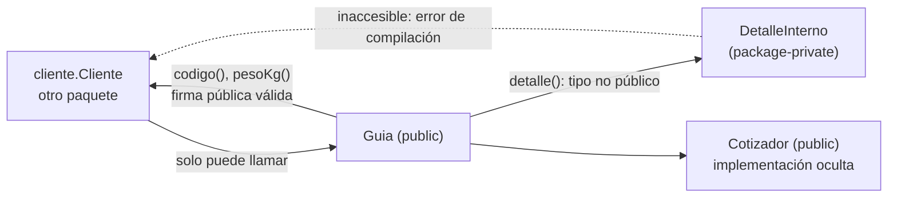
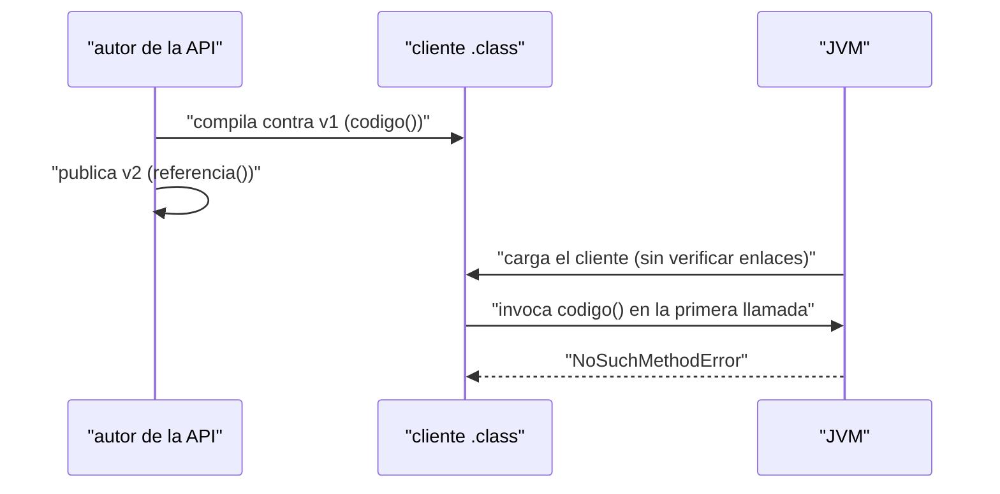
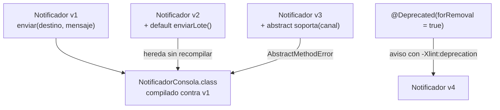
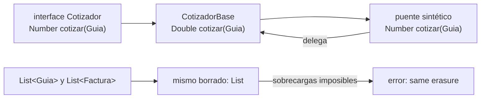
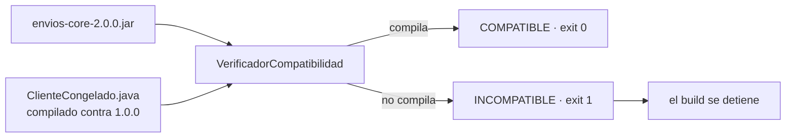

# Módulo 21: APIs públicas, compatibilidad y evolución

Una librería no se rompe cuando deja de compilar: se rompe cuando un cliente que ya estaba compilado deja de ejecutarse en producción. Este módulo construye `envios-core`, una librería con contrato público explícito, y provoca con la JVM real cada tipo de ruptura: `NoSuchMethodError`, `AbstractMethodError`, choques de borrado y constantes que se copian dentro del cliente. Todo se ejecuta con `javac`, `jar`, `javap` y `java` del JDK; no hace falta Maven, Gradle ni conexión a red.

## Aprende construyendo

El proyecto del módulo es una librería de dominio para RutaFlow: guías, cotización y notificaciones, con una regla de oro —lo que se publica se puede prometer y lo que se promete se puede retirar sin sorpresas—. Cada tema añade una capa de esa promesa y termina verificándola con un cliente congelado: un código que se compila una vez contra la versión 1 y se vuelve a ejecutar contra cada versión posterior.

### Tema 1: Qué es la superficie pública de una API · Básico · 40 min

**Prerrequisito:** Módulo 1 (modificadores de acceso) y Módulo 10 (JPMS y encapsulación fuerte).
**Al terminar podrás:** enumerar con `javap -public` el contrato real de una librería, distinguir lo que publicas de lo que solo es visible por accidente, y corregir un método público cuyo tipo de retorno no es accesible desde fuera del paquete.

#### Aprende

**¿Por qué es importante?** Cada miembro `public` o `protected` y cada tipo que aparece en una firma pública es una promesa que otros equipos compilan dentro de sus aplicaciones. Si esa promesa incluye un tipo que el cliente no puede ver, el método existe pero es inutilizable: el compilador lo rechaza aunque la firma sea `public`. La superficie de una API no es lo que escribiste con la palabra `public`; es lo que un cliente real puede compilar y llamar.

**Mapa de subtemas críticos**

| Subtema | Papel | Evidencia |
|---|---|---|
| Niveles de acceso frente a superficie real | Prerrequisito | `javap -public` lista solo tipos y miembros públicos de `Guia` |
| Tipos expuestos en la firma | Núcleo | `detalle()` aparece devolviendo `io.academia.envios.DetalleInterno` en el volcado |
| Constante `public static final` en línea | Variante | `Guia.MAX_BULTO` imprime `30` copiado dentro de `Cliente.class` |
| Encapsulación por paquete y JPMS | Límite | `DetalleInterno` es package-private y no puede nombrarse desde `cliente` |
| Error de tipo de retorno inaccesible | Error frecuente | `DetalleInterno.codigo() is defined in an inaccessible class or interface` |
| `javap -public` como vista del cliente | Diagnóstico | la salida de `javap -public` reproduce exactamente lo que el cliente puede llamar |
| Sacar el tipo interno de la firma | Decisión | la corrección devuelve datos de contrato en vez de hacer `public` a `DetalleInterno` |

Cada fila tiene su explicación individual a continuación.

**Niveles de acceso frente a superficie real (prerrequisito).** Java tiene cuatro niveles de acceso, pero para un consumidor solo cuentan los tipos `public` de paquetes exportados y sus miembros `public` y `protected`. Por eso `javap -public` sobre `Guia` muestra el contrato que otro paquete puede compilar, no el código completo que escribiste. Sin distinguir visibilidad de superficie real, se promete de más.

**Tipos expuestos en la firma (núcleo).** Cada parámetro, retorno y excepción declarada de un miembro público forma parte de la promesa. En el demo, `detalle()` filtra `DetalleInterno` en su firma y `javap -public` lo expone aunque el tipo no sea usable: la firma manda sobre la intención.

**Constante `public static final` en línea (variante).** Una constante primitiva o `String` no se lee en ejecución: el compilador copia su valor dentro del cliente. `Guia.MAX_BULTO` imprime `30` porque ese literal quedó dentro de `Cliente.class`, no porque se consulte el campo, y eso anticipa el comportamiento que el Tema 2 convierte en trampa.

**Encapsulación por paquete y JPMS (límite).** Un tipo package-private como `DetalleInterno` queda fuera de la superficie siempre que nadie lo exponga; JPMS refuerza ese límite exportando solo el paquete de contrato. El límite se rompe en cuanto ese tipo aparece en una firma pública, aunque la clase siga siendo interna.

**Error de tipo de retorno inaccesible (error frecuente).** Al llamar `guia.detalle().codigo()` desde otro paquete, el compilador falla con `DetalleInterno.codigo() is defined in an inaccessible class or interface`: el método es `public` pero su tipo de retorno no, y Java exige que el tipo sea accesible para invocar sus miembros. Es una superficie rota a medias que parece funcionar.

**`javap -public` como vista del cliente (diagnóstico).** El comando `javap -public` es la herramienta de diagnóstico que reproduce la vista del consumidor: lo que sale ahí es lo que se promete. Si aparece algo que no quieres mantener, el diseño de la API aún no está terminado aunque el código compile.

**Sacar el tipo interno de la firma (decisión).** La corrección profesional no es hacer `public` a `DetalleInterno` —eso amplía la promesa— sino retirar el tipo interno de la firma: devolver datos primitivos o un tipo de contrato y dejar el detalle como método package-private. Así la superficie queda limpia sin ampliar el compromiso.

**Conceptos clave:** superficie pública, firma, tipo expuesto, encapsulación de paquete, constante en línea.

Un tipo en Java tiene cuatro niveles de acceso, pero para quien consume una librería solo cuentan tres puertas: los tipos `public` de paquetes exportados, los miembros `public` y `protected` de esos tipos, y los tipos que aparecen en sus firmas —parámetros, retorno y excepciones declaradas—. Un tipo `public` en un paquete de implementación sigue siendo accesible si nadie lo oculta con JPMS, por eso el Módulo 10 insiste en exportar solo el paquete de contrato y cerrar el resto.

Hay una cuarta pieza que suele olvidarse: una constante `public static final` de tipo primitivo o `String` no se lee en tiempo de ejecución, se copia dentro del bytecode del cliente al compilarlo. Ese detalle, que parece menor, aparece en el Tema 2 como un cambio que no rompe nada y aun así no llega nunca a los clientes ya compilados.

**Analogía:** la superficie pública es el menú de un restaurante. El menú define lo que el cliente puede pedir y lo compromete: si mañana desaparece un plato, el cliente que ya lo había pedido se queda sin comer. La cocina —los paquetes internos— puede reorganizarse sin avisar. El error clásico es poner en el menú un plato que solo existe en la cocina: figura escrito, pero nadie puede servirlo.

**Diagrama:**



#### Practica

**Demo paso a paso.** Desde una carpeta vacía, crea la librería y compílala como JAR real:

```bash
mkdir envios-core && cd envios-core
mkdir -p src/io/academia/envios cliente
```

```java
// src/io/academia/envios/Guia.java
package io.academia.envios;

public final class Guia {
    public static final int MAX_BULTO = 30;

    private final String codigo;
    private final double pesoKg;

    public Guia(String codigo, double pesoKg) {
        if (codigo == null || codigo.isBlank()) {
            throw new IllegalArgumentException("El código de guía es obligatorio");
        }
        if (pesoKg <= 0) {
            throw new IllegalArgumentException("El peso debe ser positivo");
        }
        this.codigo = codigo;
        this.pesoKg = pesoKg;
    }

    public String codigo() {
        return codigo;
    }

    public double pesoKg() {
        return pesoKg;
    }

    public DetalleInterno detalle() {
        return new DetalleInterno(codigo);
    }
}
```

```java
// src/io/academia/envios/DetalleInterno.java
package io.academia.envios;

final class DetalleInterno {
    private final String codigo;

    DetalleInterno(String codigo) {
        this.codigo = codigo;
    }

    String codigo() {
        return codigo;
    }
}
```

```java
// src/io/academia/envios/Cotizador.java
package io.academia.envios;

public interface Cotizador {
    double cotizar(Guia guia);
}
```

```java
// src/io/academia/envios/CotizadorBase.java
package io.academia.envios;

public final class CotizadorBase implements Cotizador {
    @Override
    public double cotizar(Guia guia) {
        return guia.pesoKg() * 1.2;
    }
}
```

```bash
javac -d out $(find src -name '*.java')
jar --create --file envios-core-1.0.0.jar -C out .
javap -public -cp envios-core-1.0.0.jar io.academia.envios.Guia
```

**Resultado esperado:** la compilación termina sin mensajes y `javap` imprime el contrato público real, incluido el tipo que se filtró:

```text
Compiled from "Guia.java"
public final class io.academia.envios.Guia {
  public static final int MAX_BULTO;
  public io.academia.envios.Guia(java.lang.String, double);
  public java.lang.String codigo();
  public double pesoKg();
  public io.academia.envios.DetalleInterno detalle();
}
```

Crea un cliente en otro paquete y compruébalo:

```java
// cliente/Cliente.java
package cliente;

import io.academia.envios.Guia;

public final class Cliente {
    public static void main(String[] args) {
        Guia guia = new Guia("RF-001", 12.5);
        System.out.println(guia.codigo() + " " + guia.pesoKg() + " " + Guia.MAX_BULTO);
    }
}
```

```bash
javac -cp envios-core-1.0.0.jar -d cliente-out cliente/Cliente.java
java -cp "envios-core-1.0.0.jar:cliente-out" cliente.Cliente
```

**Resultado esperado:** `RF-001 12.5 30`.

**Explicación línea por línea:** `javac -d out` escribe los `.class` respetando la estructura de paquetes; `jar --create --file ... -C out .` empaqueta ese directorio como JAR sin incluir la ruta absoluta; `javap -public -cp <jar>` lee el JAR y muestra solo la superficie pública, que es exactamente lo que un cliente puede ver. En el cliente, `-cp` añade el JAR al classpath de compilación y `-d cliente-out` separa sus clases de las de la librería; al ejecutar, el classpath debe incluir el mismo JAR y el directorio del cliente separados por `:` en macOS y Linux. `Guia.MAX_BULTO` compila a una constante literal dentro de `Cliente.class`: no hay lectura del campo en tiempo de ejecución.

**Fallo deliberado:** añade al cliente la llamada `System.out.println(guia.detalle().codigo());` y recompílalo. El compilador falla con un error real:

```text
cliente/Cliente.java:8: error: DetalleInterno.codigo() is defined in an inaccessible class or interface
        System.out.println(guia.detalle().codigo());
                                         ^
1 error
```

Diagnostica el motivo: `detalle()` es `public`, pero su tipo de retorno no lo es, y Java exige que el tipo sea accesible para invocar sus miembros desde otro paquete. El matiz importa: `Object detalle = guia.detalle();` sí compila, porque recibir el valor no exige nombrar su tipo. Puedes obtener el objeto, pero no declarar una variable de ese tipo ni llamar a nada suyo. Una superficie rota a medias es peor que rota del todo, porque parece funcionar. La corrección no es hacer `public` a `DetalleInterno` —eso amplía la promesa— sino sacar el tipo interno de la firma pública: devuelve datos primitivos o un tipo de contrato, y deja el detalle como método package-private.

**Ejercicios.**

1. Ejecuta `javap -public -cp envios-core-1.0.0.jar io.academia.envios.CotizadorBase` y anota qué métodos aparecen; explica por qué la implementación de `cotizar` es parte del contrato y el campo privado no.
2. Convierte `DetalleInterno` en un `record` package-private y comprueba que el error de compilación del cliente no cambia: el problema es la accesibilidad, no la forma del tipo.
3. Añade un método `protected` a `Guia` y explica por qué `final class` lo convierte en irrelevante para clientes externos.
4. Escribe de memoria la salida de `javap -public` para una clase con dos métodos, un constructor y una constante; compara después con el resultado real.

**Pista:** `javap -public` es la vista del cliente, no la del autor. Si algo aparece ahí y no quieres prometerlo, todavía no has terminado de diseñar la API, aunque el código compile.

**Completa el código:** rellena el espacio con el comando que muestra solo el contrato público de la clase compilada:

```bash
javap ____ -cp envios-core-1.0.0.jar io.academia.envios.Guia
```

**Reto de memoria:** cierra este documento y escribe, solo de memoria, la secuencia completa —crear `src`, compilar con `javac -d`, empaquetar con `jar --create`, inspeccionar con `javap -public`— y una firma pública que filtre un tipo interno. Compara después con el patrón del demo.

#### Aplica

**Reto abierto.** Toma `envios-core` 1.0.0 y separa su superficie en dos listas: contrato público que te comprometes a mantener y detalle interno que puede cambiar sin aviso. Reescribe `Guia` para que ningún tipo package-private aparezca en una firma pública, y demuestra con `javap -public` y con el cliente recompilado que la superficie quedó limpia.

**Checklist de salida.**

- [ ] El JAR se genera con `jar --create` y `javap -public` imprime exactamente los miembros que consideras contrato.
- [ ] Ninguna firma pública menciona un tipo package-private o privado.
- [ ] El cliente en otro paquete compila y ejecuta sin tocar el código interno de la librería.
- [ ] Puedes nombrar cada miembro de la superficie y decir quién depende de él.
- [ ] Sabes explicar por qué `public static final` de tipo primitivo se comporta distinto de un método.

**Si falla.** Si `javac` responde `package io.academia.envios does not exist`, el `-cp` apunta a un directorio en vez de al JAR o el JAR se generó desde una carpeta equivocada: revisa con `jar --list --file envios-core-1.0.0.jar` que las rutas internas empiecen por `io/academia/envios/`. Si `java` responde `NoClassDefFoundError`, falta el JAR o el directorio del cliente en el classpath de ejecución.

**Siguiente paso:** con la superficie ya explícita, el siguiente tema mide qué ocurre cuando esa superficie cambia después de que un cliente ya se compiló.

**Errores comunes:** marcar `public` una clase interna para «arreglar» un error de accesibilidad en vez de sacarla de la firma; confundir que el código compile con que el contrato sea usable; olvidar que `protected` también es superficie para quien hereda.

**Límites y decisión de uso:** en una aplicación con un solo ejecutable y sin consumidores externos, la compatibilidad binaria no es una restricción y conviene refactorizar libremente. Este módulo aplica cuando la librería la consume otro equipo, otro servicio o el propio producto en versiones anteriores.

**Fuente oficial revisada el 2026-11-01:** [Java Language Specification, SE 27 — Chapter 6: Names, §6.6 Access Control](https://docs.oracle.com/javase/specs/jls/se27/html/jls-6.html).

**Transferencia al proyecto integrador:** la separación entre el paquete de contrato y los paquetes de implementación de `envios-core` es la misma que aplicará el proyecto integrador del Módulo 13 cuando extraiga su dominio a una librería reutilizable.

### Tema 2: Compatibilidad binaria frente a compatibilidad de fuente · Intermedio · 45 min

**Prerrequisito:** Tema 1 de este módulo.
**Al terminar podrás:** provocar un `NoSuchMethodError` con un cliente compilado contra la versión anterior, distinguirlo de un error de compilación, y explicar por qué una constante modificada no llega a los clientes ya compilados.

#### Aprende

**¿Por qué es importante?** Recompilar todo el mundo no es gratis ni siempre posible: hay servicios desplegados, aplicaciones móviles en tiendas y clientes que actualizan la librería sin tocar su código. Un cambio que rompe la compilación se detecta en el pipeline; un cambio que rompe el enlace binario se detecta en producción, en la primera petición que ejecuta ese método, y con una traza que no señala la línea que lo causó.

**Mapa de subtemas críticos**

| Subtema | Papel | Evidencia |
|---|---|---|
| Compatibilidad de fuente frente a binaria | Prerrequisito | recompilar el cliente da error de compilación; ejecutarlo da `NoSuchMethodError` |
| Enlace perezoso de la JVM | Núcleo | `Cliente` arranca y falla en la primera llamada a `codigo()` |
| `NoSuchMethodError` con descriptor completo | Diagnóstico | `NoSuchMethodError: 'java.lang.String io.academia.envios.Guia.codigo()'` |
| Constante en línea no se propaga | Variante | el cliente imprime `30` contra 2.0.0 y `50` solo tras recompilar |
| Casos de ida y vuelta entre fuente y binario | Límite | renombrar rompe ambas; cambiar genérico rompe solo la fuente |
| Confundir `NoClassDefFoundError` con `NoSuchMethodError` | Error frecuente | falta la clase entera da `NoClassDefFoundError`, falta el miembro da `NoSuchMethodError` |
| Subir versión mayor con todos los consumidores | Decisión | romper compatibilidad exige recompilar a todos, imposible para una librería pública |

Cada fila tiene su explicación individual a continuación.

**Compatibilidad de fuente frente a binaria (prerrequisito).** Son dos preguntas distintas: si el código antiguo vuelve a compilar (fuente) y si un `.class` antiguo se enlaza y ejecuta (binaria). El demo las separa: recompilar `Cliente.java` contra 2.0.0 da `cannot find symbol`, mientras que ejecutar el `.class` viejo da `NoSuchMethodError`. Confundirlas lleva a confiar en el pipeline para detectar algo que solo aparece en producción.

**Enlace perezoso de la JVM (núcleo).** La JVM no verifica todos los enlaces al arrancar: los resuelve en el primer uso. Por eso `Cliente` compilado contra 1.0.0 arranca sin problema contra 2.0.0 y falla solo cuando invoca `codigo()`. Ese retardo explica por qué una ruptura binaria aparece horas después del despliegue.

**`NoSuchMethodError` con descriptor completo (diagnóstico).** El error `NoSuchMethodError: 'java.lang.String io.academia.envios.Guia.codigo()'` incluye el descriptor binario completo, no solo el nombre. Ese descriptor es la firma que la JVM busca y no encuentra; leerlo entero permite ubicar el miembro exacto que desapareció.

**Constante en línea no se propaga (variante).** Cambiar `MAX_BULTO` de 30 a 50 no lanza ningún error: el valor 30 ya está copiado dentro de `Cliente.class`. El mismo cliente imprime `30` contra 2.0.0 y solo pasa a `50` tras recompilarlo, demostrando que las constantes no viajan a los binarios ya compilados.

**Casos de ida y vuelta entre fuente y binario (límite).** Un cambio puede ser binariamente compatible y romper la fuente, o al revés. Renombrar `codigo()` rompe ambas, pero cambiar `List<String>` por `List<CharSequence>` no altera el descriptor y solo rompe la compilación. El límite marca que ninguna de las dos compatibilidades implica la otra.

**Confundir `NoClassDefFoundError` con `NoSuchMethodError` (error frecuente).** Si falta la clase completa en el classpath, la JVM lanza `NoClassDefFoundError`; si falta solo el miembro, `NoSuchMethodError`. Leer mal la traza lleva a buscar el problema en el lugar equivocado: uno es un artefacto ausente, el otro un contrato cambiado.

**Subir versión mayor con todos los consumidores (decisión).** Romper compatibilidad es aceptable solo cuando controlas todos los despliegues y puedes recompilar a cada consumidor junto con la nueva versión mayor. Una librería pública o compartida entre equipos no puede hacerlo, y por eso acumula adaptadores en vez de renombrar a la ligera.

**Conceptos clave:** compatibilidad de fuente, compatibilidad binaria, enlace perezoso, `NoSuchMethodError`, constante en línea.

Hay dos preguntas distintas. Compatibilidad de fuente: ¿el código antiguo vuelve a compilar contra la versión nueva? Compatibilidad binaria: ¿un `.class` compilado contra la versión antigua se enlaza y se ejecuta contra la versión nueva? Un cambio puede ser binariamente compatible y romper la fuente —cambiar `List<String>` por `List<CharSequence>` no altera el descriptor del método, pero un llamador con `List<String>` deja de compilar— y también al revés. La JLS dedica el capítulo 13 a enumerar, cambio por cambio, qué se conserva.

La JVM no verifica todo al arrancar: resuelve referencias de forma perezosa, en el primer uso. Por eso un binario roto puede arrancar perfectamente y fallar horas después. Los errores más frecuentes son `NoSuchMethodError` y `NoSuchFieldError` al quitar o renombrar miembros, `AbstractMethodError` al añadir un método abstracto a una interfaz, e `IncompatibleClassChangeError` al convertir una clase en interfaz o al revés.

**Analogía:** firmar un contrato con el número de cuenta de una empresa. Si la empresa cambia el número en su registro pero tú conservas la copia firmada, el cobro no falla al firmar: falla el día del cobro, cuando el banco intenta usar el número que tú tienes. Las constantes son todavía más traicioneras: el número se copió en tu copia, así que aunque el registro esté actualizado, tu copia sigue con el viejo hasta que la vuelvas a emitir.

**Diagrama:**



#### Practica

**Demo paso a paso.** Continúa en `envios-core` con el cliente ya compilado contra 1.0.0. Crea la versión 2 renombrando el método y cambiando la constante:

```bash
mkdir -p v2-src/io/academia/envios
cp src/io/academia/envios/*.java v2-src/io/academia/envios/
```

```java
// v2-src/io/academia/envios/Guia.java (solo cambian la constante y el nombre del método)
package io.academia.envios;

public final class Guia {
    public static final int MAX_BULTO = 50;

    private final String codigo;
    private final double pesoKg;

    public Guia(String codigo, double pesoKg) {
        if (codigo == null || codigo.isBlank()) {
            throw new IllegalArgumentException("El código de guía es obligatorio");
        }
        if (pesoKg <= 0) {
            throw new IllegalArgumentException("El peso debe ser positivo");
        }
        this.codigo = codigo;
        this.pesoKg = pesoKg;
    }

    public String referencia() {   // antes: codigo()
        return codigo;
    }

    public double pesoKg() {
        return pesoKg;
    }

    public DetalleInterno detalle() {
        return new DetalleInterno(codigo);
    }
}
```

```bash
javac -d v2-out $(find v2-src -name '*.java')
jar --create --file envios-core-2.0.0.jar -C v2-out .
java -cp "envios-core-2.0.0.jar:cliente-out" cliente.Cliente
```

**Resultado esperado:** el cliente arranca y falla en la primera llamada, con el descriptor completo del método que ya no existe:

```text
Exception in thread "main" java.lang.NoSuchMethodError: 'java.lang.String io.academia.envios.Guia.codigo()'
```

Recompila el cliente contra la versión 2 y observa la otra cara del mismo cambio:

```bash
javac -cp envios-core-2.0.0.jar -d cliente-out cliente/Cliente.java
```

**Resultado esperado:** el compilador señala el símbolo que desapareció:

```text
cliente/Cliente.java:8: error: cannot find symbol
        System.out.println(guia.codigo() + " " + guia.pesoKg() + " " + Guia.MAX_BULTO);
                               ^
  symbol:   method codigo()
  location: variable guia of type Guia
1 error
```

El cambio es a la vez binariamente incompatible y de fuente incompatible. Recompilar te habría avisado; el cliente ya desplegado no.

**Explicación línea por línea:** `find v2-src -name '*.java'` alimenta a `javac` con las fuentes de la versión 2; el JAR nuevo se crea con otro nombre para no sobrescribir el anterior. Al ejecutar con `-cp "envios-core-2.0.0.jar:cliente-out"` la JVM carga `Cliente.class` compilado contra 1.0.0 y, en la primera invocación, intenta resolver `codigo()` en la clase `Guia` que encuentra: ya no existe y lanza `NoSuchMethodError`. La constante `MAX_BULTO` no produce error: el valor `30` está literalmente dentro de `Cliente.class` y nadie lo consulta en tiempo de ejecución.

Comprueba el efecto de la constante: vuelve a compilar el cliente contra la versión 2 y ejecútalo otra vez.

```bash
java -cp "envios-core-2.0.0.jar:cliente-out" cliente.Cliente
```

**Resultado esperado:** ahora imprime `RF-001 12.5 50`, porque al recompilar se copió el valor nuevo. Antes de recompilar, el mismo cliente contra el mismo JAR imprimía `30`.

**Fallo deliberado:** el error de ejecución del bloque anterior es el fallo, y su diagnóstico importa: en el momento del error no hay línea de código fuente señalada como culpable en tu proyecto, porque el problema está en el enlace entre dos artefactos compilados en momentos distintos. Si el proyecto no guarda el cliente congelado, este error reaparece solo en el entorno donde conviven la versión nueva de la librería y el consumidor antiguo. Restaura `codigo()` antes de continuar si quieres mantener la superficie del Tema 1.

**Ejercicios.**

1. Elimina `pesoKg()` en la versión 2 y documenta si el error es `NoSuchMethodError` o de compilación al recompilar el cliente.
2. Cambia `Guia` de `class` a `interface` en una copia y explica qué error esperas antes de ejecutarlo; compruébalo.
3. Añade un campo `public String estado;` en la versión 2, compila el cliente contra ella, ejecútalo con la versión 1 y anota el error exacto.
4. Predice qué imprime un cliente compilado con `MAX_BULTO = 30` si la versión 2 lo cambia a 50 sin recompilar. Ejecuta y corrige tu predicción.

**Pista:** el mensaje de `NoSuchMethodError` incluye el descriptor completo, no solo el nombre. Ese descriptor es la firma binaria: dos métodos con el mismo nombre y parámetros distintos son miembros diferentes para la JVM.

**Completa el código:** rellena el espacio con el error que lanza la JVM al invocar un método que ya no existe:

```java
// esperado: java.lang.____
```

**Reto de memoria:** cierra este documento y escribe, solo de memoria, la receta completa para reproducir una incompatibilidad binaria: construir v1, compilar un cliente contra v1, construir v2 con un método renombrado, ejecutar el cliente contra v2. Añade la excepción exacta que esperas.

#### Aplica

**Reto abierto.** Construye una matriz de compatibilidad de `envios-core` con cuatro cambios —renombrar un método, eliminar un campo, convertir una clase en interfaz y cambiar el valor de una constante— y registra para cada uno qué ocurre en la recompilación y qué ocurre en la ejecución del cliente congelado.

**Checklist de salida.**

- [ ] El cliente congelado está compilado contra 1.0.0 y conservado en un directorio separado.
- [ ] Cada cambio tiene su error real transcrito, no descrito de memoria.
- [ ] Distingues explícitamente error de compilación y error de ejecución en los cuatro casos.
- [ ] La constante documenta el valor impreso antes y después de recompilar el cliente.
- [ ] Sabes explicar por qué un error de enlace aparece en la primera llamada y no al arrancar.

**Si falla.** Si `java` no encuentra `Guia` en la versión 2, verifica con `jar --list --file envios-core-2.0.0.jar` que el paquete esté presente; si el error es `NoClassDefFoundError` en vez de `NoSuchMethodError`, el problema es la clase completa, no el miembro. Si la constante imprime el valor nuevo sin recompilar, es que el cliente se recompiló sin que lo notaras: borra `cliente-out` y repite.

**Siguiente paso:** sabes romper la compatibilidad; el siguiente tema enseña a evolucionar sin romperla usando métodos por defecto y deprecación.

**Errores comunes:** asumir que recompilar todo es siempre posible; creer que cambiar el valor de una constante llega a los clientes ya compilados; confundir `NoClassDefFoundError` con `NoSuchMethodError` al leer una traza.

**Límites y decisión de uso:** mantener compatibilidad binaria tiene un coste: acumulas adaptadores, alias y métodos deprecados. Un proyecto interno que controla todos sus despliegues puede romper la compatibilidad y subir la versión mayor junto con todos sus consumidores; una librería pública o compartida entre equipos, no.

**Fuente oficial revisada el 2026-11-01:** [Java Language Specification, SE 27 — Chapter 13: Binary Compatibility](https://docs.oracle.com/javase/specs/jls/se27/html/jls-13.html).

**Transferencia al proyecto integrador:** la matriz de compatibilidad es el documento que el proyecto integrador del Módulo 13 exige antes de extraer su dominio a una librería consumida por más de una aplicación.

### Tema 3: Evolucionar sin romper: default methods, deprecación y retirada · Intermedio · 45 min

**Prerrequisito:** Tema 2 de este módulo y Módulo 7 (interfaces selladas).
**Al terminar podrás:** añadir comportamiento a una interfaz sin romper a sus implementadores ya compilados, planificar una retirada con `@Deprecated(forRemoval = true)`, y reconocer el `AbstractMethodError` que provoca añadir un método abstracto a una interfaz existente.

#### Aprende

**¿Por qué es importante?** Las interfaces son el punto más delicado de la evolución de una API: miles de implementaciones viven fuera de tu repositorio y no puedes recompilarlas. Añadir un método abstracto parece inofensivo —una línea— y produce un `AbstractMethodError` en cada implementador antiguo que reciba la llamada. Los métodos `default` existen precisamente para que una interfaz pueda crecer sin obligar a todos sus implementadores a cambiar a la vez.

**Mapa de subtemas críticos**

| Subtema | Papel | Evidencia |
|---|---|---|
| Método `default` como crecimiento seguro | Núcleo | `NotificadorConsola` hereda `enviarLote` sin recompilar e imprime `Para RF-001: En reparto` |
| Delegación del `default` al método abstracto | Prerrequisito | `enviarLote` recorre la lista llamando al `enviar` original del implementador |
| Método abstracto añadido rompe binarios | Error frecuente | la v3 con `soporta` lanza `AbstractMethodError` en el implementador antiguo |
| `AbstractMethodError` frente a `NoSuchMethodError` | Diagnóstico | la traza nombra `app/NotificadorConsola.soporta(...)Z is abstract` |
| Deprecación con `forRemoval` y `since` | Variante | el aviso aparece como `[removal]`, no `[deprecation]` |
| Interfaz sellada cambia el cálculo | Límite | con `permits` cerrado puedes añadir abstractos porque actualizas a todos |
| Documentar la política de retirada | Decisión | `-Xlint:deprecation` solo avisa al recompilar, por eso la retirada se escribe |

Cada fila tiene su explicación individual a continuación.

**Método `default` como crecimiento seguro (núcleo).** Un método `default` aporta implementación, así que el implementador antiguo lo hereda sin recompilar. En el demo, `NotificadorConsola.class` compilado contra la v1 ejecuta `enviarLote` de la v2 e imprime `Para RF-001: En reparto`: la interfaz creció sin romper a nadie.

**Delegación del `default` al método abstracto (prerrequisito).** El `default enviarLote` funciona porque recorre la lista y llama al `enviar` que el implementador ya define. Entender que un `default` puede apoyarse en los métodos abstractos existentes es lo que permite añadir comportamiento compuesto sin pedir código nuevo al consumidor.

**Método abstracto añadido rompe binarios (error frecuente).** Añadir un método abstracto como `soporta` en la v3 crea una obligación que los `.class` antiguos no cumplen. El implementador congelado no lo define y la JVM lanza el error en la primera invocación: una línea aparentemente inofensiva rompe a todos los implementadores externos.

**`AbstractMethodError` frente a `NoSuchMethodError` (diagnóstico).** La traza de la v3 dice `app/NotificadorConsola.soporta(Ljava/lang/String;)Z is abstract`: el método existe en la interfaz pero el implementador no lo concreta. Se distingue de `NoSuchMethodError`, donde el miembro ya no existe; aquí existe sin cuerpo en el binario antiguo.

**Deprecación con `forRemoval` y `since` (variante).** `@Deprecated(forRemoval = true, since = "4.0")` no cambia el comportamiento: comunica intención. Al recompilar con `-Xlint:deprecation` el aviso sale como `[removal]`, no `[deprecation]`, distinguiendo «algún día» de «se elimina en la próxima mayor». No rompe el build, informa.

**Interfaz sellada cambia el cálculo (límite).** Una `sealed interface` con `permits` cerrado invierte la regla: si el conjunto de implementadores vive en tu módulo y puedes actualizarlos todos, añadir un método abstracto deja de ser una ruptura. El límite es que todos los implementadores estén bajo tu control y declarados en `permits`.

**Documentar la política de retirada (decisión).** `-Xlint:deprecation` solo avisa a quien recompila; una librería que solo crece en binario nunca verá el aviso. Por eso la decisión profesional es documentar la política de retirada —qué se añade, qué exige `default`, qué se depreca y cuándo se elimina— en vez de confiarla al compilador.

**Conceptos clave:** método `default`, `@Deprecated(forRemoval = true, since = ...)`, retirada en dos fases, interfaz sellada, `AbstractMethodError`.

Un método `default` aporta una implementación y por eso no obliga a recompilar a nadie: el implementador antiguo hereda el comportamiento nuevo. Añadir un método abstracto, en cambio, crea una obligación que los `.class` existentes no cumplen: la JVM los carga, pero al invocar ese método lanza `AbstractMethodError`. La deprecación no cambia el comportamiento: comunica una intención y produce avisos con `-Xlint:deprecation`. `forRemoval = true` distingue «algún día» de «en la próxima versión mayor se elimina», y `since` dice desde cuándo.

Las interfaces selladas (Módulo 7) invierten el cálculo: si el conjunto de implementadores está cerrado y vive en tu módulo, puedes añadir métodos abstractos porque puedes actualizarlos todos. Si la interfaz es abierta, el método nuevo debe ser `default` o la evolución rompe.

**Analogía:** añadir una cláusula a un contrato que ya firmaron cientos de proveedores. Si la cláusula trae una respuesta por defecto, nadie tiene que renegociar y el contrato sigue vigente. Si la cláusula exige una acción nueva que nadie acordó, el contrato se rompe en el momento en que alguien la invoca, no el día que la escribiste.

**Diagrama:**



#### Practica

**Demo paso a paso.** En una carpeta nueva, separa la librería del consumidor para poder recompilar una sola pieza a la vez:

```bash
mkdir notificaciones && cd notificaciones
mkdir -p lib-src/io/academia/notificaciones app-src/app
```

```java
// lib-src/io/academia/notificaciones/Notificador.java
package io.academia.notificaciones;

public interface Notificador {
    void enviar(String destino, String mensaje);
}
```

```bash
javac -d lib-out $(find lib-src -name '*.java')
jar --create --file notificaciones-core-1.0.0.jar -C lib-out .
```

El consumidor implementa la interfaz y la usa:

```java
// app-src/app/NotificadorConsola.java
package app;

import io.academia.notificaciones.Notificador;

public final class NotificadorConsola implements Notificador {
    @Override
    public void enviar(String destino, String mensaje) {
        System.out.println("Para " + destino + ": " + mensaje);
    }
}
```

```java
// app-src/app/Enviador.java
package app;

import io.academia.notificaciones.Notificador;
import java.util.List;

public final class Enviador {
    private final Notificador notificador;

    public Enviador(Notificador notificador) {
        this.notificador = notificador;
    }

    public void avisar(String destino, String mensaje) {
        notificador.enviarLote(List.of(destino), mensaje);
    }

    public static void main(String[] args) {
        new Enviador(new NotificadorConsola()).avisar("RF-001", "En reparto");
    }
}
```

Compila primero el implementador contra la versión 1 y después el enviador contra la versión 2:

```bash
javac -cp notificaciones-core-1.0.0.jar -d app-out app-src/app/NotificadorConsola.java
```

Publica la versión 2, que solo añade un método por defecto:

```java
// lib-src/io/academia/notificaciones/Notificador.java (v2)
package io.academia.notificaciones;

import java.util.List;

public interface Notificador {
    void enviar(String destino, String mensaje);

    default void enviarLote(List<String> destinos, String mensaje) {
        for (String destino : destinos) {
            enviar(destino, mensaje);
        }
    }
}
```

```bash
javac -d lib-out $(find lib-src -name '*.java')
jar --create --file notificaciones-core-2.0.0.jar -C lib-out .
javac -cp "notificaciones-core-2.0.0.jar:app-out" -d app-out app-src/app/Enviador.java
java -cp "notificaciones-core-2.0.0.jar:app-out" app.Enviador
```

**Resultado esperado:** `Para RF-001: En reparto`. `NotificadorConsola.class` nunca se recompiló contra la versión 2 y aun así hereda `enviarLote`, que a su vez llama a su `enviar` original. La interfaz creció y ningún implementador se rompió.

**Explicación línea por línea:** `javac ... -d app-out NotificadorConsola.java` produce una clase que referencia la interfaz de la versión 1; `Enviador.java` se compila aparte contra la versión 2 porque es el único que usa el método nuevo, y por eso el classpath incluye `app-out`: necesita encontrar `NotificadorConsola.class` sin recompilarlo. En ejecución, la JVM resuelve `enviarLote` en la interfaz (existe) y dentro de su implementación por defecto invoca `enviar`, que el implementador antiguo sí define. Si `enviarLote` hubiese sido abstracto, el mismo flujo habría lanzado `AbstractMethodError` en la primera llamada.

**Fallo deliberado:** publica una versión 3 que añade un método abstracto. Como el enviador debe invocarlo para que el error aparezca, actualízalo también —solo a él— contra la versión 3:

```java
// lib-src/io/academia/notificaciones/Notificador.java (v3)
package io.academia.notificaciones;

public interface Notificador {
    void enviar(String destino, String mensaje);
    default void enviarLote(java.util.List<String> destinos, String mensaje) { /* igual */ }
    boolean soporta(String canal);
}
```

```java
// app-src/app/Enviador.java (v3: el envío pasa por la nueva regla)
public void avisar(String destino, String mensaje) {
    if (!notificador.soporta("sms")) {
        throw new IllegalStateException("El canal no soportado debe rechazarse antes de enviar");
    }
    notificador.enviarLote(List.of(destino), mensaje);
}
```

```bash
javac -d lib-out $(find lib-src -name '*.java')
jar --create --file notificaciones-core-3.0.0.jar -C lib-out .
javac -cp "notificaciones-core-3.0.0.jar:app-out" -d app-out app-src/app/Enviador.java
java -cp "notificaciones-core-3.0.0.jar:app-out" app.Enviador
```

**Resultado esperado:** el implementador antiguo no tiene el método nuevo y la JVM lo declara abstracto al invocarlo:

```text
Exception in thread "main" java.lang.AbstractMethodError: Method app/NotificadorConsola.soporta(Ljava/lang/String;)Z is abstract
	at app.NotificadorConsola.soporta(NotificadorConsola.java)
	at app.Enviador.avisar(Enviador.java:14)
	at app.Enviador.main(Enviador.java:21)
```

El diagnóstico es directo: la versión 3 exigió a todos los implementadores un método que los binarios antiguos no tienen. La corrección es hacer `soporta` un `default` o sellar la interfaz y actualizar a todos sus implementadores.

Añade la deprecación en una versión 4 y compila un consumidor que llame al método retirado:

```java
// lib-src/io/academia/notificaciones/Notificador.java (v4, extracto)
@Deprecated(forRemoval = true, since = "4.0")
void enviar(String destino, String mensaje);
```

```java
// app-src/app/AvisoDirecto.java
package app;

import io.academia.notificaciones.Notificador;

public final class AvisoDirecto {
    static void mandar(Notificador notificador) {
        notificador.enviar("RF-001", "En reparto");
    }
}
```

```bash
javac -d lib-out $(find lib-src -name '*.java')
jar --create --file notificaciones-core-4.0.0.jar -C lib-out .
javac -Xlint:deprecation -cp "notificaciones-core-4.0.0.jar:app-out" -d app-out app-src/app/AvisoDirecto.java
```

**Resultado esperado:** el aviso se emite con la categoría `[removal]`, no `[deprecation]`, porque el miembro está marcado para eliminación:

```text
app-src/app/AvisoDirecto.java:7: warning: [removal] enviar(String,String) in Notificador has been deprecated and marked for removal
```

El aviso no rompe el build; informa a quien compila de que ese miembro tiene fecha de retirada.

**Ejercicios.**

1. Convierte `Notificador` en `sealed interface` con `NotificadorConsola` como única implementación permitida y explica qué cambia en la política de evolución.
2. Cambia `default` por abstracto en `enviarLote` y documenta el error exacto del implementador antiguo.
3. Añade `@Deprecated(since = "2.0")` sin `forRemoval` y compara el mensaje de `-Xlint:deprecation` con el del demo.
4. Escribe de memoria la diferencia entre `AbstractMethodError` y `NoSuchMethodError` y compruébala provocando ambos.

**Pista:** `-Xlint:deprecation` solo avisa si recompilas. Una librería que solo crece en binario y nunca recompila a sus consumidores no verá ese aviso nunca; por eso la política de retirada se documenta, no se confía al compilador.

**Completa el código:** rellena el espacio con el modificador que permite añadir comportamiento a una interfaz sin romper a sus implementadores:

```java
____ void enviarLote(List<String> destinos, String mensaje) { ... }
```

**Reto de memoria:** cierra este documento y escribe, solo de memoria, una interfaz con un método abstracto y un método `default`, un implementador que solo define el abstracto, y las tres versiones del JAR con el error que produce la tercera.

#### Aplica

**Reto abierto.** Diseña la política de evolución de `Notificador` para los próximos dos años: qué se puede añadir sin versión mayor, qué exige `default`, qué se depreca con `forRemoval` y en qué versión se elimina. Documenta la política y demuéstrala con un implementador congelado que sigue funcionando tras dos versiones.

**Checklist de salida.**

- [ ] El implementador congelado se compiló contra la versión 1 y sigue funcionando con la 2.
- [ ] La versión 3 reproduce un `AbstractMethodError` real, transcrito del terminal.
- [ ] La deprecación usa `since` y `forRemoval` y produce el aviso de `-Xlint:deprecation`.
- [ ] La política distingue añadir, deprecar y eliminar, con la versión mayor correspondiente a cada paso.
- [ ] Sabes explicar por qué una interfaz sellada cambia el cálculo de compatibilidad.

**Si falla.** Si `AbstractMethodError` no aparece, comprueba que `NotificadorConsola.class` no se recompiló: su fecha debe ser anterior a la versión 3. Si el aviso de deprecación no sale, falta `-Xlint:deprecation` o el miembro no está marcado. Si `sealed` no compila, revisa que todos los implementadores estén en el mismo módulo y declarados en `permits`.

**Siguiente paso:** los métodos por defecto resuelven la evolución de interfaces; el siguiente tema aborda el punto donde el borrado de genéricos confunde incluso a compiladores experimentados.

**Errores comunes:** añadir un método abstracto a una interfaz publicada; usar `@Deprecated` sin `forRemoval` y creer que ya está planificada la retirada; sellar una interfaz que vive en otro módulo y no puede actualizarse.

**Límites y decisión de uso:** si la interfaz solo la implementa tu equipo y el despliegue es conjunto, añadir métodos abstractos es más simple y honesto que acumular `default` vacíos que lanzan `UnsupportedOperationException`. La regla de compatibilidad aplica cuando hay implementadores que no controlas.

**Fuente oficial revisada el 2026-11-01:** [Java SE 27 API — java.lang.Deprecated](https://docs.oracle.com/en/java/javase/27/docs/api/java.base/java/lang/Deprecated.html).

**Transferencia al proyecto integrador:** la política de retirada documentada aquí es la que el proyecto integrador aplicará a su propia interfaz de repositorios antes de publicar la versión 2.0 del dominio.

### Tema 4: Genéricos, borrado y métodos puente en la superficie pública · Avanzado · 50 min

**Prerrequisito:** Módulo 2 (genéricos y type erasure) y Tema 2 de este módulo.
**Al terminar podrás:** diagnosticar un choque de borrado al compilar, inspeccionar el método puente que genera el compilador, y explicar por qué cambiar un parámetro genérico puede romper la fuente sin romper el binario.

#### Aprende

**¿Por qué es importante?** Los genéricos existen en el compilador, no en la JVM: el bytecode trabaja con `Object` y con `List` a secas. Esa distancia produce tres efectos que aparecen justo en la superficie pública: dos sobrecargas que el fuente distingue y el bytecode no, métodos puente invisibles que aparecen en las trazas, y cambios de parámetro genérico que pasan el enlace binario pero rompen la compilación de los clientes.

**Mapa de subtemas críticos**

| Subtema | Papel | Evidencia |
|---|---|---|
| Borrado de tipos en la JVM | Prerrequisito | `List<Guia>` y `List<String>` comparten el borrado `List` |
| Choque de borrado en sobrecargas | Error frecuente | `name clash: registrar(List<String>) and registrar(List<Guia>) have the same erasure` |
| Método puente sintético | Núcleo | `javap -p` muestra `Double cotizar` y `Number cotizar` en `CotizadorBase` |
| Flags `ACC_BRIDGE` y `ACC_SYNTHETIC` | Diagnóstico | `javap -v` marca el segundo `cotizar` como puente generado |
| Varianza binario-compatible, fuente-incompatible | Variante | `List<String>` a `List<CharSequence>` conserva el descriptor `(Ljava/util/List;)V` |
| Información genérica ausente en ejecución | Límite | la JVM no conoce el argumento de tipo, solo el atributo `Signature` lo preserva |
| Nombres distintos o varianza en vez de sobrecarga | Decisión | `registrarGuias` y `registrarCodigos` evitan el choque de borrado |

Cada fila tiene su explicación individual a continuación.

**Borrado de tipos en la JVM (prerrequisito).** Los genéricos existen en el compilador, no en la JVM: el bytecode trabaja con `List` a secas. Por eso `List<Guia>` y `List<String>` son el mismo tipo en ejecución, y entender esa distancia es el punto de partida de los tres efectos que el tema demuestra.

**Choque de borrado en sobrecargas (error frecuente).** Declarar `registrar(List<Guia>)` y `registrar(List<String>)` en la misma clase produce `name clash: ... have the same erasure`, porque para la JVM ambas firmas son `registrar(List)`. No es un fallo del compilador sino del diseño de la firma, que depende de una distinción que el bytecode no conserva.

**Método puente sintético (núcleo).** Cuando `Cotizador` declara `Number cotizar(Guia)` y `CotizadorBase` devuelve `Double`, el compilador añade un método puente `Number cotizar(Guia)` que delega en el real. `javap -p` sobre `CotizadorBase` lista ambos: el puente es lo que hace funcionar el polimorfismo con firmas borradas.

**Flags `ACC_BRIDGE` y `ACC_SYNTHETIC` (diagnóstico).** `javap -v` marca el segundo `cotizar` con `ACC_BRIDGE, ACC_SYNTHETIC`: la prueba de que no lo escribiste tú sino el compilador. Reconocer esos flags evita confundir el puente con un método duplicado al leer un volcado o una traza.

**Varianza binario-compatible, fuente-incompatible (variante).** Cambiar un parámetro de `List<String>` a `List<CharSequence>` deja el descriptor idéntico (`(Ljava/util/List;)V`), así que un cliente ya compilado sigue enlazando, pero al recompilar con `List<String>` falla. Es el caso inverso al renombrado del Tema 2: binario compatible, fuente incompatible.

**Información genérica ausente en ejecución (límite).** La JVM no conoce los argumentos de tipo; solo el atributo `Signature` del bytecode preserva la forma genérica para el compilador. El límite explica por qué un cast sin verificar compila con aviso y puede estallar como `ClassCastException` recién en ejecución.

**Nombres distintos o varianza en vez de sobrecarga (decisión).** La corrección profesional ante un choque de borrado es usar nombres distintos como `registrarGuias` y `registrarCodigos`, o un único método con `List<? extends ...>` que decida dentro. La superficie pública no debe apoyarse en distinciones que el borrado elimina.

**Conceptos clave:** borrado de tipos, descriptor, choque de borrado, método puente, varianza en firmas.

El borrado convierte `List<Guia>` y `List<Factura>` en el mismo tipo en tiempo de ejecución. Por eso no puedes declarar `registrar(List<Guia>)` y `registrar(List<Factura>)` en la misma clase: el compilador los ve como el mismo método y responde con un error de choque de borrado. La solución es un nombre distinto o un único método con un parámetro más general.

Los métodos puente los genera el compilador para que el polimorfismo funcione con firmas borradas. Si una interfaz declara `Number cotizar(Guia)` y la implementación devuelve `Double`, el compilador añade un método `Number cotizar(Guia)` que delega en el real: es el puente. Aparece en `javap -p` como un método adicional y en `-v` con los indicadores `ACC_BRIDGE` y `ACC_SYNTHETIC`.

La varianza afecta a la compatibilidad de fuente sin tocar el descriptor: `List<String>` y `List<CharSequence>` producen el mismo descriptor `(Ljava/util/List;)V`, así que un cliente compilado sigue enlazando, pero el código fuente que pasa `List<String>` deja de compilar cuando el parámetro pasa a `List<CharSequence>`. Es el caso inverso al del Tema 2: binario compatible, fuente incompatible.

**Analogía:** el borrado es el molde de una pieza. Por fuera, la etiqueta dice «lista de guías», pero el molde físico solo dice «lista». Si intentas fabricar dos moldes distintos con la misma forma, la fábrica te dice que ya existe uno. El método puente es el adaptador que permite que la etiqueta específica y el molde genérico encajen sin cambiar la fábrica.

**Diagrama:**



#### Practica

**Demo paso a paso.** En una carpeta nueva, para no mezclar estados con los temas anteriores:

```bash
mkdir genericos && cd genericos
mkdir -p src/io/academia/envios
```

```java
// src/io/academia/envios/Guia.java
package io.academia.envios;

public record Guia(String codigo, double pesoKg) {}
```

```java
// src/io/academia/envios/Cotizador.java
package io.academia.envios;

public interface Cotizador {
    Number cotizar(Guia guia);
}
```

```java
// src/io/academia/envios/CotizadorBase.java
package io.academia.envios;

public final class CotizadorBase implements Cotizador {
    @Override
    public Double cotizar(Guia guia) {
        return guia.pesoKg() * 1.2;
    }
}
```

```bash
javac -d out $(find src -name '*.java')
javap -p -cp out io.academia.envios.CotizadorBase
```

**Resultado esperado:** aparecen dos métodos `cotizar`, uno con retorno `Double` y otro con retorno `Number`:

```text
public final class io.academia.envios.CotizadorBase implements io.academia.envios.Cotizador {
  public io.academia.envios.CotizadorBase();
  public java.lang.Double cotizar(io.academia.envios.Guia);
  public java.lang.Number cotizar(io.academia.envios.Guia);
}
```

Confirma que el segundo es sintético:

```bash
javap -v -cp out io.academia.envios.CotizadorBase | grep -A2 'Number cotizar'
```

**Resultado esperado:** el volcado muestra `ACC_BRIDGE, ACC_SYNTHETIC` en los flags del método. No lo escribiste tú: lo generó el compilador para tender el puente entre la firma de la interfaz y la de la implementación.

**Explicación línea por línea:** `record Guia` genera constructor, accesores y `equals`/`hashCode` sin boilerplate (Módulo 7). `Cotizador` declara el retorno como `Number`, pero `CotizadorBase` devuelve `Double`, un subtipo: Java permite covariar el tipo de retorno en una sobreescritura. Como la JVM necesita un método cuya firma coincida exactamente con la de la interfaz, el compilador añade el puente `Number cotizar(Guia)`, que convierte el `Double` en `Number` y delega. `javap -p` incluye miembros privados y sintéticos; `-v` muestra los flags internos.

**Fallo deliberado:** intenta declarar dos sobrecargas que solo difieren en el argumento genérico:

```java
// src/io/academia/envios/Registro.java
package io.academia.envios;

import java.util.List;

public final class Registro {
    public void registrar(List<Guia> guias) {
        System.out.println("guías: " + guias.size());
    }

    public void registrar(List<String> codigos) {
        System.out.println("códigos: " + codigos.size());
    }
}
```

```bash
javac -d out $(find src -name '*.java')
```

**Resultado esperado:**

```text
src/io/academia/envios/Registro.java:10: error: name clash: registrar(List<String>) and registrar(List<Guia>) have the same erasure
    public void registrar(List<String> codigos) {
                ^
1 error
```

El diagnóstico: para la JVM ambas firmas son `registrar(List)`. No es un fallo del compilador sino del diseño de la firma; se corrige con nombres distintos (`registrarGuias`, `registrarCodigos`) o con un único método que reciba `List<? extends ...>` y decida dentro.

Comprueba ahora el caso binario-compatible y fuente-incompatible:

```java
// v1: public void exportar(List<String> destinos)
// v2: public void exportar(List<CharSequence> destinos)
```

```bash
javap -s -cp out io.academia.envios.Exportador | grep -A1 exportar
```

**Resultado esperado:** el descriptor es idéntico en ambas versiones (`(Ljava/util/List;)V`). Un cliente ya compilado sigue enlazando, pero al recompilar con `List<String>` el compilador rechaza la llamada. Es el caso opuesto al renombrado del Tema 2.

**Ejercicios.**

1. Sustituye el retorno `Number` de `Cotizador` por `Object` y observa si el compilador sigue generando puente.
2. Declara `registrarGuias(List<? extends Guia>)` y `registrarCodigos(List<? extends CharSequence>)`; comprueba que ambas compilan.
3. Ejecuta `javap -v` y localiza el atributo `Signature` del método real; explica qué información genérica conserva el bytecode aunque el borrado la elimine.
4. Provoca un `ClassCastException` guardando una `List<String>` en una variable `List<Guia>` mediante un cast sin verificar, y explica por qué el compilador lo permite con un aviso.

**Pista:** cuando dos métodos parecen distintos en el fuente y el compilador dice «same erasure», la diferencia desaparece al borrar los parámetros de tipo. La superficie pública no debe depender de distinciones que el bytecode no conserva.

**Completa el código:** rellena el espacio con el flag que muestra los miembros sintéticos generados por el compilador:

```bash
javap ____ -cp out io.academia.envios.CotizadorBase
```

**Reto de memoria:** cierra este documento y escribe, solo de memoria, una interfaz con retorno `Number`, una implementación con retorno `Double`, y el comando que demuestra la existencia del puente. Añade una pareja de sobrecargas que provoque choque de borrado y el mensaje esperado.

#### Aplica

**Reto abierto.** Rediseña la API de exportación de `envios-core` para aceptar guías y códigos sin choques de borrado, con varianza correcta en los parámetros, y documenta qué cambios de la firma son binariamente compatibles y cuáles rompen la fuente.

**Checklist de salida.**

- [ ] No existen dos métodos públicos que solo difieran en el argumento genérico.
- [ ] El método puente está identificado con `javap -p` y su delegación explicada.
- [ ] Un cambio de `List<String>` a `List<CharSequence>` está documentado como binario-compatible y fuente-incompatible.
- [ ] El descriptor real de cada método público está transcrito con `javap -s`.
- [ ] Sabes explicar por qué la información genérica no está disponible en tiempo de ejecución.

**Si falla.** Si `javap` no muestra el puente, comprueba que el retorno de la implementación sea un subtipo real del declarado y que la clase implemente la interfaz; si el error de borrado señala otro par de métodos, revisa que no existan ya sobrecargas equivalentes en la superclase.

**Siguiente paso:** con las tres formas de romper y de no romper demostradas, el último tema automatiza la verificación para que el build avise antes que producción.

**Errores comunes:** creer que la JVM conoce los argumentos genéricos; intentar sobrecargar por tipo genérico; cambiar un parámetro genérico y suponer que el binario se rompe cuando en realidad se rompe la fuente.

**Límites y decisión de uso:** si la API es interna y se recompila junto al consumidor, las distinciones de borrado importan poco; si publicas un JAR, cada firma genérica es una decisión que no puedes deshacer sin una versión mayor.

**Fuente oficial revisada el 2026-11-01:** [Java Language Specification, SE 27 — Chapter 15: Expressions, §15.12 Method Invocation](https://docs.oracle.com/javase/specs/jls/se27/html/jls-15.html).

**Transferencia al proyecto integrador:** la API de exportación con varianza correcta es la que usará el proyecto integrador para generar informes sin acoplarse a un tipo concreto de colección.

### Tema 5: Verificar la compatibilidad en el build · Avanzado · 50 min

**Prerrequisito:** Temas 1 a 4 de este módulo.
**Al terminar podrás:** escribir un verificador que compile un cliente congelado contra el JAR actual usando `javax.tools.JavaCompiler`, y usarlo como puerta del build que falla antes de publicar una ruptura.

#### Aprende

**¿Por qué es importante?** La compatibilidad que no se verifica se rompe en silencio. Un cliente congelado —código fuente que se compila contra cada versión— convierte la promesa de la API en una prueba reproducible: si el cliente deja de compilar, el build falla y la ruptura nunca llega al repositorio. Es la única comprobación que mide lo que de verdad importa, porque compila código real de consumidor en vez de comparar nombres de métodos.

**Mapa de subtemas críticos**

| Subtema | Papel | Evidencia |
|---|---|---|
| Cliente congelado como prueba reproducible | Núcleo | el verificador compila `Cliente.java` contra cada JAR en vez de comparar firmas |
| `ToolProvider.getSystemJavaCompiler` | Prerrequisito | devuelve `null` bajo un JRE y el verificador sale con código 2 |
| `DiagnosticCollector` y filtrado de errores | Diagnóstico | la salida lista `linea 8: cannot find symbol` solo para `Kind.ERROR` |
| Código de salida como puerta de build | Decisión | `salida=1` ante la ruptura detiene el pipeline |
| `getTask(...).call()` como señal de éxito | Variante | `call()` devuelve `Boolean.TRUE` solo si compiló sin errores |
| Qué no detecta el verificador | Límite | no detecta cambios de comportamiento, rendimiento ni semántica |
| Confundir exit 2 con incompatibilidad | Error frecuente | exit 2 significa error de uso o ausencia de compilador, no ruptura |

Cada fila tiene su explicación individual a continuación.

**Cliente congelado como prueba reproducible (núcleo).** El cliente congelado es código fuente que se compila contra cada versión del JAR. En el demo, el verificador compila `Cliente.java` contra 1.0.0 (COMPATIBLE) y contra 2.0.0 (INCOMPATIBLE), midiendo lo que un consumidor real sufriría en vez de comparar nombres de métodos.

**`ToolProvider.getSystemJavaCompiler` (prerrequisito).** `ToolProvider.getSystemJavaCompiler()` devuelve el compilador del JDK en uso, o `null` si se ejecuta sobre un JRE sin compilador. El verificador comprueba ese `null` y sale con código 2, por eso debe correr con un JDK y no con un JRE.

**`DiagnosticCollector` y filtrado de errores (diagnóstico).** El `DiagnosticCollector` recoge todos los mensajes de la compilación; el verificador filtra solo los de `Kind.ERROR` para imprimir `linea 8: cannot find symbol` sin mezclar avisos. El diagnóstico procede del compilador real, no de una heurística sobre nombres.

**Código de salida como puerta de build (decisión).** La decisión que convierte la verificación en puerta es `System.exit(1)` ante la ruptura: el `salida=1` del demo es lo que detiene un pipeline. Un build no puede declarar compatible algo que un cliente real no compila, y el código de salida traduce esa regla a automatización.

**`getTask(...).call()` como señal de éxito (variante).** `getTask(null, archivos, diagnosticos, opciones, null, unidades).call()` devuelve un `Boolean`: `true` solo si compiló sin errores. Esa llamada es la variante central del patrón `javax.tools`, y su valor es la señal que el verificador traduce en COMPATIBLE o INCOMPATIBLE.

**Qué no detecta el verificador (límite).** El verificador compila fuentes, así que detecta cualquier ruptura de compilación —incluidas las de origen genérico del Tema 4— pero no cambios de comportamiento, rendimiento ni semántica. Ese límite debe declararse: herramientas byte a byte como `japicmp` o `revapi` lo complementan, ninguna detecta un cambio semántico.

**Confundir exit 2 con incompatibilidad (error frecuente).** El código 2 no significa ruptura: señala error de uso (argumentos incorrectos) o ausencia de compilador. Interpretarlo como incompatibilidad lleva a fallar el build por un motivo equivocado; solo el código 1 indica que el cliente congelado dejó de compilar.

**Conceptos clave:** cliente congelado, `ToolProvider.getSystemJavaCompiler`, `DiagnosticCollector`, puerta de build.

El JDK incluye un compilador accesible desde Java mediante `javax.tools`. `ToolProvider.getSystemJavaCompiler()` devuelve el compilador del JDK en uso, o `null` si se ejecuta sobre un JRE sin compilador. Con `StandardJavaFileManager` se leen las fuentes, con `DiagnosticCollector` se recogen errores y avisos, y `getTask(...).call()` ejecuta la compilación y devuelve si tuvo éxito. Ese resultado es la señal que necesita el build.

El verificador no sustituye a las herramientas de comparación byte a byte como `japicmp` o `revapi`, que detectan cambios de firma sin necesidad de un cliente; las complementa. Aquí se usa solo el JDK para que el ejercicio se ejecute sin red ni dependencias, y esa decisión se declara como límite: un cambio semántico —mismo método, comportamiento distinto— no lo detecta ninguna de las dos.

**Analogía:** el cliente congelado es un cliente de prueba que firma el mismo contrato con cada versión. Si la nueva versión le obliga a cambiar, el contrato cambió. No hace falta leer la letra pequeña de todas las cláusulas: basta con ver si el cliente puede seguir firmando.

**Diagrama:**



#### Practica

**Demo paso a paso.** Reutiliza `envios-core-1.0.0.jar` del Tema 1 y escribe el verificador:

```bash
mkdir verificador && cd verificador
```

```java
// VerificadorCompatibilidad.java
import javax.tools.Diagnostic;
import javax.tools.DiagnosticCollector;
import javax.tools.JavaCompiler;
import javax.tools.JavaFileObject;
import javax.tools.StandardJavaFileManager;
import javax.tools.ToolProvider;
import java.nio.file.Files;
import java.nio.file.Path;
import java.util.List;

public final class VerificadorCompatibilidad {

    public static void main(String[] args) throws Exception {
        if (args.length != 2) {
            System.err.println("Uso: java VerificadorCompatibilidad <api.jar> <ClienteCongelado.java>");
            System.exit(2);
        }

        Path api = Path.of(args[0]).toAbsolutePath();
        Path cliente = Path.of(args[1]).toAbsolutePath();
        Path salida = Files.createTempDirectory("compatibilidad");

        JavaCompiler compilador = ToolProvider.getSystemJavaCompiler();
        if (compilador == null) {
            System.err.println("Sin compilador: ejecuta esto con un JDK, no con un JRE.");
            System.exit(2);
        }

        DiagnosticCollector<JavaFileObject> diagnosticos = new DiagnosticCollector<>();
        try (StandardJavaFileManager archivos =
                     compilador.getStandardFileManager(diagnosticos, null, null)) {
            Iterable<? extends JavaFileObject> unidades =
                    archivos.getJavaFileObjects(cliente.toFile());
            List<String> opciones = List.of(
                    "-classpath", api.toString(),
                    "-d", salida.toString());
            boolean compilo = Boolean.TRUE.equals(
                    compilador.getTask(null, archivos, diagnosticos, opciones, null, unidades).call());

            if (compilo) {
                System.out.println("COMPATIBLE: el cliente congelado compila contra " + api.getFileName());
                return;
            }

            System.out.println("INCOMPATIBLE: el cliente congelado ya no compila contra " + api.getFileName());
            for (Diagnostic<? extends JavaFileObject> d : diagnosticos.getDiagnostics()) {
                if (d.getKind() == Diagnostic.Kind.ERROR) {
                    System.out.println("  linea " + d.getLineNumber() + ": " + d.getMessage(null));
                }
            }
            System.exit(1);
        }
    }
}
```

Compila el verificador y ejecútalo contra la versión 1:

```bash
javac -d verificador-out VerificadorCompatibilidad.java
java -cp verificador-out VerificadorCompatibilidad ../envios-core-1.0.0.jar ../cliente/Cliente.java
```

**Resultado esperado:** `COMPATIBLE: el cliente congelado compila contra envios-core-1.0.0.jar` y código de salida `0`.

**Explicación línea por línea:** `Path.of(args[0]).toAbsolutePath()` fija rutas absolutas para que el classpath no dependa del directorio actual; `Files.createTempDirectory` evita ensuciar el proyecto con `.class` de la verificación. `getStandardFileManager` recibe el colector para que todos los diagnósticos se guarden. `getTask(null, archivos, diagnosticos, opciones, null, unidades)` recibe el `Writer` de salida (`null` usa el estándar), el gestor de archivos, el colector, las opciones de línea de comandos, las clases de anotación (`null`) y las unidades a compilar. `call()` devuelve `Boolean`: `true` si compiló sin errores. Si falla, se filtran solo los diagnósticos de tipo `ERROR` para no mezclar avisos.

**Fallo deliberado:** ejecuta el mismo verificador contra `envios-core-2.0.0.jar`, la versión que renombró `codigo()` a `referencia()`:

```bash
java -cp verificador-out VerificadorCompatibilidad ../envios-core-2.0.0.jar ../cliente/Cliente.java; echo "salida=$?"
```

**Resultado esperado:**

```text
INCOMPATIBLE: el cliente congelado ya no compila contra envios-core-2.0.0.jar
  linea 8: cannot find symbol
  symbol:   method codigo()
  location: variable guia of type io.academia.envios.Guia
salida=1
```

Ese código de salida distinto de cero es lo que detiene un pipeline. El diagnóstico es el del compilador real, no una heurística sobre nombres de métodos: el build no puede declarar compatible algo que un cliente no puede compilar.

**Ejercicios.**

1. Añade a la salida el nombre del símbolo que falta leyendo `d.getMessage(null)` completo y compáralo con el mensaje truncado.
2. Modifica el verificador para que también compile un segundo cliente que use `referencia()` y explica por qué ese cliente sí compila contra la versión 2.
3. Ejecuta el verificador con un JRE (o con `--limit-modules` que excluya `java.compiler`) y documenta el mensaje de `ToolProvider` vacío.
4. Escribe un script `verificar-compatibilidad.sh` que compile la librería, ejecute el verificador y propague el código de salida.

**Pista:** el verificador compila fuentes, no compara firmas. Por eso detecta cualquier ruptura que un cliente real sufriría, incluidas las de origen genérico del Tema 4, pero no detecta cambios de comportamiento.

**Completa el código:** rellena el espacio con la llamada que ejecuta la compilación y devuelve si tuvo éxito:

```java
boolean compilo = Boolean.TRUE.equals(
    compilador.getTask(null, archivos, diagnosticos, opciones, null, unidades).____());
```

**Reto de memoria:** cierra este documento y escribe, solo de memoria, el esqueleto del verificador: obtener el compilador, crear el colector, abrir el gestor, compilar con `-classpath` y `-d`, y salir con código 1 si hay errores. Compara después con el patrón del demo.

#### Aplica

**Reto abierto.** Integra el verificador en `envios-core` como puerta de publicación: un script que compile la librería, ejecute el verificador sobre el cliente congelado y devuelva código distinto de cero ante cualquier ruptura. Añade el caso de una ruptura de origen genérico y demuestra que también la detecta.

**Checklist de salida.**

- [ ] El verificador compila un cliente congelado real, no compara nombres de métodos.
- [ ] La salida distingue `COMPATIBLE` de `INCOMPATIBLE` y enumera los diagnósticos de error.
- [ ] El script propaga el código de salida y detiene el pipeline.
- [ ] La ruptura de origen genérico del Tema 4 también hace fallar la verificación.
- [ ] El README declara qué no detecta: comportamiento, rendimiento y cambios semánticos.

**Si falla.** Si `ToolProvider` devuelve `null`, estás ejecutando con un JRE o con un runtime sin el módulo `java.compiler`; usa el `java` del JDK. Si el cliente compila contra la versión rota, revisa que el JAR del classpath sea la versión 2 y que el archivo del cliente sea el congelado, no uno recién editado.

**Siguiente paso:** el proyecto de cierre del módulo reúne la superficie limpia, la política de evolución y el verificador en una librería que se puede publicar sin sorpresas.

**Errores comunes:** verificar contra la versión nueva con un cliente también nuevo, que compila siempre; interpretar el código de salida `2` como incompatibilidad cuando significa error de uso; declarar el módulo terminado sin haber ejecutado el verificador contra una ruptura real.

**Límites y decisión de uso:** si el proyecto no publica artefactos ni tiene consumidores externos, el verificador añade mantenimiento sin beneficio; si publica una librería compartida, es la comprobación de menor coste y mayor señal del pipeline. Las herramientas byte a byte (`japicmp`, `revapi`) cubren lo que el cliente congelado no ejercita, a cambio de una dependencia más.

**Fuente oficial revisada el 2026-11-01:** [Java SE 27 API — javax.tools.JavaCompiler](https://docs.oracle.com/en/java/javase/27/docs/api/java.compiler/javax/tools/JavaCompiler.html).

**Transferencia al proyecto integrador:** este verificador es el paso de build que el proyecto integrador del Módulo 13 ejecutará antes de etiquetar la versión de su librería de dominio.

## Proyecto de cierre del módulo

**Objetivo:** entregar `envios-core` 2.0 como librería publicable: superficie pública limpia y documentada, política de evolución escrita, y verificación de compatibilidad automatizada que falla el build ante una ruptura real.

**Entregables.**

1. `envios-core` compilado como JAR con `jar --create`, y la salida de `javap -public` documentada como contrato (Tema 1).
2. Superficie pública sin tipos internos en firmas: demostrado con `javap` y con el cliente compilado desde otro paquete.
3. Matriz de compatibilidad con cuatro cambios —renombrar, eliminar campo, convertir clase en interfaz y cambiar una constante— con el error real observado en compilación y en ejecución (Tema 2).
4. `CHANGELOG.md` con política de versiones y las deprecaciones con `since` y `forRemoval`, más el aviso de `-Xlint:deprecation` transcrito (Tema 3).
5. API de exportación sin sobrecargas que choquen por borrado, con el descriptor de cada método público y el método puente identificado (Tema 4).
6. `VerificadorCompatibilidad` sobre un cliente congelado y `verificar-compatibilidad.sh` que propaga el código de salida (Tema 5).
7. README que distingue lo ejecutado de lo no ejecutado: no se ejecutó `japicmp`, no hubo despliegue en producción y el verificador no detecta cambios de comportamiento.

**Rúbrica (100 puntos).**

| Criterio | Puntos |
|---|---:|
| Superficie pública sin tipos internos, verificada con `javap` | 15 |
| Matriz de compatibilidad con errores reales de compilación y ejecución | 20 |
| Política de evolución y deprecaciones documentadas | 15 |
| Verificador de cliente congelado funcionando en ambos sentidos | 25 |
| Script con código de salida correcto y explicación del diagnóstico | 15 |
| Límites declarados sin presentar como medido lo no ejecutado | 10 |

**Criterio de aceptación:** si el verificador solo compara nombres de métodos, si declara compatible sin compilar un cliente real, o si el README afirma haber ejecutado herramientas o despliegues que no ocurrieron, el módulo no se considera cerrado aunque la rúbrica sume 100.
