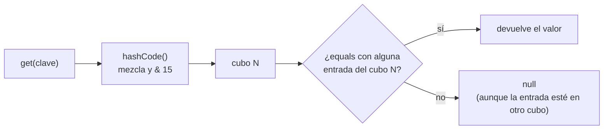
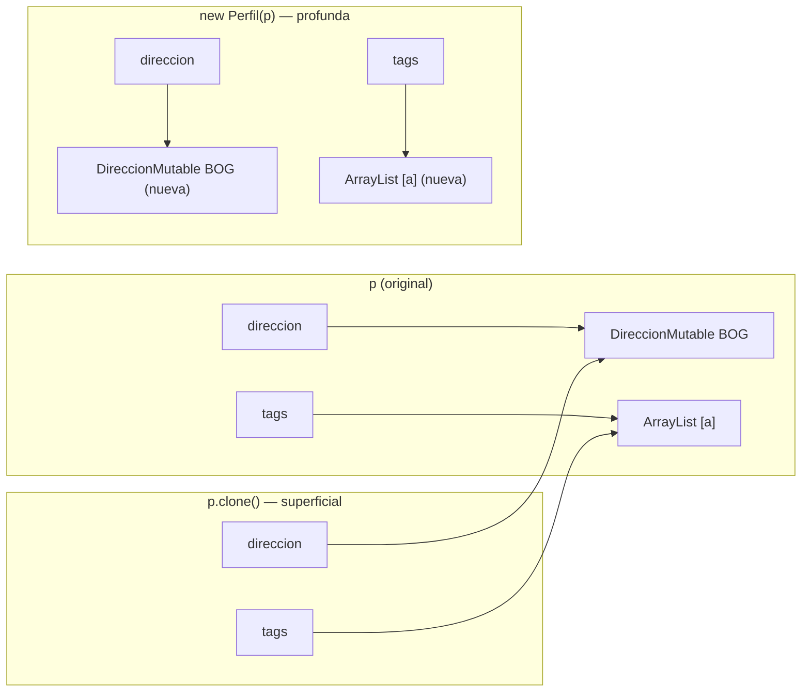
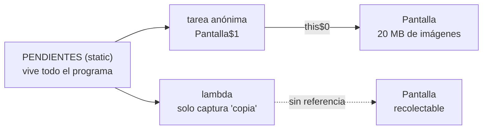

# Módulo 22: El objeto por dentro — copia, enums y tipos anidados

Un objeto en Java no es solo “una instancia con campos”. Tiene identidad, estado, reglas de mutabilidad, relaciones con otros objetos y un ciclo de vida dentro del runtime. Muchos bugs de producción no vienen de algoritmos complicados, sino de asumir que copiar un objeto copia todo, que `equals` basta para un `HashSet`, que un enum es solo una constante, o que una clase anidada es solo organización visual.

En este módulo vas a construir `tienda-aurora-java-m22`, un proyecto pequeño donde cada concepto se ve con comportamiento observable: copia defensiva, igualdad y claves hash, copia superficial frente a profunda, enums con estado/comportamiento y transiciones exhaustivas, y las cuatro formas de clases anidadas con `this$0` inspeccionado con `javap`.

## Apertura del módulo

Al terminar este módulo podrás:
- proteger el estado de un objeto con copia de entrada y de salida, y distinguir una copia de una vista no modificable;
- explicar con cubos de hash por qué `equals` sin `hashCode` y las claves mutables rompen `HashSet` y `HashMap`;
- distinguir copia superficial y profunda con `==` y preferir un constructor de copia a `clone()`;
- modelar estados con un `enum` con datos y comportamiento, `switch` exhaustivo, código persistente y `EnumMap`;
- declarar las cuatro formas de clase anidada y detectar con `javap` el `this$0` que causa retención de memoria.

**Esquema del módulo:** copia defensiva, igualdad y claves de hash (Tema 1); copia superficial y profunda, enums y
`switch` exhaustivo (Tema 2); clases anidadas, `this$0` y retención (Tema 3). El proyecto `tienda-aurora-java-m22`
está completo en «Código completo del proyecto», antes de los temas; cada tema lo usa en su Capa 2.

**Qué necesitas saber antes:** `enum` y `switch` (Java, Módulo 0, Tema 6); `javap` (Java, Módulo 0, Tema 1); clases,
`static` e identidad (Java, Módulo 1, Tema 1); `record`, *objeto de valor* y *copia defensiva* (Java, Módulo 1,
Tema 5); `equals`, `hashCode` y claves mutables (Java, Módulo 2, Temas 2 y 3); lambdas (Java, Módulo 4, Tema 1);
`switch` exhaustivo (Java, Módulo 7, Tema 2); referencias débiles (Java, Módulo 11, Tema 3); *Prototype*, *copia
profunda* y `clone()` (Java, Módulo 12, Tema 5); *copia superficial* (Fundamentos, Módulo 9, Tema 6).

## Prerrequisitos y bootstrap

```bash
java -version
javac -version
javap -version
gradle --version
mkdir -p tienda-aurora-java-m22/src/main/java/com/aurora/obj
mkdir -p tienda-aurora-java-m22/src/test/java/com/aurora/obj
cd tienda-aurora-java-m22
gradle wrapper --gradle-version 9.9.1
```

**Entorno de referencia verificado (2026-11-23):** macOS arm64, JDK 27.0.1.0.2, Gradle 9.9.1, toolchain Java 25. Con él
se capturaron las salidas del proyecto Gradle (sección «Verificación real»).

**Entorno de los programas de los temas (2026-11-24):** Linux x86_64, OpenJDK 25.0.5.1, sin Gradle. Cada problema
resuelto es un archivo completo que se ejecuta con `java Archivo.java` o con `javac` y `javap`, en `~/labs/objeto-java`.
Esas transcripciones son literales de esa ejecución. Con el mismo JDK se recompilaron las fuentes del proyecto (sin
Gradle ni JUnit) y `App` dio la misma salida que en «Verificación real».

## Build desde cero

#### `settings.gradle.kts`

```kotlin
rootProject.name = "tienda-aurora-java-m22"
```

#### `build.gradle.kts`

```kotlin
plugins { java; application }
group = "com.aurora"; version = "1.0.0"
java { toolchain { languageVersion = JavaLanguageVersion.of(25) } }
repositories { mavenCentral() }
dependencies {
    testImplementation(platform("org.junit:junit-bom:5.13.4"))
    testImplementation("org.junit.jupiter:junit-jupiter")
    testRuntimeOnly("org.junit.platform:junit-platform-launcher")
}
application { mainClass = "com.aurora.obj.App" }
tasks.test { useJUnitPlatform(); testLogging { events("passed","skipped","failed") } }
tasks.withType<JavaCompile>().configureEach {
    options.encoding = "UTF-8"
    options.compilerArgs.addAll(listOf("-Xlint:all","-Xlint:-processing","-Werror"))
}
```

## Visual del módulo

**Visual:** [Copia defensiva: proteger el estado interno](/visuals/temas/java/modulo-22-copia-defensiva.html)

Lectura: devolver la referencia interna permite que el llamador rompa el invariante; copiar al entrar y al salir lo conserva.

**Visual:** [Clases anidadas: quién captura `this$0`](/visuals/temas/java/modulo-22-clases-anidadas.html)

Lectura: una inner no estática conserva la referencia a la instancia exterior; eso explica fugas de memoria y errores de creación sin instancia.

## Código completo del proyecto

#### `Direccion.java`

```java
package com.aurora.obj;

import java.util.Objects;

public final class Direccion {
    private final String ciudad;
    public Direccion(String ciudad) { this.ciudad = ciudad; }
    public String ciudad() { return ciudad; }

    @Override
    public boolean equals(Object o) {
        return o instanceof Direccion d && Objects.equals(ciudad, d.ciudad);
    }

    @Override
    public int hashCode() {
        return Objects.hash(ciudad);
    }

    @Override public String toString() { return ciudad; }
}
```

#### `ClienteInmutable.java`

```java
package com.aurora.obj;

import java.util.ArrayList;
import java.util.List;
import java.util.Objects;

public final class ClienteInmutable {
    private final String id;
    private final Direccion direccion;
    private final List<String> tags;

    public ClienteInmutable(String id, Direccion direccion, List<String> tags) {
        this.id = Objects.requireNonNull(id);
        this.direccion = new Direccion(Objects.requireNonNull(direccion).ciudad()); // copia defensiva entrada
        this.tags = new ArrayList<>(Objects.requireNonNull(tags)); // copia defensiva entrada
    }

    public String id() { return id; }
    public Direccion direccion() { return new Direccion(direccion.ciudad()); } // copia defensiva salida
    public List<String> tags() { return List.copyOf(tags); } // vista inmutable
}
```

#### `SinHashCode.java`

```java
package com.aurora.obj;

import java.util.Objects;

/** MAL EJEMPLO deliberado: igualdad sin hashCode rompe la deduplicación en HashSet. */
@SuppressWarnings("overrides") // único sitio donde se tolera el aviso: es el contraejemplo
public final class SinHashCode {
    private final String id;

    public SinHashCode(String id) { this.id = id; }

    @Override
    public boolean equals(Object o) {
        return o instanceof SinHashCode otro && Objects.equals(id, otro.id);
    }
    // No se sobrescribe hashCode: dos objetos equals pueden caer en cubos distintos.
}
```

#### `ClaveMutable.java`

```java
package com.aurora.obj;

/** MAL EJEMPLO deliberado: hashCode depende de estado mutable. */
public final class ClaveMutable {
    private String valor;

    public ClaveMutable(String valor) { this.valor = valor; }

    public void setValor(String valor) { this.valor = valor; }

    @Override
    public boolean equals(Object o) {
        return o instanceof ClaveMutable otra && valor.equals(otra.valor);
    }

    @Override
    public int hashCode() {
        return valor.hashCode();
    }

    @Override
    public String toString() {
        return valor;
    }
}
```

#### `DireccionMutable.java`

```java
package com.aurora.obj;

public class DireccionMutable implements Cloneable {
    private String ciudad;
    public DireccionMutable(String ciudad) { this.ciudad = ciudad; }
    public String ciudad() { return ciudad; }
    public void setCiudad(String ciudad) { this.ciudad = ciudad; }
    @Override public DireccionMutable clone() {
        try { return (DireccionMutable) super.clone(); }
        catch (CloneNotSupportedException e) { throw new AssertionError(e); }
    }
}
```

#### `Perfil.java`

```java
package com.aurora.obj;

import java.util.ArrayList;
import java.util.List;
import java.util.Objects;

public class Perfil implements Cloneable {
    private final String nombre;
    private DireccionMutable direccion;
    private final List<String> tags;

    public Perfil(String nombre, DireccionMutable direccion, List<String> tags) {
        this.nombre = Objects.requireNonNull(nombre);
        this.direccion = Objects.requireNonNull(direccion);
        this.tags = new ArrayList<>(Objects.requireNonNull(tags));
    }

    public String nombre() { return nombre; }
    public DireccionMutable direccion() { return direccion; }
    // MAL EJEMPLO: devuelve la lista interna mutable; en código real usar List.copyOf(tags).
    public List<String> tags() { return tags; }

    @Override
    public Perfil clone() { // shallow
        try { return (Perfil) super.clone(); }
        catch (CloneNotSupportedException e) { throw new AssertionError(e); }
    }

    public Perfil deepCopy() {
        return new Perfil(nombre, direccion.clone(), new ArrayList<>(tags));
    }
}
```

`Perfil.tags()` y `direccion()` están marcados como mal ejemplo: este proyecto los expone a propósito para observar el efecto de la copia superficial. En código de producción, devuelve `List.copyOf(tags)` y una copia de `direccion`, o modela el agregado como inmutable desde el inicio.

#### `EstadoEnvio.java`

```java
package com.aurora.obj;

public enum EstadoEnvio {
    PENDIENTE(0) {
        @Override public EstadoEnvio siguiente() { return EN_RUTA; }
    },
    EN_RUTA(1) {
        @Override public EstadoEnvio siguiente() { return ENTREGADO; }
    },
    ENTREGADO(2) {
        @Override public EstadoEnvio siguiente() { return ENTREGADO; }
    },
    FALLIDO(3) {
        @Override public EstadoEnvio siguiente() { return FALLIDO; }
    };

    private final int codigo;
    EstadoEnvio(int codigo) { this.codigo = codigo; }
    public int codigo() { return codigo; }
    public abstract EstadoEnvio siguiente();
}
```

#### `Transiciones.java`

```java
package com.aurora.obj;

/** Switch exhaustivo sobre el enum: sin default, el compilador exige cada constante. */
public final class Transiciones {
    private Transiciones() {}

    public static String ruta(EstadoEnvio estado) {
        return switch (estado) {
            case PENDIENTE -> "PENDIENTE->EN_RUTA";
            case EN_RUTA -> "EN_RUTA->ENTREGADO";
            case ENTREGADO -> "ENTREGADO";
            case FALLIDO -> "FALLIDO";
        };
    }
}
```

#### `Contenedor.java`

```java
package com.aurora.obj;

public class Contenedor {
    // No es constante de compilación: la inner debe retener la instancia exterior para leerlo.
    private final String prefijo;

    public Contenedor() { this("AURORA"); }
    public Contenedor(String prefijo) { this.prefijo = prefijo; }

    public static class Estatica {
        public String id(int n) { return "ID-" + n; }
    }

    public class Interna {
        public String etiqueta(String s) { return prefijo + ":" + s; } // captura this externo
    }

    public Runnable crearRunnableLocal(String msg) {
        class Local implements Runnable {
            @Override public void run() { System.out.println("LOCAL=" + prefijo + ":" + msg); }
        }
        return new Local();
    }

    public Runnable crearRunnableAnonimo(String msg) {
        return new Runnable() {
            @Override public void run() { System.out.println("ANON=" + prefijo + ":" + msg); }
        };
    }
}
```

`prefijo` no es una constante de compilación: se asigna en el constructor. Por eso la inner necesita retener la instancia exterior para leerlo. Si fuera `private static final String prefijo = "AURORA"`, el compilador podría inlinearlo y `this$0` desaparecería; aquí se conserva para que la retención sea observable.

#### `App.java`

```java
package com.aurora.obj;

import java.util.ArrayList;
import java.util.HashMap;
import java.util.HashSet;
import java.util.List;
import java.util.Map;
import java.util.Set;

public final class App {
    public static void main(String[] args) {
        List<String> tags = new ArrayList<>(List.of("vip"));
        ClienteInmutable c = new ClienteInmutable("C1", new Direccion("BOG"), tags);
        tags.add("hack");
        System.out.println("TAGS=" + c.tags());

        SinHashCode x = new SinHashCode("X");
        SinHashCode y = new SinHashCode("X");
        Set<SinHashCode> sinHash = new HashSet<>();
        sinHash.add(x);
        sinHash.add(y);
        System.out.println("IGUALES=" + x.equals(y));
        System.out.println("HASHSET_SIN=" + sinHash.size());
        System.out.println("HASHSET_CON=" + new HashSet<>(List.of(new Direccion("BOG"), new Direccion("BOG"))).size());

        ClaveMutable clave = new ClaveMutable("A");
        Map<ClaveMutable, String> mapa = new HashMap<>();
        mapa.put(clave, "valor");
        System.out.println("CLAVE_ANTES=" + mapa.get(new ClaveMutable("A")));
        clave.setValor("B");
        System.out.println("CLAVE_DESPUES=" + mapa.get(new ClaveMutable("B")));
        System.out.println("CLAVE_ITER=" + mapa);

        Perfil p = new Perfil("Ana", new DireccionMutable("BOG"), new ArrayList<>(List.of("a")));
        Perfil shallow = p.clone();
        Perfil deep = p.deepCopy();
        p.direccion().setCiudad("MED");
        p.tags().add("b");
        System.out.println("SHALLOW_DIR=" + shallow.direccion().ciudad());
        System.out.println("DEEP_DIR=" + deep.direccion().ciudad());
        System.out.println("SHALLOW_TAGS=" + shallow.tags().size());
        System.out.println("DEEP_TAGS=" + deep.tags().size());

        System.out.println("ENUM=" + EstadoEnvio.PENDIENTE.siguiente().name());
        System.out.println("CODIGO=" + EstadoEnvio.ENTREGADO.codigo());
        System.out.println("RUTA=" + Transiciones.ruta(EstadoEnvio.PENDIENTE));

        Contenedor cont = new Contenedor();
        System.out.println("STATIC=" + new Contenedor.Estatica().id(7));
        System.out.println("INNER=" + cont.new Interna().etiqueta("X"));
        cont.crearRunnableLocal("L").run();
        cont.crearRunnableAnonimo("A").run();
    }
}
```

#### `ObjetoTest.java`

```java
package com.aurora.obj;

import org.junit.jupiter.api.Test;

import java.util.ArrayList;
import java.util.Arrays;
import java.util.HashMap;
import java.util.HashSet;
import java.util.List;
import java.util.Map;
import java.util.Set;

import static org.junit.jupiter.api.Assertions.*;

class ObjetoTest {

    @Test
    void copiaDefensivaProtegeInvariantes() {
        List<String> tags = new ArrayList<>(List.of("vip"));
        ClienteInmutable c = new ClienteInmutable("C1", new Direccion("BOG"), tags);
        tags.add("externo");
        assertEquals(List.of("vip"), c.tags());
        assertThrows(UnsupportedOperationException.class, () -> c.tags().add("x"));
    }

    @Test
    void shallowVsDeep() {
        Perfil p = new Perfil("Ana", new DireccionMutable("BOG"), new ArrayList<>(List.of("a")));
        Perfil shallow = p.clone();
        Perfil deep = p.deepCopy();
        p.direccion().setCiudad("MED");
        p.tags().add("b");
        assertEquals("MED", shallow.direccion().ciudad()); // comparte referencia
        assertEquals("BOG", deep.direccion().ciudad());
        assertEquals(2, shallow.tags().size());
        assertEquals(1, deep.tags().size());
    }

    @Test
    void enumConComportamiento() {
        assertEquals(EstadoEnvio.EN_RUTA, EstadoEnvio.PENDIENTE.siguiente());
        assertEquals(2, EstadoEnvio.ENTREGADO.codigo());
        assertEquals(EstadoEnvio.ENTREGADO, EstadoEnvio.ENTREGADO.siguiente());
        assertEquals(EstadoEnvio.ENTREGADO, EstadoEnvio.EN_RUTA.siguiente().siguiente());
        assertEquals(3, EstadoEnvio.FALLIDO.codigo());
        assertEquals("PENDIENTE->EN_RUTA", Transiciones.ruta(EstadoEnvio.PENDIENTE));
    }

    @Test
    void igualdadYHashSet() {
        SinHashCode a = new SinHashCode("X");
        SinHashCode b = new SinHashCode("X");
        assertTrue(a.equals(b));
        Set<SinHashCode> sinHash = new HashSet<>();
        sinHash.add(a);
        sinHash.add(b);
        assertEquals(2, sinHash.size()); // equals sin hashCode no deduplica
        Set<Direccion> conHash = new HashSet<>(
                List.of(new Direccion("BOG"), new Direccion("BOG")));
        assertEquals(1, conHash.size());
    }

    @Test
    void claveMutablePierdeEntradaEnHashMap() {
        ClaveMutable clave = new ClaveMutable("A");
        Map<ClaveMutable, String> mapa = new HashMap<>();
        mapa.put(clave, "valor");
        assertEquals("valor", mapa.get(new ClaveMutable("A")));
        clave.setValor("B");
        assertNull(mapa.get(new ClaveMutable("B")));
        assertTrue(mapa.entrySet().stream().anyMatch(e -> e.getKey() == clave)); // sigue en el bucket, inalcanzable por clave nueva
    }

    @Test
    void innerCapturaThis0YStaticNestedNo() {
        boolean inner = Arrays.stream(Contenedor.Interna.class.getDeclaredFields())
                .anyMatch(f -> f.getName().equals("this$0"));
        boolean estatica = Arrays.stream(Contenedor.Estatica.class.getDeclaredFields())
                .anyMatch(f -> f.getName().equals("this$0"));
        assertTrue(inner);
        assertFalse(estatica);
    }

    @Test
    void clasesAnidadas() {
        Contenedor c = new Contenedor();
        assertEquals("ID-1", new Contenedor.Estatica().id(1));
        assertEquals("AURORA:X", c.new Interna().etiqueta("X"));
    }
}
```

### Tema 1: Copia defensiva, igualdad y claves de hash · Intermedio · 60 min

<details open>
<summary><strong>Capa 1 — Lectura</strong></summary>

#### Objetivos
Al terminar este tema podrás:
- proteger el estado de un objeto con copia de entrada y de salida, y distinguir una copia de una vista no modificable;
- comprobar en un `HashSet` que `equals` sin `hashCode` no deduplica, y leer el aviso `[overrides]` de javac;
- calcular en qué cubo de hash cae una clave y explicar por qué una clave mutada se vuelve inalcanzable;
- elegir claves inmutables para `HashMap` y `HashSet`.

**Conceptos clave:** copia de entrada y de salida, vista no modificable, cubo de hash, aviso `[overrides]`

Ya los conoces y no se repiten: *copia defensiva*, *objeto de valor*, `record` e *inmutabilidad superficial* (Java,
Módulo 1, Tema 5); *identidad frente a igualdad*, `equals`, `hashCode` y *contrato de igualdad* (Java, Módulo 2,
Tema 2); *clave mutable* y *objeto inmutable* (Java, Módulo 2, Tema 3); *invariante* (Java, Módulo 12, Tema 1);
*función hash*, *tabla hash* y *colisión* (Fundamentos, Módulo 2, Tema 6).

#### El problema
En Tienda Aurora, el perfil de un cliente guarda sus etiquetas (`vip`, `mayorista`). El equipo de marketing recibe el
perfil, agrega `hack` a «su» lista y la etiqueta aparece en el perfil guardado. Además, un `HashSet` de direcciones
tiene dos `BOG` repetidas y un mapa «pierde» una entrada que sigue ahí. ¿Qué tienen en común los tres fallos?

#### Glosario del tema

**copia de entrada y de salida**
- **Definición técnica:** aplicar la copia defensiva en los dos bordes de un objeto: en el constructor o *setter*, al recibir un dato mutable, y en el accesor, al entregarlo.
- **En palabras sencillas:** fotocopias el documento al recibirlo y entregas otra fotocopia cuando te lo piden.
- **Dónde se rompe la comparación:** si lo que guardas ya es inmutable (`List.copyOf`, `String`, un `record` de valores), la segunda fotocopia sobra.
- **Ejemplo:** `ClienteInmutable` copia con `new ArrayList<>(tags)` al entrar y entrega `List.copyOf(tags)` al salir.
- **Error típico:** copiar solo al entrar y devolver la lista interna mutable; en `CopiaDefensiva.java`, `a.tags().add("intruso")` cambia la lista guardada.

**vista no modificable**
- **Definición técnica:** envoltorio, como el de `Collections.unmodifiableList`, que rechaza las escrituras con `UnsupportedOperationException` pero lee siempre de la colección original.
- **En palabras sencillas:** una ventana con vidrio: no puedes tocar lo de adentro, pero ves cuando el dueño lo cambia.
- **Dónde se rompe la comparación:** la ventana no protege de quien está adentro: quien conserva la lista original sigue cambiándola.
- **Ejemplo:** `SoloVista` muestra `[vip, hack]` después de que el llamador agrega `hack` a su lista.
- **Error típico:** usar `unmodifiableList` como copia defensiva en el constructor; protege la escritura por la vista, no el estado.

**cubo de hash**
- **Definición técnica:** posición del arreglo interno de un `HashMap` o `HashSet` donde se guarda una entrada; se calcula con el `hashCode` de la clave, mezclado y reducido al tamaño de la tabla.
- **En palabras sencillas:** el casillero numerado donde el mapa guarda cada cosa, según su número de hash.
- **Dónde se rompe la comparación:** un casillero físico tiene número fijo; aquí el número sale del contenido de la clave en el momento de guardar.
- **Ejemplo:** con 16 cubos, `ClaveMutable("A")` cae en el `1`; tras `setValor("B")` debería estar en el `2`, pero sigue en el `1`.
- **Error típico:** creer que `get` recorre todo el mapa; solo mira el cubo calculado con el `hashCode` actual.

**aviso `[overrides]`**
- **Definición técnica:** aviso de javac, activo con `-Xlint:overrides` o `-Xlint:all`, que señala una clase que sobrescribe `equals` sin sobrescribir `hashCode`.
- **En palabras sencillas:** el compilador te recuerda que esas dos piezas van juntas.
- **Dónde se rompe la comparación:** es solo un aviso: sin `-Werror` el programa compila y falla en silencio en un `HashSet`.
- **Ejemplo:** `warning: [overrides] Class SinHashCode overrides equals, but neither it nor any superclass overrides hashCode method`.
- **Error típico:** silenciarlo con `@SuppressWarnings("overrides")` fuera de un contraejemplo didáctico.

#### ► CÓMO FUNCIONA

##### 1. La idea en lenguaje sencillo

Cuando un notario recibe un documento, no se queda con el original del cliente: hace una copia certificada y archiva
esa copia. Si el cliente tacha su original al salir, el archivo no cambia. Y cuando alguien pide el documento, el
notario entrega otra copia, nunca la del archivo.

Un objeto que guarda datos mutables necesita la misma disciplina. El perfil de Tienda Aurora guardó la lista que le
dieron y la entregó tal cual: marketing la cambió por fuera. Los otros dos fallos vienen de la misma raíz. Un
`HashSet` y un `HashMap` archivan cada objeto en un casillero calculado a partir de su contenido. Si el objeto no
calcula bien su número, o si su contenido cambia después de archivarlo, el casillero deja de corresponder.

##### 2. Definición formal y vocabulario

La **copia defensiva** es crear una copia propia de un dato mutable en el borde del objeto. Se aplica en dos sitios:
la **copia de entrada y de salida**. La de entrada ocurre al recibir el dato en el constructor o en un *setter*. La
de salida ocurre al entregarlo en un accesor.

Una **vista no modificable** es un envoltorio que rechaza escrituras pero lee de la colección original.
`Collections.unmodifiableList` devuelve una. No es una copia: refleja los cambios que otro haga en el original.

El contrato de `Object.hashCode`, en su documentación oficial, tiene tres reglas. Dos objetos iguales según `equals`
deben tener el mismo `hashCode`. El valor debe mantenerse mientras no cambien los datos que usa `equals`. Dos
objetos distintos pueden compartir valor.

Un **cubo de hash** es la posición del arreglo interno de un `HashMap` donde se guarda una entrada. Se calcula con el
`hashCode` de la clave. Un `HashSet` es, por dentro, un `HashMap` cuyas claves son los elementos.

El **aviso `[overrides]`** de `javac` señala una clase que sobrescribe `equals` y no `hashCode`. Aparece con
`-Xlint:overrides` o con `-Xlint:all`.

##### 3. Cómo funciona por dentro, paso a paso

Una búsqueda en un `HashMap` aplica dos filtros en orden, como muestra el diagrama:



Sigue `mapa.put(clave, "valor")` con `ClaveMutable("A")` en un mapa de 16 cubos:

1. `HashMap` llama a `clave.hashCode()`. Para el texto `"A"` vale `65`.
2. Mezcla el valor con `h ^ (h >>> 16)`, que lleva los bits altos a los bajos. Con `65` no cambia nada.
3. Reduce al tamaño de la tabla con `& 15`. El resultado es el cubo `1`.
4. Crea una entrada con la clave, el valor y el hash calculado, y la guarda en el cubo `1`.

Ahora sigue `get(new ClaveMutable("B"))` después de `clave.setValor("B")`:

1. El hash de `"B"` es `66`, y el cubo es el `2`.
2. El cubo `2` está vacío. `get` devuelve `null` sin mirar el cubo `1`.
3. La entrada sigue en el cubo `1`, con el hash viejo guardado. Al recorrer el mapa aparece como `{B=valor}`, porque
   la clave es el mismo objeto mutado.

`SinHashCode` falla en el primer filtro. Hereda el `hashCode` de `Object`, que se basa en la identidad del objeto.
Dos instancias con `"X"` reciben valores distintos y casi siempre caen en cubos distintos. `equals` nunca llega a
compararlas, y el set queda con `2`.

La copia defensiva tiene su propio paso a paso. Una regla importante es copiar antes de validar:

```java
Perfil(List<String> tags) {
    this.tags = List.copyOf(tags);                  // primero copia
    if (this.tags.isEmpty()) {                      // después valida la copia
        throw new IllegalArgumentException("sin etiquetas");
    }
}
```

Si validas el original y copias después, otro hilo puede cambiar la lista entre las dos operaciones. Validar la copia
garantiza que lo que guardas es exactamente lo que comprobaste.

##### 4. Reglas, variantes y casos límite

`List.copyOf`, `Set.copyOf` y `Map.copyOf` existen desde Java 10. Devuelven colecciones inmodificables y rechazan
`null` con `NullPointerException`. Como el resultado ya es inmutable, sirve a la vez como copia de entrada y de
salida. El accesor puede devolverlo sin copiar otra vez.

La copia de una colección es superficial: copia las referencias a los elementos. Si los elementos son mutables, como
una `DireccionMutable`, el objeto sigue expuesto. Con `String` o con un `record` de valores inmutables no hay riesgo.

Un `record` genera `equals` y `hashCode` a partir de todos sus componentes. Por eso las dos `Direccion("BOG")` caen en
el mismo cubo, el `11`. Si un componente es mutable, el `record` hereda el problema de la clave mutable.

La tabla de un `HashMap` tiene siempre un tamaño potencia de dos. Por defecto empieza en 16 cubos y crece al superar
el 75 % de ocupación. Al crecer, recalcula el cubo de cada entrada con el hash que guardó, no con uno nuevo.

Desde Java 8, un cubo con muchas colisiones se convierte en un árbol balanceado cuando la tabla es grande. Eso
mejora el peor caso de búsqueda, pero no arregla un `hashCode` incoherente con `equals`.

El aviso `[overrides]` es solo un aviso. Sin `-Werror` el programa compila y falla en silencio. El proyecto del
módulo compila con `-Xlint:all -Werror` y por eso el contraejemplo necesita `@SuppressWarnings("overrides")`.

##### 5. Relación con lo que ya sabes y lo que viene

La copia defensiva y la inmutabilidad superficial vienen de Java, Módulo 1, Tema 5. Aquí las aplicas en los dos
bordes del objeto y distingues la copia de una vista, que no protege del dueño del original.

`equals`, `hashCode` y las claves mutables se presentaron en Java, Módulo 2, Temas 2 y 3. Este tema muestra el
mecanismo: el cubo calculado y el hash guardado explican por qué la entrada «se pierde» sin desaparecer.

La función hash y las colisiones de Fundamentos, Módulo 2, Tema 6 son la teoría general. `HashMap` es su
implementación concreta, con mezcla de bits y tabla potencia de dos.

El Tema 2 extiende la copia a objetos con otros objetos dentro: copia superficial frente a profunda. También muestra
por qué un `enum` es la clave más segura posible, con `EnumMap`. El Tema 3 muestra otra forma en que un objeto queda
atado a otro sin que lo veas: la referencia `this$0`.

#### Problema resuelto 1.1
Compara tres formas de guardar la lista de etiquetas de un cliente y qué ve cada una cuando el llamador la cambia.

**Razonamiento:**
1. `SinCopia` guarda la referencia recibida; `SoloVista` la envuelve con `Collections.unmodifiableList`; `ConCopia` hace `List.copyOf`.
2. Después de crear los tres, el llamador agrega `hack` a su lista original.
3. Por último, alguien intenta escribir en la lista que devuelve cada accesor.

```java
// CopiaDefensiva.java — tres formas de guardar la lista de etiquetas de un cliente
import java.util.ArrayList;
import java.util.Collections;
import java.util.List;

public class CopiaDefensiva {
    static final class SinCopia {
        private final List<String> tags;
        SinCopia(List<String> tags) { this.tags = tags; }                         // guarda la misma lista
        List<String> tags() { return tags; }
    }

    static final class SoloVista {
        private final List<String> tags;
        SoloVista(List<String> tags) { this.tags = Collections.unmodifiableList(tags); } // vista del original
        List<String> tags() { return tags; }
    }

    static final class ConCopia {
        private final List<String> tags;
        ConCopia(List<String> tags) { this.tags = List.copyOf(tags); }            // copia de entrada
        List<String> tags() { return tags; }                                      // ya es inmodificable
    }

    public static void main(String[] args) {
        List<String> original = new ArrayList<>(List.of("vip"));
        SinCopia a = new SinCopia(original);
        SoloVista b = new SoloVista(original);
        ConCopia c = new ConCopia(original);

        original.add("hack");                       // el llamador sigue teniendo su lista
        System.out.println("sin copia   -> " + a.tags());
        System.out.println("solo vista  -> " + b.tags());
        System.out.println("con copia   -> " + c.tags());

        a.tags().add("intruso");                    // el getter entrega la lista interna
        System.out.println("original    -> " + original);
        try {
            c.tags().add("intruso");
        } catch (UnsupportedOperationException e) {
            System.out.println("con copia   -> " + e);
        }
    }
}
```

```text
$ java CopiaDefensiva.java
sin copia   -> [vip, hack]
solo vista  -> [vip, hack]
con copia   -> [vip]
original    -> [vip, hack, intruso]
con copia   -> java.lang.UnsupportedOperationException
```

**Explicación por partes.**
- Línea 9: `SinCopia` comparte la lista. `hack` aparece dentro (primera línea de salida).
- Línea 15: `SoloVista` no copia: envuelve. También muestra `hack`, aunque nadie pueda escribir por la vista.
- Línea 21: `ConCopia` hace la copia de entrada. Sigue en `[vip]`.
- Línea 36: el accesor de `SinCopia` entrega la lista interna; `intruso` llega hasta la lista del llamador.
- Líneas 38–42: `List.copyOf` ya es inmodificable, así que sirve también como copia de salida: `add` lanza la excepción.

#### Problema resuelto 1.2
Demuestra los dos fallos de hash: `equals` sin `hashCode` y una clave que cambia después de guardarse.

**Razonamiento:**
1. Compila con `-Xlint:all` para ver qué detecta javac antes de ejecutar.
2. Calcula el cubo con la misma mezcla que usa `HashMap` para una tabla de 16 cubos.
3. Imprime el cubo de la clave antes y después de mutarla.

```java
// IgualdadHash.java — equals sin hashCode, equals con hashCode y una clave que cambia
import java.util.HashMap;
import java.util.HashSet;
import java.util.List;
import java.util.Map;
import java.util.Objects;
import java.util.Set;

public class IgualdadHash {
    static final class SinHashCode {                        // MAL EJEMPLO
        private final String id;
        SinHashCode(String id) { this.id = id; }
        @Override public boolean equals(Object o) {
            return o instanceof SinHashCode otro && Objects.equals(id, otro.id);
        }
    }

    record Direccion(String ciudad) {}                      // equals y hashCode generados

    static final class ClaveMutable {                       // MAL EJEMPLO
        private String valor;
        ClaveMutable(String valor) { this.valor = valor; }
        void setValor(String valor) { this.valor = valor; }
        @Override public boolean equals(Object o) {
            return o instanceof ClaveMutable otra && valor.equals(otra.valor);
        }
        @Override public int hashCode() { return valor.hashCode(); }
        @Override public String toString() { return valor; }
    }

    // Cubo que usaría un HashMap de 16 cubos para ese hash (misma mezcla que HashMap.hash)
    static int cubo(Object o) {
        int h = o.hashCode();
        return (h ^ (h >>> 16)) & 15;
    }

    public static void main(String[] args) {
        SinHashCode x = new SinHashCode("X");
        SinHashCode y = new SinHashCode("X");
        Set<SinHashCode> sinHash = new HashSet<>(List.of(x));
        sinHash.add(y);
        System.out.println("IGUALES=" + x.equals(y) + " HASHSET_SIN=" + sinHash.size());

        Set<Direccion> conHash = new HashSet<>();
        conHash.add(new Direccion("BOG"));
        conHash.add(new Direccion("BOG"));
        System.out.println("HASHSET_CON=" + conHash.size()
                + " cubos=" + cubo(new Direccion("BOG")) + "," + cubo(new Direccion("BOG")));

        ClaveMutable clave = new ClaveMutable("A");
        Map<ClaveMutable, String> mapa = new HashMap<>();
        mapa.put(clave, "valor");
        System.out.println("CLAVE_ANTES=" + mapa.get(new ClaveMutable("A")) + " cubo=" + cubo(clave));
        clave.setValor("B");
        System.out.println("CLAVE_DESPUES=" + mapa.get(new ClaveMutable("B")) + " cubo=" + cubo(clave));
        System.out.println("CLAVE_ITER=" + mapa + " size=" + mapa.size());
    }
}
```

```text
$ javac -Xlint:all -d out IgualdadHash.java
IgualdadHash.java:10: warning: [overrides] Class SinHashCode overrides equals, but neither it nor any superclass overrides hashCode method
    static final class SinHashCode {                        // MAL EJEMPLO
                 ^
1 warning
$ java -cp out IgualdadHash
IGUALES=true HASHSET_SIN=2
HASHSET_CON=1 cubos=11,11
CLAVE_ANTES=valor cubo=1
CLAVE_DESPUES=null cubo=2
CLAVE_ITER={B=valor} size=1
```

**Explicación por partes.**
- Líneas 10–16: `SinHashCode` hereda el `hashCode` de identidad de `Object`. javac lo avisa con `[overrides]`.
- Línea 42: `equals` dice `true`, pero el set tiene `2`: cada instancia cayó en su propio cubo, casi siempre distinto.
- Línea 18: el `record` genera `equals` y `hashCode` coherentes. Las dos `BOG` caen en el cubo `11` y el set queda en `1`.
- Líneas 53–55: la clave se guardó en el cubo `1`. Mutada, su hash apunta al `2`, donde no hay nada: `null`.
- Línea 56: al recorrer el mapa, la entrada sigue ahí con `B`. Está guardada en un cubo que ya no le corresponde.

> **Error común.** Escribir `equals` y olvidar `hashCode`. Con `-Xlint:all`, javac avisa:
>
> ```text
> IgualdadHash.java:10: warning: [overrides] Class SinHashCode overrides equals, but neither it nor any superclass overrides hashCode method
> ```
>
> Con `-Werror` (como el proyecto del módulo) es un error de compilación. Escribe los dos con los mismos campos o usa
> un `record`.

> **Error común.** Devolver la lista interna desde un accesor «porque el constructor ya copió». El llamador la modifica
> por la puerta de atrás: `original -> [vip, hack, intruso]` en el Problema resuelto 1.1.

> **Buena práctica.** Para colecciones, `List.copyOf`, `Set.copyOf` y `Map.copyOf` resuelven la copia de entrada y la
> de salida en una sola línea: copian y devuelven algo inmodificable.

> **Rendimiento.** Cada copia defensiva cuesta una asignación y un recorrido. En un objeto que se crea millones de
> veces, guarda directamente colecciones inmutables y evita la copia de salida.

#### Checkpoint 1.1
Después de `clave.setValor("B")`, ¿qué devuelve `mapa.get(new ClaveMutable("A"))`?

Respuesta: `null`. La clave nueva `"A"` calcula el cubo `1`, donde está la entrada, pero `equals` compara `"A"` con el
valor actual de la clave guardada, `"B"`, y falla. Ninguna clave encuentra ya esa entrada.

</details>

<details>
<summary><strong>Capa 2 — Construcción</strong></summary>

#### Paso 1 · Reproduce los tres fallos
En `~/labs/objeto-java`, ejecuta `java CopiaDefensiva.java`, luego `javac -Xlint:all -d out IgualdadHash.java` y
`java -cp out IgualdadHash`. Compara con las salidas de los problemas resueltos.

#### Paso 2 · Crea las clases del proyecto
En `tienda-aurora-java-m22`, crea `Direccion.java`, `ClienteInmutable.java`, `SinHashCode.java` y `ClaveMutable.java`
de la sección «Código completo del proyecto». Observa que `SinHashCode` lleva `@SuppressWarnings("overrides")`: sin
él, `-Werror` detiene el build.

#### Paso 3 · Ejecuta las pruebas
Ejecuta `./gradlew -q test`. `copiaDefensivaProtegeInvariantes`, `igualdadYHashSet` y `claveMutablePierdeEntradaEnHashMap`
cubren este tema. Las primeras siete líneas de `./gradlew -q run` en «Verificación real» son las de este tema.

#### Resumen
- La **copia de entrada y de salida** protege el invariante en los dos bordes del objeto.
- Una **vista no modificable** impide escribir por ella, pero refleja cada cambio de la colección original.
- `List.copyOf` copia y devuelve una lista inmodificable: sirve en los dos bordes.
- Un `HashMap` busca primero el **cubo de hash** con `hashCode` y después compara con `equals` dentro de ese cubo.
- El **aviso `[overrides]`** detecta `equals` sin `hashCode`; con `-Werror` el build falla.
- Una clave que cambia después de `put` queda en un cubo que ya no le corresponde: usa claves inmutables.

#### Ejercicio verificable 1
Básico. En `CopiaDefensiva.java`, cambia el constructor de `SoloVista` a
`this.tags = Collections.unmodifiableList(new ArrayList<>(tags));`. ¿Qué imprime la línea `solo vista`?

Respuesta esperada: `solo vista  -> [vip]`. Ahora la vista envuelve una copia propia; el `hack` del llamador no llega.

#### Ejercicio verificable 2
Intermedio. Agrega a `SinHashCode` el método `@Override public int hashCode() { return Objects.hash(id); }`. ¿Qué
imprime la primera línea y qué pasa con el aviso de javac?

Respuesta esperada: `IGUALES=true HASHSET_SIN=1` y javac ya no muestra el aviso `[overrides]`.

#### Ejercicio verificable 3
Reto. Reemplaza `ClaveMutable` por `record Clave(String valor) {}` y reescribe el `main` para «cambiar» la clave. ¿Qué
tienes que hacer en el mapa y qué imprime `CLAVE_DESPUES`?

Respuesta esperada: un `record` no tiene `setValor`; para cambiar la clave hay que hacer `mapa.remove(new Clave("A"))`
y `mapa.put(new Clave("B"), valor)`. `mapa.get(new Clave("B"))` imprime `valor`: la entrada vive en el cubo correcto.

#### En el trabajo
En un backend, las entidades JPA con `equals`/`hashCode` sobre el `id` generado son la versión real de `ClaveMutable`:
el `id` cambia de `null` a un número al guardar, y la entidad se pierde dentro de un `HashSet`. Los equipos usan claves
naturales inmutables o `record` como claves de caché por esta razón.

</details>

### Tema 2: Copia superficial, profunda, enums y switch exhaustivo · Intermedio · 60 min

<details open>
<summary><strong>Capa 1 — Lectura</strong></summary>

#### Objetivos
Al terminar este tema podrás:
- demostrar con `==` que `clone()` comparte los objetos internos y corregirlo con un constructor de copia profunda;
- explicar por qué `clone()` choca con los campos `final`;
- modelar estados con un `enum` que tiene datos, comportamiento por constante y un `switch` exhaustivo sin `default`;
- persistir un `enum` por un código explícito y no por `ordinal()`, y contar por estado con `EnumMap`.

**Conceptos clave:** enum con comportamiento, `ordinal()`, `valueOf` de un enum, `EnumMap`

Ya los conoces y no se repiten: *copia superficial* (Fundamentos, Módulo 9, Tema 6); *Prototype*, *aliasing*, *copia
profunda*, *constructor de copia* y *`Cloneable` y `clone()`* (Java, Módulo 12, Tema 5); *inmutabilidad superficial*
(Java, Módulo 1, Tema 5) e *inmutabilidad profunda* (Arquitectura, Módulo 0, Tema 5); `enum` y `switch` (Java,
Módulo 0, Tema 6); *switch con patrones* y exhaustividad (Java, Módulo 7, Tema 2); *copia de entrada y de salida*
(Tema 1 de este módulo).

#### El problema
Tienda Aurora duplica el perfil de un cliente para una campaña. Al cambiar la ciudad del original, la copia también
cambia. En el mismo sistema, el estado de cada envío se guarda en la base de datos como número; tras agregar un estado
nuevo, los envíos entregados aparecen «en ruta». ¿Qué se copió mal y qué número se guardó mal?

#### Glosario del tema

**enum con comportamiento**
- **Definición técnica:** `enum` cuyas constantes reciben argumentos de un constructor privado, guardan campos y pueden sobrescribir un método abstracto con un cuerpo propio por constante.
- **En palabras sencillas:** una lista cerrada de estados donde cada estado sabe sus datos y qué viene después.
- **Dónde se rompe la comparación:** una lista en papel no cambia de forma; aquí cada constante con cuerpo es una subclase anónima (`EstadoEnvio$1`).
- **Ejemplo:** `PENDIENTE(10) { EstadoEnvio siguiente() { return EN_RUTA; } }`.
- **Error típico:** comparar clases con `getClass()`: devuelve `EstadosEnvio$EstadoEnvio$1`; usa `getDeclaringClass()` o compara constantes con `==`.

**`ordinal()`**
- **Definición técnica:** método final de `Enum` que devuelve la posición de la constante en su declaración, empezando en `0`.
- **En palabras sencillas:** el puesto en la fila, no el nombre ni un código propio.
- **Dónde se rompe la comparación:** en una fila real cada uno conserva su turno; aquí insertar una constante corre a todas las que siguen.
- **Ejemplo:** `EstadoV1.ENTREGADO.ordinal()` es `2`; en `EstadoV2`, la posición `2` es `EN_RUTA`.
- **Error típico:** guardar `ordinal()` en una base de datos o en un JSON; JPA lo hace con `@Enumerated` por defecto (`ORDINAL`).

**`valueOf` de un enum**
- **Definición técnica:** método estático que el compilador genera en cada `enum` y que devuelve la constante cuyo nombre coincide exactamente con el texto; si no existe, lanza `IllegalArgumentException`.
- **En palabras sencillas:** buscar un estado por su nombre escrito.
- **Dónde se rompe la comparación:** una persona reconoce «en ruta» y «EN_RUTA» como lo mismo; `valueOf` distingue mayúsculas y guiones.
- **Ejemplo:** `EstadoEnvio.valueOf("EN_RUTA")` devuelve `EN_RUTA`.
- **Error típico:** pasar el texto tal como llega de un formulario: `No enum constant EstadosEnvio.EstadoEnvio.en_ruta`.

**`EnumMap`**
- **Definición técnica:** implementación de `Map` para claves de un `enum`, respaldada por un arreglo indexado por `ordinal()`; recorre las claves en orden de declaración.
- **En palabras sencillas:** una fila de casilleros, uno por estado, en el orden en que los declaraste.
- **Dónde se rompe la comparación:** usa el ordinal por dentro, pero solo en memoria: nunca lo persiste, así que reordenar no corrompe datos guardados.
- **Ejemplo:** el conteo de `OrdinalFragil.java` imprime `{PENDIENTE=1, EN_RUTA=3, FALLIDO=1}` aunque la lista empieza por `EN_RUTA`.
- **Error típico:** usar `HashMap<EstadoEnvio, …>`: funciona, pero el orden de recorrido no es el de los estados y gasta más memoria.

#### ► CÓMO FUNCIONA

##### 1. La idea en lenguaje sencillo

Fotocopiar una carpeta no es lo mismo que fotocopiar su contenido. Si la carpeta solo trae notas que dicen «el
contrato está en el cajón 3», la fotocopia trae las mismas notas. Las dos carpetas apuntan al mismo contrato. Si
alguien lo modifica, ambas «cambian».

El perfil duplicado de Tienda Aurora sufrió eso: la copia apuntaba a la misma dirección que el original. El segundo
fallo es parecido. La base de datos guardaba el puesto de cada estado en la fila, no su identidad. Cuando alguien
metió un estado nuevo en medio, todos los puestos siguientes se corrieron. Este tema explica cómo copiar objetos con
objetos dentro y cómo dar a cada estado una identidad que no dependa del orden.

##### 2. Definición formal y vocabulario

Una **copia superficial** crea un objeto nuevo y copia cada campo tal cual. Si el campo es una referencia, copia la
referencia, no el objeto. Una **copia profunda** también copia los objetos mutables alcanzados. Que dos referencias
apunten al mismo objeto se llama **aliasing**.

`Object.clone()` es, según su documentación, una copia superficial: crea una instancia de la misma clase e inicializa
cada campo «como por asignación». Exige que la clase implemente `Cloneable`; si no, lanza `CloneNotSupportedException`.
Un **constructor de copia** recibe otro objeto del mismo tipo y decide campo por campo qué copiar.

Un **enum con comportamiento** es un `enum` cuyas constantes reciben datos por un constructor privado y pueden
sobrescribir métodos con un cuerpo propio. Cada constante es la única instancia de su valor.

**`ordinal()`** devuelve la posición de la constante en la declaración, desde `0`. El método estático **`valueOf` de
un enum** busca una constante por su nombre exacto. **`EnumMap`** es un `Map` para claves de un enum, respaldado por
un arreglo indexado por el ordinal.

##### 3. Cómo funciona por dentro, paso a paso

El diagrama muestra qué objetos comparte cada copia en el Problema resuelto 2.1:



1. `p.clone()` llama a `super.clone()`. La JVM comprueba que `Perfil` implementa `Cloneable`.
2. Reserva un `Perfil` nuevo sin ejecutar ningún constructor y copia los bits de cada campo.
3. Los campos `direccion` y `tags` guardan referencias, así que la copia apunta a `D1` y `L1`, los mismos del original.
4. `p.direccion().setCiudad("MED")` cambia `D1`. La copia superficial ve `MED`, y `==` confirma `superficial=true`.
5. `new Perfil(p)` ejecuta código normal: crea `D2` y, en el constructor principal, `L2`. No comparte nada mutable.

El paso 2 explica por qué `clone()` choca con los campos `final`. El campo ya quedó asignado sin pasar por un
constructor, y no puedes reasignarlo después para hacerlo profundo: `cannot assign a value to final variable tags`.

Ahora sigue un enum con cuerpo por constante. El compilador traduce `PENDIENTE(10) { ... }` así:

1. Crea una subclase anónima del enum, `EstadoEnvio$1`, con el método `siguiente()` de esa constante.
2. En la inicialización estática del enum, crea una única instancia de cada constante, pasando su código.
3. Genera los métodos estáticos `values()` y `valueOf(String)`.

Por eso `getClass()` devuelve `EstadosEnvio$EstadoEnvio$1` y `getDeclaringClass()` el tipo del enum.

El `switch` sin `default` se compila con una comprobación de exhaustividad. Si agregas `CANCELADO` y recompilas el
`switch`, el compilador falla. Si recompilas solo el enum, el `switch` viejo no se entera hasta ejecutarse:

```java
return switch (e) {
    case PENDIENTE -> "preparando";
    case EN_RUTA -> "en camino";
    case ENTREGADO -> "entregado";
    case FALLIDO -> "fallido";
};
```

En una prueba con OpenJDK 25.0.5.1, ese `switch` compilado antes de agregar `CANCELADO` terminó con
`java.lang.MatchException` al recibir la constante nueva.

##### 4. Reglas, variantes y casos límite

La JLS §8.9 fija las reglas del enum. Su constructor es privado aunque no lo escribas. No puedes crear instancias con
`new`, y `Enum.clone()` es `final` y lanza `CloneNotSupportedException`. Por eso cada constante es única y comparar
con `==` es correcto.

Los `switch` con flecha que devuelven valor llegaron como estándar en Java 14. La exhaustividad sin `default` aplica a
esas expresiones. Java 21 extendió el `switch` a patrones y fijó `MatchException` como el error cuando, en ejecución,
llega un valor que no se cubrió al compilar.

`valueOf` distingue mayúsculas: `"en_ruta"` produce `No enum constant EstadosEnvio.EstadoEnvio.en_ruta`. Normaliza el
texto antes o busca por un código propio.

`ordinal()` es estable solo mientras nadie inserte, borre ni reordene constantes. La documentación de `Enum` dice que
la mayoría de los programadores no lo necesitarán, porque está pensado para estructuras como `EnumMap` y `EnumSet`.
JPA lo persiste por defecto con `@Enumerated`; declara `EnumType.STRING` o un convertidor al código.

`EnumMap` y `EnumSet` existen desde Java 5. Usan el ordinal solo en memoria, dentro de un proceso, así que reordenar
constantes no corrompe nada guardado. Recorren en orden de declaración y ocupan menos memoria que un `HashMap`.

Los arreglos son el caso donde `clone()` sigue siendo cómodo. `arreglo.clone()` es público, no lanza excepciones y
devuelve el mismo tipo. Sigue siendo superficial: copia referencias si el arreglo es de objetos.

##### 5. Relación con lo que ya sabes y lo que viene

La copia superficial de Fundamentos, Módulo 9, Tema 6 y el Prototype de Java, Módulo 12, Tema 5 presentaron el
problema. Aquí ves el mecanismo exacto de `clone()` y por qué el constructor de copia lo reemplaza.

En el Tema 1 copiaste listas en los bordes de un objeto. Este tema lleva esa idea un nivel más abajo: los objetos
mutables dentro de los objetos también necesitan su copia.

El `switch` exhaustivo de Java, Módulo 7, Tema 2 aparece aquí como herramienta de diseño: sin `default`, cada estado
nuevo obliga a revisar cada decisión. En el Módulo 21 viste que un cambio puede romper binarios sin romper la fuente;
el `MatchException` es un caso más de esa diferencia.

El Tema 3 muestra otra referencia oculta, `this$0`. Igual que el aliasing, ata un objeto a otro sin que aparezca en
el código que escribiste.

#### Problema resuelto 2.1
Copia un perfil de las dos formas y demuestra con `==` qué comparten.

**Razonamiento:**
1. `clone()` llama a `super.clone()`: copia cada campo tal cual, también las referencias.
2. El constructor de copia decide campo por campo: crea otra `DireccionMutable` y otra lista.
3. Cambia el original y compara identidad (`==`) además de contenido.

```java
// CopiaPerfil.java — clone() superficial frente a copia profunda y constructor de copia
import java.util.ArrayList;
import java.util.List;

public class CopiaPerfil {
    static class DireccionMutable implements Cloneable {
        private String ciudad;
        DireccionMutable(String ciudad) { this.ciudad = ciudad; }
        String ciudad() { return ciudad; }
        void setCiudad(String ciudad) { this.ciudad = ciudad; }
        @Override public DireccionMutable clone() {
            try { return (DireccionMutable) super.clone(); }
            catch (CloneNotSupportedException e) { throw new AssertionError(e); }
        }
    }

    static class Perfil implements Cloneable {
        private final String nombre;
        private final DireccionMutable direccion;
        private final List<String> tags;

        Perfil(String nombre, DireccionMutable direccion, List<String> tags) {
            this.nombre = nombre;
            this.direccion = direccion;
            this.tags = new ArrayList<>(tags);
        }

        Perfil(Perfil otro) {                                   // constructor de copia profunda
            this(otro.nombre, new DireccionMutable(otro.direccion.ciudad()), otro.tags);
        }

        @Override public Perfil clone() {                       // superficial: copia referencias
            try { return (Perfil) super.clone(); }
            catch (CloneNotSupportedException e) { throw new AssertionError(e); }
        }

        DireccionMutable direccion() { return direccion; }      // MAL EJEMPLO: expone lo interno
        List<String> tags() { return tags; }                    // MAL EJEMPLO: expone lo interno
    }

    public static void main(String[] args) {
        Perfil p = new Perfil("Ana", new DireccionMutable("BOG"), List.of("a"));
        Perfil superficial = p.clone();
        Perfil profunda = new Perfil(p);

        p.direccion().setCiudad("MED");
        p.tags().add("b");

        System.out.println("misma dirección? superficial=" + (superficial.direccion() == p.direccion())
                + " profunda=" + (profunda.direccion() == p.direccion()));
        System.out.println("SHALLOW_DIR=" + superficial.direccion().ciudad() + " DEEP_DIR=" + profunda.direccion().ciudad());
        System.out.println("SHALLOW_TAGS=" + superficial.tags() + " DEEP_TAGS=" + profunda.tags());
    }
}
```

```text
$ java CopiaPerfil.java
misma dirección? superficial=true profunda=false
SHALLOW_DIR=MED DEEP_DIR=BOG
SHALLOW_TAGS=[a, b] DEEP_TAGS=[a]
```

**Explicación por partes.**
- Líneas 32–35: `clone()` devuelve un `Perfil` nuevo cuyos campos apuntan a los **mismos** objetos.
- Líneas 28–30: el constructor de copia crea otra dirección y, a través del constructor principal (línea 25), otra lista.
- Línea 49: `==` compara identidad. `superficial=true` es el aliasing: dos perfiles, una sola dirección.
- Líneas 46–47: los cambios hechos por el original aparecen en la copia superficial (`MED`, `[a, b]`) y no en la profunda.

#### Problema resuelto 2.2
Modela los estados de un envío con datos, transición por constante y un aviso por `switch` exhaustivo.

**Razonamiento:**
1. Cada constante recibe su código por el constructor y sobrescribe `siguiente()`.
2. El `switch` sin `default` obliga a cubrir cada constante: si alguien agrega una, el compilador avisa.
3. `valueOf` convierte texto en constante, pero exige el nombre exacto.

```java
// EstadosEnvio.java — enum con datos, comportamiento por constante y switch exhaustivo
public class EstadosEnvio {
    enum EstadoEnvio {
        PENDIENTE(10) {
            @Override EstadoEnvio siguiente() { return EN_RUTA; }
        },
        EN_RUTA(20) {
            @Override EstadoEnvio siguiente() { return ENTREGADO; }
        },
        ENTREGADO(30) {
            @Override EstadoEnvio siguiente() { return ENTREGADO; }
        },
        FALLIDO(90) {
            @Override EstadoEnvio siguiente() { return FALLIDO; }
        };

        private final int codigo;
        EstadoEnvio(int codigo) { this.codigo = codigo; }
        int codigo() { return codigo; }
        abstract EstadoEnvio siguiente();
    }

    static String aviso(EstadoEnvio estado) {
        return switch (estado) {                    // sin default: el compilador exige las cuatro
            case PENDIENTE -> "preparando tu pedido";
            case EN_RUTA -> "tu pedido va en camino";
            case ENTREGADO -> "entregado";
            case FALLIDO -> "no pudimos entregar";
        };
    }

    public static void main(String[] args) {
        EstadoEnvio e = EstadoEnvio.PENDIENTE;
        for (int paso = 0; paso < 3; paso++) {
            System.out.printf("%-9s codigo=%d aviso=%s%n", e, e.codigo(), aviso(e));
            e = e.siguiente();
        }
        System.out.println("clase de la constante: " + EstadoEnvio.PENDIENTE.getClass().getName());
        System.out.println("tipo declarado:        " + EstadoEnvio.PENDIENTE.getDeclaringClass().getName());
        System.out.println("valueOf(\"EN_RUTA\") -> " + EstadoEnvio.valueOf("EN_RUTA"));
        try {
            EstadoEnvio.valueOf("en_ruta");
        } catch (IllegalArgumentException ex) {
            System.out.println("valueOf(\"en_ruta\") -> " + ex.getMessage());
        }
    }
}
```

```text
$ java EstadosEnvio.java
PENDIENTE codigo=10 aviso=preparando tu pedido
EN_RUTA   codigo=20 aviso=tu pedido va en camino
ENTREGADO codigo=30 aviso=entregado
clase de la constante: EstadosEnvio$EstadoEnvio$1
tipo declarado:        EstadosEnvio$EstadoEnvio
valueOf("EN_RUTA") -> EN_RUTA
valueOf("en_ruta") -> No enum constant EstadosEnvio.EstadoEnvio.en_ruta
```

**Explicación por partes.**
- Líneas 4–15: cada constante tiene un cuerpo con su `siguiente()`; la línea 20 lo declara `abstract`.
- Líneas 17–19: el campo `codigo` es `final` y lo asigna el constructor del enum, que es privado.
- Líneas 24–29: el `switch` devuelve un valor y no tiene `default`. Es exhaustivo para estas cuatro constantes.
- Línea 38: la constante con cuerpo es una subclase: `EstadoEnvio$1`. La línea 39 da el tipo del enum.
- Líneas 41–45: `"en_ruta"` no coincide con `EN_RUTA` y `valueOf` lanza `IllegalArgumentException`.

#### Problema resuelto 2.3
Comprueba qué pasa con un estado guardado como `ordinal()` cuando el enum cambia, y cuenta envíos por estado.

**Razonamiento:**
1. `EstadoV1` es el enum que guardó los datos; `EstadoV2` agrega `EN_BODEGA` en la segunda posición.
2. Se guarda `ENTREGADO` de dos formas: por ordinal y por código. Luego se lee con `EstadoV2`.
3. `EnumMap` cuenta los estados del día y los recorre en orden de declaración.

```java
// OrdinalFragil.java — persistir ordinal() frente a un código explícito, y contar con EnumMap
import java.util.Arrays;
import java.util.EnumMap;
import java.util.List;
import java.util.Map;

public class OrdinalFragil {
    // Versión 1 del enum, la que guardó los datos
    enum EstadoV1 {
        PENDIENTE(10), EN_RUTA(20), ENTREGADO(30), FALLIDO(90);
        final int codigo;
        EstadoV1(int codigo) { this.codigo = codigo; }
    }

    // Versión 2: alguien agregó EN_BODEGA en la segunda posición
    enum EstadoV2 {
        PENDIENTE(10), EN_BODEGA(15), EN_RUTA(20), ENTREGADO(30), FALLIDO(90);
        final int codigo;
        EstadoV2(int codigo) { this.codigo = codigo; }

        static EstadoV2 porCodigo(int codigo) {
            return Arrays.stream(values()).filter(e -> e.codigo == codigo).findFirst()
                    .orElseThrow(() -> new IllegalArgumentException("código desconocido: " + codigo));
        }
    }

    public static void main(String[] args) {
        int guardadoOrdinal = EstadoV1.ENTREGADO.ordinal();   // lo que quedó en la base de datos
        int guardadoCodigo = EstadoV1.ENTREGADO.codigo;
        System.out.println("guardado: ordinal=" + guardadoOrdinal + " codigo=" + guardadoCodigo);
        System.out.println("leído por ordinal -> " + EstadoV2.values()[guardadoOrdinal]);
        System.out.println("leído por código  -> " + EstadoV2.porCodigo(guardadoCodigo));

        List<EstadoV2> hoy = List.of(EstadoV2.EN_RUTA, EstadoV2.PENDIENTE, EstadoV2.EN_RUTA,
                EstadoV2.FALLIDO, EstadoV2.EN_RUTA);
        Map<EstadoV2, Integer> conteo = new EnumMap<>(EstadoV2.class);
        for (EstadoV2 e : hoy) conteo.merge(e, 1, Integer::sum);
        System.out.println("conteo -> " + conteo);
    }
}
```

```text
$ java OrdinalFragil.java
guardado: ordinal=2 codigo=30
leído por ordinal -> EN_RUTA
leído por código  -> ENTREGADO
conteo -> {PENDIENTE=1, EN_RUTA=3, FALLIDO=1}
```

**Explicación por partes.**
- Línea 28: `ENTREGADO` tenía ordinal `2` en la versión 1.
- Línea 31: en la versión 2, la posición `2` es `EN_RUTA`. El dato guardado cambió de significado sin que nadie lo tocara.
- Líneas 21–24 y 32: buscar por código devuelve `ENTREGADO`: el código es parte del contrato y no depende del orden.
- Líneas 36–38: `EnumMap` imprime en orden de declaración y omite `EN_BODEGA` y `ENTREGADO`, que no aparecieron.

> **Error común.** Hacer la copia profunda dentro de `clone()` con un campo `final`. `super.clone()` ya asignó el campo
> y no se puede reasignar:
>
> ```text
> $ java CloneFinal.java
> CloneFinal.java:11: error: cannot assign a value to final variable tags
>         copia.tags = new ArrayList<>(tags);          // quiero otra lista para la copia
>              ^
> 1 error
> error: compilation failed
> ```
>
> Es una de las razones para preferir un constructor de copia: ahí los campos `final` se asignan una sola vez.

> **Error común.** Agregar una constante (por ejemplo `CANCELADO(99)` con su cuerpo) y no actualizar el `switch`. Con
> OpenJDK 25:
>
> ```text
> $ javac -d out EstadosEnvio.java
> EstadosEnvio.java:27: error: the switch expression does not cover all possible input values
>         return switch (estado) {                    // sin default: el compilador exige las cuatro
>                ^
> 1 error
> ```
>
> El JDK 27 del entorno de referencia agrega además la línea `missing patterns: EstadoEnvio.CANCELADO`. Agrega el
> `case`; no pongas un `default`, porque silenciaría el próximo estado nuevo.

> **Buena práctica.** Persiste un enum por un código explícito o por `name()`, nunca por `ordinal()`. Con JPA,
> declara `@Enumerated(EnumType.STRING)` o un convertidor al código.

> **Prevenir errores.** Normaliza el texto antes de `valueOf` (`texto.strip().toUpperCase()`) o busca por código con
> un método como `porCodigo`, que da un mensaje propio cuando el valor no existe.

#### Checkpoint 2.1
En `CopiaPerfil.java`, ¿qué imprime la línea `misma dirección?` si cambias la línea 44 por `Perfil profunda = p;`?

Respuesta: `superficial=true profunda=true`. `p` y `profunda` son la misma instancia: ni siquiera hay copia superficial,
solo dos nombres para el mismo objeto.

</details>

<details>
<summary><strong>Capa 2 — Construcción</strong></summary>

#### Paso 1 · Reproduce las copias
En `~/labs/objeto-java`, ejecuta `java CopiaPerfil.java` y `java CloneFinal.java`. Lee el error del segundo y explica
por qué el constructor de copia no lo tiene.

#### Paso 2 · Crea las clases del proyecto
En `tienda-aurora-java-m22`, crea `DireccionMutable.java`, `Perfil.java`, `EstadoEnvio.java` y `Transiciones.java` de
la sección «Código completo del proyecto». `Perfil.deepCopy()` es la versión de proyecto del constructor de copia.

#### Paso 3 · Ejecuta y prueba
`./gradlew -q test` ejecuta `shallowVsDeep` y `enumConComportamiento`. En la salida de `./gradlew -q run` de
«Verificación real», las líneas `SHALLOW_DIR` a `RUTA` son las de este tema.

#### Paso 4 · Rompe la exhaustividad a propósito
Agrega `CANCELADO` a una copia de `EstadoEnvio` y compila con `Transiciones.java`, como en «Verificación real». Anota
la diferencia entre el mensaje de tu JDK y el del entorno de referencia.

#### Resumen
- `clone()` es superficial: copia referencias y deja **aliasing** en los objetos internos mutables.
- Un constructor de copia decide campo por campo y convive con campos `final`; `clone()` no.
- Un **enum con comportamiento** guarda datos y define un cuerpo por constante; cada cuerpo es una subclase anónima.
- Un `switch` sin `default` sobre un enum es exhaustivo: el compilador avisa al agregar una constante.
- **`ordinal()`** depende del orden de declaración: no se persiste. Usa un código explícito o `name()`.
- **`valueOf`** exige el nombre exacto; **`EnumMap`** es el mapa natural para claves de un enum.

#### Ejercicio verificable 1
Básico. En `CopiaPerfil.java`, ¿qué imprime la última línea si quitas `p.tags().add("b");`?

Respuesta esperada: `SHALLOW_TAGS=[a] DEEP_TAGS=[a]`. Las dos listas siguen iguales en contenido; la superficial sigue
siendo la misma instancia que la del original, pero nadie la cambió.

#### Ejercicio verificable 2
Intermedio. En `OrdinalFragil.java`, cambia la línea 31 para leer con `EstadoV2.values()[guardadoOrdinal + 1]`. ¿Imprime
el valor correcto? ¿Es una solución?

Respuesta esperada: imprime `ENTREGADO`, pero no es una solución: solo compensa esta inserción. Con otra constante
nueva el desfase cambia. La solución es guardar y leer el código.

#### Ejercicio verificable 3
Reto. Agrega a `EstadosEnvio.java` un método `static EstadoEnvio desdeTexto(String texto)` que acepte `"en ruta"` y
`" EN_RUTA "`. Imprime los dos resultados.

Respuesta esperada: con `EstadoEnvio.valueOf(texto.strip().toUpperCase().replace(' ', '_'))` las dos llamadas
imprimen `EN_RUTA`. Un texto sin constante, como `"perdido"`, sigue lanzando `IllegalArgumentException`.

#### En el trabajo
En un backend, los estados de pedidos, pagos y envíos se modelan como enums con código. El error de persistir
`ordinal()` es clásico en JPA: alguien agrega un estado en medio y los reportes cambian sin un solo error. Las copias
superficiales aparecen al «duplicar» entidades para borradores o plantillas.

</details>

### Tema 3: Clases anidadas, `this$0` y retención · Intermedio · 60 min

<details open>
<summary><strong>Capa 1 — Lectura</strong></summary>

#### Objetivos
Al terminar este tema podrás:
- declarar las cuatro formas de clase anidada y nombrar el `.class` que genera cada una;
- encontrar con `javap -p` el campo `this$0` y los campos `val$` de las variables capturadas;
- leer los errores de una clase interna sin instancia exterior y de una captura que no es efectivamente final;
- demostrar que una clase interna retiene a su objeto exterior y evitarlo con `static` o con una lambda que copia el dato.

**Conceptos clave:** clase anidada estática, clase interna, clase local, clase anónima, `this$0`, variable efectivamente final, retención

Ya los conoces y no se repiten: `static` (Java, Módulo 1, Tema 1); interfaz (Java, Módulo 1, Tema 3); *lambda* (Java, Módulo 4, Tema 1); `javap` y archivo `.class` (Java, Módulo 0, Tema 1); referencias
débiles y recolector (Java, Módulo 11, Temas 1 y 3); reflexión con `getDeclaredFields` (Java, Módulo 19, Tema 1).

#### El problema
La pantalla de checkout de Tienda Aurora registra una tarea de refresco en una lista global. Al salir de la pantalla,
la memoria no baja: cada pantalla vieja, con sus 20 MB de imágenes, sigue viva. Nadie guarda la pantalla, solo la
tarea. ¿Por qué una tarea pequeña mantiene viva una pantalla entera?

#### Glosario del tema

**clase anidada estática**
- **Definición técnica:** clase declarada con `static` dentro de otra; no está ligada a ninguna instancia exterior y solo accede a miembros estáticos de la clase que la contiene.
- **En palabras sencillas:** una clase normal guardada en la carpeta de otra, para ordenar.
- **Dónde se rompe la comparación:** no es solo orden: puede leer los miembros `private static` de la clase exterior.
- **Ejemplo:** `new Contenedor.Estatica().id(7)` imprime `STATIC=ID-7`; `javap -p` no muestra campo `this$0`.
- **Error típico:** quitarle `static` sin necesidad: cada instancia pasa a exigir y retener un objeto exterior.

**clase interna**
- **Definición técnica:** clase anidada no estática (*inner class*); cada instancia queda ligada a una instancia de la clase exterior y puede leer sus campos.
- **En palabras sencillas:** un cuarto dentro de una casa concreta: no existe sin esa casa.
- **Dónde se rompe la comparación:** la casa no depende del cuarto; aquí el cuarto mantiene viva la casa mientras exista.
- **Ejemplo:** `cont.new Interna().etiqueta("X")` imprime `INNER=AURORA:X`.
- **Error típico:** crearla desde un método `static`: `non-static variable this cannot be referenced from a static context`.

**clase local**
- **Definición técnica:** clase declarada dentro de un método o bloque; solo se puede usar ahí y puede leer variables locales efectivamente finales y la instancia exterior.
- **En palabras sencillas:** una herramienta que fabricas dentro de una tarea y que solo existe para esa tarea.
- **Dónde se rompe la comparación:** la herramienta desaparece al terminar la tarea; el objeto creado puede sobrevivir al método si lo devuelves.
- **Ejemplo:** `class Local implements Runnable` dentro de `local(String msg)` genera `Contenedor$1Local.class`.
- **Error típico:** declararla para usarla una sola vez cuando una lambda bastaba.

**clase anónima**
- **Definición técnica:** clase local sin nombre que se declara y se instancia en una misma expresión `new Tipo() { ... }`; el compilador la llama `Exterior$1`, `Exterior$2`…
- **En palabras sencillas:** una pieza hecha a la medida en el lugar donde se usa, sin etiqueta.
- **Dónde se rompe la comparación:** «sin nombre» no es «sin costo»: genera su propio `.class` y, dentro de un método de instancia, captura `this`.
- **Ejemplo:** `new Runnable() { ... }` dentro de `anonima(String msg)` imprime `ANON=AURORA:A`.
- **Error típico:** usarla para un callback largo y olvidar que retiene al objeto exterior.

**`this$0`**
- **Definición técnica:** campo `final` sintético que javac agrega a una clase interna, local o anónima para guardar la referencia a la instancia exterior que usa.
- **En palabras sencillas:** la dirección de la casa, escrita dentro del cuarto.
- **Dónde se rompe la comparación:** desde JDK 18, javac omite el campo si la clase nunca usa la instancia exterior; el constructor sigue recibiéndola.
- **Ejemplo:** `javap -p` de `Contenedor$Interna` muestra `final Contenedor this$0;`; el de `InternaSinUso`, no.
- **Error típico:** buscarlo con reflexión en una clase que no usa el exterior y concluir que no hay riesgo: basta un cambio de código para que aparezca.

**variable efectivamente final**
- **Definición técnica:** variable local que no se declara `final` pero nunca se reasigna después de inicializarse; es la única clase de variable local que una clase local, anónima o lambda puede capturar.
- **En palabras sencillas:** un dato que, en la práctica, nadie vuelve a cambiar.
- **Dónde se rompe la comparación:** «nadie lo cambia» se mide en el código, no en la ejecución: un `intentos++` en cualquier rama basta.
- **Ejemplo:** `msg` en `local(String msg)` se copia al campo `val$msg` de `Contenedor$1Local`.
- **Error típico:** modificarla antes de capturarla: `local variables referenced from an inner class must be final or effectively final`.

**retención**
- **Definición técnica:** situación en la que un objeto alcanzable mantiene una referencia, a veces implícita, que impide al recolector liberar otro objeto que ya no se usa.
- **En palabras sencillas:** guardas el llavero por una llave y te llevas toda la casa colgando.
- **Dónde se rompe la comparación:** no se ve en el código fuente: la referencia la agrega el compilador.
- **Ejemplo:** la tarea anónima en `PENDIENTES` mantiene viva la `Pantalla` de 20 MB (`pantalla viva: true`).
- **Error típico:** registrar *listeners* o tareas anónimas en un objeto de larga vida y nunca quitarlos.

#### ► CÓMO FUNCIONA

##### 1. La idea en lenguaje sencillo

Imagina un llavero con muchas llaves. Solo necesitas la del buzón, pero llevas el llavero entero porque la llave está
soldada a él. Mientras tengas esa llave en el bolsillo, cargas todo lo demás.

Una clase interna funciona así. Es una clase declarada dentro de otra, y cada objeto suyo puede llevar soldada una
referencia al objeto que lo creó. La tarea de refresco de Tienda Aurora es pequeña, pero está soldada a la pantalla
de checkout. Mientras la lista global guarde la tarea, el recolector de basura no puede liberar la pantalla ni sus 20
MB de imágenes. Este tema muestra dónde está esa soldadura, por qué la pone el compilador y cómo evitarla.

##### 2. Definición formal y vocabulario

La Especificación del Lenguaje Java (JLS §8.1.3) llama **clase anidada** a toda clase declarada dentro de otra. Hay
cuatro formas:

- **Clase anidada estática**: declarada con `static`. No está ligada a ninguna instancia exterior.
- **Clase interna**: anidada sin `static`. Cada instancia queda ligada a una instancia de la clase exterior.
- **Clase local**: declarada dentro de un método o bloque, con nombre, y visible solo ahí.
- **Clase anónima**: clase local sin nombre, declarada e instanciada en la misma expresión `new Tipo() { ... }`.

Las tres últimas son clases internas en sentido amplio. Si se declaran en un contexto de instancia, tienen una
**instancia envolvente**: el objeto exterior al que pertenecen.

**`this$0`** es el campo sintético con el que `javac` guarda esa instancia envolvente. Una **variable efectivamente
final** es una variable local que nunca se reasigna; solo esas pueden capturarse. La **retención** es el efecto: un
objeto vivo mantiene alcanzable a otro que ya nadie usa.

##### 3. Cómo funciona por dentro, paso a paso

La JVM no conoce las clases internas: solo conoce clases de primer nivel. `javac` traduce cada forma anidada a un
`.class` propio, como muestra el `ls out` del Problema resuelto 3.1. Sigue la traducción de `Interna`:

1. `javac` crea `Contenedor$Interna.class`, una clase independiente para la JVM.
2. Detecta que `etiqueta` lee `prefijo`, un campo de la instancia exterior. Agrega el campo `final Contenedor this$0`.
3. Agrega al constructor un parámetro oculto de tipo `Contenedor`. Por eso `javap` muestra
   `public Contenedor$Interna(Contenedor)` aunque el fuente no declara ninguno.
4. En el cuerpo del constructor, comprueba que el exterior no sea `null` y lo guarda, incluso antes de llamar a
   `super()`. Este es el inicio real del constructor en el proyecto, en el entorno de referencia:

```text
  public com.aurora.obj.Contenedor$Interna(com.aurora.obj.Contenedor);
    Code:
         0: aload_0
         1: aload_1
         2: dup
         3: invokestatic  #1                  // Method java/util/Objects.requireNonNull:(Ljava/lang/Object;)Ljava/lang/Object;
         6: pop
         7: putfield      #7                  // Field this$0:Lcom/aurora/obj/Contenedor;
        10: aload_0
        11: invokespecial #13                 // Method java/lang/Object."<init>":()V
        14: return
```

5. Traduce `prefijo` dentro de `etiqueta` como `this$0.prefijo`. En el bytecode es la pareja
   `getfield ... this$0` seguida de `getfield ... Contenedor.prefijo`.
6. Traduce `cont.new Interna()` como una llamada al constructor que pasa `cont` como argumento oculto.

Las clases locales y anónimas agregan un paso más. Copian cada variable local que usan en un campo `val$`: por eso
`Contenedor$1Local` tiene `val$msg`. La copia se hace al crear el objeto. Si la variable pudiera cambiar después, la
copia quedaría desactualizada; esa es la razón de la regla de «efectivamente final».

El diagrama muestra la cadena de retención del Problema resuelto 3.2:



1. `PENDIENTES` es estática: el recolector la considera siempre alcanzable.
2. La tarea anónima está en la lista y su campo `this$0` apunta a la `Pantalla`.
3. Por esa cadena, la pantalla sigue alcanzable y el `WeakReference` no se limpia: `pantalla viva: true`.
4. La lambda solo captura `copia`, un `String`. No usa `this`, así que no guarda ninguna referencia a la pantalla.

##### 4. Reglas, variantes y casos límite

Una clase anidada estática solo accede a miembros estáticos del exterior, pero incluye los `private`. Desde Java 11,
las clases anidadas son **nestmates** de su clase exterior: la JVM les permite leer miembros privados entre sí sin
métodos de acceso sintéticos, como los `access$000` que antes generaba `javac`.

Desde JDK 18, `javac` omite `this$0` si la clase interna nunca usa la instancia exterior. `InternaSinUso` lo muestra:
su constructor sigue recibiendo un `Contenedor`, pero no lo guarda. No conviene depender de esto: basta leer un campo
del exterior para que el campo vuelva.

Crear una clase interna exige una instancia exterior. Desde un método `static` no la hay, y `javac` responde
`non-static variable this cannot be referenced from a static context`. Desde otra clase, el mensaje es `an enclosing
instance that contains Contenedor.Interna is required`.

Las lambdas siguen otra regla. No generan un `.class` propio en disco ni un campo `this$0` fijo: capturan `this` solo
si su cuerpo lo usa, directa o indirectamente. Una lambda que llama a un método de instancia sí captura `this`.

Una clase anónima declarada en un método `static` no tiene instancia envolvente, así que no retiene nada exterior.

Desde Java 16, una clase interna puede declarar miembros `static`, algo que antes estaba prohibido. Llegó con los
`record` (JEP 395), que pueden anidarse y son implícitamente estáticos.

`System.gc()` es una petición al recolector, no una orden. Por eso el Problema resuelto 3.2 repite la petición hasta
cinco veces y usa un `WeakReference` como testigo, en lugar de medir memoria.

##### 5. Relación con lo que ya sabes y lo que viene

`static` de Java, Módulo 1, Tema 1 decide aquí algo concreto: si cada objeto anidado lleva o no una referencia al
exterior. Es la decisión de diseño más barata del tema.

Las referencias débiles y el recolector de Java, Módulo 11, Temas 1 y 3 explican la prueba. Un objeto se libera solo
si ninguna cadena de referencias fuertes lo alcanza, y `this$0` es una de esas cadenas.

La captura de variables es la misma regla que viste en las lambdas de Java, Módulo 4, Tema 1. Este tema muestra su
origen: la copia en un campo `val$` al crear el objeto.

Del Tema 2 traes la idea de referencia compartida. `this$0` es aliasing que no escribiste. En el Módulo 21 viste que
el compilador agrega métodos puente; aquí agrega campos y parámetros. En ambos casos, `javap -p` es la forma de ver lo
que el fuente no muestra.

#### Problema resuelto 3.1
Declara las cuatro formas en un solo archivo y averigua qué guarda cada `.class`.

**Razonamiento:**
1. Cada forma genera su propio `.class`; el nombre revela cuál es cuál.
2. `javap -p` muestra los campos privados y sintéticos: ahí aparecen `this$0` y `val$msg`.
3. Una interna que no toca nada exterior sirve de control para ver la optimización de JDK 18.

```java
// Contenedor.java — las cuatro formas de clase anidada y lo que cada una retiene
public class Contenedor {
    private final String prefijo;                   // estado de la instancia exterior

    public Contenedor(String prefijo) { this.prefijo = prefijo; }

    public static class Estatica {                  // anidada static: no ve 'prefijo'
        public String id(int n) { return "ID-" + n; }
    }

    public class Interna {                          // interna: usa la instancia exterior
        public String etiqueta(String s) { return prefijo + ":" + s; }
    }

    public class InternaSinUso {                    // interna que no toca nada exterior
        public String hola() { return "hola"; }
    }

    public Runnable local(String msg) {
        class Local implements Runnable {           // local: vive dentro del método
            @Override public void run() { System.out.println("LOCAL=" + prefijo + ":" + msg); }
        }
        return new Local();
    }

    public Runnable anonima(String msg) {
        return new Runnable() {                     // anónima: se declara y se crea a la vez
            @Override public void run() { System.out.println("ANON=" + prefijo + ":" + msg); }
        };
    }

    public static void main(String[] args) {
        Contenedor cont = new Contenedor("AURORA");
        System.out.println("STATIC=" + new Contenedor.Estatica().id(7));
        System.out.println("INNER=" + cont.new Interna().etiqueta("X"));
        cont.local("L").run();
        cont.anonima("A").run();
    }
}
```

```text
$ javac -Xlint:all -d out Contenedor.java
$ ls out
Contenedor$1.class
Contenedor$1Local.class
Contenedor$Estatica.class
Contenedor$Interna.class
Contenedor$InternaSinUso.class
Contenedor.class
$ java -cp out Contenedor
STATIC=ID-7
INNER=AURORA:X
LOCAL=AURORA:L
ANON=AURORA:A
$ javap -p -cp out 'Contenedor$Estatica'
Compiled from "Contenedor.java"
public class Contenedor$Estatica {
  public Contenedor$Estatica();
  public java.lang.String id(int);
}
$ javap -p -cp out 'Contenedor$Interna'
Compiled from "Contenedor.java"
public class Contenedor$Interna {
  final Contenedor this$0;
  public Contenedor$Interna(Contenedor);
  public java.lang.String etiqueta(java.lang.String);
}
$ javap -p -cp out 'Contenedor$InternaSinUso'
Compiled from "Contenedor.java"
public class Contenedor$InternaSinUso {
  public Contenedor$InternaSinUso(Contenedor);
  public java.lang.String hola();
}
$ javap -p -cp out 'Contenedor$1Local'
Compiled from "Contenedor.java"
class Contenedor$1Local implements java.lang.Runnable {
  final java.lang.String val$msg;
  final Contenedor this$0;
  Contenedor$1Local();
  public void run();
}
$ javap -p -cp out 'Contenedor$1'
Compiled from "Contenedor.java"
class Contenedor$1 implements java.lang.Runnable {
  final java.lang.String val$msg;
  final Contenedor this$0;
  Contenedor$1();
  public void run();
}
```

**Explicación por partes.**
- `ls out`: seis `.class`. `$Estatica` e `$Interna` llevan su nombre; la local es `$1Local` y la anónima, `$1`.
- Líneas 7–9: la anidada estática no tiene `this$0`. No podría leer `prefijo`.
- Líneas 11–13: `Interna` lee `prefijo` y por eso guarda `final Contenedor this$0`.
- Líneas 15–17: `InternaSinUso` no usa el exterior. Su constructor aún recibe un `Contenedor`, pero javac no guarda el campo.
- Líneas 19–30: la local y la anónima guardan `this$0` (usan `prefijo`) y `val$msg`, la copia del parámetro capturado.

#### Problema resuelto 3.2
Demuestra que una tarea anónima mantiene viva la pantalla que la creó y que una lambda que copia el dato no.

**Razonamiento:**
1. Un `WeakReference` es un testigo: deja que el recolector libere el objeto y avisa si lo hizo.
2. Se guarda la tarea en una lista estática, se suelta la pantalla y se pide `System.gc()` hasta cinco veces.
3. Se compara una clase anónima (captura `this`) con una lambda que solo captura un `String`.

```java
// Retencion.java — una tarea guardada puede mantener viva a la pantalla que la creó
import java.lang.ref.WeakReference;
import java.util.ArrayList;
import java.util.List;

public class Retencion {
    static class Pantalla {
        private final byte[] imagenes = new byte[20_000_000];      // 20 MB de estado
        private final String nombre;

        Pantalla(String nombre) { this.nombre = nombre; }

        Runnable tareaInterna() {                                  // anónima: captura this
            return new Runnable() {
                @Override public void run() { System.out.println("refrescar " + nombre); }
            };
        }

        Runnable tareaSinRetener() {                               // solo captura un String
            String copia = nombre;
            return () -> System.out.println("refrescar " + copia);
        }
    }

    static final List<Runnable> PENDIENTES = new ArrayList<>();      // vive todo el programa

    static boolean sigueViva(boolean retener) throws InterruptedException {
        Pantalla p = new Pantalla("checkout");
        WeakReference<Pantalla> testigo = new WeakReference<>(p);   // no impide la recolección
        PENDIENTES.add(retener ? p.tareaInterna() : p.tareaSinRetener());
        p = null;                                                   // ya nadie la usa
        for (int i = 0; i < 5 && testigo.get() != null; i++) {
            System.gc();
            Thread.sleep(50);
        }
        return testigo.get() != null;
    }

    public static void main(String[] args) throws InterruptedException {
        System.out.println("anónima      -> pantalla viva: " + sigueViva(true));
        System.out.println("lambda/copia -> pantalla viva: " + sigueViva(false));
        PENDIENTES.forEach(Runnable::run);
    }
}
```

```text
$ java Retencion.java
anónima      -> pantalla viva: true
lambda/copia -> pantalla viva: false
refrescar checkout
refrescar checkout
```

**Explicación por partes.**
- Líneas 13–17: la anónima usa `nombre`, un campo de la instancia: captura `this` en `this$0`.
- Líneas 19–22: la lambda captura `copia`, una variable local. No usa `this` y no lo guarda.
- Línea 31: nadie más apunta a la pantalla. Solo puede seguir viva por la tarea guardada en `PENDIENTES` (línea 30).
- Primera línea de salida: `true`, la pantalla de 20 MB sigue viva por el `this$0` de la anónima.
- Segunda línea: `false`, el recolector la liberó. Las dos tareas siguen funcionando (líneas 3 y 4).

`System.gc()` es una petición, no una orden: en otra JVM o con otro recolector, la segunda línea podría tardar más en
cambiar. En tres ejecuciones seguidas el resultado fue el mismo.

> **Error común.** Crear una clase interna desde `main`, que es `static`:
>
> ```text
> $ java SinInstancia.java
> SinInstancia.java:6: error: non-static variable this cannot be referenced from a static context
>         Interna i = new Interna();
>                     ^
> 1 error
> error: compilation failed
> ```
>
> Desde otra clase, el mensaje del proyecto es `an enclosing instance that contains Contenedor.Interna is required`
> («Verificación real»). Crea la instancia con `exterior.new Interna()` o, si no usa el exterior, declárala `static`.

> **Error común.** Modificar una variable local y capturarla en una clase anónima:
>
> ```text
> $ java CapturaMutable.java
> CapturaMutable.java:7: error: local variables referenced from an inner class must be final or effectively final
>             @Override public void run() { System.out.println("intentos=" + intentos); }
>                                                                            ^
> 1 error
> error: compilation failed
> ```
>
> El compilador copiaría el valor en un campo `val$intentos` al crear el objeto; si la variable pudiera cambiar, la copia mentiría.
> Usa una variable nueva sin reasignar o un `AtomicInteger`.

> **Buena práctica.** Declara `static` toda clase anidada que no necesite la instancia exterior. Es la recomendación
> por defecto: menos memoria, nada retenido y se puede crear sin un objeto exterior.

> **Rendimiento.** Una tarea, *listener* o *callback* guardado en un objeto de larga vida retiene todo lo que su
> `this$0` alcanza. En un heap dump (Java, Módulo 11, Tema 3) aparece como una cadena `Pantalla$1.this$0 → Pantalla`.

#### Checkpoint 3.1
¿Qué campos sintéticos tendría `Contenedor$1` si la anónima imprimiera solo `"ANON=" + msg`, sin `prefijo`?

Respuesta: solo `val$msg`. Desde JDK 18, javac omite `this$0` cuando la clase no usa la instancia exterior, como pasó
con `InternaSinUso`. Con versiones anteriores, el campo aparecía igual.

</details>

<details>
<summary><strong>Capa 2 — Construcción</strong></summary>

#### Paso 1 · Inspecciona las cuatro formas
En `~/labs/objeto-java`, compila `Contenedor.java` con `javac -Xlint:all -d out`, lista `out` y ejecuta `javap -p`
sobre cada `.class` anidado.

#### Paso 2 · Mide la retención
Ejecuta `java Retencion.java` tres veces. Luego cambia la línea 30 para guardar siempre `p.tareaInterna()` y comprueba
que las dos líneas dicen `true`.

#### Paso 3 · Crea `Contenedor` en el proyecto
En `tienda-aurora-java-m22`, crea `Contenedor.java` y `App.java` de la sección «Código completo del proyecto».
`./gradlew -q test` ejecuta `innerCapturaThis0YStaticNestedNo` y `clasesAnidadas`; las últimas cuatro líneas de
`./gradlew -q run` son las de este tema.

#### Paso 4 · Reproduce los errores
Ejecuta `java SinInstancia.java` y `java CapturaMutable.java` y compara los mensajes con los recuadros.

#### Resumen
- Una **clase anidada estática** no tiene vínculo con una instancia exterior; es la opción por defecto.
- Una **clase interna** necesita y retiene una instancia exterior en el campo sintético **`this$0`**.
- Una **clase local** vive dentro de un método; una **clase anónima** es una local sin nombre (`Exterior$1`).
- Las locales, anónimas y lambdas solo capturan **variables efectivamente finales**, que se copian en campos `val$`.
- La **retención** ocurre cuando un objeto de larga vida guarda una interna o anónima: el exterior no se libera.
- Una lambda que no usa `this` no lo captura; desde JDK 18, una interna que no usa el exterior tampoco guarda `this$0`.

#### Ejercicio verificable 1
Básico. ¿Cuántos `.class` genera `Contenedor.java` si borras `InternaSinUso` y el método `local`?

Respuesta esperada: cuatro: `Contenedor.class`, `Contenedor$Estatica.class`, `Contenedor$Interna.class` y
`Contenedor$1.class`.

#### Ejercicio verificable 2
Intermedio. En `Retencion.java`, cambia la lambda de `tareaSinRetener` por
`() -> System.out.println("refrescar " + nombre)`. ¿Qué imprime la segunda línea y por qué?

Respuesta esperada: `lambda/copia -> pantalla viva: true`. `nombre` es un campo, así que la lambda captura `this` para
leerlo y retiene la pantalla igual que la anónima.

#### Ejercicio verificable 3
Reto. Convierte la tarea anónima de `Pantalla` en una clase anidada estática `TareaRefresco` que reciba el nombre por
constructor. Ejecuta `Retencion.java` con `sigueViva(true)` usando esa clase.

Respuesta esperada: `pantalla viva: false` en las dos líneas. `javap -p` de `Retencion$Pantalla$TareaRefresco` muestra
un campo con el nombre y ningún `this$0`.

#### En el trabajo
En Android, una clase interna `Handler` o `AsyncTask` que retiene una `Activity` es la fuga de memoria más conocida. En
un backend, el mismo patrón aparece con *listeners* registrados en un bus de eventos o tareas en un planificador.
Por eso las guías de estilo piden clases anidadas `static` y desregistrar los *listeners*.

</details>

## Verificación real

Ejecutado el 2026-11-23 en `~/labs/aurora-m22` (macOS arm64, JDK 27.0.1.0.2 con toolchain Java 25, Gradle 9.9.1):

```bash
./gradlew -q test
./gradlew -q run
javap -p -cp build/classes/java/main 'com.aurora.obj.Contenedor$Interna'
javap -p -cp build/classes/java/main 'com.aurora.obj.Contenedor$Estatica'
javap -c -p -cp build/classes/java/main 'com.aurora.obj.Contenedor$Interna'
javac -cp build/classes/java/main -d verif/out verif/sin-instancia/com/aurora/obj/ErrorInner.java
javac -d verif/out verif/switch-incompleto/com/aurora/obj/*.java
```

`./gradlew -q test`: **7 tests, 0 fallas** (`build/test-results/test/TEST-com.aurora.obj.ObjetoTest.xml`).

Salida real de `./gradlew -q run`:

```text
TAGS=[vip]
IGUALES=true
HASHSET_SIN=2
HASHSET_CON=1
CLAVE_ANTES=valor
CLAVE_DESPUES=null
CLAVE_ITER={B=valor}
SHALLOW_DIR=MED
DEEP_DIR=BOG
SHALLOW_TAGS=2
DEEP_TAGS=1
ENUM=EN_RUTA
CODIGO=2
RUTA=PENDIENTE->EN_RUTA
STATIC=ID-7
INNER=AURORA:X
LOCAL=AURORA:L
ANON=AURORA:A
```

Las dos verificaciones de compilación usaron estos archivos temporales:

#### `verif/sin-instancia/com/aurora/obj/ErrorInner.java`

```java
package com.aurora.obj;
public class ErrorInner {
    Contenedor.Interna i = new Contenedor.Interna();
}
```

Salida real de `javac -cp build/classes/java/main -d verif/out verif/sin-instancia/com/aurora/obj/ErrorInner.java`:

```text
verif/sin-instancia/com/aurora/obj/ErrorInner.java:3: error: an enclosing instance that contains Contenedor.Interna is required
    Contenedor.Interna i = new Contenedor.Interna();
                           ^
1 error
```

#### `verif/switch-incompleto/com/aurora/obj/EstadoEnvio.java`

```java
package com.aurora.obj;
public enum EstadoEnvio {
    PENDIENTE, EN_RUTA, ENTREGADO, FALLIDO, CANCELADO
}
```

Se copió `Transiciones.java` del proyecto a ese directorio y se compilaron los tres fuentes. Salida real de `javac -d verif/out verif/switch-incompleto/com/aurora/obj/*.java`:

```text
verif/switch-incompleto/com/aurora/obj/Transiciones.java:8: error: the switch expression does not cover all possible input values
        return switch (estado) {
               ^
  missing patterns:
      EstadoEnvio.CANCELADO
1 error
```

## Errores comunes y diagnóstico

| Síntoma | Causa probable | Diagnóstico | Corrección |
|---|---|---|---|
| Estado interno cambia desde afuera | Falta copia defensiva en entrada/salida | Revisar getters/constructores con objetos mutables | Copiar al entrar; exponer copia o vista inmutable |
| `HashSet` no deduplica objetos “iguales” | `equals` sin `hashCode` | Comparar `equals` y `size()` del set | Sobrescribir ambos con los mismos campos |
| Entrada de `HashMap` desaparece tras mutar clave | `hashCode` depende de estado mutable | `get` con clave equivalente devuelve `null`; `entrySet()` la muestra | Claves inmutables: `String`, record inmutable, enum |
| `clone()` copia “a medias” | Shallow copy por defecto | Modificar objeto anidado y ver efecto en copia | Deep copy explícita, constructor de copia o rediseño inmutable |
| Enum usado como int/string mágico | No modelar dominio con tipo | Revisar validaciones y switches dispersos | Enum con campos/métodos; persistir `codigo()`, no `ordinal()` |
| Switch no cubre un estado nuevo | Se añadió una constante sin actualizar el switch | Error del compilador con `missing patterns` | Mantener switch exhaustivo sin `default` |
| Fuga de memoria con inner class | Inner retiene `this$0` | `javap -p` o heap dump | Usar static nested class si no necesita instancia exterior |
| `an enclosing instance ... is required` | Crear inner sin instancia exterior | Revisar `new Contenedor.Interna()` | `cont.new Interna()` o hacerla `static` |
| `UnsupportedOperationException` al mutar lista devuelta | Getter devuelve `List.copyOf`/`unmodifiable` | Leer contrato del getter | Mutar a través de la API del objeto, no de la vista |

## Checklist de cierre

- [ ] Aplico copia defensiva donde el invariante importa y conozco su costo.
- [ ] `equals` y `hashCode` usan los mismos campos y se prueban en un `HashSet`.
- [ ] Ninguna clave de `HashMap` depende de estado mutable.
- [ ] Distingo copia superficial, profunda y limitaciones de `clone()`.
- [ ] Modelo transiciones con enum y switch exhaustivo sin `default`.
- [ ] Sé cuándo una clase anidada debe ser `static` y cómo detectar `this$0` con `javap`.
- [ ] Probé el comportamiento con ejecución real y errores de compilación reproducidos.

Siguiente paso natural: cerrar el recorrido de Java con una auditoría final del contrato público, la semántica de objetos y la verificación ejecutada en cada módulo.
