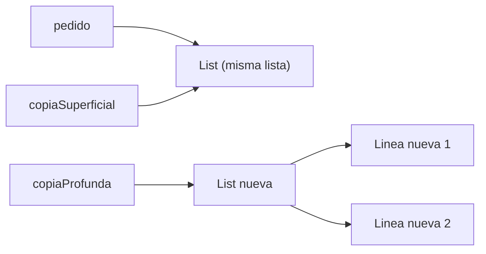
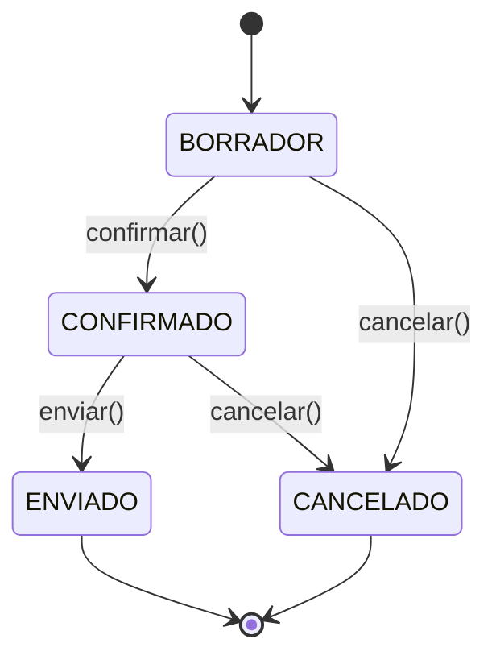
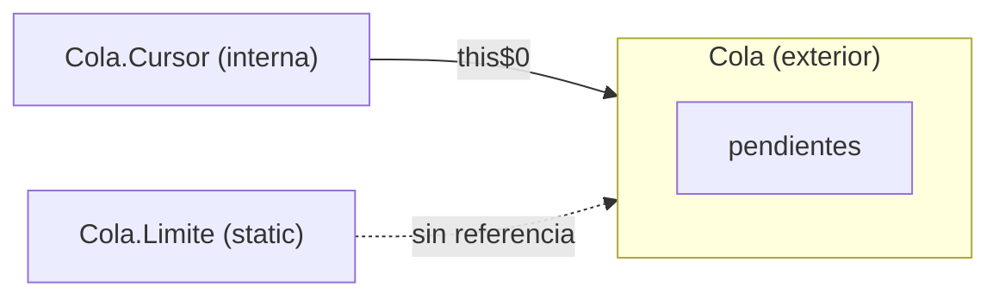

# Módulo 22: El objeto por dentro: copia, enums y tipos anidados

La igualdad (`equals`/`hashCode`) y las claves mutables se estudian antes de usar colecciones, en [M2 T2–T3](/curso/java/2); este módulo parte de ese `CodigoGuia`. Una copia que parecía independiente cambia con el original; un enum guardado por posición cambia de significado cuando alguien reordena sus constantes; y una clase interna mantiene vivo a su objeto exterior aunque ya nadie lo use. Este módulo construye el modelo de dominio de `pedidos-core` y provoca cada uno de esos fallos con el JDK real, usando solo `javac`, `javap` y `java`.

## Aprende construyendo

El proyecto es el modelo de pedidos de RutaFlow: líneas, estados y claves de búsqueda. Cada tema añade una pieza y la somete a una prueba que la rompe si la semántica es incorrecta. La regla del módulo: un objeto no se define por cómo se ve, sino por cómo responde a `equals`, `hashCode`, a una copia y a una referencia que lo retiene.


### Tema 1: Copia defensiva, copia superficial y clone · Intermedio · 40 min

<details open>
<summary><strong>Capa 1 — Lectura</strong></summary>

#### ► DE QUÉ TRATA
Este tema te guía por copia defensiva, copia superficial y clone con foco en comprensión antes de implementación.

#### ► LA IDEA EN UNA FRASE
**Entender copia defensiva, copia superficial y clone te permite tomar mejores decisiones técnicas.**

#### ► POR QUÉ EXISTE ESTO
Resuelve un problema real de diseño o implementación y evita decisiones a ciegas.

#### ► LA ANALOGÍA
Piensa en copia defensiva, copia superficial y clone como una herramienta de taller: útil cuando conoces su propósito y sus límites.
**Dónde se rompe la analogía:** en software, los efectos dependen del contexto, la escala y los trade-offs.

#### ► CÓMO FUNCIONA


#### ► LO QUE PUEDE SALIR MAL
| Síntoma | Causa probable | Arreglo |
|---|---|---|
| Copia defensiva, copia superficial y clone se aplica pero el resultado no mejora | Se usó sin medir el problema real | Mide antes y compara contra la alternativa simple |
| Aparece complejidad inesperada | Se adoptó la técnica sin comprender sus trade-offs | Vuelve a la sección de trade-offs y reduce el alcance |
| Falla en un caso límite | Se asumió un contexto que no se cumple | Prueba el caso límite y documenta cuándo NO usarlo |

#### ► TRADE-OFFS
| Opción | Cuándo usarla | Cuándo NO usarla |
|---|---|---|
| Usar Copia defensiva, copia superficial y clone | Cuando el problema coincide con su propósito y el beneficio es observable | Cuando agrega complejidad sin resolver un problema real |
| Alternativa más simple | Cuando el contexto es pequeño, estable o fácil de razonar | Cuando ya demostró no escalar o no cumplir el requisito |
| Postergar la decisión | Cuando falta evidencia del problema | Cuando el costo de esperar es mayor que el costo de probar |

#### ► CUÁNDO NO USAR ESTO
No uses copia defensiva, copia superficial y clone por defecto. Aplícalo cuando el problema lo justifique y puedas verificar el beneficio; si una alternativa más simple resuelve igual, prefiérela.

#### ► DE VUELTA A LA ANALOGÍA
Volviendo a la analogía: copia defensiva, copia superficial y clone funciona como el modelo inicial, pero recuerda dónde se rompe: en producción importan la evidencia, la escala y el costo de equivocarte.

#### ► LO QUE DEBES RECORDAR
- Copia defensiva, copia superficial y clone existe para resolver un problema específico.
- Mide antes de adoptar complejidad.
- Conoce el caso donde NO usarlo.
- Verifica con evidencia observable.

#### ► PREGUNTAS PARA PENSAR
1. ¿Qué problema concreto resuelve copia defensiva, copia superficial y clone en tu contexto?
2. ¿Cómo sabrías que copia defensiva, copia superficial y clone no está funcionando bien?
3. ¿Qué alternativa más simple considerarías antes de usar copia defensiva, copia superficial y clone?

</details>

<details>
<summary><strong>Capa 2 — Construcción</strong></summary>

#### Código y verificación


```java
// src/io/academia/modelo/Linea.java
package io.academia.modelo;

public final class Linea {
    private String producto;
    private int cantidad;

    public Linea(String producto, int cantidad) {
        this.producto = producto;
        this.cantidad = cantidad;
    }

    public void setCantidad(int cantidad) {
        this.cantidad = cantidad;
    }

    public int cantidad() {
        return cantidad;
    }

    public String producto() {
        return producto;
    }

    @Override
    public String toString() {
        return producto + " x" + cantidad;
    }
}
```

```java
// src/io/academia/modelo/Pedido.java
package io.academia.modelo;

import java.util.ArrayList;
import java.util.List;

public final class Pedido implements Cloneable {
    private final List<Linea> lineas;

    public Pedido(List<Linea> lineas) {
        this.lineas = lineas;
    }

    public List<Linea> lineas() {
        return lineas;
    }

    public Pedido copiaSuperficial() {
        return new Pedido(this.lineas);
    }

    public Pedido copiaProfunda() {
        List<Linea> copia = new ArrayList<>();
        for (Linea linea : lineas) {
            copia.add(new Linea(linea.producto(), linea.cantidad()));
        }
        return new Pedido(copia);
    }

    @Override
    public Pedido clone() {
        try {
            return (Pedido) super.clone();
        } catch (CloneNotSupportedException e) {
            throw new AssertionError(e);
        }
    }

    @Override
    public String toString() {
        return lineas.toString();
    }
}
```

```java
// src/io/academia/modelo/PedidoSeguro.java
package io.academia.modelo;

import java.util.ArrayList;
import java.util.List;

public final class PedidoSeguro {
    private final List<Linea> lineas;

    public PedidoSeguro(List<Linea> lineas) {
        List<Linea> copia = new ArrayList<>();
        for (Linea linea : lineas) {
            copia.add(new Linea(linea.producto(), linea.cantidad()));
        }
        this.lineas = List.copyOf(copia);
    }

    public List<Linea> lineas() {
        return lineas;
    }

    @Override
    public String toString() {
        return lineas.toString();
    }
}
```

```java
// src/Demo.java
import io.academia.modelo.Linea;
import io.academia.modelo.Pedido;
import io.academia.modelo.PedidoSeguro;

import java.util.ArrayList;
import java.util.List;

public class Demo {
    public static void main(String[] args) {
        List<Linea> original = new ArrayList<>();
        original.add(new Linea("teclado", 1));

        Pedido pedido = new Pedido(original);
        original.add(new Linea("raton", 2));
        System.out.println("alias en constructor = " + pedido.lineas());

        pedido.lineas().add(new Linea("monitor", 3));
        System.out.println("getter mutable = " + pedido.lineas());

        Pedido superficial = pedido.copiaSuperficial();
        Pedido profunda = pedido.copiaProfunda();
        pedido.lineas().get(0).setCantidad(99);

        System.out.println("original = " + pedido);
        System.out.println("superficial = " + superficial);
        System.out.println("profunda = " + profunda);
        System.out.println("misma lista = " + (superficial.lineas() == pedido.lineas()));
        System.out.println("misma linea = " + (profunda.lineas().get(0) == pedido.lineas().get(0)));

        PedidoSeguro seguro = new PedidoSeguro(pedido.lineas());
        pedido.lineas().get(1).setCantidad(500);
        System.out.println("pedido = " + pedido);
        System.out.println("seguro = " + seguro);
        try {
            seguro.lineas().add(new Linea("impresora", 1));
        } catch (UnsupportedOperationException e) {
            System.out.println("lista no modificable");
        }
    }
}
```

```bash
javac -d out $(find src -name '*.java')
java -cp out Demo
```

</details>

### Tema 2: Enums de dominio: estado, código y comportamiento · Intermedio · 45 min

<details open>
<summary><strong>Capa 1 — Lectura</strong></summary>

#### ► DE QUÉ TRATA
Este tema te guía por enums de dominio: estado, código y comportamiento con foco en comprensión antes de implementación.

#### ► LA IDEA EN UNA FRASE
**Entender enums de dominio: estado, código y comportamiento te permite tomar mejores decisiones técnicas.**

#### ► POR QUÉ EXISTE ESTO
Resuelve un problema real de diseño o implementación y evita decisiones a ciegas.

#### ► LA ANALOGÍA
Piensa en enums de dominio: estado, código y comportamiento como una herramienta de taller: útil cuando conoces su propósito y sus límites.
**Dónde se rompe la analogía:** en software, los efectos dependen del contexto, la escala y los trade-offs.

#### ► CÓMO FUNCIONA


#### ► LO QUE PUEDE SALIR MAL
| Síntoma | Causa probable | Arreglo |
|---|---|---|
| Enums de dominio: estado, código y comportamiento se aplica pero el resultado no mejora | Se usó sin medir el problema real | Mide antes y compara contra la alternativa simple |
| Aparece complejidad inesperada | Se adoptó la técnica sin comprender sus trade-offs | Vuelve a la sección de trade-offs y reduce el alcance |
| Falla en un caso límite | Se asumió un contexto que no se cumple | Prueba el caso límite y documenta cuándo NO usarlo |

#### ► TRADE-OFFS
| Opción | Cuándo usarla | Cuándo NO usarla |
|---|---|---|
| Usar Enums de dominio: estado, código y comportamiento | Cuando el problema coincide con su propósito y el beneficio es observable | Cuando agrega complejidad sin resolver un problema real |
| Alternativa más simple | Cuando el contexto es pequeño, estable o fácil de razonar | Cuando ya demostró no escalar o no cumplir el requisito |
| Postergar la decisión | Cuando falta evidencia del problema | Cuando el costo de esperar es mayor que el costo de probar |

#### ► CUÁNDO NO USAR ESTO
No uses enums de dominio: estado, código y comportamiento por defecto. Aplícalo cuando el problema lo justifique y puedas verificar el beneficio; si una alternativa más simple resuelve igual, prefiérela.

#### ► DE VUELTA A LA ANALOGÍA
Volviendo a la analogía: enums de dominio: estado, código y comportamiento funciona como el modelo inicial, pero recuerda dónde se rompe: en producción importan la evidencia, la escala y el costo de equivocarte.

#### ► LO QUE DEBES RECORDAR
- Enums de dominio: estado, código y comportamiento existe para resolver un problema específico.
- Mide antes de adoptar complejidad.
- Conoce el caso donde NO usarlo.
- Verifica con evidencia observable.

#### ► PREGUNTAS PARA PENSAR
1. ¿Qué problema concreto resuelve enums de dominio: estado, código y comportamiento en tu contexto?
2. ¿Cómo sabrías que enums de dominio: estado, código y comportamiento no está funcionando bien?
3. ¿Qué alternativa más simple considerarías antes de usar enums de dominio: estado, código y comportamiento?

</details>

<details>
<summary><strong>Capa 2 — Construcción</strong></summary>

#### Código y verificación


```java
// src/io/academia/modelo/EstadoPedido.java
package io.academia.modelo;

public enum EstadoPedido {
    BORRADOR(10) {
        @Override
        public boolean permiteEnvio() {
            return false;
        }
    },
    CONFIRMADO(20) {
        @Override
        public boolean permiteEnvio() {
            return true;
        }
    },
    ENVIADO(30) {
        @Override
        public boolean permiteEnvio() {
            return false;
        }
    },
    CANCELADO(40) {
        @Override
        public boolean permiteEnvio() {
            return false;
        }
    };

    private final int codigo;

    EstadoPedido(int codigo) {
        this.codigo = codigo;
    }

    public int codigo() {
        return codigo;
    }

    public abstract boolean permiteEnvio();

    public static String etiqueta(EstadoPedido estado) {
        return switch (estado) {
            case BORRADOR -> "Borrador editable";
            case CONFIRMADO -> "Listo para enviar";
            case ENVIADO -> "En camino";
            case CANCELADO -> "Cancelado";
        };
    }
}
```

```java
// src/Demo.java
import io.academia.modelo.EstadoPedido;

import java.util.EnumMap;
import java.util.EnumSet;
import java.util.Map;

public class Demo {
    public static void main(String[] args) {
        System.out.println("values identicos = " + (EstadoPedido.values() == EstadoPedido.values()));
        System.out.println("valueOf = " + EstadoPedido.valueOf("ENVIADO"));
        System.out.println("ordinal ENVIADO = " + EstadoPedido.ENVIADO.ordinal());
        System.out.println("codigo ENVIADO = " + EstadoPedido.ENVIADO.codigo());

        Map<EstadoPedido, Integer> conteo = new EnumMap<>(EstadoPedido.class);
        for (EstadoPedido estado : EstadoPedido.values()) {
            conteo.merge(estado, 1, Integer::sum);
        }
        conteo.merge(EstadoPedido.ENVIADO, 4, Integer::sum);
        System.out.println("conteo = " + conteo);

        EnumSet<EstadoPedido> abiertos = EnumSet.of(EstadoPedido.BORRADOR, EstadoPedido.CONFIRMADO);
        System.out.println("abiertos = " + abiertos);
        System.out.println("permite envio = " + EstadoPedido.CONFIRMADO.permiteEnvio());
        System.out.println("etiqueta = " + EstadoPedido.etiqueta(EstadoPedido.CANCELADO));
    }
}
```

```java
// src/DemoSerial.java
import io.academia.modelo.EstadoPedido;

import java.io.ByteArrayInputStream;
import java.io.ByteArrayOutputStream;
import java.io.ObjectInputStream;
import java.io.ObjectOutputStream;

public class DemoSerial {
    public static void main(String[] args) throws Exception {
        ByteArrayOutputStream bytes = new ByteArrayOutputStream();
        try (ObjectOutputStream salida = new ObjectOutputStream(bytes)) {
            salida.writeObject(EstadoPedido.ENVIADO);
        }
        try (ObjectInputStream entrada = new ObjectInputStream(new ByteArrayInputStream(bytes.toByteArray()))) {
            Object leido = entrada.readObject();
            System.out.println("leido = " + leido);
            System.out.println("misma instancia = " + (leido == EstadoPedido.ENVIADO));
        }
    }
}
```

```bash
javac -d out $(find src -name '*.java')
java -cp out Demo
java -cp out DemoSerial
```

```text
values identicos = false
valueOf = ENVIADO
ordinal ENVIADO = 2
codigo ENVIADO = 30
conteo = {BORRADOR=1, CONFIRMADO=1, ENVIADO=5, CANCELADO=1}
abiertos = [BORRADOR, CONFIRMADO]
permite envio = true
etiqueta = Cancelado
leido = ENVIADO
misma instancia = true
```

</details>

### Tema 3: Clases anidadas, this$0 y la referencia que retiene · Avanzado · 45 min

<details open>
<summary><strong>Capa 1 — Lectura</strong></summary>

#### ► DE QUÉ TRATA
Este tema te guía por clases anidadas, this$0 y la referencia que retiene con foco en comprensión antes de implementación.

#### ► LA IDEA EN UNA FRASE
**Entender clases anidadas, this$0 y la referencia que retiene te permite tomar mejores decisiones técnicas.**

#### ► POR QUÉ EXISTE ESTO
Resuelve un problema real de diseño o implementación y evita decisiones a ciegas.

#### ► LA ANALOGÍA
Piensa en clases anidadas, this$0 y la referencia que retiene como una herramienta de taller: útil cuando conoces su propósito y sus límites.
**Dónde se rompe la analogía:** en software, los efectos dependen del contexto, la escala y los trade-offs.

#### ► CÓMO FUNCIONA


#### ► LO QUE PUEDE SALIR MAL
| Síntoma | Causa probable | Arreglo |
|---|---|---|
| Clases anidadas, this$0 y la referencia que retiene se aplica pero el resultado no mejora | Se usó sin medir el problema real | Mide antes y compara contra la alternativa simple |
| Aparece complejidad inesperada | Se adoptó la técnica sin comprender sus trade-offs | Vuelve a la sección de trade-offs y reduce el alcance |
| Falla en un caso límite | Se asumió un contexto que no se cumple | Prueba el caso límite y documenta cuándo NO usarlo |

#### ► TRADE-OFFS
| Opción | Cuándo usarla | Cuándo NO usarla |
|---|---|---|
| Usar Clases anidadas, this$0 y la referencia que retiene | Cuando el problema coincide con su propósito y el beneficio es observable | Cuando agrega complejidad sin resolver un problema real |
| Alternativa más simple | Cuando el contexto es pequeño, estable o fácil de razonar | Cuando ya demostró no escalar o no cumplir el requisito |
| Postergar la decisión | Cuando falta evidencia del problema | Cuando el costo de esperar es mayor que el costo de probar |

#### ► CUÁNDO NO USAR ESTO
No uses clases anidadas, this$0 y la referencia que retiene por defecto. Aplícalo cuando el problema lo justifique y puedas verificar el beneficio; si una alternativa más simple resuelve igual, prefiérela.

#### ► DE VUELTA A LA ANALOGÍA
Volviendo a la analogía: clases anidadas, this$0 y la referencia que retiene funciona como el modelo inicial, pero recuerda dónde se rompe: en producción importan la evidencia, la escala y el costo de equivocarte.

#### ► LO QUE DEBES RECORDAR
- Clases anidadas, this$0 y la referencia que retiene existe para resolver un problema específico.
- Mide antes de adoptar complejidad.
- Conoce el caso donde NO usarlo.
- Verifica con evidencia observable.

#### ► PREGUNTAS PARA PENSAR
1. ¿Qué problema concreto resuelve clases anidadas, this$0 y la referencia que retiene en tu contexto?
2. ¿Cómo sabrías que clases anidadas, this$0 y la referencia que retiene no está funcionando bien?
3. ¿Qué alternativa más simple considerarías antes de usar clases anidadas, this$0 y la referencia que retiene?

</details>

<details>
<summary><strong>Capa 2 — Construcción</strong></summary>

#### Código y verificación


```java
// src/io/academia/modelo/Cola.java
package io.academia.modelo;

import java.util.ArrayList;
import java.util.List;

public final class Cola {
    private final List<String> pendientes = new ArrayList<>();

    public void encolar(String valor) {
        pendientes.add(valor);
    }

    public int tamano() {
        return pendientes.size();
    }

    public final class Cursor {
        private int posicion;

        public String siguiente() {
            return pendientes.get(posicion++);
        }
    }

    public static final class Limite {
        private final int maximo;

        public Limite(int maximo) {
            this.maximo = maximo;
        }

        public boolean excedido(int actual) {
            return actual > maximo;
        }
    }

    public Runnable anonimo() {
        return new Runnable() {
            @Override
            public void run() {
                System.out.println("anonimo this = " + this.getClass().getName());
            }
        };
    }

    public Runnable lambda() {
        return () -> System.out.println("lambda this = " + this.getClass().getName());
    }
}
```

```java
// src/Demo.java
import io.academia.modelo.Cola;

import java.lang.reflect.Field;

public class Demo {
    public static void main(String[] args) {
        Cola cola = new Cola();
        cola.encolar("A");
        cola.encolar("B");

        Cola.Cursor cursor = cola.new Cursor();
        System.out.println("siguiente = " + cursor.siguiente());

        Cola.Limite limite = new Cola.Limite(2);
        System.out.println("excedido = " + limite.excedido(3));

        for (Field campo : Cola.Cursor.class.getDeclaredFields()) {
            System.out.println("Cursor campo = " + campo.getName() + " : " + campo.getType().getSimpleName());
        }
        for (Field campo : Cola.Limite.class.getDeclaredFields()) {
            System.out.println("Limite campo = " + campo.getName() + " : " + campo.getType().getSimpleName());
        }

        cola.anonimo().run();
        cola.lambda().run();
    }
}
```

```bash
javac -d out $(find src -name '*.java')
java -cp out Demo
javap -p -cp out 'io.academia.modelo.Cola$Cursor'
javap -p -cp out 'io.academia.modelo.Cola$Limite'
```

```text
siguiente = A
excedido = true
Cursor campo = posicion : int
Cursor campo = this$0 : Cola
Limite campo = maximo : int
anonimo this = io.academia.modelo.Cola$1
lambda this = io.academia.modelo.Cola
```

```text
Compiled from "Cola.java"
public final class io.academia.modelo.Cola$Cursor {
  private int posicion;
  final io.academia.modelo.Cola this$0;
  public io.academia.modelo.Cola$Cursor(io.academia.modelo.Cola);
  public java.lang.String siguiente();
}
```

</details>
