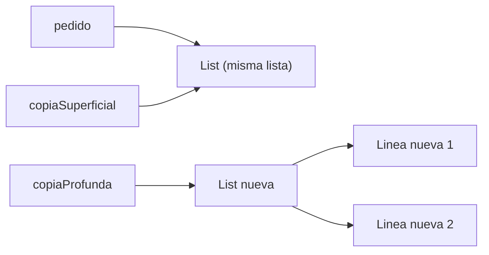
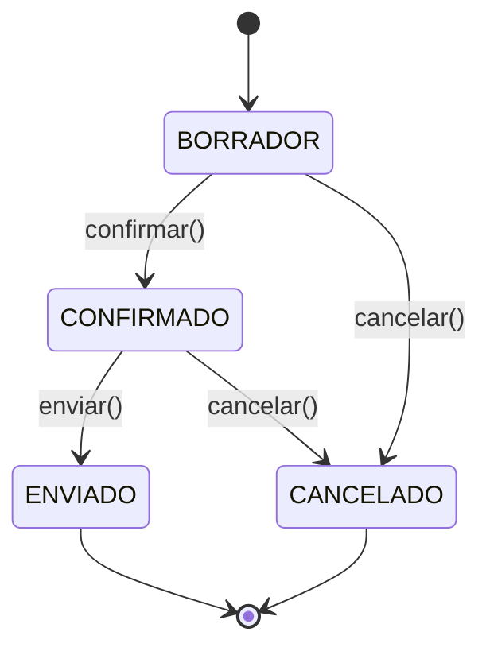
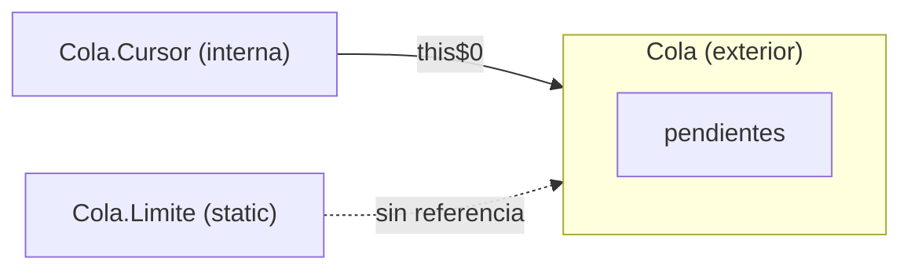

# Módulo 22: El objeto por dentro: copia, enums y tipos anidados

La igualdad (`equals`/`hashCode`) y las claves mutables se estudian antes de usar colecciones, en [M2 T2–T3](/curso/java/2); este módulo parte de ese `CodigoGuia`. Una copia que parecía independiente cambia con el original; un enum guardado por posición cambia de significado cuando alguien reordena sus constantes; y una clase interna mantiene vivo a su objeto exterior aunque ya nadie lo use. Este módulo construye el modelo de dominio de `pedidos-core` y provoca cada uno de esos fallos con el JDK real, usando solo `javac`, `javap` y `java`.

## Aprende construyendo

El proyecto es el modelo de pedidos de RutaFlow: líneas, estados y claves de búsqueda. Cada tema añade una pieza y la somete a una prueba que la rompe si la semántica es incorrecta. La regla del módulo: un objeto no se define por cómo se ve, sino por cómo responde a `equals`, `hashCode`, a una copia y a una referencia que lo retiene.

### Tema 1: Copia defensiva, copia superficial y clone · Intermedio · 40 min

**Prerrequisito:** Tema 2 del Módulo 2 y Módulo 2 (colecciones y `List`).
**Al terminar podrás:** demostrar cómo un constructor y un getter filtran la lista interna, distinguir copia superficial de profunda, y explicar por qué una copia defensiva con copia de elementos es preferible a `clone()`.

#### Aprende

**¿Por qué es importante?** Un objeto que recibe una lista y la guarda tal cual no tiene una lista: tiene un alias de la lista de otro. Quien conserve la referencia original puede añadir, borrar o modificar elementos sin pasar por el objeto. Lo mismo ocurre con un getter que devuelve la lista interna. El fallo no aparece en la clase que lo escribió: aparece semanas después, cuando otro componente muta la lista y el pedido cambia sin que nadie lo haya tocado.

**Mapa de subtemas críticos**

| Subtema | Papel | Evidencia |
|---|---|---|
| Alias por constructor y por getter | Prerrequisito | `alias en constructor = [teclado x1, raton x2]` tras `original.add` y `getter mutable` con `monitor` añadido por el getter. |
| Copia superficial comparte elementos | Núcleo | `misma lista = true` y la copia superficial pasa a `teclado x99` cuando el original cambia. |
| Copia profunda duplica cada elemento | Núcleo | `misma linea = false` y `profunda = [teclado x1, ...]` pese al cambio a 99 en el original. |
| `List.copyOf` protege estructura, no elementos | Variante | `PedidoSeguro` copia cada `Linea` antes de `List.copyOf`; `seguro` conserva `raton x2` y el `add` falla. |
| `clone()` es copia superficial con `Cloneable` | Error frecuente | El fallo deliberado muestra `misma lista = true` tras `super.clone()`. |
| `List.copyOf` devuelve lista no modificable | Diagnóstico | El `add` sobre `seguro.lineas()` imprime `lista no modificable`. |
| Constructor de copia frente a `clone` | Decisión | La sección de decisión y el ejercicio 2 sustituyen `Cloneable` por un constructor de copia. |

Cada fila tiene su explicación individual a continuación.

**Alias por constructor y por getter (prerrequisito).** Guardar una lista recibida tal cual, o devolverla desde un getter, crea un alias: quien conserve la referencia original edita el estado del objeto sin pasar por su API. El demo lo expone en dos frentes: `original.add(new Linea("raton", 2))` después de construir el `Pedido` hace que el pedido vea `raton`, y `pedido.lineas().add(...)` mete `monitor` desde el getter. Reconocer ambas fugas es el punto de partida.

**Copia superficial comparte elementos (núcleo).** `new ArrayList<>(lineas)` crea otra lista, pero sus elementos siguen siendo los mismos objetos; `copiaSuperficial` ni siquiera copia la lista, pasa la misma referencia. Por eso `misma lista = true` y, al cambiar la cantidad de la línea 0 a 99 en el original, la copia superficial también muestra `teclado x99`. Es el mecanismo que distingue estructura de contenido.

**Copia profunda duplica cada elemento (núcleo).** Una copia profunda construye una `Linea` nueva por cada elemento, de modo que el grafo queda independiente. `copiaProfunda` lo hace en el bucle y el resultado es `misma linea = false`: el cambio a 99 en el original no afecta a `profunda`, que conserva `teclado x1`. Copiar la estructura sin copiar los elementos solo da media protección.

**`List.copyOf` protege estructura, no elementos (variante).** `List.copyOf` devuelve una lista no modificable pero no clona sus elementos; para una copia completa hay que copiar cada elemento antes. `PedidoSeguro` lo hace: construye `Linea` nuevas y luego envuelve con `List.copyOf`, así tras cambiar `raton` a 500 en el original la copia conserva `raton x2`. La inmutabilidad total exige las dos operaciones, no solo la envoltura.

**`clone()` es copia superficial con `Cloneable` (error frecuente).** `Object.clone()` copia campo a campo: los campos de referencia se comparten, igual que en una copia superficial, y además obliga a `Cloneable` con su excepción comprobada. El fallo deliberado lo prueba: tras `super.clone()`, `misma lista = true` y el clon cambia cuando se muta la línea 0 del original. `clone()` no es una copia profunda por mucho que lo parezca.

**`List.copyOf` devuelve lista no modificable (diagnóstico).** Además de no copiar elementos, `List.copyOf` entrega una vista que rechaza mutaciones estructurales. El demo lo evidencia: `seguro.lineas().add(new Linea("impresora", 1))` lanza `UnsupportedOperationException` y se imprime `lista no modificable`. Esa excepción es la señal diagnóstica de que el getter ya no filtra una lista editable.

**Constructor de copia frente a `clone` (decisión).** La corrección profesional no es parchear `clone` para copiar la lista, sino eliminar `Cloneable` y exponer un constructor de copia o un método `copia()` explícito, sin excepciones comprobadas ni herencia implícita. El ejercicio 2 lo pide y la sección de decisión lo recomienda. Es la decisión que cierra el tema: expresar la copia donde se lee, no delegarla en un contrato frágil.

**Conceptos clave:** alias, copia superficial, copia profunda, copia defensiva, `List.copyOf`, `clone`.

Hay dos decisiones independientes. La primera es copiar la estructura: `new ArrayList<>(lineas)` crea otra lista, pero sus elementos siguen siendo los mismos objetos. La segunda es copiar los elementos: si cada `Linea` es mutable, una copia profunda debe crear una `Linea` nueva por cada una. `List.copyOf` resuelve la estructura con una lista no modificable, pero no copia los elementos; para que la copia sea completa, los elementos deben ser inmutables o copiarse uno a uno.

`clone()` promete menos de lo que parece. `Object.clone()` crea una copia campo a campo: los campos de tipo referencia se comparten, exactamente igual que en una copia superficial. Además exige implementar `Cloneable` —una interfaz vacía que solo cambia el comportamiento de `clone`—, lanza una excepción comprobada si se olvida, ignora los constructores y se rompe con campos `final` en jerarquías. Un constructor de copia expresa lo mismo sin excepciones comprobadas y sin herencia implícita.

**Analogía:** fotocopiar una carpeta puede significar dos cosas: copiar la carpeta con los mismos documentos dentro —si alguien escribe sobre un documento, ambas copias lo reflejan— o fotocopiar también cada documento. `clone()` hace lo primero y a menudo se confunde con lo segundo.

**Diagrama:**



#### Practica

**Demo paso a paso.** Añade el modelo con constructor que guarda la referencia, getter que la devuelve y las dos copias:

```java
// src/io/academia/modelo/Linea.java
package io.academia.modelo;

public final class Linea {
    private String producto;
    private int cantidad;

    public Linea(String producto, int cantidad) {
        this.producto = producto;
        this.cantidad = cantidad;
    }

    public void setCantidad(int cantidad) {
        this.cantidad = cantidad;
    }

    public int cantidad() {
        return cantidad;
    }

    public String producto() {
        return producto;
    }

    @Override
    public String toString() {
        return producto + " x" + cantidad;
    }
}
```

```java
// src/io/academia/modelo/Pedido.java
package io.academia.modelo;

import java.util.ArrayList;
import java.util.List;

public final class Pedido implements Cloneable {
    private final List<Linea> lineas;

    public Pedido(List<Linea> lineas) {
        this.lineas = lineas;
    }

    public List<Linea> lineas() {
        return lineas;
    }

    public Pedido copiaSuperficial() {
        return new Pedido(this.lineas);
    }

    public Pedido copiaProfunda() {
        List<Linea> copia = new ArrayList<>();
        for (Linea linea : lineas) {
            copia.add(new Linea(linea.producto(), linea.cantidad()));
        }
        return new Pedido(copia);
    }

    @Override
    public Pedido clone() {
        try {
            return (Pedido) super.clone();
        } catch (CloneNotSupportedException e) {
            throw new AssertionError(e);
        }
    }

    @Override
    public String toString() {
        return lineas.toString();
    }
}
```

```java
// src/io/academia/modelo/PedidoSeguro.java
package io.academia.modelo;

import java.util.ArrayList;
import java.util.List;

public final class PedidoSeguro {
    private final List<Linea> lineas;

    public PedidoSeguro(List<Linea> lineas) {
        List<Linea> copia = new ArrayList<>();
        for (Linea linea : lineas) {
            copia.add(new Linea(linea.producto(), linea.cantidad()));
        }
        this.lineas = List.copyOf(copia);
    }

    public List<Linea> lineas() {
        return lineas;
    }

    @Override
    public String toString() {
        return lineas.toString();
    }
}
```

```java
// src/Demo.java
import io.academia.modelo.Linea;
import io.academia.modelo.Pedido;
import io.academia.modelo.PedidoSeguro;

import java.util.ArrayList;
import java.util.List;

public class Demo {
    public static void main(String[] args) {
        List<Linea> original = new ArrayList<>();
        original.add(new Linea("teclado", 1));

        Pedido pedido = new Pedido(original);
        original.add(new Linea("raton", 2));
        System.out.println("alias en constructor = " + pedido.lineas());

        pedido.lineas().add(new Linea("monitor", 3));
        System.out.println("getter mutable = " + pedido.lineas());

        Pedido superficial = pedido.copiaSuperficial();
        Pedido profunda = pedido.copiaProfunda();
        pedido.lineas().get(0).setCantidad(99);

        System.out.println("original = " + pedido);
        System.out.println("superficial = " + superficial);
        System.out.println("profunda = " + profunda);
        System.out.println("misma lista = " + (superficial.lineas() == pedido.lineas()));
        System.out.println("misma linea = " + (profunda.lineas().get(0) == pedido.lineas().get(0)));

        PedidoSeguro seguro = new PedidoSeguro(pedido.lineas());
        pedido.lineas().get(1).setCantidad(500);
        System.out.println("pedido = " + pedido);
        System.out.println("seguro = " + seguro);
        try {
            seguro.lineas().add(new Linea("impresora", 1));
        } catch (UnsupportedOperationException e) {
            System.out.println("lista no modificable");
        }
    }
}
```

```bash
javac -d out $(find src -name '*.java')
java -cp out Demo
```

**Resultado esperado:** el alias se ve en las tres capas —constructor, getter y copia superficial— y la copia defensiva queda aislada:

```text
alias en constructor = [teclado x1, raton x2]
getter mutable = [teclado x1, raton x2, monitor x3]
original = [teclado x99, raton x2, monitor x3]
superficial = [teclado x99, raton x2, monitor x3]
profunda = [teclado x1, raton x2, monitor x3]
misma lista = true
misma linea = false
pedido = [teclado x99, raton x500, monitor x3]
seguro = [teclado x99, raton x2, monitor x3]
lista no modificable
```

**Explicación línea por línea:** `original.add` después del constructor demuestra que `Pedido` guardó la lista, no una copia: el pedido ve `raton` sin que nadie lo añadiera por su API. `pedido.lineas().add` demuestra lo mismo desde el getter. `copiaSuperficial` pasa la misma lista y `misma lista = true`; cambiar la cantidad de la línea 0 en el original cambia también la copia superficial. `copiaProfunda` crea `Linea` nuevas y `misma linea = false`; el cambio a 99 no la afecta. `PedidoSeguro` copia cada elemento y envuelve el resultado con `List.copyOf`, que devuelve una lista no modificable: tras cambiar `raton` a 500 en el pedido original, la copia conserva 2, y el `add` lanza `UnsupportedOperationException`.

**Fallo deliberado:** añade `Pedido clon = pedido.clone();` y modifica la línea 0 del original. El clon cambia también, porque `super.clone()` copia el campo `lineas` por referencia. La ejecución aislada del clon lo confirma:

```text
clon = [teclado x1, raton x2]
misma lista = true
```

`clone()` no es una copia profunda; es una copia superficial con una interfaz incómoda. La corrección no es sobrescribir `clone` para copiar la lista, sino eliminar `Cloneable` y exponer un constructor de copia o un método `copia()` explícito.

**Ejercicios.**

1. Convierte `Linea` en un `record` inmutable y comprueba que `List.copyOf` basta para que `PedidoSeguro` sea inmutable de extremo a extremo.
2. Escribe un `Pedido` con constructor de copia que reciba otro `Pedido` y demuestre que no necesita `Cloneable`.
3. Añade un campo `List<String> etiquetas` a `Linea` y reproduce el fallo de la copia superficial un nivel más abajo: una lista dentro de un elemento.

**Pista:** `List.copyOf` rechaza elementos nulos y devuelve una vista no modificable, pero no copia los elementos. La inmutabilidad total exige que cada elemento sea inmutable; sin eso, solo has protegido la estructura.

**Completa el código:** rellena el espacio con la expresión que copia la estructura de la lista sin compartirla:

```java
this.lineas = ______;
```

**Reto de memoria:** cierra este documento y escribe, solo de memoria, un `Pedido` con constructor que copia la lista y cada línea, un getter no modificable y un método `copia()`. Explica en dos frases por qué no usaste `clone`.

#### Aplica

**Reto abierto.** Endurece `pedidos-core` para que ninguna referencia externa pueda modificar un pedido ya construido: constructor que copia, getter no modificable, elementos inmutables y un método `conCantidad(indice, cantidad)` que devuelva un pedido nuevo. Demuestra con ejecuciones que el original no cambia y que el nuevo sí.

**Checklist de salida.**

- [ ] El constructor no guarda ninguna referencia recibida.
- [ ] El getter devuelve una colección no modificable o una copia.
- [ ] Los elementos de la colección son inmutables o se copian uno a uno.
- [ ] `Cloneable` no aparece en el modelo.
- [ ] Un intento de mutación externa falla con una excepción concreta y documentada.

**Si falla.** Si `seguro` cambia al mutar el original, la copia fue solo de la lista: copia también los elementos. Si `List.copyOf` lanza `NullPointerException`, hay un elemento nulo; valida antes o usa `List.of` con datos no nulos. Si el `add` sobre el getter no lanza, el getter sigue devolviendo la lista interna. Si `clone` no compila en una subclase, el problema es el campo `final` o la ausencia de `Cloneable`: no lo parches, elimina `clone`.

**Siguiente paso:** con el estado protegido, el siguiente tema modela los estados posibles de un pedido con un enum que lleva comportamiento y código propio.

**Errores comunes:** confundir copiar la lista con copiar los elementos; devolver `Collections.unmodifiableList` sobre una lista que otro conserva; creer que `record` con `List` es inmutable; implementar `clone` sin llamar a `super.clone`; usar `clone` en una jerarquía con campos `final`.

**Límites y decisión de uso:** copiar en cada llamada tiene un coste. En estructuras grandes y de solo lectura, una lista persistente o una vista no modificable compartida puede ser mejor, siempre que nadie conserve la referencia original. La copia defensiva se decide por frontera: en el constructor y en el getter de un objeto de dominio, sí; en bucles internos de cálculo, no.

**Fuente oficial revisada el 2026-11-01:** [Java SE 27 API — java.lang.Object#clone()](https://docs.oracle.com/en/java/javase/27/docs/api/java.base/java/lang/Object.html#clone()).

**Transferencia al proyecto integrador:** el constructor de copia de `Pedido` es el patrón que el proyecto integrador del Módulo 13 aplicará a sus agregados antes de publicarlos por una API.

### Tema 2: Enums de dominio: estado, código y comportamiento · Intermedio · 45 min

**Prerrequisito:** Módulo 0 (`switch`) y Tema 3 del Módulo 2.
**Al terminar podrás:** modelar un estado con campos, constructor y métodos por constante, persistir un código estable en lugar de `ordinal()`, usar `EnumMap` y `EnumSet` con sus garantías, y explicar por qué un enum serializado vuelve como la misma instancia.

#### Aprende

**¿Por qué es importante?** Un estado representado con enteros o cadenas acepta cualquier valor: `estado = 7` compila y solo falla cuando alguien lo interpreta. Un `enum` restringe el conjunto de valores en tiempo de compilación, pero eso es solo el principio: puede llevar campos, constructor, métodos y comportamiento distinto por constante. Lo que no puede hacer es cambiar de forma: sus instancias son fijas, se crean una vez y son únicas. Esa unicidad resuelve de paso la serialización y la comparación con `==`.

**Mapa de subtemas críticos**

| Subtema | Papel | Evidencia |
|---|---|---|
| Campo propio y constructor privado | Prerrequisito | `EstadoPedido(int codigo)` asigna `codigo`; `codigo ENVIADO = 30`. |
| Comportamiento por constante con método abstracto | Núcleo | Cada constante implementa `permiteEnvio()`; `permite envio = true` para `CONFIRMADO`. |
| `ordinal()` inestable frente a código estable | Error frecuente | `ordinal ENVIADO = 2` frente a `codigo ENVIADO = 30`; reordenar cambia solo el primero. |
| `switch` exhaustivo sin `default` | Decisión | `etiqueta = Cancelado` sale de un `switch` que cubre las cuatro constantes. |
| `values()` devuelve un arreglo nuevo | Límite | `values identicos = false` en dos llamadas seguidas. |
| `EnumMap` y `EnumSet` con orden de declaración | Variante | `conteo = {BORRADOR=1, CONFIRMADO=1, ENVIADO=5, CANCELADO=1}` y `abiertos = [BORRADOR, CONFIRMADO]`. |
| Serialización por nombre devuelve la misma instancia | Diagnóstico | `DemoSerial` imprime `misma instancia = true`. |

Cada fila tiene su explicación individual a continuación.

**Campo propio y constructor privado (prerrequisito).** Un enum no es solo un conjunto de nombres: cada constante puede llevar estado propio inyectado por un constructor implícitamente privado. `EstadoPedido(int codigo)` guarda un `codigo` final por constante, y el demo lo lee con `codigo ENVIADO = 30`. Ese campo es la base para no depender de la posición.

**Comportamiento por constante con método abstracto (núcleo).** Declarar un método abstracto en el enum obliga a cada constante a aportar su cuerpo, que el compilador materializa como una subclase anónima. `permiteEnvio()` devuelve `true` solo en `CONFIRMADO`, y el demo lo confirma con `permite envio = true`. Así el estado lleva su propia regla en lugar de dispersarla en condicionales externas.

**`ordinal()` inestable frente a código estable (error frecuente).** `ordinal()` es la posición en la declaración, de modo que reordenar constantes cambia el número sin cambiar el significado; persistirlo corrompe datos antiguos en silencio. El demo pone lado a lado `ordinal ENVIADO = 2` y `codigo ENVIADO = 30`: insertar `CANCELADO` antes de `ENVIADO` movería el ordinal a 3 y leería un pedido viejo como `CANCELADO`, mientras el código 30 permanece. La regla profesional es persistir `name()` o un código propio, nunca el ordinal.

**`switch` exhaustivo sin `default` (decisión).** Un `switch` que enumera todas las constantes y omite `default` convierte al compilador en guardián: añadir una quinta constante obliga a actualizarlo. `etiqueta` lo aplica y produce `etiqueta = Cancelado`; agregar `default` desactivaría ese aviso. La decisión profesional es renunciar al `default` para que las ramas incompletas fallen en compilación, no en producción.

**`values()` devuelve un arreglo nuevo (límite).** `values()` construye un arreglo fresco en cada invocación, por lo que dos llamadas no son el mismo objeto y modificar el resultado no altera el enum. El demo lo evidencia con `values identicos = false`. Conocer este límite evita tanto fugas de mutabilidad como el coste de llamarlo dentro de un bucle caliente.

**`EnumMap` y `EnumSet` con orden de declaración (variante).** `EnumMap` y `EnumSet` usan el ordinal internamente pero garantizan el orden de declaración y rechazan claves de otro enum. El demo lo muestra con `conteo = {BORRADOR=1, CONFIRMADO=1, ENVIADO=5, CANCELADO=1}` y `abiertos = [BORRADOR, CONFIRMADO]`, ambos en el orden en que se declararon las constantes. Son la variante optimizada frente a un `HashMap` o `HashSet` genérico.

**Serialización por nombre devuelve la misma instancia (diagnóstico).** La serialización de un enum escribe su nombre y la lectura lo resuelve con `valueOf`, así que nunca se duplica una constante al deserializar. `DemoSerial` lo comprueba con `misma instancia = true` tras un ciclo de escritura y lectura. De ahí se deduce que añadir constantes es compatible con datos antiguos, pero renombrarlas rompe la lectura.

**Conceptos clave:** constante de enum, campo final, cuerpo por constante, `ordinal`, `values`, `valueOf`, `EnumMap`, `EnumSet`, exhaustividad.

Un enum es una clase `final` con un conjunto cerrado de instancias. El constructor es implícitamente privado; cada constante puede aportar un cuerpo que sobrescribe un método abstracto, y ese cuerpo genera una subclase anónima. `values()` devuelve un arreglo nuevo en cada llamada —modificarlo no afecta al enum—, `valueOf` convierte un nombre exacto y lanza `IllegalArgumentException` si no existe. `ordinal()` es la posición en la declaración: sirve para ordenar dentro del enum, no como identificador persistente, porque reordenar las constantes cambia el número sin cambiar el significado.

`EnumMap` y `EnumSet` están optimizados para enums: usan el ordinal internamente, pero garantizan orden de declaración y rechazan claves ajenas. Un enum serializado se lee como la misma instancia porque la serialización escribe el nombre y la JVM lo resuelve con `valueOf`; por eso un enum nunca se duplica al deserializar y por eso añadir constantes es compatible con datos antiguos, mientras que renombrarlas no.

**Analogía:** un formulario con un conjunto fijo de estados impresos y una regla distinta en cada casilla. El número de formulario —`ordinal`— depende de dónde se imprimió la casilla; el código impreso —el campo propio— es el que se cita en un trámite. Si mañana se reimprime el formulario con las casillas en otro orden, los trámites antiguos siguen citando el código, no la posición.

**Diagrama:**



#### Practica

**Demo paso a paso.** Crea el enum con código propio, comportamiento por constante y un `switch` exhaustivo:

```java
// src/io/academia/modelo/EstadoPedido.java
package io.academia.modelo;

public enum EstadoPedido {
    BORRADOR(10) {
        @Override
        public boolean permiteEnvio() {
            return false;
        }
    },
    CONFIRMADO(20) {
        @Override
        public boolean permiteEnvio() {
            return true;
        }
    },
    ENVIADO(30) {
        @Override
        public boolean permiteEnvio() {
            return false;
        }
    },
    CANCELADO(40) {
        @Override
        public boolean permiteEnvio() {
            return false;
        }
    };

    private final int codigo;

    EstadoPedido(int codigo) {
        this.codigo = codigo;
    }

    public int codigo() {
        return codigo;
    }

    public abstract boolean permiteEnvio();

    public static String etiqueta(EstadoPedido estado) {
        return switch (estado) {
            case BORRADOR -> "Borrador editable";
            case CONFIRMADO -> "Listo para enviar";
            case ENVIADO -> "En camino";
            case CANCELADO -> "Cancelado";
        };
    }
}
```

```java
// src/Demo.java
import io.academia.modelo.EstadoPedido;

import java.util.EnumMap;
import java.util.EnumSet;
import java.util.Map;

public class Demo {
    public static void main(String[] args) {
        System.out.println("values identicos = " + (EstadoPedido.values() == EstadoPedido.values()));
        System.out.println("valueOf = " + EstadoPedido.valueOf("ENVIADO"));
        System.out.println("ordinal ENVIADO = " + EstadoPedido.ENVIADO.ordinal());
        System.out.println("codigo ENVIADO = " + EstadoPedido.ENVIADO.codigo());

        Map<EstadoPedido, Integer> conteo = new EnumMap<>(EstadoPedido.class);
        for (EstadoPedido estado : EstadoPedido.values()) {
            conteo.merge(estado, 1, Integer::sum);
        }
        conteo.merge(EstadoPedido.ENVIADO, 4, Integer::sum);
        System.out.println("conteo = " + conteo);

        EnumSet<EstadoPedido> abiertos = EnumSet.of(EstadoPedido.BORRADOR, EstadoPedido.CONFIRMADO);
        System.out.println("abiertos = " + abiertos);
        System.out.println("permite envio = " + EstadoPedido.CONFIRMADO.permiteEnvio());
        System.out.println("etiqueta = " + EstadoPedido.etiqueta(EstadoPedido.CANCELADO));
    }
}
```

```java
// src/DemoSerial.java
import io.academia.modelo.EstadoPedido;

import java.io.ByteArrayInputStream;
import java.io.ByteArrayOutputStream;
import java.io.ObjectInputStream;
import java.io.ObjectOutputStream;

public class DemoSerial {
    public static void main(String[] args) throws Exception {
        ByteArrayOutputStream bytes = new ByteArrayOutputStream();
        try (ObjectOutputStream salida = new ObjectOutputStream(bytes)) {
            salida.writeObject(EstadoPedido.ENVIADO);
        }
        try (ObjectInputStream entrada = new ObjectInputStream(new ByteArrayInputStream(bytes.toByteArray()))) {
            Object leido = entrada.readObject();
            System.out.println("leido = " + leido);
            System.out.println("misma instancia = " + (leido == EstadoPedido.ENVIADO));
        }
    }
}
```

```bash
javac -d out $(find src -name '*.java')
java -cp out Demo
java -cp out DemoSerial
```

**Resultado esperado:** el ordinal y el código se separan, `values()` entrega un arreglo nuevo y el enum deserializado es la misma instancia:

```text
values identicos = false
valueOf = ENVIADO
ordinal ENVIADO = 2
codigo ENVIADO = 30
conteo = {BORRADOR=1, CONFIRMADO=1, ENVIADO=5, CANCELADO=1}
abiertos = [BORRADOR, CONFIRMADO]
permite envio = true
etiqueta = Cancelado
leido = ENVIADO
misma instancia = true
```

**Explicación línea por línea:** `values()` construye un arreglo nuevo cada vez, por eso dos llamadas no son el mismo objeto aunque contengan las mismas constantes; modificarlo no altera el enum. `valueOf("ENVIADO")` resuelve por nombre exacto. `ordinal()` devuelve 2 porque hay dos constantes antes; `codigo()` devuelve 30 porque el campo se declaró así: si mañana se reordena la declaración, el ordinal cambia y el código no. `EnumMap` itera en orden de declaración y cuenta cada estado; `EnumSet.of` mantiene el orden y la pertenencia. `switch` cubre las cuatro constantes sin `default`: si se añade una quinta, el compilador exige actualizarlo. La serialización escribe el nombre y la lectura devuelve la constante existente, por eso `misma instancia = true`.

**Fallo deliberado:** persistir `ordinal()` en lugar de `codigo()` es el fallo. Un pedido guardado como `2` significa `ENVIADO` hoy; si en la versión 2 se declara `CANCELADO` antes de `ENVIADO`, el ordinal de `ENVIADO` pasa a 3 y el pedido antiguo se lee como `CANCELADO` sin ningún error. La prueba está en las dos líneas `ordinal = 2` y `codigo = 30`: el primero depende de la posición, el segundo de una decisión explícita. Añadir una constante al final no rompe nada; insertarla en medio cambia todos los ordinales posteriores.

**Ejercicios.**

1. Añade un método `siguiente()` que devuelva el estado permitido y lance `IllegalStateException` en los terminales. Demuéstralo con los cuatro estados.
2. Sustituye el `switch` de `etiqueta` por un campo `etiqueta` en el constructor y compara legibilidad y coste.
3. Serializa un `EnumMap<EstadoPedido, Integer>` y demuestra que el orden de declaración se conserva al leerlo.

**Pista:** persiste `name()` o un código propio, nunca `ordinal()`. Si el código debe ser numérico y estable, decláralo como campo y documenta que no se reutiliza al retirar un estado.

**Completa el código:** rellena el espacio con la expresión que devuelve el código estable declarado en el enum:

```java
System.out.println("codigo ENVIADO = " + EstadoPedido.ENVIADO.______());
```

**Reto de memoria:** cierra este documento y escribe, solo de memoria, un enum con cuatro constantes, un campo `codigo`, un constructor, un método abstracto implementado por constante y un `switch` exhaustivo. Añade la regla de persistencia en una frase.

#### Aplica

**Reto abierto.** Modela las transiciones de `EstadoPedido` como un enum con reglas: desde `BORRADOR` solo se puede confirmar o cancelar; desde `CONFIRMADO`, enviar o cancelar; `ENVIADO` y `CANCELADO` son terminales. Escribe `transicionar(EstadoPedido destino)` que lance `IllegalStateException` con un mensaje que nombre ambos estados, y demuéstralo con una matriz de intentos válidos e inválidos.

**Checklist de salida.**

- [ ] Cada constante tiene su código estable y su comportamiento.
- [ ] El `switch` es exhaustivo y no usa `default`.
- [ ] `ordinal()` no aparece en persistencia ni en protocolos.
- [ ] `EnumMap` y `EnumSet` se usan donde corresponde y se conoce su orden.
- [ ] Las transiciones inválidas fallan con un mensaje que nombra los dos estados.

**Si falla.** Si `switch` no compila por falta de caso, añade la constante al `switch`: el compilador está haciendo su trabajo. Si `EnumMap` lanza `ClassCastException`, la clave no es del enum declarado. Si `valueOf` lanza `IllegalArgumentException`, el nombre no coincide exactamente: distingue mayúsculas y espacios. Si el estado leído de la base no coincide, revisa si se guardó el ordinal.

**Siguiente paso:** el modelo ya tiene estados con reglas; el siguiente tema cierra con las clases que los envuelven y con la referencia que puede mantenerlas vivas.

**Errores comunes:** guardar `ordinal()` en la base o en JSON; comparar enums con `equals` cuando `==` es más claro y seguro; añadir `default` a un `switch` exhaustivo y perder el aviso del compilador; usar `values()` dentro de un bucle caliente sin necesidad; asumir que `EnumSet` admite un enum de otro tipo.

**Límites y decisión de uso:** un enum es la elección correcta cuando el conjunto es cerrado y conocido en compilación. Si los estados los define el cliente o cambian sin desplegar, un enum obliga a recompilar: en ese caso conviene una tabla de estados o una jerarquía sellada con datos. Un enum con decenas de constantes y cuerpos largos suele pedir una jerarquía `sealed` con un `record` por estado.

**Fuente oficial revisada el 2026-11-01:** [Java Language Specification, SE 27 — §8.9 Enum Types](https://docs.oracle.com/javase/specs/jls/se27/html/jls-8.html#jls-8.9).

**Transferencia al proyecto integrador:** los estados del pedido del proyecto integrador del Módulo 13 serán este enum con transiciones; el código persistido, no el ordinal, es lo que viajará en la API.

### Tema 3: Clases anidadas, this$0 y la referencia que retiene · Avanzado · 45 min

**Prerrequisito:** Módulo 1 (clases y objetos) y Módulo 20 (lambdas).
**Al terminar podrás:** distinguir clase anidada estática de interna, demostrar con `javap` el campo sintético `this$0` que une la interna con su exterior, explicar qué retiene memoria y cuándo una lambda captura distinto que una clase anónima.

#### Aprende

**¿Por qué es importante?** Una clase interna no estática guarda una referencia implícita a la instancia externa que la creó. Esa referencia aparece en el bytecode como un campo `final` llamado `this$0` y un parámetro extra en el constructor. Mientras alguien conserve la instancia interna —en una caché, en una lista de listeners, en un `CompletableFuture`—, el objeto externo y todo su grafo siguen vivos. En una aplicación de larga vida, eso es una fuga que el recolector no puede resolver porque la referencia es real.

**Mapa de subtemas críticos**

| Subtema | Papel | Evidencia |
|---|---|---|
| Clase interna no estática y su exterior | Prerrequisito | `cola.new Cursor()` crea el enlace; `siguiente()` lee `pendientes` del exterior. |
| El campo sintético `this$0` | Núcleo | `javap` del `Cursor` muestra `final io.academia.modelo.Cola this$0;` y el constructor que recibe `Cola`. |
| Clase anidada `static` sin exterior | Variante | `Limite` solo declara `maximo`; su `javap` no tiene `this$0`. |
| Retención del exterior por la interna | Diagnóstico | El ejercicio 2 guarda cien `Cursor` y la `Cola` no puede recolectarse. |
| `this` en clase anónima frente a lambda | Error frecuente | `anonimo this = ...Cola$1` frente a `lambda this = ...Cola`. |
| Interna inconstruible sin exterior | Límite | `new Cola.Cursor()` falla: `an enclosing instance ... is required`. |
| `static` por defecto como decisión de diseño | Decisión | La pista y la sección de decisión marcan `static` salvo que la identidad con el exterior sea parte del diseño. |

Cada fila tiene su explicación individual a continuación.

**Clase interna no estática y su exterior (prerrequisito).** Una clase interna no estática pertenece a una instancia concreta del exterior y accede a sus miembros de instancia. El demo la crea con `cola.new Cursor()`, sintaxis que indica qué `Cola` será el exterior, y `siguiente()` lee el campo `pendientes` de esa cola. Sin entender ese vínculo, el resto del tema no se sostiene.

**El campo sintético `this$0` (núcleo).** El compilador materializa ese vínculo como un campo `final this$0` y un parámetro extra en el constructor, ambos invisibles en el fuente. El `javap -p` del `Cursor` lo prueba: `final io.academia.modelo.Cola this$0;` y `public io.academia.modelo.Cola$Cursor(io.academia.modelo.Cola);`. Ese campo es el mecanismo exacto que retiene al exterior.

**Clase anidada `static` sin exterior (variante).** Una clase anidada `static` es una clase normal cuyo nombre vive dentro de otra; no tiene instancia externa ni puede usar sus miembros de instancia. `Limite` lo ilustra: su único campo es `maximo` y su `javap` no muestra `this$0` ni parámetro de enlace. Es la variante que no retiene nada del exterior.

**Retención del exterior por la interna (diagnóstico).** Mientras alguien conserve una instancia interna —en una caché, una lista o un futuro—, el `this$0` mantiene vivo al exterior y a todo su grafo, y el recolector no puede liberarlo porque la referencia es legítima. El ejercicio 2 lo diagnostica: cien `Cursor` en una lista estática impiden recolectar la `Cola` aunque no quede otra referencia. Es la fuga característica del tema.

**`this` en clase anónima frente a lambda (error frecuente).** En una clase anónima `this` es la propia instancia anónima; en una lambda `this` es la instancia de la clase que la encierra, porque una lambda es una función, no una clase. El demo lo hace visible: `anonimo this = io.academia.modelo.Cola$1` frente a `lambda this = io.academia.modelo.Cola`. Confundir ambos cambia a qué campo o método apunta el código y qué se captura.

**Interna inconstruible sin exterior (límite).** No se puede instanciar una clase interna no estática sin una instancia del exterior que la enlace. El fallo deliberado lo confirma: `new Cola.Cursor()` no compila y el error es `an enclosing instance that contains Cola.Cursor is required`. Ese límite del compilador es la prueba observable de que el `this$0` es obligatorio.

**`static` por defecto como decisión de diseño (decisión).** Si una clase anidada no necesita miembros de instancia del exterior, marcarla `static` elimina el `this$0` y la retención asociada; `static` no es una optimización, cambia la semántica de la referencia. La pista y la sección de decisión lo fijan como regla: estática por defecto, interna solo cuando la identidad con el exterior sea parte del diseño, como un iterador sobre su colección. Es la decisión profesional que cierra el módulo.

**Conceptos clave:** clase anidada estática, clase interna, clase local, clase anónima, `this$0`, captura, lambda, retención.

Hay cuatro formas de anidar código. La clase anidada `static` es una clase normal cuyo nombre vive dentro de otra: no tiene instancia externa y no puede usar miembros de instancia del exterior. La clase interna no estática se crea con `exterior.new Interna()` y sí accede al exterior porque guarda `this$0`. La clase local se declara dentro de un método y puede capturar variables locales efectivamente finales. La clase anónima es una clase local sin nombre que se usa una vez; una lambda es una función, no una clase, y su `this` es el de la clase que la encierra.

La confusión clásica aparece con `this` dentro de un callback. En `new Runnable() { ... }`, `this` es la instancia de la clase anónima. En `() -> ...`, `this` es la instancia de la clase que contiene la lambda. Esa diferencia cambia a qué método o campo se refiere el código y también cambia qué se captura.

**Analogía:** una extensión telefónica está conectada a la línea de una oficina: quien se lleve la extensión mantiene viva la oficina. Un teléfono independiente con su propia línea no. La clase interna es la extensión; la clase anidada estática, el teléfono independiente.

**Diagrama:**



#### Practica

**Demo paso a paso.** Crea una cola con una clase interna que lee el estado externo y una clase anidada estática que no lo necesita:

```java
// src/io/academia/modelo/Cola.java
package io.academia.modelo;

import java.util.ArrayList;
import java.util.List;

public final class Cola {
    private final List<String> pendientes = new ArrayList<>();

    public void encolar(String valor) {
        pendientes.add(valor);
    }

    public int tamano() {
        return pendientes.size();
    }

    public final class Cursor {
        private int posicion;

        public String siguiente() {
            return pendientes.get(posicion++);
        }
    }

    public static final class Limite {
        private final int maximo;

        public Limite(int maximo) {
            this.maximo = maximo;
        }

        public boolean excedido(int actual) {
            return actual > maximo;
        }
    }

    public Runnable anonimo() {
        return new Runnable() {
            @Override
            public void run() {
                System.out.println("anonimo this = " + this.getClass().getName());
            }
        };
    }

    public Runnable lambda() {
        return () -> System.out.println("lambda this = " + this.getClass().getName());
    }
}
```

```java
// src/Demo.java
import io.academia.modelo.Cola;

import java.lang.reflect.Field;

public class Demo {
    public static void main(String[] args) {
        Cola cola = new Cola();
        cola.encolar("A");
        cola.encolar("B");

        Cola.Cursor cursor = cola.new Cursor();
        System.out.println("siguiente = " + cursor.siguiente());

        Cola.Limite limite = new Cola.Limite(2);
        System.out.println("excedido = " + limite.excedido(3));

        for (Field campo : Cola.Cursor.class.getDeclaredFields()) {
            System.out.println("Cursor campo = " + campo.getName() + " : " + campo.getType().getSimpleName());
        }
        for (Field campo : Cola.Limite.class.getDeclaredFields()) {
            System.out.println("Limite campo = " + campo.getName() + " : " + campo.getType().getSimpleName());
        }

        cola.anonimo().run();
        cola.lambda().run();
    }
}
```

```bash
javac -d out $(find src -name '*.java')
java -cp out Demo
javap -p -cp out 'io.academia.modelo.Cola$Cursor'
javap -p -cp out 'io.academia.modelo.Cola$Limite'
```

**Resultado esperado:** la interna declara `this$0` y la estática no; el `this` de la lambda es la clase exterior:

```text
siguiente = A
excedido = true
Cursor campo = posicion : int
Cursor campo = this$0 : Cola
Limite campo = maximo : int
anonimo this = io.academia.modelo.Cola$1
lambda this = io.academia.modelo.Cola
```

Y `javap` muestra el campo y el constructor sintéticos:

```text
Compiled from "Cola.java"
public final class io.academia.modelo.Cola$Cursor {
  private int posicion;
  final io.academia.modelo.Cola this$0;
  public io.academia.modelo.Cola$Cursor(io.academia.modelo.Cola);
  public java.lang.String siguiente();
}
```

```text
Compiled from "Cola.java"
public final class io.academia.modelo.Cola$Limite {
  private final int maximo;
  public io.academia.modelo.Cola$Limite(int);
  public boolean excedido(int);
}
```

**Explicación línea por línea:** `cola.new Cursor()` indica al compilador qué instancia de `Cola` será el exterior. `siguiente()` lee `pendientes`, un campo de instancia del exterior, y lo hace a través de `this$0`. El constructor de `Cursor` recibe un `Cola` que no escribiste: lo genera el compilador para enlazar la instancia. `Limite` no tiene `this$0` ni parámetro extra porque es `static`; su único estado es `maximo`. En `anonimo()`, `this` dentro de `run()` es la instancia de `io.academia.modelo.Cola$1`; en `lambda()`, `this` es `io.academia.modelo.Cola`.

**Fallo deliberado:** intenta crear la interna sin una instancia exterior:

```java
// Bad.java
import io.academia.modelo.Cola;

public class Bad {
    public static void main(String[] args) {
        Cola.Cursor cursor = new Cola.Cursor();
    }
}
```

```bash
javac -cp out -d out Bad.java
```

**Resultado esperado:** el compilador rechaza la creación porque falta el enlace que después sería `this$0`:

```text
Bad.java:6: error: an enclosing instance that contains Cola.Cursor is required
        Cola.Cursor cursor = new Cola.Cursor();
                             ^
1 error
```

**Ejercicios.**

1. Convierte `Cursor` en una clase `static` que reciba la lista en el constructor y demuestra con `javap` que `this$0` desaparece.
2. Guarda cien `Cursor` en una lista estática y explica, con el bytecode, por qué la `Cola` original no puede recolectarse aunque no haya otra referencia.
3. Añade a `Cola` un método que devuelva un `Supplier<String>` con `this.nombre` y otro con una variable local; compara qué captura cada uno y qué `this` ve.

**Pista:** si una clase anidada no necesita acceder a miembros de instancia del exterior, márcala `static`. El `static` no es una optimización: cambia la semántica de la referencia.

**Completa el código:** rellena el espacio con la expresión que crea la clase interna enlazada a `cola`:

```java
Cola.Cursor cursor = ______;
```

**Reto de memoria:** cierra este documento y escribe, solo de memoria, una clase exterior con una interna que lea su estado, una estática y una lambda; incluye la salida de `javap` que esperas para cada una.

#### Aplica

**Reto abierto.** Audita `pedidos-core` para eliminar retenciones innecesarias: convierte en `static` toda clase anidada que no use el exterior, documenta las que sí lo necesitan y demuestra con `javap` el antes y el después. Añade un `Cursor` que no retenga la cola y explique en su Javadoc cómo se obtiene el siguiente elemento.

**Checklist de salida.**

- [ ] Cada clase anidada está justificada como `static` o interna por una necesidad real.
- [ ] `javap -p` demuestra qué clases tienen `this$0`.
- [ ] Ninguna colección de larga vida contiene instancias internas sin necesidad.
- [ ] El uso de `this` en lambdas y clases anónimas está documentado donde importa.
- [ ] La compilación falla si se intenta crear una interna sin exterior.

**Si falla.** Si `javap` no muestra `this$0`, la clase ya es `static` o el compilador la optimizó porque no accede al exterior. Si `new Cursor()` compila sin exterior, `Cursor` es `static`. Si una lambda imprime una clase con `$1`, es una clase anónima, no una lambda. Si el recolector no libera la cola, busca campos que guarden la interna.

**Siguiente paso:** con el modelo completo —igualdad, claves inmutables, copias, estados y tipos anidados— el proyecto de cierre exige auditar todo junto y demostrar cada decisión con una ejecución.

**Errores comunes:** marcar `static` una clase que sí usa el exterior y luego añadir el exterior como parámetro «por comodidad»; creer que una lambda captura `this` del mismo modo que una clase anónima; guardar listeners internos en campos estáticos; serializar clases internas sin un exterior serializable; confundir clase local con clase anónima.

**Límites y decisión de uso:** la clase interna es correcta cuando la instancia interna no tiene sentido sin la externa —un iterador sobre una colección, una vista de un documento—. Fuera de ese caso, `static` reduce acoplamiento y retención. En un framework de inyección de dependencias, las clases internas de configuración suelen ser `static` precisamente por esto.

**Fuente oficial revisada el 2026-11-01:** [Java Language Specification, SE 27 — §8.1.3 Inner Classes and Enclosing Instances](https://docs.oracle.com/javase/specs/jls/se27/html/jls-8.html#jls-8.1.3).

**Transferencia al proyecto integrador:** el proyecto integrador del Módulo 13 revisará sus clases anidadas con este criterio: estática por defecto, interna solo cuando la identidad con el exterior sea parte del diseño.

## Proyecto de cierre del módulo

**Objetivo:** entregar `pedidos-core` como modelo de dominio auditable: objetos de valor con igualdad correcta, claves inmutables para sus mapas, agregados que no filtran estado mutable, un enum de estados con transiciones y sin usos de `ordinal` en persistencia, y tipos anidados justificados como estáticos o internos.

**Entregables.**

1. `CodigoGuia` inmutable, con igualdad por valor y demostración de deduplicación en un `HashSet` (Tema 2 del Módulo 2).
2. `Pedido` con constructor de copia profunda, getter no modificable y un método `conCantidad` que devuelve un pedido nuevo (Tema 1).
3. Una caché `Map<CodigoGuia, Pedido>` que demuestra con una clave mutable el fallo y con la clave inmutable la corrección (Tema 3 del Módulo 2).
4. `EstadoPedido` con código estable, comportamiento por constante y transiciones que fallan con mensajes que nombran ambos estados (Tema 2).
5. Prueba ejecutada de que `ordinal()` no aparece en ningún dato persistido, con la matriz de qué cambia al reordenar constantes.
6. `Cursor` y `Limite` con `javap` documentado: qué clase tiene `this$0` y por qué (Tema 3).
7. `AUDITORIA.md` con cada fallo reproducido, su salida real y la corrección aplicada; distingue lo ejecutado de lo razonado.

**Rúbrica (100 puntos).**

| Criterio | Puntos |
|---|---:|
| Igualdad por valor correcta y demostrada en colecciones | 20 |
| Copia defensiva completa, sin alias por constructor ni getter | 20 |
| Clave inmutable y fallo con clave mutable reproducido | 15 |
| Enum con código estable, comportamiento y transiciones | 20 |
| Tipos anidados justificados con evidencia de `javap` | 15 |
| Auditoría honesta: salidas reales y límites declarados | 10 |

**Criterio de aceptación:** si la auditoría muestra una salida que no se ejecutó, si `equals` y `hashCode` usan campos distintos, si algún getter devuelve la colección interna, si se persiste `ordinal()` o si una clase interna se declara sin explicar qué referencia retiene, el módulo no se considera cerrado aunque la rúbrica sume 100.
