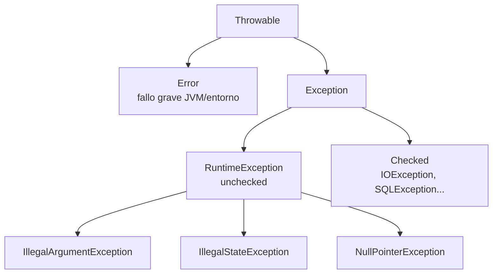
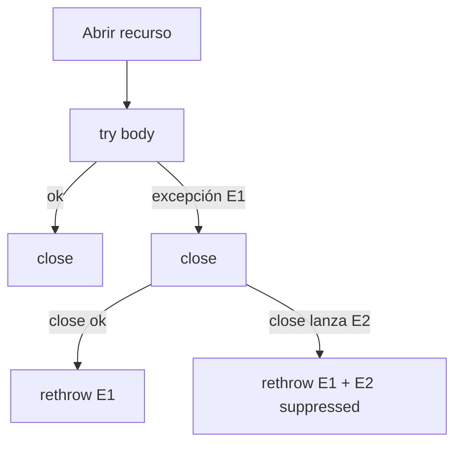

# Módulo 3: Excepciones y manejo de recursos

En Tienda Aurora, las excepciones de dominio (ProductoNoEncontrado, StockInsuficiente) se traducen a ProblemDetail en el borde HTTP. Un sistema que solo funciona en el “camino feliz” no es confiable. Los archivos pueden faltar, una entrada puede ser inválida, una conexión puede caer o una regla de negocio puede impedir una operación. Java modela estas fallas con excepciones y recursos gestionados. La habilidad profesional no es “atrapar todo”, sino distinguir tipos de fallo, decidir dónde manejarlos, preservar contexto y liberar recursos determinísticamente.

**Entorno de referencia verificado (2026-05-22):** JDK 27.0.1.0.2, `javac 27.0.1.0.2`.

## Aprende construyendo

## Proyecto desde cero: tienda-aurora-exceptions

## Prerrequisitos

```bash
java -version    # JDK 25+
gradle --version # Gradle 9.x
```

## Estructura del proyecto

```text
tienda-aurora-exceptions/
├── build.gradle.kts
├── settings.gradle.kts
└── src/
    └── main/
        └── java/com/aurora/exceptions/
            ├── Main.java
            ├── domain/
            │   ├── Product.java
            │   └── ProductNotFoundException.java
            └── service/
                └── ProductService.java
```

## build.gradle.kts

```kotlin
plugins {
    java
    application
}

group = "com.aurora"
version = "1.0.0"

java {
    toolchain {
        languageVersion = JavaLanguageVersion.of(25)
    }
}

application {
    mainClass.set("com.aurora.exceptions.Main")
}

repositories {
    mavenCentral()
}
```

## settings.gradle.kts

```kotlin
rootProject.name = "tienda-aurora-exceptions"
```

## Ejecutar

```bash
./gradlew run
# O directamente:
mkdir -p out
javac -d out src/main/java/com/aurora/exceptions/**/*.java
java -cp out com.aurora.exceptions.Main
```

### Tema 1: Checked vs unchecked exceptions · Básico · 35 min

**Caso guía.** un importador lee una edad desde un archivo. El archivo puede no existir (fallo externo) y el contenido puede ser inválido (violación de datos/precondición). Tratar ambos igual produce código ruidoso o bugs ocultos.



Checked exceptions

**Definición.** Excepción que hereda de `Exception` pero no de `RuntimeException`; el compilador exige capturarla o declararla con `throws`.

 El compilador verifica el flujo: si un método llama código que puede lanzar una checked exception, debe manejarla o declararla. Esto hace visible en la firma un fallo recuperable esperado.

**Reglas.** `throws` documenta la posibilidad; `try-catch` la maneja. Capturar debe agregar valor: recuperar, traducir, reintentar con límite o registrar con contexto.

**Cuándo usar / cuándo no.** Úsala para fallos externos recuperables (I/O, red, SQL). No para validación de argumentos o bugs de programación.

**Ejemplo mínimo enfocado (ejecutable).**

```bash
mkdir -p java-m3-checked
cd java-m3-checked
```

Crea el archivo `DemoChecked.java`:

```java
import java.io.IOException;
import java.nio.file.*;

public class DemoChecked {
  static String leer(Path p) throws IOException {
    return Files.readString(p);
  }

  public static void main(String[] args) throws Exception {
    Path p = Path.of("dato.txt");
    Files.writeString(p, "ok");
    System.out.println(leer(p));
    Files.deleteIfExists(p);
  }
}
```

```bash
javac DemoChecked.java
java DemoChecked
```

**Caso real.** Leer configuración/archivo de entrada; el llamador decide fallback o abortar con mensaje claro.

**Error común.** `catch (IOException e) {}`. Síntoma: fallo silencioso. Causa: se tragó la excepción. Corrección: registrar, traducir o relanzar con contexto (`throw new MiExcepcion("...", e)`).

**Verificación (JDK 27, 2026-05-22).** Salida real: `ok`.

Unchecked exceptions

**Definición.** `RuntimeException` y subclases; el compilador no obliga a declararlas/capturarlas.

 Se propagan por la pila hasta un `catch` compatible o hasta terminar el hilo. Suelen representar precondiciones violadas, estado inválido o bugs.

**Cuándo usar / cuándo no.** Úsalas para validar argumentos (`IllegalArgumentException`), estado (`IllegalStateException`), índices/nulos. No captures genéricamente para “evitar caídas”.

**Ejemplo mínimo enfocado (ejecutable).**

```bash
mkdir -p java-m3-unchecked
cd java-m3-unchecked
```

Crea el archivo `DemoUnchecked.java`:

```java
public class DemoUnchecked {
  static int edad(String t) {
    if (t == null || t.isBlank()) throw new IllegalArgumentException("edad obligatoria");
    return Integer.parseInt(t);
  }

  public static void main(String[] args) {
    try {
      edad("");
    } catch (IllegalArgumentException e) {
      System.out.println(e.getMessage());
    }
  }
}
```

```bash
javac DemoUnchecked.java
java DemoUnchecked
```

**Error común.** `catch (RuntimeException e) {}`. Síntoma: bugs ocultos, datos inconsistentes. Corrección: validar temprano y manejar solo en fronteras con contexto.

**Verificación (JDK 27, 2026-05-22).** Salida real: `edad obligatoria`.

`throw`, `throws`, `try-catch-finally`

**Definición.** `throw` lanza una excepción; `throws` declara checked exceptions; `try-catch-finally` maneja y ejecuta limpieza.

**Contrato.** `finally` se ejecuta al salir del `try/catch` salvo terminación abrupta de JVM. No usar `finally` para lógica de negocio oculta.

**Ejemplo mínimo enfocado (ejecutable).**

```bash
mkdir -p java-m3-throw
cd java-m3-throw
```

Crea el archivo `DemoThrow.java`:

```java
public class DemoThrow {
  static void validar(int n) {
    if (n < 0) throw new IllegalArgumentException("negativo");
  }

  public static void main(String[] args) {
    try {
      validar(-1);
    } catch (IllegalArgumentException e) {
      System.out.println(e.getMessage());
    } finally {
      System.out.println("fin");
    }
  }
}
```

```bash
javac DemoThrow.java
java DemoThrow
```

**Error común.** Capturar y relanzar sin causa (`throw new RuntimeException(e.getMessage())`). Se pierde stacktrace original. Corrección: pasar causa: `new X("contexto", e)`.

**Verificación (JDK 27, 2026-05-22).** Salida real: `negativo`, `fin`.

Ejemplo integrado

```bash
mkdir -p java-m3-t1
cd java-m3-t1
```

Crea el archivo `ParseoEdad.java`:

```java
import java.io.IOException;
import java.nio.file.*;

public class ParseoEdad {
  static int parsearEdad(String texto) {
    if (texto == null || texto.isBlank()) throw new IllegalArgumentException("La edad es obligatoria");
    int edad = Integer.parseInt(texto.trim());
    if (edad < 0 || edad > 120) throw new IllegalArgumentException("Edad fuera de rango: " + edad);
    return edad;
  }

  static String leerPrimeraLinea(Path ruta) throws IOException {
    return Files.readAllLines(ruta).get(0);
  }

  public static void main(String[] args) throws Exception {
    for (String entrada : new String[]{"25", "-3", "abc", ""}) {
      try {
        System.out.println("OK: " + parsearEdad(entrada));
      } catch (IllegalArgumentException e) {
        System.out.println("ERROR: " + e.getMessage());
      } catch (RuntimeException e) {
        System.out.println("ERROR: " + e.getMessage());
      }
    }
    Path ruta = Path.of("edad.txt");
    Files.writeString(ruta, "30");
    System.out.println("Archivo: " + parsearEdad(leerPrimeraLinea(ruta)));
    Files.deleteIfExists(ruta);
  }
}
```

```bash
javac ParseoEdad.java
java ParseoEdad
```

**Recorrido.** `parsearEdad` valida precondiciones: falla de datos → unchecked. `leerPrimeraLinea` expone fallo externo de I/O → checked. El `main` maneja cada entrada y muestra el error sin ocultarlo.

**Verificación (JDK 27, 2026-05-22).**

```text
OK: 25
ERROR: Edad fuera de rango: -3
ERROR: For input string: "abc"
ERROR: La edad es obligatoria
Archivo: 30
```

### Tema 2: try-with-resources · Básico · 40 min

**Caso guía.** procesas un archivo línea por línea. Si falla a mitad, el descriptor de archivo debe cerrarse. Hacerlo a mano con `finally` es verboso y fácil de romper.

`AutoCloseable` y try-with-resources

**Definición.** `try-with-resources` declara recursos que implementan `AutoCloseable`/`Closeable` y los cierra automáticamente al salir del bloque.

 El compilador genera la lógica de cierre. Si el cuerpo lanza excepción y `close()` también, la excepción de cierre se suprime y se adjunta como *suppressed* a la principal.



**Cuándo usar / cuándo no.** Úsalo siempre con archivos, streams, sockets, JDBC. No dependas del GC para recursos externos.

**Ejemplo mínimo enfocado (ejecutable).**

```bash
mkdir -p java-m3-twr
cd java-m3-twr
```

Crea el archivo `DemoTwr.java`:

```java
import java.io.*;

public class DemoTwr {
  static class Recurso implements AutoCloseable {
    public void close() { System.out.println("cerrado"); }
    void usar() { System.out.println("usando"); }
  }

  public static void main(String[] args) {
    try (Recurso r = new Recurso()) {
      r.usar();
    }
  }
}
```

```bash
javac DemoTwr.java
java DemoTwr
```

**Error común.** Cerrar manualmente y olvidar el `finally`. Síntoma: leak de descriptores bajo carga. Corrección: try-with-resources.

**Verificación (JDK 27, 2026-05-22).** `usando`, `cerrado`.

Excepciones suprimidas

**Definición.** Cuando el cuerpo del try y `close()` lanzan excepciones, la de cierre se agrega a `Throwable.getSuppressed()` de la excepción principal.

**Ejemplo mínimo enfocado (ejecutable).**

```bash
mkdir -p java-m3-sup
cd java-m3-sup
```

Crea el archivo `DemoSuppressed.java`:

```java
public class DemoSuppressed {
  static class R implements AutoCloseable {
    public void close() { throw new RuntimeException("close"); }
  }
  public static void main(String[] args) {
    try (R r = new R()) {
      throw new RuntimeException("body");
    } catch (RuntimeException e) {
      System.out.println(e.getMessage());
      System.out.println(e.getSuppressed().length);
    }
  }
}
```

```bash
javac DemoSuppressed.java
java DemoSuppressed
```

**Error común.** Usar `finally` manual y pisar la excepción original con la de cierre. Corrección: try-with-resources preserva la principal.

**Verificación (JDK 27, 2026-05-22).** `body`, `1`.

### Tema 3: Excepciones personalizadas y no tragar excepciones · Intermedio · 35 min

**Caso guía.** un dominio de envíos necesita distinguir “capacidad excedida” de un `IllegalArgumentException` genérico. Además, una capa intermedia a veces captura y silencia, haciendo imposible diagnosticar.

Excepciones personalizadas

**Definición.** Excepción definida por el dominio (`extends Exception` o `RuntimeException`) con nombre y contexto que expresan la regla violada.

**Cuándo usar / cuándo no.** Úsala cuando el llamador necesita distinguir el caso para decidir. No crees una excepción por cada método si el tipo estándar ya comunica bien.

**Ejemplo mínimo enfocado (ejecutable).**

```bash
mkdir -p java-m3-custom
cd java-m3-custom
```

Crea el archivo `DemoCustom.java`:

```java
class CapacidadExcedidaException extends RuntimeException {
  CapacidadExcedidaException(int max, int actual) {
    super("Capacidad excedida: max=" + max + " actual=" + actual);
  }
}
public class DemoCustom {
  static void agregar(int actual, int max) {
    if (actual >= max) throw new CapacidadExcedidaException(max, actual + 1);
  }
  public static void main(String[] args) {
    try { agregar(3, 3); }
    catch (CapacidadExcedidaException e) { System.out.println(e.getMessage()); }
  }
}
```

```bash
javac DemoCustom.java
java DemoCustom
```

**Error común.** Excepciones sin contexto. Corrección: incluir datos relevantes (id, límite, valor actual) sin filtrar secretos.

**Verificación (JDK 27, 2026-05-22).** `Capacidad excedida: max=3 actual=4`.

No tragar excepciones

**Definición.** “Tragar” una excepción es capturarla y no registrar, no traducir, no relanzar ni recuperar adecuadamente.

**Por qué es grave.** Rompe la observabilidad: el sistema queda en estado inválido sin evidencia. Es una de las causas más caras de debugging.

**Ejemplo mínimo enfocado (ejecutable).**

```bash
mkdir -p java-m3-swallow
cd java-m3-swallow
```

Crea el archivo `DemoSwallow.java`:

```java
public class DemoSwallow {
  static int parsear(String s) {
    try { return Integer.parseInt(s); }
    catch (NumberFormatException e) {
      throw new IllegalArgumentException("Numero invalido: " + s, e); // preserva causa
    }
  }
  public static void main(String[] args) {
    try { parsear("x"); }
    catch (IllegalArgumentException e) {
      System.out.println(e.getMessage());
      System.out.println(e.getCause().getClass().getSimpleName());
    }
  }
}
```

```bash
javac DemoSwallow.java
java DemoSwallow
```

**Error común.** `catch(Exception e){ return null; }`. Corrección: contrato explícito: Optional, valor default documentado, o excepción con contexto.

**Verificación (JDK 27, 2026-05-22).** `Numero invalido: x`, `NumberFormatException`.

**Caso guía.** importar guías desde archivo CSV simple. Líneas inválidas no deben tumbar toda la importación; capacidad excedida sí debe detener o reportarse claramente.

Ejemplo integrado

```bash
mkdir -p java-m3-t4
cd java-m3-t4
```

Crea el archivo `ImportadorGuias.java`:

```java
import java.io.*;
import java.nio.file.*;
import java.util.*;

class CapacidadExcedidaException extends RuntimeException {
  CapacidadExcedidaException(String msg) { super(msg); }
}

public class ImportadorGuias {
  static List<String> importar(Path ruta, int max) throws IOException {
    List<String> guias = new ArrayList<>();
    try (BufferedReader br = Files.newBufferedReader(ruta)) {
      String linea;
      int n = 0;
      while ((linea = br.readLine()) != null) {
        n++;
        linea = linea.trim();
        if (linea.isBlank() || !linea.contains("@")) {
          System.out.println("WARN linea " + n + ": invalida");
          continue;
        }
        if (guias.size() >= max) throw new CapacidadExcedidaException("Capacidad maxima " + max);
        guias.add(linea);
      }
    }
    return guias;
  }

  public static void main(String[] args) throws Exception {
    Path ruta = Path.of("guias.csv");
    Files.writeString(ruta, "G1@CDMX\n\nMALA\nG2@GDL\nG3@MTY\n");
    try {
      List<String> g = importar(ruta, 2);
      System.out.println(g.size());
    } catch (CapacidadExcedidaException e) {
      System.out.println("ERROR: " + e.getMessage());
    }
    Files.deleteIfExists(ruta);
  }
}
```

```bash
javac ImportadorGuias.java
java ImportadorGuias
```

**Recorrido.** `try-with-resources` cierra el `BufferedReader`. Líneas inválidas se reportan y se saltan (recuperable). Capacidad excedida es regla de dominio y se lanza como excepción personalizada. El llamador decide.

**Verificación (JDK 27, 2026-05-22).**

```text
WARN linea 2: invalida
WARN linea 3: invalida
ERROR: Capacidad maxima 2
```

## Cierre

El manejo de errores profesional separa fallos externos recuperables, violaciones de datos y bugs. Try-with-resources es el default para recursos. Las excepciones personalizadas dan semántica; preservar la causa da diagnóstico.

## Checklist

- Distingo checked/unchecked y elijo según recuperabilidad y contrato.
- Uso try-with-resources para todo `AutoCloseable`.
- No trago excepciones; preservo causa y contexto.
- Defino excepciones de dominio solo cuando aportan decisión/claridad.
