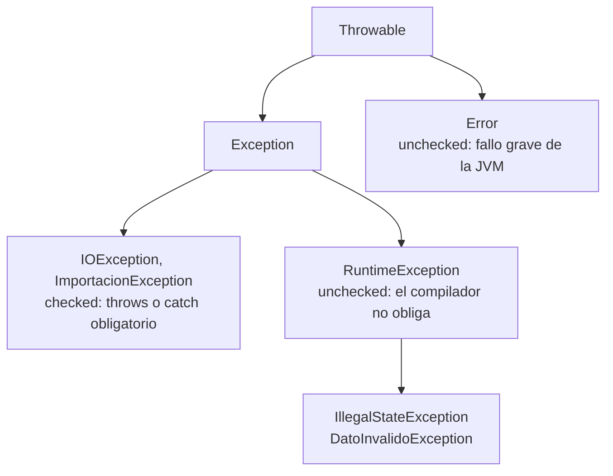
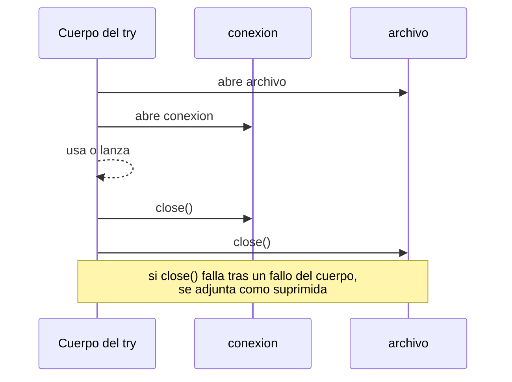
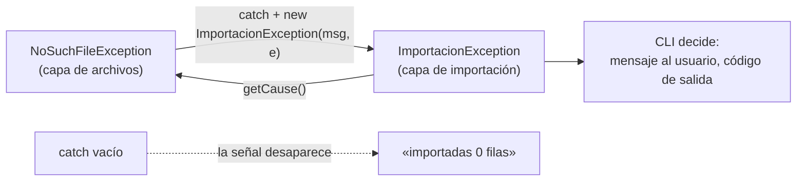

# Módulo 3: Excepciones y manejo de recursos

Tienda Aurora ya puede vender, pero el mundo real no le entrega datos perfectos. Un CSV llega con columnas rotas, un operador pide reservar más stock del disponible, un archivo no existe, o un campo numérico trae texto. Si el sistema responde mal a esos casos, el fallo es peor que una excepción: puede quedar un estado inconsistente, ocultar el error original o darle al operador un mensaje inútil.

Las excepciones en Java son el mecanismo para separar el flujo normal del flujo de error. No son “eventos malos” genéricos; son objetos con tipo, mensaje, causa y traza. El tipo comunica qué clase de problema ocurrió. El mensaje comunica el contexto. La causa conserva el error de más bajo nivel que lo originó. La traza dice por dónde pasó. Un buen diseño de excepciones no intenta atrapar todo lo antes posible: decide dónde un error se puede recuperar, dónde debe traducirse y dónde debe subir con contexto.

En este módulo construimos `tienda-aurora-excepciones`, una pequeña app de línea de comandos que importa productos desde CSV y reserva stock. El proyecto es deliberadamente pequeño, pero toca las decisiones que importan: qué excepción es checked y cuál unchecked, cómo cerrar recursos con `try-with-resources`, cómo crear excepciones propias con contexto, y por qué “tragarse” una excepción es una forma de corromper el diagnóstico.

**Entorno de referencia verificado (2026-11-23):** macOS arm64, JDK 27.0.1.0.2, Gradle 9.9.1, toolchain Java 25.

**Entorno de las salidas nuevas de los temas (2026-11-24):** Linux x86_64, OpenJDK 25.0.5.1, `javac` y `java` sin Gradle. Con ese mismo JDK se recompiló el código principal del laboratorio con `-Xlint:all -Werror`; `importar` y `auditoria` dieron la misma salida que en el entorno de referencia. Las pruebas JUnit no se ejecutaron en ese entorno. Los números de línea dentro de las trazas de clases del JDK (por ejemplo `Integer.java:565`) cambian entre versiones.

## Apertura del módulo

#### Objetivos del módulo
Al terminar este módulo podrás:
- distinguir una excepción checked de una unchecked y decidir cuál usar en cada capa;
- declarar con `throws`, lanzar con `throw` y capturar con `try-catch` leyendo la traza de pila;
- cerrar archivos y conexiones con `try-with-resources` y leer una excepción suprimida;
- crear excepciones personalizadas que llevan contexto sin exponer datos sensibles;
- traducir una excepción de bajo nivel conservando su causa;
- reconocer y corregir un `catch` que se traga el error.

#### Esquema del módulo
1. Tema 1 — Checked vs unchecked exceptions.
2. Tema 2 — try-with-resources.
3. Tema 3 — Excepciones personalizadas y no tragar excepciones.
4. Laboratorio integrador — `tienda-aurora-excepciones`, una CLI que importa productos desde CSV y reserva stock.

#### Qué necesitas saber antes
- **Fundamentos, Módulo 1, Tema 1:** la ficha *excepción* explica la idea general con Python (`raise`, `try`, `except`). Aquí solo se explica lo propio de Java.
- **Java, Módulos 0 a 2:** clases, `record`, interfaces, herencia, `String`, `List` y `Map`.

## Visual del módulo

**Visual:** [Mapa de excepciones Java: checked, unchecked, try-with-resources y preservación de causa](/visuals/temas/java/modulo-3-excepciones.html)

Lectura: El tipo define el contrato, el mensaje da contexto, la causa preserva el origen y try-with-resources garantiza el cierre.

## Prerrequisitos

Necesitas un JDK 25 o superior y Gradle 9.

```bash
java -version
javac -version
gradle --version
```

## Aprende construyendo

### Tema 1: Checked vs unchecked exceptions · Básico · 50 min

<details open>
<summary><strong>Capa 1 — Lectura</strong></summary>

#### Objetivos
Al terminar este tema podrás:
- ubicar una excepción en la jerarquía de `Throwable` y decir si es checked o unchecked;
- declarar una excepción checked con `throws` y lanzar una unchecked con `throw`;
- capturar cada tipo con `try-catch` y leer una traza de pila línea por línea;
- corregir el error de compilación `unreported exception … must be caught or declared to be thrown`.

**Conceptos clave:** Throwable, excepción checked, excepción unchecked, throw, throws, try-catch, traza de pila

#### El problema
Tienda Aurora tiene dos fallos que parecen iguales y no lo son. Al importar, el archivo `productos.csv` puede no
existir: eso no depende del programador. Al reservar, alguien pide 99 unidades cuando hay 3: eso es una regla de
negocio violada. ¿Cómo le dice Java a quien llama un método que puede fallar, y quién está obligado a decidir qué hacer?

#### Glosario del tema

En Fundamentos viste qué es una **excepción** con Python: una señal que interrumpe el flujo normal. Java usa la misma
idea, pero añade algo que Python no tiene: el compilador revisa algunas excepciones antes de ejecutar.

**Throwable**
- **Definición técnica:** clase raíz de todo lo que Java puede lanzar con `throw`; sus dos ramas son `Exception` (fallos que un programa puede tratar) y `Error` (fallos graves de la JVM).
- **En palabras sencillas:** el árbol genealógico de todos los errores de Java; cada excepción tiene a `Throwable` como antepasado.
- **Dónde se rompe la comparación:** en un árbol familiar cualquiera puede tener hijos; aquí la rama decide reglas del compilador.
- **Ejemplo:** en el Problema resuelto 1.1, `IOException -> Exception -> Throwable` muestra el linaje real de `IOException`.
- **Error típico:** capturar `Throwable` o `Error` «por si acaso»: también atrapas `OutOfMemoryError`, que el programa no puede arreglar.

**excepción checked**
- **Definición técnica:** subclase de `Exception` que no hereda de `RuntimeException`; el compilador exige capturarla o declararla con `throws` en cada método por el que pueda salir.
- **En palabras sencillas:** un fallo que el compilador te obliga a mirar antes de dejarte ejecutar, porque viene de fuera del programa.
- **Dónde se rompe la comparación:** «obligatoria» no significa «más segura»: un `catch` vacío cumple al compilador y esconde el fallo.
- **Ejemplo:** `Files.readAllLines(ruta)` declara `IOException`; en el Problema resuelto 1.2 la salida muestra `checked: NoSuchFileException -> no-existe.csv`.
- **Error típico:** llamar a un método que la lanza sin capturarla ni declararla: `error: unreported exception IOException; must be caught or declared to be thrown`.

**excepción unchecked**
- **Definición técnica:** subclase de `RuntimeException` o de `Error`; el compilador no exige capturarla ni declararla.
- **En palabras sencillas:** un fallo que suele indicar un error de uso o de programación: el llamador pudo evitarlo pasando datos correctos.
- **Dónde se rompe la comparación:** que el compilador no la vigile no significa que no importe: si nadie la captura, termina el hilo.
- **Ejemplo:** `IllegalStateException`; en el Problema resuelto 1.1 su linaje termina en `RuntimeException -> Exception -> Throwable  [unchecked]`.
- **Error típico:** creer que «unchecked» quiere decir «no hay que manejarla nunca» y dejar que llegue al usuario como traza cruda.

**throw**
- **Definición técnica:** instrucción que lanza un objeto `Throwable`; el método se interrumpe y la JVM busca un `catch` compatible subiendo por la pila de llamadas.
- **En palabras sencillas:** el momento en que el código dice «aquí no puedo seguir» y entrega el problema a quien lo llamó.
- **Dónde se rompe la comparación:** a diferencia de Python (`raise`), en Java lanzas un objeto creado con `new`.
- **Ejemplo:** `throw new IllegalStateException("stock insuficiente: ...")` en la línea 13 del Problema resuelto 1.2.
- **Error típico:** escribir `throw IllegalStateException("x")` sin `new`: el compilador responde `cannot find symbol`.

**throws**
- **Definición técnica:** cláusula de la firma de un método que declara qué excepciones checked pueden salir de él; forma parte del contrato público del método.
- **En palabras sencillas:** la etiqueta de advertencia del método: «ojo, esto puede fallar así».
- **Dónde se rompe la comparación:** una etiqueta se puede ignorar; `throws` obliga al llamador a capturar o a declarar a su vez.
- **Ejemplo:** `static String leerPrimeraLinea(Path ruta) throws IOException` en la línea 7 del Problema resuelto 1.2.
- **Error típico:** confundirla con `throw`: `throws` va en la firma y declara; `throw` va en el cuerpo y lanza.

**try-catch**
- **Definición técnica:** bloque que ejecuta las instrucciones de `try` y, si se lanza una excepción compatible con el tipo de un `catch`, salta a ese `catch`; los demás tipos siguen subiendo.
- **En palabras sencillas:** «intenta esto; si pasa este problema concreto, haz esto otro».
- **Dónde se rompe la comparación:** equivale al `try`/`except` de Python, pero en Java cada `catch` declara un tipo y el compilador lo revisa.
- **Ejemplo:** `catch (IOException e)` en la línea 22 del Problema resuelto 1.2 imprime `checked: NoSuchFileException -> no-existe.csv`.
- **Error típico:** capturar una checked que el bloque no puede lanzar: `error: exception IOException is never thrown in body of corresponding try statement`.

**traza de pila**
- **Definición técnica:** lista que imprime la JVM al terminar por una excepción no capturada: el tipo, el mensaje y cada método activo (`at Clase.metodo(Archivo.java:línea)`), del más reciente al más antiguo.
- **En palabras sencillas:** el rastro de migas: dónde ocurrió el fallo y por qué métodos pasó para llegar ahí.
- **Dónde se rompe la comparación:** las migas se leen del final al inicio; la traza se lee de arriba abajo: la primera línea `at` es el origen.
- **Ejemplo:** `at CheckedVsUnchecked.reservar(CheckedVsUnchecked.java:13)` en la salida del Problema resuelto 1.2.
- **Error típico:** leer solo la última línea de la traza, que suele ser `main`, en vez de la primera, que señala el origen.

#### ► CÓMO FUNCIONA

Una excepción checked es aquella que el compilador obliga a declarar o manejar si puede salir de un método. En Java, esto aplica a las subclases de `Exception` que no son `RuntimeException`. Existe para hacer visible una condición externa o recuperable en el contrato del método: leer un archivo puede fallar por I/O, parsear una fuente externa puede fallar por formato, una llamada remota puede fallar por red. El llamador debería decidir si reintenta, usa un fallback, pide otro input o reporta el error.

Una excepción unchecked es una `RuntimeException` o `Error`. El compilador no obliga a declararla. Se usa cuando el problema normalmente representa un bug de programación, una violación de precondición o un estado que el llamador debió evitar: índice fuera de rango, argumento nulo, estado inválido, SKU mal formado. Obligar a capturarla en todas partes suele generar ruido y `catch` vacíos.

La decisión no es dogmática. Pregunta: “¿el llamador inmediato tiene una acción razonable de recuperación?”. Si la respuesta es sí y el fallo es externo/esperable, una checked puede ser apropiada en la frontera. Si la respuesta es no, o es un contrato violado, unchecked es más clara. En el proyecto, `ImportacionException` es checked porque importar desde archivo es una operación de frontera; `DatoInvalidoException` y `StockInsuficienteException` son unchecked porque expresan violación de contrato o regla de negocio que la capa superior debe manejar de forma consciente, no por obligación sintáctica en cada llamada.



Cuando un método lanza, la JVM sube por la pila de llamadas buscando un `catch` compatible. Si llega a `main` sin
encontrarlo, imprime la traza de pila y el programa termina con código de salida 1.

#### Problema resuelto 1.1
Muestra el linaje de cuatro excepciones del JDK y clasifícalas como checked o unchecked.

**Razonamiento:**
1. Toda clase conoce a su padre con `getSuperclass()`; se sube hasta llegar a `Object`.
2. Es unchecked si hereda de `RuntimeException` o de `Error`; si no, es checked.
3. `isAssignableFrom` responde «¿este tipo es igual o hijo de aquel?».

```java
import java.io.IOException;

public class Jerarquia {

    static void imprimirLinaje(Class<?> tipo) {
        StringBuilder linaje = new StringBuilder(tipo.getSimpleName());
        for (Class<?> padre = tipo.getSuperclass(); padre != Object.class; padre = padre.getSuperclass()) {
            linaje.append(" -> ").append(padre.getSimpleName());
        }
        boolean checked = !RuntimeException.class.isAssignableFrom(tipo)
                && !Error.class.isAssignableFrom(tipo);
        System.out.println(linaje + (checked ? "  [checked]" : "  [unchecked]"));
    }

    public static void main(String[] args) {
        imprimirLinaje(IOException.class);
        imprimirLinaje(IllegalStateException.class);
        imprimirLinaje(NumberFormatException.class);
        imprimirLinaje(OutOfMemoryError.class);
    }
}
```

```text
$ javac Jerarquia.java && java Jerarquia
IOException -> Exception -> Throwable  [checked]
IllegalStateException -> RuntimeException -> Exception -> Throwable  [unchecked]
NumberFormatException -> IllegalArgumentException -> RuntimeException -> Exception -> Throwable  [unchecked]
OutOfMemoryError -> VirtualMachineError -> Error -> Throwable  [unchecked]
```

**Explicación por partes.**
- Líneas 5–8: el `for` sube por los padres y los agrega al texto hasta llegar a `Object`.
- Líneas 10–11: la regla del compilador en una sola expresión: ni `RuntimeException` ni `Error` significa checked.
- Líneas 16–19: `NumberFormatException` es unchecked aunque tenga más niveles: lo que cuenta es por qué rama pasa.

#### Problema resuelto 1.2
Lee la primera línea de un archivo que no existe y reserva stock dos veces: una con éxito y otra imposible. Al
final, provoca una reserva imposible sin capturarla para ver la traza.

**Razonamiento:**
1. Leer un archivo es una frontera externa: `Files.readAllLines` declara `IOException`, así que el método declara `throws IOException`.
2. Reservar más de lo disponible es una regla violada: se lanza `IllegalStateException`, unchecked.
3. `main` captura la checked porque el compilador lo exige, y la unchecked porque quiere mostrar un mensaje.
4. La última reserva no se captura: la traza muestra dónde nació el fallo.

```java
import java.io.IOException;
import java.nio.file.Files;
import java.nio.file.Path;

public class CheckedVsUnchecked {

    static String leerPrimeraLinea(Path ruta) throws IOException {
        return Files.readAllLines(ruta).get(0);
    }

    static int reservar(int disponible, int solicitado) {
        if (solicitado > disponible) {
            throw new IllegalStateException(
                    "stock insuficiente: disponible=" + disponible + ", solicitado=" + solicitado);
        }
        return disponible - solicitado;
    }

    public static void main(String[] args) {
        try {
            System.out.println(leerPrimeraLinea(Path.of("no-existe.csv")));
        } catch (IOException e) {
            System.out.println("checked: " + e.getClass().getSimpleName() + " -> " + e.getMessage());
        }

        System.out.println("quedan: " + reservar(3, 2));

        try {
            reservar(3, 99);
        } catch (IllegalStateException e) {
            System.out.println("unchecked: " + e.getMessage());
        }

        reservar(1, 5);
        System.out.println("esta línea no se ejecuta");
    }
}
```

```text
$ javac CheckedVsUnchecked.java && java CheckedVsUnchecked
checked: NoSuchFileException -> no-existe.csv
quedan: 1
unchecked: stock insuficiente: disponible=3, solicitado=99
Exception in thread "main" java.lang.IllegalStateException: stock insuficiente: disponible=1, solicitado=5
	at CheckedVsUnchecked.reservar(CheckedVsUnchecked.java:13)
	at CheckedVsUnchecked.main(CheckedVsUnchecked.java:34)
```

**Explicación por partes.**
- Línea 7: `throws IOException` traslada la decisión al llamador; el método no inventa un valor de respaldo.
- Líneas 12–15: la regla de negocio lanza una unchecked con el contexto completo en el mensaje.
- Líneas 20–24: el compilador obliga a este `catch`; la causa real es `NoSuchFileException`, una hija de `IOException`.
- Línea 34: nadie captura; la traza empieza en `reservar` (línea 13) y termina en `main` (línea 34).
- La línea 35 nunca se imprime: la excepción interrumpe `main`.

> **Error común.** Llamar a `Files.readAllLines` sin `throws` ni `catch`. El compilador no deja ejecutar:
>
> ```text
> $ javac SinThrows.java
> SinThrows.java:7: error: unreported exception IOException; must be caught or declared to be thrown
>         return Files.readAllLines(ruta).get(0);
>                                  ^
> 1 error
> ```
>
> Lee el mensaje así: «la `IOException` no está reportada; captúrala o declárala». El `^` señala la llamada culpable.

> **Error común.** Capturar una checked que el bloque no puede lanzar. `catch (IOException e)` alrededor de
> `Integer.parseInt("42")` produce:
>
> ```text
> $ javac NuncaLanzada.java
> NuncaLanzada.java:7: error: exception IOException is never thrown in body of corresponding try statement
>         } catch (IOException e) {
>           ^
> 1 error
> ```

> **Prevenir errores.** “checked es más segura”. No automáticamente. Un checked mal usada produce `catch (Exception e) {}` o `throws Exception` por todos lados, que es peor que una unchecked bien ubicada. La seguridad viene de decidir bien el punto de manejo.

> **Buena práctica.** Usa checked solo en la frontera donde el fallo es externo y el llamador inmediato tiene una recuperación razonable (reintentar, fallback, pedir otro input); si el fallo es un contrato violado o un bug, unchecked es más clara.

#### Checkpoint 1.1
`NumberFormatException` aparece al convertir texto inválido con `Integer.parseInt`. ¿El compilador te obliga a capturarla?

Respuesta: no. Según la salida del Problema resuelto 1.1, hereda de `RuntimeException`, así que es unchecked. Igual
conviene capturarla en la frontera donde llega texto del usuario.

</details>

<details>
<summary><strong>Capa 2 — Construcción</strong></summary>

#### Paso 1 · Prepara la carpeta
Crea `~/labs/java-m3-t1` y entra con `cd ~/labs/java-m3-t1`. Comprueba `javac -version`: necesitas 21 o superior.

#### Paso 2 · Mapea la jerarquía
Escribe `Jerarquia.java`, ejecútalo con `javac Jerarquia.java && java Jerarquia` y añade `FileNotFoundException`.
Debe salir `FileNotFoundException -> IOException -> Exception -> Throwable  [checked]`.

#### Paso 3 · Provoca el error del compilador
Escribe `CheckedVsUnchecked.java` y borra `throws IOException` de la línea 7. Compila y lee el mensaje
`unreported exception IOException`. Restaura la línea.

#### Paso 4 · Lee la traza
Ejecuta el programa completo. En la traza, ubica la primera línea `at` y abre el archivo en ese número de línea.

#### Resumen
- Todo lo que se lanza desciende de **Throwable**; sus ramas son `Exception` y `Error`.
- Una **excepción checked** hereda de `Exception` sin pasar por `RuntimeException`; el compilador exige `catch` o **throws**.
- Una **excepción unchecked** hereda de `RuntimeException` o `Error`; el compilador no la vigila.
- **throw** lanza un objeto en el cuerpo; **throws** declara en la firma.
- **try-catch** captura por tipo; el resto sigue subiendo por la pila.
- La **traza de pila** se lee de arriba abajo: la primera línea `at` es el origen.

#### Ejercicio verificable 1
Básico. Sin ejecutar, clasifica `FileNotFoundException`, `IllegalArgumentException` y `StackOverflowError`.

Respuesta esperada: `FileNotFoundException` es checked (hija de `IOException`). `IllegalArgumentException` es
unchecked (hija de `RuntimeException`). `StackOverflowError` es unchecked (hija de `Error`).

#### Ejercicio verificable 2
Intermedio. Provoca una `NullPointerException` (unchecked) y una `IOException` (checked) en el mismo programa. Explica
por qué el compilador solo protesta por una.

Respuesta esperada: `String s = null; s.length();` compila y falla al ejecutar con `NullPointerException`. Leer un
archivo sin `throws` no compila: el compilador solo revisa las checked.

#### Ejercicio verificable 3
Reto. Cambia `reservar` para que lance una excepción checked propia `ReservaException extends Exception`. ¿Qué
líneas de `main` dejan de compilar y por qué?

Respuesta esperada: las líneas 26, 29 y 34 dejan de compilar con `unreported exception ReservaException`. El
`catch (IllegalStateException e)` de la línea 30 no la cubre, y la línea 26 también falla aunque nunca reserve de más. Por eso las reglas de negocio
suelen ser unchecked.

#### En el trabajo
En un backend, las checked aparecen en las fronteras: archivos, red, bases de datos. Los equipos suelen traducirlas a
excepciones propias en el borde y dejar unchecked las de negocio. Un controlador central las convierte en respuestas
HTTP. Leer bien una traza de pila es lo primero que te piden al revisar un incidente en producción.

</details>

### Tema 2: try-with-resources · Básico · 45 min

<details open>
<summary><strong>Capa 1 — Lectura</strong></summary>

#### Objetivos
Al terminar este tema podrás:
- abrir y cerrar recursos con `try-with-resources` y predecir el orden de cierre;
- implementar `AutoCloseable` en una clase propia;
- leer una excepción suprimida con `getSuppressed()`;
- explicar por qué un `finally` manual puede perder la excepción original.

**Conceptos clave:** recurso, AutoCloseable, try-with-resources, finally, excepción suprimida

#### El problema
El importador de Tienda Aurora abre `productos.csv`. Si la fila 4 trae datos rotos y el código sale con una
excepción, ¿quién cierra el archivo? Un archivo abierto ocupa un descriptor del sistema operativo. Con cientos de
importaciones fallidas, el proceso se queda sin descriptores y deja de abrir archivos.

#### Glosario del tema

Las fichas de `throw`, `try-catch` y traza de pila están en el Tema 1.

**recurso**
- **Definición técnica:** objeto que reserva algo externo al montón de Java (descriptor de archivo, conexión, socket, lock) y que debe liberarse explícitamente; el recolector de basura no lo hace a tiempo.
- **En palabras sencillas:** algo prestado que hay que devolver: si no lo devuelves, nadie más lo puede usar.
- **Dónde se rompe la comparación:** un préstamo se nota cuando falta; un recurso sin cerrar no avisa hasta que se agotan.
- **Ejemplo:** el `BufferedReader` que abre `Files.newBufferedReader(ruta)` en el importador del laboratorio.
- **Error típico:** confiar en que el recolector de basura cerrará el archivo; puede tardar o no ocurrir antes de agotar descriptores.

**AutoCloseable**
- **Definición técnica:** interfaz de `java.lang` con un único método `void close() throws Exception`; `Closeable` (de `java.io`) es su hija y restringe `close()` a `IOException`.
- **En palabras sencillas:** el contrato que dice «sé cómo devolver lo que tomé prestado».
- **Dónde se rompe la comparación:** implementarla no cierra nada por sí sola: alguien tiene que llamar a `close()`.
- **Ejemplo:** `static final class Recurso implements AutoCloseable` en la línea 3 del Problema resuelto 2.1.
- **Error típico:** usar en `try (...)` una clase que no la implementa: `error: incompatible types: try-with-resources not applicable to variable type`.

**try-with-resources**
- **Definición técnica:** forma de `try` que declara recursos entre paréntesis; al salir del bloque, Java llama a `close()` de cada uno en orden inverso, haya excepción o no.
- **En palabras sencillas:** un préstamo con devolución automática: al salir de la habitación, la puerta se cierra sola.
- **Dónde se rompe la comparación:** cierra, pero no atrapa: la excepción sigue subiendo si no hay `catch`.
- **Ejemplo:** `try (Recurso archivo = new Recurso("archivo"); Recurso conexion = new Recurso("conexion"))` imprime `cierra conexion` antes que `cierra archivo`.
- **Error típico:** crear el recurso antes del `try` y solo usarlo dentro: así no queda declarado y no se cierra.

**finally**
- **Definición técnica:** bloque opcional de `try` que se ejecuta siempre al salir, tanto si el `try` terminó normal como si lanzó o si un `catch` la manejó.
- **En palabras sencillas:** «pase lo que pase, al final haz esto».
- **Dónde se rompe la comparación:** «siempre» tiene matices: si `finally` lanza su propia excepción, reemplaza a la original.
- **Ejemplo:** en el Problema resuelto 2.1, `finally se ejecuta al final` aparece después del `catch`.
- **Error típico:** cerrar a mano dentro de `finally` un recurso cuyo `close()` puede fallar; se pierde el error del cuerpo (Problema resuelto 2.2).

**excepción suprimida**
- **Definición técnica:** excepción que `try-with-resources` adjunta a la principal cuando `close()` falla después de que el cuerpo ya lanzó; se consulta con `Throwable.getSuppressed()`.
- **En palabras sencillas:** el segundo problema que ocurrió mientras atendías el primero: queda anotado sin tapar al primero.
- **Dónde se rompe la comparación:** no es una lista de todos los errores del programa: solo los del cierre de ese bloque.
- **Ejemplo:** la salida `suprimida: falló el cierre` del Problema resuelto 2.2.
- **Error típico:** registrar solo `getMessage()` de la principal y no mirar `getSuppressed()`: el fallo de cierre queda invisible.

#### ► CÓMO FUNCIONA

`try-with-resources` es la forma segura de manejar recursos que deben cerrarse: archivos, streams, conexiones JDBC, sockets, locks con `AutoCloseable`. Un recurso que implementa `AutoCloseable` o `Closeable` se declara en la cabecera del `try`; Java llama a `close()` al salir del bloque, tanto si termina normal como si lanza excepción.

El mecanismo importa porque el cierre manual con `finally` es fácil de hacer mal: hay que cuidar nulls, no perder la excepción original si el cierre también falla, y no olvidar el cierre en ramas tempranas. `try-with-resources` hace esto correctamente. Si el cuerpo lanza una excepción y `close()` lanza otra, la excepción del cuerpo se mantiene como principal y la del cierre se adjunta como *suppressed*. Puedes verla con `Throwable.getSuppressed()`.

En `ImportadorProductos`, el `BufferedReader` se abre en el try-with-resources. Si la lectura falla a mitad de archivo, el reader se cierra igual. En `auditoria()`, `RecursoRuidoso` demuestra la excepción suprimida: el cuerpo lanza “falló el cuerpo” y el cierre lanza “falló el cierre”; la principal es la del cuerpo, la secundaria queda suprimida.



#### Problema resuelto 2.1
Abre dos recursos, úsalos y observa el orden de cierre. Luego provoca un fallo a mitad de uso.

**Razonamiento:**
1. Una clase propia que imprime al abrir y al cerrar deja ver el orden.
2. Si cierra en orden inverso, la conexión, abierta después, se cierra primero.
3. Con un fallo dentro, `close()` debe ejecutarse antes del `catch` y del `finally`.

```java
public class OrdenDeCierre {

    static final class Recurso implements AutoCloseable {
        private final String nombre;

        Recurso(String nombre) {
            this.nombre = nombre;
            System.out.println("abre " + nombre);
        }

        void usar() {
            System.out.println("usa " + nombre);
        }

        @Override
        public void close() {
            System.out.println("cierra " + nombre);
        }
    }

    public static void main(String[] args) {
        try (Recurso archivo = new Recurso("archivo"); Recurso conexion = new Recurso("conexion")) {
            archivo.usar();
            conexion.usar();
        }
        System.out.println("---");
        try (Recurso archivo = new Recurso("archivo")) {
            archivo.usar();
            throw new IllegalStateException("falla a mitad de lectura");
        } catch (IllegalStateException e) {
            System.out.println("capturada después del cierre: " + e.getMessage());
        } finally {
            System.out.println("finally se ejecuta al final");
        }
    }
}
```

```text
$ javac OrdenDeCierre.java && java OrdenDeCierre
abre archivo
abre conexion
usa archivo
usa conexion
cierra conexion
cierra archivo
---
abre archivo
usa archivo
cierra archivo
capturada después del cierre: falla a mitad de lectura
finally se ejecuta al final
```

**Explicación por partes.**
- Línea 3: implementar `AutoCloseable` es lo único que necesita una clase para usarse en `try (...)`.
- Línea 22: dos recursos separados por `;`. Se abren de izquierda a derecha y se cierran al revés.
- Líneas 27–29: el cuerpo lanza; antes de llegar al `catch`, Java ya llamó a `close()`.
- Líneas 30–34: el `catch` maneja y el `finally` corre al final, en ese orden.

#### Problema resuelto 2.2
Compara qué ocurre cuando el cuerpo y el cierre fallan a la vez, con `try-with-resources` y con un `finally` manual.

**Razonamiento:**
1. `RecursoRuidoso.close()` siempre lanza, así que hay dos fallos.
2. Con `try-with-resources`, el del cuerpo debe quedar como principal y el del cierre como suprimida.
3. Con `finally`, la excepción del cierre se lanza la última y sustituye a la del cuerpo.

```java
public class Suprimida {

    static final class RecursoRuidoso implements AutoCloseable {
        @Override
        public void close() {
            throw new IllegalStateException("falló el cierre");
        }
    }

    static void conTryWithResources() {
        try (RecursoRuidoso recurso = new RecursoRuidoso()) {
            throw new IllegalStateException("falló el cuerpo");
        }
    }

    static void conFinallyManual() {
        RecursoRuidoso recurso = new RecursoRuidoso();
        try {
            throw new IllegalStateException("falló el cuerpo");
        } finally {
            recurso.close();
        }
    }

    public static void main(String[] args) {
        try {
            conTryWithResources();
        } catch (IllegalStateException e) {
            System.out.println("try-with-resources -> principal: " + e.getMessage());
            for (Throwable suprimida : e.getSuppressed()) {
                System.out.println("  suprimida: " + suprimida.getMessage());
            }
        }
        try {
            conFinallyManual();
        } catch (IllegalStateException e) {
            System.out.println("finally manual     -> principal: " + e.getMessage());
            System.out.println("  suprimidas: " + e.getSuppressed().length);
        }
    }
}
```

```text
$ javac Suprimida.java && java Suprimida
try-with-resources -> principal: falló el cuerpo
  suprimida: falló el cierre
finally manual     -> principal: falló el cierre
  suprimidas: 0
```

**Explicación por partes.**
- Líneas 11–12: el cuerpo lanza `falló el cuerpo`; después, el cierre lanza `falló el cierre`.
- Líneas 30–32: `getSuppressed()` devuelve el arreglo de excepciones adjuntas; aquí hay una.
- Líneas 18–21: con `finally`, `recurso.close()` lanza y borra la excepción del cuerpo: la principal es la del cierre y no hay suprimidas.
- La causa real del problema («falló el cuerpo») desaparece en la versión manual. Ese es el motivo del Tema.

> **Error común.** “try-with-resources atrapa excepciones”. No. Solo garantiza cierre. Las excepciones siguen propagándose a menos que las captures. También no reemplaza decisiones de diseño: cerrar el recurso no significa que el error ya esté manejado.

> **Error común.** Declarar en `try (...)` una clase que no implementa `AutoCloseable`:
>
> ```text
> $ javac NoCerrable.java
> NoCerrable.java:10: error: incompatible types: try-with-resources not applicable to variable type
>         try (Conexion conexion = new Conexion()) {
>                       ^
>     (Conexion cannot be converted to AutoCloseable)
> 1 error
> ```
>
> La línea entre paréntesis dice exactamente qué falta: la conversión a `AutoCloseable`.

> **Buena práctica.** Declara el recurso **dentro** de los paréntesis y con el tipo más concreto. Si necesitas varios,
> sepáralos con `;` en el mismo `try`: el orden de cierre inverso respeta las dependencias.

> **Rendimiento.** Un descriptor de archivo sin cerrar no se nota en una prueba, pero en un servidor se acumula. Linux
> limita los descriptores por proceso; al llegar al tope aparece `Too many open files`.

#### Checkpoint 2.1
En `try (Recurso a = new Recurso("a"); Recurso b = new Recurso("b"); Recurso c = new Recurso("c")) {}`, ¿en qué orden se imprimen los cierres?

Respuesta: `cierra c`, `cierra b`, `cierra a`. Se cierran en orden inverso al de apertura.

</details>

<details>
<summary><strong>Capa 2 — Construcción</strong></summary>

#### Paso 1 · Prepara la carpeta
Crea `~/labs/java-m3-t2` y entra con `cd ~/labs/java-m3-t2`.

#### Paso 2 · Observa el orden de cierre
Escribe `OrdenDeCierre.java` y ejecútalo. Añade un tercer recurso `"lock"` y comprueba que se cierra primero.

#### Paso 3 · Compara cierre automático y manual
Escribe `Suprimida.java`. Ejecuta y explica por qué la versión manual imprime `suprimidas: 0`.

#### Paso 4 · Lee un archivo real
Crea `productos.csv` con dos líneas y escribe un método `leerPrimeraLinea(Path)` con
`try (BufferedReader lector = Files.newBufferedReader(ruta))`. Llama al método con una ruta inexistente y comprueba
que la `NoSuchFileException` sube sin dejar el archivo abierto.

#### Resumen
- Un **recurso** reserva algo externo a la memoria de Java y debe liberarse con `close()`.
- **AutoCloseable** es el contrato que permite usar una clase en `try (...)`.
- **try-with-resources** llama a `close()` siempre, en orden inverso de apertura; no captura excepciones.
- **finally** se ejecuta siempre, pero si lanza, sustituye a la excepción original.
- Una **excepción suprimida** conserva el fallo del cierre sin tapar el del cuerpo; se lee con `getSuppressed()`.

#### Ejercicio verificable 1
Básico. Agrega un `catch (IllegalStateException e)` a `conTryWithResources` que imprima `e.getMessage()`. ¿Qué imprime?

Respuesta esperada: `falló el cuerpo`. El `catch` recibe la principal; la del cierre sigue en `getSuppressed()`.

#### Ejercicio verificable 2
Intermedio. Escribe una clase `Cronometro implements AutoCloseable` que imprima los milisegundos transcurridos al
cerrarse. Úsala alrededor de un `Thread.sleep(50)`.

Respuesta esperada: el programa imprime un valor cercano a `50 ms` al salir del bloque. `Thread.sleep` declara
`InterruptedException`, así que `main` necesita `throws InterruptedException` o un `catch`.

#### Ejercicio verificable 3
Reto. Reescribe `conFinallyManual` para que conserve la excepción del cuerpo como principal y la del cierre como
suprimida, sin usar `try-with-resources`.

Respuesta esperada: guarda la excepción del cuerpo en una variable. En `finally`, envuelve `close()` en su propio
`try-catch` y, si ya había principal, llama `principal.addSuppressed(e)`; al final relanza la principal. Al terminar
verás por qué existe `try-with-resources`.

#### En el trabajo
Conexiones JDBC, `ResultSet`, clientes HTTP, `InputStream` de archivos y locks se cierran con `try-with-resources` en
todo código revisado por un equipo. Los analizadores estáticos (SonarQube, el linter de IntelliJ) marcan un recurso
abierto sin cerrar como fallo. Cuando una base de datos rechaza conexiones por «pool agotado», la causa suele ser un
recurso que alguien no cerró.

</details>

### Tema 3: Excepciones personalizadas y no tragar excepciones · Intermedio · 50 min

<details open>
<summary><strong>Capa 1 — Lectura</strong></summary>

#### Objetivos
Al terminar este tema podrás:
- crear una excepción personalizada checked o unchecked con campos de contexto;
- traducir una excepción técnica a una de tu dominio conservando la causa;
- leer `Caused by:` en una traza de pila;
- reconocer un `catch` que se traga el error y corregirlo.

**Conceptos clave:** excepción personalizada, encadenamiento de excepciones, traducción de excepciones, tragar una excepción, serialVersionUID

#### El problema
El importador de Tienda Aurora informa «importadas 0 filas». ¿El archivo estaba vacío o no existía? Con el código
actual no se puede saber: alguien escribió un `catch` vacío. Y cuando una reserva falla, la tienda necesita saber
cuántas unidades faltan, no solo leer un texto.

#### Glosario del tema

Las fichas de excepción checked y unchecked están en el Tema 1.

**excepción personalizada**
- **Definición técnica:** clase propia que hereda de `Exception` (checked) o de `RuntimeException` (unchecked); su nombre describe el problema del dominio y sus campos llevan contexto estructurado.
- **En palabras sencillas:** un formulario de error hecho a la medida de tu negocio, con casillas para los datos que importan.
- **Dónde se rompe la comparación:** un formulario se llena a mano; aquí el constructor arma el mensaje con los campos.
- **Ejemplo:** `StockInsuficienteException(sku, disponible, solicitado)` en el Problema resuelto 3.1 permite imprimir `pedir al proveedor 3 unidades de MOL-0003`.
- **Error típico:** crear una clase por cada mensaje distinto; si `IllegalArgumentException` con buen mensaje basta, úsala.

**encadenamiento de excepciones**
- **Definición técnica:** guardar una excepción como **causa** de otra pasándola al constructor (`super(mensaje, causa)`); se recupera con `getCause()` y la traza la muestra como `Caused by:`.
- **En palabras sencillas:** grapar el informe original al informe nuevo, para no perder qué pasó primero.
- **Dónde se rompe la comparación:** la grapa no se ve sola: si el constructor no recibe la causa, se pierde para siempre.
- **Ejemplo:** `new IllegalArgumentException("cantidad inválida: 'tres'", e)` produce `Caused by: java.lang.NumberFormatException: For input string: "tres"` en el Problema resuelto 3.2.
- **Error típico:** crear la nueva excepción sin la causa: `getCause()` devuelve `null`, como muestra la salida `sin causa -> getCause() = null`.

**traducción de excepciones**
- **Definición técnica:** capturar una excepción de una capa inferior y lanzar otra del nivel de abstracción del llamador, encadenando la original como causa.
- **En palabras sencillas:** pasar el problema al idioma de quien lo va a leer, sin tirar el original.
- **Dónde se rompe la comparación:** una traducción reemplaza al texto original; aquí el original viaja grapado.
- **Ejemplo:** `catch (IOException e) { throw new ImportacionException("no se pudo importar " + ruta, e); }` en las líneas 28–29 del Problema resuelto 3.2.
- **Error típico:** traducir a una excepción genérica (`throw new RuntimeException(e)`), que pierde el significado de dominio.

**tragar una excepción**
- **Definición técnica:** capturar una excepción y no hacer nada que preserve el contrato: ni manejarla, ni relanzarla, ni traducirla. Suele ser un `catch` vacío.
- **En palabras sencillas:** apagar la alarma de incendio sin mirar si hay fuego.
- **Dónde se rompe la comparación:** la alarma apagada no cambia el fuego; aquí el programa sigue con un estado que puede estar incompleto.
- **Ejemplo:** `importarTragando` en el Problema resuelto 3.2 imprime `importadas 0 filas` aunque el archivo no existe.
- **Error típico:** «manejar» con solo un `printStackTrace()` y seguir como si la operación hubiera salido bien.

**serialVersionUID**
- **Definición técnica:** constante `private static final long` que identifica la versión de una clase serializable; `Throwable` implementa `Serializable`, así que toda excepción propia hereda esa condición.
- **En palabras sencillas:** el número de versión del formulario, por si alguien guarda uno y lo lee con otra versión del programa.
- **Dónde se rompe la comparación:** tú casi nunca serializas excepciones; la declaras para que el compilador estricto no se queje.
- **Ejemplo:** `private static final long serialVersionUID = 1L;` en la línea 4 del Problema resuelto 3.1.
- **Error típico:** omitirla con `-Xlint:all -Werror`, como en el `build.gradle.kts` del laboratorio: la compilación falla.

#### ► CÓMO FUNCIONA

Una excepción personalizada tiene sentido cuando el tipo comunica algo que las excepciones estándar no comunican bien, o cuando necesitas transportar contexto estructurado. `StockInsuficienteException` lleva SKU, disponible y solicitado; eso es más útil que un `IllegalStateException` con un string genérico. Pero no se crean clases por crear: si `IllegalArgumentException` con buen mensaje basta, úsala.

Una buena excepción personalizada define: tipo correcto (checked/unchecked), mensaje claro con contexto, causa cuando traduce otro error, y solo los campos necesarios. No debe exponer secretos ni datos sensibles en mensajes que puedan terminar en logs públicos.

Ese catch elimina la señal de fallo. El sistema sigue como si nada, pero el estado puede estar incompleto. Tampoco es correcto solo loguear y continuar cuando el fallo invalida la operación. Las respuestas válidas son: manejar realmente (fallback, reintento, valor por defecto justificado), traducir y relanzar con causa, o dejar propagar. En `importarSilenciosoIncorrecto` del demo, el catch incorrecto se corrige propagando; en producción, la decisión depende del contrato.



#### Problema resuelto 3.1
Crea `StockInsuficienteException` con el SKU, lo disponible y lo solicitado. El llamador debe calcular cuántas
unidades pedir al proveedor sin leer el texto del mensaje.

**Razonamiento:**
1. Es una regla de negocio que el llamador puede evitar consultando el stock: unchecked, hereda de `RuntimeException`.
2. Los datos van en campos `final` con accesores; el mensaje se arma una vez en el constructor.
3. `faltan()` es un cálculo de dominio: evita que cada llamador repita la resta.

```java
public class ExcepcionPropia {

    static final class StockInsuficienteException extends RuntimeException {
        private static final long serialVersionUID = 1L;
        private final String sku;
        private final int disponible;
        private final int solicitado;

        StockInsuficienteException(String sku, int disponible, int solicitado) {
            super("stock insuficiente para " + sku + ": disponible=" + disponible + ", solicitado=" + solicitado);
            this.sku = sku;
            this.disponible = disponible;
            this.solicitado = solicitado;
        }

        String sku() { return sku; }
        int faltan() { return solicitado - disponible; }
    }

    static int reservar(String sku, int disponible, int solicitado) {
        if (solicitado > disponible) {
            throw new StockInsuficienteException(sku, disponible, solicitado);
        }
        return disponible - solicitado;
    }

    public static void main(String[] args) {
        System.out.println("quedan: " + reservar("CAF-0001", 3, 2));
        try {
            reservar("MOL-0003", 1, 4);
        } catch (StockInsuficienteException e) {
            System.out.println(e.getMessage());
            System.out.println("pedir al proveedor " + e.faltan() + " unidades de " + e.sku());
        }
    }
}
```

```text
$ javac ExcepcionPropia.java && java ExcepcionPropia
quedan: 1
stock insuficiente para MOL-0003: disponible=1, solicitado=4
pedir al proveedor 3 unidades de MOL-0003
```

**Explicación por partes.**
- Línea 3: hereda de `RuntimeException`, así que `reservar` no necesita `throws`.
- Línea 4: `serialVersionUID` porque toda excepción es serializable.
- Línea 10: `super(...)` entrega el mensaje a `Throwable`; `getMessage()` lo devuelve después.
- Líneas 31–34: el `catch` usa `faltan()` y `sku()`, campos tipados, en lugar de recortar el mensaje.

#### Problema resuelto 3.2
Importa un archivo que no existe de dos formas: tragando la excepción y traduciéndola con causa. Luego compara una
traducción con y sin causa en la traza.

**Razonamiento:**
1. La versión que traga devuelve una lista vacía: el llamador no distingue «archivo vacío» de «archivo ausente».
2. La versión correcta captura `IOException` y lanza `ImportacionException` con la causa.
3. `main` registra el error en la salida de errores (`System.err`) y decide qué mostrar.

```java
import java.io.IOException;
import java.nio.file.Files;
import java.nio.file.Path;
import java.util.List;

public class TragarVsTraducir {

    static final class ImportacionException extends Exception {
        private static final long serialVersionUID = 1L;

        ImportacionException(String mensaje, Throwable causa) {
            super(mensaje, causa);
        }
    }

    static List<String> importarTragando(Path ruta) {
        try {
            return Files.readAllLines(ruta);
        } catch (IOException e) {
            // antipatrón: catch vacío
        }
        return List.of();
    }

    static List<String> importar(Path ruta) throws ImportacionException {
        try {
            return Files.readAllLines(ruta);
        } catch (IOException e) {
            throw new ImportacionException("no se pudo importar " + ruta, e);
        }
    }

    public static void main(String[] args) {
        Path ruta = Path.of("inventario-noviembre.csv");

        List<String> filas = importarTragando(ruta);
        System.out.println("tragando: importadas " + filas.size() + " filas (¿archivo vacío o error?)");

        try {
            importar(ruta);
        } catch (ImportacionException e) {
            System.err.println("[ERROR] " + e.getMessage());
            System.out.println("traduciendo: " + e.getMessage());
            System.out.println("causa: " + e.getCause().getClass().getSimpleName() + " -> " + e.getCause().getMessage());
        }
    }
}
```

```text
$ javac TragarVsTraducir.java && java TragarVsTraducir
tragando: importadas 0 filas (¿archivo vacío o error?)
[ERROR] no se pudo importar inventario-noviembre.csv
traduciendo: no se pudo importar inventario-noviembre.csv
causa: NoSuchFileException -> inventario-noviembre.csv
```

**Explicación por partes.**
- Líneas 17–22: el `catch` vacío convierte un error en un resultado normal. La línea de salida «importadas 0 filas» miente.
- Líneas 28–29: traducción con causa; el llamador ve un error de importación y la causa técnica sigue disponible.
- Línea 42: `System.err` es la salida de errores; registrar no es manejar, por eso las líneas 43–44 toman la decisión.
- Línea 44: `getCause()` recupera `NoSuchFileException`, el diagnóstico real.

Ahora la misma traducción con y sin causa, dejando que la segunda llegue sin capturar a `main`:

```java
public class SinCausa {

    static int parsearCantidad(String texto, boolean conservarCausa) {
        try {
            return Integer.parseInt(texto);
        } catch (NumberFormatException e) {
            if (conservarCausa) {
                throw new IllegalArgumentException("cantidad inválida: '" + texto + "'", e);
            }
            throw new IllegalArgumentException("cantidad inválida: '" + texto + "'");
        }
    }

    public static void main(String[] args) {
        try {
            parsearCantidad("tres", false);
        } catch (IllegalArgumentException e) {
            System.out.println("sin causa -> getCause() = " + e.getCause());
        }
        parsearCantidad("tres", true);
    }
}
```

```text
$ javac SinCausa.java && java SinCausa
sin causa -> getCause() = null
Exception in thread "main" java.lang.IllegalArgumentException: cantidad inválida: 'tres'
	at SinCausa.parsearCantidad(SinCausa.java:8)
	at SinCausa.main(SinCausa.java:20)
Caused by: java.lang.NumberFormatException: For input string: "tres"
	at java.base/java.lang.NumberFormatException.forInputString(NumberFormatException.java:67)
	at java.base/java.lang.Integer.parseInt(Integer.java:565)
	at java.base/java.lang.Integer.parseInt(Integer.java:662)
	at SinCausa.parsearCantidad(SinCausa.java:5)
	... 1 more
```

- Línea 10: sin el segundo argumento, la causa se pierde: `getCause()` devuelve `null`.
- Línea 8: con la causa, la traza agrega `Caused by:` con el texto exacto que no se pudo convertir.
- `... 1 more` indica que el resto de la pila coincide con la de arriba y se omite.

> **Error común.** “loguear es manejar”. Loguear es observabilidad. Manejar es tomar una decisión que mantiene el contrato del sistema. A veces se loguea y se relanza; a veces se loguea y se responde al usuario; casi nunca se loguea y se sigue como si hubiera salido bien.

> **Error común.** Omitir `serialVersionUID` con el compilador estricto que usa el laboratorio:
>
> ```text
> $ javac -Xlint:all -Werror SinSerial.java
> SinSerial.java:3: warning: [serial] serializable class ProductoNoEncontradoException has no definition of serialVersionUID
>     static final class ProductoNoEncontradoException extends RuntimeException {
>                  ^
> error: warnings found and -Werror specified
> 1 error
> 1 warning
> ```
>
> Es una advertencia (`warning`), pero `-Werror` la convierte en error de compilación.

> **Buena práctica.** Pon en el mensaje el dato que permite reproducir el fallo: archivo, línea, SKU, operación. No
> pongas contraseñas, tokens ni datos personales: los mensajes terminan en registros que leen muchas personas.

> **Prevenir errores.** Cada vez que escribas `catch`, elige una de tres salidas y escríbela: manejar (respaldo,
> reintento, valor por defecto justificado), traducir con causa o relanzar. Un `catch` sin ninguna de las tres es un bug.

#### Checkpoint 3.1
En `catch (IOException e) { throw new ImportacionException("no se pudo importar " + ruta); }`, ¿qué se pierde?

Respuesta: la causa. `getCause()` devolverá `null` y la traza no tendrá `Caused by:`, así que no sabrás si fue un
archivo ausente, un permiso denegado o un disco lleno.

</details>

<details>
<summary><strong>Capa 2 — Construcción</strong></summary>

#### Paso 1 · Prepara la carpeta
Crea `~/labs/java-m3-t3` y entra con `cd ~/labs/java-m3-t3`.

#### Paso 2 · Crea tu excepción de dominio
Escribe `ExcepcionPropia.java` y ejecútalo. Agrega un accesor `solicitado()` y úsalo en el `catch`.

#### Paso 3 · Provoca el silencio
Escribe `TragarVsTraducir.java`. Ejecuta y fíjate en la primera línea: el programa dice «0 filas» sin error.

#### Paso 4 · Pierde y recupera la causa
Escribe `SinCausa.java`, ejecútalo y compara las dos trazas. Compila también con `javac -Xlint:all -Werror` y
borra `serialVersionUID` de una clase para ver el aviso.

#### Resumen
- Una **excepción personalizada** nombra un problema del dominio y lleva campos de contexto.
- El **encadenamiento de excepciones** guarda la original como causa: `super(mensaje, causa)`, `getCause()`, `Caused by:`.
- La **traducción de excepciones** cambia el nivel de abstracción sin perder la causa.
- **Tragar una excepción** convierte un fallo en un resultado falso; todo `catch` maneja, traduce o relanza.
- Registrar no es manejar: registra y toma una decisión.
- `serialVersionUID` evita el aviso `[serial]` en clases de excepción.

#### Ejercicio verificable 1
Básico. Crea `SaldoInsuficienteException extends RuntimeException` con los campos `saldo` y `cargo`. Lánzala cuando
`cargo > saldo` y muestra el mensaje.

Respuesta esperada: con `saldo = 100` y `cargo = 150`, un mensaje como `saldo insuficiente: saldo=100, cargo=150`.
La clase declara `serialVersionUID`, dos campos `final` y un constructor que llama a `super(mensaje)`.

#### Ejercicio verificable 2
Intermedio. Modifica `importarTragando` para que registre en `System.err` y relance la excepción traducida.

Respuesta esperada: el método declara `throws ImportacionException`; el `catch` imprime `[ERROR] ...` y luego hace
`throw new ImportacionException(..., e)`. La línea «importadas 0 filas» ya no aparece.

#### Ejercicio verificable 3
Reto. Escribe un método que intente leer tres archivos y devuelva los que sí existen, sin tragar los fallos. ¿Cómo
informas los que fallaron?

Respuesta esperada: devuelve un resultado con dos listas (contenidos y rechazos), como `ResultadoImportacion` del
laboratorio. Cada rechazo incluye la ruta y `e.getClass().getSimpleName()`. El fallo queda informado y la
operación tiene éxito parcial explícito.

#### En el trabajo
En Spring Boot, un `@ControllerAdvice` convierte `StockInsuficienteException` en una respuesta HTTP 409 con los
campos de la excepción. Las herramientas de monitoreo (Sentry, Datadog) agrupan errores por tipo y muestran la cadena
`Caused by:`. Un `catch` vacío es de los primeros hallazgos en una revisión de código.

</details>

## Laboratorio integrador: `tienda-aurora-excepciones`

#### Bootstrap

Desde un directorio de trabajo vacío:

```bash
mkdir -p tienda-aurora-excepciones/src/main/java/com/aurora/excepciones/{dominio,importacion,servicio}
cd tienda-aurora-excepciones
gradle wrapper --gradle-version 9.9.1
```


#### Estructura final

```text
tienda-aurora-excepciones/
├── build.gradle.kts
├── settings.gradle.kts
├── productos.csv
├── productos-buenos.csv
└── src/main/java/com/aurora/excepciones/
    ├── TiendaAuroraExcepcionesApp.java
    ├── dominio/
    │   ├── DatoInvalidoException.java
    │   ├── Dinero.java
    │   ├── Producto.java
    │   ├── ProductoNoEncontradoException.java
    │   ├── Sku.java
    │   └── StockInsuficienteException.java
    ├── importacion/
    │   ├── ImportacionException.java
    │   ├── ImportadorProductos.java
    │   ├── LineaInvalidaException.java
    │   └── ResultadoImportacion.java
    └── servicio/
        ├── Catalogo.java
        └── ServicioPedidos.java
```

#### Código completo, archivo por archivo

La versión verificada añade `src/test/java/com/aurora/excepciones/ExcepcionesTest.java`; se documenta completo en `#### Test`.

##### `build.gradle.kts`

Configura Java 25 por toolchain, la aplicación CLI y compilación estricta. `-Werror` evita que warnings se acumulen como deuda silenciosa.

```kotlin
plugins {
    java
    application
}

group = "com.aurora"
version = "1.0.0"

java {
    toolchain {
        languageVersion = JavaLanguageVersion.of(25)
    }
}

application {
    mainClass = "com.aurora.excepciones.TiendaAuroraExcepcionesApp"
}

repositories {
    mavenCentral()
}

tasks.withType<JavaCompile>().configureEach {
    options.encoding = "UTF-8"
    options.compilerArgs.addAll(listOf("-Xlint:all", "-Werror"))
}

dependencies {
    testImplementation(platform("org.junit:junit-bom:5.13.4"))
    testImplementation("org.junit.jupiter:junit-jupiter")
    testRuntimeOnly("org.junit.platform:junit-platform-launcher")
}

tasks.test { useJUnitPlatform() }
```

##### `settings.gradle.kts`

```kotlin
rootProject.name = "tienda-aurora-excepciones"
```

##### Datos de prueba

`productos.csv` incluye filas válidas e inválidas para observar rechazos sin abortar toda la importación:

```csv
sku;nombre;precio;stock
CAF-0001;Café Aurora;12.50;3
MOL-0003;Molino manual;34.90;1
BAD-0001;;8.00;2
TAZ-0002;Taza Aurora;precio;2
FIL-0004;Filtros x100;4.75;10
```

`productos-buenos.csv` contiene solo datos válidos para la demo de reserva:

```csv
sku;nombre;precio;stock
CAF-0001;Café Aurora;12.50;3
FIL-0004;Filtros x100;4.75;10
```

#### Dominio

El dominio modela reglas de negocio. Sus errores indican contratos violados o estados de negocio que la capa superior debe presentar con claridad. Aquí conviven excepciones unchecked: si llegan, normalmente el llamador pasó datos inválidos o pidió una operación imposible según el estado actual.

##### `Sku.java`

`Sku` valida formato `AAA-0000` en el constructor. La normalización (`strip`, mayúsculas, reemplazo de espacio/guion bajo) ocurre antes de validar. Si el dato es inválido, lanza `DatoInvalidoException` con el valor recibido. Esto evita que un SKU mal formado circule por el sistema.

```java
package com.aurora.excepciones.dominio;

import java.util.Locale;
import java.util.Objects;
import java.util.regex.Pattern;

public record Sku(String valor) {

    private static final Pattern FORMATO = Pattern.compile("[A-Z]{3}-\\d{4}");

    public Sku {
        Objects.requireNonNull(valor, "valor");
        String limpio = valor.strip()
                .toUpperCase(Locale.ROOT)
                .replace(" ", "")
                .replace("_", "-");
        if (!FORMATO.matcher(limpio).matches()) {
            throw new DatoInvalidoException("SKU inválido: '" + valor + "' (formato AAA-0000)");
        }
        valor = limpio;
    }

    public static Sku de(String crudo) {
        return new Sku(crudo);
    }

    @Override
    public String toString() {
        return valor;
    }
}
```

##### `DatoInvalidoException.java`

Excepción unchecked de base para datos/precondiciones inválidas. Extiende `RuntimeException` porque representa un problema que el llamador puede evitar pasando datos correctos; obligar a declararla en todos los métodos volvería ruidoso el código sin añadir recuperabilidad real. Incluye constructor con causa para preservar el error técnico original cuando se traduce.

```java
package com.aurora.excepciones.dominio;

/**
 * Violación de datos o precondición. Es unchecked porque el llamador puede y
 * debe evitarla pasando datos válidos; si llega a ocurrir, es un error de uso
 * o de entrada que debe corregirse, no una condición externa recuperable.
 */
public class DatoInvalidoException extends RuntimeException {

    private static final long serialVersionUID = 1L;

    public DatoInvalidoException(String mensaje) {
        super(mensaje);
    }

    public DatoInvalidoException(String mensaje, Throwable causa) {
        super(mensaje, causa);
    }
}
```

##### `Dinero.java`

Value object inmutable en centavos. El punto clave del módulo es `de(String)`: si `BigDecimal` falla por formato o escala, captura `NumberFormatException | ArithmeticException` y lanza `DatoInvalidoException` con la causa. Así el dominio no filtra detalles técnicos sin contexto, pero tampoco pierde el diagnóstico.

```java
package com.aurora.excepciones.dominio;

import java.math.BigDecimal;
import java.util.Locale;
import java.util.Objects;

/**
 * Importe monetario inmutable en centavos.
 */
public final class Dinero implements Comparable<Dinero> {

    public static final Dinero CERO = new Dinero(0L);

    private final long centavos;

    private Dinero(long centavos) {
        this.centavos = centavos;
    }

    public static Dinero de(String texto) {
        try {
            BigDecimal valor = new BigDecimal(texto);
            return new Dinero(valor.movePointRight(2).longValueExact());
        } catch (NumberFormatException | ArithmeticException e) {
            throw new DatoInvalidoException("importe inválido: '" + texto + "'", e);
        }
    }

    public static Dinero deCentavos(long centavos) {
        return new Dinero(centavos);
    }

    public Dinero mas(Dinero otro) {
        Objects.requireNonNull(otro, "otro");
        return new Dinero(Math.addExact(this.centavos, otro.centavos));
    }

    public Dinero por(int cantidad) {
        if (cantidad < 0) {
            throw new DatoInvalidoException("cantidad negativa: " + cantidad);
        }
        return new Dinero(Math.multiplyExact(this.centavos, cantidad));
    }

    public long enCentavos() {
        return centavos;
    }

    @Override
    public int compareTo(Dinero otro) {
        return Long.compare(this.centavos, otro.centavos);
    }

    @Override
    public boolean equals(Object otro) {
        return otro instanceof Dinero dinero && this.centavos == dinero.centavos;
    }

    @Override
    public int hashCode() {
        return Long.hashCode(centavos);
    }

    @Override
    public String toString() {
        long absoluto = Math.abs(centavos);
        return String.format(Locale.ROOT, "%s$%d.%02d",
                centavos < 0 ? "-" : "", absoluto / 100, absoluto % 100);
    }
}
```

##### `ProductoNoEncontradoException.java`

Excepción de dominio para una búsqueda fallida. Lleva el `Sku` solicitado, de modo que la CLI o una API puedan responder con precisión sin parsear el mensaje.

```java
package com.aurora.excepciones.dominio;

public final class ProductoNoEncontradoException extends RuntimeException {

    private static final long serialVersionUID = 1L;
    private final transient Sku sku;

    public ProductoNoEncontradoException(Sku sku) {
        super("no existe el producto " + sku);
        this.sku = sku;
    }

    public Sku sku() {
        return sku;
    }
}
```

##### `StockInsuficienteException.java`

Excepción de dominio para una reserva imposible. Lleva SKU, disponible y solicitado; el mensaje y los accesadores dan el contexto sin depender de texto libre.

```java
package com.aurora.excepciones.dominio;

public final class StockInsuficienteException extends RuntimeException {

    private static final long serialVersionUID = 1L;
    private final transient Sku sku;
    private final int disponible;
    private final int solicitado;

    public StockInsuficienteException(Sku sku, int disponible, int solicitado) {
        super("stock insuficiente para " + sku + ": disponible=" + disponible + ", solicitado=" + solicitado);
        this.sku = sku;
        this.disponible = disponible;
        this.solicitado = solicitado;
    }

    public Sku sku() { return sku; }
    public int disponible() { return disponible; }
    public int solicitado() { return solicitado; }
}
```

##### `Producto.java`

Record con validación compacta. El método `reservar` no modifica el objeto existente: devuelve un nuevo `Producto` con stock reducido. Si la cantidad es inválida, usa `DatoInvalidoException`; si no hay stock suficiente, usa `StockInsuficienteException`. El llamador no recibe un booleano ambiguo; recibe éxito o una excepción con significado.

```java
package com.aurora.excepciones.dominio;

import java.util.Objects;

public record Producto(Sku sku, String nombre, Dinero precio, int stock) {

    public Producto {
        Objects.requireNonNull(sku, "sku");
        Objects.requireNonNull(precio, "precio");
        nombre = nombre == null ? "" : nombre.strip();
        if (nombre.isBlank()) {
            throw new DatoInvalidoException("el nombre del producto es obligatorio");
        }
        if (precio.compareTo(Dinero.CERO) <= 0) {
            throw new DatoInvalidoException("el precio debe ser positivo: " + precio);
        }
        if (stock < 0) {
            throw new DatoInvalidoException("el stock no puede ser negativo: " + stock);
        }
    }

    public Producto reservar(int cantidad) {
        if (cantidad <= 0) {
            throw new DatoInvalidoException("la cantidad debe ser mayor que cero: " + cantidad);
        }
        if (cantidad > stock) {
            throw new StockInsuficienteException(sku, stock, cantidad);
        }
        return new Producto(sku, nombre, precio, stock - cantidad);
    }
}
```

#### Importación

La importación es una frontera de I/O. Leer un archivo puede fallar porque el archivo no existe, no hay permisos o el disco falla. Esos fallos son externos al dominio y a menudo recuperables a nivel de operación: el usuario puede elegir otro archivo. Por eso la capa de importación usa excepciones checked en su contrato público.

##### `ImportacionException.java`

```java
package com.aurora.excepciones.importacion;

/**
 * Falla al leer o interpretar un archivo de importación.
 *
 * Es checked porque representa un fallo externo/recuperable en la frontera: el
 * llamador puede decidir reintentar, usar otro archivo, reportar el problema o
 * abortar la operación. La causa original se preserva para diagnóstico.
 */
public final class ImportacionException extends Exception {

    private static final long serialVersionUID = 1L;

    public ImportacionException(String mensaje) {
        super(mensaje);
    }

    public ImportacionException(String mensaje, Throwable causa) {
        super(mensaje, causa);
    }
}
```

##### `LineaInvalidaException.java`

Excepción checked interna de la importación para una línea concreta. Lleva número de línea y contenido original. El importador la captura por fila, la convierte en rechazo legible y sigue con la siguiente línea. No aborta el archivo completo por una fila mala: esa es una decisión de política de importación.

```java
package com.aurora.excepciones.importacion;

public final class LineaInvalidaException extends Exception {

    private static final long serialVersionUID = 1L;
    private final int numeroLinea;
    private final String contenido;

    public LineaInvalidaException(int numeroLinea, String contenido, String motivo) {
        super("línea " + numeroLinea + " inválida: " + motivo);
        this.numeroLinea = numeroLinea;
        this.contenido = contenido;
    }

    public LineaInvalidaException(int numeroLinea, String contenido, String motivo, Throwable causa) {
        super("línea " + numeroLinea + " inválida: " + motivo, causa);
        this.numeroLinea = numeroLinea;
        this.contenido = contenido;
    }

    public int numeroLinea() { return numeroLinea; }
    public String contenido() { return contenido; }
}
```

##### `ResultadoImportacion.java`

Objeto de resultado inmutable: productos válidos y rechazos. Es preferible a imprimir desde el importador o a lanzar por cada fila mala. La importación puede tener éxito parcial; el resultado lo hace explícito.

```java
package com.aurora.excepciones.importacion;

import com.aurora.excepciones.dominio.Producto;
import java.util.List;

public record ResultadoImportacion(List<Producto> productos, List<String> rechazos) {

    public ResultadoImportacion {
        productos = List.copyOf(productos);
        rechazos = List.copyOf(rechazos);
    }

    public int importados() { return productos.size(); }
    public int rechazados() { return rechazos.size(); }
}
```

##### `ImportadorProductos.java`

Aquí aparecen dos decisiones importantes. Primero, `try-with-resources` abre el `BufferedReader` y garantiza el cierre aunque haya excepción. Segundo, `IOException` se traduce a `ImportacionException` preservando la causa: el llamador ve un error de importación con contexto del archivo, y el diagnóstico conserva la excepción original de I/O.

```java
package com.aurora.excepciones.importacion;

import com.aurora.excepciones.dominio.DatoInvalidoException;
import com.aurora.excepciones.dominio.Dinero;
import com.aurora.excepciones.dominio.Producto;
import com.aurora.excepciones.dominio.Sku;

import java.io.BufferedReader;
import java.io.IOException;
import java.nio.charset.StandardCharsets;
import java.nio.file.Files;
import java.nio.file.Path;
import java.util.ArrayList;
import java.util.List;

/**
 * Importa productos desde un CSV simple con formato:
 * sku;nombre;precio;stock
 */
public final class ImportadorProductos {

    public ResultadoImportacion importar(Path ruta) throws ImportacionException {
        List<Producto> productos = new ArrayList<>();
        List<String> rechazos = new ArrayList<>();

        try (BufferedReader lector = Files.newBufferedReader(ruta, StandardCharsets.UTF_8)) {
            String linea;
            int numeroLinea = 0;
            while ((linea = lector.readLine()) != null) {
                numeroLinea++;
                if (numeroLinea == 1 && linea.toLowerCase().startsWith("sku;")) {
                    continue;
                }
                if (linea.isBlank()) {
                    continue;
                }
                try {
                    productos.add(parsearLinea(numeroLinea, linea));
                } catch (LineaInvalidaException e) {
                    rechazos.add(e.getMessage() + " | contenido=" + e.contenido());
                }
            }
        } catch (IOException e) {
            throw new ImportacionException("no se pudo leer el archivo " + ruta, e);
        }

        return new ResultadoImportacion(productos, rechazos);
    }

    private Producto parsearLinea(int numeroLinea, String linea) throws LineaInvalidaException {
        String[] partes = linea.split(";", -1);
        if (partes.length != 4) {
            throw new LineaInvalidaException(numeroLinea, linea,
                    "se esperaban 4 columnas sku;nombre;precio;stock");
        }
        try {
            Sku sku = Sku.de(partes[0]);
            String nombre = partes[1];
            Dinero precio = Dinero.de(partes[2]);
            int stock = Integer.parseInt(partes[3].strip());
            return new Producto(sku, nombre, precio, stock);
        } catch (DatoInvalidoException | NumberFormatException e) {
            throw new LineaInvalidaException(numeroLinea, linea, "datos inválidos", e);
        }
    }
}
```

#### Servicio y CLI

##### `Catalogo.java`

Almacén en memoria. `obtener` lanza `ProductoNoEncontradoException` si el SKU no existe; `actualizar` también valida existencia. No atrapa excepciones para devolver `null`: el contrato es explícito.

```java
package com.aurora.excepciones.servicio;

import com.aurora.excepciones.dominio.Producto;
import com.aurora.excepciones.dominio.ProductoNoEncontradoException;
import com.aurora.excepciones.dominio.Sku;

import java.util.LinkedHashMap;
import java.util.List;
import java.util.Map;
import java.util.Optional;

public final class Catalogo {

    private final Map<Sku, Producto> productos = new LinkedHashMap<>();

    public void registrar(Producto producto) {
        productos.put(producto.sku(), producto);
    }

    public Optional<Producto> buscar(Sku sku) {
        return Optional.ofNullable(productos.get(sku));
    }

    public Producto obtener(Sku sku) {
        return buscar(sku).orElseThrow(() -> new ProductoNoEncontradoException(sku));
    }

    public void actualizar(Producto producto) {
        if (!productos.containsKey(producto.sku())) {
            throw new ProductoNoEncontradoException(producto.sku());
        }
        productos.put(producto.sku(), producto);
    }

    public List<Producto> todos() {
        return List.copyOf(productos.values());
    }

    public int tamano() {
        return productos.size();
    }
}
```

##### `ServicioPedidos.java`

Caso de uso pequeño: normaliza SKU, obtiene producto, reserva y actualiza. No tiene `try/catch` porque aquí no hay una recuperación útil; traducir o reportar corresponde a la frontera CLI/API.

```java
package com.aurora.excepciones.servicio;

import com.aurora.excepciones.dominio.Dinero;
import com.aurora.excepciones.dominio.Producto;
import com.aurora.excepciones.dominio.Sku;

public final class ServicioPedidos {

    private final Catalogo catalogo;

    public ServicioPedidos(Catalogo catalogo) {
        this.catalogo = catalogo;
    }

    public Dinero reservar(String skuCrudo, int cantidad) {
        Sku sku = Sku.de(skuCrudo);
        Producto producto = catalogo.obtener(sku);
        Producto actualizado = producto.reservar(cantidad);
        catalogo.actualizar(actualizado);
        return actualizado.precio().por(cantidad);
    }
}
```

##### `TiendaAuroraExcepcionesApp.java`

La CLI es la frontera. Aquí se decide qué se imprime al usuario, qué código de salida se usa y dónde se captura una excepción de negocio. El comando `auditoria` ejecuta escenarios controlados para mostrar checked, unchecked, try-with-resources, excepción suprimida, causa preservada y la corrección de un catch que no debe tragar.

```java
package com.aurora.excepciones;

import com.aurora.excepciones.dominio.DatoInvalidoException;
import com.aurora.excepciones.dominio.Dinero;
import com.aurora.excepciones.dominio.Producto;
import com.aurora.excepciones.dominio.ProductoNoEncontradoException;
import com.aurora.excepciones.dominio.StockInsuficienteException;
import com.aurora.excepciones.importacion.ImportacionException;
import com.aurora.excepciones.importacion.ImportadorProductos;
import com.aurora.excepciones.importacion.ResultadoImportacion;
import com.aurora.excepciones.servicio.Catalogo;
import com.aurora.excepciones.servicio.ServicioPedidos;

import java.io.BufferedReader;
import java.io.IOException;
import java.nio.charset.StandardCharsets;
import java.nio.file.Files;
import java.nio.file.Path;
import java.util.Locale;

public final class TiendaAuroraExcepcionesApp {

    public static void main(String[] args) throws Exception {
        Locale.setDefault(Locale.ROOT);
        if (args.length == 0) {
            ayuda();
            return;
        }
        switch (args[0]) {
            case "importar" -> ejecutarImportar(argumento(args, "--archivo"));
            case "reservar" -> ejecutarReservar(
                    argumento(args, "--archivo"),
                    argumento(args, "--sku"),
                    Integer.parseInt(argumento(args, "--cantidad")));
            case "auditoria" -> auditoria();
            default -> {
                System.err.println("Comando desconocido: " + args[0]);
                ayuda();
                System.exit(2);
            }
        }
    }

    private static void ejecutarImportar(String ruta) throws ImportacionException {
        ResultadoImportacion resultado = new ImportadorProductos().importar(Path.of(ruta));
        System.out.println("Importados: " + resultado.importados());
        System.out.println("Rechazados: " + resultado.rechazados());
        for (Producto producto : resultado.productos()) {
            System.out.printf(Locale.ROOT, "  %-9s %-18s %7s stock=%d%n",
                    producto.sku(), producto.nombre(), producto.precio(), producto.stock());
        }
        for (String rechazo : resultado.rechazos()) {
            System.out.println("  RECHAZO " + rechazo);
        }
    }

    private static void ejecutarReservar(String ruta, String sku, int cantidad) throws ImportacionException {
        Catalogo catalogo = cargarCatalogo(ruta);
        ServicioPedidos servicio = new ServicioPedidos(catalogo);
        try {
            Dinero total = servicio.reservar(sku, cantidad);
            System.out.println("Reserva OK: " + sku + " x" + cantidad + " total=" + total);
            System.out.println("Stock restante: " + catalogo.obtener(com.aurora.excepciones.dominio.Sku.de(sku)).stock());
        } catch (DatoInvalidoException | ProductoNoEncontradoException | StockInsuficienteException e) {
            System.out.println("ERROR_NEGOCIO: " + e.getClass().getSimpleName());
            System.out.println("mensaje: " + e.getMessage());
        }
    }

    private static Catalogo cargarCatalogo(String ruta) throws ImportacionException {
        ResultadoImportacion resultado = new ImportadorProductos().importar(Path.of(ruta));
        Catalogo catalogo = new Catalogo();
        for (Producto producto : resultado.productos()) {
            catalogo.registrar(producto);
        }
        return catalogo;
    }

    private static void auditoria() throws Exception {
        Path temporal = Files.createTempFile("aurora-m3-", ".csv");
        try {
            Files.writeString(temporal, """
                    sku;nombre;precio;stock
                    CAF-0001;Café Aurora;12.50;3
                    """, StandardCharsets.UTF_8);

            System.out.println("== checked ==");
            try {
                new ImportadorProductos().importar(Path.of("no-existe.csv"));
            } catch (ImportacionException e) {
                System.out.println(e.getClass().getSimpleName());
                System.out.println("causa: " + e.getCause().getClass().getSimpleName());
            }

            System.out.println("== unchecked ==");
            try {
                new ServicioPedidos(cargarCatalogo(temporal.toString())).reservar("CAF-0001", 99);
            } catch (StockInsuficienteException e) {
                System.out.println(e.getClass().getSimpleName());
                System.out.println(e.getMessage());
            }

            System.out.println("== try-with-resources ==");
            System.out.println(leerPrimeraLinea(temporal));

            System.out.println("== suprimida ==");
            try {
                lanzarCuerpoYCierre();
            } catch (RuntimeException e) {
                System.out.println("principal: " + e.getMessage());
                System.out.println("suprimidas: " + e.getSuppressed().length);
                System.out.println("suprimida: " + e.getSuppressed()[0].getMessage());
            }

            System.out.println("== causa preservada ==");
            try {
                parsearCantidad("x");
            } catch (DatoInvalidoException e) {
                System.out.println(e.getMessage());
                System.out.println("causa: " + e.getCause().getClass().getSimpleName());
            }

            System.out.println("== no tragar ==");
            try {
                importarSilenciosoIncorrecto(Path.of("no-existe.csv"));
                System.out.println("INESPERADO");
            } catch (ImportacionException e) {
                System.out.println("propagada: " + e.getClass().getSimpleName());
            }
        } finally {
            Files.deleteIfExists(temporal);
        }
    }

    private static String leerPrimeraLinea(Path ruta) throws IOException {
        try (BufferedReader lector = Files.newBufferedReader(ruta, StandardCharsets.UTF_8)) {
            return lector.readLine();
        }
    }

    private static void lanzarCuerpoYCierre() {
        try (RecursoRuidoso recurso = new RecursoRuidoso()) {
            recurso.usar();
            throw new RuntimeException("falló el cuerpo");
        }
    }

    private static int parsearCantidad(String texto) {
        try {
            return Integer.parseInt(texto);
        } catch (NumberFormatException e) {
            throw new DatoInvalidoException("cantidad inválida: '" + texto + "'", e);
        }
    }

    private static void importarSilenciosoIncorrecto(Path ruta) throws ImportacionException {
        try {
            new ImportadorProductos().importar(ruta);
        } catch (ImportacionException e) {
            // Antipatrón: tragar la excepción. Aquí lo corregimos propagando.
            throw e;
        }
    }

    private static String argumento(String[] args, String nombre) {
        for (int i = 1; i < args.length - 1; i++) {
            if (nombre.equals(args[i])) {
                return args[i + 1];
            }
        }
        throw new DatoInvalidoException("falta el argumento " + nombre);
    }

    private static void ayuda() {
        System.out.println("""
                Tienda Aurora - excepciones y recursos

                Uso:
                  importar --archivo <ruta.csv>
                  reservar --archivo <ruta.csv> --sku <SKU> --cantidad <n>
                  auditoria
                """);
    }

    private static final class RecursoRuidoso implements AutoCloseable {
        void usar() {
            System.out.println("recurso abierto");
        }

        @Override
        public void close() {
            throw new RuntimeException("falló el cierre");
        }
    }
}
```

#### Test

**Archivo:** `src/test/java/com/aurora/excepciones/ExcepcionesTest.java` (ruta real en `~/labs/aurora-m3`). Dependencias JUnit 5 en `build.gradle.kts` (`junit-bom:5.13.4`, `junit-jupiter` y `junit-platform-launcher`) y `tasks.test { useJUnitPlatform() }`. Siete casos sobre el dominio real del módulo.

```java
package com.aurora.excepciones;

import com.aurora.excepciones.dominio.DatoInvalidoException;
import com.aurora.excepciones.dominio.Dinero;
import com.aurora.excepciones.dominio.Producto;
import com.aurora.excepciones.dominio.ProductoNoEncontradoException;
import com.aurora.excepciones.dominio.Sku;
import com.aurora.excepciones.dominio.StockInsuficienteException;
import com.aurora.excepciones.importacion.ImportacionException;
import com.aurora.excepciones.importacion.ImportadorProductos;
import com.aurora.excepciones.servicio.Catalogo;
import com.aurora.excepciones.servicio.ServicioPedidos;
import org.junit.jupiter.api.Test;
import org.junit.jupiter.api.io.TempDir;

import java.io.IOException;
import java.nio.charset.StandardCharsets;
import java.nio.file.Files;
import java.nio.file.NoSuchFileException;
import java.nio.file.Path;

import static org.junit.jupiter.api.Assertions.assertAll;
import static org.junit.jupiter.api.Assertions.assertEquals;
import static org.junit.jupiter.api.Assertions.assertInstanceOf;
import static org.junit.jupiter.api.Assertions.assertThrows;
import static org.junit.jupiter.api.Assertions.assertTrue;

class ExcepcionesTest {

    @TempDir
    Path temporal;

    @Test
    void importadorAceptaFilasValidasYRechazaLasDemasSinAbortar()
            throws IOException, ImportacionException {
        Path csv = temporal.resolve("productos.csv");
        Files.writeString(csv, """
                sku;nombre;precio;stock
                CAF-0001;Café Aurora;12.50;3
                MAL-0001;;8.00;2
                TAZ-0002;Taza Aurora;precio;2
                FIL-0004;Filtros x100;4.75;10
                FALTAN;columnas
                """, StandardCharsets.UTF_8);

        var resultado = new ImportadorProductos().importar(csv);

        assertAll(
                () -> assertEquals(2, resultado.importados()),
                () -> assertEquals(3, resultado.rechazados()),
                () -> assertEquals(Sku.de("CAF-0001"), resultado.productos().getFirst().sku()),
                () -> assertEquals(3, resultado.productos().getFirst().stock()),
                () -> assertTrue(resultado.rechazos().getFirst().contains("línea 3 inválida")),
                () -> assertTrue(resultado.rechazos().getLast().contains("se esperaban 4 columnas"))
        );
    }

    @Test
    void falloDeLecturaEsCheckedYConservaLaCausa() {
        ImportacionException error = assertThrows(ImportacionException.class,
                () -> new ImportadorProductos().importar(temporal.resolve("no-existe.csv")));

        assertAll(
                () -> assertTrue(error.getMessage().contains("no se pudo leer el archivo")),
                () -> assertInstanceOf(NoSuchFileException.class, error.getCause())
        );
    }

    @Test
    void reservarDescuentaStockYDevuelveElImporte() {
        Catalogo catalogo = new Catalogo();
        catalogo.registrar(new Producto(Sku.de("CAF-0001"), "Café Aurora", Dinero.de("12.50"), 3));

        Dinero total = new ServicioPedidos(catalogo).reservar("caf-0001", 2);

        assertAll(
                () -> assertEquals(Dinero.de("25.00"), total),
                () -> assertEquals(1, catalogo.obtener(Sku.de("CAF-0001")).stock())
        );
    }

    @Test
    void erroresDeNegocioLlevanContextoYSonUnchecked() {
        Catalogo catalogo = new Catalogo();
        catalogo.registrar(new Producto(Sku.de("CAF-0001"), "Café Aurora", Dinero.de("12.50"), 3));
        ServicioPedidos servicio = new ServicioPedidos(catalogo);

        StockInsuficienteException sinStock = assertThrows(StockInsuficienteException.class,
                () -> servicio.reservar("CAF-0001", 99));
        ProductoNoEncontradoException ausente = assertThrows(ProductoNoEncontradoException.class,
                () -> servicio.reservar("TAZ-0002", 1));
        DatoInvalidoException cantidad = assertThrows(DatoInvalidoException.class,
                () -> servicio.reservar("CAF-0001", 0));

        assertAll(
                () -> assertEquals(Sku.de("CAF-0001"), sinStock.sku()),
                () -> assertEquals(3, sinStock.disponible()),
                () -> assertEquals(99, sinStock.solicitado()),
                () -> assertEquals(Sku.de("TAZ-0002"), ausente.sku()),
                () -> assertTrue(cantidad.getMessage().contains("mayor que cero"))
        );
    }

    @Test
    void importeInvalidoTraduceLaCausaDeBajoNivel() {
        DatoInvalidoException texto = assertThrows(DatoInvalidoException.class,
                () -> Dinero.de("abc"));
        DatoInvalidoException escala = assertThrows(DatoInvalidoException.class,
                () -> Dinero.de("1.234"));

        assertAll(
                () -> assertInstanceOf(NumberFormatException.class, texto.getCause()),
                () -> assertInstanceOf(ArithmeticException.class, escala.getCause()),
                () -> assertTrue(texto.getMessage().contains("importe inválido"))
        );
    }

    @Test
    void tryWithResourcesConservaLaExcepcionSuprimida() {
        IllegalStateException principal = assertThrows(IllegalStateException.class,
                () -> {
                    try (RecursoRuidoso recurso = new RecursoRuidoso()) {
                        recurso.usar();
                        throw new IllegalStateException("falló el cuerpo");
                    }
                });

        assertAll(
                () -> assertEquals("falló el cuerpo", principal.getMessage()),
                () -> assertEquals(1, principal.getSuppressed().length),
                () -> assertEquals("falló el cierre", principal.getSuppressed()[0].getMessage())
        );
    }

    @Test
    void skuInvalidoSeRechazaEnLaFronteraDelDominio() {
        assertAll(
                () -> assertEquals(Sku.de("CAF-0001"), Sku.de(" caf_0001 ")),
                () -> assertThrows(DatoInvalidoException.class, () -> Sku.de("cafe"))
        );
    }

    private static final class RecursoRuidoso implements AutoCloseable {

        void usar() {
            // El cuerpo usa el recurso antes de fallar.
        }

        @Override
        public void close() {
            throw new IllegalStateException("falló el cierre");
        }
    }
}
```

Salida observada: `./gradlew -q clean test` termina con código de salida 0 y no escribe nada en stdout; el resumen XML que Gradle deja en `build/test-results/test/` confirma los siete casos:

```text
<testsuite name="com.aurora.excepciones.ExcepcionesTest" tests="7" skipped="0" failures="0" errors="0" timestamp="2026-11-23T08:27:38.945Z" hostname="MacBook-Pro-de-Nicolas.local" time="0.032">
```

El XML mostrado corresponde a la última corrida limpia.

#### Ejecutar

Desde la raíz de `tienda-aurora-excepciones`:

```bash
./gradlew -q run --args="importar --archivo productos.csv"
./gradlew -q run --args="reservar --archivo productos-buenos.csv --sku CAF-0001 --cantidad 2"
./gradlew -q run --args="auditoria"
./gradlew -q clean test
```

#### Verificación real

Re-verificado el 2026-11-23 en `~/labs/aurora-m3` (macOS arm64, JDK 27.0.1.0.2, Gradle 9.9.1, toolchain Java 25).

Desde la raíz del proyecto:

```bash
cd ~/labs/aurora-m3
./gradlew -q clean test
./gradlew -q run --args="importar --archivo productos.csv"
./gradlew -q run --args="auditoria"
```

Resultados observados (salida literal, recortada donde se indica):

```text
Importados: 3
Rechazados: 2
  CAF-0001  Café Aurora         $12.50 stock=3
  MOL-0003  Molino manual       $34.90 stock=1
  FIL-0004  Filtros x100         $4.75 stock=10
  RECHAZO línea 4 inválida: datos inválidos | contenido=BAD-0001;;8.00;2
  RECHAZO línea 5 inválida: datos inválidos | contenido=TAZ-0002;Taza Aurora;precio;2
```

```text
== checked ==
ImportacionException
causa: NoSuchFileException
== unchecked ==
StockInsuficienteException
stock insuficiente para CAF-0001: disponible=3, solicitado=99
== try-with-resources ==
sku;nombre;precio;stock
== suprimida ==
recurso abierto
principal: falló el cuerpo
suprimidas: 1
suprimida: falló el cierre
== causa preservada ==
cantidad inválida: 'x'
causa: NumberFormatException
== no tragar ==
propagada: ImportacionException
```

`./gradlew -q clean test` terminó con código 0 y sin salida; el resumen real de la última corrida limpia es:

```text
<testsuite name="com.aurora.excepciones.ExcepcionesTest" tests="7" skipped="0" failures="0" errors="0" timestamp="2026-11-23T08:27:38.945Z" hostname="MacBook-Pro-de-Nicolas.local" time="0.032">
```

Los siete casos cubren importación con filas válidas y rechazadas, causa de una checked exception, reserva que descuenta stock, errores de negocio con contexto, traducción de errores de importe, excepción suprimida y validación de SKU. La salida de la CLI confirma que la traducción de la checked exception conserva la causa, que el recurso se cierra con try-with-resources, que la excepción suprimida aparece con `suprimidas: 1` y que un `catch` que decide propagar no pierde el tipo original.

#### Errores comunes y diagnóstico

| Síntoma | Causa probable | Diagnóstico | Corrección |
|---|---|---|---|
| Se traga el error y sigue | `catch` vacío o solo log sin decisión | Revisar catches sin rethrow/retorno | Manejar, traducir con causa o propagar |
| Se pierde la causa original | `throw new ...()` sin `cause` | Falta stack/cause en logs | `new XException(msg, e)` |
| Recurso queda abierto | No usar try-with-resources | FDs/locks crecen, tests flaky | `try (var r = ...)` o cerrar en `finally` seguro |
| Checked exception por todos lados | Usar checked para errores de programación | API difícil de usar | Checked en frontera recuperable; unchecked para bug/contrato |
| Mensaje inútil | "error" sin contexto | Logs no permiten reproducir | Incluir archivo/línea/SKU/operación, sin secretos |

## Cierre del módulo

Manejar excepciones bien no es “poner try/catch”. Es diseñar contratos de fallo: qué puede fallar, quién puede recuperarse, qué contexto se conserva y qué recursos se liberan. En el siguiente módulo el foco pasa a streams: muchos errores aparecen al reutilizar un pipeline consumido, mutar estado compartido desde una lambda o asumir que un `Optional` siempre trae valor.

#### Autoevaluación
1. ¿Por qué el compilador obliga a manejar las checked exceptions y no las unchecked?
   Respuesta: las checked representan fallos externos que el llamador puede tratar, así que forman parte del contrato del método. Las unchecked suelen ser errores de uso que se evitan con datos correctos; exigirlas llenaría el código de `catch` inútiles.
2. ¿Qué problema causa un `catch` vacío que «traga» la excepción?
   Respuesta: el fallo desaparece y el programa sigue con un estado que puede estar incompleto. Nadie se entera hasta que aparece un dato erróneo lejos del origen.
3. ¿Qué excepción queda como principal si el cuerpo de un `try-with-resources` y su `close()` fallan?
   Respuesta: la del cuerpo. La del cierre queda en `getSuppressed()`.

#### Checklist

- [ ] Distingo cuándo usar checked y cuándo unchecked según recuperabilidad y contrato.
- [ ] Uso `try-with-resources` para todo `AutoCloseable`.
- [ ] Preservo la causa al traducir excepciones.
- [ ] No trago excepciones; manejo, traduzco o propago.
- [ ] Mis excepciones personalizadas llevan contexto útil y no datos sensibles.
- [ ] Ejecuté `./gradlew -q clean test` y comprobé las siete pruebas en el XML de Gradle.
