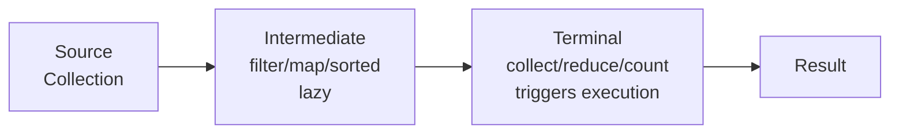
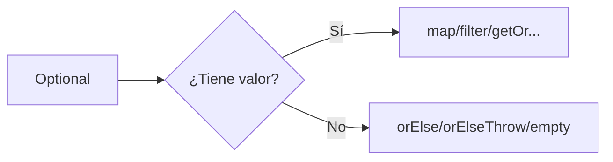

# Módulo 4: Programación funcional y Streams

En el módulo anterior aprendiste a manejar errores y recursos. Ahora el foco cambia a cómo transformar datos con claridad. En código de negocio aparecen pipelines repetidos: filtrar, mapear, agrupar, sumar, buscar. Los Streams y lambdas no reemplazan todo `for`; aportan un modelo declarativo cuando la operación es una transformación de datos. La clave es usarlos con disciplina: sin efectos secundarios ocultos, con tipos claros y sabiendo cuándo `Optional` o un bucle simple es mejor.

**Entorno de referencia verificado (2026-05-22):** JDK 27.0.1.0.2.

## Aprende construyendo

## Proyecto desde cero: tienda-aurora-streams

### Prerrequisitos

```bash
java -version    # JDK 25+
gradle --version # Gradle 9.x
```

### Estructura del proyecto

```text
tienda-aurora-streams/
├── build.gradle.kts
├── settings.gradle.kts
└── src/
    └── main/
        └── java/com/aurora/streams/
            ├── Main.java
            └── domain/
                └── Order.java
```

### build.gradle.kts

```kotlin
plugins {
    java
    application
}

group = "com.aurora"
version = "1.0.0"

java {
    toolchain {
        languageVersion = JavaLanguageVersion.of(25)
    }
}

application {
    mainClass.set("com.aurora.streams.Main")
}

repositories {
    mavenCentral()
}
```

### settings.gradle.kts

```kotlin
rootProject.name = "tienda-aurora-streams"
```

### Ejecutar

```bash
./gradlew run
# O directamente:
mkdir -p out
javac -d out src/main/java/com/aurora/streams/**/*.java
java -cp out com.aurora.streams.Main
```

### Tema 1: Stream API — map, filter, reduce, collect · Intermedio · 45 min

**Caso guía.** tienes una lista de guías con pesos y quieres calcular el total de guías pesadas. El enfoque imperativo funciona, pero mezcla iteración, condición y acumulación; un stream expresa la intención como pipeline.



Stream, pipeline, pereza

**Definición.** Un `Stream<T>` es una secuencia de elementos que soporta operaciones agregadas. Un pipeline tiene fuente, cero o más operaciones intermedias (lazy) y una terminal (eager).

**Cómo funciona por dentro.** Las intermedias no ejecutan el trabajo; construyen el pipeline. La terminal lo dispara. Esto permite fusionar operaciones y evitar trabajo innecesario en algunos casos (como `findFirst`).

**Cuándo usar / cuándo no.** Úsalo para transformar/consultar colecciones con claridad. No para lógica con muchos efectos secundarios, mutación compartida o control de flujo complejo.

**Ejemplo mínimo enfocado (ejecutable).**

```bash
mkdir -p java-m4-stream
cd java-m4-stream
```

Crea el archivo `DemoStream.java`:

```java
import java.util.*;
import java.util.stream.*;

public class DemoStream {
  public static void main(String[] args) {
    List<Integer> pesos = List.of(1, 6, 3, 8);
    int total = pesos.stream()
      .filter(p -> p > 5)
      .mapToInt(Integer::intValue)
      .sum();
    System.out.println(total);
  }
}
```

```bash
javac DemoStream.java
java DemoStream
```

**Error común.** Reusar un stream ya consumido. Síntoma: `IllegalStateException: stream has already been operated upon or closed`. Corrección: crear otro stream desde la fuente.

**Verificación (JDK 27, 2026-05-22).** `14`.

`map`, `filter`, `reduce`, `collect`

**Definición.** `filter` selecciona elementos por predicado; `map` transforma; `reduce` combina a un valor; `collect` materializa en una estructura o resumen.

**Contrato/reglas.** Las lambdas deben ser no interferentes y preferiblemente sin estado. `reduce` necesita identidad y operador asociativo para ser correcto, especialmente en paralelo.

**Ejemplo mínimo enfocado (ejecutable).**

```bash
mkdir -p java-m4-ops
cd java-m4-ops
```

Crea el archivo `DemoOps.java`:

```java
import java.util.*;
import java.util.stream.*;

public class DemoOps {
  public static void main(String[] args) {
    List<String> guias = List.of("G1", "G2", "G3");
    String joined = guias.stream().map(String::toLowerCase).collect(Collectors.joining(","));
    int sum = List.of(1, 2, 3).stream().reduce(0, Integer::sum);
    System.out.println(joined);
    System.out.println(sum);
  }
}
```

```bash
javac DemoOps.java
java DemoOps
```

**Error común.** Usar `reduce` para mutar una lista compartida. Corrección: `collect(Collectors.toList())`.

**Verificación (JDK 27, 2026-05-22).** `g1,g2,g3`, `6`.

### Tema 2: Optional — evitar null explícitamente · Intermedio · 35 min

**Caso guía.** buscar una guía por código. Puede existir o no. Devolver `null` obliga a recordar el chequeo; olvidarlo produce `NullPointerException`.

`Optional<T>`

**Definición.** `Optional<T>` es un contenedor que puede contener o no un valor no nulo, y expone operaciones para manejar ambos casos.

**Cómo funciona por dentro.** `Optional.of(v)` rechaza null; `ofNullable(v)` acepta null; `empty()` representa ausencia. Métodos como `map`, `filter`, `orElse`, `orElseThrow` componen el manejo.



**Cuándo usar / cuándo no.** Úsalo como retorno de búsqueda/cálculo que puede no existir. No lo uses como campo de entidad, parámetro general o en colecciones de Optional; agrega ruido.

**Ejemplo mínimo enfocado (ejecutable).**

```bash
mkdir -p java-m4-opt
cd java-m4-opt
```

Crea el archivo `DemoOpt.java`:

```java
import java.util.*;

public class DemoOpt {
  static Optional<String> buscar(String id) {
    return "A1".equals(id) ? Optional.of("Guia A1") : Optional.empty();
  }

  public static void main(String[] args) {
    System.out.println(buscar("A1").orElse("NA"));
    System.out.println(buscar("X").orElse("NA"));
    System.out.println(buscar("A1").map(String::toUpperCase).orElse("NA"));
  }
}
```

```bash
javac DemoOpt.java
java DemoOpt
```

**Error común.** `optional.get()` sin verificar. Síntoma: `NoSuchElementException`. Corrección: `orElseThrow`, `orElse`, `ifPresentOrElse`.

**Verificación (JDK 27, 2026-05-22).** `Guia A1`, `NA`, `GUIA A1`.

### Tema 3: Stream Gatherers (Java 24) · Avanzado · 40 min

**Caso guía.** quieres ventanas deslizantes o agrupar por lotes en un stream. Antes se requerían bucles externos o colecciones mutables.

Gatherers

**Definición.** Un Gatherer es una operación intermedia personalizada de Stream que puede transformar, acumular, cortocircuitar o emitir elementos de forma controlada.

**Cómo funciona por dentro.** Expone funciones de inicializador, integrador, combinador y finalizador. Java incluye gatherers built-in como `windowFixed` y `windowSliding` (según versión/API disponible).

**Cuándo usar / cuándo no.** Úsalo cuando la operación intermedia no se expresa bien con `map/filter/flatMap`. No lo uses si una operación estándar ya es clara.

**Ejemplo mínimo enfocado (ejecutable, JDK 27).**

```bash
mkdir -p java-m4-gather
cd java-m4-gather
```

Crea el archivo `DemoGather.java`:

```java
import java.util.*;
import java.util.stream.*;

public class DemoGather {
  public static void main(String[] args) {
    var ventanas = Stream.of(1,2,3,4,5)
      .gather(java.util.stream.Gatherers.windowFixed(2))
      .toList();
    System.out.println(ventanas);
  }
}
```

```bash
javac DemoGather.java
java DemoGather
```

**Error común.** Implementar gatherers complejos con estado mutable no seguro. Corrección: mantener estado local al integrador o usar combinador correcto para paralelo.

**Verificación (JDK 27, 2026-05-22).** `[[1, 2], [3, 4], [5]]`.

### Tema 4: Streams paralelos y referencias a métodos · Intermedio · 35 min

**Caso guía.** procesar muchos elementos CPU-bound puede beneficiarse de paralelismo, pero solo si la operación es independiente y segura.

Streams paralelos

**Definición.** `parallelStream()` o `stream().parallel()` divide el trabajo en subtareas ejecutadas en el ForkJoinPool común por defecto.

**Contrato/riesgos.** Requiere operaciones sin estado compartido mutable, asociativas para reduce, y cuidado con orden. El overhead puede superar el beneficio en colecciones pequeñas o tareas I/O bloqueantes.

**Ejemplo mínimo enfocado (ejecutable).**

```bash
mkdir -p java-m4-par
cd java-m4-par
```

Crea el archivo `DemoPar.java`:

```java
import java.util.stream.*;

public class DemoPar {
  public static void main(String[] args) {
    int sum = IntStream.rangeClosed(1, 1000).parallel().sum();
    System.out.println(sum);
  }
}
```

```bash
javac DemoPar.java
java DemoPar
```

**Error común.** Usar `parallel()` con `ArrayList` compartido y `forEach` mutando. Síntoma: datos perdidos/condición de carrera. Corrección: `collect`.

**Verificación (JDK 27, 2026-05-22).** `500500`.

Referencias a métodos

**Definición.** Sintaxis compacta (`Class::method`, `obj::method`, `Class::new`) para lambdas que solo delegan a un método existente.

**Ejemplo mínimo enfocado (ejecutable).**

```bash
mkdir -p java-m4-ref
cd java-m4-ref
```

Crea el archivo `DemoRef.java`:

```java
import java.util.*;
import java.util.stream.*;

public class DemoRef {
  static String tag(String s) { return "[" + s + "]"; }
  public static void main(String[] args) {
    System.out.println(Stream.of("a","b").map(DemoRef::tag).collect(Collectors.joining(",")));
  }
}
```

```bash
javac DemoRef.java
java DemoRef
```

**Error común.** Forzar referencia a método cuando la lambda es más legible. Corrección: priorizar claridad.

**Verificación (JDK 27, 2026-05-22).** `[a],[b]`.

## Cierre

Streams expresan transformaciones; Optional expresa ausencia; gatherers extienden pipelines; parallel streams requieren seguridad y medición.

## Checklist

- Distingo operaciones intermedias (lazy) y terminales (eager).
- No uso streams con efectos secundarios compartidos.
- Uso `Optional` para retornos ausentes, no como campo general.
- Mido antes de usar `parallelStream()`.
