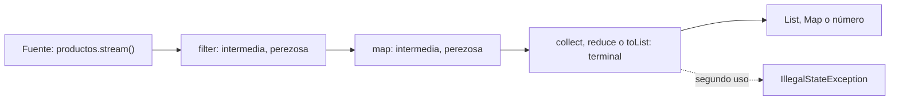
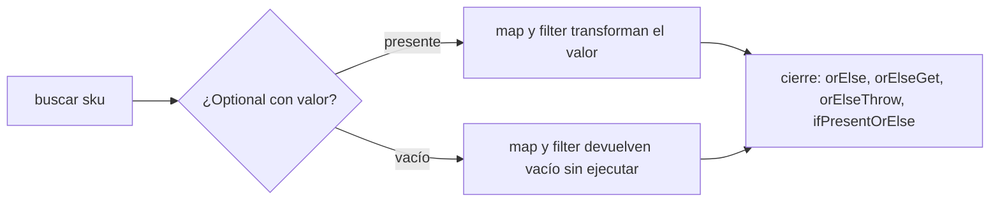
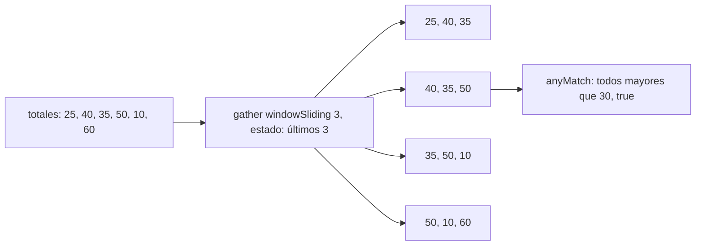
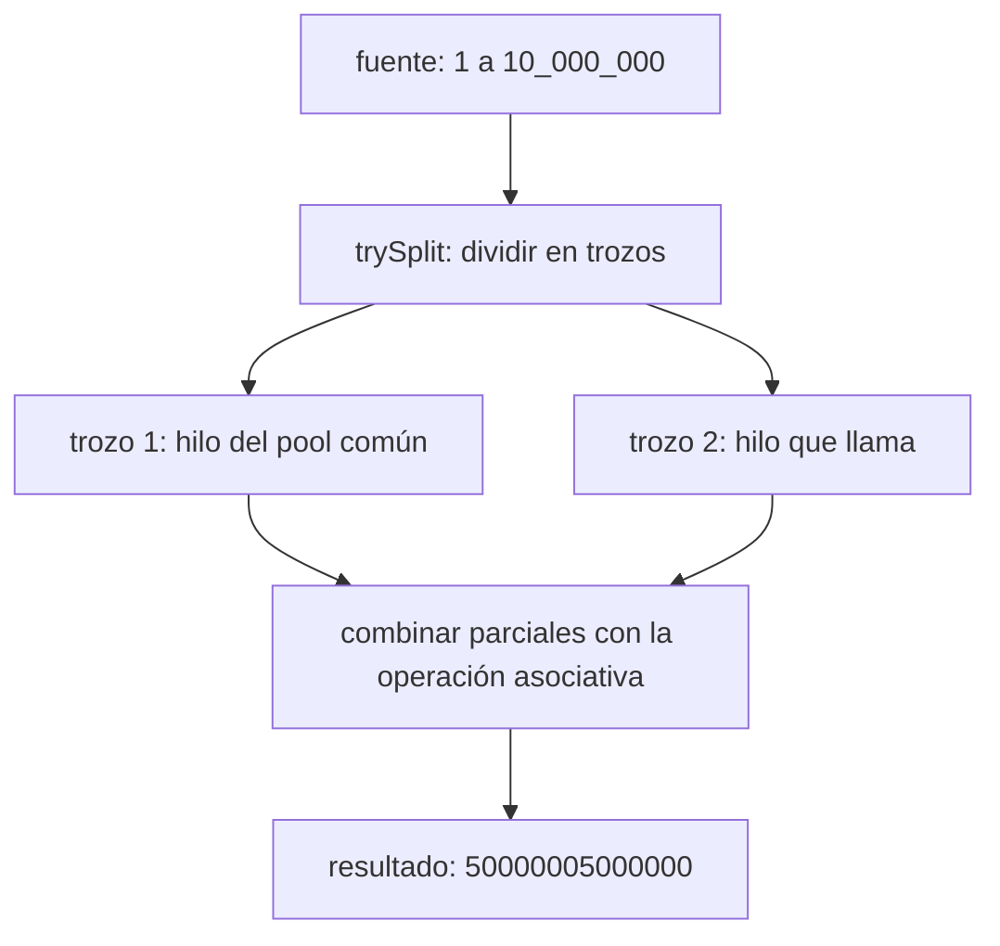

# Módulo 4: Streams y programación funcional

Cuando el módulo 2 te dejó con colecciones y el módulo 3 con errores controlados, el siguiente problema práctico es transformar datos sin escribir bucles imperativos por todos lados. Tienda Aurora necesita responder preguntas como: qué productos activos hay en una categoría, cuál es el valor de inventario por categoría, cuánto facturó un conjunto de pedidos, quiénes son los mejores clientes, o qué ciudades fueron atendidas. Se puede resolver con `for`, acumuladores y mapas mutables; Java Streams permite expresar la intención como un pipeline de transformación.

Un stream no es una colección. Es una secuencia de elementos que se consume una vez, con operaciones intermedias perezosas (`filter`, `map`, `sorted`) y una operación terminal (`collect`, `reduce`, `forEach`, `toList`) que dispara la ejecución. La ventaja no es “menos líneas”, sino separar qué quieres calcular de cómo iterar. El costo es que un pipeline opaco también puede ser difícil de leer; el criterio es usar streams cuando aclaran la transformación, no por moda.

**Entorno de referencia verificado (2026-05-23):** macOS arm64, JDK 27.0.1.0.2, Gradle 9.9.1, toolchain Java 25.

**Entorno de las salidas nuevas de los temas (2026-11-24):** Linux x86_64 con 2 núcleos, OpenJDK 25.0.5.1, `javac` y `java` sin Gradle. Con ese mismo JDK se recompiló el código principal del laboratorio con `-Xlint:all -Werror` y se ejecutaron `run` y `auditoria`; los resultados coinciden con los del entorno de referencia, salvo los milisegundos. Las pruebas JUnit no se ejecutaron en ese entorno. El mensaje de error de JDK 21 del Tema 3 se capturó con OpenJDK 21.0.13.1.

## Apertura del módulo

#### Objetivos del módulo
Al terminar este módulo podrás:
- escribir lambdas y referencias a métodos y explicar qué interfaz funcional implementan;
- construir un pipeline con fuente, operaciones intermedias y una operación terminal;
- transformar, filtrar, aplanar, reducir y agrupar datos con `map`, `filter`, `flatMap`, `reduce` y `collect`;
- devolver `Optional` en lugar de `null` y cerrar la ausencia con `orElse`, `orElseGet` u `orElseThrow`;
- resolver ventanas, acumulados y lógica con estado usando gatherers (Java 24+);
- medir un stream paralelo y explicar cuándo empeora el rendimiento o rompe el resultado.

#### Esquema del módulo
1. Tema 1 — Stream API: map, filter, reduce, collect.
2. Tema 2 — Optional: evitar null explícitamente.
3. Tema 3 — Stream Gatherers (Java 24).
4. Tema 4 — Streams paralelos y referencias a métodos.
5. Laboratorio integrador — `tienda-aurora-streams`, reportes de catálogo y ventas.

#### Qué necesitas saber antes
- **Java, Módulo 1:** `record`, interfaces y clases anidadas.
- **Java, Módulo 2:** `List`, `Map`, `Comparator` y genéricos.
- **Java, Módulo 3:** excepciones unchecked y `IllegalStateException`.

## Visual del módulo

**Visual:** [Pipeline de Java Streams con fuente, operaciones intermedias, gather, terminal y Optional](/visuals/temas/java/modulo-4-streams.html)

Lectura: Fuente → operaciones intermedias perezosas → terminal. Optional hace explícita la ausencia.

## Prerrequisitos

```bash
java -version
gradle --version
```

## Aprende construyendo

### Tema 1: Stream API — map, filter, reduce, collect · Intermedio · 60 min

<details open>
<summary><strong>Capa 1 — Lectura</strong></summary>

#### Objetivos
Al terminar este tema podrás:
- escribir una lambda y guardarla en una interfaz funcional como `Predicate`;
- construir un pipeline con fuente, operaciones intermedias y una terminal, y predecir cuándo se ejecuta;
- elegir entre `map` y `flatMap`, y entre `reduce` y `collect`;
- agrupar y unir resultados con `Collectors`.

**Conceptos clave:** lambda, interfaz funcional, referencia a método, Stream, operación intermedia, operación terminal, filter, map, flatMap, reduce, collect, Collectors

#### El problema
Tienda Aurora quiere saber qué productos tienen stock, cuántas unidades hay en total, cuántos productos hay por
categoría y cuáles están agotados. Con bucles `for` necesitas cuatro acumuladores, un mapa mutable y varios `if`.
¿Cómo expresas cada pregunta como una cadena de pasos que se lea igual que la pregunta?

#### Glosario del tema

**lambda**
- **Definición técnica:** expresión `(parámetros) -> cuerpo` que crea una implementación anónima del único método abstracto de una interfaz funcional.
- **En palabras sencillas:** una función pequeña escrita en el lugar donde se usa, sin darle nombre.
- **Dónde se rompe la comparación:** no es un método suelto: Java la convierte en un objeto de la interfaz que espera el contexto.
- **Ejemplo:** `p -> p.stock() > 0` en la línea 18 del Problema resuelto 1.1 decide si un producto tiene stock.
- **Error típico:** modificar una variable local desde la lambda: `error: local variables referenced from a lambda expression must be final or effectively final`.

**interfaz funcional**
- **Definición técnica:** interfaz con exactamente un método abstracto; el paquete `java.util.function` trae las comunes: `Predicate<T>` (prueba), `Function<T,R>` (transforma), `BiFunction<T,U,R>`, `Consumer<T>` y `Supplier<T>`.
- **En palabras sencillas:** un enchufe con una sola forma; cualquier lambda con esa forma encaja.
- **Dónde se rompe la comparación:** el enchufe puede traer métodos extra ya hechos (`default`), como `negate()` en `Predicate`.
- **Ejemplo:** `Predicate<Producto> conStock` (línea 18) y `conStock.negate()` (línea 36) del Problema resuelto 1.1; la salida muestra `agotados: [CAF-101]`.
- **Error típico:** asignar una lambda a un tipo que no es funcional, como `Object o = x -> x;`: el compilador responde `incompatible types: Object is not a functional interface`.

**referencia a método**
- **Definición técnica:** forma abreviada `Tipo::metodo` o `objeto::metodo` de una lambda que solo llama a un método existente con los mismos argumentos.
- **En palabras sencillas:** en vez de escribir «toma p y dame su SKU», nombras directamente «el SKU».
- **Dónde se rompe la comparación:** solo sirve si la lambda no hace nada más que llamar; con lógica extra, vuelve a la lambda.
- **Ejemplo:** `Producto::sku` equivale a `p -> p.sku()`; en la línea 37 del Problema resuelto 1.1 produce `agotados: [CAF-101]`. Las cuatro formas se estudian en el Tema 4.
- **Error típico:** poner paréntesis (`Producto::sku()`): es un error de sintaxis; la referencia no llama al método, lo nombra.

**Stream**
- **Definición técnica:** `java.util.stream.Stream<T>`, secuencia de elementos que se procesa con un pipeline y se consume una sola vez; no guarda los datos.
- **En palabras sencillas:** una cinta transportadora que pasa los elementos de una colección por varias estaciones.
- **Dónde se rompe la comparación:** la cinta no se rebobina: después de la operación terminal, el stream ya no sirve.
- **Ejemplo:** `productos.stream()` en la línea 20 del Problema resuelto 1.1 crea la fuente del pipeline.
- **Error típico:** reutilizarlo: `IllegalStateException` con el mensaje `stream has already been operated upon or closed`.

**operación intermedia**
- **Definición técnica:** operación que devuelve otro `Stream` y es perezosa: registra una transformación pero no recorre datos hasta que una terminal lo pide.
- **En palabras sencillas:** una estación de la cinta que se instala, pero no arranca hasta que alguien pide el resultado.
- **Dónde se rompe la comparación:** algunas, como `sorted()`, necesitan ver todos los elementos antes de dejar pasar el primero.
- **Ejemplo:** en el Problema resuelto 1.2, `pipeline armado: nada se ha recorrido` se imprime antes que cualquier `filter`.
- **Error típico:** poner efectos (imprimir, guardar) en una intermedia y sorprenderse de que no ocurran sin terminal.

**operación terminal**
- **Definición técnica:** operación que consume el stream, dispara la ejecución del pipeline y produce un valor (`toList`, `count`, `reduce`, `collect`) o un efecto (`forEach`).
- **En palabras sencillas:** el botón que arranca la cinta y entrega el producto final.
- **Dónde se rompe la comparación:** algunas cortan antes de terminar (`limit` + `toList`, `findFirst`, `anyMatch`) y dejan elementos sin procesar.
- **Ejemplo:** `pipeline.limit(1).toList()` en la línea 23 del Problema resuelto 1.2 solo procesa `MOL-200` y `CAF-100`.
- **Error típico:** llamar dos terminales sobre el mismo stream (líneas 23 y 27 del Problema resuelto 1.2).

**`filter`**
- **Definición técnica:** operación intermedia que recibe un `Predicate<T>` y deja pasar solo los elementos para los que devuelve `true`.
- **En palabras sencillas:** un colador: lo que cumple la condición sigue; lo demás se queda.
- **Dónde se rompe la comparación:** el colador no cambia los elementos, solo decide cuáles pasan.
- **Ejemplo:** `.filter(conStock)` en la línea 21 del Problema resuelto 1.1 descarta `Cafe Sierra`, que tiene stock 0.
- **Error típico:** invertir la condición y quedarse con lo que querías descartar; nombrar el predicado (`conStock`) lo evita.

**`map`**
- **Definición técnica:** operación intermedia que aplica una `Function<T,R>` a cada elemento y produce exactamente un resultado por entrada.
- **En palabras sencillas:** una máquina que transforma cada pieza en otra, una por una.
- **Dónde se rompe la comparación:** si la transformación devuelve una colección, obtienes un stream de colecciones, no de sus elementos.
- **Ejemplo:** `.map(p -> p.nombre().toUpperCase())` (línea 22 del Problema resuelto 1.1) produce `[CAFE AURORA, MOLINO MANUAL, FILTROS V60]`.
- **Error típico:** usar `map` cuando cada entrada trae varias salidas: la línea 43 del Problema resuelto 1.2 deja `3 streams, no SKUs`.

**`flatMap`**
- **Definición técnica:** operación intermedia que aplica una función que devuelve un `Stream` por elemento y concatena todos esos streams en uno solo.
- **En palabras sencillas:** abrir cada caja y vaciar su contenido en la misma cinta.
- **Dónde se rompe la comparación:** una caja vacía no aporta nada: un elemento puede producir cero salidas.
- **Ejemplo:** `.flatMap(lineas -> lineas.stream())` (línea 38 del Problema resuelto 1.2) produce `{CAF-100=3, FIL-300=1, MOL-200=1}`.
- **Error típico:** devolver una `List` en lugar de un `Stream` dentro de `flatMap`: el compilador no acepta el tipo.

**`reduce`**
- **Definición técnica:** operación terminal que combina todos los elementos en un único valor con una identidad y una función asociativa.
- **En palabras sencillas:** ir sumando (o combinando) de dos en dos hasta que queda uno.
- **Dónde se rompe la comparación:** «de dos en dos» no fija el orden: en paralelo, la función debe dar igual agrupe como agrupe.
- **Ejemplo:** `.reduce(0, (a, b) -> a + b)` (línea 28 del Problema resuelto 1.1) imprime `unidades totales: 36`.
- **Error típico:** usar `reduce` para construir listas; para eso existen `collect` y `toList`.

**`collect`**
- **Definición técnica:** operación terminal que acumula los elementos en un contenedor mutable siguiendo un `Collector` (crear, acumular, combinar y terminar).
- **En palabras sencillas:** el empaque final: decide si el resultado sale como lista, mapa o texto.
- **Dónde se rompe la comparación:** el empaque puede tener empaques dentro: un collector puede delegar en otro (*downstream*).
- **Ejemplo:** `.collect(Collectors.toList())` en la línea 23 del Problema resuelto 1.1.
- **Error típico:** asumir que `Collectors.toList()` devuelve una lista inmodificable; si la necesitas inmodificable usa `toList()` del stream.

**Collectors**
- **Definición técnica:** clase de `java.util.stream` con fábricas de `Collector`: `toList`, `toSet`, `toMap`, `groupingBy`, `counting`, `summingLong`, `reducing`, `joining`.
- **En palabras sencillas:** la caja de herramientas de empaques ya hechos.
- **Dónde se rompe la comparación:** `groupingBy` no da orden por defecto; si lo quieres ordenado, pasa un `TreeMap::new`.
- **Ejemplo:** `Collectors.groupingBy(Producto::categoria, TreeMap::new, Collectors.counting())` (línea 32) imprime `{ACCESORIOS=1, BEBIDAS=2, MOLIENDA=1}`.
- **Error típico:** usar `toMap` con claves repetidas: `IllegalStateException: Duplicate key k (attempted merging values 1 and 2)`; usa `groupingBy` o una función de mezcla.

#### ► CÓMO FUNCIONA

##### 1. La idea en lenguaje sencillo

Piensa en una línea de empaque de una bodega. Las cajas entran por un extremo, pasan por una mesa que descarta las
dañadas, otra que les pone etiqueta y, al final, alguien las cuenta. Nadie mueve una caja hasta que el encargado
del final pide el conteo.

Un stream de Java funciona igual. Tú describes las estaciones: «descarta lo que no tiene stock», «toma el nombre»,
«júntalo en una lista». Java no recorre nada mientras describes. Recorre cuando pides el resultado final, y lo hace
una sola vez.

En Tienda Aurora esto cambia la forma de escribir los reportes. Con un `for` mezclas tres cosas: cómo avanzar por
la lista, qué condición aplicar y dónde acumular. Con un stream escribes solo las dos últimas. El recorrido lo pone
la librería.

La ganancia real no es escribir menos líneas. Es que el código se lee como la pregunta de negocio: «productos con
stock, en mayúsculas, en una lista». Cuando la pregunta cambia, cambias una estación y no reescribes el bucle
entero.

##### 2. Definición formal y vocabulario

La documentación del paquete `java.util.stream` define un **Stream** como una secuencia de elementos que admite
operaciones agregadas, secuenciales o paralelas. Un stream no almacena datos: los toma de una **fuente**, como una
colección, un arreglo o un generador. En palabras sencillas, es la cinta, no la bodega.

Las operaciones se combinan en un **pipeline** (cadena de procesamiento). Tiene una fuente, cero o más
**operaciones intermedias** y una **operación terminal**. Las intermedias devuelven otro `Stream` y son
**perezosas**: registran el trabajo sin hacerlo. La terminal consume el stream y produce un valor o un efecto.

Las estaciones reciben su comportamiento como **lambda**. Una lambda implementa el único método abstracto de una
**interfaz funcional**. `filter` espera un `Predicate<T>`, `map` espera una `Function<T,R>` y `reduce` espera un
`BinaryOperator<T>`. Cuando la lambda solo llama a un método existente, la abrevias con una **referencia a
método**, como `Producto::sku`.

Las intermedias que más usarás son **`filter`**, que decide qué elementos pasan, y **`map`**, que transforma cada
uno en exactamente otro. **`flatMap`** transforma cada elemento en un stream y concatena todos. Las terminales de
este tema son **`reduce`**, que combina todo en un valor, y **`collect`**, que acumula en un contenedor.
**Collectors** trae los contenedores ya hechos.

##### 3. Cómo funciona por dentro, paso a paso

Sigue lo que ocurre con el pipeline de nombres del Problema resuelto 1.1:

```java
List<String> nombres = productos.stream()
        .filter(conStock)
        .map(p -> p.nombre().toUpperCase())
        .collect(Collectors.toList());
```

1. El compilador traduce cada lambda en una instrucción `invokedynamic`. Al ejecutarla por primera vez, la JVM crea
   un objeto que implementa la interfaz funcional esperada.
2. `productos.stream()` crea la etapa fuente. Por dentro guarda un **Spliterator**, el objeto que sabe recorrer la
   lista y partirla en trozos.
3. `filter` y `map` no recorren nada. Cada una crea una etapa nueva enlazada a la anterior y guarda su lambda. Por
   eso el Problema resuelto 1.2 imprime `pipeline armado: nada se ha recorrido` antes que cualquier `filter`.
4. `collect` es la terminal. Encadena las etapas de atrás hacia adelante en receptores internos: cada etapa sabe a
   quién pasar lo que produce.
5. El Spliterator empuja los elementos uno a uno. Cada elemento atraviesa todas las estaciones antes de que entre
   el siguiente: es un recorrido vertical, no por etapas completas.
6. Al terminar, la etapa fuente queda marcada como consumida. Una segunda terminal lanza `IllegalStateException`.



El paso 5 explica la salida del Problema resuelto 1.2. `MOL-200` entra, no pasa el filtro y se descarta. `CAF-100`
pasa el filtro, entra a `map` y llega a `limit(1)`. Como ya hay un resultado, el recorrido se corta y `FIL-300`
nunca se toca. A ese corte se le llama **cortocircuito**.

`reduce` combina con una identidad y una función. La identidad responde a «¿cuánto vale la suma de cero
elementos?». En `Pedido.total()` del laboratorio la identidad es `BigDecimal.ZERO`:

```java
return lineas.stream()
        .map(LineaPedido::subtotal)
        .reduce(BigDecimal.ZERO, BigDecimal::add);
```

`collect` es más general. Un `Collector` describe cuatro funciones: crear el contenedor, acumular un elemento,
combinar dos contenedores parciales y entregar el resultado. Por eso `groupingBy` puede recibir otro collector,
llamado *downstream*, que decide qué se acumula dentro de cada grupo.

##### 4. Reglas, variantes y casos límite

La API de streams llegó en Java 8. Desde entonces la documentación exige tres condiciones a las lambdas que pasas:

- **No interferir**: no modifiques la fuente mientras el pipeline la recorre. Si lo haces, `ArrayList` suele lanzar
  `ConcurrentModificationException`.
- **Sin estado**: el resultado de la lambda no debe depender de algo que cambie durante el recorrido.
- **Asociatividad** en `reduce`: `(a + b) + c` debe dar lo mismo que `a + (b + c)`. En secuencial casi no se nota;
  en paralelo (Tema 4) cambia el resultado.

Las intermedias se dividen en dos clases. Las **sin estado** (`filter`, `map`, `flatMap`) procesan cada elemento
sin mirar a los demás. Las **con estado** (`sorted`, `distinct`) necesitan recordar elementos; `sorted` consume la
fuente entera antes de emitir el primero. Un `findFirst` después de `sorted` no ahorra el ordenamiento.

Las variables locales que usa una lambda deben ser *effectively final*: no pueden reasignarse después. Por eso
`total += s` dentro de `forEach` no compila, como muestra el recuadro de error de este tema.

Hay cambios por versión que conviene conocer. Java 9 añadió `takeWhile`, `dropWhile` y `Stream.ofNullable`. Java 16
añadió `Stream.toList()` y `mapMulti`. `toList()` devuelve una lista inmodificable. `Collectors.toList()` no
garantiza tipo ni mutabilidad; hoy devuelve un `ArrayList`, pero la documentación no lo promete.

Con `Collectors.toMap`, una clave repetida lanza `IllegalStateException: Duplicate key`. Lo resuelves con una
función de mezcla como tercer argumento o con `groupingBy`. `groupingBy` devuelve un `HashMap` sin orden
garantizado; si necesitas orden, pasas `TreeMap::new`, como en el Problema resuelto 1.1.

Para números existen streams primitivos: `IntStream`, `LongStream` y `DoubleStream`.
`mapToInt(Producto::stock).sum()` evita convertir cada `int` en un objeto `Integer`. Es la alternativa directa al
`reduce(0, (a, b) -> a + b)` del Problema resuelto 1.1.

##### 5. Relación con lo que ya sabes y lo que viene

Este tema se apoya en tres módulos anteriores. Los `record` del Java, Módulo 1 son los datos que viajan por la
cinta. Las `List`, `Map` y `Comparator` del Java, Módulo 2 son fuentes y destinos del pipeline. La
`IllegalStateException` del Java, Módulo 3 es la que ves al reutilizar un stream.

Un stream no es una colección. Una `List` guarda elementos y la recorres cuantas veces quieras. Un stream no guarda
nada y se consume una vez. Si necesitas recorrer dos veces, vuelves a pedir `stream()` a la colección.

`Optional`, en el Tema 2, nace de terminales como `findFirst()` y `max()`, que pueden no encontrar nada. Los
gatherers del Tema 3 añaden estaciones con memoria, como ventanas y acumulados. El Tema 4 ejecuta el mismo pipeline
en varios hilos y pone a prueba las reglas de asociatividad de la subsección anterior.

#### Problema resuelto 1.1
Responde cuatro preguntas sobre el catálogo: nombres con stock, unidades totales, productos por categoría y SKUs agotados.

**Razonamiento:**
1. «Con stock» es una condición reutilizable: se guarda una vez como `Predicate<Producto>`.
2. Nombres con stock: filtrar, transformar a mayúsculas y juntar en lista.
3. Unidades: transformar cada producto en su stock y combinar con suma.
4. Por categoría: agrupar y contar; un `TreeMap` deja el resultado ordenado.
5. Agotados: la condición negada, el SKU y un texto unido con comas.

```java
import java.util.List;
import java.util.Map;
import java.util.TreeMap;
import java.util.function.Predicate;
import java.util.stream.Collectors;

public class PipelineBasico {

    record Producto(String sku, String nombre, String categoria, double precio, int stock) {}

    public static void main(String[] args) {
        List<Producto> productos = List.of(
                new Producto("CAF-100", "Cafe Aurora", "BEBIDAS", 14.90, 8),
                new Producto("CAF-101", "Cafe Sierra", "BEBIDAS", 16.50, 0),
                new Producto("MOL-200", "Molino Manual", "MOLIENDA", 79.90, 3),
                new Producto("FIL-300", "Filtros V60", "ACCESORIOS", 9.50, 25));

        Predicate<Producto> conStock = p -> p.stock() > 0;

        List<String> nombres = productos.stream()
                .filter(conStock)
                .map(p -> p.nombre().toUpperCase())
                .collect(Collectors.toList());
        System.out.println("con stock: " + nombres);

        int unidades = productos.stream()
                .map(p -> p.stock())
                .reduce(0, (a, b) -> a + b);
        System.out.println("unidades totales: " + unidades);

        Map<String, Long> porCategoria = productos.stream()
                .collect(Collectors.groupingBy(Producto::categoria, TreeMap::new, Collectors.counting()));
        System.out.println("productos por categoría: " + porCategoria);

        String agotados = productos.stream()
                .filter(conStock.negate())
                .map(Producto::sku)
                .collect(Collectors.joining(", ", "[", "]"));
        System.out.println("agotados: " + agotados);
    }
}
```

```text
$ javac PipelineBasico.java && java PipelineBasico
con stock: [CAFE AURORA, MOLINO MANUAL, FILTROS V60]
unidades totales: 36
productos por categoría: {ACCESORIOS=1, BEBIDAS=2, MOLIENDA=1}
agotados: [CAF-101]
```

**Explicación por partes.**
- Línea 9: un `record` local sirve de dato inmutable para el ejemplo.
- Línea 18: la lambda queda guardada en una interfaz funcional y se reutiliza dos veces.
- Líneas 20–23: fuente, dos intermedias y una terminal; nada se recorre hasta `collect`.
- Líneas 26–28: `map` deja un `Stream<Integer>` y `reduce` lo combina empezando en `0`.
- Línea 32: `groupingBy` recibe la clave, la fábrica del mapa y el collector *downstream* que cuenta.
- Líneas 36–38: `negate()` invierte el predicado; `joining` agrega separador, prefijo y sufijo.

#### Problema resuelto 1.2
Comprueba la pereza del pipeline, provoca el reuso de un stream y aplana pedidos con varias líneas.

**Razonamiento:**
1. Si cada intermedia imprime, se ve en qué momento y para qué elementos se ejecuta.
2. `limit(1)` corta en cuanto hay un resultado: los elementos siguientes no deberían procesarse.
3. Una segunda terminal sobre el mismo stream debe fallar.
4. Cada pedido es una lista de SKUs: para contarlos hay que aplanar.

```java
import java.util.List;
import java.util.Map;
import java.util.TreeMap;
import java.util.stream.Collectors;
import java.util.stream.Stream;

public class PerezaYConsumo {

    public static void main(String[] args) {
        List<String> skus = List.of("MOL-200", "CAF-100", "FIL-300", "TEA-100");

        Stream<String> pipeline = skus.stream()
                .filter(s -> {
                    System.out.println("  filter " + s);
                    return s.startsWith("CAF") || s.startsWith("TEA");
                })
                .map(s -> {
                    System.out.println("  map " + s);
                    return s.toLowerCase();
                });
        System.out.println("pipeline armado: nada se ha recorrido");

        List<String> primero = pipeline.limit(1).toList();
        System.out.println("primero: " + primero);

        try {
            pipeline.count();
        } catch (IllegalStateException e) {
            System.out.println("reuso: " + e.getMessage());
        }

        List<List<String>> pedidos = List.of(
                List.of("CAF-100", "FIL-300"),
                List.of("MOL-200"),
                List.of("CAF-100", "CAF-100"));

        Map<String, Long> unidadesPorSku = pedidos.stream()
                .flatMap(lineas -> lineas.stream())
                .collect(Collectors.groupingBy(s -> s, TreeMap::new, Collectors.counting()));
        System.out.println("unidades por SKU: " + unidadesPorSku);

        List<Stream<String>> sinAplanar = pedidos.stream()
                .map(lineas -> lineas.stream())
                .toList();
        System.out.println("con map quedan " + sinAplanar.size() + " streams, no SKUs");
    }
}
```

```text
$ javac PerezaYConsumo.java && java PerezaYConsumo
pipeline armado: nada se ha recorrido
  filter MOL-200
  filter CAF-100
  map CAF-100
primero: [caf-100]
reuso: stream has already been operated upon or closed
unidades por SKU: {CAF-100=3, FIL-300=1, MOL-200=1}
con map quedan 3 streams, no SKUs
```

**Explicación por partes.**
- Línea 21: se imprime primero; las líneas 12–20 solo armaron el pipeline.
- Línea 23: cada elemento pasa por todas las estaciones antes de que entre el siguiente. `MOL-200` no pasa el filtro; `CAF-100` sí, y `limit(1)` detiene todo. `FIL-300` y `TEA-100` nunca se tocan.
- Línea 27: segunda terminal sobre el mismo stream; el mensaje es literal del JDK.
- Línea 38: `flatMap` vacía las tres listas en una sola cinta de cinco SKUs.
- Líneas 42–45: con `map`, cada pedido sigue siendo un stream entero.

> **Error común.** Mutar estado externo desde una lambda. `lista.forEach(x -> total += x)` compila en ciertos contextos, pero es frágil: oscurece la intención y rompe la corrección en paralelo. El pipeline debe producir valores, no esconder efectos. Si lo intentas con una variable local, el compilador lo impide:
>
> ```text
> $ javac LambdaMuta.java
> LambdaMuta.java:7: error: local variables referenced from a lambda expression must be final or effectively final
>         stock.forEach(s -> total += s);
>                            ^
> 1 error
> ```
>
> Calcula el total con el pipeline (`mapToInt(...).sum()` o `reduce`) en lugar de acumular desde fuera.

> **Error común.** Reutilizar un stream. Los streams son de un solo uso. Si necesitas recorrer dos veces la misma fuente, crea dos streams desde la colección o materializa el primero con `toList()`. El mensaje que verás es `java.lang.IllegalStateException: stream has already been operated upon or closed`, como en la línea `reuso:` del Problema resuelto 1.2.

> **Buena práctica.** “stream es para todo”. Un `for` con dos variables, dos índices o una dependencia fuerte entre iteraciones suele ser más claro. Usa streams cuando el pipeline expresa una transformación; usa bucles cuando el algoritmo es imperativo por naturaleza.

> **Prevenir errores.** Confundir `reduce` con `collect`. `reduce` entrega un valor; `collect` construye un resultado estructurado. Para juntar elementos en una lista usa `toList()`, no un `reduce` con concatenación.

#### Checkpoint 1.1
En el Problema resuelto 1.2, si cambias `limit(1)` por `limit(2)`, ¿cuántas veces se imprime `filter`?

Respuesta: cuatro. Para encontrar dos SKUs que empiecen con `CAF` o `TEA` hay que llegar hasta `TEA-100`, el último.

</details>

<details>
<summary><strong>Capa 2 — Construcción</strong></summary>

#### Paso 1 · Prepara la carpeta
Crea `~/labs/java-m4-t1` y entra con `cd ~/labs/java-m4-t1`. Comprueba `java -version`.

#### Paso 2 · Arma el primer pipeline
Escribe `PipelineBasico.java` y ejecútalo con `javac PipelineBasico.java && java PipelineBasico`. Compara con la salida.

#### Paso 3 · Observa la pereza
Escribe `PerezaYConsumo.java`. Cambia `limit(1)` por `limit(2)` y comprueba tu respuesta al checkpoint.

#### Paso 4 · Provoca los errores
Escribe `total += s` dentro de un `forEach` y lee el error del compilador. Luego reemplázalo por `reduce`.

#### Resumen
- Una **lambda** implementa el único método de una **interfaz funcional**; una **referencia a método** la abrevia.
- Un **Stream** tiene fuente, **operaciones intermedias** perezosas y una **operación terminal** que lo consume.
- **filter** decide qué pasa; **map** transforma uno a uno; **flatMap** aplana contenedores.
- **reduce** combina en un valor con identidad y función asociativa; **collect** empaqueta con un collector.
- **Collectors** trae `groupingBy`, `counting`, `joining` y otros collectors listos.
- Un stream se usa una sola vez: el segundo uso lanza `IllegalStateException`.

#### Ejercicio verificable 1
Básico. Con la lista del Problema resuelto 1.1, obtén los SKUs de los productos con precio mayor que 10, en una lista.

Respuesta esperada: `productos.stream().filter(p -> p.precio() > 10).map(Producto::sku).toList()` produce
`[CAF-100, CAF-101, MOL-200]`.

#### Ejercicio verificable 2
Intermedio. Usa `reduce` para calcular el valor del inventario (`precio * stock`) de la misma lista.

Respuesta esperada: `productos.stream().map(p -> p.precio() * p.stock()).reduce(0.0, Double::sum)` imprime
`596.4000000000001` (119.2 + 0 + 239.7 + 237.5). El decimal largo aparece porque `double` no representa exactamente
los centavos; por eso el laboratorio usa `BigDecimal` para dinero.

#### Ejercicio verificable 3
Reto. Agrupa los productos por categoría y obtén la lista de nombres de cada una, ordenada por categoría.

Respuesta esperada: `Collectors.groupingBy(Producto::categoria, TreeMap::new, Collectors.mapping(Producto::nombre,
Collectors.toList()))`, asignado a un `Map<String, List<String>>`, produce `{ACCESORIOS=[Filtros V60], BEBIDAS=[Cafe Aurora, Cafe Sierra], MOLIENDA=[Molino Manual]}`.

#### En el trabajo
En un backend, los streams preparan respuestas: filtran registros de una consulta, los transforman en DTO y agrupan
para reportes. Las revisiones de código piden pipelines cortos y con nombres claros. Si un pipeline pasa de cinco
pasos o necesita estado entre iteraciones, se extrae a un método o se vuelve a un bucle.

</details>

### Tema 2: Optional — evitar null explícitamente · Básico · 45 min

<details open>
<summary><strong>Capa 1 — Lectura</strong></summary>

#### Objetivos
Al terminar este tema podrás:
- cambiar un método que devuelve `null` por uno que devuelve `Optional`;
- crear un `Optional` con la fábrica correcta según el dato pueda ser nulo o no;
- cerrar la ausencia con `orElse`, `orElseGet`, `orElseThrow` o `ifPresentOrElse`;
- explicar por qué `orElse` puede ejecutar trabajo innecesario.

**Conceptos clave:** null, Optional, Optional.of, orElse, orElseGet, orElseThrow, ifPresentOrElse, Supplier

#### El problema
El buscador de Tienda Aurora devuelve `null` cuando un SKU no existe. Funciona hasta que alguien escribe
`buscar("TAZ-002").nombre()` y la aplicación cae con un error que apunta a esa línea, no al buscador. ¿Cómo haces
que la firma del método avise que el producto puede no estar?

#### Glosario del tema

Las fichas de lambda, interfaz funcional, `map` y `filter` están en el Tema 1.

**null**
- **Definición técnica:** valor especial de cualquier tipo referencia que indica «no apunta a ningún objeto»; llamar un método sobre él lanza `NullPointerException`.
- **En palabras sencillas:** una etiqueta pegada a una caja que no existe.
- **Dónde se rompe la comparación:** el tipo no avisa: un `Producto` puede ser `null` y el compilador no lo distingue.
- **Ejemplo:** `buscarConNull("TAZ-002").nombre()` en la línea 47 del Problema resuelto 2.1 termina con `NullPointerException`.
- **Error típico:** devolver `null` para «no encontrado» y confiar en que cada llamador recuerde comprobarlo.

**Optional**
- **Definición técnica:** `java.util.Optional<T>`, contenedor inmutable de cero o un valor no nulo, pensado como tipo de retorno que declara una ausencia posible.
- **En palabras sencillas:** una caja con un letrero que dice «puede venir vacía»: no la puedes usar sin decidir qué hacer si lo está.
- **Dónde se rompe la comparación:** la caja no impide hacer trampa: `get()` la abre a ciegas.
- **Ejemplo:** `buscar("XXX-999")` imprime `Optional.empty` en el Problema resuelto 2.1.
- **Error típico:** usar `Optional` en campos o parámetros; su propósito es el valor de retorno.

**Optional.of**
- **Definición técnica:** fábricas de `Optional`: `of(valor)` exige no nulo, `ofNullable(valor)` devuelve vacío si recibe `null`, y `empty()` crea uno vacío.
- **En palabras sencillas:** tres formas de llenar la caja según estés seguro o no de tener algo.
- **Dónde se rompe la comparación:** `of` no «protege» de `null`: lo rechaza en el acto.
- **Ejemplo:** `Optional.ofNullable(System.getenv("SKU_POR_DEFECTO"))` imprime `variable de entorno presente: false`.
- **Error típico:** `Optional.of(null)` lanza `NullPointerException`, como muestra el Problema resuelto 2.2.

**orElse**
- **Definición técnica:** método de `Optional` que devuelve el valor si está presente o el argumento recibido si no; el argumento se evalúa antes de la llamada.
- **En palabras sencillas:** «dame lo que hay o, si no hay nada, este reemplazo».
- **Dónde se rompe la comparación:** el reemplazo se prepara siempre, aunque no se use.
- **Ejemplo:** `buscar("XXX-999").map(Producto::nombre).orElse("sin nombre")` imprime `con orElse: sin nombre`.
- **Error típico:** pasarle una llamada costosa: en el Problema resuelto 2.2 la consulta al proveedor ocurre aunque el valor exista.

**orElseGet**
- **Definición técnica:** método de `Optional` que recibe un `Supplier<T>` y solo lo ejecuta si el contenedor está vacío.
- **En palabras sencillas:** «si no hay nada, entonces ve a buscar el reemplazo».
- **Dónde se rompe la comparación:** no hay ahorro si el `Supplier` es trivial; para un literal, `orElse` es más claro.
- **Ejemplo:** en el Problema resuelto 2.2, `orElseGet(respaldo)` con valor presente no imprime la consulta costosa.
- **Error típico:** escribir `orElseGet(consultarProveedor())` con paréntesis: pasas el resultado, no la función, y no compila.

**orElseThrow**
- **Definición técnica:** método de `Optional` que devuelve el valor o lanza la excepción que crea el `Supplier` recibido; sin argumentos lanza `NoSuchElementException`.
- **En palabras sencillas:** «si no hay nada, esto es un error y lo digo con mis palabras».
- **Dónde se rompe la comparación:** convierte una ausencia esperable en un fallo; úsalo solo cuando faltar sea un error.
- **Ejemplo:** `orElseThrow(() -> new IllegalArgumentException("no existe el SKU TAZ-002"))` imprime `orElseThrow: no existe el SKU TAZ-002`.
- **Error típico:** usar `get()`, que hace lo mismo sin mensaje útil: `NoSuchElementException: No value present`.

**ifPresentOrElse**
- **Definición técnica:** método de `Optional` que recibe un `Consumer<T>` para el caso presente y un `Runnable` para el caso vacío, y ejecuta solo uno.
- **En palabras sencillas:** un `if/else` pegado a la caja: una acción si hay algo y otra si no.
- **Dónde se rompe la comparación:** no devuelve nada; si necesitas un valor, usa `map` y `orElse`.
- **Ejemplo:** líneas 34–36 del Problema resuelto 2.1, que imprimen `encontrado: Cafe Aurora`.
- **Error típico:** usar `ifPresent` y olvidar el caso vacío, que pasa en silencio.

**Supplier**
- **Definición técnica:** interfaz funcional `java.util.function.Supplier<T>` con el método `T get()`, sin parámetros.
- **En palabras sencillas:** una receta guardada: no cocina hasta que alguien la pide.
- **Dónde se rompe la comparación:** puede devolver algo distinto cada vez que se llama.
- **Ejemplo:** `Supplier<String> respaldo = () -> consultarProveedor();` en la línea 19 del Problema resuelto 2.2.
- **Error típico:** confundir `Supplier.get()` con `Optional.get()`: el primero calcula, el segundo abre la caja a ciegas.

#### ► CÓMO FUNCIONA

##### 1. La idea en lenguaje sencillo

Imagina que pides un repuesto en un mostrador. El empleado puede volver con la pieza o con las manos vacías. Si
vuelve con las manos vacías y no dice nada, tú sigues armando el aparato y descubres el problema mucho después.

Eso hace `null` en Java. El método `buscarConNull` promete un `Producto` y, a veces, entrega nada sin avisar. El
fallo no aparece en el buscador: aparece donde alguien llama `.nombre()`, como muestra la línea 47 del Problema
resuelto 2.1.

`Optional` es el empleado que vuelve con una caja rotulada «puede venir vacía». Antes de usar lo que hay dentro,
tienes que decidir qué haces si no hay nada. La ausencia deja de ser una sorpresa y pasa a ser parte del contrato.

En Tienda Aurora la pregunta «¿existe este SKU?» es normal, no un error. Un cliente puede escribir mal un código.
`Optional<Producto>` dice eso en la firma del método, y el compilador obliga al llamador a abrir la caja de forma
explícita.

##### 2. Definición formal y vocabulario

La documentación de `java.util.Optional<T>` lo define como un objeto contenedor que puede o no contener un valor no
nulo. Está pensado sobre todo como **tipo de retorno** cuando hace falta representar «sin resultado» y usar
**null** probablemente causaría errores.

Un **Optional** tiene dos estados: presente, con un valor, o vacío. Lo creas con tres fábricas. **`Optional.of`**
exige un valor no nulo y lanza `NullPointerException` si recibe `null`. `Optional.ofNullable` convierte `null` en
vacío. `Optional.empty()` crea uno vacío de forma explícita.

Sobre la caja aplicas transformaciones que ya conoces del Tema 1: `map`, `filter` y `flatMap`. Después la cierras
con una decisión. **`orElse`** devuelve el valor o un reemplazo ya calculado. **`orElseGet`** recibe un
**Supplier**, una interfaz funcional sin parámetros que calcula el reemplazo solo cuando se pide.

**`orElseThrow`** devuelve el valor o lanza una excepción; úsalo cuando la ausencia es un error de negocio.
**`ifPresentOrElse`** ejecuta una de dos acciones: un `Consumer` si hay valor y un `Runnable` si no. No devuelve
nada; sirve para efectos como imprimir o registrar.

##### 3. Cómo funciona por dentro, paso a paso

Por dentro, `Optional` es una clase pequeña con un solo campo, `value`. Si el campo es `null`, el contenedor está
vacío. Todas las instancias vacías comparten un único objeto constante. Sigue esta cadena del Problema resuelto
2.1:

```java
String nombre = buscar("XXX-999")
        .map(Producto::nombre)
        .orElse("sin nombre");
```

1. `buscar` arma un stream con `filter` y termina con `findFirst()`. Como ningún producto cumple el filtro,
   `findFirst` devuelve el `Optional` vacío compartido.
2. `map` pregunta primero si la caja está vacía. Si lo está, devuelve otra vez vacío y **no llama** a
   `Producto::nombre`.
3. Si hubiera valor, `map` aplicaría la función y envolvería el resultado con `ofNullable`. Si la función
   devolviera `null`, el resultado sería vacío, no un error.
4. `orElse("sin nombre")` mira el campo: como es `null`, devuelve el reemplazo. La salida es `con orElse: sin
   nombre`.



La diferencia entre `orElse` y `orElseGet` está en el orden de evaluación de Java. Java evalúa todos los argumentos
**antes** de llamar a un método. Observa la línea 15 del Problema resuelto 2.2:

```java
String a = presente.orElse(consultarProveedor());
```

Primero se ejecuta `consultarProveedor()` y se imprime `(consulta costosa al proveedor)`. Después `orElse` recibe
ese texto, ve que la caja tiene `Cafe Aurora` y lo descarta. La consulta se hizo para nada.

Con `orElseGet(respaldo)` el argumento es la lambda misma, no su resultado. Crear la lambda no ejecuta su cuerpo.
`orElseGet` solo llama a `respaldo.get()` si la caja está vacía. Por eso la consulta no aparece en la segunda parte
de la salida.

`flatMap` resuelve otro caso. Si la función de transformación ya devuelve `Optional`, `map` te dejaría un
`Optional<Optional<Integer>>`. `flatMap` no vuelve a envolver: devuelve directamente el `Optional` que produjo la
función.

##### 4. Reglas, variantes y casos límite

`Optional` llegó en Java 8 con `of`, `ofNullable`, `empty`, `map`, `flatMap`, `filter`, `orElse`, `orElseGet`,
`orElseThrow(Supplier)` e `ifPresent`. Las versiones siguientes completaron la API:

- Java 9 añadió `ifPresentOrElse`, `or` y `stream()`. `stream()` convierte la caja en un stream de cero o un
  elemento.
- Java 10 añadió `orElseThrow()` sin argumentos, equivalente a `get()` pero con un nombre que avisa del riesgo.
- Java 11 añadió `isEmpty()`, el opuesto de `isPresent()`.

La documentación fija reglas de uso. Una variable de tipo `Optional` nunca debe ser `null`: debe apuntar siempre a
una instancia. Si devuelves `null` desde un método que promete `Optional`, rompes el contrato que querías crear.

`Optional` es una **clase basada en valor**. Eso significa que no debes compararla con `==` ni usarla para
sincronizar hilos. Dos `Optional` con el mismo contenido se comparan con `equals`, que compara los valores
internos.

`get()` sobre una caja vacía lanza `NoSuchElementException` con el mensaje `No value present`. La documentación
recomienda `orElseThrow()` en su lugar porque el nombre deja claro que puede fallar.

No uses `Optional` en campos, parámetros ni colecciones. En un parámetro, el llamador puede pasar `null` y tendrías
dos tipos de ausencia. Una colección vacía ya expresa «no hay elementos»; `Optional<List<T>>` duplica la idea.

Para tipos primitivos existen `OptionalInt`, `OptionalLong` y `OptionalDouble`. Los devuelven terminales como
`IntStream.max()` y evitan crear objetos `Integer`.

El mensaje largo del `NullPointerException` de la salida, con `because the return value of ... is null`, viene de
los **mensajes útiles de NPE**. Llegaron en Java 14 y están activos por defecto desde Java 15.

##### 5. Relación con lo que ya sabes y lo que viene

Los métodos de `Optional` reciben las interfaces funcionales del Tema 1: `Predicate` en `filter`, `Function` en
`map` y `Supplier` en `orElseGet`. El buscador del Problema resuelto 2.1 es un pipeline del Tema 1 que termina en
`findFirst()`.

`orElseThrow` conecta con las excepciones unchecked del Java, Módulo 3. Ahí aprendiste a lanzar
`IllegalArgumentException` con un mensaje de dominio. Aquí la ausencia de un valor se convierte en esa excepción en
el punto exacto donde importa.

`Optional` se parece a una lista de cero o un elementos, pero no es una colección. No implementa `Iterable` ni se
recorre con `for`. Si necesitas tratarlo como stream, usas `stream()`, disponible desde Java 9.

Los gatherers del Tema 3 y los reportes del laboratorio devuelven `Optional` cuando un cálculo puede no tener
resultado. En proyectos con Spring Data, `findById` devuelve `Optional<Entidad>`, y la capa de servicio decide con
`orElseThrow`.

#### Problema resuelto 2.1
Compara un buscador que devuelve `null` con uno que devuelve `Optional`, y cierra el resultado de cuatro formas.

**Razonamiento:**
1. El buscador con `Optional` reutiliza el stream del Tema 1: `filter` + `findFirst`.
2. `findFirst` es terminal y devuelve `Optional` porque el stream filtrado puede quedar vacío.
3. Cada cierre responde a una decisión de negocio distinta: valor por defecto, acción, error.
4. Al final, la versión con `null` se usa sin comprobar, para ver el fallo real.

```java
import java.util.List;
import java.util.Optional;

public class BuscarProducto {

    record Producto(String sku, String nombre) {}

    static final List<Producto> CATALOGO = List.of(
            new Producto("CAF-100", "Cafe Aurora"),
            new Producto("MOL-200", "Molino Manual"));

    static Producto buscarConNull(String sku) {
        for (Producto p : CATALOGO) {
            if (p.sku().equals(sku)) {
                return p;
            }
        }
        return null;
    }

    static Optional<Producto> buscar(String sku) {
        return CATALOGO.stream()
                .filter(p -> p.sku().equals(sku))
                .findFirst();
    }

    public static void main(String[] args) {
        System.out.println(buscar("MOL-200"));
        System.out.println(buscar("XXX-999"));

        String nombre = buscar("XXX-999").map(Producto::nombre).orElse("sin nombre");
        System.out.println("con orElse: " + nombre);

        buscar("CAF-100").ifPresentOrElse(
                p -> System.out.println("encontrado: " + p.nombre()),
                () -> System.out.println("no encontrado"));

        Optional<String> talVez = Optional.ofNullable(System.getenv("SKU_POR_DEFECTO"));
        System.out.println("variable de entorno presente: " + talVez.isPresent());

        try {
            buscar("TAZ-002").orElseThrow(() -> new IllegalArgumentException("no existe el SKU TAZ-002"));
        } catch (IllegalArgumentException e) {
            System.out.println("orElseThrow: " + e.getMessage());
        }

        System.out.println(buscarConNull("TAZ-002").nombre());
    }
}
```

```text
$ javac BuscarProducto.java && java BuscarProducto
Optional[Producto[sku=MOL-200, nombre=Molino Manual]]
Optional.empty
con orElse: sin nombre
encontrado: Cafe Aurora
variable de entorno presente: false
orElseThrow: no existe el SKU TAZ-002
Exception in thread "main" java.lang.NullPointerException: Cannot invoke "BuscarProducto$Producto.nombre()" because the return value of "BuscarProducto.buscarConNull(String)" is null
	at BuscarProducto.main(BuscarProducto.java:47)
```

**Explicación por partes.**
- Líneas 12–19: la firma promete un `Producto`, pero puede entregar `null`: el riesgo no se ve.
- Líneas 21–25: la firma `Optional<Producto>` dice que puede faltar; `findFirst` lo construye.
- Línea 31: `map` sobre vacío sigue vacío; `orElse` pone el reemplazo.
- Líneas 34–36: dos ramas explícitas, sin `if` sobre `null`.
- Línea 42: la ausencia se vuelve una excepción con mensaje de dominio.
- Línea 47: el `NullPointerException` explica qué valor era `null`, pero el fallo aparece lejos de su causa.

#### Problema resuelto 2.2
Comprueba cuándo se ejecuta el respaldo con `orElse` y con `orElseGet`, y qué pasa con `get()` y `Optional.of(null)`.

**Razonamiento:**
1. Un método de respaldo que imprime deja ver si se llamó.
2. Con valor presente, `orElse` debería llamarlo igual; `orElseGet` no.
3. Con `Optional` vacío, `orElseGet` sí debe llamarlo.

```java
import java.util.Optional;
import java.util.function.Supplier;

public class OrElseVsOrElseGet {

    static String consultarProveedor() {
        System.out.println("  (consulta costosa al proveedor)");
        return "Producto del proveedor";
    }

    public static void main(String[] args) {
        Optional<String> presente = Optional.of("Cafe Aurora");

        System.out.println("orElse:");
        String a = presente.orElse(consultarProveedor());
        System.out.println("  resultado: " + a);

        System.out.println("orElseGet:");
        Supplier<String> respaldo = () -> consultarProveedor();
        String b = presente.orElseGet(respaldo);
        System.out.println("  resultado: " + b);

        System.out.println("orElseGet con Optional vacío:");
        String c = Optional.<String>empty().orElseGet(respaldo);
        System.out.println("  resultado: " + c);

        try {
            Optional.empty().get();
        } catch (java.util.NoSuchElementException e) {
            System.out.println("get() vacío: " + e.getClass().getSimpleName() + ": " + e.getMessage());
        }

        try {
            Optional.of(null);
        } catch (NullPointerException e) {
            System.out.println("Optional.of(null): " + e.getClass().getSimpleName());
        }
    }
}
```

```text
$ javac OrElseVsOrElseGet.java && java OrElseVsOrElseGet
orElse:
  (consulta costosa al proveedor)
  resultado: Cafe Aurora
orElseGet:
  resultado: Cafe Aurora
orElseGet con Optional vacío:
  (consulta costosa al proveedor)
  resultado: Producto del proveedor
get() vacío: NoSuchElementException: No value present
Optional.of(null): NullPointerException
```

**Explicación por partes.**
- Línea 15: Java evalúa `consultarProveedor()` antes de llamar a `orElse`; la consulta se imprime aunque no se use.
- Líneas 19–20: el `Supplier` solo guarda la receta; con valor presente, nunca se ejecuta.
- Línea 24: con el contenedor vacío, `orElseGet` sí ejecuta la consulta.
- Líneas 27–36: `get()` sobre vacío y `of(null)` fallan con excepciones unchecked.

> **Error común.** **Por qué no `get()`:** `get()` lanza `NoSuchElementException` si el contenedor está vacío. Es equivalente a decir “sé que aquí hay valor” sin demostrarlo. Si esa certeza es real, `orElseThrow` la documenta mejor; si no lo es, `map`/`ifPresentOrElse` obligan a manejar el caso vacío. El mensaje literal es `java.util.NoSuchElementException: No value present` (Problema resuelto 2.2).

> **Error común.** `Optional.of(null)`. Lanza `NullPointerException` inmediatamente; para valores que pueden ser nulos usa `ofNullable`. La idea no es esconder `null`, sino hacerlo imposible de propagar accidentalmente dentro del contenedor.

> **Rendimiento.** **`orElse` frente a `orElseGet`:** `orElse(valor)` recibe un valor ya calculado, por lo que la expresión se evalúa siempre, incluso cuando el `Optional` está presente. `orElseGet(() -> calcular())` recibe un `Supplier` y solo lo ejecuta si falta el valor. Usa `orElse` para defaults baratos —como una cadena literal— y `orElseGet` para costosos —consultar BD, leer archivo, construir objeto grande—. Para ausencias que son error, `orElseThrow(...)` convierte la falta en una excepción con mensaje de dominio.

> **Buena práctica.** Usar `Optional` en campos, parámetros o DTOs por defecto. Su propósito principal es ser valor de retorno. En campos agrega una capa que hay que desempaquetar; en parámetros obligatorios, un `Optional` puede recibir `null` y empeorar el contrato. Para serialización JSON, un `Optional` suele ruidar el esquema; modela la ausencia con el campo ausente o con un valor de dominio explícito.

> **Ingeniería de software.** Crear `Optional` solo para evitar un `if`. Si la ausencia es imposible o el flujo debe fallar, usa un tipo normal y valida. `Optional` no sustituye a los invariantes ni a las excepciones de dominio.

#### Checkpoint 2.1
¿Qué imprime `Optional.of("CAF-100").filter(s -> s.startsWith("MOL")).orElse("ninguno")`?

Respuesta: `ninguno`. `filter` vacía el contenedor porque el valor no cumple la condición, y `orElse` pone el reemplazo.

</details>

<details>
<summary><strong>Capa 2 — Construcción</strong></summary>

#### Paso 1 · Prepara la carpeta
Crea `~/labs/java-m4-t2` y entra con `cd ~/labs/java-m4-t2`.

#### Paso 2 · Reemplaza null por Optional
Escribe `BuscarProducto.java` y ejecútalo. Lee el `NullPointerException` final: ¿qué método devolvió `null`?

#### Paso 3 · Mide quién se ejecuta
Escribe `OrElseVsOrElseGet.java` y cuenta cuántas veces aparece `(consulta costosa al proveedor)`.

#### Paso 4 · Corrige el llamador
Cambia la línea 47 de `BuscarProducto.java` para usar `buscar` y `orElseThrow` con un mensaje propio.

#### Resumen
- **null** no se ve en la firma; el fallo aparece lejos de su causa.
- **Optional** declara en el retorno que el valor puede faltar.
- Las fábricas **Optional.of**, `ofNullable` y `empty` dependen de si el dato puede ser nulo.
- **orElse** evalúa siempre su argumento; **orElseGet** recibe un **Supplier** y solo lo ejecuta si falta el valor.
- **orElseThrow** convierte la ausencia en una excepción con mensaje; **ifPresentOrElse** ejecuta una de dos acciones.
- `get()` a ciegas lanza `NoSuchElementException: No value present`.

#### Ejercicio verificable 1
Básico. Usa `buscar` para obtener el nombre de `CAF-100` en mayúsculas o el texto `"N/A"`.

Respuesta esperada: `buscar("CAF-100").map(Producto::nombre).map(String::toUpperCase).orElse("N/A")` devuelve `CAFE AURORA`.

#### Ejercicio verificable 2
Intermedio. Cambia un método `Persona buscarPersona(String id)` que devuelve `null` por uno que devuelve
`Optional<Persona>`, y maneja el caso vacío con `orElseThrow`.

Respuesta esperada: la firma pasa a `Optional<Persona> buscarPersona(String id)` y el cuerpo usa `filter` + `findFirst`.
El llamador hace `buscarPersona("P9").orElseThrow(() -> new IllegalArgumentException("no existe la persona P9"))`.

#### Ejercicio verificable 3
Reto. Escribe `Optional<Integer> stockDe(String sku)` y úsalo con `flatMap` desde un `Optional<String>` que viene de
la línea de comandos. ¿Por qué no sirve `map`?

Respuesta esperada: con `map` obtendrías `Optional<Optional<Integer>>`. `flatMap` aplana y deja `Optional<Integer>`:
`skuArg.flatMap(sku -> stockDe(sku)).orElse(0)`.

#### En el trabajo
Los repositorios de Spring Data devuelven `Optional<Entidad>` en `findById`. El servicio decide: `orElseThrow` con una
excepción que el controlador convierte en HTTP 404, o un valor por defecto. Las guías de estilo prohíben `get()` sin
comprobación y `Optional` en campos de entidades o DTO.

</details>

### Tema 3: Stream Gatherers (Java 24) · Avanzado · 50 min

<details open>
<summary><strong>Capa 1 — Lectura</strong></summary>

#### Objetivos
Al terminar este tema podrás:
- usar `gather` con los gatherers integrados `windowFixed`, `windowSliding`, `fold` y `scan`;
- detectar una racha de elementos consecutivos con una ventana deslizante;
- escribir un gatherer propio con estado usando `Gatherer.ofSequential`;
- explicar qué lógica expresa un gatherer que `map` y `filter` no pueden.

**Conceptos clave:** Gatherer, gather, windowFixed, windowSliding, fold, scan

#### El problema
Tienda Aurora quiere una alerta cuando haya tres pedidos seguidos de más de 30. `filter` mira un pedido a la vez y
no recuerda los anteriores. Con índices y `subList` se puede, pero el código esconde la intención. ¿Cómo agregas al
pipeline un paso que recuerde lo que ya vio?

#### Glosario del tema

Las fichas de Stream, operación intermedia y operación terminal están en el Tema 1.

**Gatherer**
- **Definición técnica:** interfaz `java.util.stream.Gatherer<T, A, R>` que describe una operación intermedia propia: un estado de tipo `A`, un integrador que recibe cada elemento `T` y puede emitir cero o más `R`, y un final opcional.
- **En palabras sencillas:** una estación de la cinta con memoria: puede guardar piezas, juntarlas y soltar otras.
- **Dónde se rompe la comparación:** la estación puede detener la cinta antes de tiempo devolviendo `false`.
- **Ejemplo:** `sinRepetidosSeguidos()` en el Problema resuelto 3.3 recuerda el último SKU y produce `[CAF-100, MOL-200, CAF-100, FIL-300]`.
- **Error típico:** compartir estado entre ejecuciones con un campo estático en lugar de crearlo con el inicializador.

**gather**
- **Definición técnica:** método intermedio `Stream.gather(Gatherer)` añadido como estándar en Java 24 (JEP 485); conecta un gatherer al pipeline.
- **En palabras sencillas:** el enchufe donde instalas una estación con memoria.
- **Dónde se rompe la comparación:** en Java 21 no existe: el código no compila.
- **Ejemplo:** `.gather(Gatherers.windowFixed(2))` en la línea 10 del Problema resuelto 3.1.
- **Error típico:** compilar con JDK 21: `error: cannot find symbol` sobre `class Gatherers`.

**windowFixed**
- **Definición técnica:** `Gatherers.windowFixed(n)` agrupa los elementos en listas consecutivas de tamaño `n` sin traslape; la última puede ser más corta.
- **En palabras sencillas:** empacar de a `n`; lo que sobra va en una caja más pequeña.
- **Dónde se rompe la comparación:** las cajas no se mezclan: un elemento está en una sola ventana.
- **Ejemplo:** sobre `1..5` con `n = 2` produce `[[1, 2], [3, 4], [5]]`.
- **Error típico:** pasar `0` o un negativo: `IllegalArgumentException: 'windowSize' must be greater than zero`.

**windowSliding**
- **Definición técnica:** `Gatherers.windowSliding(n)` emite listas de `n` elementos consecutivos que avanzan de a uno, con traslape.
- **En palabras sencillas:** una lupa de `n` casillas que se corre una posición cada vez.
- **Dónde se rompe la comparación:** si hay menos de `n` elementos, emite una sola ventana con los que hay.
- **Ejemplo:** sobre `1..5` con `n = 3` produce `[[1, 2, 3], [2, 3, 4], [3, 4, 5]]`.
- **Error típico:** usar `windowFixed` para detectar rachas: una racha que cruza dos cajas no se detecta.

**fold**
- **Definición técnica:** `Gatherers.fold(inicial, combinador)` acumula todos los elementos en un estado y emite un único valor al final.
- **En palabras sencillas:** ir sumando en una libreta y mostrar solo el total.
- **Dónde se rompe la comparación:** se parece a `reduce`, pero sigue siendo intermedia: el resultado es un stream de un elemento.
- **Ejemplo:** `Gatherers.fold(() -> 0, Integer::sum)` en la línea 20 del Problema resuelto 3.2 imprime `acumulado final (fold): 220`.
- **Error típico:** esperar que funcione en paralelo como `reduce`: `fold` es secuencial.

**scan**
- **Definición técnica:** `Gatherers.scan(inicial, combinador)` acumula como `fold`, pero emite el estado después de cada elemento.
- **En palabras sencillas:** la misma libreta, pero mostrando cada subtotal.
- **Dónde se rompe la comparación:** no incluye el valor inicial en la salida: empieza con el primer subtotal.
- **Ejemplo:** `Gatherers.scan(() -> 0, Integer::sum)` produce `[25, 65, 100, 150, 160, 220]`.
- **Error típico:** usar `scan` cuando solo necesitas el total; `fold` o `reduce` dicen mejor la intención.

#### ► CÓMO FUNCIONA

##### 1. La idea en lenguaje sencillo

Piensa en un vigilante que cuenta autos en un peaje. Si solo mira el auto que tiene delante, puede decir «este es
rojo». No puede decir «van tres rojos seguidos» sin una libreta donde anote los anteriores.

Las operaciones del Tema 1 son vigilantes sin libreta. `filter` decide sobre un pedido a la vez y lo olvida. `map`
transforma uno y pasa al siguiente. Ninguna de las dos recuerda lo que ya vio.

Un **gatherer** es una estación con libreta. Guarda lo que necesita, decide cuándo soltar resultados y puede soltar
varios, uno o ninguno por cada elemento que recibe. Incluso puede pedir que la cinta se detenga.

En Tienda Aurora la alerta de «tres pedidos seguidos de más de 30» necesita esa libreta. Con un gatherer de ventana
deslizante, el pipeline recibe grupos de tres totales consecutivos. Después, `anyMatch` y `allMatch` del Tema 1
hacen el resto.

##### 2. Definición formal y vocabulario

La documentación define **Gatherer** como una operación intermedia que transforma un stream de elementos de entrada
en un stream de elementos de salida. Puede aplicar una acción final cuando llega al fin de la entrada. La interfaz
es `java.util.stream.Gatherer<T, A, R>`.

Los tres parámetros de tipo tienen un papel fijo. `T` es el tipo de entrada. `A` es el tipo del **estado**, la
libreta privada del gatherer. `R` es el tipo de salida. Un gatherer que no necesita estado declara `A` como `Void`.

Un gatherer se compone de cuatro funciones. El **inicializador** crea el estado vacío. El **integrador** recibe el
estado, el elemento y un **downstream**, que es la puerta hacia la siguiente etapa. El **combinador**, opcional,
une estados en paralelo. El **finalizador**, opcional, emite lo pendiente al terminar.

El método **gather** de `Stream` conecta un gatherer al pipeline. La clase `Gatherers`, con *s*, trae los
integrados. **windowFixed** agrupa sin traslape y **windowSliding** con traslape. **fold** acumula y emite un valor
al final. **scan** emite cada acumulado intermedio.

##### 3. Cómo funciona por dentro, paso a paso

Sigue el gatherer propio del Problema resuelto 3.3, que quita repeticiones consecutivas:

```java
return Gatherer.ofSequential(
        Ultimo::new,
        (estado, elemento, salida) -> {
            if (estado.hayValor && Objects.equals(estado.valor, elemento)) {
                return true;
            }
            estado.valor = elemento;
            estado.hayValor = true;
            return salida.push(elemento);
        });
```

1. `gather` añade una etapa intermedia perezosa, como `map`. No se ejecuta nada hasta la terminal `toList()`.
2. Al empezar, la etapa llama al inicializador `Ultimo::new`. Cada ejecución del pipeline recibe su propio estado.
3. Por cada lectura, la etapa llama al integrador con tres datos: el estado, el elemento y la puerta `salida`.
4. Si el elemento repite el último, el integrador no emite nada y devuelve `true`. Ese `true` significa «sigue
   mandándome elementos».
5. Si es distinto, actualiza el estado y llama a `salida.push(elemento)`. `push` entrega el elemento a la siguiente
   etapa.
6. `push` devuelve `false` cuando las etapas siguientes ya no quieren más, por ejemplo tras un `limit`. El
   integrador devuelve ese valor y el recorrido se corta.
7. Al acabar la entrada se ejecuta el finalizador, si existe. Aquí no hace falta: no queda nada pendiente.



Los integrados siguen el mismo esquema. `windowSliding(3)` guarda en su estado los últimos tres elementos. Cuando
recibe el tercero, emite la primera ventana. Con cada elemento nuevo, descarta el más antiguo y emite otra. Por eso
seis totales producen cuatro ventanas.

`fold` es un gatherer cuyo integrador nunca emite. Solo actualiza el acumulador. Su finalizador emite el valor
final. `scan`, en cambio, emite el acumulador después de cada elemento y no tiene nada que emitir al final.

En el diagrama, `anyMatch` se detiene en la ventana `[40, 35, 50]`. En ese momento `push` devuelve `false`, el
gatherer deja de integrar y `[50, 10, 60]` nunca se evalúa.

##### 4. Reglas, variantes y casos límite

Los gatherers pasaron por dos vistas previas: Java 22 (JEP 461) y Java 23 (JEP 473). Son estándar desde Java 24
(JEP 485). En Java 21, que es LTS, no existen: compilar da el `cannot find symbol` del recuadro de error de este
tema.

Hay dos fábricas para crear gatherers propios. `Gatherer.ofSequential` crea uno que siempre corre en secuencia,
aunque el stream sea paralelo. `Gatherer.of` recibe además un combinador y permite evaluación paralela. Si el
estado depende del orden, como «el último SKU», usa `ofSequential`.

El integrador puede declararse **voraz** con `Gatherer.Integrator.ofGreedy`. Un integrador voraz promete no pedir
nunca el corte por su cuenta. La librería usa esa promesa para optimizar. Solo es válido si tu integrador devuelve
siempre lo que devuelve `push`.

Casos límite verificados con OpenJDK 25.0.5.1:

- `windowSliding(3)` sobre dos elementos emite una sola ventana con ambos: `[[1, 2]]`.
- `fold(() -> 0, Integer::sum)` sobre un stream vacío emite el valor inicial: `[0]`.
- `scan(() -> 0, Integer::sum)` sobre un stream vacío no emite nada: `[]`.
- `windowFixed(0)` lanza `IllegalArgumentException`, como dice la ficha del glosario.

Las ventanas son listas inmodificables. No intentes añadirles elementos dentro de un `map`.

Puedes encadenar dos gatherers con `andThen`: `a.andThen(b)` produce un gatherer que aplica `a` y luego `b`.
Equivale a llamar `gather` dos veces, pero lo guardas como una sola pieza reutilizable.

`Gatherers` trae un quinto integrado, `mapConcurrent`. Aplica una función en paralelo usando hilos virtuales, con
un límite de concurrencia. Lo entenderás mejor después del Módulo 5.

##### 5. Relación con lo que ya sabes y lo que viene

Este tema extiende el modelo del Tema 1. Un gatherer es una operación intermedia más: perezosa, enlazada a las
demás y disparada por la terminal. Lo nuevo es el estado y la posibilidad de emitir cero o varios elementos por
entrada.

Compara `fold` con `reduce`. Los dos acumulan, pero `reduce` es terminal y `fold` es intermedio. Tras `fold` el
pipeline continúa, por eso el Problema resuelto 3.2 necesita `findFirst()`. Ese `findFirst()` devuelve el
`Optional` del Tema 2, que se cierra con `orElseThrow()`.

Compara también con `distinct()`, que tiene estado pero recuerda todo lo visto. El gatherer del Problema resuelto
3.3 solo recuerda el último elemento. La diferencia se ve en la salida: `distinct` pierde la segunda lectura de
`CAF-100`.

El Tema 4 ejecuta pipelines en paralelo. Allí verás por qué un gatherer creado con `ofSequential` frena el
paralelismo. El laboratorio integrador usa `windowFixed` en `ReporteVentas.ventanasDeTotales`.

#### Problema resuelto 3.1
Muestra la diferencia entre ventanas fijas y deslizantes sobre los números del 1 al 5.

**Razonamiento:**
1. `IntStream` produce `int`; `boxed()` los convierte en `Integer`, que es lo que acepta `gather`.
2. Con ventanas fijas de 2 se esperan dos pares y un sobrante.
3. Con ventanas deslizantes de 3 se esperan tres ventanas que se traslapan.

```java
import java.util.List;
import java.util.stream.Gatherers;
import java.util.stream.IntStream;

public class Ventanas {

    public static void main(String[] args) {
        List<List<Integer>> fijas = IntStream.rangeClosed(1, 5)
                .boxed()
                .gather(Gatherers.windowFixed(2))
                .toList();
        System.out.println("Gatherers windowFixed: " + fijas);

        List<List<Integer>> deslizantes = IntStream.rangeClosed(1, 5)
                .boxed()
                .gather(Gatherers.windowSliding(3))
                .toList();
        System.out.println("Gatherers windowSliding: " + deslizantes);
    }
}
```

```text
$ javac Ventanas.java && java Ventanas
Gatherers windowFixed: [[1, 2], [3, 4], [5]]
Gatherers windowSliding: [[1, 2, 3], [2, 3, 4], [3, 4, 5]]
```

Las dos líneas coinciden con la auditoría del laboratorio capturada en el entorno de referencia.

**Explicación por partes.**
- Línea 2: `Gatherers` (con *s*) es la clase de fábricas; `Gatherer` es la interfaz.
- Líneas 8–11: fuente, `boxed`, `gather` y terminal `toList`.
- Línea 16: `windowSliding(3)` produce `5 - 3 + 1 = 3` ventanas.

#### Problema resuelto 3.2
Detecta si hay tres pedidos seguidos de más de 30 y calcula el total y los subtotales acumulados. Compara con la
versión sin gatherers que exige Java 21.

**Razonamiento:**
1. Una racha de tres es una ventana deslizante de 3 en la que todos cumplen: `windowSliding` + `allMatch`.
2. «Hay alguna racha» es `anyMatch`, que corta en la primera ventana que cumple.
3. El total es un `fold`; los subtotales, un `scan`.

```java
import java.util.List;
import java.util.stream.Gatherers;

public class RachaConGatherers {

    public static void main(String[] args) {
        List<Integer> totales = List.of(25, 40, 35, 50, 10, 60);

        List<List<Integer>> ventanas = totales.stream()
                .gather(Gatherers.windowSliding(3))
                .toList();
        System.out.println("ventanas deslizantes: " + ventanas);

        boolean hayRacha = totales.stream()
                .gather(Gatherers.windowSliding(3))
                .anyMatch(v -> v.stream().allMatch(t -> t > 30));
        System.out.println("racha de 3 pedidos > 30: " + hayRacha);

        int acumuladoFinal = totales.stream()
                .gather(Gatherers.fold(() -> 0, Integer::sum))
                .findFirst()
                .orElseThrow();
        System.out.println("acumulado final (fold): " + acumuladoFinal);

        List<Integer> acumulados = totales.stream()
                .gather(Gatherers.scan(() -> 0, Integer::sum))
                .toList();
        System.out.println("acumulados paso a paso (scan): " + acumulados);
    }
}
```

```text
$ javac RachaConGatherers.java && java RachaConGatherers
ventanas deslizantes: [[25, 40, 35], [40, 35, 50], [35, 50, 10], [50, 10, 60]]
racha de 3 pedidos > 30: true
acumulado final (fold): 220
acumulados paso a paso (scan): [25, 65, 100, 150, 160, 220]
```

La misma lógica sin gatherers, válida en Java 21:

```java
import java.util.ArrayList;
import java.util.List;
import java.util.stream.IntStream;

public class RachaSinGatherers {

    public static void main(String[] args) {
        List<Integer> totales = List.of(25, 40, 35, 50, 10, 60);

        List<List<Integer>> ventanas = IntStream.rangeClosed(0, totales.size() - 3)
                .mapToObj(i -> totales.subList(i, i + 3))
                .toList();
        System.out.println("ventanas deslizantes: " + ventanas);

        boolean hayRacha = ventanas.stream()
                .anyMatch(v -> v.stream().allMatch(t -> t > 30));
        System.out.println("racha de 3 pedidos > 30: " + hayRacha);

        int acumuladoFinal = totales.stream().reduce(0, Integer::sum);
        System.out.println("acumulado final (como fold): " + acumuladoFinal);

        List<Integer> acumulados = new ArrayList<>();
        int suma = 0;
        for (int total : totales) {
            suma += total;
            acumulados.add(suma);
        }
        System.out.println("acumulados paso a paso (como scan): " + acumulados);
    }
}
```

```text
$ javac RachaSinGatherers.java && java RachaSinGatherers
ventanas deslizantes: [[25, 40, 35], [40, 35, 50], [35, 50, 10], [50, 10, 60]]
racha de 3 pedidos > 30: true
acumulado final (como fold): 220
acumulados paso a paso (como scan): [25, 65, 100, 150, 160, 220]
```

**Explicación por partes.**
- Líneas 14–16 (con gatherers): la ventana `[40, 35, 50]` cumple; `anyMatch` devuelve `true` sin revisar `[50, 10, 60]`.
- Líneas 19–22 (con gatherers): `fold` deja un stream de un solo elemento; `findFirst().orElseThrow()` lo saca.
- Líneas 10–12 (sin gatherers): los índices y `subList` reemplazan a la ventana; funcionan, pero ocultan la intención.
- Líneas 22–27 (sin gatherers): el `scan` se vuelve un bucle con una variable mutable.

#### Problema resuelto 3.3
Un lector de códigos registra el mismo SKU varias veces seguidas. Quita solo las repeticiones consecutivas.

**Razonamiento:**
1. `distinct()` quita todas las repeticiones, incluso las que no son seguidas: no sirve.
2. Hay que recordar el último elemento emitido: eso es estado, y `filter` no lo tiene.
3. `Gatherer.ofSequential(inicializador, integrador)` crea el estado y decide qué emitir.

```java
import java.util.List;
import java.util.Objects;
import java.util.stream.Gatherer;

public class SinRepetidosSeguidos {

    static <T> Gatherer<T, ?, T> sinRepetidosSeguidos() {
        class Ultimo {
            T valor;
            boolean hayValor;
        }
        return Gatherer.ofSequential(
                Ultimo::new,
                (estado, elemento, salida) -> {
                    if (estado.hayValor && Objects.equals(estado.valor, elemento)) {
                        return true;
                    }
                    estado.valor = elemento;
                    estado.hayValor = true;
                    return salida.push(elemento);
                });
    }

    public static void main(String[] args) {
        List<String> lecturas = List.of("CAF-100", "CAF-100", "MOL-200", "CAF-100", "FIL-300", "FIL-300");

        System.out.println("distinct():             " + lecturas.stream().distinct().toList());
        System.out.println("sinRepetidosSeguidos(): " + lecturas.stream().gather(sinRepetidosSeguidos()).toList());
    }
}
```

```text
$ javac SinRepetidosSeguidos.java && java SinRepetidosSeguidos
distinct():             [CAF-100, MOL-200, FIL-300]
sinRepetidosSeguidos(): [CAF-100, MOL-200, CAF-100, FIL-300]
```

**Explicación por partes.**
- Líneas 8–11: una clase local guarda el estado: el último valor y si ya hubo alguno.
- Línea 13: `Ultimo::new` es el inicializador; cada ejecución del pipeline recibe un estado nuevo.
- Líneas 15–16: si el elemento repite el último, no se emite nada; `true` pide seguir.
- Línea 20: `push` emite el elemento; devuelve `false` si el resto del pipeline ya no quiere más.
- Líneas 27–28: `distinct` pierde el segundo `CAF-100`, que sí es una lectura nueva.

> **Error común.** Compilar código con gatherers en JDK 21. La salida (recortada a la primera de tres) es:
>
> ```text
> $ javac -version && javac Ventanas.java
> javac 21.0.13.1
> Ventanas.java:2: error: cannot find symbol
> import java.util.stream.Gatherers;
>                        ^
>   symbol:   class Gatherers
>   location: package java.util.stream
> ```
>
> La solución es usar JDK 24 o superior, o reemplazar el gatherer por la versión sin gatherers del Problema resuelto 3.2.

> **Prevenir errores.** **Nota de versión:** Gatherers son de Java 24+. En este proyecto se verificó con JDK 27.0.1.0.2, donde funcionan. Si tu runtime es Java 21, no compilará este código; debes usar un JDK 24+ o reemplazar por lógica manual. El curso usa Java 25; comprueba `java -version` antes de compilar.

> **Buena práctica.** Usa un gatherer cuando el paso necesita recordar elementos anteriores o cortar el flujo. Si
> `map`, `filter` o un collector bastan, no lo uses: un gatherer propio es más código que leer.

#### Checkpoint 3.1
¿Qué produce `Stream.of(1, 2, 3, 4).gather(Gatherers.windowFixed(3)).toList()`?

Respuesta: `[[1, 2, 3], [4]]`. Las ventanas fijas no se traslapan y la última lleva lo que sobra.

</details>

<details>
<summary><strong>Capa 2 — Construcción</strong></summary>

#### Paso 1 · Prepara la carpeta
Crea `~/labs/java-m4-t3`, entra y comprueba que `java -version` muestre 24 o superior.

#### Paso 2 · Compara ventanas
Escribe `Ventanas.java`, ejecútalo y cambia `windowSliding(3)` por `windowSliding(2)`. Deben salir cuatro ventanas.

#### Paso 3 · Detecta la racha
Escribe `RachaConGatherers.java`. Cambia el `50` por `20` y comprueba que la racha desaparece.

#### Paso 4 · Escribe tu gatherer
Escribe `SinRepetidosSeguidos.java` y pruébalo con una lista vacía: debe imprimir `[]`.

#### Resumen
- Un **Gatherer** es una operación intermedia propia con estado; se conecta con **gather** (Java 24+).
- **windowFixed** empaca sin traslape; **windowSliding** avanza de a uno y sirve para rachas.
- **fold** emite solo el acumulado final; **scan** emite cada subtotal.
- `Gatherer.ofSequential` crea un gatherer con inicializador e integrador.
- En Java 21 la misma lógica exige índices, `subList` o bucles con variables mutables.

#### Ejercicio verificable 1
Básico. Con `windowFixed`, agrupa `["CAF-100", "MOL-200", "FIL-300", "TEA-100", "TAZ-002"]` en lotes de 2 para enviarlos al almacén.

Respuesta esperada: `[[CAF-100, MOL-200], [FIL-300, TEA-100], [TAZ-002]]`.

#### Ejercicio verificable 2
Intermedio. Usa `windowSliding(3)` sobre `List.of(25, 40, 35, 50, 10, 60)` para calcular el promedio de cada ventana.

Respuesta esperada: `.gather(Gatherers.windowSliding(3)).map(v -> v.stream().mapToInt(Integer::intValue).average().orElse(0)).toList()`
produce `[33.333333333333336, 41.666666666666664, 31.666666666666668, 40.0]`.

#### Ejercicio verificable 3
Reto. Escribe un gatherer que emita los elementos hasta que la suma acumulada pase de 100 y luego detenga el stream.

Respuesta esperada: con `Gatherer.ofSequential`, el estado guarda la suma; el integrador suma, hace `push` si no pasa
de 100 y devuelve `false` cuando pasa. Sobre `25, 40, 35, 50` emite `[25, 40, 35]`.

#### En el trabajo
Las ventanas deslizantes aparecen en monitoreo (promedio de latencia de los últimos N minutos), en finanzas (medias
móviles) y en logística (rachas de entregas fallidas). Antes de Java 24 esto requería librerías externas o bucles. En
proyectos que siguen en Java 21 LTS, documenta la alternativa sin gatherers.

</details>

### Tema 4: Streams paralelos y referencias a métodos · Intermedio · 50 min

<details open>
<summary><strong>Capa 1 — Lectura</strong></summary>

#### Objetivos
Al terminar este tema podrás:
- escribir las cuatro formas de referencia a método, incluida la referencia a constructor;
- ejecutar un stream en paralelo y medirlo contra la versión secuencial;
- reconocer cuándo una reducción paralela cambia el resultado;
- evitar efectos secundarios sobre colecciones compartidas.

**Conceptos clave:** referencia a constructor, stream paralelo, ForkJoinPool común, operación asociativa, efecto secundario

#### El problema
El reporte nocturno de Tienda Aurora suma millones de líneas de pedido y tarda. Alguien propone agregar
`.parallel()` en todos los pipelines. ¿Siempre va más rápido? ¿Puede dar un resultado distinto?

#### Glosario del tema

La ficha de referencia a método y la de `reduce` están en el Tema 1.

**referencia a constructor**
- **Definición técnica:** referencia a método de la forma `Tipo::new`; equivale a una lambda que llama al constructor con los parámetros que pide la interfaz funcional.
- **En palabras sencillas:** nombrar «fabrica uno nuevo» sin escribir `new` con sus argumentos.
- **Dónde se rompe la comparación:** el constructor elegido depende de la interfaz: `Supplier` usa el sin argumentos, `BiFunction` uno de dos.
- **Ejemplo:** `BiFunction<String, Integer, Producto> constructor = Producto::new;` imprime `Producto[sku=MOL-200, stock=3]`.
- **Error típico:** usar `Producto::new` donde no hay constructor con esos parámetros: el compilador responde `incompatible types: invalid constructor reference`.

**stream paralelo**
- **Definición técnica:** stream cuyo pipeline se divide en partes que procesan varios hilos a la vez; se obtiene con `parallelStream()` o `.parallel()`.
- **En palabras sencillas:** repartir una pila de trabajo entre varias personas y juntar los resultados.
- **Dónde se rompe la comparación:** repartir y juntar cuesta; con poco trabajo, una sola persona termina antes.
- **Ejemplo:** `LongStream.rangeClosed(1, 10_000_000).parallel().sum()` en la línea 21 del Problema resuelto 4.2.
- **Error típico:** agregarlo sin medir; en la salida del Problema resuelto 4.2 hay rondas en que el paralelo es más lento.

**ForkJoinPool común**
- **Definición técnica:** grupo de hilos compartido por toda la JVM (`ForkJoinPool.commonPool()`) que ejecuta las tareas de los streams paralelos; su paralelismo por defecto es el número de núcleos menos uno.
- **En palabras sencillas:** el equipo fijo de ayudantes que la JVM presta a cualquier stream paralelo.
- **Dónde se rompe la comparación:** el hilo que llama también trabaja, así que hay un ayudante más de los que dice el número.
- **Ejemplo:** con 2 núcleos, el Problema resuelto 4.2 imprime `paralelismo del pool común: 1`.
- **Error típico:** hacer llamadas bloqueantes (red, disco) dentro de un stream paralelo: ocupan los hilos que comparten todos.

**operación asociativa**
- **Definición técnica:** función binaria `op` que cumple `op(op(a, b), c) == op(a, op(b, c))`; `reduce` paralelo la exige para dar el mismo resultado que el secuencial.
- **En palabras sencillas:** da igual cómo agrupes los paréntesis: sumar sí, restar no.
- **Dónde se rompe la comparación:** la suma de `double` es asociativa en matemáticas, pero no exactamente en el computador por el redondeo.
- **Ejemplo:** la resta en paralelo da `paralela=15` y en secuencial `-55` (Problema resuelto 4.2).
- **Error típico:** pasar a `reduce` una función no asociativa y no notarlo porque en secuencial funciona.

**efecto secundario**
- **Definición técnica:** cambio que una función hace fuera de su valor de retorno, como modificar una colección externa o imprimir.
- **En palabras sencillas:** algo que la función deja tocado al pasar, además de entregar su resultado.
- **Dónde se rompe la comparación:** en secuencial parece inofensivo; en paralelo, dos hilos lo tocan a la vez.
- **Ejemplo:** `forEach(compartida::add)` sobre un `ArrayList` en paralelo dejó `93542 de 100000` en el Problema resuelto 4.2.
- **Error típico:** «arreglarlo» con `synchronized` o una lista sincronizada, en lugar de producir el resultado con `toList()` o `collect`.

#### ► CÓMO FUNCIONA

##### 1. La idea en lenguaje sencillo

Imagina que tienes que contar diez mil facturas. Puedes contarlas tú solo o repartirlas entre tres compañeros y
sumar sus totales. Repartir sale bien si la pila es grande y cada conteo es independiente. Si la pila tiene veinte
facturas, explicar el reparto tarda más que contarlas.

Hay otra trampa. Si cada compañero anota en la misma hoja al mismo tiempo, los números se pisan. Y si la tarea
fuera «restar» en lugar de «sumar», el orden en que juntas los parciales cambiaría el resultado.

Un **stream paralelo** es ese reparto. Java divide la fuente en trozos, los procesa en varios hilos y combina los
resultados. El reporte nocturno de Tienda Aurora es el candidato natural: millones de líneas, un cálculo por línea
y una suma final.

Las **referencias a método** comparten tema porque aparecen en casi todos los pipelines, paralelos o no. Son la
forma corta de decir «aplica este método que ya existe», en lugar de escribir una lambda que solo lo llama.

##### 2. Definición formal y vocabulario

La Especificación del Lenguaje Java (JLS, sección 15.13) define cuatro formas de referencia a método. Cada una
equivale a una lambda distinta:

| Forma | Ejemplo | Lambda equivalente |
|---|---|---|
| Método estático | `Integer::parseInt` | `s -> Integer.parseInt(s)` |
| Método de un objeto concreto | `prefijo::concat` | `s -> prefijo.concat(s)` |
| Método de cualquier objeto del tipo | `String::toUpperCase` | `s -> s.toUpperCase()` |
| Constructor | `Producto::new` | `(sku, stock) -> new Producto(sku, stock)` |

La cuarta fila es la **referencia a constructor**. La interfaz funcional de destino decide qué constructor se usa:
un `Supplier` elige el que no tiene parámetros y una `BiFunction` uno de dos.

Un **stream paralelo** es un stream cuyo pipeline se ejecuta en varios hilos. Lo obtienes con `parallelStream()`
sobre una colección o con `.parallel()` sobre cualquier stream. Los hilos salen del **ForkJoinPool común**, un
grupo de hilos compartido por toda la JVM.

Dos condiciones hacen correcto un stream paralelo. La primera es usar una **operación asociativa** en las
reducciones: agrupar los paréntesis de otra forma no cambia el resultado. La segunda es evitar el **efecto
secundario**: las lambdas no deben modificar estado compartido, como una lista externa.

##### 3. Cómo funciona por dentro, paso a paso

Sigue la suma paralela del Problema resuelto 4.2:

```java
long b = LongStream.rangeClosed(1, 10_000_000).parallel().sum();
```

1. `.parallel()` no crea hilos. Solo marca el pipeline como paralelo. Puedes ponerlo en cualquier punto antes de la
   terminal.
2. La terminal `sum()` crea una tarea raíz y la entrega al ForkJoinPool común.
3. La tarea pide al **Spliterator** de la fuente que se parta en dos con `trySplit()`. Un rango de números se parte
   exactamente por la mitad, sin recorrerlo.
4. Cada mitad se vuelve a partir mientras el trozo sea grande. Las tareas pequeñas resultantes son las hojas del
   árbol.
5. Cada hilo procesa sus hojas en secuencia, con el mismo pipeline de etapas del Tema 1.
6. Un hilo que se queda sin trabajo toma tareas pendientes de la cola de otro. A esto se le llama **robo de
   trabajo** (*work stealing*).
7. Los resultados parciales se combinan de abajo hacia arriba con la misma operación. Para `sum()`, esa operación
   es la suma.



El hilo que llamó a la terminal no espera de brazos cruzados: también procesa trozos. Por eso, con 2 núcleos, el
pool común muestra `paralelismo del pool común: 1` y aun así trabajan dos hilos.

El paso 7 explica la resta. En secuencial, `reduce(0, (x, y) -> x - y)` calcula `0 - 1 - 2 - … - 10`, que da `-55`.
En paralelo, cada trozo empieza desde la identidad `0` y resta su parte. Luego los parciales se restan entre sí, y
aparece `15`.

Las referencias a método también tienen mecánica propia. En la forma de objeto concreto, el objeto se evalúa al
**crear** la referencia, no al usarla. Verificado con OpenJDK 25.0.5.1:

```java
String prefijo = null;
Function<String, String> f = prefijo::concat;
```

La segunda línea lanza `NullPointerException` de inmediato, aunque nadie llame a `f.apply`. La lambda `s ->
prefijo.concat(s)` no fallaría hasta usarse.

##### 4. Reglas, variantes y casos límite

La documentación de `java.util.stream` fija las reglas de corrección en paralelo:

- La función de `reduce` debe ser asociativa, sin estado y sin interferir con la fuente.
- La identidad debe ser neutra para la función: `op(identidad, x)` debe dar `x`. Con la resta, `0` solo es neutro
  por la derecha: `x - 0` da `x`, pero `0 - x` da `-x`.
- `forEach` no respeta el orden de la fuente en paralelo. Si necesitas orden, usa `forEachOrdered`, que sacrifica
  parte del paralelismo.
- `findFirst` respeta el orden y `findAny` no. En paralelo, `findAny` suele ser más barato.

El paralelismo por defecto del pool común es el número de núcleos menos uno. Puedes cambiarlo con la propiedad del
sistema `java.util.concurrent.ForkJoinPool.common.parallelism`. Afecta a toda la JVM, no solo a tu stream.

La facilidad de partir la fuente decide gran parte del rendimiento. Arreglos, `ArrayList` y rangos de `IntStream` o
`LongStream` se parten en tiempo constante. `LinkedList` y `Stream.iterate` se parten mal, porque hay que recorrer
para encontrar la mitad.

El *boxing* también cuenta. `Stream<Long>` guarda cada número como objeto `Long`. `LongStream` trabaja con `long`
primitivos, sin objetos. Por eso el Problema resuelto 4.2 mide con `LongStream`.

Las referencias a método tienen dos casos límite frecuentes. Si un método está sobrecargado, la referencia puede
ser ambigua. `Function<Integer, String> f = Integer::toString;` no compila: el mensaje dice `reference to toString
is ambiguous` porque encajan `toString(int)` y `toString()`.

La referencia a constructor de arreglo usa `Tipo[]::new`. La usas con `toArray(String[]::new)`, que crea un
`String[]` del tamaño justo.

Las referencias a método existen desde Java 8, igual que las lambdas. `parallelStream()` también es de Java 8.

##### 5. Relación con lo que ya sabes y lo que viene

El Tema 1 dejó dos reglas que aquí se vuelven críticas: la identidad y la asociatividad de `reduce`. En secuencial
casi nunca se notan. En paralelo, la resta del Problema resuelto 4.2 muestra el resultado incorrecto sin ninguna
excepción.

El Tema 1 también presentó `Producto::sku`. Aquí ves que es una de cuatro formas y que la interfaz funcional de
destino decide su significado. Las lambdas siguen siendo necesarias cuando hay lógica extra.

El Tema 3 se relaciona por contraste. Un gatherer creado con `Gatherer.ofSequential` procesa en un solo hilo esa
parte del pipeline, aunque el stream sea paralelo. Un gatherer creado con `Gatherer.of` y un combinador sí puede
repartirse.

El Módulo 5 retoma el ForkJoinPool común y los hilos. Allí verás `ExecutorService`, hilos virtuales y condiciones
de carrera con más detalle. La lista que pierde elementos en este tema es tu primera condición de carrera en Java.

#### Problema resuelto 4.1
Escribe las cuatro formas de referencia a método y usa una dentro de un stream.

**Razonamiento:**
1. Cada forma se asigna a la interfaz funcional que coincide con sus parámetros y su retorno.
2. `Integer::parseInt` recibe un `String` y devuelve un `Integer`: `Function<String, Integer>`.
3. El constructor de un `record` de dos campos encaja en `BiFunction`; `ArrayList::new` sin argumentos, en `Supplier`.

```java
import java.util.ArrayList;
import java.util.List;
import java.util.function.BiFunction;
import java.util.function.Function;
import java.util.function.Supplier;

public class Referencias {

    record Producto(String sku, int stock) {}

    public static void main(String[] args) {
        Function<String, Integer> estatica = Integer::parseInt;
        System.out.println("estática:        " + estatica.apply("42"));

        String prefijo = "SKU ";
        Function<String, String> deObjeto = prefijo::concat;
        System.out.println("de un objeto:    " + deObjeto.apply("CAF-100"));

        Function<String, String> deCualquiera = String::toUpperCase;
        System.out.println("de cualquiera:   " + deCualquiera.apply("caf-100"));

        BiFunction<String, Integer, Producto> constructor = Producto::new;
        System.out.println("constructor:     " + constructor.apply("MOL-200", 3));

        Supplier<List<String>> nuevaLista = ArrayList::new;
        System.out.println("constructor ():  " + nuevaLista.get());

        List<Producto> productos = List.of("CAF-100", "FIL-300").stream()
                .map(sku -> new Producto(sku, 0))
                .toList();
        List<String> skus = productos.stream().map(Producto::sku).toList();
        System.out.println("en un stream:    " + skus);
    }
}
```

```text
$ javac Referencias.java && java Referencias
estática:        42
de un objeto:    SKU CAF-100
de cualquiera:   CAF-100
constructor:     Producto[sku=MOL-200, stock=3]
constructor ():  []
en un stream:    [CAF-100, FIL-300]
```

**Explicación por partes.**
- Línea 12: estática; el argumento de `apply` pasa a `parseInt`.
- Línea 16: el objeto `prefijo` queda fijo; el argumento pasa a `concat`.
- Línea 19: el argumento es el propio objeto sobre el que se llama `toUpperCase`.
- Líneas 22 y 25: dos referencias a constructor; la interfaz decide qué constructor usa Java.
- Línea 31: `Producto::sku` es la forma más común dentro de un pipeline.

#### Problema resuelto 4.2
Mide la suma de 10 millones de números en secuencial y en paralelo. Luego prueba una reducción no asociativa y una
colección compartida.

**Razonamiento:**
1. Una sola medición engaña: la primera ronda incluye el calentamiento de la JVM. Se miden tres rondas.
2. `LongStream` evita el *boxing* (convertir `long` en objetos `Long`), que cuesta memoria y tiempo.
3. La resta no es asociativa: el resultado paralelo debería diferir.
4. `ArrayList` no es segura para varios hilos: agregar en paralelo puede perder elementos o lanzar excepciones.

```java
import java.util.ArrayList;
import java.util.List;
import java.util.concurrent.ForkJoinPool;
import java.util.stream.IntStream;
import java.util.stream.LongStream;

public class ParaleloMedido {

    static long medir(Runnable tarea) {
        long inicio = System.nanoTime();
        tarea.run();
        return (System.nanoTime() - inicio) / 1_000_000;
    }

    public static void main(String[] args) {
        System.out.println("núcleos: " + Runtime.getRuntime().availableProcessors()
                + ", paralelismo del pool común: " + ForkJoinPool.commonPool().getParallelism());

        for (int ronda = 1; ronda <= 3; ronda++) {
            long seq = medir(() -> LongStream.rangeClosed(1, 10_000_000).sum());
            long par = medir(() -> LongStream.rangeClosed(1, 10_000_000).parallel().sum());
            System.out.println("ronda " + ronda + ": seq=" + seq + "ms par=" + par + "ms");
        }
        long a = LongStream.rangeClosed(1, 10_000_000).sum();
        long b = LongStream.rangeClosed(1, 10_000_000).parallel().sum();
        System.out.println("mismo resultado: " + (a == b) + " (" + a + ")");

        int restaSecuencial = IntStream.rangeClosed(1, 10).reduce(0, (x, y) -> x - y);
        int restaParalela = IntStream.rangeClosed(1, 10).parallel().reduce(0, (x, y) -> x - y);
        System.out.println("resta secuencial=" + restaSecuencial + " paralela=" + restaParalela);

        for (int intento = 1; intento <= 3; intento++) {
            List<Integer> compartida = new ArrayList<>();
            try {
                IntStream.range(0, 100_000).parallel().forEach(compartida::add);
                System.out.println("intento " + intento + ", ArrayList compartida: " + compartida.size() + " de 100000");
            } catch (RuntimeException e) {
                System.out.println("intento " + intento + ", ArrayList compartida: " + e.getClass().getSimpleName());
            }
        }

        List<Integer> segura = IntStream.range(0, 100_000).parallel().boxed().toList();
        System.out.println("toList(): " + segura.size() + " de 100000");
    }
}
```

```text
$ javac ParaleloMedido.java && java ParaleloMedido
núcleos: 2, paralelismo del pool común: 1
ronda 1: seq=36ms par=8ms
ronda 2: seq=3ms par=2ms
ronda 3: seq=3ms par=1ms
mismo resultado: true (50000005000000)
resta secuencial=-55 paralela=15
intento 1, ArrayList compartida: 93542 de 100000
intento 2, ArrayList compartida: 93091 de 100000
intento 3, ArrayList compartida: 100000 de 100000
toList(): 100000 de 100000
```

Los milisegundos y los tamaños de la lista compartida cambian en cada ejecución y en cada equipo. Lo estable es
`mismo resultado: true`, la diferencia de la resta y el `toList()` completo.

**Explicación por partes.**
- Líneas 16–17: este equipo tiene 2 núcleos, así que el pool común tiene un solo hilo de ayuda.
- Líneas 19–23: la primera ronda es más lenta en ambos casos; después, las diferencias son de pocos milisegundos.
- Líneas 28–30: `0 - 1 - 2 - …` da `-55` en orden; en paralelo cada parte resta por su lado y luego se restan los parciales.
- Líneas 32–40: dos intentos pierden elementos y uno no. Un error que aparece a veces es el más difícil de depurar.
- Líneas 42–43: `toList()` construye el resultado sin estado compartido y siempre da 100000.

> **Error común.** Agregar a una colección compartida desde un stream paralelo. No hay mensaje de error: la salida
> `intento 1, ArrayList compartida: 93542 de 100000` es el síntoma. En otras ejecuciones puede aparecer
> `ArrayIndexOutOfBoundsException`. Produce el resultado con `toList()` o `collect`.

> **Error común.** Reducir en paralelo con una función no asociativa. Tampoco hay excepción: `resta secuencial=-55
> paralela=15` es un resultado incorrecto que pasa en silencio.

> **Rendimiento.** Un stream paralelo ayuda cuando hay muchos elementos, trabajo de CPU por elemento, una fuente fácil
> de dividir (arreglos, `ArrayList`, rangos) y sin *boxing*. Empeora con fuentes pequeñas, `LinkedList`, operaciones
> que dependen del orden (`limit`, `findFirst`) o E/S.

> **Buena práctica.** Usa una referencia a método cuando el nombre dice lo mismo que la lambda (`Producto::sku`). Si
> necesitas lógica extra o el nombre no es claro, deja la lambda.

#### Checkpoint 4.1
¿Es seguro `productos.parallelStream().map(Producto::sku).toList()`? ¿Y `productos.parallelStream().forEach(p -> lista.add(p.sku()))` con un `ArrayList`?

Respuesta: el primero sí: no hay estado compartido y `toList()` combina las partes. El segundo no: varios hilos
modifican el mismo `ArrayList` y pueden perder elementos.

</details>

<details>
<summary><strong>Capa 2 — Construcción</strong></summary>

#### Paso 1 · Prepara la carpeta
Crea `~/labs/java-m4-t4` y entra con `cd ~/labs/java-m4-t4`.

#### Paso 2 · Escribe las cuatro referencias
Escribe `Referencias.java` y ejecútalo. Reemplaza cada referencia por su lambda y comprueba que la salida no cambia.

#### Paso 3 · Mide en tu equipo
Escribe `ParaleloMedido.java` y ejecútalo tres veces. Anota los milisegundos y el número de núcleos.

#### Paso 4 · Cambia el tamaño
Cambia `10_000_000` por `1_000` en las líneas 20 y 21. Comprueba si el paralelo sigue ganando.

#### Resumen
- Hay cuatro formas de referencia a método: estática, de un objeto, de cualquier objeto del tipo y **referencia a constructor** (`Tipo::new`).
- Un **stream paralelo** reparte el trabajo entre los hilos del **ForkJoinPool común** y el hilo que llama.
- El paralelo solo es correcto con funciones sin **efecto secundario** y reducciones con **operación asociativa**.
- El paralelo solo es rápido con mucho trabajo, una fuente divisible y sin *boxing*; siempre se mide.
- Los fallos de concurrencia no siempre lanzan excepción: pueden dar resultados incorrectos a veces.

#### Ejercicio verificable 1
Básico. Reemplaza `x -> System.out.println(x)` por una referencia a método. ¿De qué forma es?

Respuesta esperada: `System.out::println`. Es una referencia a método de un objeto concreto: el objeto es `System.out`.

#### Ejercicio verificable 2
Intermedio. Compara `stream()` y `parallelStream()` sobre una `List<Integer>` de 10 millones de elementos sumando con
`mapToInt(Integer::intValue).sum()`.

Respuesta esperada: el resultado es igual en ambos. Los tiempos dependen del equipo; con *boxing* la ganancia
paralela suele ser menor que con `LongStream`. Se mide en varias rondas e ignorando la primera.

#### Ejercicio verificable 3
Reto. Corrige `IntStream.range(0, 100_000).parallel().forEach(compartida::add)` sin usar colecciones sincronizadas.

Respuesta esperada: `List<Integer> compartida = IntStream.range(0, 100_000).parallel().boxed().toList();` El
resultado tiene siempre 100000 elementos y conserva el orden de la fuente.

#### En el trabajo
En servicios web, los streams paralelos casi nunca se usan dentro de una petición: el servidor ya atiende muchas
peticiones en paralelo y el pool común es compartido. Se reservan para procesos por lotes con mucha CPU, y siempre
con una medición que justifique el cambio. Las referencias a métodos, en cambio, aparecen en casi todo pipeline.

</details>

## Laboratorio integrador: `tienda-aurora-streams`

#### Bootstrap

```bash
mkdir -p tienda-aurora-streams/src/main/java/com/aurora/streams/{dominio,reporte}
mkdir -p tienda-aurora-streams/src/test/java/com/aurora/streams
cd tienda-aurora-streams
gradle wrapper --gradle-version 9.9.1
```

#### Código completo, archivo por archivo

#### `settings.gradle.kts`

```kotlin
rootProject.name = "tienda-aurora-streams"
```

#### `build.gradle.kts`

```kotlin
plugins {
    java
    application
}

group = "com.aurora"
version = "1.0.0"

java {
    toolchain {
        languageVersion = JavaLanguageVersion.of(25)
    }
}

application {
    mainClass = "com.aurora.streams.TiendaAuroraStreamsApp"
}

repositories {
    mavenCentral()
}

dependencies {
    testImplementation(platform("org.junit:junit-bom:5.13.4"))
    testImplementation("org.junit.jupiter:junit-jupiter")
    testRuntimeOnly("org.junit.platform:junit-platform-launcher")
}

tasks.test { useJUnitPlatform() }

tasks.withType<JavaCompile>().configureEach {
    options.encoding = "UTF-8"
    options.compilerArgs.addAll(listOf("-Xlint:all", "-Werror"))
}
```

#### Dominio

Los records hacen el dominio pequeño e inmutable. Las validaciones fallan temprano y evitan que un pipeline procese datos ambiguos.

#### `Categoria.java`

```java
package com.aurora.streams.dominio;

public enum Categoria {
    BEBIDAS,
    ACCESORIOS,
    MOLIENDA,
    LIMPIEZA
}
```

#### `Cliente.java`

```java
package com.aurora.streams.dominio;

import java.util.Objects;

public record Cliente(String id, String nombre, String ciudad) {
    public Cliente {
        Objects.requireNonNull(id, "id");
        Objects.requireNonNull(nombre, "nombre");
        Objects.requireNonNull(ciudad, "ciudad");
        id = id.trim();
        nombre = nombre.trim();
        ciudad = ciudad.trim();
        if (id.isBlank()) throw new IllegalArgumentException("id vacío");
        if (nombre.isBlank()) throw new IllegalArgumentException("nombre vacío");
        if (ciudad.isBlank()) throw new IllegalArgumentException("ciudad vacío");
    }
}
```

#### `Producto.java`

```java
package com.aurora.streams.dominio;

import java.math.BigDecimal;
import java.math.RoundingMode;
import java.util.Objects;

public record Producto(
        String sku,
        String nombre,
        Categoria categoria,
        BigDecimal precio,
        int stock,
        boolean activo
) {
    public Producto {
        Objects.requireNonNull(sku, "sku");
        Objects.requireNonNull(nombre, "nombre");
        Objects.requireNonNull(categoria, "categoria");
        Objects.requireNonNull(precio, "precio");
        sku = sku.trim().toUpperCase();
        nombre = nombre.trim();
        if (sku.isBlank()) throw new IllegalArgumentException("sku vacío");
        if (nombre.isBlank()) throw new IllegalArgumentException("nombre vacío");
        if (precio.signum() <= 0) throw new IllegalArgumentException("precio inválido: " + precio);
        if (stock < 0) throw new IllegalArgumentException("stock negativo: " + stock);
        precio = precio.setScale(2, RoundingMode.HALF_UP);
    }

    public BigDecimal valorInventario() {
        return precio.multiply(BigDecimal.valueOf(stock));
    }
}
```

#### `LineaPedido.java`

```java
package com.aurora.streams.dominio;

import java.math.BigDecimal;
import java.util.Objects;

public record LineaPedido(String sku, int cantidad, BigDecimal precioUnitario) {
    public LineaPedido {
        Objects.requireNonNull(sku, "sku");
        Objects.requireNonNull(precioUnitario, "precioUnitario");
        sku = sku.trim().toUpperCase();
        if (sku.isBlank()) throw new IllegalArgumentException("sku vacío");
        if (cantidad <= 0) throw new IllegalArgumentException("cantidad inválida: " + cantidad);
        if (precioUnitario.signum() <= 0) throw new IllegalArgumentException("precio inválido");
    }

    public BigDecimal subtotal() {
        return precioUnitario.multiply(BigDecimal.valueOf(cantidad));
    }
}
```

#### `Pedido.java`

`total()` usa `stream().map(...).reduce(...)`: un ejemplo pequeño de pipeline dentro del dominio. Es aceptable aquí porque la intención es clara; si el cálculo creciera, podría extraerse.

```java
package com.aurora.streams.dominio;

import java.math.BigDecimal;
import java.time.LocalDate;
import java.util.List;
import java.util.Objects;

public record Pedido(String id, String clienteId, LocalDate fecha, List<LineaPedido> lineas) {
    public Pedido {
        Objects.requireNonNull(id, "id");
        Objects.requireNonNull(clienteId, "clienteId");
        Objects.requireNonNull(fecha, "fecha");
        Objects.requireNonNull(lineas, "lineas");
        id = id.trim();
        clienteId = clienteId.trim();
        if (id.isBlank()) throw new IllegalArgumentException("id vacío");
        if (clienteId.isBlank()) throw new IllegalArgumentException("clienteId vacío");
        lineas = List.copyOf(lineas);
    }

    public BigDecimal total() {
        return lineas.stream()
                .map(LineaPedido::subtotal)
                .reduce(BigDecimal.ZERO, BigDecimal::add);
    }
}
```

#### Reportes

#### `CatalogoProductos.java`

Muestra filtros, mapeos, ordenamiento, collectors y `Optional`. `activosDe` filtra por activo y categoría, luego ordena por nombre. `valorInventarioPorCategoria` agrupa y reduce con `Collectors.groupingBy` + `reducing`. `buscarPorSku` devuelve `Optional<Producto>`: la ausencia es parte del contrato.

```java
package com.aurora.streams.reporte;

import com.aurora.streams.dominio.Categoria;
import com.aurora.streams.dominio.Producto;

import java.math.BigDecimal;
import java.util.Comparator;
import java.util.List;
import java.util.Map;
import java.util.Optional;
import java.util.stream.Collectors;

public final class CatalogoProductos {

    private final List<Producto> productos;

    public CatalogoProductos(List<Producto> productos) {
        this.productos = List.copyOf(productos);
    }

    public List<Producto> activosDe(Categoria categoria) {
        return productos.stream()
                .filter(Producto::activo)
                .filter(p -> p.categoria() == categoria)
                .sorted(Comparator.comparing(Producto::nombre))
                .toList();
    }

    public List<String> nombresAgotados() {
        return productos.stream()
                .filter(Producto::activo)
                .filter(p -> p.stock() == 0)
                .map(Producto::nombre)
                .sorted()
                .toList();
    }

    public Map<Categoria, BigDecimal> valorInventarioPorCategoria() {
        return productos.stream()
                .filter(Producto::activo)
                .collect(Collectors.groupingBy(
                        Producto::categoria,
                        Collectors.reducing(BigDecimal.ZERO, Producto::valorInventario, BigDecimal::add)
                ));
    }

    public Optional<Producto> buscarPorSku(String sku) {
        String buscado = sku == null ? "" : sku.trim().toUpperCase();
        return productos.stream()
                .filter(p -> p.sku().equals(buscado))
                .findFirst();
    }

    public Optional<Producto> masCaro() {
        return productos.stream()
                .filter(Producto::activo)
                .max(Comparator.comparing(Producto::precio));
    }

    public List<Producto> todos() {
        return productos;
    }
}
```

#### `ReporteVentas.java`

Combina `flatMap` para desarmar líneas de pedido, `groupingBy` para sumar unidades, y `Gatherers.windowFixed` para ventanas de totales. También muestra la resolución segura de ausencia con `Optional.ofNullable`.

```java
package com.aurora.streams.reporte;

import com.aurora.streams.dominio.Cliente;
import com.aurora.streams.dominio.LineaPedido;
import com.aurora.streams.dominio.Pedido;

import java.math.BigDecimal;
import java.util.Comparator;
import java.util.List;
import java.util.Map;
import java.util.Set;
import java.util.stream.Collectors;
import java.util.stream.Gatherers;

public final class ReporteVentas {

    private final List<Pedido> pedidos;
    private final Map<String, Cliente> clientesPorId;

    public ReporteVentas(List<Pedido> pedidos, List<Cliente> clientes) {
        this.pedidos = List.copyOf(pedidos);
        this.clientesPorId = clientes.stream()
                .collect(Collectors.toUnmodifiableMap(Cliente::id, c -> c));
    }

    public BigDecimal totalFacturado() {
        return pedidos.stream()
                .map(Pedido::total)
                .reduce(BigDecimal.ZERO, BigDecimal::add);
    }

    public Map<String, Long> unidadesPorSku() {
        return pedidos.stream()
                .flatMap(p -> p.lineas().stream())
                .collect(Collectors.groupingBy(LineaPedido::sku, Collectors.summingLong(LineaPedido::cantidad)));
    }

    public List<String> topClientesPorGasto(int limite) {
        Map<String, BigDecimal> gastoPorCliente = pedidos.stream()
                .collect(Collectors.groupingBy(
                        Pedido::clienteId,
                        Collectors.reducing(BigDecimal.ZERO, Pedido::total, BigDecimal::add)
                ));
        return gastoPorCliente.entrySet().stream()
                .sorted(Map.Entry.<String, BigDecimal>comparingByValue().reversed())
                .limit(limite)
                .map(e -> nombreCliente(e.getKey()) + "=" + e.getValue())
                .toList();
    }

    public String nombreCliente(String clienteId) {
        return java.util.Optional.ofNullable(clientesPorId.get(clienteId))
                .map(Cliente::nombre)
                .orElse("Cliente " + clienteId);
    }

    public List<String> ciudadesAtendidas() {
        Set<String> idsClientes = pedidos.stream()
                .map(Pedido::clienteId)
                .collect(Collectors.toSet());
        return idsClientes.stream()
                .map(clientesPorId::get)
                .filter(java.util.Objects::nonNull)
                .map(Cliente::ciudad)
                .distinct()
                .sorted()
                .toList();
    }

    public List<List<BigDecimal>> ventanasDeTotales(int tamano) {
        return pedidos.stream()
                .sorted(Comparator.comparing(Pedido::fecha).thenComparing(Pedido::id))
                .map(Pedido::total)
                .gather(Gatherers.windowFixed(tamano))
                .toList();
    }
}
```

#### `TiendaAuroraStreamsApp.java`

CLI mínima para ejecutar los reportes y una auditoría de operaciones de stream/Optional/gather/parallel.

```java
package com.aurora.streams;

import com.aurora.streams.dominio.Categoria;
import com.aurora.streams.dominio.Cliente;
import com.aurora.streams.dominio.LineaPedido;
import com.aurora.streams.dominio.Pedido;
import com.aurora.streams.dominio.Producto;
import com.aurora.streams.reporte.CatalogoProductos;
import com.aurora.streams.reporte.ReporteVentas;

import java.math.BigDecimal;
import java.time.LocalDate;
import java.util.Comparator;
import java.util.List;
import java.util.Map;
import java.util.Optional;
import java.util.stream.IntStream;
import java.util.stream.LongStream;

public final class TiendaAuroraStreamsApp {

    public static void main(String[] args) {
        String comando = args.length == 0 ? "demo" : args[0];
        switch (comando) {
            case "catalogo" -> mostrarCatalogo();
            case "ventas" -> mostrarVentas();
            case "auditoria" -> auditoria();
            case "demo" -> {
                mostrarCatalogo();
                System.out.println();
                mostrarVentas();
            }
            default -> {
                System.err.println("Comando desconocido: " + comando);
                System.err.println("Usa: catalogo | ventas | auditoria");
                System.exit(2);
            }
        }
    }

    private static void mostrarCatalogo() {
        CatalogoProductos catalogo = cargarCatalogo();
        System.out.println("== Catalogo ==");
        System.out.println("Bebidas activas:");
        catalogo.activosDe(Categoria.BEBIDAS)
                .forEach(p -> System.out.println("  - " + p.sku() + " " + p.nombre() + " $" + p.precio()));

        System.out.println("Agotados: " + String.join(", ", catalogo.nombresAgotados()));

        System.out.println("Valor inventario por categoria:");
        catalogo.valorInventarioPorCategoria().entrySet().stream()
                .sorted(Map.Entry.comparingByKey(Comparator.comparing(Enum::name)))
                .forEach(e -> System.out.println("  " + e.getKey() + "=" + e.getValue()));

        catalogo.buscarPorSku("MOL-200")
                .ifPresentOrElse(
                        p -> System.out.println("SKU MOL-200: " + p.nombre()),
                        () -> System.out.println("SKU MOL-200: no encontrado")
                );
        catalogo.buscarPorSku("XXX-999")
                .ifPresentOrElse(
                        p -> System.out.println("SKU XXX-999: " + p.nombre()),
                        () -> System.out.println("SKU XXX-999: no encontrado")
                );

        catalogo.masCaro().ifPresent(p -> System.out.println("Mas caro: " + p.nombre() + " $" + p.precio()));
    }

    private static void mostrarVentas() {
        ReporteVentas reporte = cargarReporte();
        System.out.println("== Ventas ==");
        System.out.println("Total facturado: $" + reporte.totalFacturado());
        System.out.println("Unidades por SKU:");
        reporte.unidadesPorSku().entrySet().stream()
                .sorted(Map.Entry.<String, Long>comparingByValue().reversed().thenComparing(Map.Entry::getKey))
                .forEach(e -> System.out.println("  " + e.getKey() + "=" + e.getValue()));
        System.out.println("Top clientes: " + String.join(", ", reporte.topClientesPorGasto(2)));
        System.out.println("Ciudades: " + String.join(", ", reporte.ciudadesAtendidas()));
        System.out.println("Ventanas de totales (2): " + reporte.ventanasDeTotales(2));
    }

    private static void auditoria() {
        System.out.println("== Auditoria ==");
        Optional<String> presente = Optional.of("CAF-100");
        Optional<String> ausente = Optional.empty();
        System.out.println("Optional presente: " + presente.map(String::toLowerCase).orElse("NA"));
        System.out.println("Optional ausente: " + ausente.map(String::toLowerCase).orElse("NA"));

        List<Integer> pesos = List.of(1, 6, 3, 8, 2, 10);
        int totalPesados = pesos.stream().filter(p -> p > 5).mapToInt(Integer::intValue).sum();
        System.out.println("Suma filtrada: " + totalPesados);

        List<String> skus = List.of("CAF-100", "CAF-100", "MOL-200", "FIL-300");
        String distintos = skus.stream().distinct().sorted().collect(java.util.stream.Collectors.joining(","));
        System.out.println("SKUs distintos: " + distintos);

        List<List<Integer>> ventanas = IntStream.rangeClosed(1, 5)
                .boxed()
                .gather(java.util.stream.Gatherers.windowFixed(2))
                .toList();
        System.out.println("Gatherers windowFixed: " + ventanas);

        List<List<Integer>> deslizantes = IntStream.rangeClosed(1, 5)
                .boxed()
                .gather(java.util.stream.Gatherers.windowSliding(3))
                .toList();
        System.out.println("Gatherers windowSliding: " + deslizantes);

        long inicioSecuencial = System.nanoTime();
        long sumaSecuencial = LongStream.rangeClosed(1, 10_000_000).sum();
        long msSecuencial = (System.nanoTime() - inicioSecuencial) / 1_000_000;
        long inicioParalelo = System.nanoTime();
        long sumaParalela = LongStream.rangeClosed(1, 10_000_000).parallel().sum();
        long msParalelo = (System.nanoTime() - inicioParalelo) / 1_000_000;
        System.out.println("Bench 10M suma=" + sumaSecuencial + " seq=" + msSecuencial
                + "ms par=" + msParalelo + "ms same=" + (sumaSecuencial == sumaParalela));

        String refs = List.of("cafe", "taza").stream().map(String::toUpperCase).toList().toString();
        System.out.println("Method ref: " + refs);
    }

    private static CatalogoProductos cargarCatalogo() {
        return new CatalogoProductos(List.of(
                new Producto("CAF-100", "Cafe Aurora", Categoria.BEBIDAS, bd("14.90"), 8, true),
                new Producto("CAF-101", "Cafe Sierra", Categoria.BEBIDAS, bd("16.50"), 0, true),
                new Producto("TEA-100", "Te Andino", Categoria.BEBIDAS, bd("11.00"), 15, true),
                new Producto("MOL-200", "Molino Manual", Categoria.MOLIENDA, bd("79.90"), 3, true),
                new Producto("FIL-300", "Filtros V60", Categoria.ACCESORIOS, bd("9.50"), 25, true),
                new Producto("OLD-999", "Producto Retirado", Categoria.LIMPIEZA, bd("5.00"), 4, false)
        ));
    }

    private static ReporteVentas cargarReporte() {
        List<Cliente> clientes = List.of(
                new Cliente("C1", "Ana", "Lima"),
                new Cliente("C2", "Bruno", "Cusco"),
                new Cliente("C3", "Carla", "Lima")
        );
        List<Pedido> pedidos = List.of(
                new Pedido("P-001", "C1", LocalDate.of(2026, 11, 1), List.of(
                        new LineaPedido("CAF-100", 2, bd("14.90")),
                        new LineaPedido("FIL-300", 1, bd("9.50"))
                )),
                new Pedido("P-002", "C2", LocalDate.of(2026, 11, 2), List.of(
                        new LineaPedido("MOL-200", 1, bd("79.90"))
                )),
                new Pedido("P-003", "C1", LocalDate.of(2026, 11, 3), List.of(
                        new LineaPedido("TEA-100", 3, bd("11.00"))
                )),
                new Pedido("P-004", "C3", LocalDate.of(2026, 11, 4), List.of(
                        new LineaPedido("CAF-100", 1, bd("14.90")),
                        new LineaPedido("FIL-300", 2, bd("9.50"))
                ))
        );
        return new ReporteVentas(pedidos, clientes);
    }

    private static BigDecimal bd(String valor) {
        return new BigDecimal(valor);
    }
}
```


#### Test

```java
package com.aurora.streams;

import com.aurora.streams.dominio.*;
import com.aurora.streams.reporte.CatalogoProductos;
import com.aurora.streams.reporte.ReporteVentas;
import org.junit.jupiter.api.Test;

import java.math.BigDecimal;
import java.time.LocalDate;
import java.util.List;

import static org.junit.jupiter.api.Assertions.*;

class ReporteVentasTest {
    @Test
    void totalYTop() {
        var clientes = List.of(new Cliente("C1","Ana","Lima"), new Cliente("C2","Bruno","Cusco"));
        var pedidos = List.of(
            new Pedido("P1","C1",LocalDate.of(2026,11,1), List.of(new LineaPedido("CAF-100",2,new BigDecimal("10.00")))),
            new Pedido("P2","C2",LocalDate.of(2026,11,2), List.of(new LineaPedido("MOL-200",1,new BigDecimal("50.00"))))
        );
        var r = new ReporteVentas(pedidos, clientes);
        assertEquals(new BigDecimal("70.00"), r.totalFacturado());
        assertEquals(List.of("Bruno=50.00","Ana=20.00"), r.topClientesPorGasto(2));
    }

    @Test
    void optionalYCatalogo() {
        var c = new CatalogoProductos(List.of(new Producto("CAF-100","Cafe",Categoria.BEBIDAS,new BigDecimal("10.00"),1,true)));
        assertTrue(c.buscarPorSku("CAF-100").isPresent());
        assertTrue(c.buscarPorSku("NOPE").isEmpty());
    }
}
```

#### Verificación real

Re-verificado el 2026-11-23 en `~/labs/aurora-m4` (macOS arm64, JDK 27.0.1.0.2, Gradle 9.9.1, toolchain Java 25).

Desde la raíz del proyecto:

```bash
cd ~/labs/aurora-m4
./gradlew -q test
./gradlew -q run
./gradlew -q run --args="auditoria"
```

Resultados observados:

- `test`: 2 pruebas, 0 fallas.
- `run`: catálogo activo, agotados, valor por categoría, SKU presente/ausente con Optional, más caro, total facturado, unidades por SKU, top clientes, ciudades y ventanas de totales `[[39.30, 79.90], [33.00, 33.90]]`.
- `auditoria` (salida literal verificada):

```text
== Auditoria ==
Optional presente: caf-100
Optional ausente: NA
Suma filtrada: 24
SKUs distintos: CAF-100,FIL-300,MOL-200
Gatherers windowFixed: [[1, 2], [3, 4], [5]]
Gatherers windowSliding: [[1, 2, 3], [2, 3, 4], [3, 4, 5]]
Bench 10M suma=50000005000000 seq=12ms par=2ms same=true
Method ref: [CAFE, TAZA]
```

Salida literal de `run` (comando `demo`), obtenida al recompilar el laboratorio con OpenJDK 25.0.5.1 el 2026-11-24:

```text
$ java -cp out com.aurora.streams.TiendaAuroraStreamsApp demo
== Catalogo ==
Bebidas activas:
  - CAF-100 Cafe Aurora $14.90
  - CAF-101 Cafe Sierra $16.50
  - TEA-100 Te Andino $11.00
Agotados: Cafe Sierra
Valor inventario por categoria:
  ACCESORIOS=237.50
  BEBIDAS=284.20
  MOLIENDA=239.70
SKU MOL-200: Molino Manual
SKU XXX-999: no encontrado
Mas caro: Molino Manual $79.90

== Ventas ==
Total facturado: $186.10
Unidades por SKU:
  CAF-100=3
  FIL-300=3
  TEA-100=3
  MOL-200=1
Top clientes: Bruno=79.90, Ana=72.30
Ciudades: Cusco, Lima
Ventanas de totales (2): [[39.30, 79.90], [33.00, 33.90]]
```

#### Errores comunes y diagnóstico

| Síntoma | Causa probable | Diagnóstico | Corrección |
|---|---|---|---|
| `NullPointerException` en stream | Fuente o mapper retorna null | Revisar pipeline y datos | Filtrar/validar, usar `Optional` donde corresponda |
| Resultado inesperado en stream paralelo | Estado mutable compartido | Race en collectors/lambdas | Evitar side effects, usar collectors thread-safe |
| `IllegalStateException: stream has already been operated upon` | Reusar stream | Stack trace en segunda terminal op | Crear nuevo stream |
| Optional mal usado | `get()` sin verificar, campos Optional | NPE/ruido | `orElseThrow/orElse/map`; no usar Optional en campos/params salvo criterio |
| Collector lento/memoria alta | Materializar innecesariamente | Perfil, tamaño colección | Usar streams con criterio, no por moda |

## Cierre del módulo

Streams no reemplazan el pensamiento de colecciones; lo complementan. Un buen pipeline es legible, no muta estado externo y termina en una operación que expresa el resultado. En el siguiente módulo, el foco pasa a concurrencia: cuando varias tareas compiten por CPU, I/O y estado compartido, la claridad del pipeline no basta si el modelo de ejecución es incorrecto.

#### Autoevaluación
1. ¿Por qué `Optional` reemplaza con ventaja a devolver `null` directamente?
   Respuesta: porque la ausencia queda en la firma del método y el llamador debe decidir qué hacer con ella. Con `null`, el compilador no avisa y el fallo aparece lejos de su origen.
2. ¿Cuándo un stream paralelo realmente mejora el rendimiento y cuándo lo empeora?
   Respuesta: mejora con muchos elementos, trabajo de CPU independiente, fuente divisible y sin *boxing*. Empeora con fuentes pequeñas, orden obligatorio, E/S o estado compartido. Solo una medición lo confirma.
3. ¿Qué tipo de lógica puede expresar un Gatherer que `filter` y `map` no pueden?
   Respuesta: la que necesita recordar elementos anteriores, emitir varios resultados por entrada o cortar el flujo: ventanas, acumulados parciales, repeticiones seguidas.

#### Checklist

- [ ] Distingo operación intermedia perezosa de terminal.
- [ ] Uso `flatMap` cuando necesito aplanar.
- [ ] Uso `Optional` como contrato de ausencia, sin `get()` ciego.
- [ ] Sé cuándo un gatherer aporta claridad.
- [ ] No uso `parallelStream()` sin medir y sin asegurar independencia.
