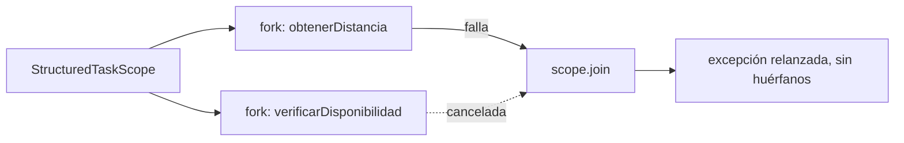
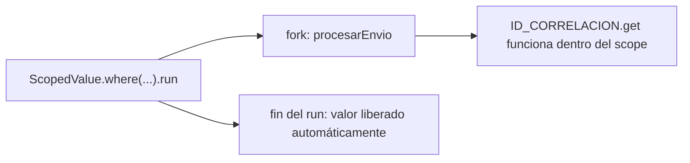

# Módulo 5: Concurrencia — hilos y virtual threads


## Aprende construyendo

### Tema 1: ExecutorService y gestión de hilos

**¿Por qué es importante?** Un pool limita cuántos trabajos simultáneos compiten por los recursos del motor. **Modelo mental:** una cantidad fija de operadores atiende una fila de tareas.

**Proyecto integrador:** valida varias guías y recoge cada resultado con Future. **Límite:** cerrar el executor no cancela tareas que ya enviaste. **Práctica:** mueve shutdown antes del envío y observa el rechazo.

#### Subtema 1.1: Envía trabajos a un executor · 10 min

**1. Contexto**

El motor recibe varias guías para validar; puede repartir el trabajo a un grupo acotado de hilos.

**2. Hazlo tú**

Crea `src/ExecutorDemo.java`:

```java
import java.util.concurrent.Executors;

public class ExecutorDemo {
    public static void main(String[] args) throws Exception {
        var executor = Executors.newFixedThreadPool(2);
        try {
            var primero = executor.submit(() -> "RT-1 validada");
            var segundo = executor.submit(() -> "RT-2 validada");
            System.out.println(primero.get());
            System.out.println(segundo.get());
        } finally {
            executor.shutdown();
        }
    }
}
```

Desde la carpeta del proyecto compila y ejecuta:

```bash
javac -d out src/ExecutorDemo.java
java -cp out ExecutorDemo
```

**Resultado esperado:** aparecen las dos guías validadas.

**Fallo deliberado:** elimina `executor.shutdown()`. **Diagnóstico:** el programa puede no terminar porque el pool sigue aceptando trabajo; restaura el cierre.

**3. Entiende**

El executor reutiliza un número limitado de hilos. `submit` agenda trabajo y devuelve un `Future`.

**4. Cierra**

Anota cuántos hilos permite el pool y quién cierra el executor.

#### Subtema 1.2: Recoge el resultado con Future · 10 min

**1. Contexto**

Si una validación produce un valor, el hilo que coordina puede esperar el resultado.

**2. Hazlo tú**

En `src/Futuro.java` crea una tarea que devuelva `"RT-3"`, guárdala como `Future<String>`, imprime `future.get()` y cierra el executor en un `finally`.

```java
import java.util.concurrent.Executors;
import java.util.concurrent.Future;

public class Futuro {
    public static void main(String[] args) throws Exception {
        var executor = Executors.newSingleThreadExecutor();
        try {
            Future<String> guia = executor.submit(() -> "RT-3");
            System.out.println(guia.get());
        } finally {
            executor.shutdown();
        }
    }
}
```

Ejecuta `javac -d out src/Futuro.java` y `java -cp out Futuro`.

**Resultado esperado:** imprime `RT-3`.

**Fallo deliberado:** cambia `Future<String>` por `Future<Integer>`. **Diagnóstico:** la tarea devuelve texto; el tipo de `Future` debe coincidir con el resultado.

**3. Entiende**

`get()` espera si la tarea aún no termina y puede lanzar una excepción si falló. No bloquees el hilo principal sin una razón clara.

**4. Cierra**

Señala qué tipo de resultado entrega la tarea.

#### Subtema 1.3: Cierra el executor al completar todas las tareas · 10 min

**1. Contexto**

Cerrar un executor impide nuevas tareas, pero las que ya fueron enviadas pueden terminar.

**2. Hazlo tú**

En `src/CierreExecutor.java` llama `shutdown()` después de enviar dos tareas y espera su resultado con `get()`. Imprime `executor.isTerminated()` después de leer ambos resultados.

```java
var a = executor.submit(() -> "RT-1");
var b = executor.submit(() -> "RT-2");
executor.shutdown();
System.out.println(a.get());
System.out.println(b.get());
executor.awaitTermination(1, java.util.concurrent.TimeUnit.SECONDS);
System.out.println(executor.isTerminated());
```

**Resultado esperado:** muestra los dos resultados y luego `true`.

**Fallo deliberado:** llama a `shutdown()` antes de `submit`. **Diagnóstico:** después de cerrar, el executor rechaza nuevos trabajos; envía primero y cierra después.

**3. Entiende**

`shutdown()` inicia el cierre ordenado. No significa que el trabajo pendiente se haya cancelado.

**4. Cierra**

Guarda el orden de envío, espera y cierre. Fuente oficial: [ExecutorService](https://docs.oracle.com/en/java/javase/25/docs/api/java.base/java/util/concurrent/ExecutorService.html).

### Tema 2: CompletableFuture

**¿Por qué es importante?** CompletableFuture permite encadenar y combinar resultados sin anidar esperas manuales. **Modelo mental:** cada etapa entrega un sobre a la siguiente cuando llega su resultado.

**Proyecto integrador:** combina destino y tarifa para presentar una cotización. **Límite:** join espera y envuelve el fallo; define dónde se reporta. **Práctica:** elimina exceptionally y observa cómo se propaga el error.

```bash
javac -d out src/FuturoCompletable.java
java -cp out FuturoCompletable
```

#### Subtema 2.1: Transforma un resultado asíncrono · 10 min

**1. Contexto**

Una consulta remota entrega el código de una guía; después quieres crear el texto de confirmación.

**2. Hazlo tú**

Crea `src/FuturoCompletable.java`:

```java
import java.util.concurrent.CompletableFuture;

public class FuturoCompletable {
    public static void main(String[] args) {
        var confirmacion = CompletableFuture
            .supplyAsync(() -> "RT-8")
            .thenApply(guia -> "Guía " + guia + " lista");
        System.out.println(confirmacion.join());
    }
}
```

Compila y ejecuta `javac -d out src/FuturoCompletable.java` y `java -cp out FuturoCompletable`.

**Resultado esperado:** `Guía RT-8 lista`.

**Fallo deliberado:** cambia `thenApply` por `thenAccept` y conserva `join()` como si devolviera el texto. **Diagnóstico:** `thenAccept` consume el valor y produce `CompletableFuture<Void>`; usa `thenApply` para transformar y devolver.

**3. Entiende**

`supplyAsync` inicia una tarea que produce un valor; `thenApply` transforma ese valor cuando está disponible.

**4. Cierra**

Dibuja la secuencia proveedor → transformación → salida.

#### Subtema 2.2: Combina dos resultados independientes · 10 min

**1. Contexto**

Para mostrar una ruta se necesitan la dirección y la tarifa; las dos consultas no dependen entre sí.

**2. Hazlo tú**

Crea `src/Combinar.java` y usa dos `CompletableFuture.supplyAsync`: uno devuelve `"Cali"` y el otro `4500`. Combínalos con `thenCombine` para imprimir `Cali: 4500`.

```java
import java.util.concurrent.CompletableFuture;

public class Combinar {
    public static void main(String[] args) {
        var ciudad = CompletableFuture.supplyAsync(() -> "Cali");
        var tarifa = CompletableFuture.supplyAsync(() -> 4500);
        var resumen = ciudad.thenCombine(tarifa,
            (destino, valor) -> destino + ": " + valor);
        System.out.println(resumen.join());
    }
}
```

Ejecuta `javac -d out src/Combinar.java` y `java -cp out Combinar`.

**Resultado esperado:** `Cali: 4500`.

**Fallo deliberado:** reemplaza `thenCombine` por `thenApply` intentando usar dos valores. **Diagnóstico:** `thenApply` recibe un solo resultado; para combinar dos futuros usa `thenCombine`.

**3. Entiende**

Ambos cálculos pueden avanzar de forma independiente; la combinación espera a que estén listos.

**4. Cierra**

Explica por qué ninguno de los cálculos necesita esperar al otro para empezar.

#### Subtema 2.3: Convierte un fallo en una respuesta visible · 10 min

**1. Contexto**

Una consulta puede fallar. La pantalla debe recibir un estado entendible y no ocultar el problema.

**2. Hazlo tú**

En `src/ErrorFuturo.java` crea un `CompletableFuture` que lanza `IllegalStateException` y añade `exceptionally(error -> "No se pudo consultar")`. Imprime el resultado con `join()`.

```java
var respuesta = CompletableFuture.<String>supplyAsync(() -> {
    throw new IllegalStateException("servicio no disponible");
}).exceptionally(error -> "No se pudo consultar");
System.out.println(respuesta.join());
```

**Resultado esperado:** `No se pudo consultar`.

**Fallo deliberado:** quita `exceptionally`. **Diagnóstico:** `join()` propaga el fallo envuelto en `CompletionException`; vuelve a definir dónde se transforma el error para la interfaz.

**3. Entiende**

`exceptionally` da una respuesta alternativa para esa cadena de futuro. No debe convertir cualquier error en un éxito silencioso sin registro o contexto.

**4. Cierra**

Conserva el mensaje mostrado y anota qué dato de diagnóstico guardarías. Fuente oficial: [CompletableFuture](https://docs.oracle.com/en/java/javase/25/docs/api/java.base/java/util/concurrent/CompletableFuture.html).

### Tema 3: Virtual threads

**¿Por qué es importante?** Virtual threads hacen más simple manejar muchas tareas que pasan tiempo esperando E/S. **Modelo mental:** hay muchos turnos livianos compartiendo un conjunto de trabajadores de plataforma.

**Proyecto integrador:** atiende consultas de seguimiento que esperan red. **Límite:** no aumentan CPU ni conexiones de base de datos. **Práctica:** limita a dos el acceso simulado a conexiones.

```bash
javac -d out src/HilosVirtuales.java
java -cp out HilosVirtuales
```

#### Subtema 3.1: Ejecuta una tarea en un virtual thread · 10 min

**1. Contexto**

Las llamadas que esperan red pasan mucho tiempo sin usar CPU. Los virtual threads ayudan a ejecutar muchas tareas bloqueantes con una API sencilla.

**2. Hazlo tú**

Crea `src/HilosVirtuales.java`:

```java
import java.util.concurrent.Executors;

public class HilosVirtuales {
    public static void main(String[] args) {
        try (var executor = Executors.newVirtualThreadPerTaskExecutor()) {
            var tarea = executor.submit(() ->
                Thread.currentThread().isVirtual());
            try {
                System.out.println(tarea.get());
            } catch (Exception error) {
                throw new RuntimeException(error);
            }
        }
    }
}
```

Con JDK 21 o posterior, ejecuta `javac -d out src/HilosVirtuales.java` y `java -cp out HilosVirtuales`.

**Resultado esperado:** imprime `true`.

**Fallo deliberado:** cambia `newVirtualThreadPerTaskExecutor()` por un executor de hilos tradicionales y repite. **Diagnóstico:** `isVirtual()` muestra `false`; volviste a un hilo de plataforma.

**3. Entiende**

Un virtual thread no es un núcleo nuevo; la JVM lo programa sobre hilos de plataforma. Es útil para muchas tareas que esperan, no para acelerar cálculo intensivo de CPU.

**4. Cierra**

Guarda la salida y explica qué clase de espera modelaría tu tarea.

#### Subtema 3.2: No limites virtual threads como si fueran conexiones · 10 min

**1. Contexto**

Crear muchos virtual threads no crea más conexiones de base de datos. El recurso externo sigue teniendo capacidad limitada.

**2. Hazlo tú**

En `src/LimiteConexiones.java` conserva el executor de virtual threads y agrega un `Semaphore(2)` alrededor de una operación simulada de conexión. Inicia cinco tareas y muestra al entrar y salir cuántas están usando el recurso.

```java
var conexiones = new java.util.concurrent.Semaphore(2);
try (var executor = java.util.concurrent.Executors.newVirtualThreadPerTaskExecutor()) {
    for (int i = 0; i < 5; i++) {
        int id = i;
        executor.submit(() -> {
            conexiones.acquire();
            try {
                System.out.println("usando conexión " + id);
            } finally {
                conexiones.release();
            }
            return null;
        });
    }
}
```

**Resultado esperado:** cinco tareas se completan y como máximo dos pasan a la vez por el recurso protegido.

**Fallo deliberado:** elimina `conexiones.acquire()`. **Diagnóstico:** las tareas ya no respetan el límite simulado; devuelve el semáforo antes de usar el recurso compartido.

**3. Entiende**

Usa virtual threads para la cantidad de tareas; limita por separado conexiones, permisos o solicitudes al servicio remoto.

**4. Cierra**

Explica por qué el executor de virtual threads no sustituye al pool de conexiones.

#### Subtema 3.3: Libera las tareas cuando termina el bloque · 10 min

**1. Contexto**

El trabajo asíncrono debe terminar antes de que el programa abandone el alcance que administra al executor.

**2. Hazlo tú**

En `src/AlcanceVirtual.java` envía tres tareas que impriman su número y usa el executor dentro de `try-with-resources`. Ejecuta varias veces.

```java
try (var executor = Executors.newVirtualThreadPerTaskExecutor()) {
    for (int i = 1; i <= 3; i++) {
        int id = i;
        executor.submit(() -> System.out.println("tarea " + id));
    }
}
```

**Resultado esperado:** cada tarea imprime un número y el proceso termina después de completar las tareas.

**Fallo deliberado:** crea el executor y no lo cierra ni espera tareas. **Diagnóstico:** el ciclo de vida del recurso quedó suelto; usa `try-with-resources` para cerrar el executor y esperar el trabajo iniciado.

**3. Entiende**

El executor crea virtual threads por tarea y `close()` espera a que terminen las tareas enviadas antes de salir del bloque.

**4. Cierra**

Guarda una salida y señala qué límite de capacidad aún necesita tu sistema. Fuente oficial: [Virtual Threads](https://docs.oracle.com/en/java/javase/25/core/virtual-threads.html).

### Tema 4: Condiciones de carrera y sincronización

**¿Por qué es importante?** Una carrera puede aceptar dos retiros sobre el mismo saldo y romper una regla de negocio. **Modelo mental:** dos personas leen el mismo tablero antes de que ninguna escriba el cambio.

**Proyecto integrador:** hace atómico el chequeo y descuento del saldo. **Límite:** AtomicInteger sirve para una actualización simple; una regla de varias condiciones requiere sincronizar la operación completa. **Práctica:** compara el intercalado inseguro con synchronized.

```bash
javac -d out src/ContadorSeguro.java
java -cp out ContadorSeguro
```

#### Subtema 4.1: Reproduce un retiro duplicado de forma controlada · 10 min

**1. Contexto**

Dos solicitudes pueden leer el mismo saldo antes de que alguna lo actualice.

**2. Hazlo tú**

Crea `src/Carrera.java`. Usa un saldo compartido de `100`, dos tareas que intenten retirar `80` y dos `CountDownLatch`: ambas tareas anuncian que leyeron el saldo y esperan en una compuerta antes de restar.

```java
int[] saldo = {100};
boolean[] aceptado = new boolean[2];
var ambasLecturas = new java.util.concurrent.CountDownLatch(2);
var iniciarEscritura = new java.util.concurrent.CountDownLatch(1);
var turnoDos = new java.util.concurrent.CountDownLatch(1);
Runnable primero = () -> retirarConPausa(0, saldo, aceptado, ambasLecturas,
    iniciarEscritura, turnoDos);
Runnable segundo = () -> retirarConPausa(1, saldo, aceptado, ambasLecturas,
    iniciarEscritura, turnoDos);
```

Implementa `retirarConPausa`: cada tarea lee `saldo[0] >= 80` y guarda el resultado en `aceptado[id]`, baja `ambasLecturas` y espera en `iniciarEscritura`. La tarea `id == 1` espera además `turnoDos`; la primera resta 80 y libera `turnoDos`, y la segunda resta 80 si su lectura previa fue verdadera.

**Resultado esperado:** las dos solicitudes deciden aceptar el retiro con el mismo saldo inicial y el saldo final queda incorrecto. Repite para observar el intercalado controlado.

**Fallo deliberado:** quita la compuerta compartida y confía en que la carrera ocurra siempre. **Diagnóstico:** los hilos pueden ejecutarse en cualquier orden y el fallo deja de ser reproducible; la barrera sincroniza el punto exacto de intercalado.

**3. Entiende**

Una condición de carrera aparece cuando el resultado depende del orden de operaciones concurrentes sobre estado compartido.

**4. Cierra**

Dibuja los pasos leer saldo → validar → restar para cada solicitud.

#### Subtema 4.2: Protege la operación completa con synchronized · 10 min

**1. Contexto**

Proteger solo la resta no basta: la comprobación y el cambio deben formar una sola operación indivisible.

**2. Hazlo tú**

En `src/Carrera.java` cambia el retiro a un método `synchronized` que revise el saldo y lo descuente dentro del mismo método. Ejecuta las dos tareas anteriores.

```java
synchronized boolean retirar(int monto) {
    if (monto > saldo) return false;
    saldo -= monto;
    return true;
}
```

**Resultado esperado:** una solicitud retira `80`; la otra observa `20` y se rechaza. El saldo no queda negativo.

**Fallo deliberado:** sincroniza solo la línea `saldo -= monto`. **Diagnóstico:** las dos tareas pueden haber leído `100` antes de llegar a esa línea; protege el método completo.

**3. Entiende**

El monitor del objeto deja entrar una tarea a la vez en la sección sincronizada. La regla crítica incluye lectura, validación y actualización.

**4. Cierra**

Conserva los resultados de la versión insegura y la versión sincronizada.

#### Subtema 4.3: Usa AtomicInteger para un contador · 10 min

**1. Contexto**

Un contador compartido necesita actualizarse sin perder incrementos concurrentes.

**2. Hazlo tú**

Crea `src/ContadorSeguro.java`:

```java
import java.util.concurrent.atomic.AtomicInteger;
import java.util.stream.IntStream;

public class ContadorSeguro {
    public static void main(String[] args) {
        var contador = new AtomicInteger();
        IntStream.range(0, 10_000).parallel().forEach(i -> contador.incrementAndGet());
        System.out.println(contador.get());
    }
}
```

Compila y ejecuta `javac -d out src/ContadorSeguro.java` y `java -cp out ContadorSeguro`.

**Resultado esperado:** imprime `10000`.

**Fallo deliberado:** reemplaza `AtomicInteger` por un `int[]` compartido y vuelve a ejecutar varias veces. **Diagnóstico:** la lectura y escritura no forman una operación atómica y pueden perder incrementos; restaura `AtomicInteger`.

**3. Entiende**

`incrementAndGet` combina lectura y suma como una sola operación atómica. Para reglas con varias condiciones, como retirar saldo, una sección crítica puede ser más apropiada.

**4. Cierra**

Explica por qué el contador admite una operación atómica y el retiro necesita proteger una regla completa. Fuente oficial: [concurrencia en Java](https://docs.oracle.com/en/java/javase/25/docs/api/java.base/java/util/concurrent/package-summary.html).

### Tema 5: Structured Concurrency (StructuredTaskScope, Java 25)

#### Paso 1 · Objetivo y preparación
Al finalizar vas a lanzar dos subtareas relacionadas (distancia y disponibilidad del conductor) con `StructuredTaskScope`, cancelando automáticamente la otra si cualquiera falla. Prerrequisitos: JDK 25 y un editor. Comprueba java --version. **`StructuredTaskScope` todavía es una feature en preview (JEP 505, quinta ronda) en Java 25**, no finalizada: compilar y ejecutar requiere las banderas `--enable-preview --release 25` explícitas.

#### Paso 2 · Contexto y caso real
El servicio de tracking lanza dos llamadas relacionadas con `CompletableFuture` por separado (distancia y disponibilidad del conductor); si la de distancia falla, la de disponibilidad sigue corriendo en segundo plano sin que nadie la cancele, consumiendo recursos para un resultado que ya no se va a usar.

#### Paso 3 · Teoría, modelo mental y analogía
Structured concurrency trata un grupo de subtareas relacionadas como una única unidad: todas nacen dentro del mismo scope y ese scope no termina hasta que todas terminan (o se cancelan). La analogía: un padre que lleva a sus hijos a un museo — si uno se pierde, no se va dejando a los demás dispersos; reúne o cancela el paseo completo antes de continuar.

#### Paso 4 · Demostración guiada desde cero
**Ejemplo independiente (desde cero):** este tema también se puede reproducir en una **carpeta vacía**, como **proyecto nuevo**, sin arrastrar estado de otros temas: crea el andamiaje y vuelve a escribir `src/main/java/academia/concurrencia/CalculoTarifaEstructurado.java` dentro.
```bash
mkdir ejemplo && cd ejemplo && gradle init --type java-application
```

Crea `src/main/java/academia/concurrencia/CalculoTarifaEstructurado.java`:
```java
try (var scope = StructuredTaskScope.open(StructuredTaskScope.Joiner.<Object>allSuccessfulOrThrow())) {
    Subtask<Double> distancia = scope.fork(() -> obtenerDistancia(ruta));
    Subtask<Boolean> disponible = scope.fork(() -> verificarDisponibilidad(conductorId));
    scope.join();
    return calcularTarifa(distancia.get(), disponible.get());
}
```
```bash
javac --release 25 --enable-preview -d out src/main/java/academia/concurrencia/CalculoTarifaEstructurado.java
java --enable-preview -cp out academia.concurrencia.CalculoTarifaEstructurado
```
Resultado esperado: si `obtenerDistancia` lanza una excepción, `scope.join()` cancela automáticamente `verificarDisponibilidad` (si todavía no terminó) y relanza la excepción original, sin dejar ninguna subtarea corriendo de forma huérfana en segundo plano. La JVM además imprime una advertencia de que estás usando funcionalidades en preview.



#### Paso 5 · Práctica guiada
Pista: reemplazá el `StructuredTaskScope` por dos `CompletableFuture.supplyAsync(...)` independientes sin ningún scope que los agrupe, y hacé que el primero lance una excepción. Ese es el fallo deliberado: el segundo `CompletableFuture` sigue ejecutándose completo en segundo plano, sin que nadie lo cancele ni lo espere, consumiendo el carrier thread para un resultado que la tarifa final ya no va a usar porque el cálculo ya falló.

#### Paso 6 · Práctica independiente
Corregí el Paso 5 volviendo a `StructuredTaskScope` con `fork`/`join`, y agregá una tercera subtarea (por ejemplo, registrar el intento en un log de auditoría) confirmando que las tres se cancelan juntas si cualquiera falla.

#### Paso 7 · Cierre y evidencia
Entregá el scope con cancelación conjunta del Paso 4, la subtarea huérfana del Paso 5, y la tercera subtarea agregada del Paso 6; explicá por qué estructurar la concurrencia como un árbol (con el mismo ciclo de vida que su scope padre) elimina las fugas de subtareas que `CompletableFuture` suelto no previene. Siguiente paso: estudia Scoped Values, el complemento de structured concurrency para propagar contexto sin ThreadLocal. Errores comunes: lanzar subtareas con CompletableFuture sin ningún scope que las agrupe y cancele juntas, no leer `Subtask.get()` solo después de `join()`, y usar structured concurrency para tareas que no están genuinamente relacionadas entre sí. Fuentes oficiales: https://openjdk.org/jeps/505 y https://docs.oracle.com/en/java/javase/25/core/structured-concurrency.html. **Actualización de plataforma (octubre 2026):** en JDK 27 (la entrega más reciente, liberada en septiembre de 2026) esta misma feature avanzó a su séptima ronda de preview (JEP 533) y ya fue propuesta como candidata a finalizarse sin cambios adicionales — el código de este Tema, compilado con `--release 25 --enable-preview`, sigue siendo válido; solo cambia el número de JEP y de ronda si migrás a una JDK más reciente.
**¿Por qué es importante?** Un grupo de subtareas relacionadas que no comparte un ciclo de vida común puede dejar trabajo huérfano corriendo en segundo plano cuando una falla, consumiendo recursos para un resultado que ya nadie espera.
**Evidencia de aprendizaje:** entrega scope con cancelación conjunta funcionando, subtarea huérfana reproducida y tercera subtarea agregada correctamente.
**Conceptos clave:** StructuredTaskScope, fork, join, Joiner, cancelación conjunta, árbol de tareas.

Cada operación del proyecto integrador de este track que dependa de varias subtareas relacionadas (ej. validar un pedido consultando stock y precio a la vez) debería usar structured concurrency en vez de lanzar `CompletableFuture` sueltos sin ningún scope que los agrupe.

**Cuándo no usarlo:** para una única tarea asíncrona sin ninguna otra subtarea relacionada, `StructuredTaskScope` agrega ceremonia sin beneficio; basta con `Executors.newVirtualThreadPerTaskExecutor()` y esperar ese único resultado.

Structured concurrency (todavía en preview en Java 25 — JEP 505, quinta ronda) trata un conjunto de subtareas lanzadas dentro de un mismo `StructuredTaskScope` como una única unidad de trabajo con un ciclo de vida compartido: el scope no puede cerrarse (saliendo del bloque `try`) hasta que todas sus subtareas hayan terminado, y un `Joiner` como `allSuccessfulOrThrow()` cancela automáticamente las subtareas restantes en cuanto cualquiera falla, en vez de dejarlas corriendo de forma huérfana sin que el código que las lanzó se entere o las controle.

**Analogía:** `StructuredTaskScope` es como un padre que lleva a sus hijos a un museo: todos entran juntos y el padre no se va hasta reunir a todos (o decide terminar el paseo para todos si uno se pierde), en vez de que cada hijo deambule de forma independiente sin que nadie sepa cuándo terminaron ni pueda reunirlos si algo sale mal.

**¿Por qué es importante?** `StructuredTaskScope` garantiza que un grupo de subtareas relacionadas comparta un ciclo de vida común, cancelando el resto automáticamente si cualquiera falla, eliminando las subtareas huérfanas que `CompletableFuture` suelto no previene.

**Código del ejemplo:**

```java
try (var scope = StructuredTaskScope.open(StructuredTaskScope.Joiner.<Object>allSuccessfulOrThrow())) {
    Subtask<Double> distancia = scope.fork(() -> obtenerDistancia(ruta));
    Subtask<Boolean> disponible = scope.fork(() -> verificarDisponibilidad(conductorId));
    scope.join();
    return calcularTarifa(distancia.get(), disponible.get());
}
```

### Tema 6: Scoped Values frente a ThreadLocal (Java 25)

#### Paso 1 · Objetivo y preparación
Al finalizar vas a propagar un ID de correlación a través de virtual threads hijos con `ScopedValue`, evitando el crecimiento de memoria que produce `ThreadLocal` heredable con cientos de miles de virtual threads. Prerrequisitos: Tema 3 y Tema 5 de este módulo.

#### Paso 2 · Contexto y caso real
El servicio usa un `ThreadLocal<String>` heredable para propagar el ID de correlación de cada solicitud a los virtual threads que lanza para procesarla; bajo una carga de 500.000 virtual threads simultáneos, el heap crece de forma sostenida porque cada copia heredada del `ThreadLocal` queda retenida hasta que el hilo específico termine y sea recolectado.

#### Paso 3 · Teoría, modelo mental y analogía
`ScopedValue` vincula un valor a una porción específica y acotada de código (no al hilo completo como `ThreadLocal`): el valor es inmutable durante ese scope, se propaga automáticamente a los virtual threads hijos lanzados dentro de él, y se libera automáticamente al salir del bloque, sin retenerlo indefinidamente. La analogía: un gafete de visitante que solo es válido dentro del edificio y se devuelve automáticamente al salir, en vez de una llave que el visitante se queda y alguien debe recordar reclamar después.

#### Paso 4 · Demostración guiada desde cero
Crea `src/main/java/academia/concurrencia/ContextoCorrelacion.java`:
```java
static final ScopedValue<String> ID_CORRELACION = ScopedValue.newInstance();

ScopedValue.where(ID_CORRELACION, generarId()).run(() -> {
    try (var scope = StructuredTaskScope.open()) {
        scope.fork(() -> procesarEnvio());   // ID_CORRELACION.get() funciona aquí también
        scope.join();
    }
});
```

**Ejecuta el ejemplo** (crea un proyecto desde cero con Maven o Gradle, pega el código y corre las pruebas; equivalencias en el Módulo 8, Tema 4):

```bash
# Maven
mvn -q archetype:generate -DgroupId=academia -DartifactId=app -DarchetypeArtifactId=maven-archetype-quickstart -DinteractiveMode=false
cd app && mvn test
# Gradle (equivalente): gradle init --type java-application --dsl kotlin && ./gradlew test
```

Resultado esperado: dentro del bloque `run`, cualquier código (incluidas las subtareas lanzadas con `StructuredTaskScope`) puede leer `ID_CORRELACION.get()` con el mismo valor, y ese valor deja de existir automáticamente apenas el bloque `run` termina, sin ninguna llamada manual de limpieza.



#### Paso 5 · Práctica guiada
Pista: reemplazá `ScopedValue` por un `InheritableThreadLocal<String>` para propagar el mismo ID de correlación, y lanzá 500.000 virtual threads que lo hereden. Ese es el fallo deliberado: cada virtual thread retiene su propia copia heredada del `ThreadLocal` durante toda su vida, y con esa cantidad de virtual threads simultáneos el heap crece de forma medible y sostenida, justo el problema de memoria que los virtual threads estaban destinados a evitar.

#### Paso 6 · Práctica independiente
Corregí el Paso 5 volviendo a `ScopedValue`, y medí el uso de heap antes y después del cambio lanzando la misma carga de 500.000 virtual threads, confirmando que `ScopedValue` no muestra ese crecimiento sostenido.

#### Paso 7 · Cierre y evidencia
Entregá la propagación con `ScopedValue` del Paso 4, el crecimiento de heap con `ThreadLocal` heredable del Paso 5, y la medición comparativa del Paso 6; explicá por qué un valor inmutable y acotado a un scope es más apropiado que un valor mutable heredado por cientos de miles de virtual threads. Siguiente paso: estudia NIO.2 para completar el manejo de datos del proyecto integrador. Errores comunes: usar `ThreadLocal` heredable como propagación de contexto por defecto con virtual threads, intentar mutar un `ScopedValue` desde dentro de su propio scope (son inmutables por diseño), y no medir el uso real de memoria antes de descartar el problema como "poco probable". Fuentes oficiales: https://openjdk.org/jeps/506 y https://docs.oracle.com/en/java/javase/25/core/scoped-values.html.
**¿Por qué es importante?** `ThreadLocal` heredable retiene una copia por cada hilo que lo hereda durante toda su vida; con cientos de miles de virtual threads esa retención se vuelve un problema de memoria real que `ScopedValue` evita por diseño.
**Evidencia de aprendizaje:** entrega propagación con ScopedValue funcionando, crecimiento de heap con ThreadLocal heredable reproducido y medición comparativa confirmada.

## Construcción guiada del capítulo

**Objetivo del laboratorio:** construir un servicio concurrente que procese N tareas en paralelo usando virtual threads, corrigiendo una condición de carrera provocada intencionalmente.

**Requisitos previos:** Módulos 0-4 completados.

| Paso | Acción | Código | Explicación |
|---|---|---|---|
| 1 | Lanzar un `Thread` manual y luego con `ExecutorService` | Ver Tema 1 | Compara la reutilización de hilos |
| 2 | Provocar una condición de carrera y corregirla | Ver Tema 4 | Con `synchronized` |
| 3 | Componer llamadas con `CompletableFuture` | Ver Tema 2 | `thenCompose` + `exceptionally` |
| 4 | Crear 100,000 virtual threads | Ver Tema 3 | Compara el uso de memoria contra threads de plataforma |
| 5 | Medir latencia de I/O con threads de plataforma vs virtuales | Ver Tema 3 | Con 1000 tareas de I/O bloqueante |
| 6 | Agrupar subtareas relacionadas con `StructuredTaskScope` | Ver Tema 5 | Cancelación conjunta si una falla |
| 7 | Propagar contexto con `ScopedValue` a virtual threads hijos | Ver Tema 6 | Sin el crecimiento de heap de ThreadLocal heredable |

**Verificación:** el laboratorio se considera exitoso si el contador sin sincronizar muestra un resultado incorrecto reproducible, corregido correctamente con `synchronized`, si la comparación de virtual threads muestra una diferencia mensurable de uso de memoria o de capacidad de concurrencia frente a threads de plataforma, y si el scope de structured concurrency cancela correctamente una subtarea hermana cuando la otra falla.

**Errores comunes y soluciones**

- **Crear un `Thread` nuevo por cada tarea en cargas con muchas tareas.** Usa un `ExecutorService` para reutilizar hilos.
- **Modificar estado compartido sin sincronización.** Usa `synchronized`, `ReentrantLock`, o estructuras concurrentes como `ConcurrentHashMap`.
- **Usar virtual threads para código CPU-intensivo puro sin I/O.** Los virtual threads no aceleran cálculo puro; su beneficio es específico para I/O bloqueante.
- **Lanzar subtareas relacionadas con `CompletableFuture` suelto en vez de `StructuredTaskScope`.** Sin un scope que las agrupe, una subtarea puede quedar huérfana corriendo en segundo plano si su hermana falla.
- **Usar `ThreadLocal` heredable para propagar contexto a virtual threads masivos.** Cada hilo retiene su copia heredada; `ScopedValue` libera el valor automáticamente al salir del scope.

---


## Laboratorio de transferencia

### Tema 7: Timeouts y cancelación cooperativa sin abandonar recursos

#### Paso 1 · Objetivo y preparación
Al finalizar limitarás una espera y comprobarás que una tarea acepta la interrupción antes de cerrar su executor. **Prerrequisitos:** excepciones, try/finally y Future. JDK 25; comprueba `java --version` y `javac --version`. Ejemplo independiente desde carpeta vacía.

#### Paso 2 · Contexto y caso real
El proyecto integrador consulta un proveedor que puede tardar demasiado. Dejar de esperar no significa que ese trabajo se haya detenido. **¿Por qué es importante?** Tareas abandonadas siguen consumiendo conexiones, CPU o memoria.

#### Paso 3 · Teoría, modelo mental y analogía
`get` con timeout limita cuánto espera quien llama. `cancel(true)` solicita interrupción; no mata un hilo de forma segura. La tarea debe responder a esa señal. Las esperas interrumpibles, como `sleep`, lanzan `InterruptedException`; si la capturas y finalizas, puedes restaurar la marca de interrupción.

**Analogía:** un plazo vence en recepción, pero hay que avisar también a quien ejecuta el encargo. El límite es que el aviso requiere cooperación; una tarea que ignora interrupciones puede seguir activa.

#### Paso 4 · Demostración guiada desde cero
```bash
mkdir timeout-java
cd timeout-java
```
Crea `Plazo.java` completo:
```java
import java.util.concurrent.*;

public class Plazo {
    public static void main(String[] args) throws Exception {
        ExecutorService pool = Executors.newSingleThreadExecutor();
        CountDownLatch started = new CountDownLatch(1);
        Future<String> result = pool.submit(() -> {
            started.countDown();
            try {
                Thread.sleep(10_000);
                return "Respuesta";
            } catch (InterruptedException error) {
                Thread.currentThread().interrupt();
                return "Cancelada";
            }
        });
        try {
            started.await();
            System.out.println(result.get(50, TimeUnit.MILLISECONDS));
        } catch (TimeoutException error) {
            result.cancel(true); // Solicita la interrupción de la tarea.
            System.out.println("Plazo agotado");
        } finally {
            pool.shutdownNow();
            if (!pool.awaitTermination(2, TimeUnit.SECONDS)) {
                throw new IllegalStateException("La tarea no cooperó");
            }
        }
        System.out.println("Executor terminado");
    }
}
```
```bash
javac Plazo.java
java Plazo
```
**Resultado esperado:** `Plazo agotado` y `Executor terminado`, sin esperar diez segundos. Explica cada bloque: el latch confirma que empezó la tarea, `get` limita la espera y `finally` comprueba terminación. Un timeout no afirma que un servicio remoto haya deshecho nada.

#### Paso 5 · Práctica guiada
**Fallo deliberado:** elimina el catch del timeout y conserva `finally`. El programa informa `TimeoutException`; comprueba que el executor sigue cerrándose. **Pista:** el manejo del resultado y la limpieza son responsabilidades distintas. Repón el catch y el mensaje de negocio.

#### Paso 6 · Práctica independiente
Haz una variante rápida con espera de 10 ms y timeout de 2 segundos. Debe mostrar `Respuesta` y terminar. Escribe qué harías si el proveedor no coopera y qué límite pondrías al número de peticiones simultáneas.

#### Paso 7 · Cierre y evidencia
**Evidencia de aprendizaje:** ambas salidas, duración aproximada y explicación de timeout frente a cancelación. El siguiente paso es propagar un presupuesto de tiempo entre llamadas. **Errores comunes:** asumir que `cancel` garantiza terminación, tragarse interrupciones y cerrar un pool sin comprobar tareas pendientes. **Límites y decisión de uso:** tiempos exactos dependen del planificador; verifica resultados y terminación, no una duración exacta al milisegundo.

**Fuentes oficiales:** [ExecutorService](https://docs.oracle.com/en/java/javase/25/docs/api/java.base/java/util/concurrent/ExecutorService.html) y [Future](https://docs.oracle.com/en/java/javase/25/docs/api/java.base/java/util/concurrent/Future.html).
