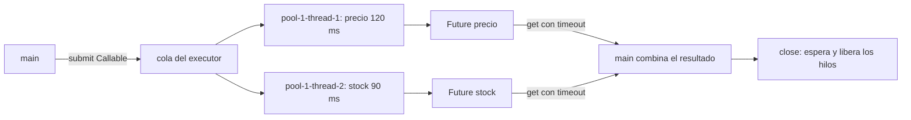
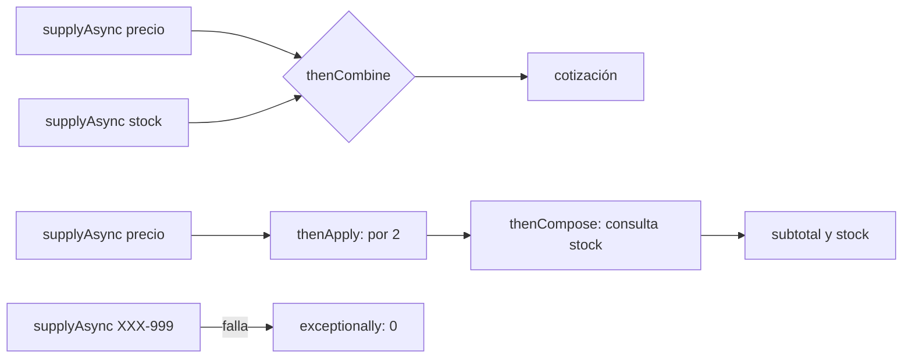
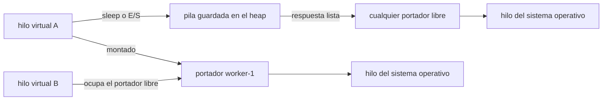
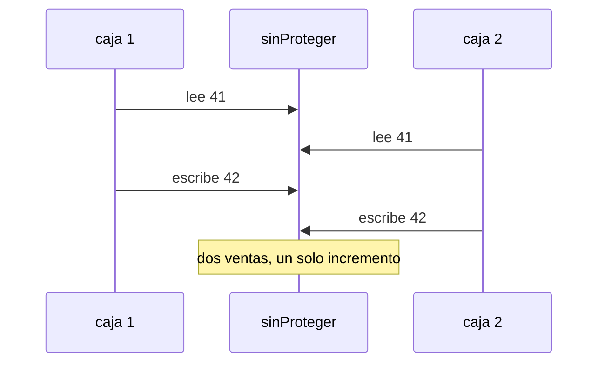
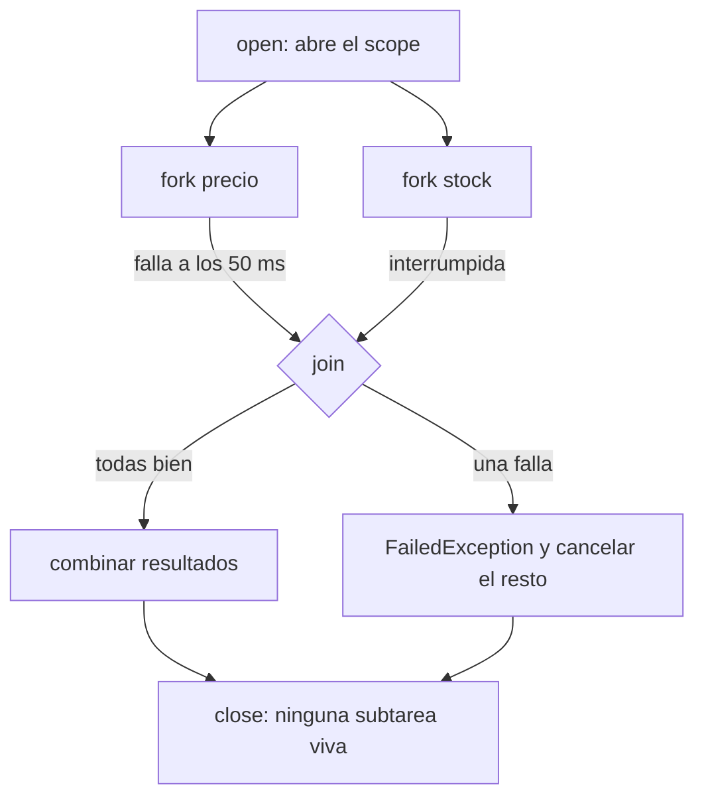
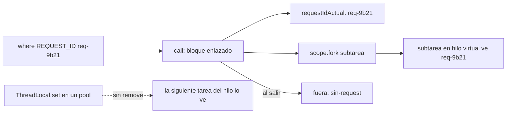
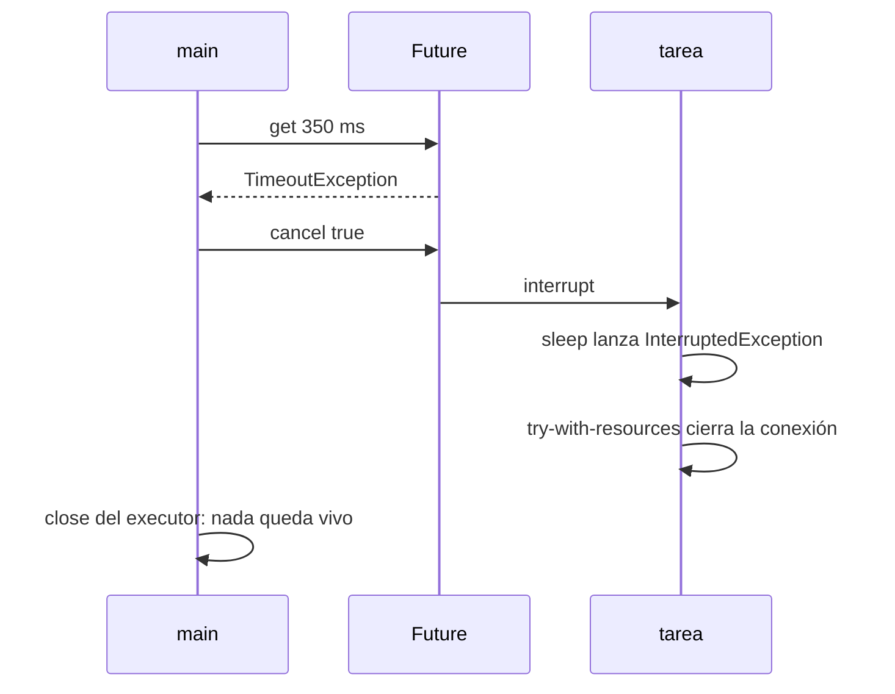

# Módulo 5: Concurrencia — hilos y virtual threads

Tienda Aurora puede calcular catálogos y reportes, pero una aplicación real también espera red, disco o servicios remotos. Si cada operación bloqueante consume un hilo de plataforma por mucho tiempo, el sistema escala mal. Si varias tareas actualizan estado compartido sin coordinación, el sistema produce resultados incorrectos. La concurrencia en Java trata esos dos problemas: ejecutar trabajo en paralelo o asincrónicamente, y proteger la corrección cuando hay estado compartido.

Este módulo construye un `CheckoutService` que consulta catálogo e inventario remotos simulados. El mismo caso de uso se implementa con `ExecutorService`, `CompletableFuture`, virtual threads, `StructuredTaskScope` y `ScopedValue`. También se muestra una condición de carrera y su corrección, y una medición simple de lotes bloqueantes.

Al terminar este módulo podrás:
- crear hilos a mano y con un `ExecutorService`, y cerrarlos sin dejar la JVM colgada;
- componer consultas asíncronas con `CompletableFuture` y manejar sus fallos;
- medir cuándo los hilos virtuales mejoran una carga de E/S bloqueante y cuándo no;
- provocar una condición de carrera real en Java y corregirla con `synchronized`, `AtomicInteger` o `ConcurrentHashMap`;
- agrupar subtareas con `StructuredTaskScope` y propagar contexto con `ScopedValue`;
- aplicar timeouts y cancelación cooperativa sin abandonar recursos abiertos.

**Qué necesitas saber antes:** hilo, memoria compartida, concurrencia, paralelismo, condición de carrera, sección crítica y lock (Fundamentos, Módulo 5, Tema 2); interbloqueo, espera circular, orden global de recursos e hilo daemon (Fundamentos, Módulo 5, Tema 5); `record` (Java, Módulo 1); excepciones comprobadas, `AutoCloseable` y try-with-resources (Java, Módulo 3); lambdas, referencias a métodos y el `ForkJoinPool` común de los streams paralelos (Java, Módulo 4). Aquí esos términos se citan, no se redefinen: este módulo explica cómo los resuelve Java.

**Esquema del módulo:**
1. ExecutorService y gestión de hilos.
2. CompletableFuture.
3. Virtual threads.
4. Condiciones de carrera y sincronización.
5. Structured Concurrency (StructuredTaskScope, Java 25).
6. Scoped Values frente a ThreadLocal (Java 25).
7. Timeouts y cancelación cooperativa sin abandonar recursos.
8. Laboratorio integrador: `CheckoutService` con todas las variantes.

## Visual del módulo

**Visual:** [Mapa de concurrencia Java: ExecutorService, CompletableFuture, virtual threads, structured concurrency, ScopedValue y race condition](/visuals/temas/java/modulo-5-concurrencia.html)

Lectura: La concurrencia exige coordinar ejecución, cancelación, visibilidad y ciclo de vida, no solo lanzar hilos.

## Entorno

**Entorno de referencia verificado (2026-05-23):** macOS arm64, JDK 27.0.1.0.2, Gradle 9.9.1, toolchain Java 25. El proyecto usa `--enable-preview` porque `StructuredTaskScope` y APIs relacionadas se usaron en modo preview en esta configuración.

**Salidas nuevas de los temas (2026-11-24):** Linux x86_64 (Ubuntu 24.04, 2 núcleos), OpenJDK 25.0.5.1. Cada programa de un solo archivo se ejecutó con `java Archivo.java`; los que usan `StructuredTaskScope` llevan `--enable-preview --source 25`. La comparación de *pinning* del Tema 4 se ejecutó además con OpenJDK 21.0.13.1. El laboratorio integrador se recompiló con Gradle 8.14.3 (toolchain 25) sin acceso a la red: el wrapper 9.9.1 y JUnit no se pudieron descargar, así que `./gradlew test` no se repitió en este entorno. Los tiempos en milisegundos y los conteos de las carreras cambian en cada máquina y en cada corrida.

Para seguir los temas basta un JDK 25 y una carpeta de trabajo:

```bash
java -version
mkdir -p ~/labs/aurora-m5-temas && cd ~/labs/aurora-m5-temas
```

## Aprende construyendo

### Tema 1: ExecutorService y gestión de hilos · Intermedio · 40 min

<details open>
<summary><strong>Capa 1 — Lectura</strong></summary>

#### Objetivos
Al terminar este tema podrás:
- crear un hilo con `Thread` y `Runnable`, arrancarlo con `start()` y esperarlo con `join()`;
- enviar tareas `Callable` a un `ExecutorService` y leer su resultado con un `Future`;
- cerrar un executor con try-with-resources y explicar por qué un pool abierto impide que la JVM termine;
- leer `IllegalThreadStateException` y corregir el error de llamar `run()` en lugar de `start()`.

**Conceptos clave:** Thread, Runnable, `start` y `join`, hilo de plataforma, ExecutorService, pool de hilos, Callable, Future

#### El problema
Para cotizar un producto, Tienda Aurora pregunta el precio al catálogo (120 ms) y el stock al inventario (90 ms).
En secuencia la respuesta tarda unos 210 ms, aunque las dos consultas no dependen una de la otra. ¿Cómo lanzas
las dos a la vez en Java, recoges ambos resultados y te aseguras de que ningún hilo quede vivo al terminar?

Este tema usa **hilo** y **concurrencia** tal como se definieron en Fundamentos (Módulo 5, Tema 2). Aquí ves las
clases con las que Java los representa.

#### Glosario del tema

**Thread**
- **Definición técnica:** clase de `java.lang` que representa un hilo de ejecución de la JVM; cada objeto `Thread` tiene nombre, estado y su propia pila de llamadas.
- **En palabras sencillas:** el objeto que Java te da para manejar un hilo: lo creas, lo arrancas y lo esperas.
- **Dónde se rompe la comparación:** crear el objeto no crea el hilo del sistema; eso ocurre solo al llamar `start()`.
- **Ejemplo:** `new Thread(consultarCatalogo, "aurora-catalogo")` crea un hilo con nombre, todavía detenido.
- **Error típico:** llamar `start()` dos veces sobre el mismo objeto: produce `IllegalThreadStateException`.

**Runnable**
- **Definición técnica:** interfaz funcional con un único método `void run()`; describe una tarea sin resultado y sin excepciones comprobadas.
- **En palabras sencillas:** la orden de trabajo que le entregas al hilo: «haz esto».
- **Dónde se rompe la comparación:** una orden de trabajo puede traer un informe; `run()` no devuelve nada.
- **Ejemplo:** `Runnable consultarCatalogo = () -> System.out.println("catálogo");`.
- **Error típico:** necesitar un resultado y usar `Runnable` con variables externas, en lugar de `Callable`.

**`start` y `join`**
- **Definición técnica:** `start()` pide a la JVM un hilo nuevo que ejecuta `run()` en paralelo; `join()` bloquea al hilo que llama hasta que ese hilo termina.
- **En palabras sencillas:** `start` es «empieza tú»; `join` es «te espero aquí hasta que acabes».
- **Dónde se rompe la comparación:** `join()` no trae ningún resultado; solo garantiza que el hilo ya terminó.
- **Ejemplo:** `catalogo.start(); catalogo.join();` en `HiloManual.java`.
- **Error típico:** llamar `run()` en vez de `start()`: la tarea corre en `main` y no hay concurrencia.

**hilo de plataforma**
- **Definición técnica:** hilo de Java respaldado uno a uno por un hilo del sistema operativo; es el tipo clásico que crean `new Thread` y `Thread.ofPlatform()`.
- **En palabras sencillas:** un trabajador de tiempo completo contratado al sistema operativo; cuesta memoria aunque esté esperando.
- **Dónde se rompe la comparación:** el «sueldo» se paga en memoria de pila y en trabajo del planificador, no en dinero.
- **Ejemplo:** `Thread.ofPlatform().name("aurora-inventario").unstarted(tarea)`.
- **Error típico:** crear uno por cada petición en un servidor: con miles de peticiones lentas, la memoria se agota.

**ExecutorService**
- **Definición técnica:** interfaz de `java.util.concurrent` que recibe tareas (`submit`), las ejecuta en hilos que administra y controla su ciclo de vida (`close`, `shutdown`).
- **En palabras sencillas:** un jefe de turno: tú le entregas tareas y él decide qué trabajador hace cada una.
- **Dónde se rompe la comparación:** el jefe no se va a casa solo; si no lo cierras, sus hilos mantienen viva la JVM.
- **Ejemplo:** `try (ExecutorService executor = Executors.newFixedThreadPool(2)) { ... }`.
- **Error típico:** crear el executor sin try-with-resources y olvidar cerrarlo: el programa nunca termina.

**pool de hilos**
- **Definición técnica:** conjunto de hilos creados una vez y reutilizados para ejecutar muchas tareas sacadas de una cola.
- **En palabras sencillas:** un grupo fijo de cajeros que atienden una fila; cuando uno termina, llama al siguiente.
- **Dónde se rompe la comparación:** si todos los cajeros esperan una respuesta lenta, la fila se detiene aunque la CPU esté libre.
- **Ejemplo:** `Executors.newFixedThreadPool(2)` crea dos hilos llamados `pool-1-thread-1` y `pool-1-thread-2`.
- **Error típico:** pensar que más hilos siempre es más rápido; el exceso añade cambios de contexto y memoria.

**Callable**
- **Definición técnica:** interfaz funcional con el método `V call() throws Exception`; describe una tarea que devuelve un valor y puede lanzar excepciones comprobadas.
- **En palabras sencillas:** una orden de trabajo que trae respuesta: «averigua el precio y dímelo».
- **Dónde se rompe la comparación:** la respuesta no llega en la mano: llega en un `Future` que consultas después.
- **Ejemplo:** `Callable<BigDecimal> tareaPrecio = () -> precio("CAF-100");`.
- **Error típico:** creer que `submit` ya devuelve el valor; devuelve un `Future` que aún puede estar vacío.

**Future**
- **Definición técnica:** objeto que representa el resultado pendiente de una tarea asíncrona; `get()` bloquea hasta tenerlo, `get(tiempo, unidad)` limita la espera e `isDone()` consulta sin bloquear.
- **En palabras sencillas:** el ticket de la tintorería: con él reclamas la ropa cuando esté lista.
- **Dónde se rompe la comparación:** si la tarea falló, `get()` no te da la ropa: lanza `ExecutionException` con la causa.
- **Ejemplo:** `precio.get(2, TimeUnit.SECONDS)` en `CotizadorExecutor.java`.
- **Error típico:** llamar `get()` sin límite de tiempo sobre una tarea que puede colgarse para siempre.

#### ► CÓMO FUNCIONA

##### 1. La idea en lenguaje sencillo

Piensa en una tintorería con dos empleados. Si un solo empleado lava y luego plancha, el cliente espera la suma de
los dos trabajos. Si cada empleado hace uno al mismo tiempo, el cliente espera solo lo que tarda el más lento.

La cotización de Tienda Aurora tiene esa forma. El precio tarda 120 ms y el stock 90 ms, y ninguna consulta
necesita a la otra. Si las lanzas a la vez, esperas cerca de 120 ms en lugar de 210 ms.

Java te ofrece dos maneras de conseguir esos empleados. La primera es contratarlos uno por uno con `Thread`: tú los
creas, los arrancas y los esperas. La segunda es pedirlos a un jefe de turno, el `ExecutorService`, que mantiene un
grupo de empleados y les reparte tareas.

El jefe de turno tiene una responsabilidad que a menudo se olvida: alguien debe mandarlo a casa. Si no lo cierras,
sus empleados siguen esperando trabajo y el programa nunca termina, como muestra `SinCerrar.java`.

##### 2. Definición formal y vocabulario

Un **Thread** es el objeto de `java.lang` que representa un hilo de ejecución de la JVM. Tiene nombre, estado y su
propia pila de llamadas. La tarea que ejecuta se describe con un **Runnable**, una interfaz funcional con el método
`void run()`.

El ciclo de vida se controla con **`start` y `join`**. `start()` pide a la JVM un hilo nuevo que ejecuta `run()`.
`join()` bloquea al hilo que llama hasta que el otro termina. Los hilos que crea `new Thread` son **hilos de
plataforma**: cada uno está respaldado por un hilo del sistema operativo.

Un **ExecutorService** es la interfaz de `java.util.concurrent` que recibe tareas y las ejecuta en hilos que
administra. La implementación habitual mantiene un **pool de hilos**: hilos creados una vez y reutilizados para
muchas tareas, que toman de una cola.

Para tareas con resultado usas **Callable**, cuyo método `V call()` devuelve un valor y puede lanzar excepciones
comprobadas. `submit` no devuelve ese valor: devuelve un **Future**, que representa el resultado pendiente. Lo
reclamas con `get()`, preferiblemente con un tiempo límite.

##### 3. Cómo funciona por dentro, paso a paso

Sigue el recorrido de `CotizadorExecutor.java`, del Problema resuelto 1.2:

```java
try (ExecutorService executor = Executors.newFixedThreadPool(2)) {
    Future<BigDecimal> precio = executor.submit(tareaPrecio);
    Future<Integer> stock = executor.submit(() -> stock("CAF-100"));
    System.out.println("precio=" + precio.get(2, TimeUnit.SECONDS)
            + " stock=" + stock.get(2, TimeUnit.SECONDS));
}
```

1. `newFixedThreadPool(2)` crea un `ThreadPoolExecutor` con una cola de tareas sin límite. Todavía no hay hilos.
2. El primer `submit` envuelve el `Callable` en un `FutureTask`. Ese objeto es a la vez la tarea y su `Future`.
3. Como el pool tiene menos de dos hilos, crea uno, `pool-1-thread-1`, y le entrega la tarea. El segundo `submit`
   crea `pool-1-thread-2`.
4. `submit` vuelve enseguida. Por eso `isDone()` imprime `false`: el precio todavía duerme sus 120 ms.
5. `precio.get(2, TimeUnit.SECONDS)` bloquea a `main` hasta que el `FutureTask` guarde el resultado o pasen 2
   segundos.
6. Cuando el hilo del pool termina `call()`, guarda el valor en el `FutureTask` y despierta a `main`.
7. Al salir del `try`, se llama `close()`. Ese método deja de aceptar tareas, espera a que terminen las pendientes
   y libera los hilos.



El paso 7 explica `SinCerrar.java`. La JVM termina cuando acaban todos los hilos que no son *daemon*. Los hilos de
`newFixedThreadPool` no son daemon y, al quedarse sin tareas, esperan en la cola indefinidamente. `main` acaba,
pero la JVM sigue viva.

Hay una garantía de memoria detrás de `start` y `join`. El Modelo de Memoria de Java (JLS, sección 17.4.5)
establece relaciones *happens-before*. Todo lo que `main` escribió antes de `start()` es visible para el hilo
nuevo. Todo lo que el hilo escribió es visible para `main` cuando `join()` retorna.

`Future.get()` da la misma garantía: el valor que devuelve y todo lo que la tarea escribió antes son visibles para
quien lo lee. Sin estas reglas, un hilo podría ver datos viejos de otro.

##### 4. Reglas, variantes y casos límite

Un objeto `Thread` solo se arranca una vez. Una segunda llamada a `start()` lanza `IllegalThreadStateException`,
aunque el hilo ya haya terminado. `run()` llamado a mano es una llamada normal: la tarea corre en el hilo actual.

Un hilo pasa por seis estados, definidos en el enum `Thread.State`: `NEW`, `RUNNABLE`, `BLOCKED`, `WAITING`,
`TIMED_WAITING` y `TERMINATED`. Un hilo creado con `unstarted` está en `NEW`. Uno dormido en `Thread.sleep(120)`
está en `TIMED_WAITING`.

`ExecutorService` ofrece tres formas de cerrar:

- `shutdown()` deja de aceptar tareas nuevas y deja terminar las que hay. No espera.
- `shutdownNow()` interrumpe las tareas en curso y devuelve las que no empezaron.
- `close()` hace `shutdown()` y espera la terminación. Si el hilo que espera es interrumpido, llama a
  `shutdownNow()`.

Algunos cambios por versión son importantes para este curso. `ExecutorService` implementa `AutoCloseable` desde
Java 19, por eso funciona en try-with-resources. `Thread.ofPlatform()` y `Thread.ofVirtual()` son estándar desde
Java 21. Java 19 añadió también `Future.state()` y `resultNow()`.

Si la tarea lanza una excepción, `get()` no la propaga tal cual. La envuelve en `ExecutionException` y la original
queda en `getCause()`. Si se agota el tiempo, `get` lanza `TimeoutException` y la tarea **sigue corriendo**: el
límite es para quien espera, no para la tarea.

`submit` también acepta un `Runnable`. En ese caso el `Future` devuelve `null` al completarse. Úsalo cuando solo te
interesa saber que la tarea acabó o si falló.

`newFixedThreadPool` usa una cola sin límite. Si llegan tareas más rápido de lo que se procesan, la cola crece
hasta agotar la memoria. En producción se configura un `ThreadPoolExecutor` con cola acotada.

##### 5. Relación con lo que ya sabes y lo que viene

Los conceptos de **hilo** y **concurrencia** vienen de Fundamentos, Módulo 5, Tema 2. Aquí ves las clases con que
Java los representa. Las tareas se escriben como las lambdas del Java, Módulo 4, y el executor se cierra con el
try-with-resources del Java, Módulo 3.

En el Java, Módulo 4, Tema 4 usaste el ForkJoinPool común sin crearlo. Ese pool está pensado para dividir cálculos
de CPU. Un `ExecutorService` propio sirve para tareas independientes, incluidas las que esperan red o disco. No
mezcles esperas bloqueantes en el pool común.

`Future` tiene un límite: solo puedes esperar con `get()`. No puedes decir «cuando termine el precio, calcula el
total». El Tema 2 resuelve eso con `CompletableFuture`.

El Tema 3 cambia el tipo de hilo: los hilos virtuales hacen barato tener miles de tareas bloqueadas. El Tema 4
trata lo que pasa cuando dos hilos tocan el mismo dato. El Tema 7 explica cómo cancelar la tarea que sigue
corriendo después de un `TimeoutException`.

#### Problema resuelto 1.1
Lanza las consultas de catálogo e inventario en dos hilos creados a mano, con nombre, y espera a que terminen.

**Razonamiento:**
1. Cada consulta es una tarea sin resultado: un `Runnable`.
2. Cada tarea necesita su propio `Thread`; el nombre ayuda a leer la salida y los volcados de hilos.
3. `main` debe esperar con `join()` antes de seguir; si no, podría terminar antes que los hilos.

```java
// HiloManual.java — dos consultas de Tienda Aurora en hilos creados a mano
public class HiloManual {
    public static void main(String[] args) throws InterruptedException {
        Runnable consultarCatalogo = () ->
                System.out.println("catálogo consultado en " + Thread.currentThread().getName());
        Runnable consultarInventario = () ->
                System.out.println("inventario consultado en " + Thread.currentThread().getName());

        Thread catalogo = new Thread(consultarCatalogo, "aurora-catalogo");
        Thread inventario = Thread.ofPlatform().name("aurora-inventario").unstarted(consultarInventario);

        catalogo.start();
        inventario.start();
        catalogo.join();
        inventario.join();
        System.out.println("main sigue en " + Thread.currentThread().getName() + " tras join");
    }
}
```

```text
$ java HiloManual.java
catálogo consultado en aurora-catalogo
inventario consultado en aurora-inventario
main sigue en main tras join
```

**Explicación por partes.**
- Líneas 4–7: dos `Runnable` escritos como lambdas. Cada uno imprime el nombre del hilo que lo ejecuta.
- Línea 9: el constructor clásico `new Thread(tarea, nombre)`.
- Línea 10: la API moderna `Thread.ofPlatform()` construye el mismo tipo de hilo con un constructor fluido; `unstarted` lo deja detenido.
- Líneas 12–13: `start()` crea los hilos reales. Desde aquí hay tres hilos vivos: `main` y los dos nuevos.
- Líneas 14–15: `join()` bloquea a `main` hasta que cada hilo termina. Las dos primeras líneas de la salida pueden salir en otro orden.

> **Error común.** Llamar `run()` en lugar de `start()`, o arrancar dos veces el mismo hilo. El programa
> `DobleStart.java` hace ambas cosas:
>
> ```java
> // DobleStart.java — un Thread solo se puede arrancar una vez
> public class DobleStart {
>     public static void main(String[] args) throws InterruptedException {
>         Thread hilo = new Thread(() -> System.out.println("tarea en " + Thread.currentThread().getName()));
>         hilo.run();      // NO crea un hilo: ejecuta la tarea en main
>         hilo.start();    // sí crea el hilo
>         hilo.join();
>         hilo.start();    // segunda vez: falla
>     }
> }
> ```
>
> ```text
> $ java DobleStart.java
> tarea en main
> tarea en Thread-0
> Exception in thread "main" java.lang.IllegalThreadStateException
> 	at java.base/java.lang.Thread.start(Thread.java:1416)
> 	at DobleStart.main(DobleStart.java:8)
> ```
>
> La primera línea dice `main`: `run()` (línea 5) ejecutó la tarea en el hilo actual. La segunda llamada a `start()`
> (línea 8) lanza `IllegalThreadStateException`: un `Thread` terminado no se reinicia. Crea un objeto nuevo o usa un executor.

#### Problema resuelto 1.2
Cotiza `CAF-100` lanzando precio y stock en un pool fijo de 2 hilos, con un límite de 2 segundos por resultado.

**Razonamiento:**
1. Las dos consultas devuelven valor, así que son `Callable` y producen un `Future` cada una.
2. Un pool de 2 basta: hay exactamente dos tareas bloqueantes independientes.
3. `get(2, TimeUnit.SECONDS)` evita esperar para siempre si una consulta se cuelga.
4. try-with-resources cierra el executor aunque `get` lance una excepción.

```java
// CotizadorExecutor.java — precio y stock en paralelo con un pool fijo de 2 hilos
import java.math.BigDecimal;
import java.util.concurrent.Callable;
import java.util.concurrent.ExecutorService;
import java.util.concurrent.Executors;
import java.util.concurrent.Future;
import java.util.concurrent.TimeUnit;

public class CotizadorExecutor {
    static BigDecimal precio(String sku) throws InterruptedException {
        Thread.sleep(120);                       // simula la llamada remota al catálogo
        return new BigDecimal("14.90");
    }

    static int stock(String sku) throws InterruptedException {
        Thread.sleep(90);                        // simula la llamada remota al inventario
        return 8;
    }

    public static void main(String[] args) throws Exception {
        long inicio = System.nanoTime();
        try (ExecutorService executor = Executors.newFixedThreadPool(2)) {
            Callable<BigDecimal> tareaPrecio = () -> {
                System.out.println("precio en " + Thread.currentThread().getName());
                return precio("CAF-100");
            };
            Future<BigDecimal> precio = executor.submit(tareaPrecio);
            Future<Integer> stock = executor.submit(() -> stock("CAF-100"));
            System.out.println("¿precio listo al enviar? " + precio.isDone());
            System.out.println("precio=" + precio.get(2, TimeUnit.SECONDS)
                    + " stock=" + stock.get(2, TimeUnit.SECONDS));
        }
        long ms = (System.nanoTime() - inicio) / 1_000_000;
        System.out.println("tiempo total ms=" + ms + " (en secuencia serían unos 210)");
    }
}
```

```text
$ java CotizadorExecutor.java
precio en pool-1-thread-1
¿precio listo al enviar? false
precio=14.90 stock=8
tiempo total ms=173 (en secuencia serían unos 210)
```

**Explicación por partes.**
- Líneas 10–18: dos métodos bloqueantes que simulan la red con `Thread.sleep`.
- Línea 22: el pool de 2 hilos se declara en la cabecera del `try`; al salir se llama `close()`.
- Líneas 23–26: un `Callable` explícito que además imprime el hilo del pool que lo ejecuta.
- Líneas 27–28: `submit` devuelve de inmediato un `Future`; la tarea sigue corriendo en el pool.
- Línea 29: `isDone()` consulta sin bloquear. Da `false` porque el precio tarda 120 ms.
- Líneas 30–31: `get` con timeout bloquea a `main` hasta tener cada resultado.
- Línea 33: el tiempo total queda por debajo de los 210 ms de la versión en secuencia. En esta corrida fueron 173 ms, porque incluye arrancar la JVM y crear el pool.

> **Error común.** Olvidar cerrar el executor. `SinCerrar.java` termina `main`, pero la JVM sigue viva porque los
> hilos del pool esperan más tareas. `timeout 5` (GNU coreutils, en Linux) lo detuvo a los 5 segundos, y `124`
> es el código de salida que `timeout` usa para avisar que tuvo que matar el proceso:
>
> ```java
> // SinCerrar.java — un pool que nadie cierra mantiene viva la JVM
> import java.util.concurrent.ExecutorService;
> import java.util.concurrent.Executors;
>
> public class SinCerrar {
>     public static void main(String[] args) throws Exception {
>         ExecutorService executor = Executors.newFixedThreadPool(2);
>         executor.submit(() -> System.out.println("tarea terminada"));
>         System.out.println("main terminó");
>         // falta executor.close() o try-with-resources
>     }
> }
> ```
>
> ```text
> $ timeout 5 java SinCerrar.java; echo "código de salida: $?"
> main terminó
> tarea terminada
> código de salida: 124
> ```
>
> En macOS sin coreutils, el síntoma es la terminal bloqueada: detén el programa con Ctrl+C.

> **Buena práctica.** Declara cada executor en un try-with-resources y nombra los hilos que creas a mano. Un volcado
> de hilos con `aurora-catalogo` se diagnostica en segundos; uno lleno de `Thread-7` no.

> **Rendimiento.** Pool grande = más rápido es una confusión común. No. Demasiados hilos generan cambio de contexto, contención y presión de memoria. Para I/O bloqueante, virtual threads cambian el modelo; para CPU-bound, el paralelismo útil suele estar cerca del número de cores.

Antes del executor, la forma mínima es crear y arrancar un hilo a mano. El laboratorio integrador lo demuestra con
`contarHiloManual()`, que usa `Thread.ofPlatform().start(...)` y un `AtomicInteger` (lo verás en el Tema 4). `join()` es la barrera: sin él, `main` podría terminar antes de que el hilo aumente el contador. Un `ExecutorService` sustituye ese patrón por una cola de tareas y un pool reutilizable, y `try-with-resources` garantiza el `close()` del executor. Salida verificada: `hilo-manual=1`.

#### Checkpoint 1.1
En `CotizadorExecutor.java` cambias `newFixedThreadPool(2)` por `newFixedThreadPool(1)`. ¿Cuánto tarda, como mínimo, en tener ambos resultados?

Respuesta: unos 210 ms. Con un solo hilo, el stock espera en la cola a que termine el precio: 120 + 90 ms, como en secuencia.

#### Checkpoint 1.2
¿Qué imprime `hilo.run()` si lo llamas sobre `new Thread(() -> System.out.println(Thread.currentThread().getName()))` desde `main`?

Respuesta: `main`. `run()` es una llamada normal a método; solo `start()` crea un hilo nuevo.

</details>

<details>
<summary><strong>Capa 2 — Construcción</strong></summary>

#### Paso 1 · Prepara la carpeta
Entra en `~/labs/aurora-m5-temas` y comprueba con `java -version` que tienes un JDK 25.

#### Paso 2 · Hilos a mano
Escribe `HiloManual.java` y ejecútalo con `java HiloManual.java`. Repítelo tres veces y observa si cambia el orden
de las dos primeras líneas.

#### Paso 3 · El mismo trabajo con un pool
Escribe `CotizadorExecutor.java`. Anota el tiempo total. Cambia el pool a 1 hilo y comprueba la respuesta del Checkpoint 1.1.

#### Paso 4 · Provoca los dos errores
Ejecuta `DobleStart.java` y `SinCerrar.java`. Corrige `SinCerrar.java` con try-with-resources y confirma que la terminal vuelve sola.

#### Resumen
- Un **Thread** representa un hilo; recibe la tarea como **Runnable** y solo existe de verdad tras **`start()`**.
- **`join()`** bloquea hasta que el hilo termina; `run()` llamado a mano no crea concurrencia.
- Un **hilo de plataforma** está respaldado por un hilo del sistema operativo: es caro mantener miles.
- Un **ExecutorService** administra un **pool de hilos**, recibe tareas y debe cerrarse con try-with-resources.
- Un **Callable** devuelve valor; `submit` entrega un **Future** y `get(tiempo, unidad)` lo espera con límite.
- `IllegalThreadStateException` significa «ese hilo ya se arrancó»; un pool sin cerrar impide que la JVM termine.

#### Ejercicio verificable 1
Básico. En `HiloManual.java`, quita las dos llamadas a `join()` y ejecuta varias veces. ¿Qué puede cambiar?

Respuesta esperada: la línea `main sigue en main tras join` puede aparecer antes que las otras dos. `main` ya no espera a los hilos; el texto del mensaje queda engañoso.

#### Ejercicio verificable 2
Intermedio. Agrega a `CotizadorExecutor.java` una tercera consulta, `descuento`, que tarda 100 ms y devuelve `new BigDecimal("0.10")`. ¿Qué tamaño de pool necesitas para que el total siga cerca de 120 ms?

Respuesta esperada: un pool de 3. Con 2 hilos, la tercera tarea espera a que se libere uno y el total sube a unos 190–220 ms.

#### Ejercicio verificable 3
Reto. Haz que `stock` tarde 3 segundos y conserva `get(2, TimeUnit.SECONDS)`. ¿Qué excepción recibe `main` y qué pasa con la tarea?

Respuesta esperada: `java.util.concurrent.TimeoutException`. La tarea sigue corriendo; `close()` la espera al salir del `try`. Para detenerla hay que cancelarla (Tema 7).

#### En el trabajo
En un backend, cada petición que llama a varios servicios internos usa un executor compartido y configurado, no
`new Thread` sueltos. Los equipos nombran los hilos de cada pool (`pagos-1`, `inventario-3`) para leer los volcados
de hilos durante un incidente, y fijan timeouts en cada `get` para que un servicio lento no bloquee a todos.

</details>

### Tema 2: CompletableFuture · Intermedio · 45 min

<details open>
<summary><strong>Capa 1 — Lectura</strong></summary>

#### Objetivos
Al terminar este tema podrás:
- lanzar tareas asíncronas con `supplyAsync` sobre un executor propio;
- combinar dos resultados independientes con `thenCombine` y encadenar uno dependiente con `thenCompose`;
- transformar un fallo en un valor de respaldo con `exceptionally`;
- leer una `CompletionException` y el error de compilación por excepciones comprobadas dentro de la lambda.

**Conceptos clave:** CompletableFuture, supplyAsync, thenApply, thenCombine, thenCompose, exceptionally, `join` de CompletableFuture, ForkJoinPool común

#### El problema
Con `Future` del Tema 1, `main` se queda bloqueado en `get()` antes de poder combinar los datos. Tienda Aurora
quiere describir el flujo completo de antemano: «cuando lleguen precio y stock, arma la cotización; si el precio
falla, usa 0 y sigue». ¿Cómo encadenas pasos asíncronos sin bloquear en cada uno?

Este tema usa **ExecutorService**, **Callable** y **Future** (ficha en el Tema 1), y las lambdas del Módulo 4.

#### Glosario del tema

**CompletableFuture**
- **Definición técnica:** implementación de `Future` y `CompletionStage` que puede completarse con valor o con excepción y permite registrar etapas que se ejecutan al completarse.
- **En palabras sencillas:** un ticket que, además de reclamar el resultado, acepta instrucciones: «cuando esté listo, haz esto».
- **Dónde se rompe la comparación:** las instrucciones corren en algún hilo; si no indicas cuál, Java elige uno por ti.
- **Ejemplo:** `CompletableFuture<Integer> stock = CompletableFuture.supplyAsync(() -> stock("MOL-200"), executor);`.
- **Error típico:** encadenar etapas y nunca llamar `join()` ni manejar el error: el fallo se pierde en silencio.

**supplyAsync**
- **Definición técnica:** método estático que ejecuta un `Supplier<T>` de forma asíncrona y devuelve un `CompletableFuture<T>`; acepta un `Executor` como segundo argumento.
- **En palabras sencillas:** «calcula esto en otro hilo y avísame con el ticket».
- **Dónde se rompe la comparación:** un `Supplier` no puede lanzar excepciones comprobadas, a diferencia de un `Callable`.
- **Ejemplo:** `CompletableFuture.supplyAsync(() -> precio("MOL-200"), executor)`.
- **Error típico:** llamar `Thread.sleep` dentro de la lambda sin capturar `InterruptedException`: no compila.

**thenApply**
- **Definición técnica:** etapa que aplica una función síncrona al resultado y devuelve un nuevo `CompletableFuture` con el valor transformado.
- **En palabras sencillas:** «cuando llegue el precio, multiplícalo por 2».
- **Dónde se rompe la comparación:** si la función devuelve otro `CompletableFuture`, obtienes uno dentro de otro.
- **Ejemplo:** `.thenApply(p -> p.multiply(new BigDecimal("2")))`.
- **Error típico:** usarlo con una función asíncrona y obtener `CompletableFuture<CompletableFuture<T>>`.

**thenCombine**
- **Definición técnica:** etapa que espera a dos `CompletableFuture` independientes y combina sus dos resultados con una `BiFunction`.
- **En palabras sencillas:** «cuando tengas el precio y el stock, júntalos en una cotización».
- **Dónde se rompe la comparación:** no espera en orden: el que llegue primero aguarda al otro.
- **Ejemplo:** `precio.thenCombine(stock, (p, s) -> "MOL-200 precio=" + p + " stock=" + s)`.
- **Error típico:** usarlo cuando la segunda consulta necesita el resultado de la primera; ahí va `thenCompose`.

**thenCompose**
- **Definición técnica:** etapa que recibe el resultado, lanza con él otro `CompletableFuture` y devuelve el resultado de ese segundo futuro ya aplanado.
- **En palabras sencillas:** «con el precio en la mano, haz la siguiente consulta».
- **Dónde se rompe la comparación:** encadena en serie: la segunda consulta no empieza hasta que llega la primera.
- **Ejemplo:** `.thenCompose(subtotal -> CompletableFuture.supplyAsync(() -> ..., executor))`.
- **Error típico:** usar `thenCompose` para consultas independientes y perder el paralelismo.

**exceptionally**
- **Definición técnica:** etapa que se ejecuta solo si una etapa anterior terminó con excepción; recibe el `Throwable` y devuelve un valor de reemplazo.
- **En palabras sencillas:** el plan B: «si falló, usa este valor y sigue».
- **Dónde se rompe la comparación:** la excepción que recibe suele venir envuelta en `CompletionException`.
- **Ejemplo:** `.exceptionally(ex -> BigDecimal.ZERO)` convierte el fallo de `XXX-999` en precio `0`.
- **Error típico:** devolver un valor que parece válido (como `0`) y ocultar el fallo sin registrarlo.

**`join` de CompletableFuture**
- **Definición técnica:** método que bloquea hasta que el futuro se completa y devuelve el valor; si falló, lanza `CompletionException` sin excepción comprobada.
- **En palabras sencillas:** «espera aquí el resultado final»; es como `get()` pero más cómodo en lambdas.
- **Dónde se rompe la comparación:** no es el `join()` de `Thread`: este sí devuelve un resultado.
- **Ejemplo:** `String resumen = precio.thenCombine(...).join();`.
- **Error típico:** llamar `join()` justo después de cada `supplyAsync` y convertir el flujo en secuencial.

**ForkJoinPool común**
- **Definición técnica:** pool global de la JVM, con tantos hilos como núcleos menos uno, que usan por defecto los streams paralelos y las etapas `Async` sin executor.
- **En palabras sencillas:** la cocina compartida del edificio: cualquiera la usa si no trae la suya.
- **Dónde se rompe la comparación:** si alguien la ocupa con esperas largas, nadie más cocina y nadie te avisa.
- **Ejemplo:** sin executor, la tarea corre en `ForkJoinPool.commonPool-worker-1`.
- **Error típico:** mandar consultas bloqueantes al pool común y frenar también los streams paralelos de la aplicación.

#### ► CÓMO FUNCIONA

##### 1. La idea en lenguaje sencillo

Piensa en una cocina de restaurante. Un cocinero no se queda mirando la olla hasta que hierve para luego picar la
cebolla. Deja instrucciones: «cuando hierva el agua, echa la pasta; cuando estén la pasta y la salsa, sirve el
plato».

Con el `Future` del Tema 1, `main` se queda mirando la olla. Llama a `get()` y no hace nada más hasta que llega el
resultado. Si quieres combinar dos resultados, primero esperas uno, luego el otro y después combinas a mano.

`CompletableFuture` es el cocinero que deja instrucciones. Describes el flujo completo antes de que llegue ningún
dato. Cuando cada resultado está listo, la instrucción correspondiente se ejecuta sola.

En Tienda Aurora el flujo es: «cuando lleguen precio y stock, arma la cotización; si el precio falla, usa 0». Con
`CompletableFuture` escribes esa frase casi literalmente. `main` solo espera una vez, al final, cuando pide la
cotización ya armada.

##### 2. Definición formal y vocabulario

La documentación define **CompletableFuture** como un `Future` que puede completarse de forma explícita, con su
valor y su estado. Además implementa `CompletionStage`: una etapa de un cálculo que realiza una acción cuando otra
etapa termina.

Las etapas se crean con métodos que empiezan por `then`. **thenApply** transforma el resultado con una función.
**thenCombine** espera a dos futuros independientes y une sus resultados. **thenCompose** usa el resultado para
lanzar otro futuro y devuelve el resultado de ese segundo, sin anidar.

El punto de partida suele ser **supplyAsync**, que ejecuta un `Supplier` en otro hilo. Si no le pasas un executor,
la tarea va al **ForkJoinPool común**, el pool global que comparten los streams paralelos del Java, Módulo 4.

Un futuro puede terminar de dos formas: con un valor o con una excepción. A esto último se le llama **completarse
excepcionalmente**. **exceptionally** es la etapa que solo actúa en ese caso y devuelve un valor de reemplazo. Al
final, el **`join` de CompletableFuture** espera y devuelve el valor.

##### 3. Cómo funciona por dentro, paso a paso

Sigue la primera sección del Problema resuelto 2.1:

```java
CompletableFuture<BigDecimal> precio = CompletableFuture.supplyAsync(() -> precio("MOL-200"), executor);
CompletableFuture<Integer> stock = CompletableFuture.supplyAsync(() -> stock("MOL-200"), executor);
String resumen = precio.thenCombine(stock, (p, s) -> "MOL-200 precio=" + p + " stock=" + s).join();
```

1. Cada `supplyAsync` crea un `CompletableFuture` vacío y envía al executor una tarea que, al terminar, lo
   completará. Vuelve enseguida.
2. `thenCombine` crea un tercer futuro vacío. Registra en `precio` y en `stock` una acción dependiente: «cuando
   ambos estén completos, aplica la función».
3. Cada futuro guarda sus acciones dependientes en una pila interna. Registrar una acción no ejecuta nada.
4. `main` llama a `join()` sobre el tercer futuro y se bloquea.
5. A los 90 ms, el hilo del stock completa su futuro. Revisa la pila de dependientes: la combinación todavía
   necesita el precio, así que no se ejecuta.
6. A los 120 ms, el hilo del precio completa el suyo. Ahora ambos están listos y ese mismo hilo ejecuta la función
   de combinación.
7. El resultado completa el tercer futuro y `join()` despierta a `main` con el texto `MOL-200 precio=79.90
   stock=3`.



El paso 6 muestra una regla importante. Una etapa sin el sufijo `Async` corre en el hilo que completó la etapa
anterior. Si la anterior ya estaba completa al registrarla, corre en el hilo que llama. Verificado con OpenJDK
25.0.5.1:

```java
CompletableFuture.completedFuture("x")
        .thenApply(s -> Thread.currentThread().getName())
        .thenAccept(System.out::println);
```

Imprime `main`, porque el futuro ya estaba completo cuando se registró `thenApply`.

Los fallos viajan por la misma cadena. Si `precio` lanza `IllegalArgumentException`, su futuro se completa
excepcionalmente. Las etapas siguientes no ejecutan su función: se completan con la misma excepción, envuelta en
`CompletionException`. `exceptionally` es la primera etapa que la recibe y la convierte en un valor.

##### 4. Reglas, variantes y casos límite

Casi cada etapa existe en tres variantes. `thenApply(f)` corre en el hilo que completa la etapa anterior.
`thenApplyAsync(f)` corre en el pool común. `thenApplyAsync(f, executor)` corre en el executor que indicas. Si `f`
bloquea, usa la tercera.

`thenApply` y `thenCompose` se diferencian por lo que devuelve la función. Si devuelve un valor normal, usas
`thenApply`. Si devuelve otro `CompletableFuture`, usas `thenCompose`; con `thenApply` obtendrías
`CompletableFuture<CompletableFuture<String>>`, como dice el Checkpoint 2.1.

Hay tres formas de reaccionar a un fallo:

- `exceptionally(fn)` solo actúa si hubo excepción y devuelve un reemplazo.
- `handle((valor, ex) -> ...)` actúa siempre y recibe ambos; uno de los dos es `null`.
- `whenComplete((valor, ex) -> ...)` actúa siempre, pero no cambia el resultado. Sirve para registrar.

`join()` y `get()` esperan igual, pero fallan distinto. `join()` lanza `CompletionException`, que no es comprobada.
`get()` lanza `ExecutionException`, que es comprobada y obliga a capturarla. Por eso `join()` es más cómodo dentro
de lambdas.

`supplyAsync` recibe un `Supplier`, cuyo método no declara `throws`. Cualquier excepción comprobada, como la
`InterruptedException` de `Thread.sleep`, debe capturarse dentro de la lambda. Ese es el error de compilación del
recuadro `LambdaChecked.java`.

`CompletableFuture` existe desde Java 8. Java 9 añadió `orTimeout`, que completa con `TimeoutException` si se pasa
el tiempo, y `completeOnTimeout`, que completa con un valor por defecto. Java 12 añadió `exceptionallyCompose`, que
recupera un fallo lanzando otro futuro.

`allOf(f1, f2, ...)` devuelve un futuro que se completa cuando terminan todos. `anyOf` se completa con el primero
que termine. `allOf` devuelve `CompletableFuture<Void>`: los valores los lees después con `join()` en cada futuro
original.

`cancel(true)` sobre un `CompletableFuture` lo completa con `CancellationException`, pero **no interrumpe** el hilo
que hace el trabajo. La tarea sigue corriendo hasta terminar por su cuenta.

##### 5. Relación con lo que ya sabes y lo que viene

Este tema parte del Tema 1. `CompletableFuture` implementa `Future`, así que también tiene `get()` e `isDone()`. Lo
nuevo son las etapas que reaccionan al resultado sin bloquear a quien las registra.

Las etapas se parecen a las operaciones intermedias de un stream del Java, Módulo 4: `thenApply` hace el papel de
`map` y `thenCompose` el de `flatMap`. La diferencia es el tiempo. Un stream procesa muchos elementos ya
disponibles. Un `CompletableFuture` procesa un solo valor que todavía no existe.

El pool común de este tema es el mismo de los streams paralelos. Una consulta lenta enviada sin executor ocupa un
hilo que también necesitan los pipelines `parallel()` de toda la aplicación.

El Tema 3 cambia el executor por uno de hilos virtuales, que hace barato bloquear. El Tema 5 presenta
`StructuredTaskScope`, una alternativa que escribe el mismo flujo como código secuencial. El Tema 7 retoma
`orTimeout` y la cancelación que `cancel(true)` no resuelve.

#### Problema resuelto 2.1
Cotiza `MOL-200` de tres formas: combinando dos consultas independientes, encadenando una dependiente y
recuperándote de un SKU desconocido. Al final, comprueba qué hilo se usa si no pasas executor.

**Razonamiento:**
1. Precio y stock no dependen entre sí: dos `supplyAsync` y un `thenCombine`.
2. El subtotal sí depende del precio: `thenApply` lo transforma y `thenCompose` lanza la consulta siguiente.
3. El SKU desconocido lanza `IllegalArgumentException`; `exceptionally` la convierte en `BigDecimal.ZERO`.
4. Las consultas usan `Thread.sleep`, que lanza una excepción comprobada: `esperar` la captura, restaura la interrupción y la relanza como no comprobada.

```java
// CotizadorFuture.java — combinar, encadenar y recuperar con CompletableFuture
import java.math.BigDecimal;
import java.util.Map;
import java.util.concurrent.CompletableFuture;
import java.util.concurrent.ExecutorService;
import java.util.concurrent.Executors;

public class CotizadorFuture {
    static final Map<String, BigDecimal> PRECIOS = Map.of("MOL-200", new BigDecimal("79.90"));
    static final Map<String, Integer> STOCK = Map.of("MOL-200", 3);

    static void esperar(long ms) {
        try {
            Thread.sleep(ms);
        } catch (InterruptedException e) {
            Thread.currentThread().interrupt();
            throw new IllegalStateException("consulta interrumpida", e);
        }
    }

    static BigDecimal precio(String sku) {
        esperar(120);
        BigDecimal precio = PRECIOS.get(sku);
        if (precio == null) throw new IllegalArgumentException("SKU desconocido: " + sku);
        return precio;
    }

    static int stock(String sku) {
        esperar(90);
        return STOCK.getOrDefault(sku, 0);
    }

    public static void main(String[] args) {
        try (ExecutorService executor = Executors.newFixedThreadPool(4)) {
            // 1. Dos consultas independientes que se combinan
            CompletableFuture<BigDecimal> precio = CompletableFuture.supplyAsync(() -> precio("MOL-200"), executor);
            CompletableFuture<Integer> stock = CompletableFuture.supplyAsync(() -> stock("MOL-200"), executor);
            String resumen = precio.thenCombine(stock, (p, s) -> "MOL-200 precio=" + p + " stock=" + s).join();
            System.out.println("thenCombine " + resumen);

            // 2. Una consulta que depende de la anterior
            String total = CompletableFuture.supplyAsync(() -> precio("MOL-200"), executor)
                    .thenApply(p -> p.multiply(new BigDecimal("2")))
                    .thenCompose(subtotal -> CompletableFuture.supplyAsync(
                            () -> "subtotal=" + subtotal + " disponibles=" + stock("MOL-200"), executor))
                    .join();
            System.out.println("thenCompose " + total);

            // 3. Un fallo convertido en valor de respaldo
            BigDecimal respaldo = CompletableFuture.supplyAsync(() -> precio("XXX-999"), executor)
                    .exceptionally(ex -> {
                        System.out.println("falló: " + ex);
                        return BigDecimal.ZERO;
                    })
                    .join();
            System.out.println("exceptionally precio=" + respaldo);
        }

        // 4. Sin executor: el trabajo va al ForkJoinPool común
        CompletableFuture.supplyAsync(() -> Thread.currentThread().getName())
                .thenAccept(nombre -> System.out.println("sin executor corre en " + nombre))
                .join();
    }
}
```

```text
$ java CotizadorFuture.java
thenCombine MOL-200 precio=79.90 stock=3
thenCompose subtotal=159.80 disponibles=3
falló: java.util.concurrent.CompletionException: java.lang.IllegalArgumentException: SKU desconocido: XXX-999
exceptionally precio=0
sin executor corre en ForkJoinPool.commonPool-worker-1
```

**Explicación por partes.**
- Líneas 12–19: `Supplier` no admite excepciones comprobadas, así que `esperar` captura `InterruptedException`, vuelve a marcar la interrupción (Tema 7) y lanza una excepción no comprobada.
- Líneas 36–38: dos tareas en paralelo y una combinación. `join()` espera solo al final.
- Líneas 42–46: `thenApply` duplica el precio (159.80) y `thenCompose` lanza la consulta de stock con ese subtotal.
- Líneas 50–55: el precio falla; `exceptionally` recibe una `CompletionException` que envuelve la excepción original y devuelve `0`.
- Líneas 60–62: sin executor, el nombre del hilo revela que la tarea fue al `ForkJoinPool` común.

> **Error común.** Llamar un método que lanza una excepción comprobada dentro de `supplyAsync`:
>
> ```java
> // LambdaChecked.java — supplyAsync no acepta excepciones comprobadas
> import java.util.concurrent.CompletableFuture;
>
> public class LambdaChecked {
>     public static void main(String[] args) {
>         CompletableFuture<String> f = CompletableFuture.supplyAsync(() -> {
>             Thread.sleep(50);
>             return "listo";
>         });
>         System.out.println(f.join());
>     }
> }
> ```
>
> ```text
> $ java LambdaChecked.java
> LambdaChecked.java:7: error: unreported exception InterruptedException; must be caught or declared to be thrown
>             Thread.sleep(50);
>                         ^
> 1 error
> error: compilation failed
> ```
>
> El compilador señala la línea 7: `Supplier.get()` no declara `throws`. Captura la excepción dentro de la lambda,
> como hace `esperar` en el Problema resuelto 2.1.

> **Error común.** Llamar `join()` sobre un futuro que falló y no manejar el error:
>
> ```java
> // JoinFalla.java — join() relanza el fallo envuelto en CompletionException
> import java.util.concurrent.CompletableFuture;
>
> public class JoinFalla {
>     public static void main(String[] args) {
>         CompletableFuture<Integer> stock = CompletableFuture.supplyAsync(() -> {
>             throw new IllegalArgumentException("SKU desconocido: XXX-999");
>         });
>         System.out.println("stock=" + stock.join());
>     }
> }
> ```
>
> ```text
> $ java JoinFalla.java
> Exception in thread "main" java.util.concurrent.CompletionException: java.lang.IllegalArgumentException: SKU desconocido: XXX-999
> 	at java.base/java.util.concurrent.CompletableFuture.wrapInCompletionException(CompletableFuture.java:323)
> 	at java.base/java.util.concurrent.CompletableFuture.encodeThrowable(CompletableFuture.java:359)
> 	at java.base/java.util.concurrent.CompletableFuture.completeThrowable(CompletableFuture.java:364)
> 	at java.base/java.util.concurrent.CompletableFuture$AsyncSupply.run(CompletableFuture.java:1791)
> Caused by: java.lang.IllegalArgumentException: SKU desconocido: XXX-999
> 	at JoinFalla.lambda$main$0(JoinFalla.java:7)
> 	at java.base/java.util.concurrent.CompletableFuture$AsyncSupply.run(CompletableFuture.java:1789)
> 	at java.base/java.util.concurrent.CompletableFuture$AsyncSupply.exec(CompletableFuture.java:1781)
> 	at java.base/java.util.concurrent.ForkJoinTask.doExec(ForkJoinTask.java:511)
> 	at java.base/java.util.concurrent.ForkJoinPool$WorkQueue.topLevelExec(ForkJoinPool.java:1450)
> 	at java.base/java.util.concurrent.ForkJoinPool.runWorker(ForkJoinPool.java:2019)
> 	at java.base/java.util.concurrent.ForkJoinWorkerThread.run(ForkJoinWorkerThread.java:187)
> ```
>
> Lee primero la línea `Caused by`: ahí está el error real y la línea de tu código (`JoinFalla.java:7`). La
> `CompletionException` de arriba solo es el envoltorio.

> **Buena práctica.** Pasa siempre un executor propio a `supplyAsync` cuando la tarea bloquea. El pool común está
> pensado para cálculo corto; con consultas lentas lo saturas.

> **Prevenir errores.** `CompletableFuture` no elimina la necesidad de pensar en errores y cancelación. Los errores se propagan como completaciones excepcionales; si olvidas manejarlos, `join()` lanza. Las cadenas largas pueden volverse difíciles de depurar; para subtareas con ciclo de vida claro, Structured Concurrency (Tema 5) suele ser más legible.

`thenCombine` ejecuta dos futuros independientes y combina sus resultados. Cuando la segunda llamada **depende** de la primera, la herramienta es `thenCompose`. El laboratorio integrador lo usa en `cotizarConThenCompose`: `thenApply` habría producido un `CompletableFuture<CompletableFuture<ResultadoCotizacion>>`; `thenCompose` aplana la cadena. `exceptionally` define el valor ante fallo, y `orTimeout` limita la espera en la variante `cotizarConCompletableFuture`. Salida observada: `thenCompose sku=FIL-300 precio=9.50 stock=25`.

#### Checkpoint 2.1
Si en la sección 2 cambias `thenCompose` por `thenApply`, ¿de qué tipo es el resultado antes de `join()`?

Respuesta: `CompletableFuture<CompletableFuture<String>>`. `thenApply` no aplana: guarda el segundo futuro como valor.

#### Checkpoint 2.2
En la sección 3, ¿por qué el mensaje dice `CompletionException` y no `IllegalArgumentException`?

Respuesta: porque `CompletableFuture` envuelve la excepción de la tarea al propagarla a las etapas siguientes. La original queda como causa (`getCause()`).

</details>

<details>
<summary><strong>Capa 2 — Construcción</strong></summary>

#### Paso 1 · Escribe el cotizador asíncrono
Copia `CotizadorFuture.java` en `~/labs/aurora-m5-temas` y ejecútalo. Compara tu salida con la del Problema resuelto 2.1.

#### Paso 2 · Provoca el error de compilación
Escribe `LambdaChecked.java` y lee el mensaje. Corrígelo envolviendo `Thread.sleep` en un `try`/`catch`.

#### Paso 3 · Provoca la CompletionException
Ejecuta `JoinFalla.java`. Luego agrega `.exceptionally(ex -> -1)` antes de `join()` y confirma que imprime `stock=-1`.

#### Resumen
- Un **CompletableFuture** es un `Future` que acepta etapas: se describen ahora y corren al completarse.
- **supplyAsync** lanza la tarea; pásale siempre un executor si la tarea bloquea.
- **thenApply** transforma; **thenCombine** junta dos resultados independientes; **thenCompose** encadena uno dependiente.
- **exceptionally** convierte un fallo en un valor de respaldo; la excepción llega envuelta en `CompletionException`.
- **`join` de CompletableFuture** devuelve el valor o lanza `CompletionException`; úsalo al final, no en cada paso.
- Sin executor, el trabajo va al **ForkJoinPool común**, compartido con los streams paralelos.

#### Ejercicio verificable 1
Básico. En la sección 1, cambia `"MOL-200"` por `"XXX-999"` solo en la consulta de precio. ¿Qué pasa al llamar `join()`?

Respuesta esperada: `join()` lanza `CompletionException` causada por `IllegalArgumentException: SKU desconocido: XXX-999`. `thenCombine` falla si cualquiera de los dos falla.

#### Ejercicio verificable 2
Intermedio. Reemplaza `exceptionally` por `handle((valor, ex) -> ex == null ? valor : BigDecimal.ZERO)` en la sección 3. ¿Cambia la salida?

Respuesta esperada: el precio sigue siendo `0`, pero ya no se imprime la línea `falló:`. `handle` recibe valor y excepción, y se ejecuta siempre.

#### Ejercicio verificable 3
Reto. Mide con `System.nanoTime()` la sección 1 y la sección 2. ¿Cuál tarda más y por qué?

Respuesta esperada: la sección 2 tarda unos 210 ms (120 + 90, en serie por `thenCompose`); la sección 1, unos 120 ms, porque precio y stock corren en paralelo.

#### En el trabajo
Los servicios que agregan datos de varias fuentes (precio, stock, envío, reseñas) se escriben como cadenas de
`CompletableFuture` con un executor dedicado por tipo de llamada. Las revisiones de código buscan tres cosas: que
haya executor propio, que cada cadena tenga manejo de error y que el `join()` esté al final.

</details>

### Tema 3: Virtual threads · Intermedio · 40 min

<details open>
<summary><strong>Capa 1 — Lectura</strong></summary>

#### Objetivos
Al terminar este tema podrás:
- crear hilos virtuales y reconocerlos por su nombre y por `isVirtual()`;
- explicar qué hace el hilo portador cuando un hilo virtual se bloquea;
- medir el mismo lote de tareas bloqueantes con un pool de plataforma y con hilos virtuales;
- decidir cuándo los hilos virtuales ayudan (E/S bloqueante) y cuándo no (cálculo puro).

**Conceptos clave:** hilo virtual, hilo portador, desmontaje, `newVirtualThreadPerTaskExecutor`, CountDownLatch, tarea limitada por E/S

#### El problema
En un día de ofertas, Tienda Aurora recibe 1000 cotizaciones a la vez y cada una espera 100 ms al inventario. Con un
pool de 20 hilos de plataforma (Tema 1), las tareas hacen fila: 1000 / 20 × 100 ms son unos 5 segundos. Subir el
pool a 1000 hilos del sistema operativo cuesta memoria y no escala a 100 000. ¿Cómo atiendes miles de esperas a la vez?

Este tema usa **hilo de plataforma**, **ExecutorService** y **Future** (ficha en el Tema 1).

#### Glosario del tema

**hilo virtual**
- **Definición técnica:** `Thread` ligero (Java 21+) administrado por la JVM y no por el sistema operativo; muchos hilos virtuales se ejecutan por turnos sobre pocos hilos de plataforma.
- **En palabras sencillas:** un cliente con su propia ficha de atención; la ventanilla lo atiende solo mientras hay algo que hacer.
- **Dónde se rompe la comparación:** para tu código es un `Thread` normal: `sleep`, `join` e interrupciones funcionan igual.
- **Ejemplo:** `Thread.ofVirtual().name("aurora-virtual").start(tarea)`.
- **Error típico:** meterlos en un pool fijo; son baratos y se crean uno por tarea, nunca se reutilizan.

**hilo portador**
- **Definición técnica:** hilo de plataforma de un `ForkJoinPool` interno sobre el que la JVM monta un hilo virtual para ejecutarlo; en inglés, *carrier thread*.
- **En palabras sencillas:** la ventanilla física; los clientes (hilos virtuales) pasan por ella cuando tienen trabajo.
- **Dónde se rompe la comparación:** un cliente puede volver a otra ventanilla tras esperar; un hilo virtual puede cambiar de portador.
- **Ejemplo:** `VirtualThread[#23,aurora-virtual]/runnable@ForkJoinPool-1-worker-1`: el portador es `ForkJoinPool-1-worker-1`.
- **Error típico:** confundir este `ForkJoinPool-1` con el `ForkJoinPool` común del Tema 2: son pools distintos.

**desmontaje**
- **Definición técnica:** operación por la que la JVM guarda la pila de un hilo virtual bloqueado en el heap y libera su portador para otro hilo virtual; al desbloquearse, lo vuelve a montar.
- **En palabras sencillas:** el cliente que espera un documento se sienta y deja libre la ventanilla.
- **Dónde se rompe la comparación:** en algunos casos el hilo no puede desmontarse y retiene el portador (*pinning*, Tema 4).
- **Ejemplo:** en `HiloVirtual.java`, el `Thread.sleep(50)` de la línea 7 desmonta el hilo virtual.
- **Error típico:** creer que ayuda al cálculo puro; sin esperas no hay nada que desmontar.

**`newVirtualThreadPerTaskExecutor`**
- **Definición técnica:** método de `Executors` que devuelve un `ExecutorService` que crea un hilo virtual nuevo por cada tarea enviada, sin pool ni cola.
- **En palabras sencillas:** un jefe de turno que contrata un ayudante nuevo por cada tarea, porque contratar es casi gratis.
- **Dónde se rompe la comparación:** no limita cuántas tareas corren a la vez; si el servicio remoto aguanta 50, tú pones el límite.
- **Ejemplo:** `medir(Executors.newVirtualThreadPerTaskExecutor(), 1000)` en `LoteBloqueante.java`.
- **Error típico:** usarlo para tareas de cálculo intenso; el límite sigue siendo el número de núcleos.

**CountDownLatch**
- **Definición técnica:** sincronizador de `java.util.concurrent` con un contador inicial; `countDown()` lo resta y `await()` bloquea hasta que llega a cero.
- **En palabras sencillas:** un contador de llegadas a la meta: la carrera termina cuando llega el último.
- **Dónde se rompe la comparación:** no se puede reiniciar; una vez en cero, queda abierto para siempre.
- **Ejemplo:** `new CountDownLatch(cantidad)` y `pendientes.await(60, TimeUnit.SECONDS)` en `CienMil.java`.
- **Error típico:** olvidar `countDown()` en un camino de error: `await()` sin límite espera para siempre.

**tarea limitada por E/S**
- **Definición técnica:** tarea que pasa la mayor parte del tiempo esperando entrada y salida (red, disco, base de datos) y no usando CPU; en inglés, *I/O-bound*. Su opuesta es la limitada por CPU (*CPU-bound*).
- **En palabras sencillas:** un trámite donde casi todo es esperar en la fila, no hacer el trabajo.
- **Dónde se rompe la comparación:** una misma tarea puede ser de E/S con una base local y de CPU si procesa mucho la respuesta.
- **Ejemplo:** `Thread.sleep(100)` simula una consulta remota de 100 ms con CPU casi en cero.
- **Error típico:** medir solo la CPU y concluir que «el sistema está libre» mientras miles de peticiones esperan.

#### ► CÓMO FUNCIONA

##### 1. La idea en lenguaje sencillo

Piensa en una oficina de trámites con cuatro ventanillas. Si cada cliente ocupa una ventanilla mientras espera que
le traigan un documento del archivo, la fila no avanza. Las ventanillas están ocupadas, pero nadie trabaja.

Una oficina mejor organizada hace otra cosa. El cliente que espera un documento se sienta en la sala y deja libre
la ventanilla. Cuando llega el documento, vuelve a la primera ventanilla libre. Con cuatro ventanillas puedes
atender a cientos de clientes que pasan casi todo el tiempo esperando.

Un **hilo virtual** es ese cliente con ficha propia. Las ventanillas son los **hilos portadores**, pocos y caros.
Cuando el hilo virtual se bloquea en una espera, la JVM lo saca de la ventanilla. Lo guarda en memoria hasta que la
espera termina.

En el día de ofertas de Tienda Aurora, cada cotización espera 100 ms al inventario. Con 20 hilos de plataforma, mil
cotizaciones hacen fila durante 5 segundos. Con un hilo virtual por cotización, todas esperan a la vez y el lote
tarda 132 ms en la salida del Problema resuelto 3.2.

##### 2. Definición formal y vocabulario

La documentación de `java.lang.Thread` distingue dos tipos de hilo. Un **hilo de plataforma** es una envoltura
delgada sobre un hilo del sistema operativo y lo ocupa durante toda su vida. Un **hilo virtual** no está atado a un
hilo del sistema concreto; la JVM lo programa sobre hilos de plataforma.

El hilo de plataforma que ejecuta un hilo virtual en un momento dado se llama **hilo portador** (*carrier thread*).
Cuando el hilo virtual hace una operación bloqueante compatible, la JVM lo **desmonta**: guarda su pila en el heap
y libera el portador. Al terminar la espera, lo vuelve a montar en un portador libre.

Para tu código, un hilo virtual es un `Thread` normal. Tiene nombre, `sleep`, `join` e interrupciones. Lo creas con
`Thread.ofVirtual()` o con **`newVirtualThreadPerTaskExecutor`**, un executor que crea un hilo virtual nuevo para
cada tarea, sin pool ni cola.

Los hilos virtuales sirven para **tareas limitadas por E/S**, las que pasan casi todo el tiempo esperando red,
disco o una base de datos. Para esperar a muchas tareas sin guardar un `Future` por cada una, el tema usa
**CountDownLatch**, un contador que bloquea `await()` hasta llegar a cero.

##### 3. Cómo funciona por dentro, paso a paso

Sigue el hilo virtual del Problema resuelto 3.1:

```java
Thread virtual = Thread.ofVirtual().name("aurora-virtual").start(() -> {
    System.out.println("antes de bloquear: " + Thread.currentThread());
    try {
        Thread.sleep(50);
    } catch (InterruptedException e) {
        Thread.currentThread().interrupt();
    }
    System.out.println("después de bloquear: " + Thread.currentThread());
});
```

1. `start` crea un objeto `VirtualThread`. No pide ningún hilo al sistema operativo. Por dentro, la tarea se
   envuelve en una **continuación**: un objeto que puede pausar y reanudar su propia pila.
2. La JVM entrega el hilo virtual a su planificador, un `ForkJoinPool` propio llamado `ForkJoinPool-1`. No es el
   pool común del Tema 2.
3. Un trabajador del planificador, `ForkJoinPool-1-worker-1`, monta el hilo virtual y ejecuta la continuación. Por
   eso la salida muestra `@ForkJoinPool-1-worker-1`.
4. `Thread.sleep(50)` detecta que el hilo actual es virtual. En lugar de bloquear al portador, programa un
   temporizador y pausa la continuación.
5. Pausar significa copiar los marcos de la pila al heap. El portador queda libre y toma otro hilo virtual de su
   cola.
6. Al vencer el temporizador, la JVM devuelve el hilo virtual al planificador. Un portador libre lo monta, copia de
   vuelta los marcos y sigue en la línea siguiente al `sleep`.



Este mecanismo explica la salida del Problema resuelto 3.3. Cien mil hilos virtuales dormidos no ocupan portadores:
son objetos en el heap. El pico fue de 10 hilos del sistema. Con hilos de plataforma, cada espera retiene un hilo
del sistema, y 10 000 tareas necesitaron 5853.

El desmontaje funciona con las operaciones bloqueantes del JDK que se adaptaron: `sleep`, `join`, los sockets de
`java.net`, los locks de `java.util.concurrent` y las colas bloqueantes. El código de tu aplicación no cambia;
cambia lo que la JVM hace mientras esperas.

##### 4. Reglas, variantes y casos límite

Los hilos virtuales fueron vista previa en Java 19 (JEP 425) y Java 20 (JEP 436). Son estándar desde Java 21 (JEP
444). La documentación fija varias reglas sobre ellos:

- Siempre son *daemon*: no impiden que la JVM termine. `setDaemon(false)` lanza `IllegalArgumentException`.
- Su prioridad es siempre `NORM_PRIORITY`; `setPriority` no tiene efecto.
- No se agrupan en pools. Crear uno es barato, así que se crea uno por tarea y se descarta.

El planificador tiene por defecto tantos portadores como núcleos disponibles. Puedes ajustarlo con la propiedad
`jdk.virtualThreadScheduler.parallelism`. Normalmente no hace falta.

Hay casos en que el hilo virtual no puede desmontarse y retiene su portador. A esto se le llama **pinning** (quedar
fijado). Ocurre durante la ejecución de código nativo. En Java 21 a 23 ocurría también dentro de un bloque
`synchronized`. Java 24 eliminó ese caso con el JEP 491. El Tema 4 lo mide.

Un hilo virtual no acelera el cálculo. Si la tarea usa la CPU sin pausa, no hay espera que aprovechar. El límite
sigue siendo el número de núcleos, como muestra el Ejercicio verificable 2.

`newVirtualThreadPerTaskExecutor` no pone límite a cuántas tareas corren a la vez. Si un servicio remoto aguanta 50
conexiones, tú pones el límite con un `Semaphore`. Meter hilos virtuales en un pool fijo devuelve el problema
original: en el recuadro de error, 1000 consultas tardaron 5029 ms.

`ThreadMXBean.getPeakThreadCount()` solo cuenta hilos de plataforma. Por eso el Problema resuelto 3.3 lo usa como
medida de hilos del sistema operativo.

Cada hilo virtual puede tener variables `ThreadLocal`, pero con miles de hilos esa memoria se multiplica. El Tema 6
presenta una alternativa.

##### 5. Relación con lo que ya sabes y lo que viene

Este tema reutiliza el **hilo de plataforma**, el **ExecutorService** y el **Future** del Tema 1. La API es la
misma: cambias `newFixedThreadPool(20)` por `newVirtualThreadPerTaskExecutor()` y el resto del código sigue igual.

Compara con `CompletableFuture` del Tema 2. Allí evitabas bloquear describiendo etapas que reaccionan al resultado.
Con hilos virtuales bloqueas sin miedo, porque bloquear ya no retiene un hilo del sistema. Son dos respuestas al
mismo problema; muchas bases de código nuevas prefieren la segunda por su simpleza.

La idea de hilo *daemon* viene de Fundamentos, Módulo 5, Tema 5. Como los hilos virtuales siempre lo son, `main`
debe esperarlos con `join()` o cerrando el executor.

El Tema 4 muestra que miles de hilos virtuales que tocan el mismo dato producen condiciones de carrera, igual que
los de plataforma. El Tema 5 organiza grupos de hilos virtuales con `StructuredTaskScope`. El Tema 6 resuelve cómo
pasarles contexto sin `ThreadLocal`.

#### Problema resuelto 3.1
Crea un hilo virtual, muestra en qué portador corre antes y después de bloquearse, y compruébalo con `isVirtual()`.

**Razonamiento:**
1. `Thread.ofVirtual()` es la contraparte de `Thread.ofPlatform()` del Tema 1.
2. `toString()` de un hilo virtual incluye su portador actual: imprimirlo basta para verlo.
3. `main` es un hilo de plataforma; `isVirtual()` lo confirma.

```java
// HiloVirtual.java — un hilo virtual y el hilo portador que lo ejecuta
public class HiloVirtual {
    public static void main(String[] args) throws InterruptedException {
        Thread virtual = Thread.ofVirtual().name("aurora-virtual").start(() -> {
            System.out.println("antes de bloquear: " + Thread.currentThread());
            try {
                Thread.sleep(50);                    // aquí el hilo virtual se desmonta
            } catch (InterruptedException e) {
                Thread.currentThread().interrupt();
            }
            System.out.println("después de bloquear: " + Thread.currentThread());
        });
        virtual.join();
        System.out.println("isVirtual=" + virtual.isVirtual()
                + " main.isVirtual=" + Thread.currentThread().isVirtual());
    }
}
```

```text
$ java HiloVirtual.java
antes de bloquear: VirtualThread[#23,aurora-virtual]/runnable@ForkJoinPool-1-worker-1
después de bloquear: VirtualThread[#23,aurora-virtual]/runnable@ForkJoinPool-1-worker-1
isVirtual=true main.isVirtual=false
```

**Explicación por partes.**
- Línea 4: el constructor fluido crea y arranca el hilo virtual con nombre.
- Línea 5: la cadena muestra el id `#23`, el nombre y el portador `ForkJoinPool-1-worker-1`.
- Línea 7: el `sleep` desmonta el hilo virtual; el portador queda libre para otros.
- Línea 11: tras la espera vuelve a montarse. Aquí cayó en el mismo portador porque no había más trabajo; con carga, puede cambiar.
- Líneas 14–15: el hilo nuevo es virtual; `main` no lo es.

#### Problema resuelto 3.2
Procesa 1000 consultas de 100 ms con un pool de 20 hilos de plataforma y con un hilo virtual por tarea. Mide ambas.

**Razonamiento:**
1. Con 20 hilos, 1000 tareas forman 50 turnos de 100 ms: unos 5 s.
2. Con hilos virtuales todas esperan a la vez: el total debería acercarse a 100 ms más el costo de crearlas.
3. Un mismo método `medir` recibe el executor; así la única diferencia es el tipo de hilo.

```java
// LoteBloqueante.java — 1000 consultas de 100 ms: pool de 20 hilos frente a hilos virtuales
import java.util.ArrayList;
import java.util.List;
import java.util.concurrent.ExecutorService;
import java.util.concurrent.Executors;
import java.util.concurrent.Future;

public class LoteBloqueante {
    static long medir(ExecutorService executor, int tareas) throws Exception {
        long inicio = System.nanoTime();
        try (executor) {
            List<Future<String>> futuros = new ArrayList<>();
            for (int i = 0; i < tareas; i++) {
                int n = i;
                futuros.add(executor.submit(() -> {
                    Thread.sleep(100);               // I/O bloqueante simulado
                    return "SKU-" + n;
                }));
            }
            for (Future<String> f : futuros) f.get();
        }
        return (System.nanoTime() - inicio) / 1_000_000;
    }

    public static void main(String[] args) throws Exception {
        int tareas = 1000;
        System.out.println("plataforma(20) ms=" + medir(Executors.newFixedThreadPool(20), tareas));
        System.out.println("virtual ms=" + medir(Executors.newVirtualThreadPerTaskExecutor(), tareas));
    }
}
```

```text
$ java LoteBloqueante.java
plataforma(20) ms=5066
virtual ms=132
```

**Explicación por partes.**
- Línea 11: `try (executor)` cierra el executor recibido por parámetro (try-with-resources con variable existente).
- Líneas 13–19: se envían 1000 tareas; cada una duerme 100 ms y devuelve un texto.
- Línea 20: se espera cada `Future`; el bucle termina cuando acaba la última.
- Líneas 27–28: 5066 ms frente a 132 ms. La predicción del razonamiento se cumple: 50 turnos contra una sola espera colectiva.

En el proyecto, `medirLote` hace lo mismo con 200 tareas de 40 ms y un pool de 20. Con `./gradlew -q run --args="medir"` se obtuvo `plataforma-ms=442` y `virtual-ms=48`; son tiempos de una corrida, no un benchmark definitivo.

#### Problema resuelto 3.3
Lanza 100 000 tareas que esperan 1 segundo a la vez y compara cuántos hilos del sistema operativo necesita cada modelo.

**Razonamiento:**
1. `Executors.newThreadPerTaskExecutor(fabrica)` crea un hilo por tarea con la fábrica (`ThreadFactory`) que le pases: virtual o de plataforma.
2. No conviene guardar 100 000 `Future`: un `CountDownLatch` cuenta las tareas terminadas.
3. `ManagementFactory.getThreadMXBean().getPeakThreadCount()` informa el máximo de hilos de plataforma vivos a la vez; los virtuales no cuentan ahí.

```java
// CienMil.java — muchas tareas bloqueantes a la vez: hilos virtuales frente a hilos de plataforma
import java.lang.management.ManagementFactory;
import java.util.concurrent.CountDownLatch;
import java.util.concurrent.ExecutorService;
import java.util.concurrent.Executors;
import java.util.concurrent.ThreadFactory;
import java.util.concurrent.TimeUnit;

public class CienMil {
    public static void main(String[] args) throws Exception {
        String tipo = args[0];                              // "virtual" o "plataforma"
        int cantidad = Integer.parseInt(args[1]);
        ThreadFactory fabrica = tipo.equals("virtual")
                ? Thread.ofVirtual().factory()
                : Thread.ofPlatform().factory();
        CountDownLatch pendientes = new CountDownLatch(cantidad);
        long inicio = System.nanoTime();
        try (ExecutorService executor = Executors.newThreadPerTaskExecutor(fabrica)) {
            for (int i = 0; i < cantidad; i++) {
                executor.submit(() -> {
                    Thread.sleep(1000);                     // todas esperan 1 s al mismo tiempo
                    pendientes.countDown();
                    return null;
                });
            }
            if (!pendientes.await(60, TimeUnit.SECONDS)) {
                throw new IllegalStateException("no terminaron todas las tareas");
            }
        }
        long ms = (System.nanoTime() - inicio) / 1_000_000;
        int picoHilosSO = ManagementFactory.getThreadMXBean().getPeakThreadCount();
        System.out.println(tipo + " tareas=" + cantidad + " ms=" + ms + " pico-hilos-SO=" + picoHilosSO);
    }
}
```

```text
$ java CienMil.java virtual 100000
virtual tareas=100000 ms=2353 pico-hilos-SO=10
$ java CienMil.java plataforma 10000
plataforma tareas=10000 ms=3587 pico-hilos-SO=5853
$ java CienMil.java plataforma 100000
plataforma tareas=100000 ms=30546 pico-hilos-SO=8479
```

**Explicación por partes.**
- Líneas 13–15: el operador ternario elige la fábrica según el primer argumento.
- Líneas 20–24: cada tarea duerme 1 s y descuenta el latch. Devuelve `null` para ser un `Callable` y poder declarar `sleep` sin `try`.
- Línea 26: `await` con límite: si algo falla, el programa no se cuelga.
- Línea 31: con hilos virtuales, el pico fue de 10 hilos del sistema para 100 000 tareas.
- Con hilos de plataforma, 10 000 tareas ya necesitaron 5853 hilos del sistema; con 100 000, el sistema no pudo tenerlas todas a la vez y tardó 30 s en vez de 1.

La escala se aprecia mejor con 100 000 tareas. El laboratorio integrador incluye `lanzarVirtualThreads(100_000)`, que usa un `CountDownLatch` para esperar a todas sin guardar 100 000 `Future`. Salida observada: `virtual-threads=100000`. Con hilos de plataforma ese número de hilos simultáneo no sería razonable en este entorno. La clave no es que cada tarea haga mucho, sino que cada una pueda bloquearse sin inmovilizar un hilo del SO.

> **Error común.** Reutilizar hilos virtuales con un pool fijo, por ejemplo `Executors.newFixedThreadPool(20, Thread.ofVirtual().factory())`.
> Compila y corre sin ningún mensaje, pero vuelve a limitar el lote a 20 tareas a la vez: con ese executor, las
> mismas 1000 consultas tardaron 5029 ms, igual que el pool de plataforma. Para limitar la concurrencia contra un
> servicio, usa un `Semaphore` (Ejercicio verificable 3), no un pool.

> **Rendimiento.** Los hilos virtuales no aceleran el cálculo. Un lote de tareas limitadas por CPU tarda lo mismo con
> hilos virtuales que con un pool del tamaño de los núcleos: el límite es la CPU, no la espera.

> **Buena práctica.** Escribe código bloqueante simple (`sleep`, JDBC, `HttpClient.send`) dentro de hilos virtuales en
> vez de reescribirlo de forma asíncrona. Es la razón por la que existen.

#### Checkpoint 3.1
En `LoteBloqueante.java`, ¿cuánto tardaría el pool de plataforma con 40 hilos en lugar de 20?

Respuesta: unos 2,5 s. Son 1000 / 40 = 25 turnos de 100 ms. Los hilos virtuales seguirían cerca de 100–150 ms.

#### Checkpoint 3.2
¿Qué muestra `Thread.currentThread()` dentro de una tarea de `newVirtualThreadPerTaskExecutor`?

Respuesta: una cadena que empieza por `VirtualThread[#…]` y termina con `@ForkJoinPool-1-worker-N`, el portador en ese momento.

</details>

<details>
<summary><strong>Capa 2 — Construcción</strong></summary>

#### Paso 1 · Observa el portador
Ejecuta `HiloVirtual.java`. Cambia el `sleep` por 5 hilos virtuales que duermen a la vez y comprueba si cambian los `worker-N`.

#### Paso 2 · Mide el lote
Ejecuta `LoteBloqueante.java` dos veces. Anota ambos tiempos: varían, pero la proporción se mantiene.

#### Paso 3 · Escala a 100 000
Ejecuta `CienMil.java virtual 100000` y `CienMil.java plataforma 10000`. Compara el pico de hilos del sistema.

#### Resumen
- Un **hilo virtual** es un `Thread` ligero de la JVM; miles de ellos corren sobre pocos **hilos portadores**.
- Al bloquearse, el hilo virtual se **desmonta**: su pila va al heap y el portador atiende a otro.
- **`newVirtualThreadPerTaskExecutor`** crea un hilo virtual por tarea, sin pool y sin cola.
- Ayudan a las **tareas limitadas por E/S**; no aceleran el cálculo puro.
- **CountDownLatch** espera a muchas tareas sin guardar un `Future` por cada una.
- En este entorno, 100 000 esperas de 1 s usaron 10 hilos del sistema con hilos virtuales.

#### Ejercicio verificable 1
Básico. Agrega a `HiloVirtual.java` la línea `System.out.println(Thread.currentThread().isDaemon());` dentro de la tarea. ¿Qué imprime?

Respuesta esperada: `true`. Los hilos virtuales siempre son daemon (Fundamentos, Módulo 5, Tema 5): no impiden que la JVM termine, por eso `main` debe esperarlos con `join()`.

#### Ejercicio verificable 2
Intermedio. En `LoteBloqueante.java`, usa 100 tareas y cambia `Thread.sleep(100)` por un bucle que sume números durante 100 ms de CPU. ¿Sigue la ventaja de los hilos virtuales?

Respuesta esperada: no. Ambos tiempos quedan limitados por los núcleos: en una máquina de 2 núcleos, unos 100 × 100 ms / 2 = 5 s en los dos modelos.

#### Ejercicio verificable 3
Reto. Limita `LoteBloqueante` con hilos virtuales a 50 consultas simultáneas usando `java.util.concurrent.Semaphore` (`acquire` antes del `sleep`, `release` en un `finally`). ¿Cuánto tarda?

Respuesta esperada: unos 2 s: 1000 / 50 = 20 turnos de 100 ms. El semáforo limita la presión sobre el servicio sin volver a un pool.

#### En el trabajo
Desde Java 21, frameworks como Spring Boot permiten atender cada petición HTTP en un hilo virtual con una propiedad
de configuración. El código de los controladores no cambia: sigue llamando a la base de datos de forma bloqueante.
Lo que cambia es cuántas peticiones lentas aguanta el servicio con la misma memoria.

</details>

### Tema 4: Condiciones de carrera y sincronización · Básico · 35 min

<details open>
<summary><strong>Capa 1 — Lectura</strong></summary>

#### Objetivos
Al terminar este tema podrás:
- reproducir una condición de carrera real en Java y explicar por qué `valor++` pierde incrementos;
- corregirla con `synchronized` y con `AtomicInteger`, y elegir entre ambos;
- explicar qué garantiza `volatile` y qué no garantiza;
- usar `ConcurrentHashMap.merge` para contar desde varios hilos;
- provocar un deadlock con dos monitores, detectarlo y eliminarlo con un orden global;
- comparar con JDK 21 y JDK 25 una espera dentro de `synchronized` en hilos virtuales.

**Conceptos clave:** estado mutable compartido, operación atómica, `synchronized`, `volatile`, `AtomicInteger`, `ConcurrentHashMap`, `ReentrantLock`, deadlock, pinning

#### El problema
Cuatro cajas de Tienda Aurora registran ventas en el mismo contador. Cada caja vende 100 000 unidades, así que el
total debe ser 400 000. El programa dice 373 820 en una corrida y 387 783 en la siguiente. Nadie cambió el código.

Este tema usa **hilo**, **memoria compartida**, **condición de carrera**, **sección crítica** y **lock** (Fundamentos, Módulo 5, Tema 2), e **interbloqueo**, **espera circular**, **orden global de recursos** e **hilo daemon**
(Fundamentos, Módulo 5, Tema 5). Aquí ves cómo los resuelve Java. También usa **Thread** y **ExecutorService**
(ficha en el Tema 1) e **hilo virtual** e **hilo portador** (ficha en el Tema 3).

#### Glosario del tema

**estado mutable compartido**
- **Definición técnica:** campo o estructura que varios hilos pueden leer y escribir; en Java, los campos `static` y los objetos alcanzables desde varios hilos.
- **En palabras sencillas:** el cuaderno de ventas que todas las cajas escriben a la vez.
- **Dónde se rompe la comparación:** en el cuaderno ves los tachones; en memoria, una escritura pisada no deja rastro.
- **Ejemplo:** `static int sinProteger` en `Carrera.java`, incrementado por cuatro hilos.
- **Error típico:** creer que una variable local de una lambda es compartida; Java ni siquiera deja modificarla.

**operación atómica**
- **Definición técnica:** operación que otros hilos observan como indivisible: o no ha ocurrido, o ocurrió completa, sin estados intermedios visibles.
- **En palabras sencillas:** un paso que nadie puede interrumpir a la mitad.
- **Dónde se rompe la comparación:** `valor++` parece un paso, pero son tres: leer, sumar 1 y escribir.
- **Ejemplo:** `atomico.incrementAndGet()` es atómica; `sinProteger++` no lo es.
- **Error típico:** suponer que una línea de código equivale a una operación atómica.

**`synchronized`**
- **Definición técnica:** palabra clave que adquiere el monitor (lock intrínseco) de un objeto antes de un bloque o método y lo libera al salir, incluso con excepción; garantiza exclusión mutua y visibilidad de lo escrito dentro.
- **En palabras sencillas:** el lock de Fundamentos, integrado en el lenguaje: cada objeto de Java trae su propio candado.
- **Dónde se rompe la comparación:** no hay `acquire` ni `release` visibles: la llave se devuelve sola al cerrar la llave `}`.
- **Ejemplo:** `synchronized (CANDADO) { sincronizado++; }`.
- **Error típico:** sincronizar sobre objetos distintos en cada hilo: cada uno tiene su propio candado y no se excluyen.

**`volatile`**
- **Definición técnica:** modificador de campo que garantiza visibilidad y orden: según el Modelo de Memoria de Java (JLS 17.4.5), cada escritura del campo *happens-before* toda lectura posterior del mismo campo, y el compilador no puede reordenar los accesos a su alrededor; no hace atómico `valor++`.
- **En palabras sencillas:** un tablón de anuncios: todos leen la última versión publicada, no una copia vieja.
- **Dónde se rompe la comparación:** ver el último valor no evita que dos hilos lo pisen al escribir.
- **Ejemplo:** `static volatile boolean detenerVolatile` en `Visibilidad.java`.
- **Error típico:** usar `volatile int contador` y `contador++` creyendo que ya no hay carrera.

**`AtomicInteger`**
- **Definición técnica:** clase de `java.util.concurrent.atomic` que guarda un `int` y ofrece operaciones atómicas sin lock (`incrementAndGet`, `compareAndSet`) basadas en instrucciones de comparación e intercambio de la CPU.
- **En palabras sencillas:** un contador con torniquete: cada paso se registra completo, uno por uno.
- **Dónde se rompe la comparación:** solo protege una variable; dos atómicos juntos no forman una operación atómica.
- **Ejemplo:** `enParalelo(atomico::incrementAndGet)` da siempre `400000`.
- **Error típico:** hacer `if (a.get() > 0) a.decrementAndGet();`: entre las dos llamadas otro hilo puede cambiar el valor.

**`ConcurrentHashMap`**
- **Definición técnica:** implementación de `Map` segura para hilos que permite lecturas sin bloqueo y actualizaciones atómicas por clave con `merge`, `compute` y `putIfAbsent`.
- **En palabras sencillas:** un archivador con un cajón por clave: dos cajas pueden escribir en cajones distintos a la vez.
- **Dónde se rompe la comparación:** cada llamada es atómica, pero `get` seguido de `put` no lo es.
- **Ejemplo:** `conteo.merge(sku, 1, Integer::sum)` cuenta pedidos por SKU sin perder ninguno.
- **Error típico:** usar `HashMap` compartido entre hilos: pierde conteos y puede corromper su estructura interna.

**`ReentrantLock`**
- **Definición técnica:** lock explícito de `java.util.concurrent.locks` con `lock()` y `unlock()`; además admite `tryLock` con tiempo e interrupción mientras espera.
- **En palabras sencillas:** el mismo candado de `synchronized`, pero lo abres y cierras tú.
- **Dónde se rompe la comparación:** si olvidas `unlock()`, nadie lo libera por ti: va siempre en un `finally`.
- **Ejemplo:** `lock.lock(); try { dormir(); } finally { lock.unlock(); }` en `Pinning.java`.
- **Error típico:** llamar `unlock()` sin tenerlo: lanza `IllegalMonitorStateException`.

**deadlock**
- **Definición técnica:** en Java, situación en la que dos o más hilos esperan para siempre monitores o locks que tiene el otro; es el interbloqueo de Fundamentos con `synchronized` anidados.
- **En palabras sencillas:** dos traslados de bodega, cada uno con una llave, esperando la llave del otro.
- **Dónde se rompe la comparación:** la JVM no lo resuelve sola: los hilos quedan en estado `BLOCKED` hasta que el proceso muere.
- **Ejemplo:** `norte->sur` toma `NORTE` y espera `SUR`; `sur->norte` toma `SUR` y espera `NORTE`.
- **Error típico:** «arreglarlo» con `sleep` distintos: cambia la probabilidad, no elimina la espera circular.

**pinning**
- **Definición técnica:** estado en el que un hilo virtual no puede desmontarse y retiene su hilo portador mientras espera; en JDK 21 ocurre al bloquear dentro de `synchronized`; desde JDK 24 (JEP 491) ese caso ya no fija el hilo.
- **En palabras sencillas:** el cliente que se queda sentado en la ventanilla mientras espera un documento.
- **Dónde se rompe la comparación:** el cliente lo hace por descuido; el hilo, por una limitación de la JVM.
- **Ejemplo:** con JDK 21, `-Djdk.tracePinnedThreads=short` informa `reason:MONITOR` en `Pinning.java:16`.
- **Error típico:** migrar a hilos virtuales en JDK 21 con bibliotecas llenas de `synchronized` y no ver ninguna mejora.

#### ► CÓMO FUNCIONA

##### 1. La idea en lenguaje sencillo

Imagina un cuaderno de ventas en el mostrador. Para anotar una venta, el cajero lee el último total, le suma uno y
escribe el nuevo total. Si dos cajeros leen el mismo total al mismo tiempo, los dos escriben el mismo número. Se
vendieron dos unidades y el cuaderno registra una.

Eso es una **condición de carrera**: el resultado depende del orden en que los hilos se cruzan. En `Carrera.java`,
cuatro cajas venden 400 000 unidades y el contador dice 373 820. En la corrida siguiente dice 387 783. El código es
el mismo; cambió el cruce.

Hay dos formas de arreglar el cuaderno. La primera es un candado: solo quien tiene la llave escribe, y los demás
esperan. La segunda es un contador mecánico con torniquete, que suma uno en un paso que nadie puede partir.

Java ofrece las dos, y algunas más. Este tema también muestra dos fallos vecinos: un hilo que no ve lo que otro
escribió y dos hilos que se esperan para siempre.

##### 2. Definición formal y vocabulario

El **estado mutable compartido** es cualquier dato que varios hilos pueden leer y escribir: un campo `static`, un
mapa o un objeto alcanzable desde varios hilos. Sin coordinación, sus lecturas y escrituras se intercalan de forma
impredecible.

Una **operación atómica** es la que otros hilos ven como indivisible: o no ocurrió o ocurrió completa.
`sinProteger++` no lo es, porque son tres pasos: leer, sumar y escribir. `incrementAndGet()` de **`AtomicInteger`**
sí lo es.

**`synchronized`** adquiere el **monitor** de un objeto antes de entrar a un bloque y lo libera al salir, incluso
con excepción. Cada objeto de Java tiene un monitor, que es su lock intrínseco. **`ReentrantLock`** hace lo mismo
de forma explícita, con `lock()` y `unlock()`.

**`volatile`** es un modificador de campo que garantiza visibilidad y orden, pero no atomicidad.
**`ConcurrentHashMap`** es un mapa seguro para hilos con actualizaciones atómicas por clave. Un **deadlock** es el
interbloqueo de Fundamentos en Java. El **pinning** es el caso en que un hilo virtual no puede soltar su portador.

##### 3. Cómo funciona por dentro, paso a paso

El compilador convierte `sinProteger++` en tres instrucciones de la JVM: leer el campo, sumar uno y escribir el
campo. El diagrama muestra cómo dos cajas pierden una venta:



Con `synchronized`, la secuencia cambia así:

```java
synchronized (CANDADO) {
    sincronizado++;
}
```

1. Al entrar, el hilo intenta adquirir el monitor de `CANDADO`. Si otro hilo lo tiene, este queda en estado
   `BLOCKED`.
2. Con el monitor tomado, ejecuta los tres pasos del `++` sin que ningún otro hilo entre al bloque.
3. Al salir, libera el monitor. La JVM despierta a uno de los hilos que esperaban.
4. El Modelo de Memoria de Java (JLS, sección 17.4.5) garantiza que liberar un monitor *happens-before* la
   siguiente adquisición del mismo monitor. El hilo siguiente ve el valor escrito, no una copia vieja.

`AtomicInteger` no usa monitores. `incrementAndGet()` termina en una instrucción atómica del procesador, que lee,
suma y escribe sin dejar huecos. Otras operaciones, como `compareAndSet(esperado, nuevo)`, escriben solo si el
valor actual sigue siendo el esperado. Si no, el método informa el fallo y el código reintenta.

`volatile` resuelve otro problema: la visibilidad. El compilador JIT puede leer un campo normal una vez y guardarlo
en un registro del procesador. En `Visibilidad.java`, el bucle sin `volatile` nunca volvió a leer `detenerNormal`.
Con `volatile`, cada lectura ve la última escritura de cualquier hilo.

`ConcurrentHashMap.merge` bloquea solo la posición de la tabla donde cae la clave. Dos hilos que actualizan claves
distintas no se esperan. Dos hilos con la misma clave se turnan, y ninguno pierde su suma.

##### 4. Reglas, variantes y casos límite

`synchronized` es **reentrante**: un hilo que ya tiene un monitor puede volver a entrar a otro bloque del mismo
objeto sin bloquearse. `ReentrantLock` también lo es, como dice su nombre.

Un método `synchronized` de instancia usa el monitor de `this`. Un método `static synchronized` usa el monitor del
objeto `Class`. Sincronizar sobre objetos distintos no excluye nada, como muestra el Ejercicio verificable 2.

`volatile` tiene límites precisos:

- Garantiza que una escritura sea visible para las lecturas posteriores de otros hilos.
- Impide que el compilador reordene las lecturas y escrituras alrededor del campo.
- No hace atómico `contador++`. Por eso `static volatile int sinProteger` no arregla la carrera (Checkpoint 4.1).

`ReentrantLock` ofrece lo que `synchronized` no tiene. `tryLock(tiempo, unidad)` deja de esperar tras un límite.
`lockInterruptibly()` permite interrumpir la espera. Su costo es que `unlock()` va siempre en un `finally`; si lo
olvidas, nadie lo libera.

`ConcurrentHashMap` no admite claves ni valores `null`. La función de `merge` o `compute` debe ser corta y no
modificar el mismo mapa. Cada llamada es atómica, pero `get` seguido de `put` no lo es.

Para contadores con mucha disputa existe `LongAdder`, desde Java 8. Reparte la suma en varias celdas y las junta al
leer con `sum()`. Escribe más rápido que `AtomicLong`, pero su lectura no es una foto instantánea.

Un deadlock exige las cuatro condiciones de Fundamentos, entre ellas la espera circular. El orden global de
adquisición rompe esa condición. La JVM detecta ciclos de monitores con `ThreadMXBean.findDeadlockedThreads()`,
pero no los resuelve.

El pinning cambió entre versiones. En Java 21 a 23, un hilo virtual que bloquea dentro de `synchronized` retiene su
portador. Java 24 eliminó ese caso con el JEP 491; por eso la salida de JDK 25 baja de 815 ms a 197 ms. La
propiedad `jdk.tracePinnedThreads` se retiró en Java 24. El evento `jdk.VirtualThreadPinned` de JDK Flight Recorder
sigue informando el pinning que queda, como el de código nativo.

##### 5. Relación con lo que ya sabes y lo que viene

Este tema traduce a Java los conceptos de Fundamentos, Módulo 5: **sección crítica** y **lock** del Tema 2, e
**interbloqueo** y **orden global de recursos** del Tema 5. El `synchronized` de Java es ese lock, integrado en
cada objeto.

En el Java, Módulo 4, Tema 4 viste una `ArrayList` que perdía elementos en un stream paralelo. Era el mismo
fenómeno que `sinProteger++`. La solución allí fue no compartir estado y producir el resultado con `toList()`;
sigue siendo la mejor cuando es posible.

El error de compilación de `ContadorLocal.java` viene del Java, Módulo 4, Tema 1: una lambda no puede modificar una
variable local. Java impide así la carrera más obvia antes de ejecutar nada.

El Tema 3 presentó los hilos portadores; aquí ves cuándo un hilo virtual no puede soltarlos. El Tema 6 muestra
`ScopedValue`, que pasa datos inmutables entre hilos sin estado compartido. El laboratorio integrador usa
`AtomicInteger` y `synchronized` en `CheckoutService`.

#### Problema resuelto 4.1
Reproduce la carrera de las cuatro cajas y corrígela de dos formas.

**Razonamiento:**
1. Cuatro hilos de plataforma ejecutan la misma venta 100 000 veces cada uno.
2. Versión sin proteger: `sinProteger++`. Esperamos menos de 400 000.
3. Versión `synchronized`: el mismo `++`, dentro del monitor de un objeto compartido.
4. Versión atómica: `AtomicInteger.incrementAndGet()`, sin lock.

```java
// Carrera.java — cuatro hilos venden unidades del mismo contador de Tienda Aurora
import java.util.ArrayList;
import java.util.List;
import java.util.concurrent.atomic.AtomicInteger;

public class Carrera {
    static final int HILOS = 4, VENTAS_POR_HILO = 100_000;
    static int sinProteger = 0;
    static int sincronizado = 0;
    static final Object CANDADO = new Object();
    static final AtomicInteger atomico = new AtomicInteger();

    static void enParalelo(Runnable venta) throws InterruptedException {
        List<Thread> hilos = new ArrayList<>();
        for (int h = 0; h < HILOS; h++) {
            hilos.add(Thread.ofPlatform().start(() -> {
                for (int i = 0; i < VENTAS_POR_HILO; i++) venta.run();
            }));
        }
        for (Thread t : hilos) t.join();
    }

    public static void main(String[] args) throws InterruptedException {
        enParalelo(() -> sinProteger++);                          // leer, sumar y escribir: tres pasos
        enParalelo(() -> { synchronized (CANDADO) { sincronizado++; } });
        enParalelo(atomico::incrementAndGet);                     // una operación atómica
        System.out.println("esperado=" + HILOS * VENTAS_POR_HILO);
        System.out.println("sin proteger=" + sinProteger);
        System.out.println("synchronized=" + sincronizado);
        System.out.println("AtomicInteger=" + atomico.get());
    }
}
```

```text
$ java Carrera.java; java Carrera.java
esperado=400000
sin proteger=373820
synchronized=400000
AtomicInteger=400000
esperado=400000
sin proteger=387783
synchronized=400000
AtomicInteger=400000
```

**Explicación por partes.**
- Líneas 13–21: `enParalelo` arranca cuatro hilos que ejecutan la venta recibida y los espera con `join()`.
- Línea 24: `sinProteger++` pierde incrementos: 373 820 y 387 783 en dos corridas seguidas.
- Línea 25: el bloque `synchronized` hace de `++` una sección crítica; un solo hilo a la vez tiene el monitor de `CANDADO`.
- Línea 26: `incrementAndGet` hace leer, sumar y escribir como una sola operación atómica.
- Líneas 27–30: los dos arreglos dan `400000` siempre; el valor sin proteger cambia en cada corrida.

> **Error común.** Intentar contar con una variable local dentro de la lambda del hilo:
>
> ```java
> // ContadorLocal.java — una lambda no puede modificar una variable local
> public class ContadorLocal {
>     public static void main(String[] args) throws InterruptedException {
>         int vendidas = 0;
>         Thread hilo = Thread.ofPlatform().start(() -> vendidas++);
>         hilo.join();
>         System.out.println(vendidas);
>     }
> }
> ```
>
> ```text
> $ java ContadorLocal.java
> ContadorLocal.java:5: error: local variables referenced from a lambda expression must be final or effectively final
>         Thread hilo = Thread.ofPlatform().start(() -> vendidas++);
>                                                       ^
> 1 error
> error: compilation failed
> ```
>
> Java prohíbe modificar locales desde una lambda justamente para evitar esta carrera. No lo «arregles» con un
> arreglo `int[1]`: compila, pero recupera la carrera. Usa un `AtomicInteger`.

> **Prevenir errores.** “No lo vi fallar en mi test, entonces no hay race” es una confusión común. Las races son no deterministas. Se detectan con diseño cuidadoso, pruebas de estrés, sanitizers/herramientas y revisión de invariantes.

#### Problema resuelto 4.2
Un hilo de control debe detener a un hilo que recalcula precios cambiando una bandera. Compara una bandera normal con una `volatile`.

**Razonamiento:**
1. Dos hilos giran mientras su bandera sea `false`.
2. Tras 1,5 s, `main` pone ambas banderas en `true`.
3. Sin `volatile`, el compilador JIT puede leer la bandera una vez y no volver a mirarla.
4. El hilo sin `volatile` es daemon: si se queda colgado, no impide que la JVM termine.

```java
// Visibilidad.java — un hilo que espera una bandera que otro hilo cambia
public class Visibilidad {
    static boolean detenerNormal = false;
    static volatile boolean detenerVolatile = false;

    public static void main(String[] args) throws InterruptedException {
        Thread sinVolatile = Thread.ofPlatform().daemon().start(() -> {
            long vueltas = 0;
            while (!detenerNormal) vueltas++;           // puede no ver nunca el cambio
            System.out.println("sin volatile se detuvo tras " + vueltas + " vueltas");
        });
        Thread conVolatile = Thread.ofPlatform().start(() -> {
            long vueltas = 0;
            while (!detenerVolatile) vueltas++;         // volatile obliga a leer el valor actual
            System.out.println("con volatile se detuvo");
        });

        Thread.sleep(1500);
        detenerNormal = true;
        detenerVolatile = true;
        conVolatile.join(2000);
        sinVolatile.join(2000);
        System.out.println("con volatile vivo=" + conVolatile.isAlive());
        System.out.println("sin volatile vivo=" + sinVolatile.isAlive());
    }
}
```

```text
$ java Visibilidad.java
con volatile se detuvo
con volatile vivo=false
sin volatile vivo=true
```

**Explicación por partes.**
- Líneas 3–4: dos banderas iguales salvo por `volatile`.
- Línea 9: el bucle nunca vio el cambio de la línea 19. Tras 1,5 s de vueltas, el JIT dejó de releer el campo.
- Línea 14: con `volatile`, la lectura siempre va a memoria y el hilo termina.
- Líneas 23–24: `sin volatile vivo=true` dos segundos después de cambiar la bandera. Por eso no aparece la línea 10.

> **Error común.** Confiar en que «en mi máquina el bucle se detiene». Con esperas más cortas, el mismo programa a
> veces terminaba: el fallo depende de cuándo compila el JIT. Ningún mensaje lo avisa: el síntoma es un hilo que no para.

#### Problema resuelto 4.3
Cuenta 30 000 pedidos de tres SKU desde un pool de 4 hilos con un `HashMap` y con un `ConcurrentHashMap`.

**Razonamiento:**
1. `merge(sku, 1, Integer::sum)` crea la entrada en 1 o le suma 1.
2. En `HashMap`, `merge` es leer y escribir sin protección: puede perder conteos.
3. En `ConcurrentHashMap`, `merge` es atómica por clave.
4. `TreeMap` solo ordena las claves para imprimirlas.

```java
// ConteoPedidos.java — contar pedidos por SKU desde varios hilos
import java.util.HashMap;
import java.util.List;
import java.util.Map;
import java.util.TreeMap;
import java.util.concurrent.ConcurrentHashMap;
import java.util.concurrent.ExecutorService;
import java.util.concurrent.Executors;

public class ConteoPedidos {
    static void contar(Map<String, Integer> conteo) {
        List<String> skus = List.of("CAF-100", "MOL-200", "FIL-300");
        try (ExecutorService executor = Executors.newFixedThreadPool(4)) {
            for (int i = 0; i < 30_000; i++) {
                String sku = skus.get(i % 3);
                executor.submit(() -> conteo.merge(sku, 1, Integer::sum));
            }
        }
    }

    public static void main(String[] args) {
        Map<String, Integer> normal = new HashMap<>();
        Map<String, Integer> concurrente = new ConcurrentHashMap<>();
        contar(normal);
        contar(concurrente);
        System.out.println("esperado: 10000 por SKU");
        System.out.println("HashMap           " + new TreeMap<>(normal));
        System.out.println("ConcurrentHashMap " + new TreeMap<>(concurrente));
    }
}
```

```text
$ java ConteoPedidos.java; java ConteoPedidos.java
esperado: 10000 por SKU
HashMap           {CAF-100=9995, FIL-300=9997, MOL-200=9999}
ConcurrentHashMap {CAF-100=10000, FIL-300=10000, MOL-200=10000}
esperado: 10000 por SKU
HashMap           {CAF-100=10000, FIL-300=9999, MOL-200=9999}
ConcurrentHashMap {CAF-100=10000, FIL-300=10000, MOL-200=10000}
```

**Explicación por partes.**
- Líneas 13–18: 30 000 tareas, 10 000 por SKU, y el `close()` del executor espera a todas.
- Línea 16: la misma llamada `merge` en los dos mapas; solo cambia la implementación.
- Línea 27: `HashMap` perdió conteos distintos en cada corrida.
- Línea 28: `ConcurrentHashMap` dio 10 000 exactos las dos veces.

> **Buena práctica.** Para contar por clave entre hilos usa `ConcurrentHashMap.merge` o `compute`, nunca
> `get` + `put`. Para contadores muy disputados existe `LongAdder`, que reparte la contención.

#### Problema resuelto 4.4
Dos traslados de stock toman las bodegas `NORTE` y `SUR` en orden opuesto. Detecta el deadlock y elimínalo.

**Razonamiento:**
1. Cada traslado toma un monitor, duerme 100 ms y pide el otro: la espera circular queda garantizada.
2. `ThreadMXBean.findDeadlockedThreads()` pregunta a la JVM qué hilos están en un ciclo.
3. La corrección es el orden global de Fundamentos: todos toman `NORTE` antes que `SUR`.
4. Los hilos son daemon para que el programa termine aunque queden bloqueados.

```java
// Interbloqueo.java — dos traslados de stock toman las bodegas en orden opuesto
import java.lang.management.ManagementFactory;
import java.lang.management.ThreadInfo;
import java.lang.management.ThreadMXBean;

public class Interbloqueo {
    static final Object NORTE = new Object();
    static final Object SUR = new Object();
    static boolean ordenado;

    static void trasladar(Object origen, Object destino, String nombre) {
        Object primero = origen, segundo = destino;
        if (ordenado && origen == SUR) {                  // corrección: siempre NORTE antes que SUR
            primero = destino;
            segundo = origen;
        }
        synchronized (primero) {
            dormir(100);                                  // da tiempo a que el otro tome su candado
            synchronized (segundo) {
                System.out.println(nombre + " completado");
            }
        }
    }

    static void dormir(long ms) {
        try { Thread.sleep(ms); } catch (InterruptedException e) { Thread.currentThread().interrupt(); }
    }

    public static void main(String[] args) throws InterruptedException {
        ordenado = args.length > 0 && args[0].equals("ordenado");
        Thread t1 = Thread.ofPlatform().name("norte->sur").daemon().start(() -> trasladar(NORTE, SUR, "norte->sur"));
        Thread t2 = Thread.ofPlatform().name("sur->norte").daemon().start(() -> trasladar(SUR, NORTE, "sur->norte"));
        t1.join(1000);
        t2.join(1000);

        ThreadMXBean jvm = ManagementFactory.getThreadMXBean();
        long[] bloqueados = jvm.findDeadlockedThreads();
        if (bloqueados == null) {
            System.out.println("sin interbloqueo");
            return;
        }
        for (ThreadInfo info : jvm.getThreadInfo(bloqueados)) {
            System.out.println("interbloqueo: " + info.getThreadName() + " espera a " + info.getLockOwnerName());
        }
    }
}
```

```text
$ java Interbloqueo.java
interbloqueo: norte->sur espera a sur->norte
interbloqueo: sur->norte espera a norte->sur
$ java Interbloqueo.java ordenado
norte->sur completado
sur->norte completado
sin interbloqueo
```

**Explicación por partes.**
- Líneas 17–22: dos `synchronized` anidados; el segundo se pide con el primero tomado.
- Líneas 13–16: con `ordenado`, quien va de `SUR` a `NORTE` invierte el orden de adquisición.
- Líneas 36–44: la JVM informa el ciclo: cada hilo espera al otro.
- Segunda corrida: los dos traslados terminan; el orden entre ellos puede variar.

> **Error común.** Buscar el deadlock en los logs: no hay excepción ni mensaje. Toma un volcado de hilos con
> `jstack <PID>`; la JVM lo detecta y escribe `Found one Java-level deadlock:` seguido de cada hilo con
> `waiting to lock monitor ...` y `which is held by "sur->norte"`.

#### Problema resuelto 4.5
Compara con JDK 21 y JDK 25 dieciséis hilos virtuales que duermen 100 ms dentro de `synchronized` y dentro de un `ReentrantLock`.

**Razonamiento:**
1. Cada tarea usa su propio candado: no hay contención entre ellas.
2. Sin pinning, las 16 esperas ocurren a la vez: unos 100 ms.
3. Con pinning, solo hay tantos portadores como núcleos (2): 16 / 2 × 100 ms = unos 800 ms.
4. `-Djdk.tracePinnedThreads=short` (JDK 21) imprime dónde se fijó el hilo.

```java
// Pinning.java — esperar dentro de synchronized fija el hilo virtual a su portador (JDK 21)
import java.util.concurrent.ExecutorService;
import java.util.concurrent.Executors;
import java.util.concurrent.locks.ReentrantLock;

public class Pinning {
    static long medir(boolean conSynchronized) {
        long inicio = System.nanoTime();
        try (ExecutorService executor = Executors.newVirtualThreadPerTaskExecutor()) {
            for (int i = 0; i < 16; i++) {
                Object monitor = new Object();            // un candado distinto por tarea: no hay contención
                ReentrantLock lock = new ReentrantLock();
                executor.submit(() -> {
                    if (conSynchronized) {
                        synchronized (monitor) {
                            dormir();                     // bloquea con el monitor tomado
                        }
                    } else {
                        lock.lock();
                        try {
                            dormir();
                        } finally {
                            lock.unlock();
                        }
                    }
                });
            }
        }
        return (System.nanoTime() - inicio) / 1_000_000;
    }

    static void dormir() {
        try {
            Thread.sleep(100);
        } catch (InterruptedException e) {
            Thread.currentThread().interrupt();
        }
    }

    public static void main(String[] args) {
        System.out.println("núcleos=" + Runtime.getRuntime().availableProcessors());
        System.out.println("synchronized ms=" + medir(true));
        System.out.println("ReentrantLock ms=" + medir(false));
    }
}
```

```text
$ $JAVA21_HOME/bin/java -Djdk.tracePinnedThreads=short Pinning.java
núcleos=2
VirtualThread[#22]/runnable@ForkJoinPool-1-worker-2 reason:MONITOR
    Pinning.lambda$medir$0(Pinning.java:16) <== monitors:1
synchronized ms=815
ReentrantLock ms=101
$ $JAVA25_HOME/bin/java -Djdk.tracePinnedThreads=short Pinning.java
núcleos=2
synchronized ms=197
ReentrantLock ms=101
```

**Explicación por partes.**
- Líneas 15–17: `sleep` con el monitor tomado. En JDK 21 el hilo virtual no puede desmontarse.
- Líneas 19–24: el mismo `sleep` con `ReentrantLock` sí desmonta: 101 ms en ambos JDK.
- JDK 21: 815 ms, como predice el razonamiento, y la traza `reason:MONITOR` en la línea 16.
- JDK 25: 197 ms y ninguna traza. La propiedad `jdk.tracePinnedThreads` ya no existe ahí; el caso de `synchronized` dejó de fijar el hilo.

> **Rendimiento.** Si tu servicio corre en JDK 21 con hilos virtuales, revisa los `synchronized` que envuelven E/S o
> pásalos a `ReentrantLock`. En JDK 24 o superior ese cambio deja de ser necesario para `synchronized`.

#### Checkpoint 4.1
¿Arreglarías `Carrera.java` declarando `static volatile int sinProteger`?

Respuesta: no. `volatile` da visibilidad, pero `++` sigue siendo leer, sumar y escribir. Dos hilos aún pueden escribir el mismo valor.

#### Checkpoint 4.2
En `Interbloqueo.java`, ¿qué condición de Fundamentos rompe la versión `ordenado`?

Respuesta: la espera circular. Si todos piden `NORTE` antes que `SUR`, nadie puede tener `SUR` mientras espera `NORTE`.

</details>

<details>
<summary><strong>Capa 2 — Construcción</strong></summary>

#### Paso 1 · Reproduce la carrera
Ejecuta `Carrera.java` cinco veces y anota el valor `sin proteger`. Cambia `HILOS` a 1 y explica por qué la carrera desaparece.

#### Paso 2 · Visibilidad
Ejecuta `Visibilidad.java`. Cambia `Thread.sleep(1500)` por `Thread.sleep(10)` y repite varias veces: a veces el hilo sin `volatile` sí se detiene.

#### Paso 3 · Mapa concurrente
Ejecuta `ConteoPedidos.java` tres veces y compara los conteos de `HashMap`.

#### Paso 4 · Deadlock y volcado de hilos
Ejecuta `Interbloqueo.java` sin `daemon()` en ambos hilos; en otra terminal, busca el PID con `jps` y ejecuta `jstack <PID>`. Detén el programa con Ctrl+C.

#### Paso 5 · Pinning
Si tienes JDK 21 y JDK 25, ejecuta `Pinning.java` con ambos y compara los tiempos de `synchronized`.

#### Resumen
- El **estado mutable compartido** sin protección produce condiciones de carrera; `valor++` no es una **operación atómica**.
- **`synchronized`** usa el monitor de un objeto como lock: exclusión mutua y visibilidad.
- **`volatile`** garantiza ver el último valor, no atomicidad.
- **`AtomicInteger`** hace atómicas las operaciones sobre un `int` sin lock; **`ConcurrentHashMap`** hace atómicas las actualizaciones por clave.
- **`ReentrantLock`** es un lock explícito: `unlock()` siempre en `finally`.
- Un **deadlock** aparece con monitores anidados en orden opuesto; se elimina con un orden global y se diagnostica con `jstack`.
- El **pinning** de JDK 21 retiene el portador al bloquear dentro de `synchronized`; JDK 24+ lo eliminó para ese caso.

#### Ejercicio verificable 1
Básico. En `Carrera.java`, ¿qué imprime `sin proteger` si `HILOS = 1`?

Respuesta esperada: `100000`, igual que `esperado`. Con un solo hilo no hay intercalado y la carrera no existe.

#### Ejercicio verificable 2
Intermedio. Reemplaza `synchronized (CANDADO)` por `synchronized (new Object())` en la línea 25. ¿Qué esperas?

Respuesta esperada: vuelve la carrera: el valor `synchronized` queda por debajo de 400 000. Cada hilo toma un candado nuevo, así que nadie se excluye.

#### Ejercicio verificable 3
Reto. Reescribe `trasladar` con dos `ReentrantLock` y `tryLock(50, TimeUnit.MILLISECONDS)`: si no consigue el segundo, suelta el primero y reintenta. ¿Aparece el deadlock?

Respuesta esperada: no. Ningún hilo espera para siempre con un lock tomado; `findDeadlockedThreads()` devuelve `null` y ambos traslados terminan, quizá tras algún reintento.

#### En el trabajo
Las condiciones de carrera aparecen en servicios que guardan cachés, contadores o sesiones en memoria. Las revisiones
de código exigen colecciones concurrentes y objetos inmutables, y los incidentes de «servicio congelado» se
diagnostican con volcados de hilos (`jstack` o `jcmd <PID> Thread.print`) buscando `Found one Java-level deadlock`.

</details>

### Tema 5: Structured Concurrency (StructuredTaskScope, Java 25) · Avanzado · 45 min

<details open>
<summary><strong>Capa 1 — Lectura</strong></summary>

#### Objetivos
Al terminar este tema podrás:
- demostrar el problema de la tarea huérfana con `CompletableFuture`;
- agrupar subtareas con `StructuredTaskScope.open()`, `fork` y `join`;
- comprobar que, si una subtarea falla, el scope cancela a las demás;
- compilar y ejecutar una API en vista previa con `--enable-preview`.

**Conceptos clave:** tarea huérfana, concurrencia estructurada, `StructuredTaskScope`, `fork` y `join` del scope, Subtask, FailedException, API en vista previa

#### El problema
En el checkout, el precio de un SKU desconocido falla a los 50 ms. La consulta de inventario tarda 500 ms. Con los
futuros del Tema 2, el checkout informa el fallo de inmediato, pero la consulta de inventario sigue corriendo y
gastando una conexión. Nadie va a usar su resultado. ¿Cómo atas la vida de las subtareas al método que las creó?

Este tema usa **CompletableFuture** y **`join` de CompletableFuture** (ficha en el Tema 2), **hilo virtual** (ficha en
el Tema 3) y la interrupción, que verás a fondo en el Tema 7.

#### Glosario del tema

**tarea huérfana**
- **Definición técnica:** subtarea asíncrona que sigue ejecutándose después de que el código que la lanzó terminó o falló, sin que nadie espere ni use su resultado.
- **En palabras sencillas:** un mandado que sigue en curso aunque ya cancelaste el pedido.
- **Dónde se rompe la comparación:** el mandadero sabría que lo cancelaste; la tarea no se entera si nadie se lo dice.
- **Ejemplo:** en `Huerfana.java`, el inventario imprime su resultado después de que el checkout ya falló.
- **Error típico:** creer que una excepción en `join()` detiene las demás tareas.

**concurrencia estructurada**
- **Definición técnica:** modelo en el que las subtareas concurrentes viven dentro de un bloque léxico: empiezan dentro, terminan antes de salir, y sus errores y cancelaciones se propagan al bloque.
- **En palabras sencillas:** como un `try` para tareas: lo que se abre dentro, se cierra dentro.
- **Dónde se rompe la comparación:** un `try` es secuencial; aquí varias ramas corren a la vez dentro del mismo bloque.
- **Ejemplo:** `try (var scope = StructuredTaskScope.open()) { ... }`.
- **Error típico:** sacar una `Subtask` fuera del bloque y esperar usarla después.

**`StructuredTaskScope`**
- **Definición técnica:** interfaz de `java.util.concurrent`, en vista previa en Java 25 (JEP 505), que implementa la concurrencia estructurada; `open()` crea un scope que falla si falla cualquier subtarea.
- **En palabras sencillas:** la mesa de trabajo del checkout: todas las consultas se hacen sobre ella y se recoge al salir.
- **Dónde se rompe la comparación:** la mesa se recoge sola: `close()` cancela lo que siga abierto.
- **Ejemplo:** `StructuredTaskScope.open()` en `CheckoutEstructurado.java`, línea 25.
- **Error típico:** compilar sin `--enable-preview`: el compilador rechaza cada uso de la clase.

**`fork` y `join` del scope**
- **Definición técnica:** `fork(tarea)` lanza la tarea en un hilo virtual nuevo y devuelve una `Subtask`; `join()` espera a que terminen todas o a que una falle.
- **En palabras sencillas:** `fork` reparte el trabajo; `join` es «nadie se va hasta que acabemos o algo salga mal».
- **Dónde se rompe la comparación:** no es el `join` de `Thread` ni el de `CompletableFuture`: espera a un grupo completo.
- **Ejemplo:** `scope.fork(() -> stock(sku))` y luego `scope.join()`.
- **Error típico:** llamar `get()` de una subtarea antes de `scope.join()`: lanza `IllegalStateException: join not called`.

**Subtask**
- **Definición técnica:** interfaz anidada `StructuredTaskScope.Subtask<T>` que representa una subtarea lanzada con `fork`; tras `join()`, `get()` devuelve su valor y `state()` informa si tuvo éxito, falló o quedó sin resultado.
- **En palabras sencillas:** el recibo de una de las consultas del checkout.
- **Dónde se rompe la comparación:** a diferencia de un `Future`, no tiene `cancel`: cancelar es asunto del scope.
- **Ejemplo:** `Subtask<BigDecimal> precio = scope.fork(() -> precio(sku, 50));`.
- **Error típico:** guardar la `Subtask` en un campo y leerla fuera del scope.

**FailedException**
- **Definición técnica:** excepción no comprobada `StructuredTaskScope.FailedException` que lanza `join()` cuando una subtarea falla; su causa es la excepción original.
- **En palabras sencillas:** el aviso «una consulta salió mal», con la consulta culpable adentro.
- **Dónde se rompe la comparación:** solo trae la primera falla; las cancelaciones posteriores no se informan como errores.
- **Ejemplo:** `falló: java.lang.IllegalArgumentException: SKU desconocido: XXX-999`.
- **Error típico:** registrar solo el mensaje de `FailedException` y perder la causa con `getCause()`.

**API en vista previa**
- **Definición técnica:** API completa de la plataforma Java que aún puede cambiar entre versiones; solo se compila y ejecuta con `--enable-preview` y la versión exacta del JDK (`--release` o `--source`).
- **En palabras sencillas:** un modelo de exhibición: se puede usar, pero el fabricante avisa que puede cambiar.
- **Dónde se rompe la comparación:** el código compilado con preview de Java 25 no corre en otro JDK sin recompilar.
- **Ejemplo:** `java --enable-preview --source 25 CheckoutEstructurado.java`.
- **Error típico:** copiar código de structured concurrency de un artículo de JDK 21 (`ShutdownOnFailure`) a JDK 25, donde esa API ya no existe.

#### ► CÓMO FUNCIONA

##### 1. La idea en lenguaje sencillo

Piensa en un jefe de cocina que reparte un pedido: uno prepara la carne, otro la ensalada. Si la carne se quema y
el pedido se cancela, el jefe avisa a todos y espera a que dejen los cuchillos. Nadie sigue picando lechuga para un
plato que ya no existe.

Con los futuros del Tema 2 no hay jefe. En `Huerfana.java`, el precio falla a los 50 ms, el checkout informa el
error y el inventario sigue trabajando 450 ms más. Esa consulta es una **tarea huérfana**: gasta una conexión y su
resultado nunca se usará.

La **concurrencia estructurada** pone al jefe. Las subtareas se lanzan dentro de un bloque, y el bloque no termina
hasta que todas acabaron. Si una falla, el bloque cancela a las demás y espera a que se detengan.

En el checkout de Tienda Aurora, esto significa que precio y stock viven y mueren con el método `checkout`. Cuando
el método retorna, con éxito o con error, no queda ninguna consulta suelta.

##### 2. Definición formal y vocabulario

El JEP 505 define la concurrencia estructurada como un enfoque que trata un grupo de tareas relacionadas como una
sola unidad de trabajo. Esas tareas corren en hilos distintos. El objetivo declarado es simplificar el manejo de
errores y la cancelación, y mejorar la observabilidad.

En Java 25, **`StructuredTaskScope`** es una interfaz de `java.util.concurrent` en **vista previa**. Una **API en
vista previa** está completa pero puede cambiar; solo se compila con `--enable-preview` y la versión exacta del
JDK.

Abres un scope con `StructuredTaskScope.open()`. Dentro usas **`fork` y `join` del scope**. `fork` lanza una tarea
en un hilo virtual nuevo y devuelve una **Subtask**, el recibo de esa tarea. `join` espera a que todas terminen o a
que una falle.

Si una subtarea falla, `join` lanza **FailedException**, una excepción no comprobada cuya causa es la excepción
original. El scope se declara en un try-with-resources, porque su `close()` garantiza que ninguna subtarea
sobreviva al bloque.

##### 3. Cómo funciona por dentro, paso a paso

Sigue el checkout con `XXX-999` del Problema resuelto 5.2:

```java
try (var scope = StructuredTaskScope.open()) {
    Subtask<BigDecimal> precio = scope.fork(() -> precio(sku, 50));
    Subtask<Integer> stock = scope.fork(() -> stock(sku));
    scope.join();
    return sku + " precio=" + precio.get() + " stock=" + stock.get();
}
```

1. `open()` crea el scope con su política por defecto. El hilo que lo abre pasa a ser su **dueño**.
2. Cada `fork` crea un hilo virtual nuevo, lo registra como hijo del scope y lo arranca. Devuelve la `Subtask` de
   inmediato.
3. `join()` bloquea al dueño. El scope queda esperando eventos de sus hijos.
4. A los 50 ms, el precio lanza `IllegalArgumentException`. El scope recibe la falla y aplica la política: cancela
   el scope.
5. Cancelar significa interrumpir a todos los hilos hijos que siguen vivos. El stock recibe `InterruptedException`
   dentro de `Thread.sleep`, imprime `inventario cancelado para XXX-999` y relanza.
6. Cuando todos los hijos terminaron, `join()` despierta al dueño y lanza `FailedException` con la falla del precio
   como causa.
7. La excepción sale del `try` y se ejecuta `close()`. Como ya no hay hijos vivos, cierra sin esperar.



El paso 5 explica el orden de la salida. En `Huerfana.java`, el mensaje del inventario sale después del fallo. En
`CheckoutEstructurado.java`, `inventario cancelado` sale antes de `falló:`, porque `join()` no devuelve el control
hasta que los hijos terminan.

La política por defecto de `open()` es «esperar a que todas tengan éxito o fallar con la primera». Internamente la
representa un **Joiner**, un objeto que decide, ante cada subtarea terminada, si el scope debe cancelarse y qué
devuelve `join()`.

##### 4. Reglas, variantes y casos límite

La API ha cambiado mucho entre versiones. Fue incubadora en Java 19 y 20, y vista previa desde Java 21. En Java 21
a 24 se usaban subclases como `ShutdownOnFailure`. Java 25 (JEP 505) las reemplazó por `open()` y la interfaz
`Joiner`. Código de un artículo de JDK 21 no compila en JDK 25.

`StructuredTaskScope.Joiner` trae fábricas para otras políticas:

- `awaitAllSuccessfulOrThrow()`: la de `open()` sin argumentos; `join()` devuelve `null`.
- `allSuccessfulOrThrow()`: como la anterior, pero `join()` devuelve un stream con las subtareas.
- `anySuccessfulResultOrThrow()`: devuelve el primer resultado exitoso y cancela las demás.
- `awaitAll()`: espera a todas sin cancelar por fallas; tú revisas cada `Subtask`.

`open(joiner, config -> config.withTimeout(Duration.ofSeconds(2)))` añade un límite de tiempo al scope. La
configuración también admite `withName` y `withThreadFactory`.

Las reglas de uso son estrictas. Verificado con OpenJDK 25.0.5.1:

- Solo el dueño llama a `fork` y `join`. Otro hilo, incluso una subtarea, recibe `WrongThreadException: Current
  thread not owner`.
- `fork` después de `join` lanza `IllegalStateException: Already joined or scope is closed`.
- `Subtask.get()` antes de `join` lanza `IllegalStateException: join not called`, como dice el Checkpoint 5.2.

Una `Subtask` tiene tres estados en `Subtask.State`. `SUCCESS` tiene valor, `FAILED` tiene excepción y
`UNAVAILABLE` no tiene ninguno, por ejemplo porque fue cancelada.

La cancelación es cooperativa. El scope interrumpe al hilo; si la tarea ignora la interrupción y sigue calculando,
`close()` la espera. El Tema 7 muestra cómo escribir tareas que respetan la interrupción.

Los scopes pueden anidarse: una subtarea puede abrir su propio scope. Los volcados de hilos en formato JSON
muestran ese árbol de scopes y sus hilos.

##### 5. Relación con lo que ya sabes y lo que viene

Este tema compara directamente con el Tema 2. `CompletableFuture` encadena etapas sin bloquear, pero cada futuro
vive por su cuenta. Un fallo en uno no cancela a los otros: eso produce la huérfana del Problema resuelto 5.1.

`StructuredTaskScope` usa los hilos virtuales del Tema 3. Por eso puedes escribir cada subtarea como código
bloqueante normal. Lanzar un hilo virtual por `fork` es barato.

El bloque `try` del scope sigue la misma idea que el try-with-resources del Java, Módulo 3: lo que se abre dentro
se cierra al salir. Aquí lo que se cierra son hilos, no archivos.

El Tema 6 muestra cómo un `ScopedValue` llega automáticamente a las subtareas de un scope. El Tema 7 añade tiempos
límite y explica cómo una subtarea responde a la interrupción. El laboratorio usa este patrón en
`checkoutConStructuredConcurrency`.

#### Problema resuelto 5.1
Demuestra la tarea huérfana: el precio falla rápido y el inventario sigue trabajando.

**Razonamiento:**
1. Dos `supplyAsync` sobre hilos virtuales: precio falla a los 50 ms; stock tarda 500 ms.
2. `precio.join()` lanza primero; el `catch` informa el fallo.
3. Si `stock` no se detuvo, su mensaje aparecerá después del fallo.

```java
// Huerfana.java — el precio falla, pero la consulta de inventario sigue viva
import java.util.concurrent.CompletableFuture;
import java.util.concurrent.ExecutorService;
import java.util.concurrent.Executors;

public class Huerfana {
    static void dormir(long ms) {
        try { Thread.sleep(ms); } catch (InterruptedException e) { throw new IllegalStateException("interrumpida", e); }
    }

    public static void main(String[] args) throws Exception {
        ExecutorService executor = Executors.newVirtualThreadPerTaskExecutor();
        CompletableFuture<String> precio = CompletableFuture.supplyAsync(() -> {
            dormir(50);
            throw new IllegalArgumentException("SKU desconocido: XXX-999");
        }, executor);
        CompletableFuture<Integer> stock = CompletableFuture.supplyAsync(() -> {
            dormir(500);
            System.out.println("inventario terminó una consulta que ya nadie necesita");
            return 8;
        }, executor);

        try {
            String p = precio.join();                     // lanza: el precio falló
            System.out.println(p + " stock=" + stock.join());
        } catch (Exception e) {
            System.out.println("checkout falló: " + e.getCause().getMessage());
        }
        System.out.println("¿stock sigue corriendo? " + !stock.isDone());
        executor.close();                                 // espera a la tarea huérfana
    }
}
```

```text
$ java Huerfana.java
checkout falló: SKU desconocido: XXX-999
¿stock sigue corriendo? true
inventario terminó una consulta que ya nadie necesita
```

**Explicación por partes.**
- Líneas 13–16: el precio lanza `IllegalArgumentException` a los 50 ms.
- Líneas 17–21: el stock no se entera de nada y sigue durmiendo.
- Líneas 23–28: el checkout ya falló y se informó.
- Línea 29: `¿stock sigue corriendo? true`: la tarea es huérfana.
- Línea 30: `close()` espera a la huérfana; por eso su mensaje sale al final.

#### Problema resuelto 5.2
Haz el mismo checkout con un `StructuredTaskScope`: con un SKU válido y con uno desconocido.

**Razonamiento:**
1. `open()` crea un scope con la política por defecto: si una subtarea falla, se cancela el resto y `join()` lanza.
2. Cada consulta es un `fork`; corre en su propio hilo virtual.
3. La consulta de stock captura `InterruptedException` solo para informar que la cancelaron y la relanza.
4. Los resultados se leen con `get()` después de `join()`, nunca antes.

```java
// CheckoutEstructurado.java — precio y stock como subtareas de un mismo scope (Java 25, preview)
import java.math.BigDecimal;
import java.util.concurrent.StructuredTaskScope;
import java.util.concurrent.StructuredTaskScope.Subtask;

public class CheckoutEstructurado {
    static BigDecimal precio(String sku, long ms) throws InterruptedException {
        Thread.sleep(ms);
        if (!sku.equals("CAF-100")) throw new IllegalArgumentException("SKU desconocido: " + sku);
        return new BigDecimal("14.90");
    }

    static int stock(String sku) throws InterruptedException {
        try {
            Thread.sleep(500);
            System.out.println("inventario respondió para " + sku);
            return 8;
        } catch (InterruptedException e) {
            System.out.println("inventario cancelado para " + sku);
            throw e;
        }
    }

    static String checkout(String sku) throws InterruptedException {
        try (var scope = StructuredTaskScope.open()) {
            Subtask<BigDecimal> precio = scope.fork(() -> precio(sku, 50));
            Subtask<Integer> stock = scope.fork(() -> stock(sku));
            scope.join();                                 // espera a ambas o falla con la primera
            return sku + " precio=" + precio.get() + " stock=" + stock.get();
        }
    }

    public static void main(String[] args) throws InterruptedException {
        System.out.println("ok: " + checkout("CAF-100"));
        try {
            checkout("XXX-999");
        } catch (StructuredTaskScope.FailedException e) {
            System.out.println("falló: " + e.getCause());
        }
    }
}
```

```text
$ java --enable-preview --source 25 CheckoutEstructurado.java
inventario respondió para CAF-100
ok: CAF-100 precio=14.90 stock=8
inventario cancelado para XXX-999
falló: java.lang.IllegalArgumentException: SKU desconocido: XXX-999
```

**Explicación por partes.**
- Línea 25: try-with-resources: al salir, el scope se cierra pase lo que pase.
- Líneas 26–27: dos `fork`; ambas consultas corren en paralelo.
- Línea 28: con `CAF-100`, `join()` espera a las dos y la línea 29 combina los valores.
- Con `XXX-999`, el precio falla; el scope interrumpe el stock (`inventario cancelado para XXX-999`) y `join()` lanza `FailedException`.
- Líneas 37–38: la causa es la excepción original del precio. A diferencia de 5.1, el mensaje de cancelación sale **antes** del fallo: nada queda huérfano.

En el proyecto, `checkoutConStructuredConcurrency` aplica el mismo patrón junto con un `ScopedValue` (Tema 6). Salida real del proyecto:

```text
$ ./gradlew -q run --args="structured"
structured pedido=PED-900 precio=14.90 stock=8 requestId=req-7f3a
requestId fuera=sin-request
```

> **Error común.** Compilar sin `--enable-preview`. Con `java --source 25 CheckoutEstructurado.java`, el compilador
> rechaza cada uso de la API; las primeras líneas son:
>
> ```text
> CheckoutEstructurado.java:3: error: StructuredTaskScope is a preview API and is disabled by default.
> import java.util.concurrent.StructuredTaskScope;
>                            ^
>   (use --enable-preview to enable preview APIs)
> ```
>
> En total fueron `8 errors`. En Gradle, la bandera va en `compilerArgs`, en `tasks.test` y en `applicationDefaultJvmArgs`,
> como en el `build.gradle.kts` del laboratorio.

> **Prevenir errores.** Structured Concurrency ha cambiado de API entre previews. Este código se verificó con JDK 27.0.1.0.2/Java 25 toolchain y `--enable-preview`, y los programas de este tema con OpenJDK 25.0.5.1. Antes de copiarlo a otro JDK, verifica la API exacta (`open`, `Subtask.get()`, políticas de fallo).

> **Ingeniería de software.** Usa un scope por operación lógica (un checkout, una página) y no lo pases a otros
> métodos. Así el bloque de código coincide con el ciclo de vida de sus subtareas, y un volcado de hilos lo refleja.

#### Checkpoint 5.1
En `CheckoutEstructurado.java`, ¿por qué `inventario cancelado para XXX-999` sale antes que `falló:`?

Respuesta: porque `join()` no devuelve el control hasta que el scope canceló e interrumpió las subtareas pendientes. Cuando `main` imprime el fallo, el stock ya terminó.

#### Checkpoint 5.2
¿Qué pasa si llamas `precio.get()` antes de `scope.join()`?

Respuesta: lanza `java.lang.IllegalStateException: join not called`. El resultado de una `Subtask` solo está disponible después de `join()`.

</details>

<details>
<summary><strong>Capa 2 — Construcción</strong></summary>

#### Paso 1 · Observa la huérfana
Ejecuta `Huerfana.java` y localiza la línea que aparece después del fallo.

#### Paso 2 · El mismo checkout estructurado
Ejecuta `CheckoutEstructurado.java` con `--enable-preview --source 25` y compara el orden de los mensajes con el Paso 1.

#### Paso 3 · Sin la bandera
Ejecuta el mismo archivo sin `--enable-preview` y cuenta los errores del compilador.

#### Resumen
- Una **tarea huérfana** sigue corriendo cuando nadie necesita ya su resultado; los futuros sueltos no lo evitan.
- La **concurrencia estructurada** ata las subtareas a un bloque: empiezan y terminan dentro.
- **`StructuredTaskScope`** (vista previa en Java 25) implementa el modelo; `open()` cancela todo si una falla.
- **`fork` y `join` del scope** lanzan subtareas en hilos virtuales y esperan al grupo.
- Cada **Subtask** se lee con `get()` solo después de `join()`.
- **FailedException** trae como causa la primera falla.
- Una **API en vista previa** exige `--enable-preview` y la versión exacta del JDK.

#### Ejercicio verificable 1
Básico. En `CheckoutEstructurado.java`, cambia la demora del precio de 50 a 600 ms y ejecuta con `XXX-999`. ¿Aparece `inventario cancelado`?

Respuesta esperada: no. El stock ya respondió a los 500 ms (`inventario respondió para XXX-999`) antes de que el precio falle; no queda nada que cancelar.

#### Ejercicio verificable 2
Intermedio. Agrega una tercera subtarea `envio` que tarda 300 ms y devuelve `"24h"`. ¿Cuánto tarda el checkout exitoso?

Respuesta esperada: unos 500 ms, el tiempo de la subtarea más lenta (stock). Las tres corren en paralelo.

#### Ejercicio verificable 3
Reto. Imprime `stock.state()` dentro del `catch (FailedException e)`. Para que compile, declara las `Subtask` antes del `try` interno. ¿Qué estado tiene?

Respuesta esperada: `UNAVAILABLE`. La subtarea fue cancelada por el scope y no tiene ni resultado ni excepción propia.

#### En el trabajo
Los servicios que arman una respuesta con varias llamadas internas (precio, stock, envío) son los candidatos naturales
a la concurrencia estructurada. Mientras la API siga en vista previa, muchos equipos la evalúan en ramas o servicios
internos y conservan `CompletableFuture` en producción; la decisión se revisa en cada versión del JDK.

</details>

### Tema 6: Scoped Values frente a ThreadLocal (Java 25) · Avanzado · 35 min

<details open>
<summary><strong>Capa 1 — Lectura</strong></summary>

#### Objetivos
Al terminar este tema podrás:
- demostrar cómo un `ThreadLocal` filtra datos de una petición a otra en un pool;
- limpiar un `ThreadLocal` con `remove()` en un `finally`;
- enlazar un `ScopedValue` con `where(...).run/call` y leerlo dentro del alcance y de sus subtareas;
- elegir entre `ScopedValue` y `ThreadLocal` para propagar un ID de correlación.

**Conceptos clave:** ID de correlación, ThreadLocal, InheritableThreadLocal, ScopedValue, enlace de un ScopedValue

#### El problema
Cada petición de checkout trae un `requestId` que debe aparecer en todos los logs de esa petición, incluidos los de
sus subtareas. Pasarlo como parámetro por diez métodos ensucia todas las firmas. Guardarlo «en el hilo» parece
cómodo, pero los hilos de un pool atienden muchas peticiones. ¿Cómo viaja el contexto sin mezclarse con el de otro cliente?

Este tema usa **ExecutorService** (ficha en el Tema 1), **hilo virtual** (ficha en el Tema 3) y **`StructuredTaskScope`**
y **`fork` y `join` del scope** (ficha en el Tema 5).

#### Glosario del tema

**ID de correlación**
- **Definición técnica:** identificador único asignado a una petición al entrar al sistema y propagado a cada log, subtarea y llamada saliente para reconstruir su recorrido.
- **En palabras sencillas:** el número de guía de un pedido: lo ves en cada paso del envío.
- **Dónde se rompe la comparación:** la guía va pegada a la caja; el ID hay que pasarlo a mano o con un mecanismo de contexto.
- **Ejemplo:** `req-7f3a` en `CheckoutResult` y en los logs del checkout.
- **Error típico:** que dos peticiones compartan el mismo ID por reutilizar un hilo con contexto viejo.

**ThreadLocal**
- **Definición técnica:** clase de `java.lang` que guarda un valor distinto por cada hilo; `set`, `get` y `remove` actúan solo sobre la copia del hilo actual, que vive hasta que se borra o el hilo muere.
- **En palabras sencillas:** un casillero personal por trabajador: cada uno ve solo lo suyo.
- **Dónde se rompe la comparación:** en un pool el trabajador atiende a otro cliente y el casillero sigue lleno.
- **Ejemplo:** `ThreadLocal.withInitial(() -> "sin-request")` en `FugaThreadLocal.java`.
- **Error típico:** hacer `set` sin `remove()` en un `finally`: la siguiente tarea del mismo hilo ve el valor anterior.

**InheritableThreadLocal**
- **Definición técnica:** subclase de `ThreadLocal` cuyo valor se copia al crear un hilo hijo; la copia ocurre una vez, al nacer el hijo.
- **En palabras sencillas:** el hijo nace con una fotocopia del casillero del padre.
- **Dónde se rompe la comparación:** si el padre cambia su valor después, el hijo conserva la fotocopia vieja.
- **Ejemplo:** `hijo virtual hereda: req-padre` en `FugaThreadLocal.java`.
- **Error típico:** usarlo con 100 000 hilos virtuales: cada hijo carga su copia y aumenta el consumo de memoria.

**ScopedValue**
- **Definición técnica:** clase de `java.lang`, final en Java 25 (JEP 506), que guarda un valor inmutable visible solo durante la ejecución de un bloque y en las subtareas de un `StructuredTaskScope` creadas dentro.
- **En palabras sencillas:** una credencial que te ponen al entrar a una sala y te quitan al salir.
- **Dónde se rompe la comparación:** no puedes cambiar la credencial dentro: solo abrir un bloque anidado con otra.
- **Ejemplo:** `static final ScopedValue<String> REQUEST_ID = ScopedValue.newInstance();`.
- **Error típico:** llamar `get()` fuera de un bloque enlazado: `NoSuchElementException: ScopedValue not bound`.

**enlace de un ScopedValue**
- **Definición técnica:** asociación temporal de un valor a un `ScopedValue` mediante `ScopedValue.where(clave, valor)` seguida de `run(Runnable)` o `call(...)`; dura exactamente lo que dura esa llamada.
- **En palabras sencillas:** «mientras dure esta tarea, el requestId es este».
- **Dónde se rompe la comparación:** un hilo creado a mano con `Thread.start` dentro del bloque no lo hereda; solo las subtareas de un scope.
- **Ejemplo:** `ScopedValue.where(REQUEST_ID, "req-7f3a").run(() -> ...)`.
- **Error típico:** comprobar `isBound()` y olvidar el caso `false`; `requestIdActual()` devuelve `sin-request` para cubrirlo.

#### ► CÓMO FUNCIONA

##### 1. La idea en lenguaje sencillo

Piensa en un evento donde te entregan una credencial en la puerta. Mientras estás dentro, cualquier persona del
personal puede leerla y saber quién eres. Al salir, te la quitan. El siguiente asistente recibe la suya; nunca
hereda la tuya.

Ahora piensa en un casillero de gimnasio que nadie vacía. Un socio deja sus cosas, se va, y el siguiente que usa
ese casillero las encuentra. Eso hace un `ThreadLocal` en un pool de hilos cuando olvidas `remove()`: la petición B
ve el `req-cliente-A` de otro cliente.

El problema de Tienda Aurora es el contexto de una petición. Cada checkout trae un `requestId` que debe aparecer en
todos sus logs, incluidos los de sus subtareas. Pasarlo como parámetro por diez métodos ensucia las firmas.
Guardarlo en el hilo es cómodo pero arriesgado.

`ScopedValue` es la credencial del evento. Lo enlazas al entrar a un bloque de código, lo leen todos los métodos
que ese bloque llama, y desaparece al salir. Las subtareas de un `StructuredTaskScope` creadas dentro lo ven
también.

##### 2. Definición formal y vocabulario

Un **ID de correlación** es un identificador asignado a una petición al entrar y propagado a cada log, subtarea y
llamada saliente. Sirve para reconstruir el recorrido de una petición entre miles de líneas de log.

**ThreadLocal** es una clase de `java.lang` que guarda un valor distinto por hilo. `set`, `get` y `remove` actúan
sobre la copia del hilo actual, que vive hasta que la borras o el hilo muere. **InheritableThreadLocal** es una
subclase que copia el valor del padre al crear un hilo hijo.

La documentación define **ScopedValue** como un valor que puede compartirse de forma segura y eficiente con
métodos, sin pasarlo como parámetro. Es inmutable mientras está enlazado y solo existe durante una ejecución
acotada.

El **enlace de un ScopedValue** se crea con `ScopedValue.where(clave, valor)`, que devuelve un `Carrier`. Después
llamas `run(Runnable)` o `call(...)` sobre él. El enlace dura exactamente lo que dura esa llamada, ni un instante
más.

##### 3. Cómo funciona por dentro, paso a paso

Sigue la primera parte de `ContextoScoped.java`, del Problema resuelto 6.2:

```java
ScopedValue.where(REQUEST_ID, "req-7f3a").run(() -> {
    System.out.println("dentro: " + requestIdActual());
    ScopedValue.where(REQUEST_ID, "req-reintento").run(() ->
            System.out.println("anidado: " + requestIdActual()));
    System.out.println("de vuelta: " + requestIdActual());
});
```

1. `where` crea un objeto `Carrier` que empareja la clave `REQUEST_ID` con `"req-7f3a"`. Todavía no enlaza nada.
2. `run` guarda el conjunto de enlaces actual del hilo y lo reemplaza por uno nuevo. El nuevo contiene el par
   recién creado y apunta al conjunto anterior.
3. Dentro del `Runnable`, `REQUEST_ID.get()` busca la clave en ese conjunto, del enlace más reciente al más
   antiguo. Encuentra `req-7f3a`.
4. El `where` anidado repite el paso 2. Ahora el enlace más reciente es `req-reintento`, que oculta al exterior sin
   borrarlo.
5. Al terminar el `run` interior, el hilo restaura el conjunto que había antes. `get()` vuelve a encontrar
   `req-7f3a`.
6. Al terminar el `run` exterior, el hilo restaura el conjunto vacío. Fuera, `isBound()` devuelve `false`.



La restauración de los pasos 5 y 6 ocurre aunque el bloque lance una excepción. No hay `remove()` que olvidar: el
enlace no puede sobrevivir a su llamada.

Las subtareas heredan los enlaces así. `StructuredTaskScope.open()` toma una foto de los enlaces del hilo dueño.
Cada `fork` arranca su hilo virtual con esa misma foto. Como los valores son inmutables, todos los hijos comparten
la foto sin copiarla.

`ThreadLocal` funciona al revés. Cada `Thread` tiene un mapa propio, y `set` escribe en el mapa del hilo actual.
Nadie lo borra al terminar la tarea. En un pool, el hilo sigue vivo y su mapa también.

##### 4. Reglas, variantes y casos límite

`ScopedValue` pasó por una incubadora en Java 20 y por varias vistas previas desde Java 21. Es estándar desde Java
25 (JEP 506). `StructuredTaskScope`, en cambio, sigue en vista previa en Java 25. Por eso `ContextoScoped.java`
necesita `--enable-preview`.

La API de Java 25 tiene pocas piezas:

- `get()` devuelve el valor enlazado o lanza `NoSuchElementException: ScopedValue not bound`.
- `isBound()` dice si hay enlace, sin lanzar nada.
- `orElse(otro)` devuelve el valor o `otro`. `orElseThrow(proveedor)` lanza la excepción que tú eliges.
- `where(...).where(...)` encadena varios enlaces en un mismo `Carrier`.

`call` recibe un `ScopedValue.CallableOp`, una interfaz funcional cuyo método puede lanzar un tipo de excepción
concreto. El compilador conoce ese tipo y no te obliga a capturar `Exception` genérica.

No existe `set`. Para usar otro valor dentro de un bloque, abres un enlace anidado, como `req-reintento`. Esta
restricción es la que hace seguro compartir el valor entre muchos hilos.

Los enlaces solo pasan a las subtareas de `StructuredTaskScope`. Un hilo creado a mano con `Thread.start` dentro
del bloque no los ve, como explica el Checkpoint 6.2.

`ThreadLocal` sigue siendo útil cuando necesitas un valor **mutable** por hilo, como un formateador costoso que no
es seguro para hilos. En ese caso, escribe `set` y `remove()` en el mismo método, con `remove()` en un `finally`.

Con hilos virtuales, `ThreadLocal` funciona pero cuesta. Cada uno de 100 000 hilos virtuales puede tener su copia.
`InheritableThreadLocal` empeora el caso, porque copia el valor en cada hijo.
`Thread.Builder.inheritInheritableThreadLocals(false)` desactiva esa copia, como prueba el Ejercicio verificable 2.

##### 5. Relación con lo que ya sabes y lo que viene

Este tema depende del Tema 5. Un `ScopedValue` muestra su valor real cuando se combina con `StructuredTaskScope`:
el contexto llega a cada subtarea sin pasarlo como parámetro y sin copias.

El Tema 4 resolvía el estado compartido mutable con candados y atómicos. `ScopedValue` toma otro camino: comparte
solo valores inmutables y con duración acotada. Si nada cambia, no hay carrera.

Compara también con el `Optional` del Java, Módulo 4, Tema 2. `orElse` tiene el mismo sentido en ambos: «el valor,
o este reemplazo si no hay». El método `requestIdActual()` del tema podría escribirse como
`REQUEST_ID.orElse("sin-request")`.

El Tema 7 completa el checkout con tiempos límite y cancelación. En el laboratorio,
`checkoutConStructuredConcurrency` enlaza `REQUEST_ID` antes de abrir el scope y lo incluye en el resultado como
`requestId=req-7f3a`.

#### Problema resuelto 6.1
Demuestra la fuga de un `ThreadLocal` en un pool de un hilo, corrígela con `remove()` y observa la herencia en un hijo.

**Razonamiento:**
1. Un pool de un solo hilo garantiza que las dos peticiones usen el mismo hilo.
2. La petición A hace `set` y no limpia; la B solo lee.
3. La petición C limpia en un `finally`; la siguiente debe ver el valor inicial.
4. `InheritableThreadLocal` copia el valor del padre al crear el hijo.

```java
// FugaThreadLocal.java — un ThreadLocal sobrevive a la tarea en un pool que reutiliza hilos
import java.util.concurrent.ExecutorService;
import java.util.concurrent.Executors;

public class FugaThreadLocal {
    static final ThreadLocal<String> REQUEST_ID = ThreadLocal.withInitial(() -> "sin-request");

    public static void main(String[] args) throws Exception {
        try (ExecutorService executor = Executors.newSingleThreadExecutor()) {
            executor.submit(() -> REQUEST_ID.set("req-cliente-A")).get();          // petición A
            String visto = executor.submit(REQUEST_ID::get).get();                   // petición B
            System.out.println("petición B ve: " + visto);

            executor.submit(() -> {
                REQUEST_ID.set("req-cliente-C");
                try {
                    return "procesada";
                } finally {
                    REQUEST_ID.remove();                                             // limpieza obligatoria
                }
            }).get();
            System.out.println("tras remove() la siguiente ve: " + executor.submit(REQUEST_ID::get).get());
        }

        InheritableThreadLocal<String> heredable = new InheritableThreadLocal<>();
        heredable.set("req-padre");
        Thread hijo = Thread.ofVirtual().start(() -> System.out.println("hijo virtual hereda: " + heredable.get()));
        hijo.join();
    }
}
```

```text
$ java FugaThreadLocal.java
petición B ve: req-cliente-A
tras remove() la siguiente ve: sin-request
hijo virtual hereda: req-padre
```

**Explicación por partes.**
- Línea 6: el valor inicial `sin-request` es el que debería ver cualquier tarea sin contexto.
- Líneas 10–12: la petición B ve `req-cliente-A`, el dato de otro cliente.
- Líneas 14–21: `remove()` en el `finally` limpia aunque la tarea lance una excepción.
- Línea 22: la siguiente tarea vuelve a ver `sin-request`.
- Líneas 25–28: el hijo virtual nace con una copia del valor del padre.

#### Problema resuelto 6.2
Propaga `requestId` con un `ScopedValue`: léelo dentro, enlázalo de nuevo en un bloque anidado, compruébalo fuera y en una subtarea de un scope.

**Razonamiento:**
1. `where(...).run(...)` enlaza el valor durante el bloque.
2. Un `where` anidado lo reemplaza solo dentro del bloque interior.
3. Fuera de cualquier bloque, `isBound()` es `false`.
4. Las subtareas de `StructuredTaskScope` heredan los enlaces del bloque que las crea. Por usar esa API, el archivo necesita `--enable-preview`; `ScopedValue` ya es final en Java 25.

```java
// ContextoScoped.java — el requestId vive solo dentro de su scope y lo heredan las subtareas
import java.util.concurrent.StructuredTaskScope;

public class ContextoScoped {
    static final ScopedValue<String> REQUEST_ID = ScopedValue.newInstance();

    static String requestIdActual() {
        return REQUEST_ID.isBound() ? REQUEST_ID.get() : "sin-request";
    }

    static String consultarInventario() {
        String hilo = Thread.currentThread().isVirtual() ? "hilo virtual" : "hilo de plataforma";
        return "inventario atendió " + requestIdActual() + " en " + hilo;
    }

    public static void main(String[] args) throws Exception {
        ScopedValue.where(REQUEST_ID, "req-7f3a").run(() -> {
            System.out.println("dentro: " + requestIdActual());
            ScopedValue.where(REQUEST_ID, "req-reintento").run(() ->
                    System.out.println("anidado: " + requestIdActual()));
            System.out.println("de vuelta: " + requestIdActual());
        });
        System.out.println("fuera: " + requestIdActual());

        String respuesta = ScopedValue.where(REQUEST_ID, "req-9b21").call(() -> {
            try (var scope = StructuredTaskScope.open()) {
                var subtarea = scope.fork(ContextoScoped::consultarInventario);
                scope.join();
                return subtarea.get();
            }
        });
        System.out.println(respuesta);

        REQUEST_ID.get();                                  // sin scope: falla
    }
}
```

```text
$ java --enable-preview --source 25 ContextoScoped.java
dentro: req-7f3a
anidado: req-reintento
de vuelta: req-7f3a
fuera: sin-request
inventario atendió req-9b21 en hilo virtual
Exception in thread "main" java.util.NoSuchElementException: ScopedValue not bound
	at java.base/java.lang.ScopedValue.slowGet(ScopedValue.java:571)
	at java.base/java.lang.ScopedValue.get(ScopedValue.java:564)
	at ContextoScoped.main(ContextoScoped.java:34)
```

**Explicación por partes.**
- Líneas 7–9: `isBound()` evita la excepción cuando no hay enlace.
- Líneas 17–22: el valor anidado `req-reintento` solo existe dentro de las líneas 19–20; al volver, `req-7f3a` sigue ahí.
- Línea 23: fuera del bloque no hay enlace.
- Líneas 25–31: `call` devuelve un valor; la subtarea creada con `fork` corre en un hilo virtual y ve `req-9b21`.
- Línea 34: `get()` sin enlace termina el programa con `NoSuchElementException`.

En el ejemplo del proyecto, `REQUEST_ID` se liga antes del checkout estructurado y se lee dentro del scope; fuera del scope, `requestIdActual()` devuelve `sin-request`. La diferencia con `ThreadLocal` se demuestra en `compararThreadLocalYScopedValue()` con un pool de un solo hilo que se reutiliza:

```java
executor.submit(() -> heredado.set("req-threadlocal")).get();
String filtrado = executor.submit(heredado::get).get();
String dentroScope = ScopedValue.where(REQUEST_ID, "req-scoped").call(this::requestIdActual);
String fueraScope = requestIdActual();
```

Salida observada:

```text
threadlocal-reutilizado=req-threadlocal scoped-dentro=req-scoped scoped-fuera=sin-request
```

El `ThreadLocal` sobrevive a la tarea y contamina la siguiente ejecución en el mismo hilo. El `ScopedValue` desaparece al cerrar el scope. Eso es lo que evita filtrar un `requestId` de una petición a otra.

> **Error común.** Leer el `ScopedValue` fuera de su bloque. La línea 34 de `ContextoScoped.java` produce
> `Exception in thread "main" java.util.NoSuchElementException: ScopedValue not bound`. Lee el mensaje literal: no
> hay enlace activo en ese punto. Usa `isBound()` o mueve la llamada dentro del `run`.

> **Buena práctica.** Si el contexto solo se necesita dentro de una llamada y sus subtareas (un `requestId`, una transacción), usa `ScopedValue`; resérvate `ThreadLocal` para el caso real de mutar un valor y releerlo más tarde en el mismo hilo, no como costumbre heredada.

> **Prevenir errores.** Si mantienes un `ThreadLocal`, escribe `set` y `remove()` en el mismo método, con `remove()` en un `finally`. Así ninguna salida temprana deja contexto viejo en el hilo.

#### Checkpoint 6.1
En `FugaThreadLocal.java`, ¿qué vería la petición B si el pool fuera `newVirtualThreadPerTaskExecutor()`?

Respuesta: `sin-request`. Cada tarea corre en un hilo virtual nuevo, con su propio `ThreadLocal` vacío; no hay hilo reutilizado que filtre el dato.

#### Checkpoint 6.2
Dentro de `ScopedValue.where(REQUEST_ID, "req-7f3a").run(...)` arrancas un hilo con `Thread.ofVirtual().start(...)` que llama `requestIdActual()`. ¿Qué devuelve?

Respuesta: `sin-request`. Los enlaces solo pasan a subtareas de un `StructuredTaskScope`, no a hilos creados a mano.

</details>

<details>
<summary><strong>Capa 2 — Construcción</strong></summary>

#### Paso 1 · Provoca la fuga
Ejecuta `FugaThreadLocal.java` y localiza la línea donde la petición B ve el dato de A.

#### Paso 2 · Compara con hilos virtuales
Cambia el executor por `newVirtualThreadPerTaskExecutor()` y comprueba la respuesta del Checkpoint 6.1.

#### Paso 3 · Enlaza el contexto
Ejecuta `ContextoScoped.java` con `--enable-preview --source 25`. Luego borra la línea 34 y confirma que termina sin excepción.

#### Resumen
- Un **ID de correlación** acompaña a una petición por todos sus logs y subtareas.
- **ThreadLocal** guarda un valor por hilo; en un pool, sin `remove()`, se filtra a la siguiente tarea.
- **InheritableThreadLocal** copia el valor al nacer el hijo; con miles de hilos virtuales multiplica copias.
- **ScopedValue** guarda un valor inmutable con alcance de bloque; es final en Java 25.
- El **enlace de un ScopedValue** se hace con `where(...).run/call` y lo heredan solo las subtareas de un scope.
- `get()` sin enlace lanza `NoSuchElementException: ScopedValue not bound`.

#### Ejercicio verificable 1
Básico. En `ContextoScoped.java`, ¿qué imprime `requestIdActual()` justo después de la línea 22, todavía dentro del primer `run`?

Respuesta esperada: `req-7f3a`. El `where` anidado terminó y el enlace exterior sigue activo.

#### Ejercicio verificable 2
Intermedio. Crea el hijo de `FugaThreadLocal.java` con `Thread.ofVirtual().inheritInheritableThreadLocals(false).start(...)`. ¿Qué imprime?

Respuesta esperada: `hijo virtual hereda: null`. El hijo nace sin copia del valor del padre.

#### Ejercicio verificable 3
Reto. Lanza 100 000 subtareas con `fork` dentro de `ScopedValue.where(REQUEST_ID, "req-carga").call(...)`; cada una devuelve `requestIdActual()`. Cuenta cuántas ven `req-carga`.

Respuesta esperada: 100 000. Todas heredan el mismo enlace sin copiarlo, porque el valor es inmutable.

#### En el trabajo
Las bibliotecas de logging (MDC) y de trazas distribuidas guardan el ID de correlación por hilo, tradicionalmente con
`ThreadLocal`. Al migrar a hilos virtuales y concurrencia estructurada, los equipos revisan esos puntos: un `ThreadLocal`
mal limpiado mezcla los logs de dos clientes, y eso es un incidente de privacidad, no solo de depuración.

</details>

### Tema 7: Timeouts y cancelación cooperativa sin abandonar recursos · Avanzado · 40 min

<details open>
<summary><strong>Capa 1 — Lectura</strong></summary>

#### Objetivos
Al terminar este tema podrás:
- limitar una espera con `Future.get(tiempo, unidad)` y reaccionar a `TimeoutException`;
- cancelar una tarea con `cancel(true)` y comprobar que cierra su recurso;
- escribir bucles de cálculo que respondan a la interrupción;
- explicar por qué `orTimeout` y `completeOnTimeout` no detienen la tarea de fondo.

**Conceptos clave:** timeout, TimeoutException, interrupción, InterruptedException, cancelación cooperativa, `Future.cancel`, `orTimeout` y `completeOnTimeout`, fuga de recursos

#### El problema
El inventario de Tienda Aurora a veces no responde. El checkout no puede esperar más de 350 ms, y la consulta
abandonada tiene una conexión abierta. Si solo dejas de esperar, la conexión queda ocupada y el hilo sigue trabajando
para nadie. ¿Cómo detienes de verdad una tarea en Java y garantizas que cierre lo que abrió?

Este tema usa **Future** y **ExecutorService** (ficha en el Tema 1), **CompletableFuture** (ficha en el Tema 2),
**tarea huérfana** (ficha en el Tema 5) y try-with-resources con `AutoCloseable` (Módulo 3).

#### Glosario del tema

**timeout**
- **Definición técnica:** tiempo máximo que un código acepta esperar una operación antes de abandonar la espera y tratarla como fallo.
- **En palabras sencillas:** «si en 350 ms no contestan, cuelgo».
- **Dónde se rompe la comparación:** colgar el teléfono no detiene al otro lado; abandonar la espera tampoco detiene la tarea.
- **Ejemplo:** `stock.get(350, TimeUnit.MILLISECONDS)`.
- **Error típico:** poner timeout en la espera y creer que la tarea también se detuvo.

**TimeoutException**
- **Definición técnica:** excepción comprobada de `java.util.concurrent` que lanzan `Future.get` con límite y las etapas de `orTimeout` cuando el tiempo se agota.
- **En palabras sencillas:** el aviso «se acabó el tiempo y no hubo respuesta».
- **Dónde se rompe la comparación:** el aviso llega sin mensaje: `toString()` muestra solo el nombre de la clase.
- **Ejemplo:** `timeout: java.util.concurrent.TimeoutException`.
- **Error típico:** capturarla y no cancelar la tarea, dejándola huérfana.

**interrupción**
- **Definición técnica:** señal que un hilo envía a otro con `Thread.interrupt()`; levanta una bandera que el hilo destino consulta con `isInterrupted()` o recibe como `InterruptedException` si está bloqueado.
- **En palabras sencillas:** tocar el hombro de alguien: él decide si deja lo que hace.
- **Dónde se rompe la comparación:** si el otro no presta atención (no revisa la bandera), el toque no tiene ningún efecto.
- **Ejemplo:** `hilo.interrupt()` en la línea 20 de `InterrupcionCpu.java`.
- **Error típico:** creer que `interrupt()` mata el hilo; solo avisa.

**InterruptedException**
- **Definición técnica:** excepción comprobada que lanzan los métodos bloqueantes (`sleep`, `wait`, `join`, `BlockingQueue.take`) cuando el hilo está interrumpido; al lanzarla, la bandera se limpia.
- **En palabras sencillas:** el toque en el hombro convertido en excepción mientras dormías.
- **Dónde se rompe la comparación:** al capturarla, la bandera ya vuelve a `false`: si no la relanzas ni la restauras, el aviso se pierde.
- **Ejemplo:** `Thread.sleep(100)` en `consultaLenta` termina con esta excepción al cancelar.
- **Error típico:** un `catch` vacío: la tarea sigue como si nada.

**cancelación cooperativa**
- **Definición técnica:** modelo de Java en el que cancelar es pedir que la tarea se detenga; la tarea coopera respondiendo a la interrupción y liberando sus recursos.
- **En palabras sencillas:** pedirle a alguien que pare, y que esa persona recoja sus cosas antes de irse.
- **Dónde se rompe la comparación:** una persona siempre oye; una tarea solo «oye» si llama métodos interrumpibles o revisa la bandera.
- **Ejemplo:** el bucle con `isInterrupted()` de `InterrupcionCpu.java` termina a los 217 ms en vez de 2011 ms.
- **Error típico:** escribir bucles de cálculo largos sin ningún punto de revisión.

**`Future.cancel`**
- **Definición técnica:** método que intenta cancelar la tarea; con `true` interrumpe su hilo si ya está corriendo. Devuelve `true` si el `Future` quedó cancelado, y `state()` pasa a `CANCELLED`.
- **En palabras sencillas:** el botón de «cancelar pedido»; con `true`, además, llama a la cocina.
- **Dónde se rompe la comparación:** en un `CompletableFuture`, `cancel(true)` no interrumpe nada: solo marca el resultado.
- **Ejemplo:** `stock.cancel(true)` devolvió `true` y la conexión se cerró.
- **Error típico:** usar `cancel(false)` en una tarea que ya corre: queda marcada como cancelada pero sigue trabajando.

**`orTimeout` y `completeOnTimeout`**
- **Definición técnica:** métodos de `CompletableFuture` (Java 9+) que completan el futuro con `TimeoutException` o con un valor por defecto si no se completó a tiempo; no interrumpen la tarea que lo calculaba.
- **En palabras sencillas:** dejar de esperar el pedido y servir otra cosa, aunque la cocina siga cocinando.
- **Dónde se rompe la comparación:** la cocina gasta ingredientes en un plato que nadie recibirá.
- **Ejemplo:** `completeOnTimeout(0, 100, TimeUnit.MILLISECONDS)` devolvió `0` y la consulta lenta terminó después.
- **Error típico:** usarlos como si cancelaran la llamada remota.

**fuga de recursos**
- **Definición técnica:** recurso (conexión, archivo, lock, socket) que queda abierto u ocupado porque el código que debía cerrarlo nunca llega a ejecutar su cierre.
- **En palabras sencillas:** dejar la llave del baño puesta y llevártela a casa.
- **Dónde se rompe la comparación:** la fuga no avisa: el sistema se degrada hasta que se agotan las conexiones.
- **Ejemplo:** con `cancel(false)`, `cerrada conexion-1` nunca se imprime.
- **Error típico:** cerrar recursos al final del bloque `try` en lugar de usar try-with-resources o `finally`.

#### ► CÓMO FUNCIONA

##### 1. La idea en lenguaje sencillo

Imagina que llamas a un proveedor y nadie contesta. Después de un rato cuelgas. Colgar resuelve tu problema: ya no
esperas. Pero si dejaste a alguien buscando un dato en el archivo, esa persona sigue buscando para nadie, con el
archivo abierto.

En Java pasa lo mismo. Un **timeout** limita cuánto esperas. No detiene la tarea que calculaba el resultado. Si la
tarea abrió una conexión al inventario de Tienda Aurora, la conexión sigue ocupada mientras la tarea siga viva.

Detener una tarea de verdad requiere dos pasos. Primero le avisas que debe parar. Después la tarea, que es la única
que sabe qué tiene abierto, cierra sus recursos y sale. A este acuerdo se le llama **cancelación cooperativa**.

Java no tiene una forma segura de matar un hilo desde fuera. Lo que ofrece es una señal, la **interrupción**, y una
convención: los métodos que esperan responden a ella, y tu código también debe hacerlo.

##### 2. Definición formal y vocabulario

Un **timeout** es el tiempo máximo que aceptas esperar una operación. Cuando se agota, los métodos de espera lanzan
**TimeoutException**, una excepción comprobada de `java.util.concurrent` que no trae mensaje.

La **interrupción** es una bandera booleana de cada hilo. `hilo.interrupt()` la levanta. El hilo destino la
consulta con `isInterrupted()`. Si está bloqueado en `sleep`, `wait`, `join` o en una cola bloqueante, recibe
**InterruptedException** y la bandera vuelve a `false`.

**`Future.cancel`** pide cancelar una tarea. Con `cancel(true)`, si la tarea ya corre en un executor, interrumpe su
hilo. **`orTimeout` y `completeOnTimeout`** son métodos de `CompletableFuture` que completan el futuro cuando vence
el plazo. El primero usa una excepción y el segundo un valor por defecto; ninguno toca la tarea.

Una **fuga de recursos** ocurre cuando el código que debía cerrar una conexión, un archivo o un lock nunca se
ejecuta. Una tarea abandonada sin cancelar es la causa más común en código concurrente.

##### 3. Cómo funciona por dentro, paso a paso

Sigue `Cancelacion.java`, del Problema resuelto 7.1:

```java
Future<Integer> stock = executor.submit(Cancelacion::consultaLenta);
try {
    stock.get(350, TimeUnit.MILLISECONDS);
} catch (TimeoutException e) {
    boolean cancelada = stock.cancel(true);
}
```

1. `submit` arranca `consultaLenta` en un hilo virtual. La tarea abre `conexion-1` con try-with-resources y entra a
   un bucle con `Thread.sleep(100)`.
2. `get(350, ...)` bloquea a `main`. Pasan 350 ms sin resultado y `get` lanza `TimeoutException`. La tarea no se
   enteró de nada.
3. `cancel(true)` cambia el estado del `Future` a `CANCELLED` y llama a `interrupt()` sobre el hilo de la tarea.
4. La tarea está dentro de `Thread.sleep`. La JVM la despierta, limpia la bandera y lanza `InterruptedException`.
5. La excepción sale del bucle. Al abandonar el bloque `try`, Java llama a `close()` de la conexión y se imprime
   `cerrada conexion-1`.
6. La excepción sale del método y la tarea termina. El `Future` ya estaba cancelado, así que nadie la ve.
7. El `close()` del executor no encuentra tareas vivas y retorna enseguida.



El paso 4 depende de que la tarea esté en un método que responde a la interrupción. Un bucle de cálculo puro nunca
llama a esos métodos. En `InterrupcionCpu.java`, el bucle que ignora la bandera trabaja 2011 ms. El que la revisa
en cada vuelta sale a los 217 ms:

```java
if (revisa && Thread.currentThread().isInterrupted()) {
    break;
}
```

`orTimeout` sigue otro camino. Programa un temporizador interno. Si vence antes que la tarea, completa el futuro
con `TimeoutException`. No guarda ninguna referencia al hilo que calcula, así que no puede interrumpirlo. Por eso
`TimeoutFuture.java` imprime dos veces que la consulta lenta terminó de todos modos.

##### 4. Reglas, variantes y casos límite

La regla más importante es no perder la señal. Al lanzar `InterruptedException`, Java limpia la bandera. Si la
capturas, tienes dos opciones correctas:

- Relanzarla, declarando `throws InterruptedException` en el método.
- Restaurar la bandera con `Thread.currentThread().interrupt()` y salir. Así el código que te llamó todavía la ve.

Un `catch` vacío es la opción incorrecta: la cancelación desaparece, como muestra `TragarInterrupcion.java`.

Hay dos formas de leer la bandera. `isInterrupted()` la consulta sin cambiarla. El método estático
`Thread.interrupted()` la consulta **y la limpia**. Usa el segundo solo si vas a manejar la interrupción en ese
mismo punto.

`cancel` se comporta distinto según el tipo de `Future`:

- En un `Future` de `ExecutorService`, `cancel(true)` interrumpe el hilo si la tarea ya empezó.
- `cancel(false)` no interrumpe: el `Future` queda `CANCELLED`, pero la tarea sigue (Checkpoint 7.1).
- En un `CompletableFuture`, el argumento no tiene efecto. Solo marca el futuro como cancelado (Ejercicio
  verificable 3).
- Una tarea que todavía no empezó no llega a ejecutarse en ningún caso.

`Future.state()` y `resultNow()` existen desde Java 19. `orTimeout` y `completeOnTimeout` existen desde Java 9.

`Thread.stop()` no es alternativa. Detenía el hilo en cualquier punto y podía dejar objetos a medio modificar.
Desde Java 20 lanza `UnsupportedOperationException`.

No todas las esperas responden a la interrupción. Los flujos clásicos de `java.io` pueden quedarse bloqueados en
una lectura de red sin enterarse. Para ellos se configura un timeout propio de lectura, como dice el recuadro
«Prevenir errores».

Con `StructuredTaskScope` (Tema 5), la cancelación sigue el mismo mecanismo. Cerrar o cancelar el scope interrumpe
a los hilos hijos. Si un hijo ignora la interrupción, `close()` lo espera igual.

##### 5. Relación con lo que ya sabes y lo que viene

El Tema 1 dejó una pregunta abierta: tras un `TimeoutException`, la tarea seguía corriendo. Aquí la respuesta es
`cancel(true)` más una tarea que coopera. El executor del Tema 1 se cierra solo cuando ya no queda nada vivo.

El Tema 2 presentó `orTimeout` como límite de espera. Este tema precisa su alcance: limita la espera del
consumidor, no la tarea. Para detener la consulta necesitas un `Future` de executor o una tarea que revise un plazo
propio.

El try-with-resources del Java, Módulo 3 es la pieza que cierra la conexión. Sin él, la interrupción sacaría a la
tarea del bucle pero dejaría la conexión abierta.

La **tarea huérfana** del Tema 5 es el problema que este tema evita a mano. `StructuredTaskScope` automatiza esa
cancelación: cuando una subtarea falla, interrumpe a las demás. El laboratorio integrador combina ambas ideas en
`CheckoutService`.

#### Problema resuelto 7.1
Espera el stock como máximo 350 ms; si no llega, cancela la consulta y comprueba que la conexión se cierra.

**Razonamiento:**
1. La consulta abre una conexión con try-with-resources: el cierre queda garantizado si el método sale por excepción.
2. `Thread.sleep` responde a la interrupción lanzando `InterruptedException`.
3. `get(350, ...)` lanza `TimeoutException`; ahí se llama `cancel(true)`.
4. El `close()` del executor confirma que la tarea terminó.

```java
// Cancelacion.java — timeout, cancelación cooperativa y cierre del recurso
import java.util.concurrent.ExecutorService;
import java.util.concurrent.Executors;
import java.util.concurrent.Future;
import java.util.concurrent.TimeUnit;
import java.util.concurrent.TimeoutException;

public class Cancelacion {
    record ConexionInventario(String nombre) implements AutoCloseable {
        ConexionInventario {
            System.out.println("abierta " + nombre);
        }

        @Override
        public void close() {
            System.out.println("cerrada " + nombre);
        }
    }

    static int consultaLenta() throws InterruptedException {
        try (var conexion = new ConexionInventario("conexion-1")) {
            for (int intento = 1; ; intento++) {
                Thread.sleep(100);                       // responde a la interrupción
                System.out.println("esperando inventario, intento " + intento);
            }
        }
    }

    public static void main(String[] args) throws Exception {
        try (ExecutorService executor = Executors.newVirtualThreadPerTaskExecutor()) {
            Future<Integer> stock = executor.submit(Cancelacion::consultaLenta);
            try {
                stock.get(350, TimeUnit.MILLISECONDS);
            } catch (TimeoutException e) {
                System.out.println("timeout: " + e);
                boolean cancelada = stock.cancel(true);   // true = interrumpir el hilo de la tarea
                System.out.println("cancel(true) devolvió " + cancelada + ", estado " + stock.state());
            }
        }
        System.out.println("executor cerrado: ya no queda ninguna tarea viva");
    }
}
```

```text
$ java Cancelacion.java
abierta conexion-1
esperando inventario, intento 1
esperando inventario, intento 2
timeout: java.util.concurrent.TimeoutException
cerrada conexion-1
cancel(true) devolvió true, estado CANCELLED
executor cerrado: ya no queda ninguna tarea viva
```

**Explicación por partes.**
- Líneas 9–18: un `record` que implementa `AutoCloseable` e informa cuándo se abre y se cierra.
- Líneas 21–26: bucle infinito; la única salida es la interrupción del `sleep` en la línea 23.
- Línea 33: la espera se agota a los 350 ms. El número de intentos impresos antes varía entre corridas.
- Línea 36: `cancel(true)` interrumpe el hilo; `InterruptedException` sale del bucle y try-with-resources cierra la conexión.
- Línea 37: el `Future` queda `CANCELLED`. Las líneas `cerrada` y `cancel(true)` pueden salir en cualquier orden.

#### Problema resuelto 7.2
Interrumpe un recálculo de precios que solo usa CPU, primero sin revisar la bandera y luego revisándola.

**Razonamiento:**
1. El bucle no llama a ningún método bloqueante: nunca recibirá `InterruptedException`.
2. La única forma de cooperar es preguntar `isInterrupted()` en cada vuelta.
3. Ambos se interrumpen a los 200 ms; el límite de 2 s evita un bucle infinito.

```java
// InterrupcionCpu.java — un bucle de cálculo solo se detiene si revisa la interrupción
public class InterrupcionCpu {
    static long recalcularPrecios(boolean revisa) {
        long operaciones = 0;
        long limite = System.nanoTime() + 2_000_000_000L;   // como máximo 2 s de trabajo
        while (System.nanoTime() < limite) {
            if (revisa && Thread.currentThread().isInterrupted()) {
                System.out.println("  vio la interrupción y salió limpio");
                break;
            }
            operaciones++;
        }
        return operaciones;
    }

    static void probar(boolean revisa) throws InterruptedException {
        long inicio = System.nanoTime();
        Thread hilo = Thread.ofPlatform().start(() -> recalcularPrecios(revisa));
        Thread.sleep(200);
        hilo.interrupt();                                    // solo levanta una bandera
        hilo.join();
        long ms = (System.nanoTime() - inicio) / 1_000_000;
        System.out.println((revisa ? "revisa isInterrupted" : "ignora la bandera") + ": terminó a los " + ms + " ms");
    }

    public static void main(String[] args) throws InterruptedException {
        probar(false);
        probar(true);
    }
}
```

```text
$ java InterrupcionCpu.java
ignora la bandera: terminó a los 2011 ms
  vio la interrupción y salió limpio
revisa isInterrupted: terminó a los 217 ms
```

**Explicación por partes.**
- Líneas 6–12: el bucle de cálculo; solo la línea 7 mira la bandera, y solo si `revisa` es `true`.
- Línea 20: `interrupt()` levanta la bandera. Sin revisión, el hilo trabaja los 2 s completos.
- Con revisión, sale a los 217 ms: 200 ms de espera más el tiempo de arrancar el hilo.

#### Problema resuelto 7.3
Aplica `orTimeout` y `completeOnTimeout` a una consulta de 500 ms y observa si la tarea se detiene.

**Razonamiento:**
1. `orTimeout(100 ms)` completa el futuro con `TimeoutException`.
2. `completeOnTimeout(0, 100 ms)` lo completa con `0`.
3. Si la tarea no fue interrumpida, su mensaje aparecerá después, antes de que el executor se cierre.

```java
// TimeoutFuture.java — orTimeout y completeOnTimeout no detienen la tarea de fondo
import java.util.concurrent.CompletableFuture;
import java.util.concurrent.CompletionException;
import java.util.concurrent.ExecutorService;
import java.util.concurrent.Executors;
import java.util.concurrent.TimeUnit;

public class TimeoutFuture {
    static int stockLento() {
        try {
            Thread.sleep(500);
            System.out.println("la consulta lenta siguió y terminó de todos modos");
            return 8;
        } catch (InterruptedException e) {
            System.out.println("la consulta lenta fue interrumpida");
            return -1;
        }
    }

    public static void main(String[] args) {
        try (ExecutorService executor = Executors.newVirtualThreadPerTaskExecutor()) {
            try {
                CompletableFuture.supplyAsync(TimeoutFuture::stockLento, executor)
                        .orTimeout(100, TimeUnit.MILLISECONDS)
                        .join();
            } catch (CompletionException e) {
                System.out.println("orTimeout: " + e.getCause());
            }

            int conRespaldo = CompletableFuture.supplyAsync(TimeoutFuture::stockLento, executor)
                    .completeOnTimeout(0, 100, TimeUnit.MILLISECONDS)
                    .join();
            System.out.println("completeOnTimeout devolvió " + conRespaldo);
        }
    }
}
```

```text
$ java TimeoutFuture.java
orTimeout: java.util.concurrent.TimeoutException
completeOnTimeout devolvió 0
la consulta lenta siguió y terminó de todos modos
la consulta lenta siguió y terminó de todos modos
```

**Explicación por partes.**
- Líneas 23–28: el `join()` falla a los 100 ms con `CompletionException` cuya causa es `TimeoutException`.
- Líneas 30–33: el respaldo `0` llega a los 100 ms.
- Las dos últimas líneas: ambas consultas siguieron y terminaron. `close()` del executor las esperó. Ninguna vio la interrupción de la línea 15.

> **Error común.** Tragarse `InterruptedException` con un `catch` vacío:
>
> ```java
> // TragarInterrupcion.java — un catch vacío anula la cancelación
> public class TragarInterrupcion {
>     public static void main(String[] args) throws InterruptedException {
>         Thread consulta = Thread.ofPlatform().start(() -> {
>             for (int intento = 1; intento <= 5; intento++) {
>                 try {
>                     Thread.sleep(100);
>                 } catch (InterruptedException e) {
>                     // vacío: la señal de cancelación se pierde aquí
>                 }
>                 System.out.println("intento " + intento + " interrumpido=" + Thread.currentThread().isInterrupted());
>             }
>         });
>         Thread.sleep(150);
>         consulta.interrupt();
>         consulta.join();
>         System.out.println("la tarea ignoró la cancelación y completó los 5 intentos");
>     }
> }
> ```
>
> ```text
> $ java TragarInterrupcion.java
> intento 1 interrumpido=false
> intento 2 interrumpido=false
> intento 3 interrumpido=false
> intento 4 interrumpido=false
> intento 5 interrumpido=false
> la tarea ignoró la cancelación y completó los 5 intentos
> ```
>
> No hay mensaje de error: el síntoma es que la tarea ignora la cancelación. Al lanzar la excepción, Java limpia la
> bandera (`interrumpido=false`). Dentro del `catch`, restaura con `Thread.currentThread().interrupt()` y sal del bucle, o relanza.

> **Buena práctica.** Timeout + interrupción + cierre de recursos. Con structured concurrency, el scope da un punto natural para esperar y limpiar. Con executors, usa try-with-resources o shutdown controlado.

> **Prevenir errores.** Si una API no responde a la interrupción (algunos sockets antiguos), configura su propio
> timeout de lectura además del timeout de la espera. Así la tarea termina aunque nadie la interrumpa.

#### Checkpoint 7.1
En `Cancelacion.java` cambias `cancel(true)` por `cancel(false)`. ¿Termina el programa?

Respuesta: no. El `Future` queda `CANCELLED`, pero el hilo no se interrumpe: el bucle sigue imprimiendo intentos, `cerrada conexion-1` nunca sale y `close()` del executor espera para siempre.

#### Checkpoint 7.2
¿Por qué `TimeoutFuture.java` imprime dos veces `la consulta lenta siguió y terminó de todos modos`?

Respuesta: porque ni `orTimeout` ni `completeOnTimeout` interrumpen la tarea; solo completan el futuro. Las dos consultas siguen hasta sus 500 ms.

</details>

<details>
<summary><strong>Capa 2 — Construcción</strong></summary>

#### Paso 1 · Timeout y cancelación
Ejecuta `Cancelacion.java`. Cambia el timeout a 50 ms y observa cuántos intentos alcanzan a imprimirse.

#### Paso 2 · Cálculo interrumpible
Ejecuta `InterrupcionCpu.java` y compara los dos tiempos.

#### Paso 3 · Timeout que no cancela
Ejecuta `TimeoutFuture.java` y localiza las líneas que salen después de los timeouts.

#### Paso 4 · Corrige el catch vacío
En `TragarInterrupcion.java`, reemplaza el comentario del `catch` por `Thread.currentThread().interrupt(); return;` y vuelve a ejecutar.

#### Resumen
- Un **timeout** limita la espera; no detiene la tarea por sí solo.
- **TimeoutException** avisa que el tiempo se agotó; después hay que cancelar.
- La **interrupción** es una bandera; **InterruptedException** la entrega a quien está bloqueado y la limpia.
- La **cancelación cooperativa** exige que la tarea revise la bandera o use métodos interrumpibles.
- **`Future.cancel`** con `true` interrumpe la tarea de un executor; en `CompletableFuture` no interrumpe.
- **`orTimeout` y `completeOnTimeout`** completan el futuro, pero la tarea sigue corriendo.
- Una **fuga de recursos** se evita con try-with-resources dentro de la tarea y cancelación real.

#### Ejercicio verificable 1
Básico. Aplica el Paso 4. ¿Qué imprime ahora `TragarInterrupcion.java`?

Respuesta esperada: solo `intento 1 interrumpido=false` y la línea final. En el intento 2 el `sleep` lanza, el `catch` restaura la bandera y `return` termina la tarea. El mensaje final ya no es cierto: cámbialo.

#### Ejercicio verificable 2
Intermedio. En `TimeoutFuture.java`, reemplaza la primera consulta por `executor.submit(TimeoutFuture::stockLento)`, espera con `get(100, TimeUnit.MILLISECONDS)` y llama `cancel(true)` en el `catch`. ¿Qué cambia?

Respuesta esperada: se imprime `la consulta lenta fue interrumpida`. Un `Future` de executor sí interrumpe su hilo al cancelar.

#### Ejercicio verificable 3
Reto. Llama `cancel(true)` sobre un `CompletableFuture` creado con `supplyAsync(TimeoutFuture::stockLento, executor)` a los 100 ms. ¿Qué devuelve `cancel` y qué hace la tarea?

Respuesta esperada: `cancel(true)` devuelve `true`, pero la tarea imprime `la consulta lenta siguió y terminó de todos modos`. En `CompletableFuture`, `mayInterruptIfRunning` no tiene efecto.

#### En el trabajo
Cada llamada saliente de un servicio lleva un presupuesto de tiempo: si el cliente espera 2 s, las llamadas internas
no pueden esperar 5. Los equipos combinan timeouts del cliente HTTP, cancelación real de la tarea y métricas de
conexiones abiertas; un pool de conexiones agotado suele ser la huella de cancelaciones que no cerraron sus recursos.

</details>

## Laboratorio integrador: `CheckoutService` concurrente

Este laboratorio reúne los siete temas en un proyecto Gradle. `CheckoutService` concentra todas las variantes en una
clase para compararlas; es deliberadamente didáctico, y en producción separarías responsabilidades.

#### Prerrequisitos y bootstrap

```bash
java -version
gradle --version
mkdir -p tienda-aurora-concurrency/src/main/java/com/aurora/concurrency/{dominio,servicio}
mkdir -p tienda-aurora-concurrency/src/test/java/com/aurora/concurrency
cd tienda-aurora-concurrency
gradle wrapper --gradle-version 9.9.1
```

#### Código completo, archivo por archivo

#### `settings.gradle.kts`

```kotlin
rootProject.name = "tienda-aurora-concurrency"
```

#### `build.gradle.kts`

```kotlin
plugins {
    java
    application
}

group = "com.aurora"
version = "1.0.0"

java {
    toolchain {
        languageVersion = JavaLanguageVersion.of(25)
    }
}

application {
    mainClass = "com.aurora.concurrency.TiendaAuroraConcurrencyApp"
    applicationDefaultJvmArgs = listOf("--enable-preview")
}

repositories {
    mavenCentral()
}

dependencies {
    testImplementation(platform("org.junit:junit-bom:5.13.4"))
    testImplementation("org.junit.jupiter:junit-jupiter")
    testRuntimeOnly("org.junit.platform:junit-platform-launcher")
}

tasks.test {
    useJUnitPlatform()
    jvmArgs("--enable-preview")
}

tasks.withType<JavaCompile>().configureEach {
    options.encoding = "UTF-8"
    options.compilerArgs.addAll(listOf("-Xlint:all,-preview", "-Werror", "--enable-preview"))
}

tasks.withType<JavaExec>().configureEach {
    jvmArgs("--enable-preview")
}
```

#### Dominio

#### `ResultadoCotizacion.java`

```java
package com.aurora.concurrency.dominio;

import java.math.BigDecimal;
import java.util.Objects;

public record ResultadoCotizacion(String sku, BigDecimal precio, int stock, long latenciaMs) {
    public ResultadoCotizacion {
        Objects.requireNonNull(sku, "sku");
        Objects.requireNonNull(precio, "precio");
        if (latenciaMs < 0) throw new IllegalArgumentException("latencia negativa");
    }
}
```

#### `CheckoutResult.java`

```java
package com.aurora.concurrency.dominio;

import java.math.BigDecimal;
import java.util.Objects;

public record CheckoutResult(String pedidoId, BigDecimal precio, int stock, String requestId) {
    public CheckoutResult {
        Objects.requireNonNull(pedidoId, "pedidoId");
        Objects.requireNonNull(precio, "precio");
        Objects.requireNonNull(requestId, "requestId");
    }
}
```

#### Servicios remotos simulados

Simulan I/O bloqueante con `Thread.sleep`. En código real sería HTTP, BD o cola; la forma de coordinar y cancelar es el punto de aprendizaje.

#### `CatalogoRemoto.java`

```java
package com.aurora.concurrency.servicio;

import java.math.BigDecimal;
import java.time.Duration;
import java.util.Map;
import java.util.concurrent.ThreadLocalRandom;

public final class CatalogoRemoto {
    private final Map<String, BigDecimal> precios = Map.of(
            "CAF-100", new BigDecimal("14.90"),
            "MOL-200", new BigDecimal("79.90"),
            "FIL-300", new BigDecimal("9.50")
    );

    public BigDecimal precio(String sku, Duration demora) throws InterruptedException {
        Thread.sleep(demora.toMillis());
        BigDecimal precio = precios.get(sku);
        if (precio == null) {
            throw new IllegalArgumentException("SKU desconocido: " + sku);
        }
        return precio;
    }

    public BigDecimal precioConJitter(String sku) throws InterruptedException {
        Thread.sleep(ThreadLocalRandom.current().nextInt(20, 60));
        return precio(sku, Duration.ZERO);
    }
}
```

#### `InventarioRemoto.java`

```java
package com.aurora.concurrency.servicio;

import java.time.Duration;
import java.util.Map;

public final class InventarioRemoto {
    private final Map<String, Integer> stock = Map.of(
            "CAF-100", 8,
            "MOL-200", 3,
            "FIL-300", 25
    );

    public int stock(String sku, Duration demora) throws InterruptedException {
        Thread.sleep(demora.toMillis());
        Integer cantidad = stock.get(sku);
        if (cantidad == null) {
            throw new IllegalArgumentException("SKU desconocido: " + sku);
        }
        return cantidad;
    }
}
```

#### `CheckoutService.java`

Contiene las variantes de concurrencia de los temas 1 a 6: `cotizarConExecutor` (Tema 1), `cotizarConCompletableFuture` y `cotizarConThenCompose` (Tema 2), `medirLote` y `lanzarVirtualThreads` (Tema 3), `contarConRace` y `contarSinRace` (Tema 4), `checkoutConStructuredConcurrency` (Tema 5) y `compararThreadLocalYScopedValue` (Tema 6). Los timeouts del Tema 7 aparecen en cada `get(..., TimeUnit)` y en `orTimeout`.

```java
package com.aurora.concurrency.servicio;

import com.aurora.concurrency.dominio.CheckoutResult;
import com.aurora.concurrency.dominio.ResultadoCotizacion;

import java.math.BigDecimal;
import java.time.Duration;
import java.time.Instant;
import java.util.ArrayList;
import java.util.List;
import java.util.concurrent.CompletableFuture;
import java.util.concurrent.CountDownLatch;
import java.util.concurrent.ExecutorService;
import java.util.concurrent.Executors;
import java.util.concurrent.Future;
import java.util.concurrent.StructuredTaskScope;
import java.util.concurrent.TimeUnit;
import java.util.concurrent.atomic.AtomicInteger;

public final class CheckoutService {

    private static final ScopedValue<String> REQUEST_ID = ScopedValue.newInstance();

    private final CatalogoRemoto catalogo;
    private final InventarioRemoto inventario;

    public CheckoutService(CatalogoRemoto catalogo, InventarioRemoto inventario) {
        this.catalogo = catalogo;
        this.inventario = inventario;
    }

    public ResultadoCotizacion cotizarConExecutor(String sku) throws Exception {
        try (ExecutorService executor = Executors.newFixedThreadPool(2)) {
            Instant inicio = Instant.now();
            Future<BigDecimal> precioFuture = executor.submit(() -> catalogo.precio(sku, Duration.ofMillis(120)));
            Future<Integer> stockFuture = executor.submit(() -> inventario.stock(sku, Duration.ofMillis(90)));
            BigDecimal precio = precioFuture.get(2, TimeUnit.SECONDS);
            int stock = stockFuture.get(2, TimeUnit.SECONDS);
            return new ResultadoCotizacion(sku, precio, stock, Duration.between(inicio, Instant.now()).toMillis());
        }
    }

    public ResultadoCotizacion cotizarConCompletableFuture(String sku) {
        Instant inicio = Instant.now();
        try (ExecutorService executor = Executors.newVirtualThreadPerTaskExecutor()) {
            CompletableFuture<BigDecimal> precioFuture = CompletableFuture.supplyAsync(() -> {
                try {
                    return catalogo.precio(sku, Duration.ofMillis(120));
                } catch (InterruptedException e) {
                    Thread.currentThread().interrupt();
                    throw new RuntimeException(e);
                }
            }, executor);

            CompletableFuture<Integer> stockFuture = CompletableFuture.supplyAsync(() -> {
                try {
                    return inventario.stock(sku, Duration.ofMillis(90));
                } catch (InterruptedException e) {
                    Thread.currentThread().interrupt();
                    throw new RuntimeException(e);
                }
            }, executor);

            CompletableFuture<ResultadoCotizacion> combinado = precioFuture
                    .thenCombine(stockFuture, (precio, stock) ->
                            new ResultadoCotizacion(sku, precio, stock, Duration.between(inicio, Instant.now()).toMillis()))
                    .orTimeout(2, TimeUnit.SECONDS)
                    .exceptionally(ex -> {
                        throw new RuntimeException("falló la cotización de " + sku, ex);
                    });

            return combinado.join();
        }
    }

    public CheckoutResult checkoutConStructuredConcurrency(String pedidoId, String sku, String requestId) throws Exception {
        return ScopedValue.where(REQUEST_ID, requestId).call(() -> {
            try (var scope = StructuredTaskScope.open()) {
                StructuredTaskScope.Subtask<BigDecimal> precioTask =
                        scope.fork(() -> catalogo.precio(sku, Duration.ofMillis(120)));
                StructuredTaskScope.Subtask<Integer> stockTask =
                        scope.fork(() -> inventario.stock(sku, Duration.ofMillis(90)));
                scope.join();
                return new CheckoutResult(pedidoId, precioTask.get(), stockTask.get(), REQUEST_ID.get());
            }
        });
    }

    public String requestIdActual() {
        return REQUEST_ID.isBound() ? REQUEST_ID.get() : "sin-request";
    }

    public int contarConRace() throws Exception {
        class Contador {
            int valor;
            void inc() { valor++; }
        }
        Contador contador = new Contador();
        try (ExecutorService executor = Executors.newFixedThreadPool(8)) {
            List<Future<?>> futuros = new ArrayList<>();
            for (int i = 0; i < 1000; i++) {
                futuros.add(executor.submit(contador::inc));
            }
            for (Future<?> futuro : futuros) {
                futuro.get();
            }
        }
        return contador.valor;
    }

    public int contarSinRace() throws Exception {
        class ContadorSeguro {
            private int valor;
            synchronized void inc() { valor++; }
            synchronized int valor() { return valor; }
        }
        ContadorSeguro contador = new ContadorSeguro();
        try (ExecutorService executor = Executors.newFixedThreadPool(8)) {
            List<Future<?>> futuros = new ArrayList<>();
            for (int i = 0; i < 1000; i++) {
                futuros.add(executor.submit(contador::inc));
            }
            for (Future<?> futuro : futuros) {
                futuro.get();
            }
        }
        return contador.valor();
    }

    public long medirLote(boolean virtual) throws Exception {
        int tareas = 200;
        Duration demora = Duration.ofMillis(40);
        Instant inicio = Instant.now();
        ExecutorService executor = virtual
                ? Executors.newVirtualThreadPerTaskExecutor()
                : Executors.newFixedThreadPool(20);
        try (executor) {
            List<Future<BigDecimal>> futuros = new ArrayList<>();
            for (int i = 0; i < tareas; i++) {
                String sku = i % 2 == 0 ? "CAF-100" : "FIL-300";
                futuros.add(executor.submit(() -> catalogo.precio(sku, demora)));
            }
            for (Future<BigDecimal> futuro : futuros) {
                futuro.get(10, TimeUnit.SECONDS);
            }
        }
        return Duration.between(inicio, Instant.now()).toMillis();
    }

    public int contarHiloManual() throws Exception {
        AtomicInteger total = new AtomicInteger();
        Thread hilo = Thread.ofPlatform().start(() -> total.incrementAndGet());
        hilo.join();
        return total.get();
    }

    public ResultadoCotizacion cotizarConThenCompose(String sku) {
        Instant inicio = Instant.now();
        try (ExecutorService executor = Executors.newVirtualThreadPerTaskExecutor()) {
            return CompletableFuture
                    .supplyAsync(() -> sinInterrupcion(() -> catalogo.precio(sku, Duration.ofMillis(40))), executor)
                    .thenCompose(precio -> CompletableFuture.supplyAsync(() ->
                            new ResultadoCotizacion(sku, precio,
                                    sinInterrupcion(() -> inventario.stock(sku, Duration.ofMillis(40))),
                                    Duration.between(inicio, Instant.now()).toMillis()), executor))
                    .exceptionally(ex -> new ResultadoCotizacion(sku, BigDecimal.ZERO, -1,
                            Duration.between(inicio, Instant.now()).toMillis()))
                    .join();
        }
    }

    public int lanzarVirtualThreads(int cantidad) throws Exception {
        AtomicInteger completadas = new AtomicInteger();
        CountDownLatch latch = new CountDownLatch(cantidad);
        try (ExecutorService executor = Executors.newVirtualThreadPerTaskExecutor()) {
            for (int i = 0; i < cantidad; i++) {
                executor.submit(() -> {
                    completadas.incrementAndGet();
                    latch.countDown();
                });
            }
            if (!latch.await(30, TimeUnit.SECONDS)) {
                throw new IllegalStateException("no terminaron todas las tareas");
            }
        }
        return completadas.get();
    }

    public String compararThreadLocalYScopedValue() throws Exception {
        ThreadLocal<String> heredado = new ThreadLocal<>();
        try (ExecutorService executor = Executors.newSingleThreadExecutor()) {
            executor.submit(() -> heredado.set("req-threadlocal")).get();
            String filtrado = executor.submit(heredado::get).get();
            String dentroScope = ScopedValue.where(REQUEST_ID, "req-scoped").call(this::requestIdActual);
            String fueraScope = requestIdActual();
            return "threadlocal-reutilizado=" + filtrado + " scoped-dentro=" + dentroScope
                    + " scoped-fuera=" + fueraScope;
        }
    }

    private interface Bloqueante<T> {
        T get() throws InterruptedException;
    }

    private static <T> T sinInterrupcion(Bloqueante<T> llamada) {
        try {
            return llamada.get();
        } catch (InterruptedException e) {
            Thread.currentThread().interrupt();
            throw new IllegalStateException(e);
        }
    }
}
```

#### `TiendaAuroraConcurrencyApp.java`

```java
package com.aurora.concurrency;

import com.aurora.concurrency.dominio.CheckoutResult;
import com.aurora.concurrency.dominio.ResultadoCotizacion;
import com.aurora.concurrency.servicio.CatalogoRemoto;
import com.aurora.concurrency.servicio.CheckoutService;
import com.aurora.concurrency.servicio.InventarioRemoto;

public final class TiendaAuroraConcurrencyApp {

    public static void main(String[] args) throws Exception {
        String comando = args.length == 0 ? "demo" : args[0];
        CheckoutService service = new CheckoutService(new CatalogoRemoto(), new InventarioRemoto());
        switch (comando) {
            case "executor" -> {
                ResultadoCotizacion r = service.cotizarConExecutor("CAF-100");
                System.out.println("executor sku=" + r.sku() + " precio=" + r.precio() + " stock=" + r.stock());
            }
            case "future" -> {
                ResultadoCotizacion r = service.cotizarConCompletableFuture("MOL-200");
                System.out.println("future sku=" + r.sku() + " precio=" + r.precio() + " stock=" + r.stock());
            }
            case "structured" -> {
                CheckoutResult r = service.checkoutConStructuredConcurrency("PED-900", "CAF-100", "req-7f3a");
                System.out.println("structured pedido=" + r.pedidoId() + " precio=" + r.precio() + " stock=" + r.stock() + " requestId=" + r.requestId());
                System.out.println("requestId fuera=" + service.requestIdActual());
            }
            case "race" -> {
                int inseguro = service.contarConRace();
                int seguro = service.contarSinRace();
                System.out.println("race esperado=1000 observado=" + inseguro);
                System.out.println("seguro esperado=1000 observado=" + seguro);
            }
            case "medir" -> {
                long plataforma = service.medirLote(false);
                long virtual = service.medirLote(true);
                System.out.println("plataforma-ms=" + plataforma);
                System.out.println("virtual-ms=" + virtual);
            }
            case "auditoria" -> {
                ResultadoCotizacion r = service.cotizarConThenCompose("FIL-300");
                System.out.println("thenCompose sku=" + r.sku() + " precio=" + r.precio() + " stock=" + r.stock());
                System.out.println("hilo-manual=" + service.contarHiloManual());
                System.out.println("virtual-threads=" + service.lanzarVirtualThreads(100_000));
                System.out.println("race=" + service.contarConRace() + " seguro=" + service.contarSinRace());
                System.out.println(service.compararThreadLocalYScopedValue());
            }
            case "demo" -> {
                ResultadoCotizacion a = service.cotizarConExecutor("CAF-100");
                ResultadoCotizacion b = service.cotizarConCompletableFuture("MOL-200");
                CheckoutResult c = service.checkoutConStructuredConcurrency("PED-900", "CAF-100", "req-7f3a");
                System.out.println("executor " + a.sku() + " " + a.precio() + " stock=" + a.stock());
                System.out.println("future " + b.sku() + " " + b.precio() + " stock=" + b.stock());
                System.out.println("structured " + c.pedidoId() + " " + c.requestId());
            }
            default -> {
                System.err.println("Comando desconocido: " + comando);
                System.exit(2);
            }
        }
    }
}
```

#### Test

```java
package com.aurora.concurrency;

import com.aurora.concurrency.dominio.CheckoutResult;
import com.aurora.concurrency.servicio.CatalogoRemoto;
import com.aurora.concurrency.servicio.CheckoutService;
import com.aurora.concurrency.servicio.InventarioRemoto;
import org.junit.jupiter.api.Test;
import static org.junit.jupiter.api.Assertions.*;

class CheckoutServiceTest {
    @Test void executorYFuture() throws Exception {
        var s = new CheckoutService(new CatalogoRemoto(), new InventarioRemoto());
        var a = s.cotizarConExecutor("CAF-100");
        var b = s.cotizarConCompletableFuture("MOL-200");
        assertEquals(8, a.stock());
        assertEquals(3, b.stock());
    }
    @Test void structuredYScoped() throws Exception {
        var s = new CheckoutService(new CatalogoRemoto(), new InventarioRemoto());
        CheckoutResult r = s.checkoutConStructuredConcurrency("PED-1","CAF-100","req-x");
        assertEquals("req-x", r.requestId());
        assertEquals("sin-request", s.requestIdActual());
    }
    @Test void raceControlada() throws Exception {
        var s = new CheckoutService(new CatalogoRemoto(), new InventarioRemoto());
        assertEquals(1000, s.contarSinRace());
    }
}
```

#### Verificación real

Re-verificado el 2026-11-23 en `~/labs/aurora-m5` (macOS arm64, JDK 27.0.1.0.2, Gradle 9.9.1, toolchain Java 25, `--enable-preview`).

Desde la raíz del proyecto:

```bash
cd ~/labs/aurora-m5
./gradlew -q test
./gradlew -q run
./gradlew -q run --args="race"
./gradlew -q run --args="structured"
./gradlew -q run --args="medir"
./gradlew -q run --args="auditoria"
```

Resultados observados:

```text
$ ./gradlew -q run --args="race"
race esperado=1000 observado=989
seguro esperado=1000 observado=1000

$ ./gradlew -q run --args="structured"
structured pedido=PED-900 precio=14.90 stock=8 requestId=req-7f3a
requestId fuera=sin-request

$ ./gradlew -q run --args="medir"
plataforma-ms=442
virtual-ms=48

$ ./gradlew -q run --args="auditoria"
thenCompose sku=FIL-300 precio=9.50 stock=25
hilo-manual=1
virtual-threads=100000
race=996 seguro=1000
threadlocal-reutilizado=req-threadlocal scoped-dentro=req-scoped scoped-fuera=sin-request
```

`./gradlew -q test` (3 pruebas) terminó sin fallos. `run` produce `executor CAF-100 14.90 stock=8`, `future MOL-200 79.90 stock=3` y `structured PED-900 req-7f3a`.

**Nota honesta:** el valor inseguro de `race` cambia en cada corrida (`989` y `996` en las dos ejecuciones mostradas); no es un número canónico. Lo relevante es que `seguro` siempre entrega `1000`. Los tiempos de `medirLote` también dependen de la carga de la máquina.

**Segunda verificación (2026-11-24):** Linux x86_64, OpenJDK 25.0.5.1, Gradle 8.14.3 instalado (sin wrapper y sin red, con toolchain 25). La compilación con `-Xlint:all,-preview -Werror --enable-preview` pasó. Las pruebas no se ejecutaron porque JUnit no se pudo descargar.

```text
$ gradle -q run --args="demo"
executor CAF-100 14.90 stock=8
future MOL-200 79.90 stock=3
structured PED-900 req-7f3a

$ gradle -q run --args="race"
race esperado=1000 observado=1000
seguro esperado=1000 observado=1000

$ gradle -q run --args="structured"
structured pedido=PED-900 precio=14.90 stock=8 requestId=req-7f3a
requestId fuera=sin-request

$ gradle -q run --args="medir"
plataforma-ms=426
virtual-ms=67

$ gradle -q run --args="auditoria"
thenCompose sku=FIL-300 precio=9.50 stock=25
hilo-manual=1
virtual-threads=100000
race=1000 seguro=1000
threadlocal-reutilizado=req-threadlocal scoped-dentro=req-scoped scoped-fuera=sin-request
```

En esta máquina, `race` no perdió ningún incremento en esas corridas: 1000 tareas cortas en un pool de 8 hilos casi no
se solapan. Es la misma lección de la nota anterior: que no falle una vez no prueba nada. `Carrera.java` (Tema 4)
produce la carrera de forma fiable porque cada hilo hace 100 000 incrementos seguidos.

## Errores comunes y diagnóstico

| Síntoma | Causa probable | Diagnóstico | Corrección |
|---|---|---|---|
| Race condition intermitente | Estado mutable compartido sin protección | Tests concurrentes, logs no deterministas | `Atomic*`, locks, confinamiento, estructuras concurrentes |
| Deadlock | Locks en orden inconsistente | Thread dump (`jstack <PID>`: `Found one Java-level deadlock`) | Ordenar locks, timeout, evitar lock anidado |
| Tareas nunca terminan | No manejar interrupción/cancelación | Hilos bloqueados, app no cierra | Chequear interrupción, propagar, cerrar recursos |
| La JVM no termina al acabar `main` | Executor sin cerrar | Volcado de hilos con `pool-N-thread-M` en espera | try-with-resources sobre el executor |
| Virtual threads no mejoran | Carga CPU-bound o pinning | Métricas/JFR; en JDK 21, `-Djdk.tracePinnedThreads=short` | Usar para I/O bloqueante; evitar pinning en secciones críticas |
| `RejectedExecutionException` | Executor cerrado o cola saturada | Stack trace al submit | Política de rechazo clara, lifecycle del executor |
| `NoSuchElementException: ScopedValue not bound` | `get()` fuera del bloque enlazado | Stack trace con `ScopedValue.get` | `isBound()` o mover la llamada dentro de `where(...).run` |

## Cierre del módulo

La concurrencia no se resuelve “agregando hilos”. Se resuelve definiendo ownership de tareas, límites de tiempo, manejo de fallos, visibilidad de memoria y cierre de recursos. Los virtual threads simplifican el escalado de I/O, pero no eliminan la necesidad de diseñar bien la coordinación.

#### Resumen por tema

- **Tema 1.** **Thread**, **Runnable**, `start`/`join`; un **ExecutorService** con **pool de hilos** recibe **Callable** y devuelve **Future**; se cierra con try-with-resources.
- **Tema 2.** **CompletableFuture** compone etapas: **thenCombine** junta, **thenCompose** encadena, **exceptionally** recupera; pásale un executor propio.
- **Tema 3.** Los **hilos virtuales** se **desmontan** al bloquearse y liberan su **hilo portador**; escalan la E/S, no el cálculo.
- **Tema 4.** `valor++` no es atómico; **`synchronized`**, **`AtomicInteger`** y **`ConcurrentHashMap`** lo corrigen; **`volatile`** solo da visibilidad; el **deadlock** se evita con orden global.
- **Tema 5.** **`StructuredTaskScope`** ata las subtareas a un bloque y cancela las demás si una falla: no hay **tareas huérfanas**.
- **Tema 6.** **ScopedValue** propaga contexto inmutable a un bloque y sus subtareas; **ThreadLocal** se filtra en pools sin `remove()`.
- **Tema 7.** Un **timeout** no cancela; la **cancelación cooperativa** necesita interrupción, revisión de la bandera y cierre de recursos.

#### Autoevaluación

1. ¿Qué hace a los virtual threads tan baratos comparados con los threads de plataforma tradicionales?

   Respuesta: no tienen un hilo del sistema operativo propio. Su pila vive en el heap y crece según se necesita, y al bloquearse liberan el portador. En el Tema 3, 100 000 esperas usaron 10 hilos del sistema.

2. ¿Por qué una condición de carrera puede no manifestarse en pruebas pero sí en producción?

   Respuesta: depende del intercalado de los hilos, que cambia con la carga, los núcleos y el JIT. El proyecto dio `race=1000` en una máquina y `989` en otra con el mismo código.

3. ¿Por qué StructuredTaskScope evita subtareas huérfanas que CompletableFuture suelto no previene?

   Respuesta: porque `join()` no devuelve el control hasta que todas las subtareas terminaron o fueron canceladas, y `close()` cancela lo pendiente. Un `CompletableFuture` no sabe que el código que lo esperaba ya falló.

4. ¿`volatile` corrige `contador++` entre hilos?

   Respuesta: no. Garantiza visibilidad, no atomicidad. Usa `AtomicInteger` o `synchronized`.

5. ¿`orTimeout` detiene la tarea lenta?

   Respuesta: no. Completa el futuro con `TimeoutException`; la tarea sigue hasta terminar, como mostró `TimeoutFuture.java`.

#### Ejercicios graduados del módulo

#### Ejercicio del módulo 1 (básico)
Agrega a `TiendaAuroraConcurrencyApp` el comando `hilos`, que imprima `Thread.currentThread()` desde una tarea de `newFixedThreadPool(1)` y otra de `newVirtualThreadPerTaskExecutor()`.

Respuesta esperada: la primera línea muestra `Thread[#…,pool-1-thread-1,5,main]` y la segunda empieza por `VirtualThread[#…]` y termina en `@ForkJoinPool-1-worker-N`.

#### Ejercicio del módulo 2 (intermedio)
Cambia `contarConRace` para que cada tarea haga 1000 incrementos en vez de uno. Ejecuta `race` tres veces.

Respuesta esperada: el valor inseguro puede quedar por debajo de 1 000 000 en alguna corrida, no en todas (en una prueba de tres corridas, una dio 656 091 y dos dieron 1 000 000); el seguro da 1 000 000 siempre.

#### Ejercicio del módulo 3 (reto)
Agrega a `checkoutConStructuredConcurrency` un SKU desconocido y una prueba JUnit que confirme que el método lanza `StructuredTaskScope.FailedException` cuya causa es `IllegalArgumentException`.

Respuesta esperada: `assertThrows(StructuredTaskScope.FailedException.class, ...)` pasa y `getCause()` es `IllegalArgumentException` con el mensaje `SKU desconocido: …`.

#### En el trabajo del módulo

Un servicio de checkout real combina todo lo del módulo: hilos virtuales para atender peticiones bloqueantes, un
scope por petición para las llamadas internas, un `ScopedValue` con el ID de correlación para los logs, timeouts por
dependencia y estructuras concurrentes para cachés y contadores. Los incidentes típicos (servicio congelado, logs
mezclados, conexiones agotadas) corresponden a los errores de este módulo, y se diagnostican con volcados de hilos y métricas.

#### Checklist

- [ ] Sé cerrar un `ExecutorService` correctamente.
- [ ] Puedo componer tareas con `CompletableFuture` sin bloquear antes de tiempo.
- [ ] Entiendo cuándo usar virtual threads y cuándo no.
- [ ] Puedo explicar una race condition y corregirla.
- [ ] Uso structured concurrency/scoped values para ciclo de vida y contexto claros.
- [ ] Trato timeout/cancelación como parte del diseño, no como parche.
