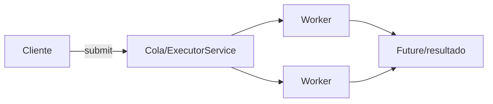
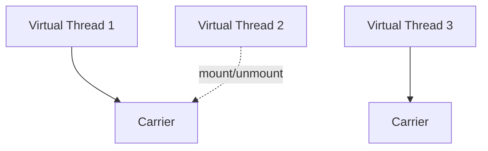
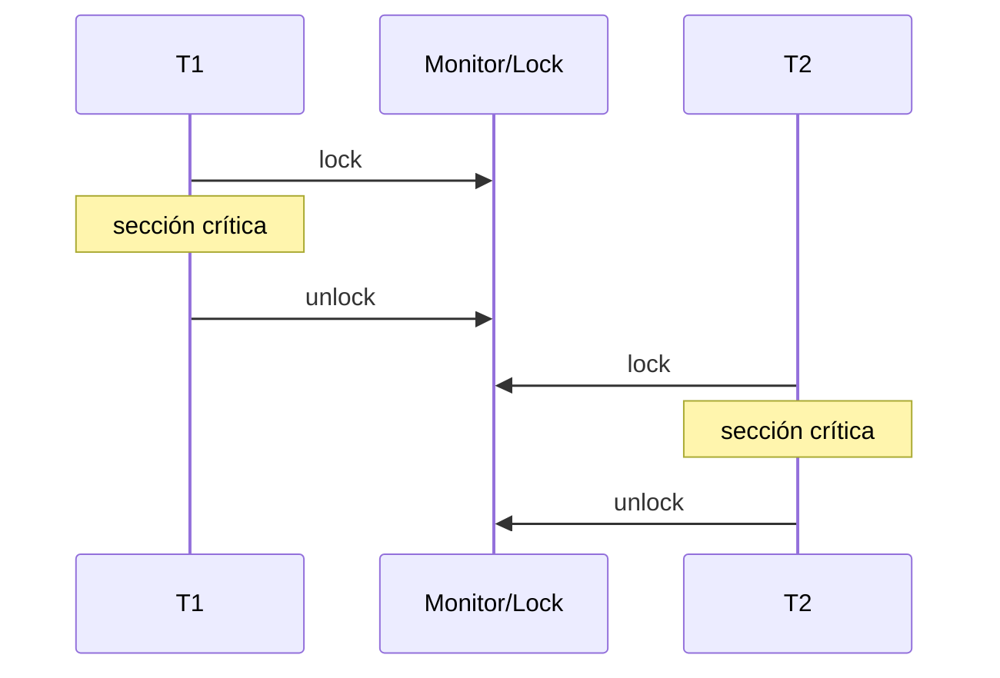

# Módulo 5: Concurrencia

La concurrencia aparece cuando una aplicación debe hacer varias cosas a la vez: atender requests, llamar servicios externos, procesar lotes o aprovechar múltiples núcleos. También es una de las fuentes más peligrosas de bugs: condiciones de carrera, deadlocks, starvation, fugas de hilos y recursos abandonados por timeouts. Java moderno ofrece un stack progresivo: `ExecutorService`, `CompletableFuture`, virtual threads, primitivas de sincronización, structured concurrency y scoped values.

**Entorno de referencia verificado (2026-05-22):** JDK 27.0.1.0.2. Structured Concurrency y Scoped Values pueden requerir `--enable-preview` según la versión; los ejemplos se ejecutaron con JDK 27.

## Aprende construyendo

### Tema 1: ExecutorService y gestión de hilos · Intermedio · 40 min

Caso guía: procesar 4 tareas independientes. Crear un `Thread` por tarea manualmente no escala y complica el apagado.

#### `ExecutorService`

**Definición formal.** `ExecutorService` es una abstracción para enviar tareas (`Runnable`/`Callable`) a un pool o estrategia de ejecución, desacoplando envío de ejecución.

**Cómo funciona por dentro.** El pool mantiene workers y una cola (según implementación). `submit` devuelve `Future`; `shutdown` inicia apagado ordenado; `awaitTermination` espera; `close()` (Java 19+) en implementaciones compatibles ayuda al ciclo de vida.



**Cuándo usar / cuándo no.** Úsalo para tareas concurrentes con límites de recursos. No crees hilos sin control en producción.

**Ejemplo mínimo enfocado (ejecutable).**

```bash
mkdir -p java-m5-exec
cd java-m5-exec
```

Crea el archivo `DemoExec.java`:

```java
import java.util.concurrent.*;

public class DemoExec {
  public static void main(String[] args) throws Exception {
    try (ExecutorService ex = Executors.newFixedThreadPool(2)) {
      Future<Integer> f = ex.submit(() -> 21 * 2);
      System.out.println(f.get());
    }
  }
}
```

```bash
javac DemoExec.java
java DemoExec
```

**Error común.** No cerrar el executor. Síntoma: JVM no termina o fuga de hilos. Corrección: `try-with-resources`/`shutdown` controlado.

**Verificación (JDK 27, 2026-05-22).** `42`.

### Tema 2: CompletableFuture · Intermedio · 40 min

Caso guía: obtener precio y descuento en paralelo y combinar. `Future.get()` bloqueante compone mal.

#### `CompletableFuture`

**Definición formal.** API para componer asincronía: encadenar, combinar, transformar y manejar errores sin bloquear manualmente en cada paso.

**Contrato.** `supplyAsync` ejecuta tarea; `thenApply/thenCompose` transforman; `allOf/anyOf` combinan; `exceptionally/handle` manejan errores. Por defecto usa `ForkJoinPool.commonPool()` salvo executor explícito.

**Ejemplo mínimo enfocado (ejecutable).**

```bash
mkdir -p java-m5-cf
cd java-m5-cf
```

Crea el archivo `DemoCF.java`:

```java
import java.util.concurrent.*;

public class DemoCF {
  public static void main(String[] args) {
    CompletableFuture<Integer> precio = CompletableFuture.supplyAsync(() -> 100);
    CompletableFuture<Integer> desc = CompletableFuture.supplyAsync(() -> 10);
    int total = precio.thenCombine(desc, (p, d) -> p - d).join();
    System.out.println(total);
  }
}
```

```bash
javac DemoCF.java
java DemoCF
```

**Error común.** Ignorar excepciones en pipeline async. Síntoma: futuros incompletos o errores perdidos. Corrección: `handle/exceptionally` y observar `join/get`.

**Verificación (JDK 27, 2026-05-22).** `90`.

### Tema 3: Virtual threads · Intermedio · 40 min

Caso guía: miles de tareas bloqueantes I/O. Hilos de plataforma son caros; virtual threads permiten un modelo por tarea más liviano.

#### Virtual threads

**Definición formal.** Hilos ligeros administrados por la JVM, diseñados para alta concurrencia en tareas que bloquean frecuentemente.

**Cómo funciona por dentro.** La JVM monta/desmonta virtual threads sobre carrier threads de plataforma cuando bloquean en operaciones compatibles. No hacen mágica a CPU-bound; reducen costo de bloqueo.



**Ejemplo mínimo enfocado (ejecutable).**

```bash
mkdir -p java-m5-vt
cd java-m5-vt
```

Crea el archivo `DemoVT.java`:

```java
import java.util.concurrent.*;

public class DemoVT {
  public static void main(String[] args) throws Exception {
    try (var ex = Executors.newVirtualThreadPerTaskExecutor()) {
      Future<String> f = ex.submit(() -> Thread.currentThread().isVirtual() ? "virtual" : "platform");
      System.out.println(f.get());
    }
  }
}
```

```bash
javac DemoVT.java
java DemoVT
```

**Error común.** Usar virtual threads para CPU-bound pesado esperando speedup mágico. Corrección: medir; usar pool acotado para CPU-bound.

**Verificación (JDK 27, 2026-05-22).** `virtual`.

### Tema 4: Condiciones de carrera y sincronización · Avanzado · 45 min

Caso guía: dos hilos incrementan un contador compartido. Sin sincronización, se pierden actualizaciones.

#### Race condition y `synchronized`/`Atomic*`

**Definición formal.** Condición de carrera: el resultado depende del orden no controlado de acceso concurrente a estado compartido mutable. `synchronized` proporciona exclusión mutua y visibilidad; `AtomicInteger` etc. proveen operaciones atómicas.

**Cómo funciona por dentro.** `synchronized` adquiere monitor: solo un hilo entra a la sección crítica. El modelo de memoria Java garantiza visibilidad al adquirir/liberar el monitor. Los atómicos usan CAS/hardware primitives.



**Ejemplo mínimo enfocado (ejecutable).**

```bash
mkdir -p java-m5-race
cd java-m5-race
```

Crea el archivo `DemoRace.java`:

```java
import java.util.concurrent.*;
import java.util.concurrent.atomic.*;

public class DemoRace {
  public static void main(String[] args) throws Exception {
    AtomicInteger ok = new AtomicInteger();
    try (ExecutorService ex = Executors.newFixedThreadPool(4)) {
      for (int i = 0; i < 1000; i++) ex.submit(ok::incrementAndGet);
    }
    System.out.println(ok.get());
  }
}
```

```bash
javac DemoRace.java
java DemoRace
```

**Error común.** Sincronizar solo lectura o solo escritura. Corrección: proteger la invariante completa.

**Verificación (JDK 27, 2026-05-22).** `1000`.

### Tema 5: Structured Concurrency (Java 25/preview) · Avanzado · 45 min

Caso guía: lanzar dos subtareas relacionadas; si una falla o hay timeout, cancelar las demás y no fugar hilos.

#### `StructuredTaskScope`

**Definición formal.** API que trata subtareas concurrentes como una unidad con alcance léxico: se abren en un bloque, se hacen fork/join y se cierran juntas.

**Contrato/reglas.** Requiere `--enable-preview` en JDK 27 actual (verificar versión). El scope define política de fallo/cancelación. Evita “fire and forget” accidental.

**Ejemplo mínimo enfocado (ejecutable, JDK 27 preview).**

```bash
mkdir -p java-m5-sts
cd java-m5-sts
```

Crea el archivo `DemoSTS.java`:

```java
import java.util.concurrent.StructuredTaskScope;

public class DemoSTS {
  public static void main(String[] args) throws Exception {
    try (var scope = StructuredTaskScope.open()) {
      var a = scope.fork(() -> "A");
      var b = scope.fork(() -> "B");
      scope.join();
      System.out.println(a.get() + b.get());
    }
  }
}
```

```bash
javac --release 27 --enable-preview DemoSTS.java
java --enable-preview DemoSTS
```

**Error común.** Dejar subtareas fuera del scope. Corrección: mantener fork/join dentro del bloque estructurado.

**Verificación (JDK 27 preview, 2026-05-22).** `AB`.

> Nota de verificación: requiere `--enable-preview` en JDK 27.0.1.0.2; la API puede evolucionar entre previews.

### Tema 6: Scoped Values frente a ThreadLocal · Avanzado · 45 min

Caso guía: propagar un `requestId` por llamadas. `ThreadLocal` funciona, pero con virtual threads y herencia puede filtrar contexto o volverse difícil de limpiar.

#### Scoped values

**Definición formal.** `ScopedValue` permite enlazar un valor inmutable al alcance dinámico de una ejecución, especialmente útil con virtual threads y structured concurrency.

**Cuándo usar / cuándo no.** Úsalo para contexto inmutable de request/tarea. `ThreadLocal` sigue válido para estado mutable por hilo con cuidado de limpieza, pero es más riesgoso.

**Ejemplo mínimo enfocado (ejecutable, JDK 27 preview).**

```bash
mkdir -p java-m5-sv
cd java-m5-sv
```

Crea el archivo `DemoSV.java`:

```java
public class DemoSV {
  static final ScopedValue<String> RID = ScopedValue.newInstance();
  public static void main(String[] args) {
    ScopedValue.where(RID, "req-1").run(() -> System.out.println(RID.get()));
  }
}
```

```bash
javac --release 27 --enable-preview DemoSV.java
java --enable-preview DemoSV
```

**Error común.** Usar `ThreadLocal` en pools sin `remove()`. Síntoma: fuga de contexto entre requests. Corrección: limpiar siempre o preferir scoped value para contexto inmutable.

**Verificación (JDK 27 preview, 2026-05-22).** `req-1`.

### Tema 7: Timeouts y cancelación cooperativa sin abandonar recursos · Avanzado · 45 min

Caso guía: una llamada externa puede colgarse. Cancelar mal deja sockets/hilos colgados.

#### Timeout y cancelación cooperativa

**Definición formal.** Timeout limita espera; cancelación cooperativa señala que la tarea debe detenerse en puntos seguros. `Future.cancel(true)` interrumpe; la tarea debe respetar la interrupción.

**Contrato.** Interrupción no mata mágicamente el hilo; el código debe chequear `Thread.interrupted()` o usar APIs que respondan a interrupción. Recursos deben cerrarse en `try-with-resources/finally`.

**Ejemplo mínimo enfocado (ejecutable).**

```bash
mkdir -p java-m5-timeout
cd java-m5-timeout
```

Crea el archivo `DemoTimeout.java`:

```java
import java.util.concurrent.*;

public class DemoTimeout {
  public static void main(String[] args) throws Exception {
    try (ExecutorService ex = Executors.newSingleThreadExecutor()) {
      Future<String> f = ex.submit(() -> {
        Thread.sleep(2000);
        return "ok";
      });
      try {
        System.out.println(f.get(100, TimeUnit.MILLISECONDS));
      } catch (TimeoutException e) {
        f.cancel(true);
        System.out.println("timeout");
      }
    }
  }
}
```

```bash
javac DemoTimeout.java
java DemoTimeout
```

**Error común.** Capturar `InterruptedException` y no restaurar el estado de interrupción. Corrección: `Thread.currentThread().interrupt()` o propagar.

**Verificación (JDK 27, 2026-05-22).** `timeout`.

## Cierre

La concurrencia profesional trata hilos como recursos con ciclo de vida. Empieza por la abstracción adecuada: executor para gestión, CompletableFuture para composición, virtual threads para I/O masivo, locks/atomics para invariantes, structured concurrency para alcance.

## Checklist

- Cierro executors y no fugó tareas.
- Protejo estado compartido mutable o lo elimino.
- Manejo interrupción, timeout y cancelación.
- Uso preview features con flag explícito y nota de versión.
