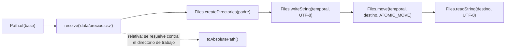
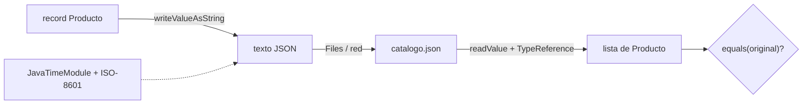
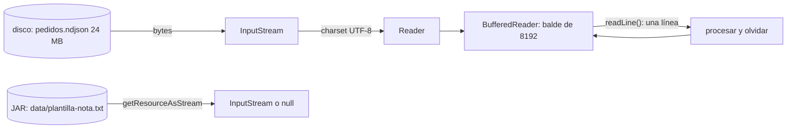

# Módulo 6: I/O, NIO.2 y serialización

El código de dominio no vive aislado: lee catálogos, escribe reportes, carga plantillas y exporta datos. La API de I/O de Java tiene dos caras. La clásica (`File`, `InputStream`, `Reader`) sigue presente; NIO.2 (`Path`, `Files`) ofrece una API más expresiva para rutas y operaciones de archivo. Sobre esa base, librerías como Jackson convierten objetos a JSON y viceversa. El reto no es solo “leer y escribir”, sino hacerlo con encoding correcto, cierre de recursos, manejo de errores y sin cargar en memoria archivos que pueden crecer.

Este módulo construye utilidades de Tienda Aurora: escribe y lee un catálogo JSON, exporta pedidos como NDJSON y CSV, lee una plantilla desde el classpath y cuenta líneas con streaming.

**Entorno de las salidas nuevas (2026-11-24):** Linux x86_64, OpenJDK 25.0.5.1 y Jackson 2.16.1, con cada archivo
ejecutado directamente con `java Archivo.java` (sin Gradle). Esas salidas corresponden a los Problemas resueltos
1.1, 1.3, 2.1, 2.2, 3.1, 3.2 y 3.3. Jackson 2.16.1 era la versión disponible en ese entorno; el proyecto del
laboratorio declara 2.19.0 y las APIs usadas son las mismas. El laboratorio integrador conserva sus salidas
originales (macOS arm64, JDK 27.0.1.0.2, Gradle 9.9.1, Jackson 2.19.0), declaradas en su sección.

**Al terminar este módulo podrás:**
- construir rutas con `Path` y leer y escribir texto con `Files` indicando el charset;
- reemplazar archivos de forma atómica y diagnosticar `NoSuchFileException`;
- serializar records a JSON con Jackson y deserializarlos de vuelta, incluidas fechas `java.time`;
- procesar archivos grandes línea por línea sin cargarlos completos en memoria;
- cargar recursos del classpath que funcionan igual en el IDE y dentro de un JAR.

**Esquema del módulo:** Tema 1 (Path y Files) → Tema 2 (Jackson) → Tema 3 (archivos grandes y classpath) →
laboratorio integrador `tienda-aurora-io`.

**Qué necesitas saber antes:** records (Módulo 1, Tema 5), genéricos y *type erasure* (Módulo 2, Tema 4),
excepciones checked y try-with-resources (Módulo 3, Temas 1 y 2) y Stream API (Módulo 4, Tema 1).

## Visual del módulo

**Visual:** [NIO.2, Jackson, streaming de archivos grandes y recursos classpath](/visuals/temas/java/modulo-6-io.html)

Lectura: Path/Files para archivos, Jackson para JSON, Buffered/streams para volumen, classpath para recursos empaquetados.

## Prerrequisitos

```bash
java -version
gradle --version
```

## Aprende construyendo

### Tema 1: NIO.2 — Path y Files · Básico · 40 min

<details open>
<summary><strong>Capa 1 — Lectura</strong></summary>

#### Objetivos
Al terminar este tema podrás:
- construir rutas con `Path` y distinguir una ruta relativa de una absoluta;
- leer y escribir texto con `Files.readString` y `Files.writeString` indicando el charset;
- reemplazar un archivo sin dejarlo a medias con un temporal y `ATOMIC_MOVE`;
- leer `NoSuchFileException` y `MalformedInputException` y corregir su causa.

**Conceptos clave:** Path, ruta relativa y absoluta, Files, charset, escritura atómica, NoSuchFileException

#### El problema
Tienda Aurora guarda su catálogo y sus reportes en disco. El programa debe saber **dónde** está cada archivo,
escribirlo con las tildes correctas y nunca dejar un catálogo a medio escribir si el proceso se corta. Además,
cuando un archivo no existe, el error debe decir cuál faltó. ¿Con qué herramientas de Java se hace todo eso?

#### Glosario del tema

**Path**
- **Definición técnica:** interfaz de `java.nio.file` que representa una ruta del sistema de archivos como una secuencia de nombres; se crea con `Path.of(...)` y se combina con `resolve`, `normalize` y `relativize`.
- **En palabras sencillas:** la dirección de un archivo, escrita como un objeto que sabe unir y simplificar tramos.
- **Dónde se rompe la comparación:** una dirección postal apunta a algo que existe; un `Path` puede describir un archivo que todavía no existe.
- **Ejemplo:** `Path.of("aurora-io").resolve("data/catalogo.json")` produce `aurora-io/data/catalogo.json`.
- **Error típico:** concatenar rutas con `+` y `"/"`; en Windows el separador es otro y `resolve` lo resuelve por ti.

**ruta relativa y absoluta**
- **Definición técnica:** una ruta absoluta empieza en la raíz del sistema de archivos; una relativa se resuelve contra el **directorio de trabajo** del proceso (el que muestra `pwd` al lanzar `java`).
- **En palabras sencillas:** la absoluta es la dirección completa; la relativa es «dos cuadras desde donde estás».
- **Dónde se rompe la comparación:** «donde estás» no es la carpeta del código, sino la carpeta desde la que se ejecutó el programa; cambia entre el IDE, Gradle y producción.
- **Ejemplo:** `Path.of("aurora-io/data").isAbsolute()` devuelve `false`; `toAbsolutePath()` le antepone la carpeta actual.
- **Error típico:** probar desde la raíz del proyecto y ejecutar en producción desde otra carpeta: aparece `NoSuchFileException`.

**Files**
- **Definición técnica:** clase de utilidades de `java.nio.file` con métodos estáticos que operan sobre un `Path`: `exists`, `createDirectories`, `readString`, `writeString`, `lines`, `list`, `copy`, `move`, `size`, `deleteIfExists`.
- **En palabras sencillas:** la caja de herramientas: `Path` dice dónde y `Files` hace el trabajo.
- **Dónde se rompe la comparación:** cada operación toca el disco real y puede fallar con `IOException` en cualquier momento.
- **Ejemplo:** `Files.writeString(destino, "sku,precio\n", StandardCharsets.UTF_8)` crea o reemplaza el archivo.
- **Error típico:** escribir en una carpeta que no existe sin llamar antes a `Files.createDirectories`.

**charset**
- **Definición técnica:** tabla que traduce caracteres a bytes y viceversa (UTF-8, ISO-8859-1); en Java se representa con `java.nio.charset.Charset` y las constantes de `StandardCharsets`.
- **En palabras sencillas:** el idioma en que el texto se guarda como números; quien lee debe usar el mismo.
- **Dónde se rompe la comparación:** en UTF-8 la `é` ocupa dos bytes y la `a` uno; no hay un tamaño fijo por letra.
- **Ejemplo:** `"Café Aurora".getBytes(StandardCharsets.UTF_8).length` es `12`, aunque el texto tiene 11 caracteres.
- **Error típico:** leer como UTF-8 un archivo guardado en ISO-8859-1: Java lanza `MalformedInputException`.

**escritura atómica**
- **Definición técnica:** reemplazo de un archivo que, visto desde fuera, ocurre en un solo paso: se escribe un temporal en la misma carpeta y se mueve sobre el destino con `StandardCopyOption.ATOMIC_MOVE`.
- **En palabras sencillas:** preparar la hoja nueva aparte y cambiarla por la vieja de un solo golpe.
- **Dónde se rompe la comparación:** no todos los sistemas de archivos soportan el movimiento atómico entre carpetas distintas; por eso el temporal va junto al destino.
- **Ejemplo:** `Files.move(temporal, destino, REPLACE_EXISTING, ATOMIC_MOVE)`.
- **Error típico:** escribir directamente sobre el archivo final: si el proceso muere a la mitad, queda corrupto.

**NoSuchFileException**
- **Definición técnica:** subclase de `IOException` (checked) que lanza NIO.2 cuando la ruta pedida, o su carpeta padre, no existe; `getFile()` devuelve la ruta tal como se pidió.
- **En palabras sencillas:** el aviso «busqué ese archivo y no está», con la dirección que usaste.
- **Dónde se rompe la comparación:** también aparece al **escribir**, si falta la carpeta que contiene el archivo.
- **Ejemplo:** `Files.readString(Path.of("data/inexistente.txt"))` termina con `NoSuchFileException: data/inexistente.txt`.
- **Error típico:** capturar `Exception` y mostrar «error de archivo», perdiendo la ruta que lo explica.

#### ► CÓMO FUNCIONA
`Path` representa una ruta de sistema de archivos. A diferencia de `File`, es más composable (`resolve`,
`relativize`, `normalize`, `toAbsolutePath`) y funciona bien con la API `Files`. `Files` ofrece operaciones
estáticas: `exists`, `createDirectories`, `readString`, `writeString`, `lines`, `list`, `walk`, `copy`, `move`,
`deleteIfExists`.

La ruta correcta depende del contexto. Un path relativo se resuelve contra el directorio de trabajo actual, que
puede cambiar según cómo se ejecute la app. Para archivos de usuario o reportes, pasa la base explícitamente o
resuélvela desde una configuración conocida. Para recursos empaquetados, usa classpath, no rutas del filesystem
(lo verás en el Tema 3).

`Files.move` con `ATOMIC_MOVE` es útil para escritura segura: escribes a un temporal y luego reemplazas el
archivo final. Si el proceso muere antes del move, el archivo final anterior sigue intacto. No todos los
filesystems soportan move atómico entre directorios distintos, por eso el temporal se crea junto al destino.



#### Problema resuelto 1.1
Arma las rutas de Tienda Aurora a partir de una base y comprueba qué hace cada operación de `Path`.

**Razonamiento:**
1. Una sola base (`aurora-io`) y todo lo demás se arma con `resolve`, para no repetir textos de ruta.
2. `getFileName` y `getParent` separan la ruta en nombre y carpeta.
3. `toAbsolutePath` muestra contra qué carpeta se resuelve una ruta relativa.
4. `normalize` elimina `.` y `..`; `relativize` calcula el camino de una ruta a otra.

```java
import java.nio.file.Path;

public class RutasAurora {
    public static void main(String[] args) {
        Path base = Path.of("aurora-io");
        Path catalogo = base.resolve("data/catalogo.json");
        Path rara = Path.of("aurora-io/reportes/../data/./catalogo.json");

        System.out.println("catalogo=" + catalogo);
        System.out.println("nombre=" + catalogo.getFileName());
        System.out.println("padre=" + catalogo.getParent());
        System.out.println("absoluta?=" + catalogo.isAbsolute());
        System.out.println("absoluta=" + catalogo.toAbsolutePath());
        System.out.println("normalizada=" + rara.normalize());
        System.out.println("iguales?=" + rara.normalize().equals(catalogo));
        System.out.println("relativa=" + base.resolve("reportes").relativize(catalogo));
    }
}
```

```text
$ java RutasAurora.java
catalogo=aurora-io/data/catalogo.json
nombre=catalogo.json
padre=aurora-io/data
absoluta?=false
absoluta=/home/estudiante/labs/aurora-m6/aurora-io/data/catalogo.json
normalizada=aurora-io/data/catalogo.json
iguales?=true
relativa=../data/catalogo.json
```

**Explicación por partes.**
- Líneas 5–6: `resolve` une la base con el tramo `data/catalogo.json`; ningún archivo se crea todavía.
- Línea 12: la ruta es relativa (`false`); su significado depende de dónde ejecutes `java`.
- Línea 13: la salida muestra la carpeta desde la que se lanzó el programa. En tu equipo será otra.
- Líneas 14–15: `normalize` quita `reportes/..` y `./`; el resultado es igual a `catalogo`.
- Línea 16: para ir de `aurora-io/reportes` al catálogo hay que subir un nivel (`..`) y entrar a `data`.

> **Buena práctica.** Registra `toAbsolutePath()` en los mensajes de error y de arranque. Así sabes contra qué
> carpeta se resolvió cada ruta relativa sin adivinar.

#### Problema resuelto 1.2
Escribe una nota en UTF-8, léela completa, léela por líneas y reacciona con un mensaje claro cuando el archivo
no existe. Este es `TextoIoDemo.java` del laboratorio del módulo.

**Razonamiento:**
1. La base llega como parámetro: así la ruta no depende de una carpeta fija.
2. `Files.writeString` y `Files.readString` sirven para archivos pequeños; el charset se indica siempre.
3. La lectura por líneas usa `BufferedReader` dentro de `try` con recursos, para que se cierre solo (Tema 3).
4. El archivo ausente se captura como `NoSuchFileException`, no como `Exception`, y se informa su ruta.

```java
package com.aurora.io;

import java.io.BufferedReader;
import java.io.IOException;
import java.nio.charset.StandardCharsets;
import java.nio.file.Files;
import java.nio.file.NoSuchFileException;
import java.nio.file.Path;

public final class TextoIoDemo {

    private TextoIoDemo() {
    }

    public static void ejecutar(Path base) throws IOException {
        Path archivo = base.resolve("data/nota.txt");
        Files.createDirectories(archivo.getParent());
        Files.writeString(archivo, "Tienda Aurora\nI/O con UTF-8\n", StandardCharsets.UTF_8);

        String contenido = Files.readString(archivo, StandardCharsets.UTF_8);
        System.out.println("readString=" + contenido.lines().map(linea -> "[" + linea + "]").toList());

        try (BufferedReader reader = Files.newBufferedReader(archivo, StandardCharsets.UTF_8)) {
            System.out.println("bufferedReader=" + reader.readLine() + " / " + reader.readLine());
        }

        Path ausente = base.resolve("data/inexistente.txt");
        try {
            Files.readString(ausente, StandardCharsets.UTF_8);
        } catch (NoSuchFileException e) {
            System.out.println("noExiste=NoSuchFileException:" + e.getFile());
        }
    }
}
```

Salida observada en el entorno original con `./gradlew -q run --args="texto"`:

```text
readString=[[Tienda Aurora], [I/O con UTF-8]]
bufferedReader=Tienda Aurora / I/O con UTF-8
noExiste=NoSuchFileException:build/aurora-io/data/inexistente.txt
```

**Explicación por partes.**
- Línea 16: la ruta se arma desde la base; con la base por defecto queda `build/aurora-io/data/nota.txt`.
- Línea 17: `createDirectories` crea `data` si falta y no falla si ya existe.
- Líneas 20–21: `readString` devuelve todo el texto; `lines()` lo parte para mostrar cada línea entre corchetes.
- Líneas 23–25: `BufferedReader` lee una línea por llamada a `readLine()`.
- Líneas 27–32: la excepción concreta se captura y `getFile()` informa la ruta que faltó.

Comprobación concreta: el test `textoSeEscribeYSeLeeConUtf8` comprueba que el archivo contiene exactamente
`Tienda Aurora\nI/O con UTF-8\n`, y `archivoInexistenteLanzaNoSuchFileException` confirma el tipo y la ruta.

> **Error común.** Escribir en una carpeta que no existe. `Files.writeString(Path.of("salidas/nota.txt"), …)` sin
> crear `salidas` termina con `Exception in thread "main" java.nio.file.NoSuchFileException: salidas/nota.txt`.
> El nombre de la excepción engaña: lo que falta es la **carpeta**. Llama antes a `Files.createDirectories(nota.getParent())`.

#### Problema resuelto 1.3
Actualiza la lista de precios sin que nadie pueda leer un archivo a medio escribir, y comprueba qué pasa con los
bytes cuando el texto tiene tildes.

**Razonamiento:**
1. El contenido nuevo se escribe en `precios.csv.tmp`, junto al destino.
2. `Files.move` con `REPLACE_EXISTING` y `ATOMIC_MOVE` cambia el archivo de un solo paso.
3. Después del movimiento el temporal ya no existe y el destino tiene el contenido nuevo.

```java
import java.io.IOException;
import java.nio.charset.StandardCharsets;
import java.nio.file.Files;
import java.nio.file.Path;
import java.nio.file.StandardCopyOption;

public class EscrituraAtomica {
    public static void main(String[] args) throws IOException {
        Path destino = Path.of("aurora-io/data/precios.csv");
        Files.createDirectories(destino.getParent());
        Files.writeString(destino, "sku,precio\nCAF-100,14.90\n", StandardCharsets.UTF_8);
        System.out.println("antes=" + Files.readString(destino, StandardCharsets.UTF_8).lines().toList());

        Path temporal = destino.resolveSibling(destino.getFileName() + ".tmp");
        Files.writeString(temporal, "sku,precio\nCAF-100,15.50\nMOL-200,79.90\n", StandardCharsets.UTF_8);
        System.out.println("temporalExiste=" + Files.exists(temporal));

        Files.move(temporal, destino, StandardCopyOption.REPLACE_EXISTING, StandardCopyOption.ATOMIC_MOVE);
        System.out.println("temporalExiste=" + Files.exists(temporal));
        System.out.println("despues=" + Files.readString(destino, StandardCharsets.UTF_8).lines().toList());
        System.out.println("bytes=" + Files.size(destino));
    }
}
```

```text
$ java EscrituraAtomica.java
antes=[sku,precio, CAF-100,14.90]
temporalExiste=true
temporalExiste=false
despues=[sku,precio, CAF-100,15.50, MOL-200,79.90]
bytes=39
```

**Explicación por partes.**
- Líneas 9–11: se crea la versión inicial del archivo.
- Línea 14: `resolveSibling` ubica el temporal en la misma carpeta que el destino.
- Línea 18: el movimiento atómico reemplaza el destino; quien lea antes ve la versión vieja completa, y quien lea después ve la nueva completa.
- Línea 21: `Files.size` cuenta **bytes**: 11 + 14 + 14 = 39, incluidos los saltos de línea.

Ahora mira el charset. El mismo texto ocupa distinto según la tabla que uses:

```java
import java.io.IOException;
import java.nio.charset.MalformedInputException;
import java.nio.charset.StandardCharsets;
import java.nio.file.Files;
import java.nio.file.Path;
import java.util.Arrays;

public class CharsetAurora {
    public static void main(String[] args) throws IOException {
        String nombre = "Café Aurora";
        byte[] utf8 = nombre.getBytes(StandardCharsets.UTF_8);
        byte[] latin1 = nombre.getBytes(StandardCharsets.ISO_8859_1);
        System.out.println("caracteres=" + nombre.length());
        System.out.println("bytesUtf8=" + utf8.length + " bytesLatin1=" + latin1.length);
        System.out.println("éEnUtf8=" + Arrays.toString(Arrays.copyOfRange(utf8, 3, 5)));

        Path archivo = Path.of("aurora-io/data/proveedor.txt");
        Files.createDirectories(archivo.getParent());
        Files.write(archivo, latin1);
        System.out.println("leidoComoLatin1=" + Files.readString(archivo, StandardCharsets.ISO_8859_1));
        try {
            Files.readString(archivo, StandardCharsets.UTF_8);
        } catch (MalformedInputException e) {
            System.out.println("leidoComoUtf8=" + e);
        }
    }
}
```

```text
$ java CharsetAurora.java
caracteres=11
bytesUtf8=12 bytesLatin1=11
éEnUtf8=[-61, -87]
leidoComoLatin1=Café Aurora
leidoComoUtf8=java.nio.charset.MalformedInputException: Input length = 3
```

- Líneas 14–15: la `é` ocupa dos bytes en UTF-8 (`-61, -87`) y uno en ISO-8859-1; por eso 12 frente a 11.
- Líneas 19–20: el archivo se guarda en ISO-8859-1 y se lee bien con esa misma tabla.
- Líneas 21–25: leerlo como UTF-8 falla, porque ese byte suelto no es una secuencia UTF-8 válida.

> **Error común.** Leer con un charset distinto al de escritura. `Files.readString` sin charset usa UTF-8 y, ante
> un archivo en ISO-8859-1, lanza `java.nio.charset.MalformedInputException: Input length = 3`. Pregunta al
> proveedor en qué charset exporta y pásalo explícito.

> **Prevenir errores.** Escribe siempre `StandardCharsets.UTF_8` al leer y escribir, aunque sea el valor por
> defecto desde Java 18. El código queda explícito y no cambia de comportamiento en otro entorno.

> **Ingeniería de software.** `File` está obsoleto: no, sigue funcionando. Pero para código nuevo, `Path/Files`
> suele ser más claro y completo; si una librería te exige `File`, convierte en el borde con `path.toFile()`.

#### Checkpoint 1.1
Ejecutas `RutasAurora` desde `/srv/aurora`. ¿Qué imprime la línea `absoluta=`?

Respuesta: `absoluta=/srv/aurora/aurora-io/data/catalogo.json`. Una ruta relativa se resuelve contra la carpeta
desde la que se ejecuta `java`, no contra la carpeta del código fuente.

</details>

<details>
<summary><strong>Capa 2 — Construcción</strong></summary>

#### Paso 1 · Prepara la carpeta
Crea `~/labs/aurora-m6`, entra con `cd ~/labs/aurora-m6` y comprueba `java -version` (Java 11 o superior basta
para ejecutar un archivo `.java` directamente).

#### Paso 2 · Explora las rutas
Guarda `RutasAurora.java` y ejecútalo con `java RutasAurora.java`. Compara tu línea `absoluta=` con la salida
de `pwd`: deben empezar igual.

#### Paso 3 · Reemplaza un archivo de forma atómica
Ejecuta `EscrituraAtomica.java` y abre `aurora-io/data/precios.csv`. Debe tener tres líneas y pesar 39 bytes.

#### Paso 4 · Provoca los errores
Ejecuta `SinCarpeta.java` y lee la primera línea del error. Después ejecuta `CharsetAurora.java` y localiza la
línea `leidoComoUtf8=`.

#### Resumen
- Un **`Path`** describe una ruta; `resolve`, `normalize` y `relativize` la arman sin concatenar textos.
- Una **ruta relativa** se resuelve contra el directorio de trabajo; una **absoluta** empieza en la raíz.
- **`Files`** ejecuta las operaciones: crear carpetas, leer, escribir, mover, medir.
- El **charset** traduce caracteres a bytes; indícalo siempre (`StandardCharsets.UTF_8`).
- La **escritura atómica** usa un temporal en la misma carpeta y `ATOMIC_MOVE`.
- **`NoSuchFileException`** informa la ruta que faltó, incluso al escribir en una carpeta inexistente.

#### Ejercicio verificable 1
Básico. ¿Qué imprime `System.out.println(Path.of("aurora-io/data/../reportes/r.csv").normalize());`?

Respuesta esperada: `aurora-io/reportes/r.csv`. El tramo `data/..` se anula.

#### Ejercicio verificable 2
Intermedio. Corrige `SinCarpeta.java` para que cree la carpeta antes de escribir y muestre `Files.size(nota)`.

Respuesta esperada: agregar `Files.createDirectories(nota.getParent());` antes de escribir. El programa imprime
`14`: trece caracteres de `Tienda Aurora` más el salto de línea, todos de un byte.

#### Ejercicio verificable 3
Reto. Escribe un método `String leerONotificar(Path ruta)` que devuelva el texto o, si no existe, el mensaje
`No existe: <ruta absoluta>`.

Respuesta esperada: un `try` con `Files.readString(ruta, StandardCharsets.UTF_8)` y un
`catch (NoSuchFileException e)` que devuelva `"No existe: " + ruta.toAbsolutePath()`. Otras `IOException` se
propagan: no se esconden.

#### En el trabajo
Los servicios de una empresa leen su configuración, escriben reportes y reciben archivos de proveedores. Los
fallos más comunes en producción son rutas relativas que dependen de cómo se lanzó el proceso y archivos en
otro charset. Un mensaje con la ruta absoluta y un charset explícito ahorran horas de diagnóstico.

</details>

### Tema 2: Serialización con Jackson · Intermedio · 45 min

<details open>
<summary><strong>Capa 1 — Lectura</strong></summary>

#### Objetivos
Al terminar este tema podrás:
- serializar un record a JSON y deserializarlo de vuelta con `ObjectMapper`, comprobando que coincide;
- leer una lista genérica desde JSON con `TypeReference`;
- registrar `JavaTimeModule` para escribir fechas `LocalDate` en formato ISO-8601;
- interpretar `UnrecognizedPropertyException` e `InvalidDefinitionException` como errores de contrato.

**Conceptos clave:** serialización, deserialización, JSON, ObjectMapper, TypeReference, JavaTimeModule, contrato de serialización

#### El problema
El catálogo de Tienda Aurora vive en memoria como una lista de records `Producto`. Para guardarlo en disco o
enviarlo a otro sistema hay que convertirlo en texto, y al día siguiente reconstruir los mismos objetos desde ese
texto. Las fechas de los pedidos también deben viajar sin perder su significado. ¿Quién hace esa conversión?

#### Glosario del tema

**serialización**
- **Definición técnica:** conversión del estado de un objeto en memoria a una secuencia de bytes o texto que se puede guardar o transmitir.
- **En palabras sencillas:** pasar a papel los datos de un objeto para poder guardarlos o enviarlos.
- **Dónde se rompe la comparación:** el papel no guarda el comportamiento: solo viajan los datos, no los métodos.
- **Ejemplo:** `mapper.writeValueAsString(cafe)` produce `{"sku":"CAF-100",...}`.
- **Error típico:** confundirla con la serialización binaria de Java (`Serializable`), que este curso no usa para intercambiar datos (el Módulo 14 explica sus riesgos).

**deserialización**
- **Definición técnica:** operación inversa: construir objetos en memoria a partir de bytes o texto serializado.
- **En palabras sencillas:** leer el papel y volver a armar el objeto.
- **Dónde se rompe la comparación:** el papel puede venir de otra persona y traer campos de más, de menos o falsos.
- **Ejemplo:** `mapper.readValue(json, Pedido.class)` devuelve un `Pedido`.
- **Error típico:** confiar en el texto recibido sin tratar los fallos de mapeo como errores de entrada.

**JSON**
- **Definición técnica:** formato de texto para datos estructurados (RFC 8259) con objetos `{}`, arreglos `[]`, textos, números, `true`, `false` y `null`.
- **En palabras sencillas:** una forma estándar de escribir datos que cualquier lenguaje sabe leer.
- **Dónde se rompe la comparación:** no tiene tipo fecha ni decimal exacto: una fecha viaja como texto o como números.
- **Ejemplo:** `{"sku":"FIL-300","precio":9.50}`.
- **Error típico:** escribir JSON a mano concatenando textos y olvidar escapar comillas.

**ObjectMapper**
- **Definición técnica:** clase central de Jackson (`com.fasterxml.jackson.databind`) que serializa con `writeValueAsString` / `writeValue` y deserializa con `readValue`; se configura con módulos y *features*.
- **En palabras sencillas:** el traductor entre objetos Java y JSON.
- **Dónde se rompe la comparación:** guarda configuración; dos mappers configurados distinto producen JSON distinto.
- **Ejemplo:** `new ObjectMapper().writerWithDefaultPrettyPrinter().writeValue(archivo.toFile(), catalogo)`.
- **Error típico:** crear un `ObjectMapper` nuevo en cada llamada; es costoso y se pierde la configuración común.

**TypeReference**
- **Definición técnica:** clase abstracta de Jackson que, al instanciarse como subclase anónima (`new TypeReference<List<Producto>>() {}`), conserva el tipo genérico completo que el *type erasure* borra.
- **En palabras sencillas:** una etiqueta que le dice a Jackson «es una lista **de productos**», no solo «una lista».
- **Dónde se rompe la comparación:** las llaves `{}` del final son obligatorias: sin ellas no hay subclase ni tipo.
- **Ejemplo:** `mapper.readValue(archivo.toFile(), new TypeReference<List<Producto>>() {})`.
- **Error típico:** usar `List.class`: Jackson devuelve `LinkedHashMap` y el código falla con `ClassCastException`.

**JavaTimeModule**
- **Definición técnica:** módulo de `jackson-datatype-jsr310` que enseña a Jackson a manejar los tipos de `java.time` (`LocalDate`, `Instant`…); se activa con `mapper.registerModule(new JavaTimeModule())`.
- **En palabras sencillas:** un diccionario extra para que el traductor entienda fechas.
- **Dónde se rompe la comparación:** por sí solo escribe la fecha como arreglo `[2026,11,20]`; para ISO-8601 hay que desactivar `WRITE_DATES_AS_TIMESTAMPS`.
- **Ejemplo:** con ambas cosas, `LocalDate.of(2026, 11, 20)` viaja como `"2026-11-20"`.
- **Error típico:** no registrarlo y recibir `InvalidDefinitionException: Java 8 date/time type ... not supported by default`.

**contrato de serialización**
- **Definición técnica:** acuerdo sobre nombres de campos, tipos y estructura del JSON que comparten quien escribe y quien lee; cambiarlo sin versionar rompe a los lectores existentes.
- **En palabras sencillas:** el formulario que ambos lados prometen llenar igual.
- **Dónde se rompe la comparación:** un formulario en papel tolera un campo de más; Jackson, por defecto, no.
- **Ejemplo:** renombrar `precio` a `valor` en el record rompe la lectura de todos los `catalogo.json` antiguos.
- **Error típico:** serializar objetos de dominio con campos internos que nunca debieron salir del programa.

#### ► CÓMO FUNCIONA
Jackson es una librería para JSON en Java. `ObjectMapper` convierte objetos Java a JSON (`writeValueAsString`,
`writeValue`) y JSON a objetos (`readValue`). Para records y POJOs simples funciona bien por defecto; para tipos
como `LocalDate`, necesitas módulos como `jackson-datatype-jsr310`.

Dos decisiones importan: formato de fechas y manejo de tipos. `WRITE_DATES_AS_TIMESTAMPS` desactivado produce
ISO-8601 legible (`2026-11-20`) en vez de números. Para leer una lista genérica, usa
`TypeReference<List<Producto>>() {}` porque Java borra genéricos en runtime.

La serialización es un contrato. Si cambias nombres de campos, tipos o estructura, puedes romper lectores
existentes. Para APIs públicas, versiona o diseña compatibilidad. No serialices objetos de dominio con detalles
internos accidentales sin revisarlo.



#### Problema resuelto 2.1
Guarda el catálogo como JSON legible, léelo de vuelta y comprueba que los objetos son iguales a los originales.

**Razonamiento:**
1. Un record ya expone sus componentes: Jackson los usa como campos del JSON.
2. `writeValueAsString` muestra el JSON de un producto; `writerWithDefaultPrettyPrinter` lo indenta para el archivo.
3. Para leer la lista se necesita `TypeReference`, si no Jackson no sabe que los elementos son `Producto`.
4. La prueba final es `equals`: los records comparan componente por componente.

```java
import com.fasterxml.jackson.core.type.TypeReference;
import com.fasterxml.jackson.databind.ObjectMapper;

import java.io.IOException;
import java.math.BigDecimal;
import java.nio.file.Files;
import java.nio.file.Path;
import java.util.List;

public class CatalogoJson {
    record Producto(String sku, String nombre, BigDecimal precio, int stock) {}

    public static void main(String[] args) throws IOException {
        ObjectMapper mapper = new ObjectMapper();
        Producto cafe = new Producto("CAF-100", "Café Aurora", new BigDecimal("14.90"), 8);

        String json = mapper.writeValueAsString(cafe);
        System.out.println("json=" + json);

        List<Producto> catalogo = List.of(cafe,
                new Producto("MOL-200", "Molino Manual", new BigDecimal("79.90"), 3));
        Path archivo = Path.of("aurora-io/data/catalogo.json");
        Files.createDirectories(archivo.getParent());
        mapper.writerWithDefaultPrettyPrinter().writeValue(archivo.toFile(), catalogo);
        System.out.println("lineasArchivo=" + Files.readAllLines(archivo).size());

        List<Producto> leidos = mapper.readValue(archivo.toFile(), new TypeReference<List<Producto>>() {});
        System.out.println("leidos=" + leidos.size() + " tipo=" + leidos.getFirst().getClass().getSimpleName());
        System.out.println("igualAlOriginal=" + leidos.equals(catalogo));
    }
}
```

```text
$ java -cp "lib/*" CatalogoJson.java
json={"sku":"CAF-100","nombre":"Café Aurora","precio":14.90,"stock":8}
lineasArchivo=11
leidos=2 tipo=Producto
igualAlOriginal=true
```

Contenido de `aurora-io/data/catalogo.json` después de ejecutar:

```json
[ {
  "sku" : "CAF-100",
  "nombre" : "Café Aurora",
  "precio" : 14.90,
  "stock" : 8
}, {
  "sku" : "MOL-200",
  "nombre" : "Molino Manual",
  "precio" : 79.90,
  "stock" : 3
} ]
```

**Explicación por partes.**
- Línea 11: el record `Producto` es el mismo del laboratorio, anidado para que el archivo sea autocontenido.
- Línea 17: el JSON respeta el orden de los componentes y conserva la `é` y el decimal `14.90`.
- Línea 24: el archivo indentado ocupa 11 líneas, como muestra `lineasArchivo`.
- Línea 27: la subclase anónima de `TypeReference` le entrega a Jackson el tipo `List<Producto>`.
- Línea 29: `true` confirma la ida y vuelta, incluido el `BigDecimal` con escala 2.

> **Error común.** Leer la lista con `List.class`. El primer elemento llega como `java.util.LinkedHashMap` y el
> casteo falla con `java.lang.ClassCastException: class java.util.LinkedHashMap cannot be cast to class
> ErroresJson$Producto`. Usa `new TypeReference<List<Producto>>() {}`.

> **Error común.** Recibir un campo que el record no tiene. Con `"color":"rojo"` de más, Jackson lanza
> `UnrecognizedPropertyException: Unrecognized field "color" (class ErroresJson$Producto), not marked as ignorable
> (4 known properties: "nombre", "sku", "precio", "stock"])`. Es una violación del contrato: decide si se
> rechaza o si el lector debe tolerar campos nuevos.

#### Problema resuelto 2.2
Serializa un pedido con fecha y líneas, primero con la configuración mínima de fechas y luego en ISO-8601.

**Razonamiento:**
1. Sin `JavaTimeModule`, Jackson no sabe escribir `LocalDate` y se niega.
2. Con el módulo, la fecha sale como arreglo de números: válida, pero difícil de leer.
3. Al desactivar `WRITE_DATES_AS_TIMESTAMPS` la fecha sale como texto ISO-8601.
4. La lectura de vuelta debe reconstruir un `LocalDate` real, con día de la semana.

```java
import com.fasterxml.jackson.databind.ObjectMapper;
import com.fasterxml.jackson.databind.SerializationFeature;
import com.fasterxml.jackson.datatype.jsr310.JavaTimeModule;

import java.io.IOException;
import java.time.LocalDate;
import java.util.List;

public class PedidosJson {
    record LineaPedido(String sku, int cantidad) {}
    record Pedido(String id, String cliente, LocalDate fecha, List<LineaPedido> lineas) {}

    public static void main(String[] args) throws IOException {
        ObjectMapper conModulo = new ObjectMapper().registerModule(new JavaTimeModule());
        Pedido pedido = new Pedido("PED-001", "Ana", LocalDate.of(2026, 11, 20),
                List.of(new LineaPedido("CAF-100", 2), new LineaPedido("FIL-300", 1)));

        System.out.println("conTimestamps=" + conModulo.writeValueAsString(pedido));

        conModulo.disable(SerializationFeature.WRITE_DATES_AS_TIMESTAMPS);
        String json = conModulo.writeValueAsString(pedido);
        System.out.println("iso8601=" + json);

        Pedido devuelta = conModulo.readValue(json, Pedido.class);
        System.out.println("fecha=" + devuelta.fecha() + " dia=" + devuelta.fecha().getDayOfWeek());
        System.out.println("idaYVuelta=" + devuelta.equals(pedido));
    }
}
```

```text
$ java -cp "lib/*" PedidosJson.java
conTimestamps={"id":"PED-001","cliente":"Ana","fecha":[2026,11,20],"lineas":[{"sku":"CAF-100","cantidad":2},{"sku":"FIL-300","cantidad":1}]}
iso8601={"id":"PED-001","cliente":"Ana","fecha":"2026-11-20","lineas":[{"sku":"CAF-100","cantidad":2},{"sku":"FIL-300","cantidad":1}]}
fecha=2026-11-20 dia=FRIDAY
idaYVuelta=true
```

**Explicación por partes.**
- Línea 14: `registerModule` devuelve el mismo mapper, por eso se puede encadenar.
- Línea 18: con el módulo y la configuración por defecto, la fecha sale como `[2026,11,20]`.
- Línea 20: desactivar la *feature* cambia el formato a `"2026-11-20"`.
- Líneas 24–26: el texto vuelve a ser `LocalDate` (sabe que es viernes) y el pedido completo es igual al original.

> **Error común.** Olvidar el módulo de fechas. Sin `registerModule(new JavaTimeModule())`, serializar el pedido
> lanza `InvalidDefinitionException: Java 8 date/time type `java.time.LocalDate` not supported by default: add
> Module "com.fasterxml.jackson.datatype:jackson-datatype-jsr310" to enable handling`. El propio mensaje dice
> qué dependencia agregar.

> **Buena práctica.** Crea un único `ObjectMapper` configurado y compártelo, como hace `ReportePedidos` en el
> laboratorio con su método `mapper()`. Es seguro entre hilos una vez configurado.

> **Prevenir errores.** “Jackson puede leer cualquier JSON a cualquier clase”: solo si el JSON coincide con el
> modelo o configuras mapeo. Fallos de mapeo deben tratarse como errores de entrada, no ignorarse.

#### Checkpoint 2.1
Si quitas la línea 20 de `PedidosJson`, ¿qué imprime `idaYVuelta=`?

Respuesta: `true`. El formato cambia a `[2026,11,20]`, pero el mismo mapper sabe leer ese arreglo y reconstruye la
fecha. El problema no es la ida y vuelta, sino que otros sistemas esperan ISO-8601.

</details>

<details>
<summary><strong>Capa 2 — Construcción</strong></summary>

#### Paso 1 · Consigue las librerías
En el proyecto Gradle del laboratorio, las dependencias `jackson-databind` y `jackson-datatype-jsr310` ya están
declaradas. Para los archivos sueltos de este tema, copia esos JAR (y `jackson-core` y `jackson-annotations`)
en una carpeta `lib`.

#### Paso 2 · Ida y vuelta del catálogo
Ejecuta `java -cp "lib/*" CatalogoJson.java`. La última línea debe ser `igualAlOriginal=true`.

#### Paso 3 · Fechas en ISO-8601
Ejecuta `PedidosJson.java` y compara la línea `conTimestamps=` con `iso8601=`.

#### Paso 4 · Rompe el contrato
Agrega `"color":"rojo"` a un producto de `catalogo.json` y vuelve a leerlo. Lee el nombre del campo en el mensaje.

#### Resumen
- **Serializar** convierte objetos en texto; **deserializar** reconstruye objetos desde ese texto.
- **JSON** es el formato; **`ObjectMapper`** es el traductor de Jackson.
- **`TypeReference`** conserva el tipo genérico de una lista que el *type erasure* borra.
- **`JavaTimeModule`** más `WRITE_DATES_AS_TIMESTAMPS` desactivado da fechas ISO-8601.
- El JSON es un **contrato de serialización**: cambiarlo rompe a quien lo lee.
- `UnrecognizedPropertyException` e `InvalidDefinitionException` son errores de contrato y de configuración, no ruido.

#### Ejercicio verificable 1
Básico. ¿Qué JSON produce `writeValueAsString(new Producto("FIL-300", "Filtros V60", new BigDecimal("9.50"), 25))`?

Respuesta esperada: `{"sku":"FIL-300","nombre":"Filtros V60","precio":9.50,"stock":25}`.

#### Ejercicio verificable 2
Intermedio. Haz que el lector tolere el campo `color` sin fallar. ¿Qué imprime el producto leído?

Respuesta esperada: con `mapper.configure(DeserializationFeature.FAIL_ON_UNKNOWN_PROPERTIES, false)` el campo se
ignora y se imprime `Producto[sku=CAF-100, nombre=Cafe, precio=14.90, stock=8]`.

#### Ejercicio verificable 3
Reto. Escribe el catálogo como NDJSON (un producto por línea) y reconstrúyelo con `Files.lines` y `readValue`.

Respuesta esperada: dos líneas en el archivo, una por producto, y `true` al comparar la lista leída con la
original. Cada línea se lee con `mapper.readValue(linea, Producto.class)`.

#### En el trabajo
Casi todo servicio backend intercambia JSON: APIs REST, colas de mensajes, archivos de exportación. Spring Boot
usa Jackson por debajo. Los incidentes típicos son un campo renombrado que rompe a otro equipo y fechas que
llegan como números. Por eso los equipos versionan sus contratos y prueban la ida y vuelta.

</details>

### Tema 3: Archivos grandes y recursos del classpath · Intermedio · 35 min

<details open>
<summary><strong>Capa 1 — Lectura</strong></summary>

#### Objetivos
Al terminar este tema podrás:
- distinguir un flujo de bytes de un flujo de caracteres y elegir el adecuado;
- procesar un archivo grande línea por línea con un buffer, sin cargarlo completo en memoria;
- cerrar flujos y `Files.lines` con try-with-resources;
- cargar un recurso del classpath con `getResourceAsStream` y manejar el caso en que no existe.

**Conceptos clave:** flujo de bytes, flujo de caracteres, buffer, try-with-resources en I/O, Files.lines, NDJSON, recurso del classpath

#### El problema
El reporte de pedidos de Tienda Aurora crece cada día: hoy tiene medio millón de líneas y 24 MB. Leerlo entero de
una vez puede agotar la memoria del servidor. Además, la plantilla de la nota de despacho viaja **dentro** del JAR
de la aplicación, donde no hay una carpeta `src/main/resources`. ¿Cómo se leen ambos sin romper nada?

#### Glosario del tema

**flujo de bytes**
- **Definición técnica:** secuencia de bytes que se lee con `InputStream` o se escribe con `OutputStream`; `read()` devuelve un byte (0–255) o `-1` al final.
- **En palabras sencillas:** una manguera por la que pasan números crudos, sin saber si son texto o imagen.
- **Dónde se rompe la comparación:** la manguera no sabe de letras: una `é` en UTF-8 llega como dos bytes.
- **Ejemplo:** `Files.newInputStream(nota)` sobre `Café Aurora\n` entrega 13 bytes.
- **Error típico:** convertir cada byte en `char` por separado y destrozar las tildes.

**flujo de caracteres**
- **Definición técnica:** secuencia de caracteres que se lee con `Reader` o se escribe con `Writer`; aplica un charset para traducir bytes a caracteres y viceversa.
- **En palabras sencillas:** la misma manguera con un traductor en la boca que ya entrega letras.
- **Dónde se rompe la comparación:** si el traductor usa otro charset, entrega letras equivocadas o falla.
- **Ejemplo:** `Files.newBufferedReader(nota, StandardCharsets.UTF_8)` sobre el mismo archivo entrega 12 caracteres.
- **Error típico:** crear un `Reader` sin charset en código antiguo y depender del valor del sistema.

**buffer**
- **Definición técnica:** zona de memoria intermedia que agrupa lecturas o escrituras pequeñas en operaciones grandes contra el disco; `BufferedReader` y `BufferedWriter` usan 8192 caracteres por defecto.
- **En palabras sencillas:** un balde: en vez de ir al pozo por cada gota, traes un balde lleno y lo usas de a poco.
- **Dónde se rompe la comparación:** lo escrito en el balde no llega al disco hasta vaciarlo (`flush` o `close`).
- **Ejemplo:** `lector.readLine()` devuelve una línea y solo guarda en memoria el balde actual.
- **Error típico:** no cerrar un `BufferedWriter`: las últimas líneas se quedan en el buffer y el archivo sale cortado.

**try-with-resources en I/O**
- **Definición técnica:** forma `try (Recurso r = ...) { }` que llama a `close()` de cada recurso `AutoCloseable` al salir del bloque, en orden inverso y aunque haya excepción.
- **En palabras sencillas:** abrir la llave con la promesa automática de cerrarla al terminar, pase lo que pase.
- **Dónde se rompe la comparación:** solo cierra lo declarado entre los paréntesis, no lo que abras dentro del bloque.
- **Ejemplo:** `try (BufferedReader lector = Files.newBufferedReader(archivo, UTF_8)) { ... }`.
- **Error típico:** usar `Files.lines(archivo).count()` sin `try`: el archivo queda abierto hasta que el recolector actúe.

**Files.lines**
- **Definición técnica:** método que devuelve un `Stream<String>` perezoso con las líneas del archivo; lee a medida que el stream avanza y mantiene el archivo abierto hasta cerrar el stream.
- **En palabras sencillas:** una cinta que trae una línea a la vez solo cuando la pides.
- **Dónde se rompe la comparación:** la cinta sigue enchufada al archivo hasta que la cierras tú.
- **Ejemplo:** `try (Stream<String> lineas = Files.lines(archivo, UTF_8)) { lineas.count(); }` devuelve `500000`.
- **Error típico:** confundirlo con `Files.readAllLines`, que carga todas las líneas en una lista en memoria.

**NDJSON**
- **Definición técnica:** *Newline Delimited JSON*: un documento JSON completo por línea, separado por `\n`.
- **En palabras sencillas:** un cuaderno donde cada renglón es una ficha completa y se puede leer sola.
- **Dónde se rompe la comparación:** el archivo completo **no** es un JSON válido: no hay corchetes ni comas entre líneas.
- **Ejemplo:** `{"id":"PED-3","sku":"CAF-100","cantidad":4}` es una línea de `pedidos.ndjson`.
- **Error típico:** escribir JSON indentado (con saltos de línea internos) dentro de un archivo NDJSON.

**recurso del classpath**
- **Definición técnica:** archivo empaquetado junto a las clases (en `src/main/resources` al compilar, dentro del JAR al distribuir) que se carga con `ClassLoader.getResourceAsStream(nombre)`, que devuelve `null` si no existe.
- **En palabras sencillas:** un documento que viaja **dentro** de la aplicación, no suelto en el disco.
- **Dónde se rompe la comparación:** dentro de un JAR no hay ruta de disco: `Path.of("src/main/resources/...")` no existe.
- **Ejemplo:** `cargador.getResourceAsStream("data/plantilla-nota.txt")`.
- **Error típico:** con `ClassLoader`, empezar el nombre con `/`: devuelve `null`. La barra inicial solo vale con `Clase.class.getResourceAsStream`.

#### ► CÓMO FUNCIONA
Para archivos grandes, evita cargar todo en memoria si no hace falta. `Files.readAllBytes` o `readString` son
cómodos para archivos pequeños; para millones de líneas, usa `BufferedReader`, `Files.lines()` o streaming.
`Files.lines()` devuelve un `Stream<String>` que debe cerrarse; por eso se usa en try-with-resources.

NDJSON es útil para streams: un JSON por línea. Permite escribir y leer registro por registro. CSV es compacto,
pero necesita cuidado con escapes si los campos pueden contener comas, comillas o saltos de línea.

Los recursos del classpath son archivos empaquetados dentro del JAR o en `src/main/resources`. Se leen con
`getResourceAsStream`, no con `Path.of("src/main/resources/...")`, porque esa ruta no existe dentro de un JAR. El
stream debe cerrarse. Si el recurso no existe, retorna `null`; hay que manejarlo explícitamente.



#### Problema resuelto 3.1
Comprueba en un archivo pequeño la diferencia entre leer bytes y leer caracteres.

**Razonamiento:**
1. El texto `Café Aurora\n` tiene 12 caracteres; la `é` ocupa dos bytes en UTF-8.
2. Un `InputStream` cuenta bytes; un `BufferedReader` con UTF-8 cuenta caracteres.
3. Ambos flujos se abren en `try` con recursos para cerrarlos al terminar cada conteo.

```java
import java.io.BufferedReader;
import java.io.IOException;
import java.io.InputStream;
import java.nio.charset.StandardCharsets;
import java.nio.file.Files;
import java.nio.file.Path;

public class FlujosAurora {
    public static void main(String[] args) throws IOException {
        Path nota = Path.of("aurora-io/data/nota.txt");
        Files.createDirectories(nota.getParent());
        Files.writeString(nota, "Café Aurora\n", StandardCharsets.UTF_8);

        int bytes = 0;
        try (InputStream entrada = Files.newInputStream(nota)) {
            while (entrada.read() != -1) {
                bytes++;
            }
        }

        int caracteres = 0;
        try (BufferedReader lector = Files.newBufferedReader(nota, StandardCharsets.UTF_8)) {
            while (lector.read() != -1) {
                caracteres++;
            }
        }

        System.out.println("bytesLeidos=" + bytes);
        System.out.println("caracteresLeidos=" + caracteres);
    }
}
```

```text
$ java FlujosAurora.java
bytesLeidos=13
caracteresLeidos=12
```

**Explicación por partes.**
- Línea 15: `Files.newInputStream` abre un flujo de bytes; el `try` lo cerrará en la línea 19.
- Línea 16: `read()` devuelve `-1` al llegar al final del archivo.
- Línea 22: `Files.newBufferedReader` combina flujo de caracteres, charset y buffer en una sola llamada.
- Líneas 28–29: 13 bytes frente a 12 caracteres: la diferencia es la `é`.

#### Problema resuelto 3.2
Genera un reporte NDJSON de 500 000 pedidos y súmale las unidades de café leyendo línea por línea. Después,
compara contra cargar todo en memoria con un límite de 16 MB de heap.

**Razonamiento:**
1. Para escribir, un `BufferedWriter` agrupa las 500 000 escrituras pequeñas.
2. Para leer, `readLine()` trae una línea; se procesa y se descarta antes de pedir la siguiente.
3. `Files.lines` cuenta las líneas como stream, dentro de un `try` que lo cierra.
4. Con `-Xmx16m` la JVM solo puede usar 16 MB: cargar 24 MB de texto de una vez no cabe.

```java
import java.io.BufferedReader;
import java.io.BufferedWriter;
import java.io.IOException;
import java.nio.charset.StandardCharsets;
import java.nio.file.Files;
import java.nio.file.Path;
import java.util.stream.Stream;

public class ArchivoGrande {
    public static void main(String[] args) throws IOException {
        Path archivo = Path.of("aurora-io/reportes/pedidos.ndjson");
        Files.createDirectories(archivo.getParent());
        String[] skus = {"CAF-100", "MOL-200", "FIL-300"};

        try (BufferedWriter escritor = Files.newBufferedWriter(archivo, StandardCharsets.UTF_8)) {
            for (int i = 1; i <= 500_000; i++) {
                escritor.write("{\"id\":\"PED-" + i + "\",\"sku\":\"" + skus[i % 3] + "\",\"cantidad\":" + (i % 4 + 1) + "}");
                escritor.newLine();
            }
        }
        System.out.println("tamanoMB=" + Files.size(archivo) / 1_000_000);

        long unidadesCafe = 0;
        try (BufferedReader lector = Files.newBufferedReader(archivo, StandardCharsets.UTF_8)) {
            String linea;
            while ((linea = lector.readLine()) != null) {
                if (linea.contains("\"CAF-100\"")) {
                    int inicio = linea.indexOf("\"cantidad\":") + 11;
                    unidadesCafe += Integer.parseInt(linea.substring(inicio, linea.length() - 1));
                }
            }
        }
        System.out.println("unidadesCafe=" + unidadesCafe);

        try (Stream<String> lineas = Files.lines(archivo, StandardCharsets.UTF_8)) {
            System.out.println("lineas=" + lineas.count());
        }
    }
}
```

```text
$ java ArchivoGrande.java
tamanoMB=24
unidadesCafe=416667
lineas=500000
```

Ahora con el heap limitado. Primero `ArchivoGrande`, luego un programa que usa `Files.readAllLines`:

```java
import java.io.IOException;
import java.nio.charset.StandardCharsets;
import java.nio.file.Files;
import java.nio.file.Path;
import java.util.List;

public class CargarTodo {
    public static void main(String[] args) throws IOException {
        List<String> todas = Files.readAllLines(Path.of("aurora-io/reportes/pedidos.ndjson"), StandardCharsets.UTF_8);
        System.out.println("lineas=" + todas.size());
    }
}
```

```text
$ javac -d clases ArchivoGrande.java CargarTodo.java
$ java -Xmx16m -cp clases ArchivoGrande
tamanoMB=24
unidadesCafe=416667
lineas=500000
$ java -Xmx16m -cp clases CargarTodo
Exception in thread "main" java.lang.OutOfMemoryError: Java heap space
```

**Explicación por partes.**
- En `ArchivoGrande`, líneas 15–20: el `try` cierra el `BufferedWriter`, que vacía su buffer; sin ese cierre el archivo quedaría cortado.
- Línea 21: 24 MB en disco; dentro de Java cada línea ocupa todavía más memoria.
- Líneas 24–32: en memoria solo vive la línea actual; por eso funciona con 16 MB de heap.
- Líneas 35–37: `Files.lines` lee de forma perezosa y el `try` cierra el archivo.
- En `CargarTodo`, `readAllLines` intenta guardar las 500 000 líneas en una lista y agota el heap.

> **Error común.** Cargar un archivo grande completo con `Files.readAllLines` o `readAllBytes`. Con poca memoria,
> el programa muere con `Exception in thread "main" java.lang.OutOfMemoryError: Java heap space`. Procesa línea
> por línea con `BufferedReader` o `Files.lines`.

> **Rendimiento.** El costo en memoria de `BufferedReader` depende del tamaño de la línea, no del archivo. El de
> `readAllLines` crece con el archivo completo: el mismo código que funciona en pruebas cae en producción.

> **Prevenir errores.** Escribe NDJSON y CSV con un único escritor dentro de `try`. Si un campo de CSV puede
> contener comas, comillas o saltos de línea, usa una librería CSV en lugar de `String.join`.

#### Problema resuelto 3.3
Lee la plantilla de la nota de despacho desde el classpath, tanto desde una carpeta como desde un JAR.

**Razonamiento:**
1. El recurso se pide por nombre relativo a la raíz del classpath: `data/plantilla-nota.txt`, sin barra inicial.
2. `getResourceAsStream` devuelve `null` si no lo encuentra; se convierte en una `IOException` con el nombre.
3. El `InputStream` se cierra con `try` con recursos y los bytes se decodifican en UTF-8.

```java
import java.io.IOException;
import java.io.InputStream;
import java.nio.charset.StandardCharsets;

public class LeerPlantilla {
    static String leer(String nombre) throws IOException {
        ClassLoader cargador = Thread.currentThread().getContextClassLoader();
        try (InputStream entrada = cargador.getResourceAsStream(nombre)) {
            if (entrada == null) {
                throw new IOException("No se encontró " + nombre + " en el classpath");
            }
            return new String(entrada.readAllBytes(), StandardCharsets.UTF_8);
        }
    }

    public static void main(String[] args) throws IOException {
        System.out.println("primera=" + leer("data/plantilla-nota.txt").lines().findFirst().orElse(""));
        try {
            leer("/data/plantilla-nota.txt");
        } catch (IOException e) {
            System.out.println("conBarra=" + e.getMessage());
        }
    }
}
```

El recurso `recursos/data/plantilla-nota.txt` contiene las dos líneas de la plantilla del laboratorio. Primero
se compila con `javac -d clases LeerPlantilla.java`; después se ejecuta con la carpeta, con un JAR y sin recurso:

```text
$ java -cp clases:recursos LeerPlantilla
primera=Tienda Aurora - Nota de despacho
conBarra=No se encontró /data/plantilla-nota.txt en el classpath
$ jar cf plantilla.jar -C recursos .
$ jar tf plantilla.jar
META-INF/
META-INF/MANIFEST.MF
data/
data/plantilla-nota.txt
$ java -cp clases:plantilla.jar LeerPlantilla
primera=Tienda Aurora - Nota de despacho
conBarra=No se encontró /data/plantilla-nota.txt en el classpath
$ java -cp clases LeerPlantilla
Exception in thread "main" java.io.IOException: No se encontró data/plantilla-nota.txt en el classpath
```

**Explicación por partes.**
- Línea 7: el cargador de clases del hilo busca en todo el classpath, carpetas y JAR por igual.
- Líneas 9–11: el `null` se transforma en un error con el nombre del recurso que faltó.
- Línea 12: `readAllBytes` es aceptable aquí: la plantilla es pequeña.
- Línea 19: con `/` inicial el `ClassLoader` no encuentra nada, como muestra `conBarra=`.
- Las ejecuciones muestran que el mismo código funciona con el recurso en carpeta y en JAR, y falla con un mensaje claro cuando el recurso no está en el classpath.

> **Error común.** Leer un recurso con una ruta de disco. `Files.readString(Path.of("recursos/data/plantilla-nota.txt"))`
> funciona desde la carpeta del proyecto, pero lanzado desde otra carpeta con el JAR termina con
> `Exception in thread "main" java.nio.file.NoSuchFileException: recursos/data/plantilla-nota.txt`. Funciona en el
> IDE y falla en producción: usa `getResourceAsStream`.

> **Buena práctica.** Convierte el `null` de `getResourceAsStream` en una excepción con el nombre del recurso,
> como en la línea 10. Un `NullPointerException` tres líneas después no dice qué faltó.

#### Checkpoint 3.1
Un `BufferedWriter` escribe 1000 líneas, pero el programa termina sin cerrarlo. ¿Qué encuentras en el archivo?

Respuesta: probablemente menos de 1000 líneas. Lo que quedaba en el buffer nunca llegó al disco. Con
try-with-resources el cierre vacía el buffer siempre.

</details>

<details>
<summary><strong>Capa 2 — Construcción</strong></summary>

#### Paso 1 · Bytes frente a caracteres
Ejecuta `java FlujosAurora.java` y cambia el texto por `Añejo\n`. Predice los dos números antes de ejecutar.

#### Paso 2 · Genera el archivo grande
Ejecuta `java ArchivoGrande.java`. Comprueba con `wc -l aurora-io/reportes/pedidos.ndjson` que hay 500000 líneas.

#### Paso 3 · Limita la memoria
Compila con `javac -d clases ArchivoGrande.java CargarTodo.java` y ejecuta ambos con `java -Xmx16m -cp clases …`.
Uno termina; el otro muere con `OutOfMemoryError`.

#### Paso 4 · Empaqueta el recurso
Crea `recursos/data/plantilla-nota.txt`, empaquétalo con `jar cf plantilla.jar -C recursos .` y ejecuta
`LeerPlantilla` con la carpeta, con el JAR y sin ninguno de los dos.

#### Resumen
- Un **flujo de bytes** (`InputStream`) entrega bytes; un **flujo de caracteres** (`Reader`) aplica un charset.
- Un **buffer** agrupa operaciones pequeñas; se vacía al cerrar el escritor.
- **try-with-resources en I/O** garantiza el `close()` de flujos y de `Files.lines`.
- **`Files.lines`** y `readLine()` procesan archivos grandes con memoria constante; `readAllLines` no.
- **NDJSON** guarda un JSON por línea y se procesa registro por registro.
- Un **recurso del classpath** se lee con `getResourceAsStream`, sin barra inicial en el `ClassLoader`.

#### Ejercicio verificable 1
Básico. ¿Cuántos caracteres y cuántos bytes en UTF-8 tiene `Añejo\n`?

Respuesta esperada: 6 caracteres y 7 bytes. La `ñ` ocupa dos bytes en UTF-8.

#### Ejercicio verificable 2
Intermedio. Con `Files.lines` dentro de `try`, cuenta cuántas líneas de `pedidos.ndjson` contienen `"MOL-200"`.

Respuesta esperada: `166667`. El código es `lineas.filter(l -> l.contains("\"MOL-200\"")).count()`.

#### Ejercicio verificable 3
Reto. Cambia la línea 8 de `LeerPlantilla` para usar `LeerPlantilla.class.getResourceAsStream(nombre)` y pide
`/data/plantilla-nota.txt`. ¿Qué pasa?

Respuesta esperada: funciona e imprime `Tienda Aurora - Nota de despacho`. En `Class.getResourceAsStream` la barra
inicial significa «desde la raíz del classpath»; en `ClassLoader` no se usa.

#### En el trabajo
Los procesos nocturnos de una empresa leen exportaciones de millones de filas, y los servicios corren en
contenedores con poca memoria. Procesar en streaming evita reinicios por `OutOfMemoryError`. Las plantillas,
certificados de prueba y archivos de configuración por defecto viajan como recursos del classpath dentro del JAR.

</details>

## Laboratorio integrador: utilidades de archivos de Tienda Aurora

El laboratorio une los tres temas en un proyecto Gradle: escribe y lee un catálogo JSON, exporta pedidos como
NDJSON y CSV, lee una plantilla desde el classpath y cuenta líneas con streaming.

## Bootstrap

```bash
mkdir -p tienda-aurora-io/src/main/java/com/aurora/io/{dominio,servicio}
mkdir -p tienda-aurora-io/src/main/resources/data
mkdir -p tienda-aurora-io/src/test/java/com/aurora/io
cd tienda-aurora-io
gradle wrapper --gradle-version 9.9.1
```

**Entorno de referencia verificado (2026-05-23):** macOS arm64, JDK 27.0.1.0.2, Gradle 9.9.1, Jackson 2.19.0.

## Código completo, archivo por archivo

#### `settings.gradle.kts`

```kotlin
rootProject.name = "tienda-aurora-io"
```

#### `build.gradle.kts`

```kotlin
plugins {
    java
    application
}

group = "com.aurora"
version = "1.0.0"

java {
    toolchain {
        languageVersion = JavaLanguageVersion.of(25)
    }
}

application {
    mainClass = "com.aurora.io.TiendaAuroraIoApp"
}

repositories {
    mavenCentral()
}

dependencies {
    implementation("com.fasterxml.jackson.core:jackson-databind:2.19.0")
    implementation("com.fasterxml.jackson.datatype:jackson-datatype-jsr310:2.19.0")
    testImplementation(platform("org.junit:junit-bom:5.13.4"))
    testImplementation("org.junit.jupiter:junit-jupiter")
    testRuntimeOnly("org.junit.platform:junit-platform-launcher")
}

tasks.test {
    useJUnitPlatform()
    testLogging {
        events("passed", "failed", "skipped")
    }
}

tasks.withType<JavaCompile>().configureEach {
    options.encoding = "UTF-8"
    options.compilerArgs.addAll(listOf("-Xlint:all", "-Werror"))
}
```

#### Recurso classpath

#### `src/main/resources/data/plantilla-nota.txt`

```text
Tienda Aurora - Nota de despacho
Gracias por tu compra. Conserva este comprobante.
```

#### Dominio

Los records representan datos que se serializan. Mantenerlos simples evita que la persistencia contamine el modelo.

#### `Producto.java`

```java
package com.aurora.io.dominio;

import java.math.BigDecimal;

public record Producto(String sku, String nombre, BigDecimal precio, int stock) {}
```

#### `LineaPedido.java`

```java
package com.aurora.io.dominio;

public record LineaPedido(String sku, int cantidad) {}
```

#### `Pedido.java`

```java
package com.aurora.io.dominio;

import java.time.LocalDate;
import java.util.List;

public record Pedido(String id, String cliente, LocalDate fecha, List<LineaPedido> lineas) {}
```

#### `CatalogoArchivos.java`

Usa `Path` y `Files` para preparar directorios, escribir JSON de forma atómica (archivo temporal + move), leer JSON con Jackson, cargar un recurso del classpath y contar líneas con `Files.lines` en streaming.

```java
package com.aurora.io.servicio;

import com.aurora.io.dominio.Producto;
import com.fasterxml.jackson.core.type.TypeReference;
import com.fasterxml.jackson.databind.ObjectMapper;

import java.io.IOException;
import java.io.InputStream;
import java.nio.charset.StandardCharsets;
import java.nio.file.Files;
import java.nio.file.Path;
import java.nio.file.StandardCopyOption;
import java.util.Comparator;
import java.util.List;
import java.util.stream.Stream;

public final class CatalogoArchivos {

    private final ObjectMapper mapper;

    public CatalogoArchivos(ObjectMapper mapper) {
        this.mapper = mapper;
    }

    public Path prepararDirectorio(Path base) throws IOException {
        Path data = base.resolve("data");
        Path reportes = base.resolve("reportes");
        Files.createDirectories(data);
        Files.createDirectories(reportes);
        return base;
    }

    public Path escribirCatalogo(Path archivo, List<Producto> productos) throws IOException {
        Files.createDirectories(archivo.getParent());
        Path temporal = archivo.resolveSibling(archivo.getFileName() + ".tmp");
        mapper.writerWithDefaultPrettyPrinter().writeValue(temporal.toFile(), productos);
        Files.move(temporal, archivo, StandardCopyOption.REPLACE_EXISTING, StandardCopyOption.ATOMIC_MOVE);
        return archivo;
    }

    public List<Producto> leerCatalogo(Path archivo) throws IOException {
        return mapper.readValue(archivo.toFile(), new TypeReference<List<Producto>>() {});
    }

    public String leerPlantilla() throws IOException {
        try (InputStream in = Thread.currentThread().getContextClassLoader().getResourceAsStream("data/plantilla-nota.txt")) {
            if (in == null) {
                throw new IOException("No se encontró plantilla-nota.txt en el classpath");
            }
            return new String(in.readAllBytes(), StandardCharsets.UTF_8);
        }
    }

    public List<Path> listarReportes(Path directorio) throws IOException {
        if (!Files.exists(directorio)) {
            return List.of();
        }
        try (Stream<Path> stream = Files.list(directorio)) {
            return stream
                    .filter(Files::isRegularFile)
                    .sorted(Comparator.comparing(p -> p.getFileName().toString()))
                    .toList();
        }
    }

    public long contarLineas(Path archivo) throws IOException {
        try (Stream<String> lineas = Files.lines(archivo, StandardCharsets.UTF_8)) {
            return lineas.count();
        }
    }
}
```

#### `ReportePedidos.java`

Configura Jackson para `java.time` y exporta NDJSON y CSV. NDJSON escribe un objeto JSON por línea: útil para archivos grandes o ingestión streaming. CSV aquí es deliberadamente simple; en producción, usa una librería CSV si hay comillas, comas o escapes complejos.

```java
package com.aurora.io.servicio;

import com.aurora.io.dominio.LineaPedido;
import com.aurora.io.dominio.Pedido;
import com.fasterxml.jackson.databind.ObjectMapper;
import com.fasterxml.jackson.databind.SerializationFeature;
import com.fasterxml.jackson.datatype.jsr310.JavaTimeModule;

import java.io.BufferedWriter;
import java.io.IOException;
import java.nio.charset.StandardCharsets;
import java.nio.file.Files;
import java.nio.file.Path;
import java.util.List;

public final class ReportePedidos {

    private final ObjectMapper mapper;

    public ReportePedidos() {
        this.mapper = new ObjectMapper();
        this.mapper.registerModule(new JavaTimeModule());
        this.mapper.disable(SerializationFeature.WRITE_DATES_AS_TIMESTAMPS);
    }

    public ObjectMapper mapper() {
        return mapper;
    }

    public Path exportarPedidosNdjson(Path archivo, List<Pedido> pedidos) throws IOException {
        Files.createDirectories(archivo.getParent());
        try (BufferedWriter writer = Files.newBufferedWriter(archivo, StandardCharsets.UTF_8)) {
            for (Pedido pedido : pedidos) {
                writer.write(mapper.writeValueAsString(pedido));
                writer.newLine();
            }
        }
        return archivo;
    }

    public Path exportarResumenCsv(Path archivo, List<Pedido> pedidos) throws IOException {
        Files.createDirectories(archivo.getParent());
        try (BufferedWriter writer = Files.newBufferedWriter(archivo, StandardCharsets.UTF_8)) {
            writer.write("pedido,cliente,fecha,total_items");
            writer.newLine();
            for (Pedido pedido : pedidos) {
                int total = pedido.lineas().stream().mapToInt(LineaPedido::cantidad).sum();
                writer.write(String.join(",",
                        pedido.id(),
                        pedido.cliente(),
                        pedido.fecha().toString(),
                        Integer.toString(total)));
                writer.newLine();
            }
        }
        return archivo;
    }
}
```

#### `TiendaAuroraIoApp.java`

CLI simple para demostrar cada capacidad.

```java
package com.aurora.io;

import com.aurora.io.dominio.LineaPedido;
import com.aurora.io.dominio.Pedido;
import com.aurora.io.dominio.Producto;
import com.aurora.io.servicio.CatalogoArchivos;
import com.aurora.io.servicio.ReportePedidos;

import java.math.BigDecimal;
import java.nio.file.Path;
import java.time.LocalDate;
import java.util.List;

public final class TiendaAuroraIoApp {

    public static void main(String[] args) throws Exception {
        String comando = args.length == 0 ? "demo" : args[0];
        Path base = args.length > 1 ? Path.of(args[1]) : Path.of("build/aurora-io");
        ReportePedidos reportes = new ReportePedidos();
        CatalogoArchivos archivos = new CatalogoArchivos(reportes.mapper());

        switch (comando) {
            case "preparar" -> {
                archivos.prepararDirectorio(base);
                System.out.println("base=" + base.toAbsolutePath().normalize());
                System.out.println("existeData=" + base.resolve("data").toFile().exists());
            }
            case "catalogo" -> {
                archivos.prepararDirectorio(base);
                Path archivo = base.resolve("data/catalogo.json");
                archivos.escribirCatalogo(archivo, productos());
                List<Producto> leidos = archivos.leerCatalogo(archivo);
                System.out.println("archivo=" + archivo.getFileName());
                System.out.println("productos=" + leidos.size());
                System.out.println("primero=" + leidos.getFirst().sku());
            }
            case "reportes" -> {
                archivos.prepararDirectorio(base);
                Path ndjson = base.resolve("reportes/pedidos.ndjson");
                Path csv = base.resolve("reportes/resumen.csv");
                reportes.exportarPedidosNdjson(ndjson, pedidos());
                reportes.exportarResumenCsv(csv, pedidos());
                System.out.println("ndjsonLineas=" + archivos.contarLineas(ndjson));
                System.out.println("csvLineas=" + archivos.contarLineas(csv));
                System.out.println("reportes=" + archivos.listarReportes(base.resolve("reportes")).stream()
                        .map(p -> p.getFileName().toString()).toList());
            }
            case "classpath" -> {
                String plantilla = archivos.leerPlantilla();
                System.out.println(plantilla.lines().findFirst().orElse(""));
            }
            case "texto" -> TextoIoDemo.ejecutar(base);
            case "demo" -> {
                archivos.prepararDirectorio(base);
                Path catalogo = archivos.escribirCatalogo(base.resolve("data/catalogo.json"), productos());
                Path ndjson = reportes.exportarPedidosNdjson(base.resolve("reportes/pedidos.ndjson"), pedidos());
                Path csv = reportes.exportarResumenCsv(base.resolve("reportes/resumen.csv"), pedidos());
                System.out.println("catalogo=" + archivos.leerCatalogo(catalogo).size());
                System.out.println("ndjsonLineas=" + archivos.contarLineas(ndjson));
                System.out.println("csvLineas=" + archivos.contarLineas(csv));
                System.out.println("plantilla=" + archivos.leerPlantilla().lines().findFirst().orElse(""));
            }
            default -> {
                System.err.println("Comando desconocido: " + comando);
                System.exit(2);
            }
        }
    }

    private static List<Producto> productos() {
        return List.of(
                new Producto("CAF-100", "Cafe Aurora", new BigDecimal("14.90"), 8),
                new Producto("MOL-200", "Molino Manual", new BigDecimal("79.90"), 3),
                new Producto("FIL-300", "Filtros V60", new BigDecimal("9.50"), 25)
        );
    }

    private static List<Pedido> pedidos() {
        return List.of(
                new Pedido("PED-001", "Ana", LocalDate.of(2026, 11, 20), List.of(
                        new LineaPedido("CAF-100", 2),
                        new LineaPedido("FIL-300", 1)
                )),
                new Pedido("PED-002", "Bruno", LocalDate.of(2026, 11, 21), List.of(
                        new LineaPedido("MOL-200", 1)
                )),
                new Pedido("PED-003", "Carla", LocalDate.of(2026, 11, 21), List.of(
                        new LineaPedido("CAF-100", 1),
                        new LineaPedido("FIL-300", 2)
                ))
        );
    }
}
```

#### `TextoIoDemo.java`

El código completo y su explicación están en el Problema resuelto 1.2.

## Verificación real

Ejecutado el 2026-11-23 en `~/labs/aurora-m6` (macOS arm64, JDK 27.0.1.0.2, Gradle 9.9.1, Jackson 2.19.0, JUnit 5.13.4).

```bash
cd ~/labs/aurora-m6
./gradlew test --rerun-tasks --console=plain
./gradlew -q run
./gradlew -q run --args="texto"
```

Salida observada de `./gradlew test --rerun-tasks --console=plain` (5 tests, 0 fallas):

```text
> Task :compileJava
> Task :processResources
> Task :classes
> Task :compileTestJava
> Task :processTestResources NO-SOURCE
> Task :testClasses

> Task :test

CatalogoArchivosTest > plantillaVieneDelClasspath() PASSED

CatalogoArchivosTest > reportesCuentanLineas() PASSED

CatalogoArchivosTest > catalogoSeEscribeYSeLee() PASSED

CatalogoArchivosTest > archivoInexistenteLanzaNoSuchFileException() PASSED

CatalogoArchivosTest > textoSeEscribeYSeLeeConUtf8() PASSED

[Incubating] Problems report is available at: file:///Users/tu-usuario/labs/aurora-m6/build/reports/problems/problems-report.html

Deprecated Gradle features were used in this build, making it incompatible with Gradle 10.

You can use '--warning-mode all' to show the individual deprecation warnings and determine if they come from your own scripts or plugins.

For more on this, please refer to https://docs.gradle.org/9.9.1/userguide/command_line_interface.html#sec:command_line_warnings in the Gradle documentation.

BUILD SUCCESSFUL in 4s
4 actionable tasks: 4 executed
Consider enabling configuration cache to speed up this build: https://docs.gradle.org/9.9.1/userguide/configuration_cache_enabling.html
```

Salida observada de `./gradlew -q run`:

```text
catalogo=3
ndjsonLineas=3
csvLineas=4
plantilla=Tienda Aurora - Nota de despacho
```

Salida observada de `./gradlew -q run --args="texto"`:

```text
readString=[[Tienda Aurora], [I/O con UTF-8]]
bufferedReader=Tienda Aurora / I/O con UTF-8
noExiste=NoSuchFileException:build/aurora-io/data/inexistente.txt
```

Archivo de test completo: `~/labs/aurora-m6/src/test/java/com/aurora/io/CatalogoArchivosTest.java`

```java
package com.aurora.io;

import com.aurora.io.dominio.LineaPedido;
import com.aurora.io.dominio.Pedido;
import com.aurora.io.dominio.Producto;
import com.aurora.io.servicio.CatalogoArchivos;
import com.aurora.io.servicio.ReportePedidos;
import org.junit.jupiter.api.Test;
import org.junit.jupiter.api.io.TempDir;

import java.io.IOException;
import java.math.BigDecimal;
import java.nio.charset.StandardCharsets;
import java.nio.file.Files;
import java.nio.file.NoSuchFileException;
import java.nio.file.Path;
import java.time.LocalDate;
import java.util.List;

import static org.junit.jupiter.api.Assertions.assertEquals;
import static org.junit.jupiter.api.Assertions.assertThrows;
import static org.junit.jupiter.api.Assertions.assertTrue;

class CatalogoArchivosTest {

    @TempDir
    Path temporal;

    @Test
    void catalogoSeEscribeYSeLee() throws IOException {
        ReportePedidos reportes = new ReportePedidos();
        CatalogoArchivos archivos = new CatalogoArchivos(reportes.mapper());
        Path catalogo = archivos.escribirCatalogo(temporal.resolve("data/catalogo.json"),
                List.of(new Producto("CAF-100", "Cafe Aurora", new BigDecimal("14.90"), 8)));

        List<Producto> leidos = archivos.leerCatalogo(catalogo);
        assertEquals(1, leidos.size());
        assertEquals("CAF-100", leidos.getFirst().sku());
        assertEquals(new BigDecimal("14.90"), leidos.getFirst().precio());
    }

    @Test
    void reportesCuentanLineas() throws IOException {
        ReportePedidos reportes = new ReportePedidos();
        CatalogoArchivos archivos = new CatalogoArchivos(reportes.mapper());
        List<Pedido> pedidos = List.of(new Pedido("PED-001", "Ana", LocalDate.of(2026, 11, 20),
                List.of(new LineaPedido("CAF-100", 2))));
        Path ndjson = reportes.exportarPedidosNdjson(temporal.resolve("reportes/pedidos.ndjson"), pedidos);
        Path csv = reportes.exportarResumenCsv(temporal.resolve("reportes/resumen.csv"), pedidos);

        assertEquals(1, archivos.contarLineas(ndjson));
        assertEquals(2, archivos.contarLineas(csv));
    }

    @Test
    void plantillaVieneDelClasspath() throws IOException {
        CatalogoArchivos archivos = new CatalogoArchivos(new ReportePedidos().mapper());
        assertTrue(archivos.leerPlantilla().contains("Tienda Aurora - Nota de despacho"));
    }

    @Test
    void textoSeEscribeYSeLeeConUtf8() throws IOException {
        TextoIoDemo.ejecutar(temporal);
        Path nota = temporal.resolve("data/nota.txt");
        assertEquals("Tienda Aurora\nI/O con UTF-8\n", Files.readString(nota, StandardCharsets.UTF_8));
    }

    @Test
    void archivoInexistenteLanzaNoSuchFileException() {
        Path ausente = temporal.resolve("data/ausente.txt");
        NoSuchFileException error = assertThrows(NoSuchFileException.class,
                () -> Files.readString(ausente, StandardCharsets.UTF_8));
        assertEquals(ausente.toString(), error.getFile());
    }
}
```

**Nota sobre rutas:** `build/aurora-io` es una ruta **relativa al directorio de trabajo actual**, no una ruta fija. Si el proyecto está en `~/labs/aurora-m6`, los archivos generados aparecen allí; ejecutando desde otra raíz, los archivos se crearán bajo esa otra raíz. Para controlar la ubicación, pasa una base explícita, por ejemplo `./gradlew -q run --args="preparar /ruta/absoluta"`. Los archivos generados son de demo y no forman parte del código fuente.

## Errores comunes y diagnóstico

| Síntoma | Causa probable | Diagnóstico | Corrección |
|---|---|---|---|
| `NoSuchFileException`/ruta inválida | Ruta relativa dependiente de CWD | Loggear `toAbsolutePath()` | Resolver rutas desde base conocida, validar existencia |
| Caracteres corruptos | Encoding implícito | Diferencia entre entornos | Especificar `UTF-8` explícitamente |
| Archivo parcial/corrupto | Escritura sin flush/atomicidad | Corte de proceso | Escribir a temp + move atómico, cerrar recursos |
| JSON/XML mal mapeado | Esquema/campo faltante | Excepción de parser | Validar input, manejar errores, versionar formato |
| Recurso no cerrado | Stream/file sin try-with-resources | FDs agotados | try-with-resources |

## Cierre del módulo

I/O es donde el código se encuentra con el entorno real: filesystem, encoding, permisos, tamaños y formatos. La disciplina es simple pero estricta: rutas explícitas, UTF-8, recursos cerrados, streaming para volumen y contratos de serialización claros.

**Resumen por tema.**
- Tema 1: **`Path`** arma rutas; **`Files`** las opera; el **charset** va siempre explícito; la **escritura atómica** evita archivos a medias; **`NoSuchFileException`** dice qué ruta faltó.
- Tema 2: **`ObjectMapper`** serializa y deserializa; **`TypeReference`** conserva el tipo de las listas; **`JavaTimeModule`** maneja fechas; el JSON es un **contrato de serialización**.
- Tema 3: los **flujos de bytes** y **de caracteres** se cierran con **try-with-resources**; el **buffer** y **`Files.lines`** procesan archivos grandes; los **recursos del classpath** se leen con `getResourceAsStream`.

**Autoevaluación con respuestas.**
1. ¿Qué ventaja da `java.nio.file.Path` sobre la antigua clase `File`?
   Respuesta: `Path` se combina con `resolve`, `normalize` y `relativize`, trabaja con `Files` (operaciones
   atómicas, charset explícito, streams de líneas) y sus errores son excepciones concretas como
   `NoSuchFileException`, en vez de un `false` sin explicación.
2. ¿Por qué leer un archivo grande con buffer evita problemas de memoria que `readAllBytes` no evita?
   Respuesta: con buffer solo vive en memoria el bloque y la línea actual; `readAllBytes` reserva el archivo
   completo. En el Problema resuelto 3.2 el mismo archivo de 24 MB se procesa con 16 MB de heap línea por línea,
   y `readAllLines` muere con `OutOfMemoryError`.
3. ¿Por qué `catalogo.json` necesita `TypeReference` para leerse como `List<Producto>`?
   Respuesta: por el *type erasure*, `List.class` no lleva el tipo de los elementos y Jackson crearía
   `LinkedHashMap`; la subclase anónima de `TypeReference` conserva `List<Producto>`.

**Aplicación real.** La utilidad del laboratorio es el esqueleto de cualquier exportador de datos: rutas desde una
base configurable, JSON con contrato estable, reportes en streaming y plantillas empaquetadas en el JAR.

## Checklist

- [ ] Uso `Path/Files` para rutas y operaciones de archivo.
- [ ] Especifico UTF-8 al leer/escribir texto.
- [ ] Uso Jackson con módulos necesarios para `java.time`.
- [ ] Leo recursos del classpath con `getResourceAsStream`.
- [ ] Uso streaming/buffer para archivos grandes.
