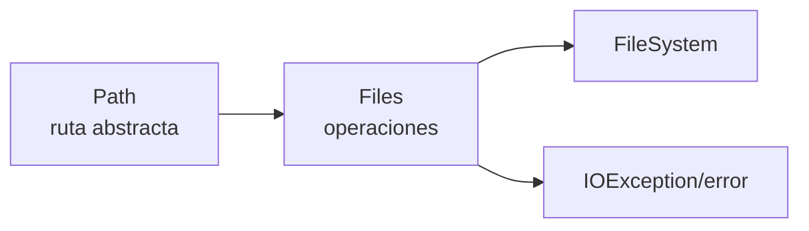
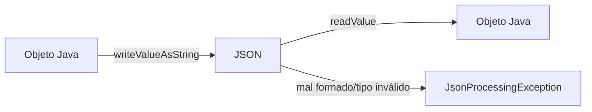

# Módulo 6: Archivos y serialización

Muchos sistemas fallan en los bordes: leer un archivo que no existe, cargar un JSON mal formado, procesar un CSV enorme cargándolo entero en memoria o asumir que un recurso del classpath es un `File` del sistema. Este módulo cubre NIO.2, serialización JSON con Jackson y lectura eficiente de archivos grandes/recursos. En Tienda Aurora, NIO.2 se usa para importar catálogos CSV, Jackson para serializar DTOs y manejar archivos grandes de reportes.

**Entorno de referencia verificado (2026-05-22):** JDK 27.0.1.0.2. Ejemplos NIO.2 verificados con JDK puro. Jackson verificado con jars descargados en `/tmp`.

## Aprende construyendo

## Proyecto desde cero: tienda-aurora-io

## Prerrequisitos

```bash
java -version    # JDK 25+
gradle --version # Gradle 9.x
```

## Estructura del proyecto

```text
tienda-aurora-io/
├── build.gradle.kts
├── settings.gradle.kts
└── src/
    └── main/
        └── java/com/aurora/io/
            ├── Main.java
            └── service/
                └── ReportService.java
```

## build.gradle.kts

```kotlin
plugins {
    java
    application
}

group = "com.aurora"
version = "1.0.0"

java {
    toolchain {
        languageVersion = JavaLanguageVersion.of(25)
    }
}

application {
    mainClass.set("com.aurora.io.Main")
}

repositories {
    mavenCentral()
}

dependencies {
    implementation("com.fasterxml.jackson.core:jackson-databind:2.18.0")
}
```

## settings.gradle.kts

```kotlin
rootProject.name = "tienda-aurora-io"
```

## Ejecutar

```bash
./gradlew run
# O directamente:
mkdir -p out
javac -cp "lib/*" -d out src/main/java/com/aurora/io/**/*.java
java -cp "out:lib/*" com.aurora.io.Main
```

### Tema 1: NIO.2 — Path y Files · Intermedio · 40 min

**Caso guía.** guardar y leer un reporte de texto de forma portable. `File` antiguo funciona, pero `Path`/`Files` ofrecen una API más clara y moderna.

`Path` y `Files`

**Definición.** `Path` representa una ruta del sistema de archivos; `Files` provee operaciones estáticas para crear, copiar, mover, leer, escribir y consultar metadatos.

 `Path` es una abstracción; no implica que el archivo exista. `Files` opera sobre el sistema de archivos real o virtual mediante providers. Las operaciones pueden lanzar `IOException`.



**Cuándo usar / cuándo no.** Usa NIO.2 para I/O de archivos moderno. No cargues archivos enormes con `readAllLines/readString` sin evaluar tamaño.

**Ejemplo mínimo enfocado (ejecutable).**

```bash
mkdir -p java-m6-nio
cd java-m6-nio
```

Crea el archivo `DemoNio.java`:

```java
import java.nio.file.*;

public class DemoNio {
  public static void main(String[] args) throws Exception {
    Path p = Path.of("reporte.txt");
    Files.writeString(p, "hola\n");
    System.out.println(Files.exists(p));
    System.out.println(Files.readString(p).trim());
    Files.deleteIfExists(p);
  }
}
```

```bash
javac DemoNio.java
java DemoNio
```

**Error común.** Asumir separadores `/` o `\`. Corrección: usar `Path.of`, `resolve`, `normalize`.

**Verificación (JDK 27, 2026-05-22).** `true`, `hola`.

### Tema 2: Serialización con Jackson · Intermedio · 40 min

**Caso guía.** exponer/consumir una guía como JSON. Escribir JSON a mano es frágil; Jackson mapea objetos a JSON y valida estructura.

ObjectMapper, `@JsonProperty`, fechas

**Definición.** Jackson es una librería de serialización/deserialización JSON. `ObjectMapper` convierte objetos Java ↔ JSON; anotaciones controlan nombres, inclusión y formato.

**Reglas.** Para POJOs, Jackson necesita constructor/propiedades accesibles o configuración. Fechas Java Time requieren `jackson-datatype-jsr310` y `findAndAddModules()`/registro de módulo. Fallos de mapeo lanzan excepciones (`JsonProcessingException` y subtipos).



**Ejemplo mínimo enfocado (ejecutable con Jackson).**

```bash
mkdir -p java-m6-jackson
cd java-m6-jackson
curl -L -o jackson-core.jar https://repo1.maven.org/maven2/com/fasterxml/jackson/core/jackson-core/2.18.3/jackson-core-2.18.3.jar
curl -L -o jackson-annotations.jar https://repo1.maven.org/maven2/com/fasterxml/jackson/core/jackson-annotations/2.18.3/jackson-annotations-2.18.3.jar
curl -L -o jackson-databind.jar https://repo1.maven.org/maven2/com/fasterxml/jackson/core/jackson-databind/2.18.3/jackson-databind-2.18.3.jar
```

Crea el archivo `DemoJackson.java`:

```java
import com.fasterxml.jackson.annotation.JsonProperty;
import com.fasterxml.jackson.databind.ObjectMapper;

record Guia(@JsonProperty("tracking_id") String id, String destino) {}

public class DemoJackson {
  public static void main(String[] args) throws Exception {
    ObjectMapper m = new ObjectMapper();
    String json = m.writeValueAsString(new Guia("G1", "CDMX"));
    System.out.println(json);
    Guia g = m.readValue(json, Guia.class);
    System.out.println(g.destino());
  }
}
```

```bash
javac -cp ".:jackson-core.jar:jackson-annotations.jar:jackson-databind.jar" DemoJackson.java
java -cp ".:jackson-core.jar:jackson-annotations.jar:jackson-databind.jar" DemoJackson
```

> Windows: usa `;` en classpath.

**Error común.** Deserializar sin manejar excepciones o asumir esquema correcto. Síntoma: `UnrecognizedPropertyException`/`MismatchedInputException`. Corrección: validar contrato, configurar `FAIL_ON_UNKNOWN_PROPERTIES` según caso, y manejar error.

**Verificación (JDK 27, Jackson 2.18.3, 2026-05-22).** `{"tracking_id":"G1","destino":"CDMX"}`, `CDMX`.

### Tema 3: Archivos grandes y recursos del classpath · Intermedio · 40 min

**Caso guía.** procesar un CSV grande no debe cargar todo en memoria; además, un template empaquetado en el jar no es un `Path` del filesystem.

Streaming/lectura por líneas y classpath resources

**Definición.** Leer por streaming procesa datos incrementalmente (`BufferedReader`, `Files.lines`, `InputStream`) en vez de cargar el archivo completo. Recursos del classpath se leen con `ClassLoader.getResourceAsStream`.

 `Files.lines()` devuelve un `Stream<String>` lazy que debe cerrarse. `getResourceAsStream` lee desde el classpath (directorio o jar), no como ruta de archivo garantizada.


**Ejemplo mínimo enfocado (ejecutable).**

```bash
mkdir -p java-m6-stream
cd java-m6-stream
```

Crea el archivo `DemoLarge.java`:

```java
import java.io.*;
import java.nio.file.*;

public class DemoLarge {
  public static void main(String[] args) throws Exception {
    Path p = Path.of("big.csv");
    Files.writeString(p, "id\n1\n2\n3\n");
    try (BufferedReader br = Files.newBufferedReader(p)) {
      String line;
      int count = 0;
      while ((line = br.readLine()) != null) if (!line.isBlank()) count++;
      System.out.println(count);
    }
    Files.deleteIfExists(p);
  }
}
```

```bash
javac DemoLarge.java
java DemoLarge
```

**Error común.** Usar `getResource().getFile()` dentro de un jar. Síntoma: falla en producción. Corrección: `getResourceAsStream`.

**Verificación (JDK 27, 2026-05-22).** `4`.

## Cierre

NIO.2 da API moderna de archivos; Jackson da contrato JSON; streaming protege memoria. La regla: conoce el tamaño, el origen y el formato antes de leer.

## Checklist

- Uso `Path/Files` y manejo `IOException`.
- No cargo archivos grandes completos sin necesidad.
- Uso `getResourceAsStream` para recursos empaquetados.
- Configuro Jackson para tipos/fechas según contrato.
