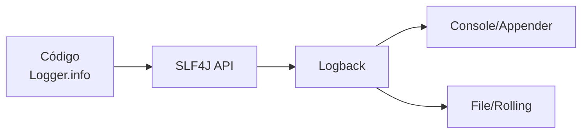
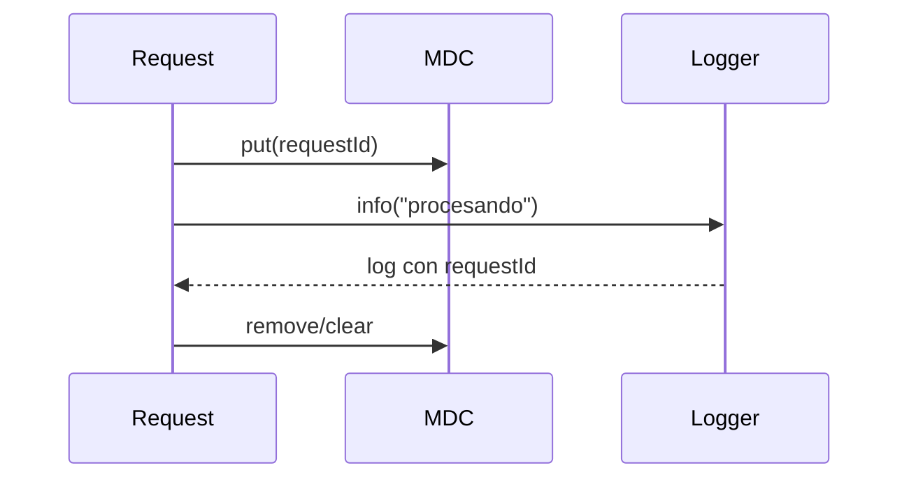

# Módulo 7: Logging y depuración

Cuando un bug ocurre en producción, no hay depurador adjunto. Lo que queda es la evidencia: logs, métricas, trazas y stack traces. Un logging profesional no es `System.out.println`; es una señal estructurada, con nivel correcto, contexto suficiente y sin secretos. Este módulo cubre SLF4J/Logback, MDC y diagnóstico con stack traces.

**Entorno de referencia verificado (2026-05-22):** JDK 27.0.1.0.2. Verificación de conceptos con Java puro y API SLF4J/Logback usando jars en `/tmp`.

## Aprende construyendo

### Tema 1: SLF4J y Logback — logging estructurado · Intermedio · 40 min

Caso guía: un servicio procesa guías. Necesitas saber qué pasó, cuándo, en qué nivel y con qué error, sin imprimir ruido ni secretos.

#### SLF4J como fachada, Logback como implementación

**Definición formal.** SLF4J es una fachada de logging; el código depende de `org.slf4j.Logger`. Logback es una implementación común que SLF4J delega en runtime.

**Cómo funciona por dentro.** El código llama la API SLF4J. En el classpath, un binding/implementación (Logback) recibe los eventos y los escribe según configuración (consola, archivo, JSON, rolling).



**Cuándo usar / cuándo no.** Usa SLF4J en librerías/apps. No uses `System.out.println` para logs operativos; no loguees secretos/tokens/passwords.

**Ejemplo mínimo enfocado (ejecutable).**

```bash
mkdir -p java-m7-log
cd java-m7-log
curl -sL -o slf4j-api.jar https://repo1.maven.org/maven2/org/slf4j/slf4j-api/2.0.17/slf4j-api-2.0.17.jar
curl -sL -o logback-core.jar https://repo1.maven.org/maven2/ch/qos/logback/logback-core/1.5.18/logback-core-1.5.18.jar
curl -sL -o logback-classic.jar https://repo1.maven.org/maven2/ch/qos/logback/logback-classic/1.5.18/logback-classic-1.5.18.jar
```

Crea el archivo `DemoLog.java`:

```java
import org.slf4j.*;

public class DemoLog {
  private static final Logger log = LoggerFactory.getLogger(DemoLog.class);
  public static void main(String[] args) {
    log.info("Procesando guia id={}", "G1");
    log.warn("Reintento id={} intento={}", "G1", 2);
  }
}
```

```bash
javac -cp ".:slf4j-api.jar:logback-core.jar:logback-classic.jar" DemoLog.java
java -cp ".:slf4j-api.jar:logback-core.jar:logback-classic.jar" DemoLog
```

**Error común.** Concatenar strings en logs: `log.info("id=" + id)`. Corrección: placeholders `{}`; evitan construir mensaje si el nivel está deshabilitado y son más legibles.

**Verificación (JDK 27, SLF4J 2.0.17, Logback 1.5.18, 2026-05-22).** Se observan líneas INFO/WARN con `Procesando guia id=G1` y `Reintento id=G1 intento=2`.

### Tema 2: MDC — contexto por request/hilo · Intermedio · 35 min

Caso guía: en un servidor concurrente, muchos requests loguean a la vez. Sin contexto, no sabes qué línea pertenece a qué request.

#### MDC (Mapped Diagnostic Context)

**Definición formal.** MDC es un mapa de contexto asociado al hilo actual (o propagado) para enriquecer logs con datos como `requestId`, `userId`, `orderId`.

**Contrato/reglas.** Poner valores con `MDC.put`, limpiar con `MDC.remove` o `MDC.clear` en `finally`. En pools/async, propagar contexto explícitamente.



**Ejemplo mínimo enfocado (ejecutable).**

```bash
mkdir -p java-m7-mdc
cd java-m7-mdc
# reutiliza jars slf4j/logback del tema anterior o descárgalos
```

Crea el archivo `DemoMdc.java`:

```java
import org.slf4j.*;

public class DemoMdc {
  private static final Logger log = LoggerFactory.getLogger(DemoMdc.class);
  public static void main(String[] args) {
    MDC.put("requestId", "r-123");
    try {
      log.info("procesando");
      System.out.println(MDC.get("requestId"));
    } finally {
      MDC.clear();
    }
  }
}
```

```bash
javac -cp ".:slf4j-api.jar:logback-core.jar:logback-classic.jar" DemoMdc.java
java -cp ".:slf4j-api.jar:logback-core.jar:logback-classic.jar" DemoMdc
```

**Error común.** No limpiar MDC en thread pool. Síntoma: un request hereda `requestId` de otro. Corrección: `finally { MDC.clear(); }` o wrapper de tareas.

**Verificación (JDK 27, SLF4J/Logback, 2026-05-22).** Salida incluye `r-123` (MDC) y log de procesamiento.

### Tema 3: Depuración y stack traces · Básico · 30 min

Caso guía: una excepción aparece en producción. La stack trace es el mapa del fallo: qué pasó, dónde y por qué cadena de llamadas.

#### Stack trace

**Definición formal.** Una stack trace es la representación de la pila de llamadas en el momento de la excepción, incluyendo clase, método, archivo y línea cuando hay debug info.

**Cómo leerla.** Empieza por el mensaje y el tipo de excepción (arriba). La primera línea de tu código relevante suele indicar el punto de lanzamiento; las “Caused by” muestran la causa raíz.

**Ejemplo mínimo enfocado (ejecutable).**

```bash
mkdir -p java-m7-stack
cd java-m7-stack
```

Crea el archivo `DemoStack.java`:

```java
public class DemoStack {
  static void c() { throw new IllegalArgumentException("dato invalido"); }
  static void b() { c(); }
  static void a() { b(); }
  public static void main(String[] args) {
    try { a(); }
    catch (Exception e) {
      System.out.println(e.getClass().getSimpleName());
      System.out.println(e.getStackTrace()[0].getMethodName());
    }
  }
}
```

```bash
javac DemoStack.java
java DemoStack
```

**Error común.** Leer solo la última línea o ignorar `Caused by`. Corrección: identificar excepción, mensaje, causa raíz y primera línea de código propio.

**Verificación (JDK 27, 2026-05-22).** `IllegalArgumentException`, `c`.

## Cierre

Loguear es diseñar evidencia operativa. Elige nivel correcto, agrega contexto con MDC, preserva causas y evita secretos.

## Checklist

- Uso SLF4J con placeholders.
- No logueo secretos/PII sensible sin política.
- Limpio MDC en `finally`.
- Leo stack traces desde tipo/mensaje hasta causa raíz.
