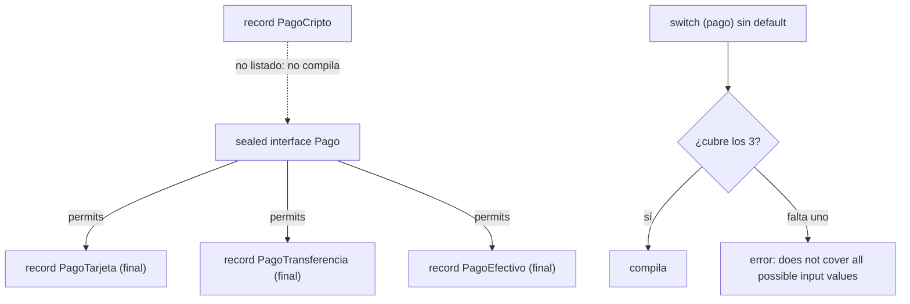
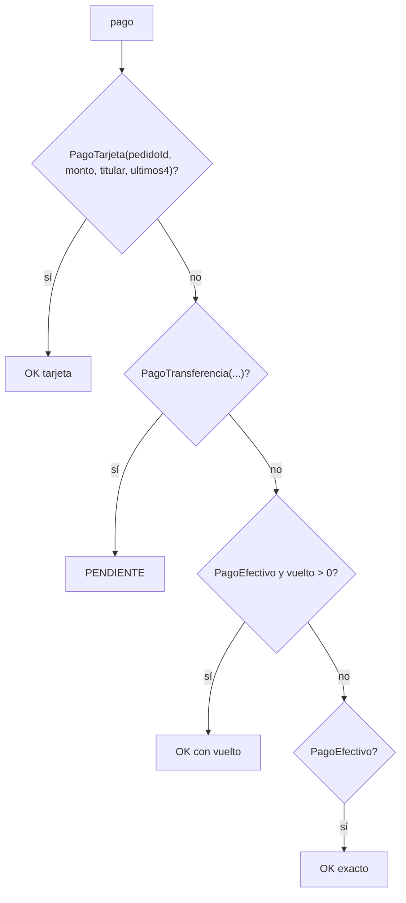
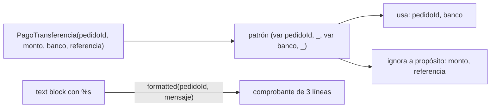

# Módulo 7: Sealed classes y pattern matching

El modelado de dominio mejora cuando el tipo expresa las posibilidades reales. Un pago en Tienda Aurora no es “un objeto con muchos campos opcionales”; puede ser tarjeta, transferencia o efectivo. Si lo modelas con `if instanceof` sueltos y campos nulos, cada nuevo caso obliga a revisar código disperso. Las sealed classes e interfaces, junto con records y pattern matching, permiten cerrar el conjunto de variantes y hacer que el compilador ayude con exhaustividad.

**Entorno de las salidas nuevas (2026-11-24):** Linux x86_64 con OpenJDK 25.0.5.1; cada archivo se ejecutó
directamente con `java Archivo.java` o se compiló con `javac` (sin Gradle). Esas salidas corresponden a los
Problemas resueltos 1.1, 1.2, 1.3, 2.1, 2.2, 3.1 y 3.2, y a los errores de compilación mostrados. El laboratorio
integrador conserva sus salidas originales (macOS arm64, JDK 27.0.1.0.2, Gradle 9.9.1, toolchain Java 25),
declaradas en su sección.

**Al terminar este módulo podrás:**
- modelar variantes cerradas del dominio con interfaces `sealed` y records;
- escribir `switch` exhaustivos sin `default` y leer el error cuando falta un caso;
- reemplazar casteos manuales por `instanceof` con patrón y record patterns;
- combinar guardas `when` en el orden correcto, sin casos dominados;
- ignorar componentes de forma explícita con `_` y escribir textos multilínea con text blocks.

**Esquema del módulo:** Tema 1 (sealed y exhaustividad) → Tema 2 (pattern matching) → Tema 3 (`_` y text
blocks) → laboratorio integrador `tienda-aurora-patterns`.

**Qué necesitas saber antes:** records y constructores compactos (Módulo 1, Tema 5), interfaces (Módulo 1,
Tema 3), `switch` con flechas (Módulo 0, Tema 6) y `BigDecimal` para montos.

## Visual del módulo

**Visual:** [Jerarquía sealed Pago con record patterns y switch exhaustivo](/visuals/temas/java/modulo-7-patterns.html)

Lectura: Sealed limita subtipos permitidos; el switch exhaustivo obliga a cubrir cada variante.

## Prerrequisitos

```bash
java -version
gradle --version
```

## Aprende construyendo

### Tema 1: sealed — jerarquías cerradas y exhaustividad · Intermedio · 40 min

<details open>
<summary><strong>Capa 1 — Lectura</strong></summary>

#### Objetivos
Al terminar este tema podrás:
- declarar una interfaz `sealed` con `permits` y modelar sus variantes como records;
- elegir entre `final`, `sealed` y `non-sealed` para cada subtipo permitido;
- escribir un `switch` exhaustivo sin `default` sobre una jerarquía sellada;
- leer los errores del compilador cuando un subtipo no está permitido o falta un caso.

**Conceptos clave:** sealed, permits, modificadores de subtipo, jerarquía cerrada, exhaustividad

#### El problema
Un pago en Tienda Aurora puede ser con tarjeta, por transferencia o en efectivo. No hay más. Si alguien agrega
mañana el pago con criptomonedas, cada parte del código que decide «qué hacer con un pago» debe enterarse. Con
`if instanceof` sueltos y un `else` genérico, el caso nuevo pasa en silencio. ¿Cómo hacer que el compilador avise?

#### Glosario del tema

**sealed**
- **Definición técnica:** modificador (Java 17) de clase o interfaz que restringe qué tipos pueden extenderla o implementarla; el conjunto lo fija `permits` o, si se omite, los subtipos del mismo archivo.
- **En palabras sencillas:** una lista de invitados cerrada: solo entran los que están en la lista.
- **Dónde se rompe la comparación:** la lista la revisa el compilador, no una persona; quien no está en ella ni siquiera compila.
- **Ejemplo:** `sealed interface Pago permits PagoTarjeta, PagoTransferencia, PagoEfectivo`.
- **Error típico:** creer que `sealed` impide crear objetos; solo limita quién puede ser subtipo.

**permits**
- **Definición técnica:** cláusula de una declaración `sealed` que enumera los subtipos directos permitidos; deben estar en el mismo módulo (o en el mismo paquete si no hay módulos).
- **En palabras sencillas:** la lista de invitados escrita en la puerta.
- **Dónde se rompe la comparación:** la lista solo nombra a los hijos directos; los nietos dependen de lo que declare cada hijo.
- **Ejemplo:** `ResultadoPago permits ResultadoPago.Aprobado, ResultadoPago.Rechazado, ResultadoPago.Pendiente`.
- **Error típico:** implementar la interfaz desde una clase no listada: `class is not allowed to extend sealed class`.

**modificadores de subtipo (`final`, `sealed`, `non-sealed`)**
- **Definición técnica:** todo subtipo permitido debe declarar cómo continúa la jerarquía: `final` (no admite subtipos), `sealed` (admite una lista cerrada) o `non-sealed` (vuelve a abrirse); los records y enums ya son `final`.
- **En palabras sencillas:** cada invitado decide si puede traer acompañantes: ninguno, solo algunos o cualquiera.
- **Dónde se rompe la comparación:** no es opcional: omitir la decisión es un error de compilación.
- **Ejemplo:** `non-sealed class Tienda implements Canal {}` permite `class Franquicia extends Tienda {}`.
- **Error típico:** declarar `class PagoCheque implements Pago` sin modificador: `sealed, non-sealed or final modifiers expected`.

**jerarquía cerrada**
- **Definición técnica:** jerarquía de tipos cuyo conjunto de subtipos se conoce completo en tiempo de compilación; `Class.isSealed()` y `getPermittedSubclasses()` la exponen en tiempo de ejecución.
- **En palabras sencillas:** un menú fijo: sabes de antemano todos los platos posibles.
- **Dónde se rompe la comparación:** un `non-sealed` en medio abre de nuevo ese tramo del menú.
- **Ejemplo:** `Pago.class.getPermittedSubclasses()` devuelve las tres clases de pago.
- **Error típico:** sellar algo que terceros deben extender, como un sistema de *plugins*.

**exhaustividad**
- **Definición técnica:** propiedad de un `switch` cuyos casos cubren todos los valores posibles del tipo evaluado; con una jerarquía sellada el compilador la verifica y no hace falta `default`.
- **En palabras sencillas:** la lista de chequeo que el compilador revisa: «¿pensaste en todos los casos?».
- **Dónde se rompe la comparación:** un `default` hace pasar la revisión aunque falte un caso real.
- **Ejemplo:** `switch (pago) { case PagoTarjeta t -> …; case PagoTransferencia t -> …; case PagoEfectivo e -> …; }`.
- **Error típico:** agregar una variante y no actualizar el `switch`: `the switch expression does not cover all possible input values`.

#### ► CÓMO FUNCIONA
Una clase o interfaz `sealed` restringe qué tipos pueden extenderla o implementarla. Se declara con `sealed` y
`permits`, y los subtipos permitidos deben ser `final`, `sealed` o `non-sealed`. Esto crea una jerarquía
cerrada: el compilador conoce todas las variantes posibles.

La ventaja principal es la exhaustividad. En un `switch` sobre un sealed, el compilador puede verificar que
cubriste todos los casos. Si mañana agregas `PagoCripto` a `permits`, todos los switches exhaustivos sobre
`Pago` fallarán al compilar hasta que los actualices. Ese fallo es bueno: te obliga a decidir.

Usa `sealed` cuando el dominio tiene un conjunto cerrado de variantes conocidas. No lo uses cuando la extensión
abierta es parte del diseño, como un plugin de terceros. `non-sealed` existe para abrir un punto específico de
la jerarquía, pero debe ser una decisión consciente.



#### Problema resuelto 1.1
Modela los tres medios de pago como una jerarquía sellada y decide el medio de cada pago sin `default`.

**Razonamiento:**
1. `Pago` es una interfaz `sealed` con tres subtipos en `permits`.
2. Cada variante es un record (Módulo 1, Tema 5), que ya es `final`: no hace falta escribir el modificador.
3. El `switch` tiene un caso por variante; como la jerarquía está cerrada, no necesita `default`.
4. La reflexión confirma lo que el compilador sabe: la interfaz está sellada y tiene tres permitidos.

```java
import java.lang.reflect.Modifier;
import java.math.BigDecimal;
import java.util.Arrays;
import java.util.List;

sealed interface Pago permits PagoTarjeta, PagoTransferencia, PagoEfectivo {
    String pedidoId();
    BigDecimal monto();
}

record PagoTarjeta(String pedidoId, BigDecimal monto, String titular, String ultimos4) implements Pago {}
record PagoTransferencia(String pedidoId, BigDecimal monto, String banco, String referencia) implements Pago {}
record PagoEfectivo(String pedidoId, BigDecimal monto, BigDecimal recibido) implements Pago {}

public class JerarquiaPagos {
    static String medio(Pago pago) {
        return switch (pago) {
            case PagoTarjeta t -> "tarjeta";
            case PagoTransferencia t -> "transferencia";
            case PagoEfectivo e -> "efectivo";
        };
    }

    public static void main(String[] args) {
        System.out.println("sellada=" + Pago.class.isSealed());
        System.out.println("permitidos=" + Arrays.stream(Pago.class.getPermittedSubclasses())
                .map(Class::getSimpleName).toList());
        System.out.println("tarjetaEsFinal=" + Modifier.isFinal(PagoTarjeta.class.getModifiers()));

        List<Pago> pagos = List.of(
                new PagoTarjeta("PED-100", new BigDecimal("39.90"), "Ana", "4242"),
                new PagoTransferencia("PED-101", new BigDecimal("79.90"), "Banco Aurora", "TR-7788"),
                new PagoEfectivo("PED-102", new BigDecimal("20.00"), new BigDecimal("50.00")));
        for (Pago pago : pagos) {
            System.out.println(pago.pedidoId() + " -> " + medio(pago));
        }
    }
}
```

```text
$ java JerarquiaPagos.java
sellada=true
permitidos=[PagoTarjeta, PagoTransferencia, PagoEfectivo]
tarjetaEsFinal=true
PED-100 -> tarjeta
PED-101 -> transferencia
PED-102 -> efectivo
```

**Explicación por partes.**
- Líneas 6–9: la interfaz sellada declara lo que todo pago tiene en común: pedido y monto.
- Líneas 11–13: cada record implementa `Pago`; sus componentes `pedidoId` y `monto` cumplen los métodos de la interfaz.
- Líneas 17–21: el `switch` es una expresión con un caso por variante y ningún `default`.
- Líneas 25–28: `isSealed`, `getPermittedSubclasses` y `isFinal` muestran la jerarquía desde dentro del programa.

Ahora agrega una cuarta variante sin tocar `permits`: `record PagoCripto(String pedidoId, BigDecimal monto,
String billetera) implements Pago {}`. El compilador la rechaza:

```text
$ javac JerarquiaPagos.java
JerarquiaPagos.java:14: error: class is not allowed to extend sealed class: Pago (as it is not listed in its 'permits' clause)
record PagoCripto(String pedidoId, BigDecimal monto, String billetera) implements Pago {}
^
1 error
```

Si la agregas a `permits` como clase normal (`class PagoCheque implements Pago`), falta decidir su modificador:

```text
$ javac JerarquiaPagos.java
JerarquiaPagos.java:15: error: sealed, non-sealed or final modifiers expected
class PagoCheque implements Pago {
^
1 error
```

Y si la agregas bien (`PagoCripto` en `permits`, como record) pero no tocas `medio`, el `switch` deja de compilar:

```text
$ javac JerarquiaPagos.java
JerarquiaPagos.java:18: error: the switch expression does not cover all possible input values
        return switch (pago) {
               ^
1 error
```

> **Error común.** Agregar una variante y olvidar los `switch` que dependen de ella. Java responde con
> `error: the switch expression does not cover all possible input values` en cada `switch` afectado. No es un
> estorbo: es la lista exacta de lugares donde debes decidir qué hacer con el pago nuevo.

> **Error común.** Implementar la interfaz desde un tipo no listado. El mensaje es
> `error: class is not allowed to extend sealed class: Pago (as it is not listed in its 'permits' clause)`.
> Agrega el tipo a `permits` solo si de verdad es una variante del dominio.

#### Problema resuelto 1.2
Convierte cada resultado de pago en una línea de resumen y comprueba qué pasa al agregar un resultado nuevo.

**Razonamiento:**
1. El resultado también es un conjunto cerrado: aprobado, rechazado o pendiente. Se modela igual que `Pago`.
2. Los records van anidados dentro de la interfaz; `permits` los nombra con el prefijo `ResultadoPago.`.
3. `resumen` cubre los tres casos sin `default`, así que el compilador vigila los casos nuevos.

```java
import java.util.List;

sealed interface ResultadoPago permits ResultadoPago.Aprobado, ResultadoPago.Rechazado, ResultadoPago.Pendiente {
    String pedidoId();

    record Aprobado(String pedidoId, String mensaje) implements ResultadoPago {}
    record Rechazado(String pedidoId, String motivo) implements ResultadoPago {}
    record Pendiente(String pedidoId, String seguimiento) implements ResultadoPago {}
}

public class ResumenResultados {
    static String resumen(ResultadoPago resultado) {
        return switch (resultado) {
            case ResultadoPago.Aprobado a -> "OK " + a.pedidoId() + " - " + a.mensaje();
            case ResultadoPago.Rechazado r -> "RECHAZADO " + r.pedidoId() + " - " + r.motivo();
            case ResultadoPago.Pendiente p -> "PENDIENTE " + p.pedidoId() + " - " + p.seguimiento();
        };
    }

    public static void main(String[] args) {
        List<ResultadoPago> resultados = List.of(
                new ResultadoPago.Aprobado("PED-1", "aprobado"),
                new ResultadoPago.Rechazado("PED-2", "sin fondos"),
                new ResultadoPago.Pendiente("PED-3", "TR-1"));
        resultados.forEach(r -> System.out.println(resumen(r)));
    }
}
```

```text
$ java ResumenResultados.java
OK PED-1 - aprobado
RECHAZADO PED-2 - sin fondos
PENDIENTE PED-3 - TR-1
```

**Explicación por partes.**
- Líneas 3–9: interfaz sellada con sus tres records anidados; es el mismo `ResultadoPago.java` del laboratorio.
- Líneas 13–17: un caso por resultado; cada patrón de tipo da acceso a los componentes del record.
- Líneas 21–25: los tres resultados producen las tres líneas que el test `resumenEsExhaustivoSobreResultadoPago` espera.

Agrega `ResultadoPago.Cancelado` a `permits` y su record `record Cancelado(String pedidoId) implements ResultadoPago {}`:

```text
$ javac ResumenResultados.java
ResumenResultados.java:14: error: the switch expression does not cover all possible input values
        return switch (resultado) {
               ^
1 error
```

> **Buena práctica.** Prefiere switch exhaustivo sobre sealed antes que `default` ciego. Un `default` en
> `resumen` habría compilado con `Cancelado` y habría mostrado un texto genérico en producción.

#### Problema resuelto 1.3
Abre a propósito un tramo de una jerarquía sellada: los canales de venta son web o tienda, pero las tiendas
pueden ser propias o franquicias que no conoces de antemano.

**Razonamiento:**
1. `Canal` es sellado con dos permitidos: `Web` y `Tienda`.
2. `Web` es `final`: no tiene variantes.
3. `Tienda` es `non-sealed`: cualquier clase puede extenderla, como `Franquicia`.
4. El `switch` sobre `Canal` sigue siendo exhaustivo: toda franquicia **es** una `Tienda`.

```java
sealed interface Canal permits Web, Tienda {}

final class Web implements Canal {}

non-sealed class Tienda implements Canal {}

class Franquicia extends Tienda {}

public class CanalesVenta {
    static String origen(Canal canal) {
        return switch (canal) {
            case Web w -> "venta en línea";
            case Tienda t -> "venta presencial (" + t.getClass().getSimpleName() + ")";
        };
    }

    public static void main(String[] args) {
        System.out.println(origen(new Web()));
        System.out.println(origen(new Tienda()));
        System.out.println(origen(new Franquicia()));
        System.out.println("tiendaSellada=" + Tienda.class.isSealed());
    }
}
```

```text
$ java CanalesVenta.java
venta en línea
venta presencial (Tienda)
venta presencial (Franquicia)
tiendaSellada=false
```

**Explicación por partes.**
- Línea 3: `final` cierra esa rama.
- Línea 5: `non-sealed` abre la rama `Tienda`; por eso la línea 7 compila sin estar en ningún `permits`.
- Líneas 11–14: dos casos bastan; `Franquicia` cae en `case Tienda t`.
- Línea 21: `Tienda` ya no está sellada, como muestra `tiendaSellada=false`.

> **Ingeniería de software.** `non-sealed` es una puerta abierta en una pared. Úsala donde el dominio sí necesita
> extensión libre y documenta por qué. El resto de la jerarquía conserva sus garantías.

#### Checkpoint 1.1
En `JerarquiaPagos`, ¿por qué `PagoTarjeta` no lleva la palabra `final` si todo subtipo permitido debe declararla?

Respuesta: porque es un record, y los records son implícitamente `final`. La salida `tarjetaEsFinal=true` lo confirma.

</details>

<details>
<summary><strong>Capa 2 — Construcción</strong></summary>

#### Paso 1 · Prepara la carpeta
Crea `~/labs/aurora-m7`, entra en ella y comprueba con `java -version` que tienes Java 21 o superior.

#### Paso 2 · Modela la jerarquía
Guarda `JerarquiaPagos.java` y ejecútalo con `java JerarquiaPagos.java`. Debes ver `sellada=true` y tres pagos.

#### Paso 3 · Rompe la exhaustividad
Agrega `PagoCripto` a `permits` y como record, sin tocar `medio`. Compila con `javac JerarquiaPagos.java` y lee
el número de línea del error.

#### Paso 4 · Repara y abre un tramo
Agrega el caso `case PagoCripto c -> "cripto";`. Después ejecuta `CanalesVenta.java` y comprueba la línea de `Franquicia`.

#### Resumen
- **`sealed`** limita quién puede extender o implementar un tipo; **`permits`** enumera los permitidos.
- Cada subtipo permitido declara su **modificador de subtipo**: `final`, `sealed` o `non-sealed`; los records ya son `final`.
- Una **jerarquía cerrada** tiene todas sus variantes conocidas al compilar.
- La **exhaustividad** permite un `switch` sin `default`, y el compilador avisa cuando falta un caso.
- `non-sealed` reabre un tramo concreto; úsalo de forma deliberada.

#### Ejercicio verificable 1
Básico. ¿Qué tres palabras acepta Java delante de `class PagoCheque implements Pago` para que compile?

Respuesta esperada: `final`, `sealed` (con su propio `permits`) o `non-sealed`.

#### Ejercicio verificable 2
Intermedio. Define `sealed interface Forma permits Circulo, Cuadrado`, con `record Circulo(double radio)` y
`record Cuadrado(double lado)`, y un `switch` sin `default` que calcule el área. Imprime el área de
`new Circulo(1.0)` y `new Cuadrado(2.0)`.

Respuesta esperada: `3.141592653589793 4.0`.

#### Ejercicio verificable 3
Reto. Agrega `PagoCripto` a `Pago` y corrige todos los `switch` hasta que `JerarquiaPagos` compile de nuevo.

Respuesta esperada: primero el error `the switch expression does not cover all possible input values` en la
línea del `switch`; después de agregar el caso, la salida incluye la cuarta clase en `permitidos=` y la línea del
pago cripto con su medio.

#### En el trabajo
En sistemas de pagos, pedidos o eventos de dominio, los estados y variantes cambian con el negocio. Una
jerarquía sellada convierte «se nos olvidó manejar el estado nuevo» en un error de compilación que aparece en la
integración continua, antes de llegar a producción.

</details>

### Tema 2: Pattern matching exhaustivo y para instanceof · Intermedio · 40 min

<details open>
<summary><strong>Capa 1 — Lectura</strong></summary>

#### Objetivos
Al terminar este tema podrás:
- reemplazar el casteo manual por `instanceof` con patrón;
- desestructurar un record por sus componentes con un record pattern;
- escribir un `switch` con patrones y guardas `when` que siga siendo exhaustivo;
- ordenar los casos para evitar el error de dominancia.

**Conceptos clave:** pattern matching, patrón de tipo, record pattern, switch con patrones, guarda when, dominancia de casos

#### El problema
El auditor de Tienda Aurora recibe objetos de distintos tipos y debe etiquetar cada pago. El procesador, además,
trata distinto un pago en efectivo con vuelto que uno exacto. Con `instanceof` seguido de un casteo, cada rama
repite el tipo dos veces y un casteo equivocado explota en ejecución. ¿Cómo preguntar y extraer en un solo paso?

#### Glosario del tema

**pattern matching**
- **Definición técnica:** mecanismo del lenguaje que comprueba si un valor tiene cierta forma (tipo, estructura) y, si coincide, enlaza partes del valor a variables nuevas.
- **En palabras sencillas:** preguntar «¿eres una tarjeta?» y, si la respuesta es sí, quedarte ya con sus datos en la mano.
- **Dónde se rompe la comparación:** la variable solo existe donde el compilador sabe que la coincidencia ocurrió.
- **Ejemplo:** `if (valor instanceof PagoTarjeta tarjeta)` deja `tarjeta` disponible dentro del `if`.
- **Error típico:** usar la variable del patrón fuera de su alcance, por ejemplo en el `else`: `cannot find symbol`.

**patrón de tipo**
- **Definición técnica:** patrón `Tipo variable` que coincide si el valor es instancia de `Tipo`; en `instanceof` (Java 16) y en `case` (Java 21) enlaza el valor ya convertido.
- **En palabras sencillas:** comprobar el tipo y hacer el casteo en una sola expresión.
- **Dónde se rompe la comparación:** se puede combinar con `&&` en el mismo `if`, pero no con `||`.
- **Ejemplo:** `valor instanceof PagoTarjeta tarjeta && tarjeta.monto().compareTo(new BigDecimal("50")) > 0`.
- **Error típico:** seguir escribiendo `PagoTarjeta t = (PagoTarjeta) valor;` y arriesgar un `ClassCastException`.

**record pattern**
- **Definición técnica:** patrón (Java 21) `Record(p1, p2, …)` que coincide con un record y aplica un subpatrón a cada componente, en el orden de su declaración.
- **En palabras sencillas:** abrir la caja y sacar cada dato a su variable, en el orden en que vienen.
- **Dónde se rompe la comparación:** el orden es por posición, no por nombre: puedes llamar `banco` a la referencia sin que Java lo note.
- **Ejemplo:** `case PagoTransferencia(String pedidoId, BigDecimal monto, String banco, String referencia)`.
- **Error típico:** poner menos componentes que el record: el patrón no compila; hay que listarlos todos.

**switch con patrones**
- **Definición técnica:** `switch` (Java 21) cuyos `case` son patrones; evalúa los casos en orden y, sobre un tipo sellado, debe ser exhaustivo.
- **En palabras sencillas:** una cadena de preguntas de forma, ordenada, donde el compilador revisa que no falte ninguna.
- **Dónde se rompe la comparación:** a diferencia del `switch` clásico, no hay «caída» de un caso al siguiente con `->`.
- **Ejemplo:** `return switch (pago) { case PagoTarjeta(...) -> …; case PagoEfectivo efectivo -> …; … };`.
- **Error típico:** usarlo sobre `Object` sin `default`: tampoco es exhaustivo, porque `Object` no está sellado.

**guarda when**
- **Definición técnica:** condición booleana que sigue a un patrón en un `case` (`case Tipo t when condición`); el caso solo coincide si el patrón coincide **y** la condición es verdadera.
- **En palabras sencillas:** un filtro extra: «es efectivo, y además hubo vuelto».
- **Dónde se rompe la comparación:** para la exhaustividad, un caso con guarda no cuenta como cubierto: hace falta otro caso sin guarda.
- **Ejemplo:** `case PagoEfectivo efectivo when efectivo.vuelto().signum() > 0 ->`.
- **Error típico:** dejar solo el caso con guarda y olvidar el caso general del mismo tipo.

**dominancia de casos**
- **Definición técnica:** regla por la cual un `case` que coincide con todo lo que coincidiría otro posterior lo «domina»; el compilador rechaza el caso dominado porque nunca podría ejecutarse.
- **En palabras sencillas:** si la primera pregunta ya atrapa a todos, la segunda nunca recibe a nadie.
- **Dónde se rompe la comparación:** el compilador solo detecta dominancia evidente por tipos y guardas, no por la lógica de tus condiciones.
- **Ejemplo:** `case PagoEfectivo efectivo` antes de `case PagoEfectivo efectivo when …` domina al segundo.
- **Error típico:** ordenar de lo general a lo específico: `this case label is dominated by a preceding case label`.

#### ► CÓMO FUNCIONA
Pattern matching permite probar una forma y extraer datos en el mismo paso. `instanceof` con patrón
(`if (valor instanceof PagoTarjeta tarjeta)`) evita el casteo manual. El record pattern desestructura
componentes por posición.

En `switch`, el pattern matching se vuelve aún más potente: cada `case` puede ser un tipo, un record pattern, o
incluir un `when` guard. El guard `case PagoEfectivo efectivo when efectivo.vuelto().signum() > 0` agrega una
condición; debes asegurar que los casos sigan siendo exhaustivos y que el orden no oculte casos más específicos.



#### Problema resuelto 2.1
Etiqueta valores de auditoría de tipo `Object` primero con el casteo clásico y luego con patrones.

**Razonamiento:**
1. La versión clásica comprueba el tipo, castea y recién después usa el valor: el tipo se escribe dos veces.
2. Con patrón de tipo, la comprobación y la variable nacen juntas, y se puede añadir una condición con `&&`.
3. Con record pattern, los componentes de la transferencia quedan en variables sin llamar a sus métodos.
4. Un casteo forzado a un tipo equivocado demuestra lo que el patrón evita.

```java
import java.math.BigDecimal;
import java.util.List;

record PagoTarjeta(String pedidoId, BigDecimal monto, String titular, String ultimos4) {}
record PagoTransferencia(String pedidoId, BigDecimal monto, String banco, String referencia) {}

public class AuditoriaInstanceof {
    static String clasico(Object valor) {
        if (valor instanceof PagoTarjeta) {
            PagoTarjeta tarjeta = (PagoTarjeta) valor;
            return "tarjeta ****" + tarjeta.ultimos4();
        }
        return "otro";
    }

    static String conPatron(Object valor) {
        if (valor instanceof PagoTarjeta tarjeta && tarjeta.monto().compareTo(new BigDecimal("50")) > 0) {
            return "tarjeta alta ****" + tarjeta.ultimos4();
        }
        if (valor instanceof PagoTarjeta tarjeta) {
            return "tarjeta ****" + tarjeta.ultimos4();
        }
        if (valor instanceof PagoTransferencia(String pedidoId, BigDecimal monto, String banco, String referencia)) {
            return "transferencia " + pedidoId + " en " + banco;
        }
        return "otro: " + valor;
    }

    public static void main(String[] args) {
        List<Object> valores = List.of(
                new PagoTarjeta("PED-100", new BigDecimal("39.90"), "Ana", "4242"),
                new PagoTarjeta("PED-104", new BigDecimal("120.00"), "Bruno", "1881"),
                new PagoTransferencia("PED-101", new BigDecimal("79.90"), "Banco Aurora", "TR-7788"),
                "PED-999");
        for (Object valor : valores) {
            System.out.println(clasico(valor) + " | " + conPatron(valor));
        }
        try {
            PagoTarjeta forzado = (PagoTarjeta) valores.get(2);
            System.out.println(forzado);
        } catch (ClassCastException e) {
            System.out.println("casteoForzado=" + e.getClass().getSimpleName());
        }
    }
}
```

```text
$ java AuditoriaInstanceof.java
tarjeta ****4242 | tarjeta ****4242
tarjeta ****1881 | tarjeta alta ****1881
otro | transferencia PED-101 en Banco Aurora
otro | otro: PED-999
casteoForzado=ClassCastException
```

**Explicación por partes.**
- Líneas 9–11: forma clásica: `instanceof`, casteo en la línea 10 y uso.
- Línea 17: patrón de tipo con `&&`: `tarjeta` ya existe a la derecha del `&&`.
- Línea 23: record pattern: los cuatro componentes de la transferencia quedan en variables.
- Línea 26: cualquier otro valor, como el texto `"PED-999"`, cae en el retorno final.
- Líneas 38–43: el casteo de una transferencia a tarjeta compila, pero falla al ejecutarse.

> **Error común.** Castear sin comprobar. `(PagoTarjeta) valor` con una transferencia compila y termina con
> `Exception in thread "main" java.lang.ClassCastException: class PagoTransferencia cannot be cast to class
> PagoTarjeta`. Con `instanceof PagoTarjeta tarjeta` el caso simplemente no coincide.

#### Problema resuelto 2.2
Procesa los cuatro pagos de la demo y distingue el efectivo con vuelto del efectivo exacto.

**Razonamiento:**
1. Tarjeta y transferencia se desestructuran con record patterns.
2. El efectivo necesita dos casos: primero el que tiene guarda `when` (vuelto positivo), después el general.
3. Como `Pago` es sellado y hay un caso de efectivo sin guarda, el `switch` es exhaustivo sin `default`.

```java
import java.math.BigDecimal;
import java.util.List;

sealed interface Pago permits PagoTarjeta, PagoTransferencia, PagoEfectivo {}

record PagoTarjeta(String pedidoId, BigDecimal monto, String titular, String ultimos4) implements Pago {}
record PagoTransferencia(String pedidoId, BigDecimal monto, String banco, String referencia) implements Pago {}
record PagoEfectivo(String pedidoId, BigDecimal monto, BigDecimal recibido) implements Pago {
    BigDecimal vuelto() {
        return recibido.subtract(monto);
    }
}

public class ProcesarPagos {
    static String procesar(Pago pago) {
        return switch (pago) {
            case PagoTarjeta(String pedidoId, BigDecimal monto, String titular, String ultimos4) ->
                    "OK " + pedidoId + " - Tarjeta ****" + ultimos4 + " de " + titular + " por " + monto;
            case PagoTransferencia(String pedidoId, BigDecimal monto, String banco, String referencia) ->
                    "PENDIENTE " + pedidoId + " - Transferencia en " + banco + " por " + monto + " en verificación";
            case PagoEfectivo efectivo when efectivo.vuelto().signum() > 0 ->
                    "OK " + efectivo.pedidoId() + " - Efectivo recibido, vuelto " + efectivo.vuelto();
            case PagoEfectivo efectivo ->
                    "OK " + efectivo.pedidoId() + " - Efectivo exacto";
        };
    }

    public static void main(String[] args) {
        List<Pago> pagos = List.of(
                new PagoTarjeta("PED-100", new BigDecimal("39.90"), "Ana", "4242"),
                new PagoTransferencia("PED-101", new BigDecimal("79.90"), "Banco Aurora", "TR-7788"),
                new PagoEfectivo("PED-102", new BigDecimal("20.00"), new BigDecimal("50.00")),
                new PagoEfectivo("PED-103", new BigDecimal("15.00"), new BigDecimal("15.00")));
        pagos.stream().map(ProcesarPagos::procesar).forEach(System.out::println);
    }
}
```

```text
$ java ProcesarPagos.java
OK PED-100 - Tarjeta ****4242 de Ana por 39.90
PENDIENTE PED-101 - Transferencia en Banco Aurora por 79.90 en verificación
OK PED-102 - Efectivo recibido, vuelto 30.00
OK PED-103 - Efectivo exacto
```

**Explicación por partes.**
- Líneas 8–11: `PagoEfectivo` declara un método `vuelto()`; los records pueden tener métodos propios.
- Líneas 17–20: dos record patterns; `monto` y `titular` se usan en el texto.
- Líneas 21–22: el caso con guarda solo coincide si hubo vuelto: `PED-102`.
- Líneas 23–24: el caso general atrapa el resto del efectivo: `PED-103`.

Comprobación concreta: es la misma lógica de `ProcesadorPagos.procesar` del laboratorio. El test
`guardWhenDistingueVueltoDeEfectivoExacto` pasa y, con `./gradlew -q run`, las dos ramas se distinguen en la salida:

```text
OK PED-102 - Efectivo recibido, vuelto 30.00
OK PED-103 - Efectivo exacto
```

Ahora invierte el orden de los dos casos de efectivo (el general primero):

```text
$ javac ProcesarPagos.java
ProcesarPagos.java:23: error: this case label is dominated by a preceding case label
            case PagoEfectivo efectivo when efectivo.vuelto().signum() > 0 ->
                 ^
1 error
```

> **Error común.** Ordenar los casos de lo general a lo específico. El compilador responde
> `error: this case label is dominated by a preceding case label`: el caso con guarda nunca podría ejecutarse.
> Pon siempre primero los casos con `when` y después el caso general del mismo tipo.

> **Prevenir errores.** Poner `default` en todo. En jerarquías sealed, `default` puede ocultar un caso nuevo que
> deberías manejar. Prefiere exhaustividad real cuando el modelo está cerrado.

#### Checkpoint 2.1
Si eliminas el caso `case PagoEfectivo efectivo ->` (líneas 23–24) y dejas solo el que tiene guarda, ¿compila?

Respuesta: no. Un caso con `when` no cuenta para la exhaustividad: el efectivo sin vuelto quedaría sin cubrir y
el compilador muestra `the switch expression does not cover all possible input values`.

</details>

<details>
<summary><strong>Capa 2 — Construcción</strong></summary>

#### Paso 1 · Compara las dos formas
Ejecuta `java AuditoriaInstanceof.java` y compara las dos columnas de cada línea.

#### Paso 2 · Procesa los pagos
Ejecuta `java ProcesarPagos.java`. Las líneas de `PED-102` y `PED-103` deben ser distintas.

#### Paso 3 · Provoca la dominancia
Intercambia los dos casos de efectivo y compila con `javac ProcesarPagos.java`. Restaura el orden.

#### Paso 4 · Quita el caso general
Borra el caso de efectivo sin guarda y compila de nuevo. Lee el mensaje y vuelve a ponerlo.

#### Resumen
- El **pattern matching** comprueba una forma y enlaza variables en el mismo paso.
- El **patrón de tipo** reemplaza el par `instanceof` + casteo.
- El **record pattern** desestructura un record por posición de sus componentes.
- El **switch con patrones** evalúa los casos en orden y, sobre un sellado, exige exhaustividad.
- La **guarda `when`** filtra un caso, pero no cuenta para la exhaustividad.
- La **dominancia de casos** obliga a poner lo específico antes que lo general.

#### Ejercicio verificable 1
Básico. Reescribe con patrón: `if (obj instanceof Circulo) { Circulo c = (Circulo) obj; return c.radio(); }`.

Respuesta esperada: `if (obj instanceof Circulo c) { return c.radio(); }`.

#### Ejercicio verificable 2
Intermedio. ¿Qué devuelve `procesar(new PagoEfectivo("PED-9", new BigDecimal("10.00"), new BigDecimal("10.00")))`?

Respuesta esperada: `OK PED-9 - Efectivo exacto`. El vuelto es `0.00`, su `signum()` es `0` y la guarda no se cumple.

#### Ejercicio verificable 3
Reto. Con `record Envio(Object pago, String ciudad)`, escribe un `instanceof` con record patterns **anidados** que
extraiga el pedido y los últimos 4 dígitos de una tarjeta y la ciudad. Prueba con
`new Envio(new PagoTarjeta("PED-7", new BigDecimal("10.00"), "Ana", "4242"), "Bogotá")`.

Respuesta esperada: el patrón `Envio(PagoTarjeta(String id, BigDecimal monto, String titular, String u4), String ciudad)`
coincide e imprime `PED-7 Bogotá ****4242`.

#### En el trabajo
Los manejadores de eventos, los adaptadores de respuestas de APIs y los motores de reglas de negocio son
cadenas de «si es esta forma, haz esto». Con patrones y `switch` exhaustivo, esa lógica queda en un solo lugar,
sin casteos, y la revisión de código se concentra en las reglas, no en la plomería.

</details>

### Tema 3: Unnamed variables y patterns (_, Java 22) · Intermedio · 30 min

<details open>
<summary><strong>Capa 1 — Lectura</strong></summary>

#### Objetivos
Al terminar este tema podrás:
- ignorar componentes de un record pattern con `_` en lugar de nombrarlos sin usarlos;
- usar variables sin nombre en `for`, lambdas y `catch`;
- reconocer los errores de usar `_` como valor o con una versión anterior a Java 22;
- escribir texto multilínea con text blocks y `formatted()`.

**Conceptos clave:** variable sin nombre, patrón sin nombre, text block

#### El problema
En el Problema resuelto 2.2, la rama de transferencia declara `monto` y `referencia` aunque solo usa algunos
datos. Quien lee no sabe si esas variables se olvidaron o se ignoran a propósito. Además, el comprobante de pago
de Tienda Aurora es un texto de varias líneas que hoy se arma con `+` y `\n`. ¿Cómo expresar ambas cosas con claridad?

#### Glosario del tema

**variable sin nombre**
- **Definición técnica:** declaración (Java 22, JEP 456) cuyo nombre es `_`: se puede inicializar pero no leer; vale en variables locales, `for`, recursos de `try`, parámetros de lambda y parámetros de `catch`.
- **En palabras sencillas:** un casillero que llenas porque el formulario lo exige, sabiendo que nadie lo va a mirar.
- **Dónde se rompe la comparación:** no es un nombre especial que puedas usar después: leer `_` es un error de compilación.
- **Ejemplo:** `catch (NumberFormatException _) { … }` y `stock.forEach((sku, _) -> …)`.
- **Error típico:** escribir `System.out.println(_)`: `error: underscore not allowed here`.

**patrón sin nombre**
- **Definición técnica:** patrón `_` (Java 22) que coincide con cualquier valor sin enlazarlo; también existe el patrón de tipo sin nombre `Tipo _`.
- **En palabras sencillas:** «aquí va algo, y no me importa qué es».
- **Dónde se rompe la comparación:** `Tipo _` sí comprueba el tipo; solo omite la variable.
- **Ejemplo:** `case PagoTransferencia(var pedidoId, _, var banco, _)` y `case PagoTarjeta _, PagoTransferencia _ -> true`.
- **Error típico:** usar `_` para esconder un dato que la regla sí debería validar, como la referencia en una conciliación.

**text block**
- **Definición técnica:** literal de texto multilínea (Java 15) entre `"""` que elimina la indentación común (*incidental*), normaliza los saltos de línea a `\n` y se combina con `formatted(...)` para insertar valores.
- **En palabras sencillas:** pegar un párrafo tal como se ve, sin `+` ni `\n` en cada línea.
- **Dónde se rompe la comparación:** la posición de las comillas de cierre cuenta: si van en su propia línea, el texto termina en `\n`.
- **Ejemplo:** `"""\n    Pedido: %s\n    """.formatted("PED-100")` da `Pedido: PED-100\n`.
- **Error típico:** escribir texto en la misma línea que las `"""` de apertura: no compila.

#### ► CÓMO FUNCIONA
`_` se usa como variable o patrón sin nombre cuando el valor es deliberadamente ignorado. En un record pattern,
`PagoTransferencia(var pedidoId, var monto, var banco, _)` comunica que la referencia no importa en esa rama.
Es mejor que llamar la variable `ignored` o `ref` y no usarla, porque el compilador y el lector entienden la
intención.

También sirve en lambdas, catch y asignaciones en contextos soportados. No lo uses para ocultar datos que sí
deberían validarse. Ignorar es una decisión de diseño; si el componente es relevante para la regla, debe
nombrarse y usarse.

El text block resuelve el otro lado del problema: el comprobante se escribe como se verá. Java quita la
indentación común a todas las líneas, medida respecto de la línea menos indentada (incluida la de las comillas
de cierre).



#### Problema resuelto 3.1
Reescribe la auditoría de pagos ignorando de forma explícita lo que cada rama no necesita, y usa `_` en un
`for`, una lambda y un `catch`.

**Razonamiento:**
1. Cada rama de `auditoria` nombra solo los componentes que imprime; el resto es `_`.
2. `esDigital` solo pregunta por el tipo: los patrones de tipo sin nombre bastan, y dos tipos comparten caso.
3. En el `for`, la lambda y el `catch`, la variable es obligatoria por sintaxis pero no se usa.

```java
import java.math.BigDecimal;
import java.util.List;
import java.util.Map;

sealed interface Pago permits PagoTarjeta, PagoTransferencia, PagoEfectivo {}

record PagoTarjeta(String pedidoId, BigDecimal monto, String titular, String ultimos4) implements Pago {}
record PagoTransferencia(String pedidoId, BigDecimal monto, String banco, String referencia) implements Pago {}
record PagoEfectivo(String pedidoId, BigDecimal monto, BigDecimal recibido) implements Pago {}

public class PatronesSinNombre {
    static String auditoria(Pago pago) {
        return switch (pago) {
            case PagoTarjeta(var pedidoId, _, _, var ultimos4) -> "tarjeta pedido=" + pedidoId + " ****" + ultimos4;
            case PagoTransferencia(var pedidoId, _, var banco, _) -> "transferencia pedido=" + pedidoId + " banco=" + banco;
            case PagoEfectivo(var pedidoId, _, _) -> "efectivo pedido=" + pedidoId;
        };
    }

    static boolean esDigital(Pago pago) {
        return switch (pago) {
            case PagoTarjeta _, PagoTransferencia _ -> true;
            case PagoEfectivo _ -> false;
        };
    }

    public static void main(String[] args) {
        List<Pago> pagos = List.of(
                new PagoTarjeta("PED-100", new BigDecimal("39.90"), "Ana", "4242"),
                new PagoTransferencia("PED-101", new BigDecimal("79.90"), "Banco Aurora", "TR-7788"),
                new PagoEfectivo("PED-102", new BigDecimal("20.00"), new BigDecimal("50.00")));
        pagos.forEach(p -> System.out.println(auditoria(p) + " digital=" + esDigital(p)));

        int cantidad = 0;
        for (Pago _ : pagos) {
            cantidad++;
        }
        System.out.println("pagos=" + cantidad);

        Map<String, Integer> stock = Map.of("CAF-100", 8);
        stock.forEach((sku, _) -> System.out.println("sku=" + sku));

        try {
            Integer.parseInt("ocho");
        } catch (NumberFormatException _) {
            System.out.println("stock inválido: se usa 0");
        }
    }
}
```

```text
$ java PatronesSinNombre.java
tarjeta pedido=PED-100 ****4242 digital=true
transferencia pedido=PED-101 banco=Banco Aurora digital=true
efectivo pedido=PED-102 digital=false
pagos=3
sku=CAF-100
stock inválido: se usa 0
```

**Explicación por partes.**
- Línea 14: de la tarjeta se ignoran el monto y el titular.
- Línea 15: de la transferencia se ignoran el monto y la referencia; es el mismo patrón de `etiquetaAuditoria` del laboratorio.
- Línea 22: `case PagoTarjeta _, PagoTransferencia _` agrupa dos tipos en un caso; solo es posible porque no enlazan variables.
- Línea 35: el `for` solo cuenta; el elemento no se usa.
- Línea 41: la lambda recibe clave y valor, pero solo usa la clave.
- Línea 45: la excepción se maneja sin inspeccionarla.

Comprobación concreta: el test `unnamedPatternIgnoraComponentesEnAuditoria` pasa; con `./gradlew -q run`, la
auditoría imprime `transferencia pedido=PED-101 banco=Banco Aurora`. La referencia se ignora con `_` en ambas ramas.

Ahora intenta leer una variable sin nombre:

```java
public class UsarGuion {
    public static void main(String[] args) {
        for (String _ : args) {
            System.out.println(_);
        }
    }
}
```

```text
$ javac UsarGuion.java
UsarGuion.java:4: error: underscore not allowed here
            System.out.println(_);
                               ^
1 error
```

Y compila `PatronesSinNombre.java` como si fuera Java 21:

```text
$ javac --release 21 PatronesSinNombre.java
PatronesSinNombre.java:14: error: unnamed variables are not supported in -source 21
            case PagoTarjeta(var pedidoId, _, _, var ultimos4) -> "tarjeta pedido=" + pedidoId + " ****" + ultimos4;
                                            ^
  (use -source 22 or higher to enable unnamed variables)
1 error
```

> **Error común.** Usar `_` como si fuera un nombre. `System.out.println(_)` produce
> `error: underscore not allowed here`. Si necesitas el valor, dale un nombre de verdad.

> **Error común.** Compilar con una versión anterior. Con `--release 21`, javac responde
> `error: unnamed variables are not supported in -source 21` y sugiere `use -source 22 or higher`. Revisa la
> `toolchain` de Gradle: este curso usa Java 25.

> **Buena práctica.** Usa `_` solo para valores deliberadamente ignorados. Si el componente participa en una
> regla de negocio, nómbralo y úsalo, aunque el patrón quede más largo.

#### Problema resuelto 3.2
Arma el comprobante de pago y una consulta SQL larga con text blocks.

**Razonamiento:**
1. El comprobante tiene tres líneas fijas con dos huecos: es un text block con `%s` y `formatted`.
2. Las comillas de cierre en su propia línea hacen que el texto termine en `\n`, como espera el test del laboratorio.
3. En la consulta, las comillas de cierre van pegadas a la última línea: el texto no termina en salto de línea.

```java
public class ReciboAurora {
    static String recibo(String pedidoId, String mensaje) {
        return """
                Aurora - comprobante
                Pedido: %s
                Resultado: %s
                """.formatted(pedidoId, mensaje);
    }

    public static void main(String[] args) {
        String texto = recibo("PED-100", "Aprobado por tarjeta");
        System.out.print(texto);
        System.out.println("lineas=" + texto.lines().count() + " terminaEnSalto=" + texto.endsWith("\n"));

        String consulta = """
            SELECT p.id, p.cliente, SUM(l.cantidad) AS unidades
            FROM pedido p
              JOIN linea_pedido l ON l.pedido_id = p.id
            WHERE p.fecha >= '2026-11-20'
            GROUP BY p.id, p.cliente""";
        System.out.println(consulta);
        System.out.println("empiezaConEspacio=" + consulta.startsWith(" "));
    }
}
```

```text
$ java ReciboAurora.java
Aurora - comprobante
Pedido: PED-100
Resultado: Aprobado por tarjeta
lineas=3 terminaEnSalto=true
SELECT p.id, p.cliente, SUM(l.cantidad) AS unidades
FROM pedido p
  JOIN linea_pedido l ON l.pedido_id = p.id
WHERE p.fecha >= '2026-11-20'
GROUP BY p.id, p.cliente
empiezaConEspacio=false
```

**Explicación por partes.**
- Líneas 3–7: el text block del laboratorio (`ReciboTexto.recibo`); la indentación se elimina respecto de la comilla de cierre.
- Línea 13: tres líneas y salto final: `terminaEnSalto=true`.
- Línea 18: la sangría extra de `JOIN` se conserva, porque es mayor que la común.
- Línea 22: la indentación común se quitó: el texto no empieza con espacio.

En el laboratorio, `./gradlew -q run --args="recibo"` imprimió en el entorno original:

```text
Aurora - comprobante
Pedido: PED-100
Resultado: Aprobado por tarjeta
```

El test `textBlockFormateaComprobante` compara la cadena completa, incluido el salto de línea final.

> **Prevenir errores.** Ubica las comillas de cierre a propósito: en su propia línea si quieres el `\n` final,
> pegadas al texto si no. Compruébalo con un test que compare la cadena completa.

#### Checkpoint 3.1
¿Por qué `case PagoTarjeta t, PagoTransferencia t -> true` no compila y `case PagoTarjeta _, PagoTransferencia _ -> true` sí?

Respuesta: el primero termina con `error: illegal attempt to redefine an existing match binding`. Un caso con
varios patrones no puede enlazar variables: Java no sabría de qué tipo es `t`. Con `_` no se enlaza nada y los dos
tipos pueden compartir el caso.

</details>

<details>
<summary><strong>Capa 2 — Construcción</strong></summary>

#### Paso 1 · Ignora componentes
Toma `ProcesarPagos.java` del Tema 2 y reemplaza por `_` cada componente que la rama no use.

#### Paso 2 · Ejecuta la auditoría
Ejecuta `java PatronesSinNombre.java` y comprueba las seis líneas de salida.

#### Paso 3 · Comprueba la versión
Compila `javac --release 21 PatronesSinNombre.java` y lee el mensaje. Después compila sin `--release`.

#### Paso 4 · Arma el comprobante
Ejecuta `java ReciboAurora.java`. Mueve las comillas de cierre del comprobante al final de la última línea y
observa cómo cambia `terminaEnSalto`.

#### Resumen
- Una **variable sin nombre** (`_`) se declara pero no se lee; vale en `for`, lambdas, `catch` y recursos.
- Un **patrón sin nombre** (`_` o `Tipo _`) coincide sin enlazar variables.
- `_` distingue «ignorado a propósito» de «olvidado»; requiere Java 22 o superior.
- Leer `_` es un error: `underscore not allowed here`.
- Un **text block** escribe texto multilínea tal como se ve; `formatted` inserta los valores.

#### Ejercicio verificable 1
Básico. Simplifica `case PagoEfectivo(var pedidoId, var monto, var recibido) -> "efectivo " + pedidoId;`.

Respuesta esperada: `case PagoEfectivo(var pedidoId, _, _) -> "efectivo " + pedidoId;`.

#### Ejercicio verificable 2
Intermedio. Define `record Punto(int x, int y)`. Comprueba que `new Punto(3, 4)` es igual a otro `new Punto(3, 4)`,
que tienen el mismo `hashCode` y muestra su `toString`. Luego imprime solo `x` con `instanceof Punto(var x, _)`.

Respuesta esperada: `Punto[x=3, y=4] true true` y luego `x=3`. El record genera `equals`, `hashCode` y `toString`.

#### Ejercicio verificable 3
Reto. ¿Por qué `_` elimina la ambigüedad entre «deliberadamente ignorado» y «olvidado»?

Respuesta esperada: una variable con nombre que no se usa puede ser un olvido o una decisión, y solo el autor lo
sabe. `_` no se puede leer, así que el compilador garantiza que el valor no participa en la lógica; la decisión
queda escrita en el código.

#### En el trabajo
En revisiones de código, una variable sin usar suele generar la pregunta «¿falta algo aquí?». Con `_`, la
respuesta ya está en el código. Los text blocks son habituales para consultas SQL, plantillas de correo, JSON de
prueba en tests y mensajes de error largos.

</details>

## Laboratorio integrador: procesador de pagos de Tienda Aurora

El laboratorio une los tres temas en un proyecto Gradle: la jerarquía sellada `Pago`, el resultado sellado
`ResultadoPago`, el procesador con record patterns, guardas y `_`, y el comprobante con text block.

## Bootstrap

```bash
mkdir -p tienda-aurora-patterns/src/main/java/com/aurora/patterns/{dominio,servicio}
mkdir -p tienda-aurora-patterns/src/test/java/com/aurora/patterns
cd tienda-aurora-patterns
gradle wrapper --gradle-version 9.9.1
```

**Entorno de referencia verificado (2026-11-23):** macOS arm64, JDK 27.0.1.0.2, Gradle 9.9.1, toolchain Java 25.

## Código completo, archivo por archivo

#### `settings.gradle.kts`

```kotlin
rootProject.name = "tienda-aurora-patterns"
```

#### `build.gradle.kts`

```kotlin
plugins {
    java
    application
}

group = "com.aurora"
version = "1.0.0"

java {
    toolchain {
        languageVersion = JavaLanguageVersion.of(25)
    }
}

application {
    mainClass = "com.aurora.patterns.TiendaAuroraPatternsApp"
}

repositories {
    mavenCentral()
}

dependencies {
    testImplementation(platform("org.junit:junit-bom:5.13.4"))
    testImplementation("org.junit.jupiter:junit-jupiter")
    testRuntimeOnly("org.junit.platform:junit-platform-launcher")
}

tasks.test {
    useJUnitPlatform()
    testLogging {
        events("passed", "failed", "skipped")
    }
}

tasks.withType<JavaCompile>().configureEach {
    options.encoding = "UTF-8"
    options.compilerArgs.addAll(listOf("-Xlint:all", "-Werror"))
}
```

#### Dominio

#### `Pago.java`

Interfaz sellada: solo los tipos permitidos pueden implementarla. Esto convierte la jerarquía en un conjunto cerrado, útil para `switch` exhaustivo.

```java
package com.aurora.patterns.dominio;

import java.math.BigDecimal;

public sealed interface Pago permits PagoTarjeta, PagoTransferencia, PagoEfectivo {
    String pedidoId();
    BigDecimal monto();
}
```

#### `PagoTarjeta.java`

Record inmutable: lleva `titular` y `ultimos4`, y valida ambos en el constructor compacto.

```java
package com.aurora.patterns.dominio;

import java.math.BigDecimal;
import java.util.Objects;

public record PagoTarjeta(String pedidoId, BigDecimal monto, String titular, String ultimos4) implements Pago {
    public PagoTarjeta {
        Objects.requireNonNull(pedidoId, "pedidoId");
        Objects.requireNonNull(monto, "monto");
        Objects.requireNonNull(titular, "titular");
        Objects.requireNonNull(ultimos4, "ultimos4");
        if (monto.signum() <= 0) throw new IllegalArgumentException("monto inválido");
        if (!ultimos4.matches("\\d{4}")) throw new IllegalArgumentException("ultimos4 inválido");
    }
}
```

#### `PagoTransferencia.java`

Record inmutable: lleva `banco` y `referencia`. La referencia no interesa en el procesamiento, por eso más adelante se ignora con `_`.

```java
package com.aurora.patterns.dominio;

import java.math.BigDecimal;
import java.util.Objects;

public record PagoTransferencia(String pedidoId, BigDecimal monto, String banco, String referencia) implements Pago {
    public PagoTransferencia {
        Objects.requireNonNull(pedidoId, "pedidoId");
        Objects.requireNonNull(monto, "monto");
        Objects.requireNonNull(banco, "banco");
        Objects.requireNonNull(referencia, "referencia");
        if (monto.signum() <= 0) throw new IllegalArgumentException("monto inválido");
    }
}
```

#### `PagoEfectivo.java`

Record inmutable: valida que el recibido cubra el monto y expone `vuelto()`.

```java
package com.aurora.patterns.dominio;

import java.math.BigDecimal;
import java.util.Objects;

public record PagoEfectivo(String pedidoId, BigDecimal monto, BigDecimal recibido) implements Pago {
    public PagoEfectivo {
        Objects.requireNonNull(pedidoId, "pedidoId");
        Objects.requireNonNull(monto, "monto");
        Objects.requireNonNull(recibido, "recibido");
        if (monto.signum() <= 0) throw new IllegalArgumentException("monto inválido");
        if (recibido.compareTo(monto) < 0) throw new IllegalArgumentException("recibido insuficiente");
    }

    public BigDecimal vuelto() {
        return recibido.subtract(monto);
    }
}
```

#### `ResultadoPago.java`

Otro sealed: el resultado también es un conjunto cerrado. Esto evita códigos mágicos y hace que el renderizado sea exhaustivo.

```java
package com.aurora.patterns.dominio;

public sealed interface ResultadoPago permits ResultadoPago.Aprobado, ResultadoPago.Rechazado, ResultadoPago.Pendiente {
    String pedidoId();

    record Aprobado(String pedidoId, String mensaje) implements ResultadoPago {}
    record Rechazado(String pedidoId, String motivo) implements ResultadoPago {}
    record Pendiente(String pedidoId, String seguimiento) implements ResultadoPago {}
}
```

#### `ProcesadorPagos.java`

Usa switch con record patterns. En transferencia y efectivo, `_` ignora componentes que no se usan, haciendo explícita la intención. El switch sobre `ResultadoPago` es exhaustivo: si agregas un nuevo resultado, el compilador obliga a manejarlo.

```java
package com.aurora.patterns.servicio;

import com.aurora.patterns.dominio.Pago;
import com.aurora.patterns.dominio.PagoEfectivo;
import com.aurora.patterns.dominio.PagoTarjeta;
import com.aurora.patterns.dominio.PagoTransferencia;
import com.aurora.patterns.dominio.ResultadoPago;

public final class ProcesadorPagos {

    public ResultadoPago procesar(Pago pago) {
        return switch (pago) {
            case PagoTarjeta(var pedidoId, var monto, var titular, var ultimos4) ->
                    new ResultadoPago.Aprobado(pedidoId,
                            "Tarjeta ****" + ultimos4 + " de " + titular + " por " + monto);
            case PagoTransferencia(var pedidoId, var monto, var banco, _) ->
                    new ResultadoPago.Pendiente(pedidoId,
                            "Transferencia en " + banco + " por " + monto + " en verificación");
            case PagoEfectivo efectivo when efectivo.vuelto().signum() > 0 ->
                    new ResultadoPago.Aprobado(efectivo.pedidoId(),
                            "Efectivo recibido, vuelto " + efectivo.vuelto());
            case PagoEfectivo(var pedidoId, _, _) ->
                    new ResultadoPago.Aprobado(pedidoId, "Efectivo exacto");
        };
    }

    public String etiquetaAuditoria(Object valor) {
        if (valor instanceof PagoTarjeta(var pedidoId, _, _, var ultimos4)) {
            return "tarjeta pedido=" + pedidoId + " ****" + ultimos4;
        }
        if (valor instanceof PagoTransferencia(var pedidoId, _, var banco, _)) {
            return "transferencia pedido=" + pedidoId + " banco=" + banco;
        }
        if (valor instanceof PagoEfectivo(var pedidoId, _, _)) {
            return "efectivo pedido=" + pedidoId;
        }
        return "desconocido";
    }

    public String resumen(ResultadoPago resultado) {
        return switch (resultado) {
            case ResultadoPago.Aprobado(var pedidoId, var mensaje) -> "OK " + pedidoId + " - " + mensaje;
            case ResultadoPago.Rechazado(var pedidoId, var motivo) -> "RECHAZADO " + pedidoId + " - " + motivo;
            case ResultadoPago.Pendiente(var pedidoId, var seguimiento) -> "PENDIENTE " + pedidoId + " - " + seguimiento;
        };
    }
}
```

#### `ReciboTexto.java`

Comprobante con text block y `formatted()`: la indentación se elimina respecto de la comilla de cierre.

```java
package com.aurora.patterns.servicio;

public final class ReciboTexto {

    private ReciboTexto() {
    }

    public static String recibo(String pedidoId, String mensaje) {
        return """
                Aurora - comprobante
                Pedido: %s
                Resultado: %s
                """.formatted(pedidoId, mensaje);
    }
}
```

#### `TiendaAuroraPatternsApp.java`

```java
package com.aurora.patterns;

import com.aurora.patterns.dominio.Pago;
import com.aurora.patterns.dominio.PagoEfectivo;
import com.aurora.patterns.dominio.PagoTarjeta;
import com.aurora.patterns.dominio.PagoTransferencia;
import com.aurora.patterns.servicio.ProcesadorPagos;
import com.aurora.patterns.servicio.ReciboTexto;

import java.math.BigDecimal;
import java.util.List;

public final class TiendaAuroraPatternsApp {

    public static void main(String[] args) {
        String comando = args.length == 0 ? "demo" : args[0];
        ProcesadorPagos procesador = new ProcesadorPagos();
        List<Pago> pagos = List.of(
                new PagoTarjeta("PED-100", new BigDecimal("39.90"), "Ana", "4242"),
                new PagoTransferencia("PED-101", new BigDecimal("79.90"), "Banco Aurora", "TR-7788"),
                new PagoEfectivo("PED-102", new BigDecimal("20.00"), new BigDecimal("50.00")),
                new PagoEfectivo("PED-103", new BigDecimal("15.00"), new BigDecimal("15.00"))
        );

        switch (comando) {
            case "procesar" -> pagos.stream()
                    .map(procesador::procesar)
                    .map(procesador::resumen)
                    .forEach(System.out::println);
            case "auditoria" -> pagos.stream()
                    .map(procesador::etiquetaAuditoria)
                    .forEach(System.out::println);
            case "record" -> {
                PagoTarjeta a = new PagoTarjeta("PED-1", new BigDecimal("10.00"), "Ana", "4242");
                PagoTarjeta b = new PagoTarjeta("PED-1", new BigDecimal("10.00"), "Ana", "4242");
                System.out.println("equals=" + a.equals(b));
                System.out.println("toString=" + a);
            }
            case "recibo" -> System.out.print(ReciboTexto.recibo("PED-100", "Aprobado por tarjeta"));
            case "demo" -> {
                System.out.println("== procesar ==");
                pagos.stream().map(procesador::procesar).map(procesador::resumen).forEach(System.out::println);
                System.out.println("== auditoria ==");
                pagos.stream().map(procesador::etiquetaAuditoria).forEach(System.out::println);
            }
            default -> {
                System.err.println("Comando desconocido: " + comando);
                System.exit(2);
            }
        }
    }
}
```

## Verificación real

Verificado el 2026-11-23 en `~/labs/aurora-m7` (macOS arm64, JDK 27.0.1.0.2, Gradle 9.9.1, toolchain Java 25, JUnit 5.13.4).

```bash
cd ~/labs/aurora-m7
./gradlew test --rerun-tasks --console=plain
./gradlew -q run
./gradlew -q run --args="recibo"
```

Salida observada de `./gradlew test --rerun-tasks --console=plain` (5 tests, 0 fallas):

```text
> Task :compileJava
> Task :processResources NO-SOURCE
> Task :classes
> Task :compileTestJava
> Task :processTestResources NO-SOURCE
> Task :testClasses

> Task :test

ProcesadorPagosTest > unnamedPatternIgnoraComponentesEnAuditoria() PASSED

ProcesadorPagosTest > guardWhenDistingueVueltoDeEfectivoExacto() PASSED

ProcesadorPagosTest > sealedPagoDeclaraTresVariantes() PASSED

ProcesadorPagosTest > textBlockFormateaComprobante() PASSED

ProcesadorPagosTest > resumenEsExhaustivoSobreResultadoPago() PASSED

[Incubating] Problems report is available at: file:///Users/tu-usuario/labs/aurora-m7/build/reports/problems/problems-report.html

Deprecated Gradle features were used in this build, making it incompatible with Gradle 10.

You can use '--warning-mode all' to show the individual deprecation warnings and determine if they come from your own scripts or plugins.

For more on this, please refer to https://docs.gradle.org/9.9.1/userguide/command_line_interface.html#sec:command_line_warnings in the Gradle documentation.

BUILD SUCCESSFUL in 1s
3 actionable tasks: 3 executed
Consider enabling configuration cache to speed up this build: https://docs.gradle.org/9.9.1/userguide/configuration_cache_enabling.html
```

Salida observada de `./gradlew -q run`:

```text
== procesar ==
OK PED-100 - Tarjeta ****4242 de Ana por 39.90
PENDIENTE PED-101 - Transferencia en Banco Aurora por 79.90 en verificación
OK PED-102 - Efectivo recibido, vuelto 30.00
OK PED-103 - Efectivo exacto
== auditoria ==
tarjeta pedido=PED-100 ****4242
transferencia pedido=PED-101 banco=Banco Aurora
efectivo pedido=PED-102
efectivo pedido=PED-103
```

Salida observada de `./gradlew -q run --args="recibo"`:

```text
Aurora - comprobante
Pedido: PED-100
Resultado: Aprobado por tarjeta
```

Archivo de test completo: `~/labs/aurora-m7/src/test/java/com/aurora/patterns/ProcesadorPagosTest.java`

```java
package com.aurora.patterns;

import com.aurora.patterns.dominio.Pago;
import com.aurora.patterns.dominio.PagoEfectivo;
import com.aurora.patterns.dominio.PagoTarjeta;
import com.aurora.patterns.dominio.PagoTransferencia;
import com.aurora.patterns.dominio.ResultadoPago;
import com.aurora.patterns.servicio.ProcesadorPagos;
import com.aurora.patterns.servicio.ReciboTexto;
import org.junit.jupiter.api.Test;

import java.math.BigDecimal;
import java.util.Arrays;

import static org.junit.jupiter.api.Assertions.assertEquals;

class ProcesadorPagosTest {

    private final ProcesadorPagos procesador = new ProcesadorPagos();

    @Test
    void sealedPagoDeclaraTresVariantes() {
        assertEquals(3, Pago.class.getPermittedSubclasses().length);
        assertEquals(Arrays.toString(new Class<?>[]{
                        PagoTarjeta.class, PagoTransferencia.class, PagoEfectivo.class}),
                Arrays.toString(Pago.class.getPermittedSubclasses()));
    }

    @Test
    void resumenEsExhaustivoSobreResultadoPago() {
        assertEquals("OK PED-1 - aprobado",
                procesador.resumen(new ResultadoPago.Aprobado("PED-1", "aprobado")));
        assertEquals("RECHAZADO PED-2 - sin fondos",
                procesador.resumen(new ResultadoPago.Rechazado("PED-2", "sin fondos")));
        assertEquals("PENDIENTE PED-3 - TR-1",
                procesador.resumen(new ResultadoPago.Pendiente("PED-3", "TR-1")));
    }

    @Test
    void guardWhenDistingueVueltoDeEfectivoExacto() {
        String conVuelto = procesador.resumen(procesador.procesar(
                new PagoEfectivo("PED-1", new BigDecimal("20.00"), new BigDecimal("50.00"))));
        String exacto = procesador.resumen(procesador.procesar(
                new PagoEfectivo("PED-2", new BigDecimal("15.00"), new BigDecimal("15.00"))));

        assertEquals("OK PED-1 - Efectivo recibido, vuelto 30.00", conVuelto);
        assertEquals("OK PED-2 - Efectivo exacto", exacto);
    }

    @Test
    void unnamedPatternIgnoraComponentesEnAuditoria() {
        assertEquals("tarjeta pedido=PED-1 ****4242", procesador.etiquetaAuditoria(
                new PagoTarjeta("PED-1", new BigDecimal("10.00"), "Ana", "4242")));
        assertEquals("transferencia pedido=PED-2 banco=Banco Aurora", procesador.etiquetaAuditoria(
                new PagoTransferencia("PED-2", new BigDecimal("20.00"), "Banco Aurora", "TR-1")));
        assertEquals("efectivo pedido=PED-3", procesador.etiquetaAuditoria(
                new PagoEfectivo("PED-3", new BigDecimal("5.00"), new BigDecimal("5.00"))));
    }

    @Test
    void textBlockFormateaComprobante() {
        assertEquals("Aurora - comprobante\nPedido: PED-100\nResultado: Aprobado por tarjeta\n",
                ReciboTexto.recibo("PED-100", "Aprobado por tarjeta"));
    }
}
```

Cada rama del `sealed Pago` aparece una vez en `procesar`, y el patrón `_` de `auditoria` absorbe los componentes que no aportan a ese reporte. La exhaustividad compilada se comprueba con los tests `sealedPagoDeclaraTresVariantes` y `resumenEsExhaustivoSobreResultadoPago`.

## Errores comunes y diagnóstico

| Síntoma | Causa probable | Diagnóstico | Corrección |
|---|---|---|---|
| `ClassCastException` en patrón | Suposición de tipo incorrecta | Revisar switch/pattern | Usar sealed + pattern matching exhaustivo |
| Switch no exhaustivo | Falta caso sealed/enum | Error compilación Java moderno | Cubrir todos los casos o default justificado |
| Record mutable por campo mutable | Lista/objeto interno mutable | Mutación externa | Copia defensiva/`List.copyOf` |
| `NullPointerException` al desestructurar | Componente null no esperado | Validar en constructor compacto | Validar invariantes al construir |
| Texto block/formato confuso | Escapes/indentación | Salida inesperada | Usar text blocks y `formatted` con cuidado |

## Cierre del módulo

Sealed types y pattern matching no son azúcar sintáctica: son herramientas de modelado. Permiten que el dominio exprese sus variantes reales y que el compilador detecte casos faltantes. El resultado es código más directo, con menos casteos defensivos y menos estados imposibles.

**Resumen por tema.**
- Tema 1: **`sealed`** y **`permits`** cierran una jerarquía; cada subtipo es **`final`, `sealed` o `non-sealed`**; la **exhaustividad** permite `switch` sin `default`.
- Tema 2: el **patrón de tipo** y el **record pattern** reemplazan casteos; el **switch con patrones** admite **guardas `when`** y rechaza **casos dominados**.
- Tema 3: la **variable sin nombre** y el **patrón sin nombre** (`_`) marcan lo ignorado a propósito; el **text block** escribe texto multilínea.

**Autoevaluación con respuestas.**
1. ¿Qué garantiza el compilador cuando usas `switch` exhaustivo sobre una sealed interface?
   Respuesta: que cada subtipo permitido tiene un caso. Si se agrega una variante a `permits`, todo `switch` sin
   `default` sobre ese tipo deja de compilar con `the switch expression does not cover all possible input values`.
2. ¿Por qué `_` elimina la ambigüedad entre «deliberadamente ignorado» y «olvidado»?
   Respuesta: porque `_` no se puede leer; el compilador garantiza que ese valor no participa en la lógica, y la
   intención queda escrita. Una variable con nombre sin usar no dice si fue un olvido.
3. ¿Por qué el caso con `when` debe ir antes que el caso general del mismo tipo?
   Respuesta: porque los casos se evalúan en orden; el general atraparía todo y el de la guarda nunca se
   ejecutaría. Java lo rechaza con `this case label is dominated by a preceding case label`.

**Aplicación real.** El procesador del laboratorio es el patrón de cualquier flujo de estados de negocio: una
jerarquía sellada de entradas, otra de resultados y `switch` exhaustivos que el compilador mantiene al día.

## Checklist

- [ ] Uso `sealed` cuando el conjunto de variantes está cerrado.
- [ ] Uso records para variantes inmutables de datos.
- [ ] Prefiero switch exhaustivo sobre sealed antes que `default` ciego.
- [ ] Uso `_` solo para valores deliberadamente ignorados.
- [ ] Valido invariantes en constructores compactos de records.
